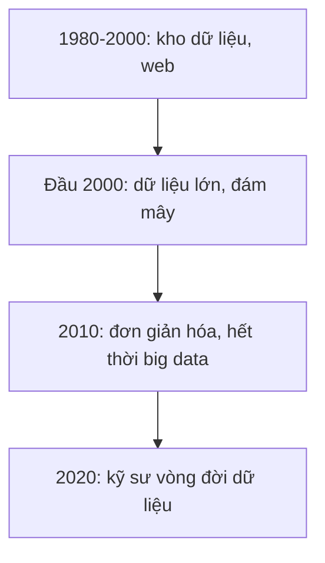

# Kỹ thuật dữ liệu là gì và nó phát triển ra sao

Bài này mở đầu Chương 1 của sách *Fundamentals of Data Engineering*. Nội dung gồm: định nghĩa **data engineering** (kỹ thuật dữ liệu), giới thiệu sơ lược vòng đời kỹ thuật dữ liệu, lịch sử hình thành lĩnh vực từ những năm 1980 đến nay, và vị trí của nó so với khoa học dữ liệu.

**Tương tự đơn giản:** hãy nghĩ đến một nhà hàng. Nhà khoa học dữ liệu là đầu bếp nấu món ăn đẹp mắt. Kỹ sư dữ liệu là người lo toàn bộ chuỗi cung ứng phía sau: nhập nguyên liệu, bảo quản, sơ chế, đưa nguyên liệu sạch lên bếp đúng lúc. Bếp có giỏi đến đâu mà nguyên liệu hỏng hoặc không về kịp thì cũng không nấu được.

---

:::note[Ghi nhớ nhanh]

- ⭐ **Định nghĩa của sách:** kỹ thuật dữ liệu là phát triển, triển khai và bảo trì các hệ thống và quy trình biến dữ liệu thô thành thông tin nhất quán, chất lượng cao để phục vụ phân tích và học máy (ML).
- ⭐ **Kỹ thuật dữ liệu nằm thượng nguồn (upstream) của khoa học dữ liệu:** không có nền tảng dữ liệu vững thì AI/ML không đứng được (Kim tự tháp nhu cầu của Monica Rogati).
- Vòng đời có 5 giai đoạn (tạo dữ liệu, lưu trữ, nhập, chuyển đổi, phục vụ) và 6 yếu tố xuyên suốt (bảo mật, quản lý dữ liệu, DataOps, kiến trúc dữ liệu, orchestration, công nghệ phần mềm).
- Lịch sử đi qua 4 mốc: kho dữ liệu (1980-2000), dữ liệu lớn và đám mây (đầu 2000), đơn giản hóa (2010), kỹ sư vòng đời dữ liệu (2020).
- "Kỹ sư dữ liệu lớn" ngày nay đơn giản chỉ còn là "kỹ sư dữ liệu".

:::

---

## Mục lục

- [1. Kỹ thuật dữ liệu là gì?](#1-kỹ-thuật-dữ-liệu-là-gì)
- [2. Định nghĩa của sách](#2-định-nghĩa-của-sách)
- [3. Vòng đời kỹ thuật dữ liệu](#3-vòng-đời-kỹ-thuật-dữ-liệu)
- [4. Sự phát triển của kỹ sư dữ liệu](#4-sự-phát-triển-của-kỹ-sư-dữ-liệu)
- [5. Kỹ thuật dữ liệu và khoa học dữ liệu](#5-kỹ-thuật-dữ-liệu-và-khoa-học-dữ-liệu)
- [Tóm tắt](#tóm-tắt)

## 1. Kỹ thuật dữ liệu là gì?

Dù đang rất nóng, vẫn còn nhiều nhầm lẫn về việc kỹ thuật dữ liệu là gì và kỹ sư dữ liệu làm gì. Lĩnh vực này đã tồn tại dưới nhiều hình thức từ khi các công ty bắt đầu làm việc với dữ liệu (phân tích dự đoán, phân tích mô tả, báo cáo), và được chú ý hơn khi khoa học dữ liệu bùng nổ trong thập niên 2010. Theo các tác giả, đầu năm 2022 chỉ riêng tìm kiếm khớp chính xác cụm "what is data engineering?" trên Google đã trả về hơn 91.000 kết quả khác nhau, cho thấy có vô số cách định nghĩa.

Sách trích ba định nghĩa của các chuyên gia để thấy mức độ khác biệt:

| Tác giả | Ý chính |
|---|---|
| **AlexSoft** | Tập hợp các hoạt động tạo ra giao diện và cơ chế cho luồng và truy cập thông tin. Kỹ sư dữ liệu thiết lập và vận hành hạ tầng dữ liệu của tổ chức, chuẩn bị dữ liệu cho nhà phân tích và nhà khoa học. |
| **Jesse Anderson** | Có hai kiểu: kiểu thứ nhất tập trung vào **SQL** (dữ liệu nằm trong cơ sở dữ liệu quan hệ, xử lý bằng SQL hoặc công cụ ETL); kiểu thứ hai tập trung vào **big data** (Hadoop, Cassandra, HBase; xử lý bằng MapReduce, Spark, Flink, viết bằng Java, Scala, Python). |
| **Maxime Beauchemin** | Là "siêu tập hợp" của business intelligence (BI) và data warehousing, mang thêm nhiều yếu tố của công nghệ phần mềm, cộng thêm chuyên môn về hệ thống phân tán "big data", hệ sinh thái Hadoop, xử lý luồng và tính toán quy mô lớn. |
| **Lewis Gavin** | Kỹ thuật dữ liệu là tất cả về chuyển động, thao tác và quản lý dữ liệu. |

Các định nghĩa này khác nhau nhiều, nhưng có mẫu số chung: kỹ sư dữ liệu lấy dữ liệu, lưu trữ nó và chuẩn bị cho nhà khoa học, nhà phân tích và những người khác dùng.

## 2. Định nghĩa của sách

> **Kỹ thuật dữ liệu** là sự phát triển, triển khai và bảo trì các hệ thống và quy trình lấy dữ liệu thô và tạo ra thông tin nhất quán, chất lượng cao, hỗ trợ các trường hợp sử dụng ở hạ nguồn như phân tích và học máy.

Ba điểm cần để ý trong định nghĩa này:

1. **Kỹ thuật dữ liệu là giao điểm của 6 mảng:** bảo mật (security), quản lý dữ liệu (data management), DataOps, kiến trúc dữ liệu (data architecture), orchestration (điều phối) và công nghệ phần mềm (software engineering).
2. **Phạm vi xuyên suốt:** kỹ sư dữ liệu quản lý cả vòng đời, bắt đầu từ lúc lấy dữ liệu từ hệ thống nguồn (source system) và kết thúc khi cung cấp dữ liệu cho các trường hợp sử dụng như phân tích hay ML.
3. **Tập trung vào dữ liệu, không chỉ công nghệ:** công cụ chỉ là phương tiện, mục tiêu là dữ liệu đáng tin cậy phục vụ nhu cầu cuối.

## 3. Vòng đời kỹ thuật dữ liệu

Rất dễ chỉ nhìn vào công nghệ mà bỏ lỡ bức tranh lớn. Vì vậy cả cuốn sách xoay quanh một ý tưởng: **data engineering lifecycle** (vòng đời kỹ thuật dữ liệu). Nó chuyển cuộc trò chuyện từ công nghệ sang bản thân dữ liệu và mục tiêu cuối mà dữ liệu phải phục vụ.

Bên cạnh 5 giai đoạn là **undercurrents** (yếu tố xuyên suốt), những ý tưởng áp dụng cho mọi giai đoạn: bảo mật, quản lý dữ liệu, DataOps, kiến trúc dữ liệu, orchestration và công nghệ phần mềm. Chương 2 của sách sẽ đi sâu; ở đây chỉ cần nhớ vì nó nằm trong định nghĩa.

## 4. Sự phát triển của kỹ sư dữ liệu

Sách mượn câu "lịch sử không lặp lại nhưng có vần điệu" (thường gán cho Mark Twain). Chủ đề xuyên suốt phần này: **cái gì cũ lại mới**.

### 4.1. Những ngày đầu: 1980 đến 2000, từ kho dữ liệu đến web

- Nguồn gốc của kỹ sư dữ liệu gắn với **data warehouse** (kho dữ liệu: nơi tập trung dữ liệu đã làm sạch, dùng cho báo cáo và phân tích). Ý tưởng có từ thập niên 1970, thành hình trong thập niên 1980, và Bill Inmon chính thức đặt tên "data warehouse" năm 1989.
- IBM phát triển cơ sở dữ liệu quan hệ và **SQL**, Oracle phổ biến hóa công nghệ này. Doanh nghiệp cần công cụ và đường truyền dữ liệu riêng cho báo cáo và BI.
- Ralph Kimball và Inmon phát triển hai phương pháp **mô hình hóa dữ liệu** mang tên họ, đến nay vẫn dùng rộng rãi.
- Data warehouse mở ra kỷ nguyên đầu tiên của phân tích có thể mở rộng nhờ cơ sở dữ liệu **MPP** (massively parallel processing: xử lý song song hàng loạt, nhiều bộ xử lý cùng xử lý lượng dữ liệu lớn).
- Các vai trò thời này: kỹ sư BI, nhà phát triển ETL, kỹ sư data warehouse. Họ là tiền thân của kỹ sư dữ liệu ngày nay.
- Giữa thập niên 1990, internet bùng nổ, sinh ra các công ty web (AOL, Yahoo, Amazon) và cơn sốt dot-com. Hạ tầng lúc đó đắt đỏ, nguyên khối (monolithic), bản quyền nặng. Các nhà cung cấp có lẽ không lường được quy mô dữ liệu mà web sẽ tạo ra.

### 4.2. Đầu những năm 2000: sự ra đời của kỹ thuật dữ liệu đương đại

- Sau khi dot-com sụp đổ, vài người sống sót (Yahoo, Google, Amazon) trở thành các công ty công nghệ lớn. Họ ban đầu vẫn dùng cơ sở dữ liệu quan hệ và kho nguyên khối kiểu thập niên 1990, đẩy chúng đến giới hạn. Cần hệ thống mới: tiết kiệm chi phí, mở rộng được, sẵn sàng cao, đáng tin cậy.
- Phần cứng phổ thông (commodity hardware: máy chủ, RAM, ổ đĩa, ổ flash) rẻ và sẵn có, cho phép tính toán và lưu trữ **phân tán** trên cụm máy lớn. Kỷ nguyên **big data** bắt đầu.
- Định nghĩa big data (Oxford): các tập dữ liệu cực lớn có thể phân tích bằng máy tính để tìm ra mẫu hình, xu hướng, mối liên hệ, nhất là về hành vi con người. Mô tả ngắn gọn nổi tiếng khác là **ba chữ V**: velocity (vận tốc), variety (đa dạng), volume (khối lượng).
- Năm 2003 Google công bố bài báo về **Google File System**, năm 2004 là bài về **MapReduce** (mô hình xử lý dữ liệu mở rộng rất tốt). Big data thực ra đã có tiền đề trong data warehouse MPP và trong quản lý dữ liệu của các dự án vật lý thực nghiệm, nhưng các bài báo của Google như một "vụ nổ lớn" (big bang) cho công nghệ dữ liệu. Chúng truyền cảm hứng cho kỹ sư Yahoo phát triển rồi mã nguồn mở **Apache Hadoop** năm 2006.
- Song song, Amazon giải quyết nhu cầu dữ liệu của riêng mình và tạo ra: **EC2** (điện toán đàn hồi), **S3** (lưu trữ mở rộng gần như vô hạn), **DynamoDB** (NoSQL mở rộng cao). Amazon bán các dịch vụ này ra ngoài qua **AWS**, thành đám mây công cộng (public cloud) phổ biến đầu tiên. Thay vì mua phần cứng cho trung tâm dữ liệu, lập trình viên chỉ cần thuê điện toán và lưu trữ. Sau đó Google Cloud, Microsoft Azure, DigitalOcean theo sau.
- Sách nhận định đám mây công cộng là một trong những đổi mới quan trọng nhất của thế kỷ 21, và big data cùng đám mây là nền tảng của hệ sinh thái dữ liệu hiện nay.
- Công cụ mã nguồn mở của hệ sinh thái Hadoop lan từ Thung lũng Silicon ra khắp thế giới. Lần đầu tiên, doanh nghiệp nào cũng dùng được công cụ dữ liệu tiên tiến như các công ty công nghệ hàng đầu. Một cuộc cách mạng khác là chuyển từ tính toán **batch** (theo lô) sang **event streaming** (luồng sự kiện), mở ra dữ liệu "real-time".
- Làn sóng công nghệ: Hadoop, Pig, Hive, Dremel, HBase, Storm, Cassandra, Spark, Presto... Công cụ có giao diện kéo thả, hướng doanh nghiệp bỗng trở nên lỗi thời, **code-first** (ưu tiên viết mã) lên ngôi. Các tác giả kể họ từng sống qua giai đoạn này.
- **Kỹ sư dữ liệu lớn (big data engineer)** ra đời. Họ phải giỏi phát triển phần mềm và "hack" hạ tầng cấp thấp (Hadoop, YARN, HDFS, MapReduce), thường vận hành các cụm phần cứng phổ thông khổng lồ, và đôi khi gửi pull request vào mã lõi Hadoop. Trọng tâm của họ chuyển từ phân phối dữ liệu sang phát triển công nghệ lõi.

### 4.3. Những năm 2000-2010: big data thành nạn nhân của chính thành công

- "Big data" thành từ thông dụng từ đầu 2000 đến giữa 2010, kèm theo marketing quá đà. Nhiều công ty dùng công cụ big data cho vấn đề dữ liệu nhỏ, đôi khi dựng cả cụm Hadoop để xử lý vài gigabyte. Dan Ariely có câu đùa nổi tiếng: big data giống như tình dục tuổi teen, ai cũng nói về nó, không ai thật sự biết làm, ai cũng nghĩ người khác đang làm nên ai cũng nói là mình đang làm.
- Sách dẫn biểu đồ Google Trends cho thấy big data lên rồi xuống. Lý do chính: **đơn giản hóa**. Công cụ big data mã nguồn mở rất mạnh nhưng tốn nhiều công vận hành. Các công ty thuê cả đội kỹ sư big data, chi hàng triệu đô mỗi năm chỉ để chăm các nền tảng này, và họ ít có thời gian mang lại giá trị kinh doanh.
- Cộng đồng mã nguồn mở, các nhà cung cấp đám mây và bên thứ ba bắt đầu **trừu tượng hóa** (abstract) và đơn giản hóa, bỏ bớt chi phí quản trị cụm, cài đặt, cấu hình, nâng cấp.
- Kết luận của sách: dữ liệu ngày nay di chuyển nhanh hơn và lớn hơn, nhưng xử lý big data dễ đến mức không còn xứng đáng là một thuật ngữ riêng. **Kỹ sư big data giờ đơn giản là kỹ sư dữ liệu.**

### 4.4. Những năm 2020: kỹ thuật cho vòng đời dữ liệu

- Vai trò kỹ sư dữ liệu đang thay đổi rất nhanh. Trước đây họ chú ý đến chi tiết cấp thấp của các framework nguyên khối (Hadoop, Spark, Informatica). Xu hướng hiện nay là công cụ **phi tập trung, mô-đun hóa, được quản lý (managed), trừu tượng cao**.
- Công cụ dữ liệu phát triển chóng mặt (sách dẫn Data Landscape của Matt Turck, so sánh 2012 với 2021). Xu hướng đầu 2020 gồm **Modern Data Stack**: bộ sưu tập sản phẩm mã nguồn mở và bên thứ ba ghép lại để việc của nhà phân tích dễ hơn. Kỹ thuật dữ liệu ngày càng giống việc ghép các khối LEGO để phục vụ mục tiêu kinh doanh.
- Vì vậy các tác giả cho rằng "kỹ sư dữ liệu" trong sách chính xác hơn nên gọi là **kỹ sư vòng đời dữ liệu (data lifecycle engineer)**. Họ vẫn giữ kỹ năng lập trình cấp thấp, nhưng vai trò ngày càng tập trung vào các lớp cao hơn trong chuỗi giá trị: bảo mật, quản lý dữ liệu, DataOps, kiến trúc dữ liệu, orchestration và quản lý vòng đời dữ liệu nói chung.
- Thái độ cũng đổi. Thay vì khoe ai có "dữ liệu lớn nhất", các dự án mã nguồn mở quan tâm hơn đến **quản lý và quản trị dữ liệu** (data management, governance), dễ khám phá và dùng, chất lượng tốt hơn. Kỹ sư dữ liệu giờ thông thạo các từ viết tắt như **CCPA** và **GDPR** (luật bảo vệ dữ liệu cá nhân), quan tâm quyền riêng tư, ẩn danh hóa, xóa dữ liệu và tuân thủ quy định.
- **Cái gì cũ lại mới:** quản lý dữ liệu kiểu "doanh nghiệp" (chất lượng, quản trị) từng phổ biến ở các tập đoàn lớn trước thời big data nhưng ít công ty nhỏ áp dụng. Khi nhiều vấn đề khó của hệ thống dữ liệu đã được giải quyết và đóng gói, người ta quay lại mảng "doanh nghiệp" này, nhưng nhấn mạnh phân quyền và linh hoạt thay vì kiểu chỉ huy và kiểm soát truyền thống. Sách gọi hiện tại là **thời hoàng kim của quản lý vòng đời dữ liệu**.

## 5. Kỹ thuật dữ liệu và khoa học dữ liệu

Có tranh luận rằng kỹ thuật dữ liệu là nhánh con của khoa học dữ liệu. Các tác giả cho rằng nó **tách biệt** với khoa học và phân tích dữ liệu: bổ sung cho nhau nhưng khác biệt rõ ràng. Kỹ thuật dữ liệu ở **thượng nguồn**: kỹ sư dữ liệu cung cấp đầu vào, nhà khoa học dữ liệu (ở hạ nguồn) biến đầu vào thành thứ hữu ích.

### Kim tự tháp nhu cầu của khoa học dữ liệu

Năm 2017 Monica Rogati công bố **Data Science Hierarchy of Needs** (Hệ thống phân cấp nhu cầu của khoa học dữ liệu), mô phỏng kim tự tháp Maslow. Ý tưởng: AI và ML nằm trên đỉnh, còn nền là những việc "trần tục" như di chuyển và lưu trữ dữ liệu, thu thập, hạ tầng.

| Tầng (từ đỉnh xuống đáy) | Nội dung |
|---|---|
| Trên cùng | AI, học sâu |
| Giữa | Học máy, phân tích, thử nghiệm |
| Dưới | Làm sạch, xử lý dữ liệu; chuyển động và lưu trữ; thu thập; hạ tầng |

- Ước tính **70% đến 80%** thời gian của nhà khoa học dữ liệu dành cho ba tầng dưới (thu thập, làm sạch, xử lý), chỉ một phần nhỏ cho phân tích và ML.
- Rogati lập luận công ty cần xây nền tảng dữ liệu vững (ba tầng dưới) trước khi nghĩ đến AI/ML.
- Nhà khoa học dữ liệu thường không được đào tạo để thiết kế hệ thống dữ liệu cấp sản xuất, nên làm việc này một cách chắp vá khi thiếu kỹ sư dữ liệu. Lý tưởng, họ nên dành hơn **90%** thời gian cho các tầng trên: phân tích, thử nghiệm, ML.
- Kỹ sư dữ liệu tập trung vào các tầng dưới sẽ tạo nền tảng để nhà khoa học dữ liệu thành công.

Sách kết luận: kỹ thuật dữ liệu **vượt qua khoảng cách** giữa việc có được dữ liệu và việc nhận được giá trị từ dữ liệu. Nó quan trọng và đáng được nhìn thấy ngang với khoa học dữ liệu, vì kỹ sư dữ liệu đóng vai trò then chốt để khoa học dữ liệu thành công trong môi trường sản xuất.

## Tóm tắt

| Chủ đề | Ý chính |
|---|---|
| Định nghĩa | Biến dữ liệu thô thành thông tin nhất quán, chất lượng cao cho phân tích và ML |
| Vòng đời | 5 giai đoạn + 6 yếu tố xuyên suốt |
| 1980-2000 | Data warehouse, SQL, Inmon, Kimball, MPP |
| Đầu 2000 | Google GFS/MapReduce, Hadoop, AWS, big data |
| Sau đó | Big data bị đơn giản hóa, kỹ sư big data thành kỹ sư dữ liệu |
| 2020 | Công cụ mô-đun, trừu tượng cao, trọng tâm là quản lý vòng đời dữ liệu |
| Với khoa học dữ liệu | Thượng nguồn, nền tảng của kim tự tháp nhu cầu |
