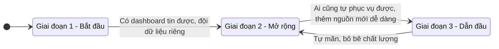
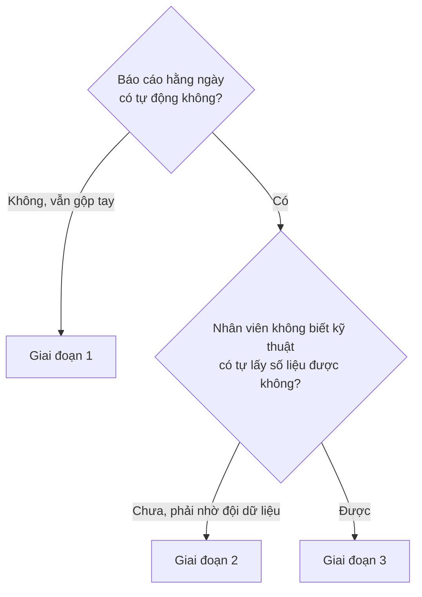

# Kỹ năng, hoạt động và độ chín muồi dữ liệu

Bài này trả lời câu hỏi "kỹ sư dữ liệu cần biết và làm gì?". Trước hết là bộ kỹ năng và những việc kỹ sư dữ liệu không làm, sau đó là mô hình **data maturity** (độ chín muồi dữ liệu) ba giai đoạn của sách, rồi đến kỹ năng kinh doanh, kỹ thuật, ngôn ngữ lập trình và hai kiểu kỹ sư dữ liệu loại A và loại B.

**Tương tự đơn giản:** độ chín muồi dữ liệu giống giai đoạn phát triển của một quán ăn. Lúc mới mở, một người kiêm bếp, thu ngân, giao hàng (tổng quát, làm nhanh). Khi đông khách thì phân công đầu bếp, phục vụ, thu mua (chuyên môn hóa). Khi thành chuỗi thì có quy trình tự động, kiểm soát chất lượng, và đầu tư công thức riêng tạo lợi thế.

---

:::note[Ghi nhớ nhanh]

- ⭐ **Kỹ sư dữ liệu vẫn là kỹ sư phần mềm:** phải viết mã cấp sản xuất, thành thạo SQL, Python, và biết thêm JVM và Bash.
- ⭐ **Ba giai đoạn trưởng thành:** bắt đầu với dữ liệu, mở rộng quy mô với dữ liệu, dẫn đầu bằng dữ liệu. Độ chín muồi không phụ thuộc tuổi hay doanh thu công ty.
- Việc cần cân bằng liên tục: chi phí, độ linh hoạt, khả năng mở rộng, tính đơn giản, tái sử dụng, khả năng tương tác.
- Kỹ sư dữ liệu thường **không** xây mô hình ML, làm dashboard, phân tích hay phát triển ứng dụng, nhưng phải hiểu các việc đó.
- Loại A (abstraction) dùng sản phẩm có sẵn; loại B (build) tự xây công cụ tạo lợi thế cạnh tranh.
- Giao tiếp, kiểm soát chi phí và học liên tục quan trọng không kém kỹ thuật.

:::

---

## Mục lục

- [1. Kỹ năng và hoạt động](#1-kỹ-năng-và-hoạt-động)
- [2. Độ chín muồi của dữ liệu](#2-độ-chín-muồi-của-dữ-liệu)
- [3. Nền tảng và kỹ năng của kỹ sư dữ liệu](#3-nền-tảng-và-kỹ-năng-của-kỹ-sư-dữ-liệu)
- [4. Liên tục các vai trò: loại A và loại B](#4-liên-tục-các-vai-trò-loại-a-và-loại-b)
- [Tóm tắt](#tóm-tắt)

## 1. Kỹ năng và hoạt động

Bộ kỹ năng của kỹ sư dữ liệu bao trùm vòng đời kỹ thuật dữ liệu và các yếu tố xuyên suốt (bảo mật, quản lý dữ liệu, DataOps, kiến trúc dữ liệu, công nghệ phần mềm). Cụ thể gồm:

- Biết đánh giá công cụ dữ liệu và cách chúng khớp với nhau trong vòng đời.
- Hiểu dữ liệu được tạo ra thế nào ở hệ thống nguồn, và nhà phân tích, nhà khoa học sẽ dùng nó ra sao sau khi xử lý.
- Cân bằng nhiều "bộ phận chuyển động" và liên tục tối ưu theo các trục: **chi phí, độ linh hoạt, khả năng mở rộng, tính đơn giản, tái sử dụng, khả năng tương tác** (hình "hành động cân bằng" của sách).

### Trước đây và bây giờ

- **Trước đây:** kỹ sư phải hiểu sâu một số công nghệ nguyên khối mạnh (Hadoop, Spark, Teradata, Hive), kéo theo kiến thức về công nghệ phần mềm, mạng, tính toán phân tán, lưu trữ. Công việc là quản trị cụm, giảm chi phí chung, viết job biến đổi và pipeline.
- **Bây giờ:** công cụ hiện đại trừu tượng hóa và đơn giản hóa quy trình. Kỹ sư tập trung vào việc chọn và cân bằng các dịch vụ **tốt nhất, đơn giản nhất, tiết kiệm nhất** để mang lại giá trị kinh doanh, và tạo kiến trúc dữ liệu linh hoạt, phát triển được khi xu hướng mới xuất hiện.

### Kỹ sư dữ liệu thường không làm gì

Thường không trực tiếp: xây mô hình ML, tạo báo cáo hoặc dashboard, phân tích dữ liệu, xây KPI (chỉ số hiệu suất chính), phát triển ứng dụng phần mềm. Tuy vậy họ phải hiểu các lĩnh vực đó để phục vụ tốt các bên liên quan.

### Thuật ngữ trong bài — hiểu nôm na

| Thuật ngữ | Nghĩa đời thường | Ví dụ ở chuỗi Mây |
| --- | --- | --- |
| Pipeline (đường ống dữ liệu) | Chuỗi bước tự động đưa dữ liệu từ nơi sinh ra tới nơi dùng | Mỗi đêm lấy đơn từ 30 máy POS, làm sạch, cập nhật dashboard |
| Job | Một "phần việc" máy tính chạy theo lịch | Job 2 giờ sáng cộng doanh thu hôm qua |
| Cụm (cluster) | Nhiều máy tính nối với nhau, làm việc như một máy lớn | Mây không cần, vì dữ liệu còn nhỏ |
| KPI | Chỉ số đo hiệu quả công việc | Doanh thu trung bình mỗi cửa hàng mỗi ngày |
| Ad hoc | Phát sinh tại chỗ, không theo kế hoạch | Chủ chuỗi nhắn "gửi anh số bán trà đào tuần trước" lúc 9 giờ tối |
| Nợ kỹ thuật (technical debt) | Làm tắt cho nhanh hôm nay, phải "trả" bằng công sửa sau này | Viết vội file Excel gộp tay, tháng sau ai cũng phải làm tay tiếp |
| DevOps, DataOps | Cách làm việc chú trọng tự động hoá, kiểm thử, phát hành thường xuyên (DevOps cho phần mềm, DataOps cho dữ liệu) | Mỗi lần sửa đường ống đều có kiểm tra tự động, không sửa thẳng trên hệ thống thật |
| Self-service (tự phục vụ) | Người dùng tự lấy dữ liệu, không cần nhờ kỹ sư | Quản lý cửa hàng tự lọc doanh thu cửa hàng mình trên dashboard |
| Metadata | Dữ liệu mô tả dữ liệu | "Bảng `don_hang` cập nhật lúc 2 giờ sáng, cột `gia` tính bằng đồng" |
| SaaS | Phần mềm thuê theo tháng qua Internet, không phải cài đặt | Thuê công cụ vẽ dashboard thay vì tự viết |

### Áp vào chuỗi Mây: kỹ sư dữ liệu làm gì, không làm gì

Ở Mây, ranh giới công việc rõ hơn khi nhìn theo từng yêu cầu cụ thể. Bảng dưới cho thấy kỹ sư dữ liệu "lo phần ống nước", còn người khác dùng nước.

| Yêu cầu | Ai làm chính | Kỹ sư dữ liệu đóng góp gì |
| --- | --- | --- |
| Dashboard doanh thu cho chủ chuỗi | Nhà phân tích dữ liệu | Bảo đảm bảng doanh thu sạch, cập nhật đúng giờ |
| Mô hình dự báo trân châu | Nhà khoa học dữ liệu | Gom đủ 2 năm lịch sử đơn, dữ liệu thời tiết, ngày lễ |
| Danh sách khách gửi voucher | Marketing | Tạo bảng "khách hàng thân thiết" tự cập nhật mỗi ngày |
| App đặt món | Kỹ sư phần mềm | Thoả thuận app gửi dữ liệu đơn theo định dạng thống nhất |
| Đường ống gom dữ liệu từ 30 cửa hàng | **Kỹ sư dữ liệu** | Thiết kế, xây, giám sát, sửa khi hỏng |

## 2. Độ chín muồi của dữ liệu

**Data maturity** là mức độ tiến triển trong việc sử dụng, năng lực và tích hợp dữ liệu trong toàn tổ chức. Nó không chỉ phụ thuộc tuổi đời hay doanh thu: một startup giai đoạn đầu có thể chín muồi dữ liệu hơn một công ty trăm năm doanh thu hàng tỷ USD. Điều quan trọng là dữ liệu được tận dụng như lợi thế cạnh tranh thế nào.

Có nhiều mô hình (như Data Management Maturity, DMM), nhưng khó chọn mô hình vừa đơn giản vừa hữu ích cho kỹ thuật dữ liệu, nên sách tự đề xuất mô hình ba giai đoạn:


### Giai đoạn 1: Bắt đầu với dữ liệu

**Đặc điểm:** mục tiêu có thể mờ nhạt, kiến trúc và hạ tầng mới ở giai đoạn quy hoạch, mức dùng thấp hoặc chưa có. Nhóm dữ liệu nhỏ (thường dưới 10 người). Kỹ sư dữ liệu thường là **người đa năng** kiêm cả vai nhà khoa học dữ liệu hoặc kỹ sư phần mềm. Báo cáo và phân tích thiếu cấu trúc, yêu cầu dữ liệu chủ yếu là **ad hoc** (phát sinh tại chỗ). Mục tiêu: di chuyển nhanh, tạo sức hút, gia tăng giá trị.

**Cạm bẫy ML:** nhảy thẳng vào ML ở giai đoạn này rất hấp dẫn nhưng các tác giả không khuyến khích. Họ thấy vô số nhóm thất bại vì thiếu nền tảng dữ liệu: không có dữ liệu để huấn luyện mô hình đáng tin, cũng không có cách đưa mô hình vào sản xuất theo cách lặp lại được. (Các tác giả tự gọi đùa là "cựu nhà khoa học dữ liệu" vì chính họ từng trải qua.) Thắng bằng ML ở giai đoạn này là hiếm nhưng có thể.

**Kỹ sư dữ liệu nên tập trung:**

- Có được sự ủng hộ của các bên liên quan chính, kể cả ban điều hành; lý tưởng là có người bảo trợ cho sáng kiến.
- Xác định kiến trúc dữ liệu phù hợp (thường tự làm vì chưa có kiến trúc sư dữ liệu): xác định mục tiêu kinh doanh và lợi thế cạnh tranh, rồi xây kiến trúc hỗ trợ.
- Xác định và kiểm toán dữ liệu hỗ trợ các sáng kiến chính.
- Xây nền tảng dữ liệu vững cho nhà phân tích và nhà khoa học tương lai. Trong lúc chưa có họ, có thể bạn phải tự làm báo cáo và mô hình.

**Lời khuyên và điều cần tránh:**

- Ý chí của tổ chức dễ suy yếu nếu không có thành công rõ ràng. Hãy tạo **chiến thắng nhanh (quick win)** để khẳng định tầm quan trọng của dữ liệu, nhưng nhớ nó sinh **nợ kỹ thuật (technical debt)**; cần có kế hoạch trả nợ.
- Ra ngoài nói chuyện với mọi người, đừng làm việc trong "bong bóng". Nếu không, bạn có thể mất nhiều thời gian làm thứ ít người dùng.
- Tránh **undifferentiated heavy lifting** (công việc nặng nhọc không tạo khác biệt): dùng giải pháp chìa khóa trao tay (turnkey), có sẵn khi có thể.
- Chỉ xây giải pháp và mã tùy chỉnh khi nó tạo lợi thế cạnh tranh.

### Giai đoạn 2: Mở rộng quy mô với dữ liệu

**Đặc điểm:** công ty đã bỏ yêu cầu dữ liệu ad hoc, áp dụng thực hành dữ liệu chính thức. Thách thức là xây kiến trúc dữ liệu **mở rộng được** và chuẩn bị cho tương lai thật sự dựa vào dữ liệu. Vai trò chuyển từ người đa năng sang **chuyên gia**, mỗi người tập trung vào một phần của vòng đời.

**Mục tiêu của kỹ sư dữ liệu:**

- Thiết lập thực hành dữ liệu chính thức.
- Tạo kiến trúc dữ liệu vững chắc, mở rộng được.
- Áp dụng phương pháp **DevOps** và **DataOps**.
- Xây hệ thống hỗ trợ ML.
- Tiếp tục tránh công việc nặng nhọc không tạo khác biệt, chỉ tùy chỉnh khi có lợi thế cạnh tranh.

**Cạm bẫy:**

- Khi tinh vi hơn, dễ bị cuốn vào việc áp dụng công nghệ tiên tiến dựa trên "bằng chứng xã hội" từ các công ty Thung lũng Silicon. Đây hiếm khi là cách dùng thời gian tốt: mọi quyết định công nghệ nên dựa vào giá trị mang lại cho khách hàng.
- **Nút thắt cổ chai** khi mở rộng không phải là nút cụm, lưu trữ hay công nghệ mà là **chính nhóm kỹ thuật dữ liệu**. Hãy ưu tiên giải pháp đơn giản, dễ mở rộng năng suất đội.
- Đừng tự xem mình là thiên tài công nghệ chuyên làm "sản phẩm ma thuật". Hãy chuyển sang lãnh đạo thực dụng, trao đổi với các nhóm khác về tiện ích thực tế của dữ liệu và dạy tổ chức cách dùng dữ liệu.

### Giai đoạn 3: Dẫn đầu bằng dữ liệu

**Đặc điểm:** công ty thật sự **data-driven**. Quy trình và hệ thống tự động do kỹ sư dữ liệu tạo ra cho phép mọi người trong công ty làm phân tích và ML **tự phục vụ (self-service)**. Việc thêm nguồn dữ liệu mới diễn ra liền mạch và mang lại giá trị. Kiểm soát và thực hành bảo đảm dữ liệu luôn sẵn sàng cho người và hệ thống. Vai trò chuyên môn hóa sâu hơn nữa.

**Kỹ sư dữ liệu, ngoài việc tiếp tục các giai đoạn trước, sẽ:**

- Tự động hóa để đưa vào và dùng dữ liệu mới liền mạch.
- Xây công cụ và hệ thống tùy chỉnh dùng dữ liệu làm lợi thế cạnh tranh.
- Tập trung vào mặt "doanh nghiệp": quản lý dữ liệu (governance, chất lượng) và DataOps.
- Triển khai công cụ giúp dữ liệu dễ thấy và dễ chia sẻ: **data catalog** (danh mục dữ liệu), công cụ truy vết nguồn gốc dữ liệu (data lineage), hệ thống quản lý **metadata** (dữ liệu mô tả dữ liệu).
- Cộng tác hiệu quả với kỹ sư phần mềm, kỹ sư ML, nhà phân tích.
- Tạo cộng đồng và môi trường cởi mở, bất kể vai trò hay vị trí.

**Cạm bẫy:**

- **Tự mãn** là mối nguy lớn. Phải liên tục duy trì và cải tiến, nếu không có nguy cơ tụt về giai đoạn thấp hơn.
- **Xao nhãng công nghệ:** có xu hướng theo đuổi dự án đắt tiền không đem lại giá trị kinh doanh. Chỉ dùng công nghệ tự xây khi nó tạo lợi thế cạnh tranh.

### Bảng so sánh ba giai đoạn

| | Giai đoạn 1 | Giai đoạn 2 | Giai đoạn 3 |
|---|---|---|---|
| Tên | Bắt đầu với dữ liệu | Mở rộng với dữ liệu | Dẫn đầu bằng dữ liệu |
| Nhóm dữ liệu | Nhỏ, người đa năng | Chuyên môn hóa | Chuyên môn hóa sâu |
| Trọng tâm | Chiến thắng nhanh, nền tảng | Thực hành chính thức, mở rộng, DataOps, ML | Tự động hóa, tự phục vụ, governance |
| Rủi ro | Nợ kỹ thuật, làm việc trong bong bóng | Chạy theo công nghệ, nút thắt là nhóm | Tự mãn, xao nhãng công nghệ |

### Áp vào chuỗi Mây: từ quán nhỏ đến chuỗi dẫn đầu bằng dữ liệu

Hãy theo chân Mây qua ba giai đoạn. Bảng dưới cho thấy cùng một câu hỏi "hôm qua bán được bao nhiêu?" được trả lời rất khác nhau ở mỗi giai đoạn.

| | Giai đoạn 1 (Mây có 3 cửa hàng) | Giai đoạn 2 (Mây có 30 cửa hàng) | Giai đoạn 3 (Mây có 200 cửa hàng) |
| --- | --- | --- | --- |
| Trả lời câu hỏi doanh thu | Quản lý gửi ảnh chụp sổ qua Zalo, một người cộng Excel | Đường ống tự gom đơn mỗi đêm, dashboard có số lúc 7 giờ sáng | Dashboard cập nhật gần như tức thì, quản lý tự lọc theo ý |
| Đội dữ liệu | 1 người kiêm luôn IT | 3-5 người, mỗi người lo một phần | Nhiều nhóm: nền tảng, phân tích, ML |
| Việc nên ưu tiên | Quick win: dashboard doanh thu đơn giản | Chuẩn hoá quy trình, kiểm tra chất lượng tự động | Tự động hoá thêm nguồn mới, danh mục dữ liệu, quản trị |
| Cái bẫy | Nhảy vào AI dự báo khi dữ liệu còn nằm trong sổ tay | Mua công nghệ "giống Netflix" mà không cần | Tự mãn, để dữ liệu cũ dần sai mà không ai kiểm |

Sơ đồ dưới cho thấy Mây chuyển giai đoạn khi nào. Mũi tên ngược là cảnh báo của sách: dừng cải tiến thì có thể tụt hạng.



Muốn biết công ty mình đang ở đâu, có thể tự hỏi lần lượt các câu trong sơ đồ quyết định sau.



## 3. Nền tảng và kỹ năng của kỹ sư dữ liệu

Kỹ thuật dữ liệu là lĩnh vực mới nên có rất ít chương trình đào tạo chính thức; đại học chưa có lộ trình chuẩn, chưa có giáo trình chung. Người vào nghề đến từ nhiều nền tảng, và ai cũng phải đầu tư nhiều thời gian tự học. Việc chuyển nghề dễ nhất khi đi từ lĩnh vực lân cận: công nghệ phần mềm, phát triển ETL, quản trị cơ sở dữ liệu, khoa học dữ liệu, phân tích dữ liệu, vì họ vốn "nhận thức được dữ liệu".

Kỹ sư dữ liệu phải hiểu **cả dữ liệu lẫn công nghệ**:

- Về dữ liệu: các thực hành tốt nhất trong quản lý dữ liệu.
- Về công nghệ: các lựa chọn công cụ, sự tương tác và đánh đổi, nền tảng tốt về công nghệ phần mềm, DataOps và kiến trúc dữ liệu.
- Hiểu yêu cầu của **consumer** (người tiêu thụ dữ liệu: nhà phân tích, nhà khoa học) và ý nghĩa rộng của dữ liệu với tổ chức. Kỹ sư dữ liệu giỏi nhất nhìn trách nhiệm qua cả lăng kính kinh doanh và kỹ thuật.

### Trách nhiệm kinh doanh

Những điều này áp dụng cho bất kỳ ai làm trong lĩnh vực dữ liệu hay công nghệ:

- **Giao tiếp** được với cả người kỹ thuật và phi kỹ thuật; xây dựng quan hệ và lòng tin trong toàn tổ chức. Chú ý cơ cấu tổ chức: ai báo cáo cho ai, mọi người tương tác ra sao, bộ phận nào tách biệt.
- **Xác định phạm vi và thu thập yêu cầu** kinh doanh và sản phẩm: biết cần xây gì, bảo đảm các bên đồng ý, và hiểu quyết định về dữ liệu và công nghệ ảnh hưởng thế nào đến doanh nghiệp.
- **Hiểu văn hóa** Agile, DevOps và DataOps. Nhiều người lầm tưởng đây là vấn đề giải quyết bằng công nghệ; sách cho là sai lầm nguy hiểm vì đây về cơ bản là **văn hóa**, cần sự đồng thuận cả tổ chức.
- **Kiểm soát chi phí:** giữ chi phí thấp mà giá trị cao. Biết tối ưu **time to value** (thời gian đến khi có giá trị), **TCO** (total cost of ownership: tổng chi phí sở hữu) và **opportunity cost** (chi phí cơ hội); theo dõi chi phí để tránh bất ngờ.
- **Học liên tục:** lĩnh vực đổi nhanh. Người thành công vừa tiếp thu cái mới vừa trau dồi nền tảng, và biết sàng lọc: cái nào phù hợp công việc, cái nào còn non, cái nào chỉ là mốt nhất thời.

Sách nhấn mạnh: các nhóm dữ liệu thành công nhờ giao tiếp với các bên liên quan; thành bại hiếm khi là vấn đề công nghệ.

### Trách nhiệm kỹ thuật

Phải biết xây kiến trúc tối ưu hiệu suất và chi phí, dùng thành phần đóng gói sẵn hoặc tự làm. Các thành phần đó phục vụ vòng đời kỹ thuật dữ liệu (5 giai đoạn và 6 yếu tố xuyên suốt đã nêu ở bài trước).

**Kỹ sư dữ liệu có nên biết code không?** Câu trả lời ngắn: **có**. Cần trình độ công nghệ phần mềm cấp sản xuất. Bản chất công việc lập trình đã đổi: dịch vụ được quản lý hoàn toàn thay thế nhiều nỗ lực lập trình cấp thấp trước đây, kỹ sư nay dùng mã nguồn mở được quản lý và SaaS plug-and-play. Họ tập trung vào trừu tượng cấp cao hoặc viết pipeline dưới dạng mã trong framework orchestration. Dù vậy thực hành công nghệ phần mềm vẫn là lợi thế cạnh tranh, và kỹ sư đi sâu được vào chi tiết kiến trúc mã sẽ giúp công ty khi có nhu cầu đặc thù. Kỹ sư dữ liệu không viết được mã cấp sản xuất sẽ bị cản trở nhiều. **Kỹ sư dữ liệu vẫn là kỹ sư phần mềm.**

#### Ngôn ngữ chính

| Ngôn ngữ | Vai trò |
|---|---|
| **SQL** | Giao diện phổ biến nhất với database và data lake. Từng bị đẩy sang bên vì phải viết MapReduce cho big data, nay quay lại thành "ngôn ngữ chung của dữ liệu". |
| **Python** | Ngôn ngữ cầu nối giữa kỹ thuật dữ liệu và khoa học dữ liệu, "ngôn ngữ tốt thứ hai cho mọi thứ". Nền tảng của pandas, NumPy, Airflow, scikit-learn, TensorFlow, PyTorch, PySpark. Là chất keo giữa các thành phần và thường là ngôn ngữ API hạng nhất của framework. |
| **JVM (Java, Scala)** | Phổ biến ở các dự án Apache như Spark, Hive, Druid. Thường nhanh hơn Python và truy cập được tính năng cấp thấp hơn API Python (ví dụ Spark, Beam). Nên biết nếu dùng framework mã nguồn mở này. |
| **Bash** | Giao diện dòng lệnh của Linux. Thành thạo CLI giúp tăng năng suất khi viết script và thao tác hệ điều hành; vẫn hay dùng `awk`, `sed` trong pipeline hoặc gọi Bash từ framework orchestration. Dùng Windows thì có thể dùng PowerShell. |

#### Hiệu quả bất ngờ của SQL

MapReduce và kỷ nguyên big data từng đẩy SQL vào cảnh lỗi thời. Sau đó nhiều phát triển đã nâng tiện ích của SQL: Spark SQL, Google BigQuery, Snowflake, Hive và nhiều công cụ khác xử lý lượng dữ liệu khổng lồ bằng ngữ nghĩa SQL khai báo, theo lý thuyết tập hợp. Nhiều framework streaming (Flink, Beam, Kafka) cũng hỗ trợ SQL. Sách tin rằng kỹ sư dữ liệu giỏi phải thành thạo SQL.

Ví dụ minh họa (do người viết ghi chép thêm, không phải của sách) cho tính khai báo của SQL:

```sql
-- Doanh thu theo tháng: chỉ nói "cần gì", engine tự lo cách chạy
SELECT date_trunc('month', order_date) AS thang,
       SUM(amount) AS doanh_thu
FROM orders
GROUP BY 1
ORDER BY 1;
```

Áp vào chuỗi Mây, câu SQL dưới đây hỏi "mỗi cửa hàng bán được bao nhiêu tiền ngày 1/3?". Bạn không cần biết lập trình để đọc nó: gần như là câu tiếng Anh.

```sql
-- Doanh thu từng cửa hàng ngày 1/3 (bảng don_hang của chuỗi Mây)
SELECT cua_hang,
       SUM(so_luong * gia) AS doanh_thu
FROM don_hang
WHERE thoi_gian >= '2026-03-01' AND thoi_gian < '2026-03-02'
GROUP BY cua_hang;
```

Với ba đơn mẫu ở [phần giới thiệu](../intro.md), kết quả trả về là:

| cua_hang | doanh_thu |
| --- | --- |
| Q1-Lê Lợi | 110000 |
| Q3-Võ Văn Tần | 30000 |

Q1-Lê Lợi có DH001 (2 ly × 35.000đ) và DH003 (1 ly × 40.000đ), cộng lại 110.000đ. Người viết SQL chỉ nói *muốn gì* (cộng tiền theo cửa hàng), còn *làm cách nào* (đọc bảng ra sao, cộng theo thứ tự nào) là việc của hệ thống.

Nhưng SQL không phải ngôn ngữ vạn năng:

- Nó mạnh ở các bài toán phân tích và biến đổi dữ liệu phức tạp. Vì thời gian là ràng buộc chính của thông lượng nhóm, hãy dùng công cụ kết hợp được **đơn giản và năng suất**.
- Nên rèn khả năng kết hợp SQL với các thao tác khác (trong Spark, Flink) hoặc dùng orchestration để phối hợp nhiều công cụ.
- Nên học SQL hiện đại để xử lý dữ liệu lồng nhau và phân tích **JSON**, cân nhắc framework quản lý SQL như **dbt** (data build tool).
- Kỹ sư giỏi biết khi nào SQL **không** phù hợp và chọn giải pháp khác. Ví dụ sách nêu: chuyên gia SQL có thể viết truy vấn tách từ và mã hóa văn bản cho NLP (xử lý ngôn ngữ tự nhiên), nhưng sẽ nhận ra làm bằng Spark nguyên bản là lựa chọn tốt hơn nhiều.

#### Ngôn ngữ phụ

Có thể cần thêm R, JavaScript, Go, Rust, C/C++, C#, Julia, khi công ty dùng phổ biến hoặc dùng với công cụ chuyên biệt. Ví dụ JavaScript phổ biến cho **hàm do người dùng định nghĩa (UDF)** trong data warehouse đám mây; C# và PowerShell cần cho công ty dùng Azure và hệ sinh thái Microsoft.

### Giữ nhịp trong lĩnh vực thay đổi nhanh

Trích Stewart Brand: nếu không ngồi trên "xe lu" khi công nghệ mới lăn qua, bạn là một phần của mặt đường. Lời khuyên của sách: **tập trung vào nguyên tắc cơ bản** để hiểu cái gì không đổi; đồng thời theo dõi các phát triển mới để biết lĩnh vực đi về đâu, và đánh giá công nghệ mới hữu ích thế nào trong vòng đời.

## 4. Liên tục các vai trò: loại A và loại B

Mô tả công việc hay vẽ kỹ sư dữ liệu thành "kỳ lân" biết mọi kỹ năng, nhưng thực tế không phải ai cũng làm cùng loại việc. Độ chín muồi dữ liệu là hướng dẫn hữu ích để hiểu loại thách thức công ty gặp, và sách mượn cách phân loại nhà khoa học dữ liệu loại A và B:

- Nhà khoa học dữ liệu **loại A (Analysis)**: tập trung hiểu và rút ra insight từ dữ liệu.
- Nhà khoa học dữ liệu **loại B (Building)**: cùng nền tảng nhưng giỏi lập trình, xây hệ thống để khoa học dữ liệu chạy được trong sản xuất.

Tương tự, hai loại kỹ sư dữ liệu:

| | Loại A (Abstraction) | Loại B (Build) |
|---|---|---|
| Triết lý | Tránh công việc nặng nhọc không tạo khác biệt, giữ kiến trúc đơn giản và trừu tượng, không phát minh lại bánh xe | Xây công cụ và hệ thống dữ liệu mở rộng, tận dụng năng lực cốt lõi và lợi thế cạnh tranh của công ty |
| Cách làm | Quản lý vòng đời chủ yếu bằng sản phẩm, dịch vụ, công cụ có sẵn | Tự xây khi cần |
| Thường gặp ở | Công ty mọi ngành, mọi mức trưởng thành | Công ty giai đoạn 2 và 3, hoặc khi trường hợp sử dụng ban đầu quá độc đáo, cần công cụ tùy chỉnh ngay từ đầu |

Áp vào chuỗi Mây, hai kiểu kỹ sư sẽ giải cùng một bài toán theo hai cách khác nhau:

| Bài toán ở Mây | Kỹ sư loại A làm | Kỹ sư loại B làm |
| --- | --- | --- |
| Gom đơn từ 30 máy POS | Thuê công cụ kéo dữ liệu có sẵn, cấu hình trong một buổi chiều | Tự viết chương trình kéo dữ liệu (chỉ đáng khi máy POS quá đặc thù, không công cụ nào hỗ trợ) |
| Dự báo nhu cầu trân châu | Dùng tính năng dự báo có sẵn của kho dữ liệu đám mây | Xây hệ thống dự báo riêng kết hợp thời tiết, lễ hội, khuyến mãi, nếu đây là lợi thế cạnh tranh của Mây |
| Dashboard | Thuê công cụ BI | Hầu như không bao giờ tự viết |

Với Mây ở giai đoạn 2, lựa chọn hợp lý là **loại A trước**: dùng đồ có sẵn để có kết quả nhanh, chỉ tự xây ở chỗ thật sự tạo khác biệt.

Hai loại có thể làm trong cùng công ty, thậm chí là cùng một người. Thường thì kỹ sư loại A được thuê trước để dựng nền tảng, kỹ năng loại B được học thêm hoặc thuê khi công ty cần.

## Tóm tắt

| Chủ đề | Ý chính |
|---|---|
| Việc cân bằng | Chi phí, linh hoạt, mở rộng, đơn giản, tái sử dụng, tương tác |
| Không làm trực tiếp | Mô hình ML, dashboard, phân tích, KPI, ứng dụng |
| Độ chín muồi | 3 giai đoạn: bắt đầu, mở rộng, dẫn đầu; không phụ thuộc tuổi công ty |
| Kỹ năng kinh doanh | Giao tiếp, xác định phạm vi, văn hóa Agile/DevOps/DataOps, chi phí, học liên tục |
| Kỹ năng kỹ thuật | Mã cấp sản xuất; SQL, Python, JVM, Bash |
| Vai trò | Loại A (trừu tượng hóa) và loại B (xây dựng) |
