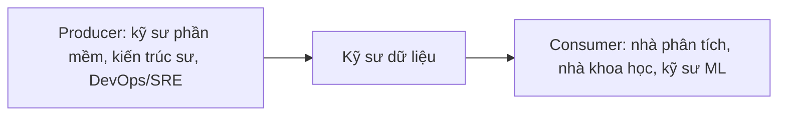
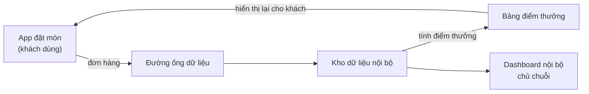
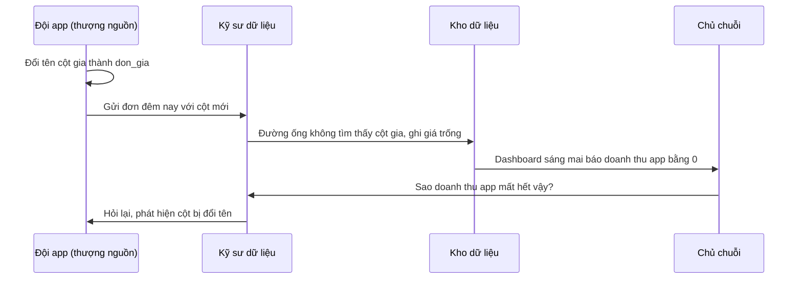
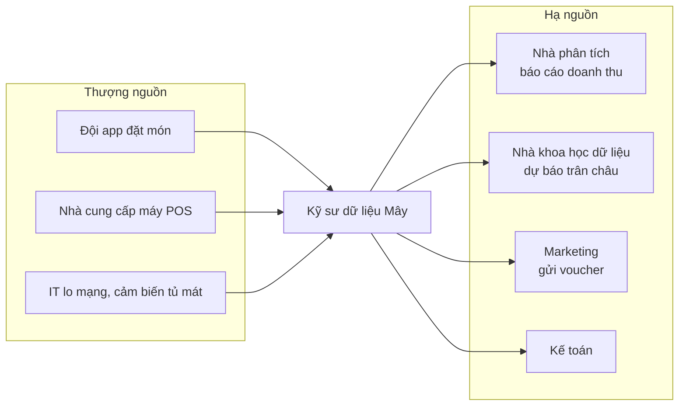

# Kỹ sư dữ liệu bên trong một tổ chức

Kỹ sư dữ liệu không làm việc trong chân không. Bài này mô tả họ phục vụ ai (bên trong hay bên ngoài tổ chức), tương tác với các bên liên quan kỹ thuật ở thượng nguồn và hạ nguồn, với lãnh đạo cấp C, với quản lý dự án và quản lý sản phẩm. Cuối bài là phần kết luận và tài nguyên của chương.

**Tương tự đơn giản:** kỹ sư dữ liệu giống người điều phối kho trung chuyển. Phía trước là các nhà cung cấp hàng (kỹ sư phần mềm, kiến trúc sư, DevOps), phía sau là các cửa hàng nhận hàng (nhà phân tích, nhà khoa học, kỹ sư ML), và phía trên là ban giám đốc cần biết kho đang có gì.

---

:::note[Ghi nhớ nhanh]

- ⭐ **Kỹ sư dữ liệu nằm giữa producer và consumer dữ liệu:** nhận từ kỹ sư phần mềm, kiến trúc sư, DevOps/SRE; phục vụ nhà phân tích, nhà khoa học, kỹ sư ML.
- ⭐ **Hướng nội và hướng ngoại:** hai nhóm người dùng có yêu cầu rất khác nhau (truy vấn đồng thời, bảo mật); dữ liệu hướng nội thường là điều kiện tiên quyết cho hướng ngoại.
- Kỹ sư dữ liệu giúp nhà khoa học dữ liệu không phải tự thu thập, làm sạch dữ liệu: tự động hóa phần đó là động lực ra đời của ngành.
- Với lãnh đạo (CEO, CIO, CTO, CDO, CAO, giám đốc thuật toán) kỹ sư dữ liệu cung cấp "bản đồ" những gì có thể làm với dữ liệu.
- Làm việc với quản lý dự án (sprint, standup) và quản lý sản phẩm (sản phẩm dữ liệu).

:::

---

## Mục lục

- [1. Hướng nội và hướng ngoại](#1-hướng-nội-và-hướng-ngoại)
- [2. Các bên liên quan kỹ thuật](#2-các-bên-liên-quan-kỹ-thuật)
- [3. Kỹ sư dữ liệu và lãnh đạo doanh nghiệp](#3-kỹ-sư-dữ-liệu-và-lãnh-đạo-doanh-nghiệp)
- [4. Quản lý dự án, sản phẩm và các quản lý khác](#4-quản-lý-dự-án-sản-phẩm-và-các-quản-lý-khác)
- [5. Kết luận và tài nguyên](#5-kết-luận-và-tài-nguyên)
- [Tóm tắt](#tóm-tắt)

## 1. Hướng nội và hướng ngoại

Kỹ sư dữ liệu phục vụ nhiều người dùng cuối, cả bên trong lẫn bên ngoài tổ chức. Tùy trường hợp sử dụng cuối, trách nhiệm chính có thể hướng ra ngoài, hướng vào trong, hoặc cả hai.

### Thuật ngữ trong bài — hiểu nôm na

| Thuật ngữ | Nghĩa đời thường | Ví dụ ở chuỗi Mây |
| --- | --- | --- |
| Producer (bên tạo dữ liệu) | Người/hệ thống sinh ra dữ liệu ở đầu dòng | Đội viết app đặt món, nhà cung cấp máy POS |
| Consumer (bên dùng dữ liệu) | Người/hệ thống dùng dữ liệu ở cuối dòng | Chủ chuỗi xem dashboard, marketing gửi voucher |
| Truy vấn đồng thời (concurrency) | Nhiều người hỏi dữ liệu cùng một lúc | 50.000 khách cùng mở app xem điểm thưởng lúc 12 giờ trưa |
| Multitenant | Dữ liệu của nhiều khách nằm chung một bảng, phải tách quyền xem cẩn thận | Bảng điểm thưởng chứa mọi khách, mỗi người chỉ được thấy dòng của mình |
| Event log (nhật ký sự kiện) | Sổ ghi lại từng hành động, kèm giờ | "10:02 khách A mở app, 10:03 bấm voucher, 10:05 đặt đơn" |
| On-premises (tại chỗ) | Tự mua máy chủ, đặt ở văn phòng mình | Một máy chủ đặt trong kho của Mây |
| Sprint, standup | Chu kỳ làm việc ngắn (1-2 tuần) và buổi họp nhanh mỗi sáng | Sprint này: thêm dữ liệu cảm biến tủ mát vào kho |
| Sản phẩm dữ liệu (data product) | Dữ liệu được đóng gói thành thứ người khác dùng được, có chủ, có chất lượng cam kết | Bảng "doanh thu ngày" cập nhật trước 7 giờ sáng, sai thì có người chịu trách nhiệm |

### Kỹ sư dữ liệu hướng ngoại (external-facing)

- Thường gắn với người dùng của các ứng dụng bên ngoài: mạng xã hội, thiết bị **IoT** (Internet of Things), nền tảng thương mại điện tử.
- Thiết kế, xây và quản lý hệ thống thu thập, lưu trữ, xử lý dữ liệu giao dịch và sự kiện từ các ứng dụng đó. Hệ thống có **vòng phản hồi**: ứng dụng, data pipeline, rồi quay lại ứng dụng.
- Vấn đề đặc thù:
  - Query engine hướng ngoại thường chịu tải **đồng thời** lớn hơn nhiều so với hệ thống nội bộ.
  - Cần đặt giới hạn chặt cho truy vấn người dùng được chạy, để một người không ảnh hưởng hạ tầng của tất cả.
  - **Bảo mật** phức tạp và nhạy cảm hơn nhiều với truy vấn bên ngoài, nhất là dữ liệu **multitenant** (dữ liệu của nhiều khách hàng nằm chung một bảng).

### Kỹ sư dữ liệu hướng nội (internal-facing)

- Tập trung vào nhu cầu của doanh nghiệp và các bên liên quan nội bộ.
- Ví dụ: tạo và duy trì data pipeline và data warehouse cho dashboard BI, báo cáo, quy trình kinh doanh, khoa học dữ liệu và mô hình ML.

Hai loại trách nhiệm thường **trộn lẫn**. Trên thực tế, dữ liệu hướng nội thường là điều kiện tiên quyết cho dữ liệu hướng ngoại, nên kỹ sư có thể phải phục vụ hai nhóm người dùng với yêu cầu rất khác nhau về truy vấn đồng thời, bảo mật... Vòng đời kỹ thuật dữ liệu cắt ngang nhiều phần trách nhiệm; kỹ sư tương tác với nhiều đơn vị trong tổ chức, trực tiếp hoặc qua người quản lý.

### Áp vào chuỗi Mây: hướng nội hay hướng ngoại?

Cùng là dữ liệu đơn hàng của Mây, nhưng phục vụ người trong công ty và khách hàng bên ngoài là hai bài toán khác hẳn. Bảng dưới so sánh.

| | Hướng nội | Hướng ngoại |
| --- | --- | --- |
| Ví dụ ở Mây | Dashboard doanh thu cho chủ chuỗi và 30 quản lý cửa hàng | Mục "Lịch sử đơn và điểm thưởng" trong app cho khách |
| Số người dùng cùng lúc | Vài chục | Có thể hàng chục nghìn vào giờ cao điểm |
| Chậm vài giây có sao không | Chấp nhận được | Khách bực, xoá app |
| Bảo mật | Nhân viên đã được phân quyền | Mỗi khách **chỉ** được thấy dữ liệu của mình |
| Dữ liệu lấy từ đâu | Kho dữ liệu sạch | Thường cũng từ kho dữ liệu sạch, được tính sẵn rồi đẩy sang app |

Hàng cuối chính là ý "dữ liệu hướng nội là điều kiện tiên quyết cho hướng ngoại": điểm thưởng của khách phải được tính đúng trong kho nội bộ trước, rồi mới hiển thị cho khách. Sơ đồ dưới cho thấy **vòng phản hồi** đó.

## 2. Các bên liên quan kỹ thuật

Kỹ sư dữ liệu là trung tâm giữa **producer** (người tạo/cung cấp dữ liệu ở thượng nguồn) và **consumer** (người dùng dữ liệu ở hạ nguồn). Danh sách dưới đây không đầy đủ, vì các vai trò dữ liệu mới (như analytics engineer, ML engineer) xuất hiện rất nhanh.

### 2.1. Thượng nguồn

Để thành công, kỹ sư dữ liệu cần hiểu kiến trúc dữ liệu đang dùng hoặc thiết kế, và các hệ thống nguồn tạo ra dữ liệu.

**Kiến trúc sư dữ liệu (data architect)**

- Làm việc ở mức trừu tượng cao hơn một bậc: thiết kế bản thiết kế quản lý dữ liệu của tổ chức, vạch ra quy trình, hệ thống và kiến trúc dữ liệu tổng thể.
- Là cầu nối giữa mặt kỹ thuật và phi kỹ thuật; người giỏi thường có kinh nghiệm kỹ thuật sâu ("vết sẹo chiến đấu"), hướng dẫn kỹ sư và truyền đạt thách thức kỹ thuật cho chủ sở hữu kinh doanh.
- Thực thi chính sách quản lý dữ liệu giữa các bộ phận, định hướng chiến lược toàn cục như quản lý và quản trị dữ liệu, và dẫn dắt sáng kiến quan trọng. Thường giữ vai trò trung tâm trong **di chuyển lên đám mây** và thiết kế đám mây **greenfield** (xây mới từ đầu).
- Đám mây làm mờ ranh giới giữa kiến trúc và kỹ thuật dữ liệu. Kiến trúc đám mây linh hoạt hơn nhiều so với tại chỗ (on-premises): những quyết định trước đây cần nghiên cứu lâu, hợp đồng, lắp đặt phần cứng nay thường được đưa ra trong lúc triển khai, chỉ là một bước trong chiến lược lớn. Kiến trúc sư vẫn là người có tầm nhìn, cộng tác chặt với kỹ sư.
- Tùy mức độ và quy mô dữ liệu của công ty, kỹ sư dữ liệu có thể đảm nhận trách nhiệm của kiến trúc sư, nên cần hiểu tốt các thực hành kiến trúc. Sách xếp kiến trúc sư ở thượng nguồn vì họ thường giúp thiết kế tầng dữ liệu ứng dụng, tức hệ thống nguồn của kỹ sư dữ liệu. (Kiến trúc dữ liệu "tốt" được bàn ở Chương 3.)

**Kỹ sư phần mềm (software engineer)**

- Xây phần mềm và hệ thống vận hành doanh nghiệp; chịu trách nhiệm phần lớn dữ liệu nội bộ mà kỹ sư dữ liệu dùng. Hệ thống của họ tạo dữ liệu và **nhật ký sự kiện ứng dụng (application event logs)**, vốn là tài sản đáng kể. Dữ liệu nội bộ này đối lập với dữ liệu bên ngoài lấy từ nền tảng SaaS hay đối tác.
- Ở tổ chức kỹ thuật vận hành tốt, hai bên phối hợp từ đầu dự án để thiết kế dữ liệu ứng dụng cho phân tích và ML.
- Kỹ sư dữ liệu nên hiểu ứng dụng sinh dữ liệu nào, khối lượng, tần suất, định dạng, và các yếu tố ảnh hưởng vòng đời như bảo mật, tuân thủ. Cần thống nhất kỳ vọng với bên upstream về dữ liệu họ cung cấp.

**DevOps và site-reliability engineer (SRE)**

- Thường tạo dữ liệu qua giám sát vận hành. Sách xếp họ ở thượng nguồn, nhưng họ cũng có thể ở hạ nguồn (dùng dữ liệu qua dashboard) hoặc phối hợp trực tiếp để vận hành hệ thống dữ liệu.

#### Áp vào chuỗi Mây: vì sao phải thống nhất với bên thượng nguồn

Một ngày, đội app của Mây đổi tên cột `gia` thành `don_gia` để "cho rõ nghĩa" mà không báo ai. Sơ đồ dưới cho thấy chuyện gì xảy ra theo thời gian: lỗi chỉ lộ ra khi chủ chuỗi đã nhìn thấy số sai.

Cách phòng: hai bên thoả thuận trước "dữ liệu gửi sang gồm những cột nào, kiểu gì" và báo trước khi đổi. Sách gọi việc này là *thống nhất kỳ vọng với bên upstream*; các chương sau sẽ gọi nó là **data contract** (hợp đồng dữ liệu).

### 2.2. Hạ nguồn

Kỹ thuật dữ liệu tồn tại để phục vụ consumer dữ liệu và các trường hợp sử dụng.

**Nhà khoa học dữ liệu (data scientist)**

- Xây mô hình hướng về tương lai để dự đoán và đề xuất. Các mô hình được đánh giá trên dữ liệu trực tiếp để mang lại giá trị: ví dụ tính điểm mô hình để kích hoạt hành động tự động theo điều kiện thời gian thực, gợi ý sản phẩm dựa trên lịch sử duyệt web của phiên hiện tại, hay dự báo kinh tế cho nhà giao dịch.
- Theo "quan niệm dân gian", họ tốn 70% đến 80% thời gian thu thập, làm sạch, chuẩn bị dữ liệu. Theo kinh nghiệm các tác giả, con số này thường phản ánh **kỹ thuật dữ liệu và khoa học dữ liệu chưa trưởng thành**. Nhiều framework khoa học dữ liệu phổ biến thành nút thắt khi không mở rộng đúng; làm việc trên một máy trạm phải **downsample** (lấy mẫu giảm) dữ liệu, làm việc chuẩn bị phức tạp hơn và có thể hại chất lượng mô hình. Mã và môi trường phát triển tập trung cũng khó đưa vào sản xuất, thiếu tự động hóa gây cản trở.
- Nếu kỹ sư dữ liệu làm tốt, nhà khoa học không phải mất thời gian thu thập, làm sạch, chuẩn bị dữ liệu sau công việc thăm dò ban đầu; kỹ sư nên tự động hóa phần này.
- Nhu cầu về khoa học dữ liệu "sẵn sàng sản xuất" là động lực quan trọng sinh ra ngành kỹ thuật dữ liệu. Chính các tác giả đã chuyển từ khoa học dữ liệu sang kỹ thuật dữ liệu vì nhận ra nhu cầu này.

**Nhà phân tích dữ liệu (data analyst / business analyst)**

- Tìm hiểu hiệu suất và xu hướng kinh doanh. Nhà khoa học hướng tương lai, còn nhà phân tích thường tập trung vào **quá khứ hoặc hiện tại**.
- Thường chạy SQL trong data warehouse hoặc data lake; có thể dùng bảng tính và công cụ BI như Microsoft Power BI, Looker, Tableau.
- Là chuyên gia về lĩnh vực của dữ liệu họ dùng, quen với định nghĩa, đặc điểm và vấn đề chất lượng. Khách hàng hạ nguồn của họ là người dùng doanh nghiệp, quản lý, giám đốc.
- Kỹ sư dữ liệu làm việc với họ để xây hệ thống cung cấp nguồn dữ liệu mới theo yêu cầu kinh doanh; chuyên môn về lĩnh vực của nhà phân tích rất quý trong việc cải thiện chất lượng dữ liệu.

**Kỹ sư học máy (ML engineer) và nhà nghiên cứu AI**

- Kỹ sư ML **chồng lấn** với kỹ sư dữ liệu và nhà khoa học dữ liệu. Họ phát triển kỹ thuật ML tiên tiến, huấn luyện mô hình, thiết kế và duy trì hạ tầng chạy quy trình ML ở quy mô sản xuất. Thường am hiểu ML nâng cao và framework học sâu như PyTorch, TensorFlow, cũng như phần cứng, dịch vụ, hệ thống để huấn luyện và triển khai. Quy trình ML thường chạy trên đám mây, nơi họ có thể ghim và mở rộng tài nguyên theo nhu cầu hoặc dùng dịch vụ được quản lý.
- Ranh giới giữa kỹ thuật ML, kỹ thuật dữ liệu và khoa học dữ liệu mờ. Kỹ sư dữ liệu có thể có trách nhiệm vận hành trên hệ thống ML, và nhà khoa học dữ liệu hợp tác chặt với kỹ sư ML để thiết kế quy trình ML nâng cao.
- Kỹ thuật ML đang phát triển song song với kỹ thuật dữ liệu: vài năm trước trọng tâm là xây mô hình, nay ngày càng nhấn mạnh việc đưa các thực hành tốt của **MLOps** (vận hành học máy) và công nghệ phần mềm/DevOps vào.
- **Nhà nghiên cứu AI** nghiên cứu kỹ thuật ML mới, tiên tiến; có thể ở công ty công nghệ lớn, startup chuyên về sở hữu trí tuệ (OpenAI, DeepMind) hoặc học viện. Một số làm bán thời gian kèm trách nhiệm kỹ thuật ML. Ví dụ dự án nghiên cứu: DALL-E, Gato, AlphaGo, GPT-3/GPT-4. Nhà nghiên cứu ở tổ chức nhiều nguồn lực có tính chuyên môn hóa cao, được đội kỹ sư hỗ trợ; ở học viện thì thường dựa vào sinh viên sau đại học, postdoc và nhân viên trường.

#### Áp vào chuỗi Mây: toàn cảnh những người kỹ sư dữ liệu làm việc cùng

Sơ đồ dưới đặt tên cụ thể cho từng vai trò ở Mây. Kỹ sư dữ liệu đứng giữa, nhận dữ liệu từ bên trái, phục vụ bên phải.

## 3. Kỹ sư dữ liệu và lãnh đạo doanh nghiệp

Ngoài vai trò kỹ thuật, kỹ sư dữ liệu còn là người kết nối tổ chức, thường ở vai trò phi kỹ thuật. Doanh nghiệp ngày càng dựa vào dữ liệu như phần cốt lõi của sản phẩm hoặc chính là sản phẩm, nên kỹ sư dữ liệu tham gia hoạch định chiến lược và dẫn dắt sáng kiến vượt ra ngoài ranh giới CNTT. Họ thường hỗ trợ kiến trúc sư dữ liệu bằng cách làm "chất kết dính" giữa doanh nghiệp và khoa học/phân tích dữ liệu. Các lãnh đạo cấp C ngày càng quan tâm đến dữ liệu như tài sản quan trọng; chẳng hạn CEO nay quan tâm các sáng kiến từng là lãnh địa của CNTT như di chuyển lên đám mây hay triển khai nền tảng dữ liệu khách hàng (customer data platform) mới.

| Vai trò | Nội dung chính |
|---|---|
| **CEO** | Ở công ty phi công nghệ, thường không quan tâm framework dữ liệu và phần mềm phức tạp. Họ đặt tầm nhìn cùng các lãnh đạo công nghệ và dữ liệu. Kỹ sư dữ liệu cho họ góc nhìn về điều khả thi với dữ liệu, duy trì "bản đồ" dữ liệu sẵn có (nội bộ và bên thứ ba) theo khung thời gian, và nghiên cứu thay đổi kiến trúc lớn cùng các vai trò kỹ thuật (di chuyển đám mây, chuyển hệ thống dữ liệu mới, triển khai streaming). |
| **CIO** (Chief Information Officer) | Lãnh đạo cấp C phụ trách công nghệ thông tin, vai trò **hướng nội**. Phải hiểu sâu cả CNTT lẫn quy trình nghiệp vụ. Lãnh đạo bộ phận CNTT, đặt chính sách, triển khai sáng kiến lớn theo chỉ đạo CEO. Ở nơi văn hóa dữ liệu tốt thì cộng tác với lãnh đạo kỹ thuật dữ liệu; ở nơi độ chín muồi thấp thì giúp định hình văn hóa dữ liệu. Cùng kỹ sư và kiến trúc sư quyết định chiến lược về ERP, CRM, di chuyển đám mây, hệ thống dữ liệu, CNTT nội bộ. |
| **CTO** (Chief Technology Officer) | Giống CIO nhưng **hướng ngoại**. Sở hữu kiến trúc và chiến lược công nghệ cho ứng dụng bên ngoài (di động, web, IoT), đều là nguồn dữ liệu quan trọng. Thường là nhà công nghệ lành nghề. Nơi không có CIO thì CTO (đôi khi COO) kiêm vai trò đó. Kỹ sư dữ liệu thường báo cáo trực tiếp hoặc gián tiếp qua CTO. |
| **CDO** (Chief Data Officer) | Vai trò lập năm 2002 tại Capital One, nhằm nhận ra tầm quan trọng của dữ liệu như tài sản kinh doanh. Chịu trách nhiệm chiến lược và tài sản dữ liệu; tập trung vào tiện ích kinh doanh nhưng cần nền kỹ thuật vững. Giám sát sản phẩm dữ liệu, chiến lược, sáng kiến và các chức năng lõi như quản lý dữ liệu chủ (master data) và quyền riêng tư. Đôi khi quản lý phân tích kinh doanh và kỹ thuật dữ liệu. |
| **CAO** (Chief Analytics Officer) | Biến thể của CDO. Khi có cả hai: CDO lo công nghệ và tổ chức để cung cấp dữ liệu, CAO lo phân tích, chiến lược và ra quyết định kinh doanh. Có thể giám sát khoa học dữ liệu và ML, tùy công ty có CDO hay CTO. |
| **Chief Algorithms Officer** (giám đốc thuật toán) | Vai trò gần đây trong C-suite, rất kỹ thuật, tập trung vào khoa học dữ liệu và ML. Thường từng là người đóng góp cá nhân và trưởng nhóm dự án khoa học dữ liệu hoặc ML, có nền tảng nghiên cứu ML và bằng cấp cao. Phải thông thạo nghiên cứu ML hiện tại và hiểu sâu sáng kiến ML của công ty; ngoài sáng kiến kinh doanh còn lãnh đạo kỹ thuật, đặt chương trình nghiên cứu và phát triển, xây nhóm nghiên cứu. |

Ở một chuỗi cỡ Mây, ít khi có đủ các chức danh trên. Thường một người kiêm nhiều vai, như bảng dưới.

| Chức danh trong sách | Ở chuỗi Mây là ai | Kỹ sư dữ liệu nói chuyện với họ về gì |
| --- | --- | --- |
| CEO | Chủ chuỗi | "Có dữ liệu thì mình biết được những gì?", ví dụ biết món nào lỗ, cửa hàng nào nên đóng |
| CIO / CTO | Trưởng phòng IT kiêm lo app | Chọn phần mềm POS mới, có nên chuyển hết lên đám mây |
| CDO / CAO | Chưa có, chủ chuỗi tự quyết | Ưu tiên dự án dữ liệu nào trước |
| Giám đốc thuật toán | Không cần ở quy mô này | — |

(Lưu ý: bản dịch tiếng Việt viết tắt cả hai chức danh CAO giống nhau; ở đây ghi tên đầy đủ để tránh nhầm.)

## 4. Quản lý dự án, sản phẩm và các quản lý khác

### Quản lý dự án (project management)

- Kỹ sư dữ liệu thường làm các sáng kiến lớn, kéo dài nhiều năm, như di chuyển lên đám mây, chuyển pipeline và kho sang thế hệ công cụ mới, hoặc xây kiến trúc dữ liệu mới từ đầu giữa vô số lựa chọn công cụ.
- Những sáng kiến này hưởng lợi từ quản lý dự án (khác với quản lý sản phẩm). Kỹ sư hoạt động ở mảng hạ tầng và khả năng cung cấp dịch vụ, còn người quản lý dự án "điều khiển giao thông" và đóng vai **gác cổng**. Phần lớn dùng biến thể của Agile và Scrum, đôi khi vẫn có waterfall.
- Hoạt động kinh doanh không ngủ, các bên liên quan luôn có lượng tồn đọng yêu cầu lớn. Người quản lý dự án phải lọc danh sách dài và ưu tiên các sản phẩm quan trọng.
- Kỹ sư dữ liệu thường lập kế hoạch **sprint** và dự các **standup** liên quan. Phản hồi đi cả hai chiều: kỹ sư báo tiến độ và các yếu tố cản trở. Quản lý dự án cân bằng năng lực nhóm công nghệ với nhu cầu thay đổi liên tục của doanh nghiệp.

Ví dụ một danh sách việc tồn đọng (backlog) của đội dữ liệu Mây mà người quản lý dự án phải sắp xếp. Cột cuối cho thấy lý do xếp thứ tự, không phải ai kêu to thì làm trước.

| Yêu cầu | Người yêu cầu | Ưu tiên | Lý do |
| --- | --- | --- | --- |
| Sửa doanh thu app hiển thị bằng 0 | Chủ chuỗi | 1 | Số sai đang được dùng để ra quyết định |
| Thêm dữ liệu cảm biến tủ mát | Quản lý vận hành | 2 | Tủ hỏng làm hỏng sữa, mất tiền thật |
| Danh sách khách lâu không quay lại | Marketing | 3 | Có giá trị, nhưng chờ một sprint được |
| Dashboard màu sắc đẹp hơn | Quản lý cửa hàng | 4 | Không ảnh hưởng quyết định |

### Quản lý sản phẩm (product management)

- Giám sát phát triển sản phẩm, thường sở hữu một dòng sản phẩm. Với kỹ sư dữ liệu, đó là **sản phẩm dữ liệu (data products)**, xây mới hoặc cải tiến dần trên sản phẩm hiện có.
- Kỹ sư dữ liệu tương tác với quản lý sản phẩm ngày càng thường xuyên vì thế giới doanh nghiệp đã chuyển sang lấy dữ liệu làm trung tâm. Như quản lý dự án, họ cân bằng hoạt động của nhóm công nghệ với nhu cầu khách hàng và doanh nghiệp.

### Các vai trò quản lý khác

Kỹ sư dữ liệu còn tương tác với nhiều loại quản lý khác, thường theo **mô hình dịch vụ** hoặc **đa chức năng (cross-functional)**: hoặc phục vụ nhiều yêu cầu đến từ nhiều nơi như một nhóm tập trung, hoặc làm nguồn lực được chỉ định cho một quản lý, dự án hay sản phẩm cụ thể. Sách gợi ý đọc thêm: *Building Analytics Teams* (John K. Thompson, Packt) và *Data Teams* (Jesse Anderson, Apress) về vai trò lãnh đạo dữ liệu, tuyển dụng và xây nhóm.

Lời nhắn cuối của phần này: công ty không thuê kỹ sư chỉ để hack mã một mình. Để xứng danh kỹ sư, cần hiểu sâu vấn đề phải giải, công cụ đang dùng và những người mình làm cùng, phục vụ.

## 5. Kết luận và tài nguyên

Chương 1 đã tóm tắt: định nghĩa kỹ thuật dữ liệu và việc kỹ sư dữ liệu làm, các mức trưởng thành dữ liệu trong công ty, kỹ sư dữ liệu loại A và loại B, và kỹ sư dữ liệu làm việc với ai. Chương 2 sẽ bàn vòng đời kỹ thuật dữ liệu, Chương 3 bàn kiến trúc, các chương sau về quyết định công nghệ cho từng phần của vòng đời. Vì lĩnh vực luôn thay đổi, mỗi chương nhấn vào những quan điểm **bất biến**, giá trị lâu dài.

**Tài nguyên bổ sung** (chọn lọc theo sách): "The AI Hierarchy of Needs" (Monica Rogati); "Big Data Will Be Dead in Five Years" (Lewis Gavin); *Building Analytics Teams* (John K. Thompson); *What Is Data Engineering?* (Lewis Gavin, O'Reilly); *Data Teams* (Jesse Anderson); "The Rise of the Data Engineer" và "The Downfall of the Data Engineer" (Maxime Beauchemin); "A Short History of Big Data" (Mark van Rijmenam); "Skills of the Data Architect" (Bob Lambert); "The Three Levels of Data Analysis" (Emilie Schario); "Why CEOs Must Lead Big Data Initiatives" (John Weathington).

## Tóm tắt

| Nhóm | Vai trò | Quan hệ với kỹ sư dữ liệu |
|---|---|---|
| Hướng phục vụ | Hướng nội / hướng ngoại | Yêu cầu khác nhau về đồng thời, bảo mật |
| Thượng nguồn | Kiến trúc sư, kỹ sư phần mềm, DevOps/SRE | Cung cấp dữ liệu và thiết kế hệ thống nguồn |
| Hạ nguồn | Nhà khoa học, nhà phân tích, kỹ sư ML, nhà nghiên cứu AI | Tiêu thụ dữ liệu, cần pipeline tự động |
| Lãnh đạo | CEO, CIO, CTO, CDO, CAO, giám đốc thuật toán | Cho góc nhìn về khả năng của dữ liệu, tham gia chiến lược |
| Quản lý | Dự án, sản phẩm, các quản lý khác | Ưu tiên, sprint, sản phẩm dữ liệu |
