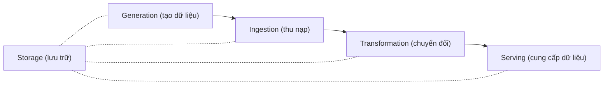

# Tổng quan vòng đời, hệ thống nguồn và lưu trữ

Chương 2 giới thiệu khung tư duy trung tâm của cuốn sách: **Data Engineering Lifecycle** (vòng đời kỹ thuật dữ liệu). Bài này giải thích vòng đời là gì, rồi đi qua hai giai đoạn đầu: **Generation** (tạo dữ liệu, tức hệ thống nguồn) và **Storage** (lưu trữ). Các giai đoạn còn lại và các "undercurrents" (yếu tố xuyên suốt) nằm ở những bài sau.

**Tương tự đơn giản:** vòng đời dữ liệu giống một chuỗi cung ứng nông sản. Nông trại (hệ thống nguồn) trồng ra nông sản, kho lạnh (lưu trữ) giữ chúng, xe tải (ingestion) chở về, xưởng chế biến (transformation) làm thành sản phẩm, rồi siêu thị (serving) bán cho khách. Điện, nước, quy định an toàn thực phẩm, kiểm định chất lượng chạy xuyên suốt mọi khâu, đó chính là các undercurrents.

---

:::note[Ghi nhớ nhanh]

- ⭐ **Vòng đời có 5 giai đoạn**: Generation, Storage, Ingestion, Transformation, Serving. Storage không chỉ là một bước mà là nền móng chạy xuyên suốt các giai đoạn khác.
- ⭐ **Undercurrents (6 yếu tố xuyên suốt)**: Security, Data Management, DataOps, Data Architecture, Orchestration, Software Engineering, hỗ trợ mọi giai đoạn.
- Các giai đoạn có thể **chồng lấn, lặp lại, đảo thứ tự**, không phải đường thẳng.
- Kỹ sư dữ liệu **dùng** dữ liệu từ hệ thống nguồn nhưng thường **không sở hữu** nó, nên phải giữ liên lạc với chủ hệ thống nguồn.
- Chọn hệ thống lưu trữ cần hiểu "nhiệt độ" dữ liệu: **hot, warm, cold**.

:::

---

## Mục lục

- 1. Vòng đời kỹ thuật dữ liệu là gì
- 2. Vòng đời dữ liệu so với vòng đời kỹ thuật dữ liệu
- 3. Generation: hệ thống nguồn
- 4. Storage: lưu trữ
- Tóm tắt

## 1. Vòng đời kỹ thuật dữ liệu là gì

Mục tiêu lớn của cuốn sách là giúp bạn thôi nhìn kỹ thuật dữ liệu như "một tập hợp công nghệ cụ thể" (Spark, Kafka, Snowflake...). Công cụ ngày càng được **trừu tượng hoá** (che bớt chi tiết bên dưới) và dễ dùng hơn, nên kỹ sư dữ liệu sẽ dần trở thành **kỹ sư vòng đời dữ liệu**: suy nghĩ và vận hành theo các nguyên tắc quản lý vòng đời dữ liệu thay vì gắn với một công cụ.

**Data Engineering Lifecycle** gồm các giai đoạn biến **dữ liệu thô** thành **sản phẩm cuối cùng hữu ích** cho nhà phân tích, nhà khoa học dữ liệu, kỹ sư ML và những người dùng khác. Sách chia thành **năm giai đoạn**:

Cách đọc sơ đồ:

1. Lấy dữ liệu từ **hệ thống nguồn** và **lưu trữ** nó.
2. **Chuyển đổi** dữ liệu.
3. Mục tiêu cuối là **cung cấp** dữ liệu cho người dùng (analyst, data scientist, ML engineer...).

Lưu ý quan trọng: **lưu trữ diễn ra xuyên suốt** khi dữ liệu di chuyển từ đầu đến cuối. Vì vậy trong sơ đồ gốc của sách, "Storage" được vẽ như một **nền tảng** đỡ các giai đoạn khác chứ không phải một ô nằm giữa dòng.

Ba giai đoạn giữa (storage, ingestion, transformation) có thể **đan xen** nhau, và điều đó hoàn toàn bình thường. Dù sách tách riêng từng phần, quy trình thực tế không phải lúc nào cũng tuần tự rõ ràng: các giai đoạn có thể lặp lại, diễn ra không theo thứ tự, chồng lấn hoặc kết hợp theo những cách bất ngờ.

Bên dưới các giai đoạn là các **undercurrents** (dòng ngầm / yếu tố xuyên suốt). Chúng là nền tảng mà nếu thiếu thì hầu như không giai đoạn nào hoạt động đầy đủ được. Sáu undercurrents sẽ được trình bày ở bài 3 và 4.

## 2. Vòng đời dữ liệu so với vòng đời kỹ thuật dữ liệu

Hai khái niệm này khác nhau tinh tế:

| Khái niệm | Phạm vi |
|---|---|
| **Data lifecycle** (vòng đời dữ liệu) | Toàn bộ cuộc đời của dữ liệu, từ lúc sinh ra đến lúc được dùng và bị huỷ |
| **Data engineering lifecycle** | Tập con của vòng đời dữ liệu, tập trung vào **phần mà kỹ sư dữ liệu kiểm soát** |

Nói cách khác, vòng đời kỹ thuật dữ liệu là "khúc" nằm trong tầm tay của kỹ sư dữ liệu, còn vòng đời dữ liệu đầy đủ còn gồm những thứ ngoài tầm kiểm soát (ví dụ ứng dụng nguồn sinh dữ liệu ra sao, người dùng cuối dùng kết quả thế nào).

## 3. Generation: hệ thống nguồn

**Source system** (hệ thống nguồn) là nơi dữ liệu **bắt nguồn**. Ví dụ: thiết bị IoT, message queue của ứng dụng, cơ sở dữ liệu giao dịch.

Đặc điểm cốt lõi: kỹ sư dữ liệu **dùng** dữ liệu của hệ thống nguồn nhưng thường **không sở hữu hay kiểm soát** nó. Vì thế họ cần:

- Hiểu sâu hệ thống nguồn hoạt động thế nào, sinh dữ liệu ra sao, với **tần suất**, **tốc độ** và **độ đa dạng** nào.
- Giữ **kênh liên lạc mở** với chủ hệ thống nguồn về những thay đổi có thể phá vỡ pipeline và phân tích. Ví dụ: mã ứng dụng đổi cấu trúc một trường, hoặc nhóm ứng dụng quyết định chuyển backend sang một công nghệ database hoàn toàn mới.

Một thách thức lớn là số lượng hệ thống nguồn rất nhiều và rất khác nhau. Sách lấy hai ví dụ đối lập:

**Ví dụ 1: cơ sở dữ liệu ứng dụng (truyền thống).** Một vài máy chủ ứng dụng nối với một database. Mẫu này phổ biến từ thập niên 1980 cùng sự thành công của **RDBMS** (hệ quản trị cơ sở dữ liệu quan hệ) và vẫn còn đến nay, thường biến tấu thành nhiều cặp "dịch vụ nhỏ + database nhỏ" khi dùng **microservices** thay cho một khối monolith.

**Ví dụ 2: bầy đàn IoT (hiện đại).** Một nhóm thiết bị (cảm biến, thiết bị thông minh...) gửi các message dữ liệu về một hệ thống thu thập trung tâm, thường qua message queue. Kiểu nguồn này ngày càng phổ biến khi số thiết bị IoT tăng.

### 3.1. Câu hỏi đánh giá hệ thống nguồn

Sách đưa ra bộ câu hỏi ban đầu mà kỹ sư dữ liệu nên đặt ra. Tôi nhóm lại cho dễ nhớ:

**Bản chất và độ bền của nguồn**

- Đặc điểm cơ bản của nguồn là gì: một ứng dụng, hay một loạt thiết bị IoT?
- Dữ liệu được giữ lại thế nào: **bền vững lâu dài** hay **tạm thời, bị xoá nhanh**?

**Tốc độ và chất lượng**

- Tốc độ sinh dữ liệu: bao nhiêu sự kiện mỗi giây, bao nhiêu GB mỗi giờ?
- Mức độ **nhất quán** của dữ liệu đầu ra: nếu chạy data quality check, các giá trị rỗng ở chỗ không mong đợi hay định dạng hỏng xuất hiện thường xuyên không?
- Tần suất lỗi ra sao? Có **bản sao (duplicate)** không?
- Có giá trị **đến muộn (late data)**, có khi muộn hơn nhiều so với các message sinh ra cùng lúc không?

**Schema và thay đổi**

- **Schema** (cấu trúc dữ liệu) là gì? Có phải join nhiều bảng, thậm chí nhiều hệ thống mới có bức tranh đầy đủ?
- Nếu schema đổi (ví dụ thêm cột), việc đó được xử lý và thông báo cho các bên downstream thế nào?

**Cách lấy dữ liệu**

- Cần lấy dữ liệu từ nguồn thường xuyên đến đâu?
- Với hệ thống **có trạng thái** (như database tài khoản khách hàng), dữ liệu đến dưới dạng **snapshot định kỳ** hay **sự kiện cập nhật từ CDC** (Change Data Capture, thu thập thay đổi dữ liệu)?
- Logic thực hiện thay đổi là gì và được theo dõi thế nào trong database nguồn?
- Ai/nhà cung cấp nào sẽ đẩy dữ liệu cho bước tiêu thụ tiếp theo?
- **Đọc từ nguồn có ảnh hưởng hiệu năng** của nó không?

**Phụ thuộc và kiểm tra**

- Hệ thống nguồn có phụ thuộc dữ liệu **upstream** (ngược dòng) nào không? Đặc điểm của chúng?
- Có kiểm tra chất lượng để phát hiện dữ liệu trễ hoặc thiếu không?

Nguồn dữ liệu có thể là bảng tính do con người tạo, cảm biến IoT, ứng dụng web và mobile... Mỗi nguồn có **khối lượng** và **nhịp độ** riêng. Kỹ sư dữ liệu cũng cần biết **giới hạn** của nguồn. Ví dụ: chạy truy vấn phân tích nặng trên database ứng dụng đang phục vụ khách có gây **tranh chấp tài nguyên** và làm chậm ứng dụng không?

### 3.2. Schema: sắc thái khó nhất của dữ liệu nguồn

**Schema** xác định tổ chức phân cấp của dữ liệu: từ cả hệ thống, xuống từng bảng, đến cấu trúc từng trường. Có hai cách tiếp cận phổ biến:

| Kiểu | Ý nghĩa | Ví dụ |
|---|---|---|
| **Schemaless** (không schema) | Không có nghĩa là "không có schema". Thật ra **ứng dụng tự quyết định** schema khi ghi vào message queue, file phẳng, blob hay document DB | MongoDB |
| **Fixed schema** (schema cố định) | Schema được **database thực thi**, việc ghi của ứng dụng phải tuân theo | Cơ sở dữ liệu quan hệ |

Cả hai đều gây thách thức. Schema **thay đổi theo thời gian**; thậm chí cách làm **Agile** còn khuyến khích tiến hoá schema. Một phần quan trọng của việc kỹ sư dữ liệu là lấy dữ liệu thô theo schema của nguồn và biến thành đầu ra có giá trị cho phân tích. Việc này càng khó khi schema nguồn liên tục đổi.

Hệ thống nguồn được bàn kỹ hơn ở Chương 5; schema và mô hình hoá dữ liệu ở Chương 6 và 8.

**Ví dụ minh hoạ (do người viết thêm, không phải của tác giả):** đội ứng dụng đổi tên cột `phone` thành `phone_number` mà không báo. Pipeline đang đọc `phone` sẽ hỏng, hoặc tệ hơn là chạy tiếp với toàn giá trị rỗng. Đây chính là lý do cần kênh liên lạc với chủ nguồn.

## 4. Storage: lưu trữ

Bạn cần nơi để chứa dữ liệu. Chọn giải pháp lưu trữ là chìa khoá cho thành công của phần còn lại, và đây cũng là một trong những giai đoạn **phức tạp nhất**, vì ba lý do:

1. Kiến trúc dữ liệu trên cloud thường dùng **nhiều giải pháp lưu trữ** cùng lúc (nhiều tầng).
2. Rất ít giải pháp lưu trữ chỉ làm mỗi việc "chứa". Nhiều cái hỗ trợ cả truy vấn và biến đổi phức tạp. Ngay cả **object storage** cũng có khả năng truy vấn, ví dụ **Amazon S3 Select**.
3. Dù là một giai đoạn, lưu trữ **giao thoa** với ingestion, transformation, serving.

Lưu trữ xảy ra ở **nhiều điểm** trong pipeline, nơi hệ thống lưu trữ kết nối với nguồn, ingestion, transformation và serving. Cách bạn lưu dữ liệu ảnh hưởng đến cách dùng dữ liệu ở **mọi** giai đoạn. Ví dụ:

- **Cloud data warehouse** có thể vừa lưu, vừa xử lý dữ liệu trong pipeline, vừa phục vụ analyst.
- **Streaming framework** như Apache Kafka và Pulsar có thể đồng thời là hệ thống ingestion, lưu trữ và truy vấn message, với object storage là lớp chuẩn để trao đổi dữ liệu.

### 4.1. Câu hỏi đánh giá hệ thống lưu trữ

- Có **tương thích tốc độ ghi/đọc** mà kiến trúc yêu cầu không?
- Lưu trữ có thành **nút thắt cổ chai** cho các quy trình downstream không?
- Bạn có **hiểu công nghệ này hoạt động ra sao** không? Bạn dùng tối ưu hay đang làm điều "phản tự nhiên"? Ví dụ: áp dụng tần suất **cập nhật truy cập ngẫu nhiên cao** lên object storage là một **anti-pattern** (mẫu xấu) có chi phí vận hành đáng kể.
- Có xử lý được **quy mô tương lai** không? Xem mọi giới hạn dung lượng: tổng dung lượng, tốc độ đọc, throughput ghi...
- Người dùng và quy trình downstream có truy xuất dữ liệu đáp ứng được **SLA** (thoả thuận cấp độ dịch vụ) không?
- Bạn có nắm bắt **metadata** về tiến hoá schema, luồng dữ liệu, **data lineage** không? Metadata là khoản đầu tư cho tương lai: tăng mạnh khả năng khám phá dữ liệu và "kiến thức tổ chức".
- Đây là lưu trữ **thuần tuý** (object storage) hay hỗ trợ **truy vấn phức tạp** (cloud data warehouse)?
- Hệ thống là **schema-agnostic** (object storage), **schema linh hoạt** (Cassandra), hay **schema được thực thi** (cloud data warehouse)?
- Bạn theo dõi **master data**, chất lượng "golden record" và data lineage cho **data governance** thế nào?
- Bạn xử lý **tuân thủ quy định** và **chủ quyền dữ liệu (data sovereignty)** ra sao? Ví dụ: có được lưu dữ liệu ở vị trí địa lý này mà không phải chỗ khác không?

### 4.2. Tần suất truy cập: "nhiệt độ" dữ liệu

Không phải dữ liệu nào cũng được truy cập giống nhau. Tần suất truy cập quyết định **nhiệt độ** của dữ liệu:

| Loại | Đặc điểm | Hệ quả lưu trữ |
|---|---|---|
| **Hot data** (dữ liệu nóng) | Truy xuất nhiều lần mỗi ngày, có khi vài lần mỗi giây (ví dụ hệ thống phục vụ yêu cầu của người dùng) | Phải lưu ở nơi truy xuất **nhanh**, "nhanh" tuỳ theo trường hợp sử dụng |
| **Warm data** (dữ liệu ấm) | Truy cập thi thoảng, ví dụ hàng tuần hoặc hàng tháng | Mức trung gian |
| **Cold data** (dữ liệu nguội) | Hiếm khi truy vấn, hợp để **lưu trữ lâu dài (archival)** | Thường giữ cho mục đích tuân thủ hoặc phòng khi một hệ thống khác gặp sự cố nghiêm trọng |

Ngày xưa dữ liệu nguội được lưu vào băng từ và chuyển tới kho ở xa. Trên cloud, các nhà cung cấp có **tầng lưu trữ chuyên dụng** với chi phí lưu hàng tháng rất thấp nhưng **phí truy xuất cao**.

### 4.3. Chọn hệ thống lưu trữ

Nên dùng loại nào? Còn tuỳ **trường hợp sử dụng, khối lượng dữ liệu, tần suất ingestion, định dạng và kích thước dữ liệu**; về bản chất là các câu hỏi ở mục 4.1. **Không có khuyến nghị chung** nào phù hợp cho mọi người, và mọi công nghệ lưu trữ đều có nhược điểm. Có vô số lựa chọn nên rất dễ bị choáng ngợp. Chương 6 đi sâu hơn về lưu trữ và giao thoa của nó với các giai đoạn khác.

## Tóm tắt

| Nội dung | Ý chính |
|---|---|
| Vòng đời | 5 giai đoạn: Generation, Storage, Ingestion, Transformation, Serving; storage là nền |
| Undercurrents | 6 yếu tố xuyên suốt hỗ trợ mọi giai đoạn |
| Data lifecycle vs DE lifecycle | DE lifecycle là tập con, phần kỹ sư dữ liệu kiểm soát |
| Hệ thống nguồn | Không sở hữu, phải hiểu sâu và giữ liên lạc với chủ nguồn |
| Schema | Schemaless hay fixed đều gây khó vì schema luôn thay đổi |
| Lưu trữ | Phức tạp, xuyên suốt; cần cân nhắc tốc độ, quy mô, SLA, metadata, tuân thủ |
| Nhiệt độ dữ liệu | Hot, warm, cold quyết định tầng lưu trữ và chi phí |
