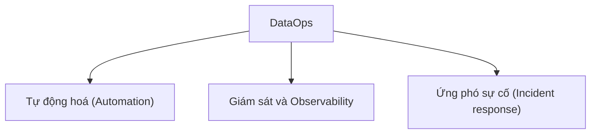
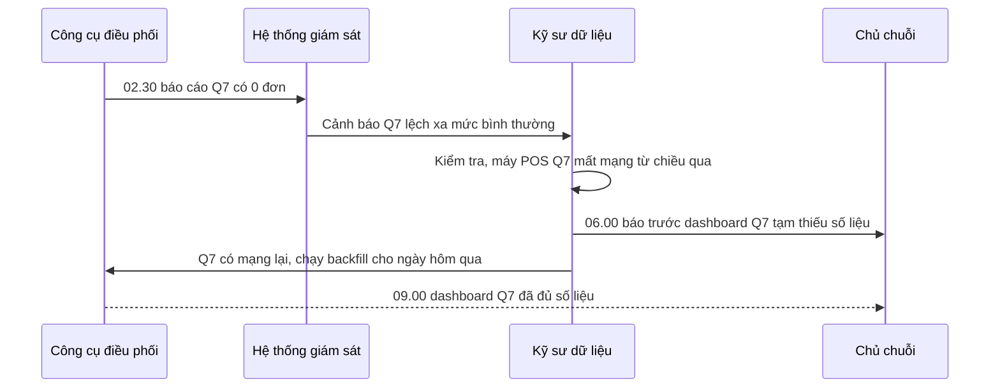
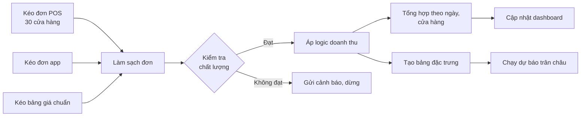

# DataOps, Data Architecture, Orchestration và Software Engineering

Bài này hoàn tất bốn undercurrents còn lại của vòng đời kỹ thuật dữ liệu, rồi chốt lại chương. Nếu bài trước nói về "quản trị" (bảo mật, quản lý dữ liệu), bài này nói về **cách vận hành, thiết kế và xây dựng**: quy trình giao hàng và giám sát (DataOps), nhìn tổng thể hệ thống (kiến trúc), điều phối công việc (orchestration) và nền tảng lập trình (software engineering).

**Tương tự đơn giản:** DataOps là quản lý chất lượng và dây chuyền sản xuất tinh gọn; kiến trúc là bản vẽ nhà máy; orchestration là người điều độ cho các dây chuyền chạy đúng thứ tự và đúng giờ; software engineering là tay nghề của người thợ.

---

:::note[Ghi nhớ nhanh]

- ⭐ **DataOps** = Agile + DevOps + SPC áp cho dữ liệu; trước hết là **văn hoá**, rồi tới ba trụ: **tự động hoá, giám sát và observability, ứng phó sự cố**.
- ⭐ **Orchestration** không chỉ là lập lịch: nó hiểu **phụ thuộc giữa các job (DAG)**, không như cron chỉ biết thời gian.
- **Kiến trúc dữ liệu**: hiểu nhu cầu kinh doanh, cân bằng chi phí và vận hành; kỹ sư dữ liệu không nhất thiết là kiến trúc sư.
- **Software engineering** vẫn cốt lõi dù công cụ trừu tượng hơn: SQL cũng là code; cần test, IaC, pipeline as code.
- Trước khi tự xây công cụ, hãy khảo sát open source và tính **TCO** và chi phí cơ hội.

:::

---

## Mục lục

- 1. DataOps
- 2. Data architecture
- 3. Orchestration
- 4. Software engineering
- 5. Kết luận chương
- Tài nguyên bổ sung

## 1. DataOps

**DataOps** ánh xạ các thực hành tốt nhất của **Agile**, **DevOps** và **SPC** (statistical process control, kiểm soát quy trình thống kê) vào dữ liệu. DevOps nhằm cải thiện việc phát hành và chất lượng sản phẩm phần mềm; DataOps làm tương tự cho **sản phẩm dữ liệu**.

Sản phẩm dữ liệu khác sản phẩm phần mềm ở cách dùng dữ liệu. Sản phẩm phần mềm cung cấp chức năng kỹ thuật cụ thể cho người dùng cuối. Còn **data product** được xây trên logic và chỉ số kinh doanh hợp lý, người dùng dựa vào đó để **ra quyết định** hoặc xây mô hình thực hiện hành động tự động. Kỹ sư dữ liệu phải hiểu cả mặt kỹ thuật xây sản phẩm phần mềm lẫn logic nghiệp vụ, chất lượng và chỉ số để làm ra sản phẩm dữ liệu xuất sắc.

Giống DevOps, DataOps vay mượn nhiều từ **lean manufacturing** (sản xuất tinh gọn) và quản lý chuỗi cung ứng, kết hợp con người, quy trình, công nghệ để **rút ngắn thời gian tạo ra giá trị**. Theo Data Kitchen, DataOps là tập hợp thực hành kỹ thuật, quy trình làm việc, chuẩn mực văn hoá và mẫu kiến trúc cho phép:

- Đổi mới và thử nghiệm nhanh, mang insight mới đến khách hàng với tốc độ tăng dần.
- Chất lượng dữ liệu cực cao và tỷ lệ lỗi rất thấp.
- Hợp tác giữa các mảng phức tạp về con người, công nghệ và môi trường.
- Đo lường, giám sát và minh bạch rõ ràng về kết quả.

Trước hết, **DataOps là tập hợp thói quen văn hoá**: nhóm data engineering cần chu trình giao tiếp và cộng tác với doanh nghiệp, phá rào cản, liên tục học từ thành công và sai lầm, lặp nhanh. Khi văn hoá đã vững, công cụ mới phát huy tối đa.

**Bắt đầu từ đâu?** Tuỳ mức trưởng thành dữ liệu của công ty:

- Công ty chưa có hạ tầng dữ liệu: DataOps là cơ hội làm ngay **từ ngày đầu**.
- Dự án/hạ tầng hiện có nhưng thiếu DataOps: bắt đầu thêm dần. Sách khuyên **trước hết là observability và giám sát** để hiểu hiệu năng hệ thống, sau đó thêm **tự động hoá** và **ứng phó sự cố**.
- Công ty đã trưởng thành: làm việc cùng nhóm DataOps sẵn có để cải thiện vòng đời.

DataOps có **ba yếu tố kỹ thuật cốt lõi (ba trụ cột)**:



### Thuật ngữ trong bài — hiểu nôm na

Ví dụ dùng chuỗi trà sữa **Mây** (30 cửa hàng, xem [phần giới thiệu](../intro.md)) và đường ống dữ liệu đã dựng ở [bài 2](./2_thu-nap-chuyen-doi-cung-cap.md).

| Thuật ngữ | Nghĩa đời thường | Ví dụ ở chuỗi Mây |
| --- | --- | --- |
| Cron job | Báo thức hẹn giờ cho máy tính: đúng giờ thì chạy, không quan tâm việc trước đã xong chưa | "2 giờ sáng chạy làm sạch, 3 giờ sáng chạy tổng hợp" |
| Orchestration (điều phối) | Người điều độ biết việc nào phải chờ việc nào | "Chỉ tổng hợp khi đã làm sạch xong cả 30 cửa hàng" |
| DAG | Sơ đồ các bước nối bằng mũi tên một chiều, không vòng lại | Lấy đơn → làm sạch → tổng hợp → dashboard |
| CI/CD | Mỗi lần sửa code là tự kiểm tra và tự đưa lên hệ thống thật | Sửa cách tính doanh thu, máy tự chạy thử trên dữ liệu mẫu trước |
| Observability (khả năng quan sát) | Nhìn vào là biết hệ thống khoẻ hay ốm, ốm ở đâu | Bảng theo dõi: đêm qua mỗi cửa hàng gửi bao nhiêu đơn |
| Alert (cảnh báo) | Tin nhắn tự động khi có gì bất thường | "Q7 không có đơn nào hôm qua" gửi vào nhóm chat |
| Incident (sự cố) | Một lần hệ thống hỏng ảnh hưởng người dùng | Dashboard sáng nay hiện doanh thu app bằng 0 |
| Backfill | Chạy bù cho những ngày đã lỡ | Đường ống hỏng 3 ngày, sửa xong chạy lại cho 3 ngày đó |
| IaC (Infrastructure as code) | Mô tả máy móc, dịch vụ cần thuê bằng file chữ, để dựng lại y hệt bất cứ lúc nào | File mô tả "kho dữ liệu, 1 máy chạy đường ống, 1 nơi lưu file thô" |
| Unit test | Kiểm tra từng mảnh nhỏ của code | Kiểm tra hàm "đổi `30.000đ` thành `30000`" |

### 1.1. Tự động hoá

Tự động hoá mang lại **độ tin cậy và tính nhất quán**, cho phép kỹ sư nhanh chóng đưa tính năng mới vào workflow hiện có. Khung và quy trình giống DevOps: **quản lý thay đổi** (kiểm soát môi trường, code, phiên bản dữ liệu), **CI/CD** (tích hợp liên tục, triển khai liên tục) và **configuration as code**. Cùng với giám sát độ tin cậy của công nghệ và hệ thống (pipeline, orchestration...), DataOps còn thêm **kiểm tra chất lượng dữ liệu, data/model drift (độ lệch dữ liệu hay mô hình), tính toàn vẹn metadata**...

Sách mô tả quá trình tiến hoá tự động hoá trong một tổ chức giả định, qua các mức trưởng thành:

1. **Mức thấp: cron job.** Lên lịch nhiều bước transformation bằng **cron job**. Chạy tốt một thời gian, rồi khi pipeline phức tạp hơn: nếu cron job nằm trên một instance cloud, instance đó có thể hỏng làm job ngừng bất ngờ; khoảng cách giữa các job hẹp lại, một job chạy lâu làm job kế **lỗi hoặc sinh dữ liệu cũ**. Kỹ sư chỉ biết job hỏng khi analyst phàn nàn báo cáo đã cũ.
2. **Mức trung: orchestration framework** (Airflow hoặc Dagster). Kỹ sư biết Airflow có gánh nặng vận hành, nhưng lợi ích orchestration cuối cùng lớn hơn. Họ dần chuyển cron job sang job Airflow. Giờ **phụ thuộc được kiểm tra trước khi chạy job**, và nhiều transformation được xếp gọn hơn vì mỗi job chạy ngay khi dữ liệu upstream sẵn sàng thay vì ở giờ cố định.
3. **Mức cao: triển khai DAG tự động.** Một ngày, một data scientist triển khai một **DAG hỏng** làm sập web server của Airflow, cả nhóm không làm việc được. Sau đủ nhức đầu, nhóm ngừng cho triển khai DAG thủ công. Họ chuyển sang **triển khai DAG tự động**: DAG được **kiểm thử trước khi triển khai**, giám sát đảm bảo DAG mới chạy bình thường; đồng thời **chặn việc triển khai dependency Python mới** cho tới khi quá trình cài đặt được xác thực. Nhóm vui hơn và ít nhức đầu hơn nhiều.

Một nguyên lý của **DataOps Manifesto** là "Hãy đón nhận sự thay đổi", tức thay đổi **theo định hướng mục tiêu**, không phải đổi vì đổi. Ở mọi giai đoạn tự động hoá đều có cơ hội cải thiện, kể cả ở mức trưởng thành cao: ví dụ dùng framework orchestration thế hệ sau để có metadata tốt hơn, hoặc phát triển framework **tự sinh DAG** từ đặc tả lineage. Điểm chính: liên tục cải thiện tự động hoá để giảm khối lượng việc và tăng giá trị mang lại cho doanh nghiệp.

### 1.2. Observability và giám sát

Câu của tác giả với khách hàng: "**Dữ liệu là kẻ giết người thầm lặng**". Họ đã thấy vô số trường hợp dữ liệu xấu nằm trong báo cáo hàng tháng, hàng năm. Lãnh đạo ra quyết định quan trọng từ dữ liệu xấu và chỉ phát hiện lỗi sau đó, đôi khi hậu quả thảm khốc: sáng kiến bị phá, nhiều năm công sức bị lãng phí, có lúc công ty phá sản về tài chính.

Một "chuyện kinh dị" khác: hệ thống sinh dữ liệu cho báo cáo ngừng hoạt động ngẫu nhiên, báo cáo trễ vài ngày; nhóm dữ liệu chỉ biết khi stakeholder hỏi sao báo cáo trễ hoặc đưa thông tin cũ. Dần dần các bên mất lòng tin vào nhóm dữ liệu cốt lõi và lập nhóm riêng. Hệ quả: nhiều hệ thống **không ổn định**, báo cáo **không nhất quán** và các **silo**.

Nếu không quan sát và giám sát dữ liệu cùng hệ thống sinh ra nó, bạn chắc chắn sẽ có "chuyện kinh dị" của riêng mình. **Observability, monitoring, logging, alerting, tracing** đều quan trọng cho mọi vấn đề trong vòng đời. Sách khuyên kết hợp **SPC** để biết sự kiện đang giám sát có **lệch khỏi quy trình bình thường** không, và sự cố nào đáng ứng phó.

**DODD** (Data-Observability Driven Development) của Petrella là khung tốt để nghĩ về data observability, rất giống **TDD** (test-driven development) trong software engineering. Mục đích: cho mọi người trong chuỗi dữ liệu **khả năng nhìn thấy** dữ liệu và ứng dụng dữ liệu, để nhận ra thay đổi ở mọi bước (từ ingestion, transformation đến analysis) nhằm khắc phục hoặc ngăn sự cố. DODD đặt data observability làm **cân nhắc hàng đầu** trong vòng đời.

### 1.3. Ứng phó sự cố

Nhóm dùng DataOps tốt có thể nhanh chóng giao sản phẩm dữ liệu mới, nhưng **sai lầm chắc chắn xảy ra**: hệ thống ngừng, mô hình dữ liệu mới làm hỏng báo cáo downstream, mô hình ML cũ đi và dự đoán tệ. **Incident response** là dùng tự động hoá và observability đã nói để **nhanh chóng tìm nguyên nhân gốc** và **giải quyết đáng tin cậy, nhanh nhất có thể**.

Nó không chỉ là công nghệ và công cụ; còn là **giao tiếp cởi mở, không đổ lỗi** trong nhóm và toàn tổ chức. Như Werner Vogels (CTO của AWS) nổi tiếng nói: "**Everything breaks all the time**" (mọi thứ luôn hỏng). Kỹ sư dữ liệu phải chuẩn bị cho thảm hoạ và sẵn sàng ứng phó hiệu quả.

Hãy **chủ động tìm ra vấn đề trước khi doanh nghiệp báo**. Khi stakeholder thấy lỗi, họ không vui; nhưng cảm giác khác nếu họ báo và thấy nhóm đang tích cực xử lý. Niềm tin mất rất nhiều thời gian để xây và có thể mất trong vài phút. Ứng phó sự cố gồm cả **phản ứng hồi tố** và **chủ động xử lý trước khi xảy ra**.

### Áp vào chuỗi Mây: DataOps trong đời thực

**Ba nấc tự động hoá ở Mây.** Câu chuyện tổ chức giả định của sách xảy ra gần như y hệt ở Mây:

| Nấc | Mây làm thế nào | Chuyện gì xảy ra |
| --- | --- | --- |
| 1. Cron job | 2:00 kéo đơn, 3:00 làm sạch, 4:00 tổng hợp | Đêm sinh nhật Mây đơn gấp ba, kéo đơn tới 3:20 mới xong. Bước làm sạch lúc 3:00 chạy trên dữ liệu thiếu, dashboard sáng ra sai mà không ai biết |
| 2. Orchestration | Công cụ điều phối chỉ chạy làm sạch khi đã kéo xong đơn của cả 30 cửa hàng | Đêm đông đơn thì cả chuỗi chạy trễ hơn, nhưng số liệu đúng |
| 3. Triển khai tự động có kiểm thử | Mọi thay đổi đường ống phải chạy thử trên dữ liệu mẫu trước khi lên hệ thống thật | Một lần sửa nhầm công thức hoa hồng bị bắt ngay ở bước chạy thử |

**Giám sát kiểu SPC.** SPC (kiểm soát quy trình thống kê) nghe phức tạp nhưng ý rất đơn giản: biết "bình thường" trông thế nào, rồi báo động khi lệch xa. Bảng dưới theo dõi số đơn mỗi đêm của vài cửa hàng:

| cua_hang | so_don_trung_binh_30_ngay | so_don_dem_qua | danh_gia |
| --- | --- | --- | --- |
| Q1-Lê Lợi | 320 | 312 | Bình thường |
| Q3-Võ Văn Tần | 280 | 265 | Bình thường |
| Q7-Nguyễn Thị Thập | 250 | 0 | **Bất thường, báo động** |
| Thủ Đức-Võ Văn Ngân | 300 | 610 | **Bất thường, kiểm tra** (khuyến mãi hay đơn bị nhân đôi?) |

**Ứng phó sự cố: phát hiện trước khi sếp phát hiện.** Sơ đồ dưới cho thấy cùng một sự cố "Q7 mất đơn" diễn ra theo thời gian khi có giám sát. Điểm mấu chốt: chủ chuỗi được báo trước khi tự nhìn thấy số sai.



### 1.4. Tóm lược DataOps

DataOps vẫn đang hoàn thiện. Các practitioner đã làm tốt việc điều chỉnh nguyên tắc DevOps cho dữ liệu và vạch tầm nhìn ban đầu qua DataOps Manifesto. Kỹ sư dữ liệu nên đặt thực hành DataOps lên ưu tiên hàng đầu; nỗ lực ban đầu mang lại lợi ích lâu dài: giao sản phẩm nhanh, dữ liệu tin cậy hơn và giá trị tổng thể lớn hơn.

Tình trạng vận hành trong công nghệ dữ liệu còn **non** so với software engineering. Nhiều công cụ data engineering, đặc biệt các monolith cũ, không "automation-first". Gần đây có phong trào áp dụng thực hành tự động hoá xuyên suốt vòng đời; các công cụ như Airflow đã mở đường cho thế hệ công cụ quản lý và tự động hoá dữ liệu mới. Các thực hành DataOps mô tả mang tính **khát vọng**, công ty nên cố áp dụng ở mức tối đa có thể dựa trên công cụ và kiến thức hiện có.

## 2. Data architecture (kiến trúc dữ liệu)

**Data architecture** phản ánh **trạng thái hiện tại và tương lai** của hệ thống dữ liệu, hỗ trợ chiến lược và nhu cầu dữ liệu dài hạn của tổ chức. Vì yêu cầu thay đổi nhanh và công cụ, thực hành mới xuất hiện gần như hàng ngày, kỹ sư dữ liệu phải hiểu kiến trúc dữ liệu tốt. Chương 3 trình bày sâu; ở đây chỉ nhấn mạnh nó là **undercurrent** của vòng đời.

Quy trình làm việc của kỹ sư dữ liệu:

1. Hiểu **nhu cầu kinh doanh** và thu thập yêu cầu cho use case mới.
2. Diễn giải yêu cầu để **thiết kế cách mới** thu thập và cung cấp dữ liệu, **cân bằng chi phí đơn giản và vận hành**.
3. Biết đánh đổi giữa các **mẫu thiết kế, công nghệ, công cụ** ở nguồn, ingestion, lưu trữ, transformation và serving.

Điều này **không** có nghĩa kỹ sư dữ liệu là kiến trúc sư dữ liệu; thường là hai vai trò riêng. Nhưng nếu làm việc cùng kiến trúc sư, kỹ sư dữ liệu phải có khả năng **hiện thực hoá thiết kế** của kiến trúc sư và **phản hồi** về kiến trúc.

## 3. Orchestration (điều phối)

> "Chúng tôi nghĩ orchestration rất quan trọng vì nó thực sự là trọng tâm của cả nền tảng dữ liệu lẫn vòng đời dữ liệu, vòng đời phát triển phần mềm khi nói đến dữ liệu." — Nick Schrock, người sáng lập Elementl

Orchestration không chỉ là quy trình trọng tâm của DataOps mà còn là phần quan trọng của việc **phát triển và triển khai** job dữ liệu.

**Orchestration** là quá trình **phối hợp nhiều job** để chạy nhanh và hiệu quả nhất có thể theo lịch đã định. Người ta hay coi công cụ như Apache Airflow là **scheduler** (bộ lập lịch), nhưng thế chưa chính xác:

| | Scheduler thuần tuý (ví dụ cron) | Công cụ orchestration (ví dụ Airflow) |
|---|---|---|
| Nhận biết | Chỉ biết **thời gian** | Xây **metadata dựa trên phụ thuộc giữa các job**, thường là **DAG** |
| Khi chạy | Đến giờ thì chạy | Chạy khi phụ thuộc xong, có thể chạy một lần hoặc theo lịch (ngày, tuần, giờ, mỗi 5 phút...) |

**DAG** là **directed acyclic graph** (đồ thị có hướng không chu trình): các nút là task, các cạnh có hướng là phụ thuộc, và không có vòng lặp.

Ví dụ DAG đơn giản bằng Python giả lập kiểu Airflow (do người viết thêm, để minh hoạ ý tưởng, không phải code của sách):

```python
# Minh hoạ: khai báo task và phụ thuộc, công cụ orchestration sẽ lo thứ tự chạy
extract >> transform >> load       # transform chỉ chạy khi extract xong
load >> build_report               # báo cáo chỉ chạy khi load xong
```

Sách giả định hệ thống orchestration **luôn trực tuyến và có độ sẵn sàng cao**. Nhờ vậy nó có thể cảm nhận và giám sát liên tục không cần con người, và chạy job mới ngay khi được triển khai. Hệ thống:

- Giám sát job nó quản lý, **khởi động task mới** khi phụ thuộc DAG nội bộ hoàn tất.
- Giám sát hệ thống và công cụ bên ngoài để theo dõi **dữ liệu đến** và các tiêu chí cần đáp ứng.
- Đặt **điều kiện lỗi** và gửi thông báo qua email hay kênh khác khi vượt ngưỡng. Ví dụ: đặt thời gian hoàn thành dự kiến 10 giờ sáng cho pipeline hằng đêm; nếu chưa xong thì thông báo cho kỹ sư dữ liệu và consumer.
- Xây khả năng **lịch sử job, trực quan hoá và cảnh báo**.
- Công cụ nâng cao có thể **backfill** DAG hoặc task mới khi được thêm vào DAG, và hỗ trợ **phụ thuộc theo khoảng thời gian**: ví dụ job báo cáo hàng tháng kiểm tra xem ETL đã xong cho cả tháng chưa trước khi bắt đầu.

### Áp vào chuỗi Mây: DAG chạy mỗi đêm

Đây là DAG thật của đường ống Mây, nối các bước đã gặp ở [bài 2](./2_thu-nap-chuyen-doi-cung-cap.md). Mũi tên nghĩa là "phải xong bước trước mới chạy bước sau". Các bước không nối với nhau (như kéo đơn POS và kéo đơn app) được chạy song song cho nhanh.



Viết bằng code kiểu "pipeline as code", DAG trên chỉ là vài dòng khai báo thứ tự (minh hoạ, không phải cú pháp chính xác của công cụ nào):

```python
[keo_don_pos, keo_don_app, keo_bang_gia] >> lam_sach >> kiem_tra_chat_luong
kiem_tra_chat_luong >> ap_logic_doanh_thu >> [tong_hop, tao_dac_trung]
tong_hop >> cap_nhat_dashboard
tao_dac_trung >> chay_du_bao
```

So sánh cron và orchestration trên cùng đêm đông đơn (kéo đơn mất 80 phút thay vì 20 phút):

| Thời điểm | Với cron | Với orchestration |
| --- | --- | --- |
| 02:00 | Bắt đầu kéo đơn | Bắt đầu kéo đơn |
| 03:00 | Làm sạch chạy theo giờ, trên dữ liệu mới có 3/4 | Vẫn chờ, vì kéo đơn chưa xong |
| 03:20 | Kéo đơn xong, nhưng không ai dùng phần còn lại | Kéo đơn xong, làm sạch bắt đầu ngay |
| 07:00 | Dashboard hiện doanh thu thiếu 25%, không ai hay | Dashboard đúng; nếu trễ quá 10 giờ thì gửi cảnh báo |

### 3.1. Lịch sử các công cụ orchestration

- Orchestration từ lâu là khả năng quan trọng cho xử lý dữ liệu nhưng ít được chú ý và chỉ các công ty lớn tiếp cận được. Công cụ workflow cũ đắt, ngoài tầm với startup nhỏ và nhìn chung khó mở rộng.
- **Apache Oozie** cực kỳ phổ biến thập niên 2010, nhưng thiết kế cho cụm **Hadoop** và khó dùng trong môi trường không đồng nhất.
- **Facebook** phát triển **Dataswarm** cho nội bộ cuối thập niên 2000, truyền cảm hứng cho các công cụ phổ biến như **Airflow** (Airbnb giới thiệu năm 2014).
- Airflow **mã nguồn mở** từ đầu và được áp dụng rộng rãi; viết bằng **Python** nên mở rộng cao cho gần như mọi use case. Có các dự án khác như **Luigi** và **Conductor**, nhưng Airflow được cho là dẫn đầu về mindshare. Nó xuất hiện đúng lúc xử lý dữ liệu ngày càng trừu tượng và dễ tiếp cận, kỹ sư ngày càng quan tâm orchestration luồng phức tạp trên nhiều bộ xử lý và hệ thống lưu trữ, nhất là trên cloud.
- Các dự án non trẻ cố giữ điểm tốt của Airflow và cải thiện: **Prefect** và **Dagster** (cải thiện tính di động và khả năng kiểm thử DAG để dễ chuyển từ local sang production), **Argo** (xây trên Kubernetes primitives), **Metaflow** (Netflix, nhằm cải thiện orchestration cho data science).

Lưu ý: orchestration **hoàn toàn là khái niệm batch**. Giải pháp thay thế cho DAG task được điều phối trong streaming là **streaming DAG**. Xây và duy trì streaming DAG còn nhiều thách thức, nhưng nền tảng streaming thế hệ mới như **Pulsar** nhằm giảm đáng kể gánh nặng kỹ thuật và vận hành. Chương 8 nói thêm.

## 4. Software engineering (kỹ thuật phần mềm)

Software engineering luôn là kỹ năng cốt lõi của kỹ sư dữ liệu. Thời kỳ đầu của data engineering hiện đại (2000 đến 2010), kỹ sư làm việc trên framework cấp thấp và viết job **MapReduce** bằng C, C++ và Java. Đỉnh cao kỷ nguyên big data (giữa thập niên 2010), họ bắt đầu dùng framework **trừu tượng** hoá chi tiết cấp thấp. Xu hướng trừu tượng này vẫn tiếp tục: cloud data warehouse hỗ trợ transformation mạnh bằng SQL; Spark thân thiện hơn, chuyển từ code cấp thấp sang DataFrame dễ dùng. Dù vậy, software engineering **vẫn rất quan trọng**.

### 4.1. Code xử lý dữ liệu cốt lõi

Code xử lý dữ liệu cốt lõi vẫn phải được viết và xuất hiện xuyên suốt vòng đời (ingestion, transformation, serving). Kỹ sư dữ liệu cần thành thạo và năng suất với framework và ngôn ngữ như **Spark, SQL, Beam**; tác giả **bác bỏ quan điểm "SQL không phải code"**. Họ cũng phải hiểu các phương pháp **kiểm thử code** phù hợp: **unit, regression, integration, end-to-end, smoke test**.

Áp vào chuỗi Mây, các loại kiểm thử mà sách liệt kê trông như sau:

| Loại kiểm thử | Hiểu nôm na | Ở đường ống Mây |
| --- | --- | --- |
| Unit test | Thử từng linh kiện | Hàm đổi `30.000đ` thành `30000` có trả đúng không |
| Integration test | Thử các linh kiện ghép với nhau | Bước làm sạch có đọc được đúng bảng do bước kéo đơn ghi ra không |
| Regression test | Sửa chỗ này có làm hỏng chỗ cũ không | Sau khi thêm đơn app, doanh thu quầy của tháng trước có còn y nguyên không |
| End-to-end test | Thử cả dây chuyền từ đầu đến cuối | Đưa 10 đơn mẫu vào đầu, kiểm tra dashboard ra đúng 173.000đ cho Q1 |
| Smoke test | Bật lên xem có "bốc khói" không | Sau khi triển khai, chạy thử một lần xem có lỗi ngay không |

### 4.2. Phát triển framework mã nguồn mở

Nhiều kỹ sư dữ liệu tham gia nhiều vào phát triển framework open source: áp dụng chúng giải quyết vấn đề cụ thể rồi tiếp tục cải tiến và đóng góp lại cộng đồng.

Thời big data, hệ sinh thái Hadoop chứng kiến sự bùng nổ framework xử lý dữ liệu ("kỷ Cambri"), chủ yếu tập trung phần transformation và serving. Việc "phân loại" công cụ không dừng lại nhưng trọng tâm đã **chuyển lên bậc thang trừu tượng**, rời việc xử lý dữ liệu trực tiếp. Thế hệ công cụ open source mới giúp kỹ sư **quản lý, nâng cao, kết nối, tối ưu và giám sát** dữ liệu.

Ví dụ: Airflow thống trị orchestration từ 2015 đến đầu thập niên 2020. Giờ một loạt đối thủ mã nguồn mở mới (Prefect, Dagster, Metaflow) khắc phục hạn chế của Airflow với metadata, tính di động và quản lý dependency tốt hơn. Chưa ai biết chắc orchestration sẽ đi về đâu.

Lời khuyên: trước khi thiết kế công cụ nội bộ mới, hãy **khảo sát bối cảnh công cụ sẵn có**. Theo dõi **TCO** (tổng chi phí sở hữu) và **chi phí cơ hội** của việc triển khai một công cụ. Rất có thể đã có dự án open source giải quyết đúng vấn đề, và hợp tác tốt hơn là "phát minh lại bánh xe".

### 4.3. Streaming

Xử lý dữ liệu streaming vốn **phức tạp hơn batch**, công cụ và mô hình được cho là kém hoàn thiện hơn. Khi streaming phổ biến ở mọi giai đoạn vòng đời, kỹ sư gặp nhiều vấn đề kỹ thuật thú vị. Ví dụ: tác vụ như **join** vốn dễ trong batch thường phức tạp hơn nhiều trong real-time, cần kỹ thuật phần mềm tinh vi hơn. Kỹ sư còn phải viết code áp nhiều phương pháp **windowing** (cửa sổ), cho phép hệ thống real-time tính số liệu như thống kê theo dõi (trailing statistics). Có nhiều framework để chọn: nền tảng function (**OpenFaaS, AWS Lambda, Google Cloud Functions**) để xử lý từng sự kiện, hoặc bộ xử lý luồng chuyên dụng (**Spark, Beam, Flink, Pulsar**) để phân tích luồng phục vụ báo cáo và hành động real-time.

### 4.4. Infrastructure as code (IaC)

**IaC** áp dụng thực hành software engineering vào cấu hình và quản lý hạ tầng. Gánh nặng quản lý hạ tầng thời big data đã giảm khi công ty chuyển sang hệ thống big data **được quản lý** (như **Databricks**, **Amazon EMR**) và cloud data warehouse. Khi kỹ sư dữ liệu vẫn phải quản lý hạ tầng trên cloud, họ ngày càng dùng **framework IaC** thay vì dựng instance và cài phần mềm thủ công. Nhiều framework (đa dụng và theo từng cloud) cho phép **triển khai hạ tầng tự động** theo bộ đặc tả, và nhiều cái quản lý được cả dịch vụ cloud lẫn hạ tầng. Cũng có IaC với **container và Kubernetes**, dùng công cụ như **Helm**.

Các thực hành này là phần quan trọng của DevOps, cho phép **kiểm soát phiên bản** và **triển khai lặp lại được**, rất quan trọng xuyên suốt vòng đời, đặc biệt khi áp dụng DataOps.

### 4.5. Pipeline as code

**Pipeline as code** là khái niệm cốt lõi của các hệ thống orchestration hiện nay, chạm mọi giai đoạn vòng đời. Kỹ sư dùng code (thường là Python) để **khai báo task dữ liệu và phụ thuộc** giữa chúng. Công cụ orchestration diễn giải các chỉ dẫn đó để chạy từng bước bằng tài nguyên sẵn có.

### 4.6. Giải quyết vấn đề đa dụng

Dù dùng công cụ cấp cao nào, kỹ sư dữ liệu vẫn gặp **corner case** nằm ngoài ranh giới công cụ, phải viết code tuỳ chỉnh. Khi dùng Fivetran, Airbyte hay Matillion, họ sẽ gặp nguồn dữ liệu **không có connector** và phải tự viết. Họ cần thành thạo software engineering để hiểu API, kéo và biến đổi dữ liệu, xử lý ngoại lệ...

## 5. Kết luận chương

Hầu hết các thảo luận trước đây về data engineering xoay quanh công nghệ mà bỏ lỡ bức tranh lớn là **quản lý vòng đời dữ liệu**. Khi công nghệ ngày càng trừu tượng và gánh phần việc nặng, kỹ sư dữ liệu có cơ hội suy nghĩ và hành động ở **cấp cao hơn**. Vòng đời kỹ thuật dữ liệu, cùng các undercurrents, là một **mô hình tư duy** (mental model) cực kỳ hữu ích để tổ chức công việc.

**Các giai đoạn:** Generation, Storage, Ingestion, Transformation, Serving.

**Các undercurrents:** Security, Data Management, DataOps, Data Architecture, Orchestration, Software Engineering.

**Mục tiêu cấp cao nhất** của kỹ sư dữ liệu trong vòng đời:

- Tạo **ROI tối ưu** và **giảm chi phí** (tài chính và cơ hội).
- **Giảm rủi ro** (bảo mật, chất lượng dữ liệu).
- **Tối đa hoá giá trị và tiện ích** của dữ liệu.

Hai chương tiếp theo bàn cách các yếu tố này tác động đến **thiết kế kiến trúc tốt** và **lựa chọn công nghệ** phù hợp. Nếu đã thoải mái với hai chủ đề ấy, có thể sang Phần II, nơi từng giai đoạn của vòng đời được đào sâu.

## Tài nguyên bổ sung

Sách gợi ý một số tài liệu (liệt kê tên để tìm đọc):

- "A Comparison of Data Processing Frameworks" (Ludovic Santos)
- Website DAMA International
- "The Dataflow Model" (Tyler Akidau và cộng sự)
- "Democratizing Data at Airbnb" (Chris Williams và cộng sự)
- "Getting Started with DevOps Automation" (Jared Murrell)
- "Incident Management in the Age of DevOps" và "The Seven Stages of Effective Incident Response" (Atlassian)
- "An Introduction to Dagster: The Orchestrator for the Full Data Lifecycle" (video, Nick Schrock)
- "Is DevOps Related to DataOps?" (Carol Jang và Jove Kuang)
- "What Is Metadata" (Michelle Knight)

## Tóm tắt

| Undercurrent | Ý chính |
|---|---|
| DataOps | Văn hoá trước, rồi ba trụ: automation, observability/monitoring, incident response |
| Tiến hoá tự động hoá | Cron, rồi orchestration (Airflow/Dagster), rồi triển khai DAG tự động có kiểm thử |
| Data architecture | Hiểu nhu cầu kinh doanh, cân bằng chi phí và vận hành; không nhất thiết là kiến trúc sư |
| Orchestration | Điều phối job theo phụ thuộc (DAG), khác cron; Airflow, Prefect, Dagster, Argo, Metaflow |
| Software engineering | Code cốt lõi (SQL cũng là code), test, open source, streaming, IaC, pipeline as code |
| Mục tiêu tổng | Tối ưu ROI và chi phí, giảm rủi ro, tối đa giá trị dữ liệu |
