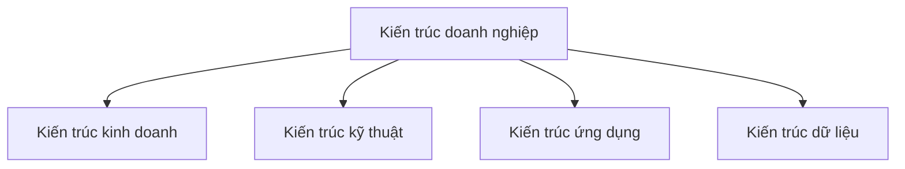
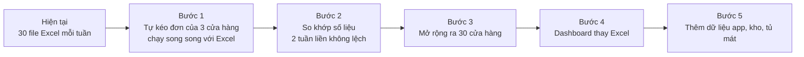
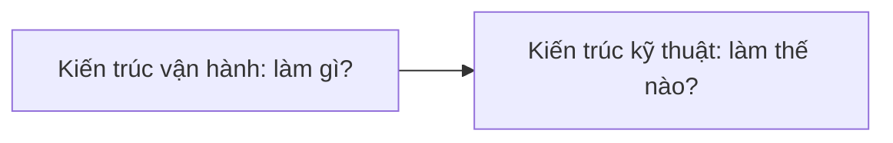
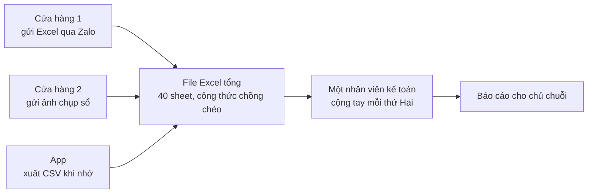
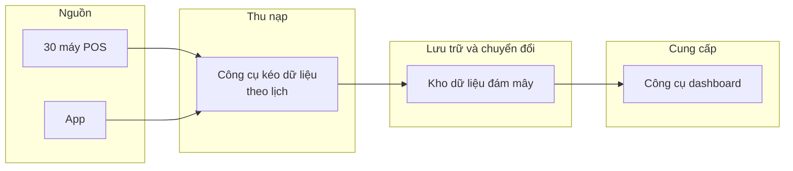

# Kiến trúc dữ liệu là gì?

Chương 3 bàn về việc **thiết kế kiến trúc dữ liệu tốt**. Bài đầu tiên này đặt nền móng: trước khi nói "tốt" hay "xấu", ta cần hiểu *kiến trúc doanh nghiệp* là gì, *kiến trúc dữ liệu* nằm ở đâu trong đó, và tác giả định nghĩa hai khái niệm này ra sao. Từ định nghĩa ấy, sách rút ra tiêu chí cho một kiến trúc dữ liệu "tốt".

**Tương tự đơn giản:** kiến trúc dữ liệu giống quy hoạch một thành phố đang lớn dần. Bạn không thể vẽ một bản đồ hoàn hảo cố định, vì dân số, nhu cầu và công nghệ giao thông luôn thay đổi. Quy hoạch tốt là quy hoạch cho phép sửa đường, mở thêm khu mới mà không phải đập cả thành phố đi xây lại.

---

:::note[Ghi nhớ nhanh]

- ⭐ **Định nghĩa của sách:** kiến trúc dữ liệu là thiết kế các hệ thống để hỗ trợ nhu cầu dữ liệu ngày càng phát triển của doanh nghiệp, đạt được bằng các quyết định linh hoạt, có thể đảo ngược, qua việc đánh giá cẩn thận các đánh đổi (trade-off).
- ⭐ **Kiến trúc tốt = linh hoạt + dễ bảo trì + dễ thay đổi.** Kiến trúc xấu là cứng nhắc, liên kết chặt, tập trung quá mức hoặc dùng sai công cụ.
- Kiến trúc dữ liệu là tập con của **kiến trúc doanh nghiệp**, kế thừa các thuộc tính: quy trình, chiến lược, quản lý thay đổi, đánh giá đánh đổi.
- **Cửa một chiều / cửa hai chiều** (Jeff Bezos): ưu tiên quyết định đảo ngược được.
- Có hai mặt: **kiến trúc vận hành** (cần làm gì) và **kiến trúc kỹ thuật** (làm như thế nào).
- Không có "kiến trúc tốt nhất", chỉ có kiến trúc **ít bất lợi nhất** cho hoàn cảnh của bạn.

:::

---

## Mục lục

- 1. Vì sao khái niệm này mơ hồ?
- 2. Kiến trúc doanh nghiệp (Enterprise Architecture)
- 3. Định nghĩa kiến trúc dữ liệu
- 4. Vận hành và kỹ thuật
- 5. Thế nào là kiến trúc dữ liệu "tốt"?
- Tóm tắt

## 1. Vì sao khái niệm này mơ hồ?

Giống như chính khái niệm "kỹ thuật dữ liệu" ở Chương 1, "kiến trúc dữ liệu" không có một định nghĩa thống nhất. Tài liệu về chủ đề này thường mâu thuẫn nhau hoặc đã lỗi thời. Vì thế các tác giả không hứa làm hài lòng tất cả mọi người; họ đưa ra một định nghĩa **thực dụng, mang tính chủ quan** đủ dùng cho các công ty có quy mô, quy trình và nhu cầu rất khác nhau.

Để định nghĩa kiến trúc dữ liệu, trước hết phải hiểu ngữ cảnh chứa nó: **kiến trúc doanh nghiệp**.

### Thuật ngữ trong bài — hiểu nôm na

Ví dụ trong chương này dùng chuỗi trà sữa **Mây** (30 cửa hàng, xem [phần giới thiệu](../intro.md)).

| Thuật ngữ | Nghĩa đời thường | Ví dụ ở chuỗi Mây |
| --- | --- | --- |
| Kiến trúc dữ liệu | Bản quy hoạch: dữ liệu sinh ra ở đâu, chảy qua đâu, cất ở đâu, ai dùng | Sơ đồ "30 máy POS → kho dữ liệu đám mây → dashboard" |
| Trade-off (đánh đổi) | Được cái này thì mất cái kia | Dữ liệu cập nhật tức thì thì đắt hơn, cập nhật mỗi đêm thì rẻ hơn |
| Liên kết chặt (tight coupling) | Các phần dính chặt vào nhau, sửa một chỗ hỏng chỗ khác | Dashboard đọc thẳng vào máy POS, đổi máy POS là dashboard chết |
| Technical debt (nợ kỹ thuật) | Đi đường tắt hôm nay, trả giá bằng công sửa sau này | File Excel gộp tay "tạm thời" dùng suốt 2 năm |
| Microservice | Ứng dụng chia thành nhiều dịch vụ nhỏ, mỗi dịch vụ một việc | App của Mây có dịch vụ đặt đơn, dịch vụ tích điểm, dịch vụ thanh toán riêng |
| Data lake | Kho chứa mọi loại dữ liệu ở dạng thô | Nơi cất ảnh hoá đơn, log app, file Excel lương |
| Big ball of mud | Hệ thống lộn xộn, không ai hiểu hết, ai cũng sợ sửa | Một file Excel 40 sheet, công thức chồng chéo, chỉ một người biết dùng |

## 2. Kiến trúc doanh nghiệp (Enterprise Architecture)

Kiến trúc doanh nghiệp có nhiều tập con: **kinh doanh, kỹ thuật, ứng dụng và dữ liệu**. Kiến trúc dữ liệu chính là một tập con của nó.

Từ "doanh nghiệp" hay gợi đến văn phòng công ty khô cứng, quy trình thác nước (waterfall), văn hoá trì trệ. Dù vậy, sách cho rằng ta vẫn học được nhiều điều ở đây. Dưới đây là ba định nghĩa kinh điển.

| Nguồn | Ý chính |
|---|---|
| **TOGAF** (The Open Group Architecture Framework, khung kiến trúc phổ biến nhất hiện nay) | "Doanh nghiệp" có thể là toàn bộ tổ chức hoặc một lĩnh vực cụ thể; kiến trúc luôn **xuyên suốt nhiều hệ thống và nhiều nhóm chức năng**. |
| **Gartner** (công ty tư vấn, nổi tiếng với Hype Cycle) | EA là một **nguyên tắc dẫn dắt doanh nghiệp chủ động** ứng phó với các lực gây gián đoạn, bằng cách xác định và phân tích các thay đổi hướng tới tầm nhìn và kết quả kinh doanh mong muốn. |
| **EABOK** (Enterprise Architecture Body of Knowledge, của tập đoàn MITRE, bản nháp 2004, không cập nhật nữa) | EA là một **mô hình tổ chức**, sự biểu diễn trừu tượng về doanh nghiệp nhằm **điều chỉnh chiến lược, hoạt động và công nghệ** để tạo lộ trình thành công. |

### Định nghĩa của tác giả

Từ ba định nghĩa trên, các tác giả rút ra các chủ đề chung: **thay đổi, liên kết (alignment), tổ chức, cơ hội, giải quyết vấn đề, di chuyển**. Họ đề xuất:

> Kiến trúc doanh nghiệp là việc thiết kế các hệ thống nhằm hỗ trợ sự thay đổi trong doanh nghiệp, đạt được bằng các quyết định linh hoạt và có thể đảo ngược thông qua việc đánh giá cẩn thận những đánh đổi.

Ba ý then chốt sẽ lặp lại xuyên suốt cuốn sách: **quyết định linh hoạt và đảo ngược được**, **quản lý thay đổi**, **đánh giá đánh đổi**.

### Quyết định đảo ngược được: cửa một chiều và cửa hai chiều

Vì sao cần quyết định có thể đảo ngược? Có hai lý do:

1. **Thế giới luôn thay đổi, không ai dự đoán được tương lai.** Quyết định đảo ngược được cho phép bạn chỉnh hướng khi có thông tin mới.
2. **Tổ chức có xu hướng tự nhiên "xơ cứng" (ossify) khi lớn dần.** Văn hoá ra quyết định đảo ngược được làm giảm rủi ro gắn với mỗi quyết định, nên bớt sợ thử nghiệm.

Jeff Bezos (Amazon) được ghi nhận là người đưa ra hình ảnh hai loại cửa:

| Loại cửa | Đặc điểm | Ví dụ trong sách |
|---|---|---|
| **Cửa một chiều (one-way door)** | Gần như không thể quay lại | Amazon bán hoặc đóng cửa AWS: rất khó xây lại một đám mây công cộng có vị thế tương đương |
| **Cửa hai chiều (two-way door)** | Bước vào, không thích thì quay ra | Amazon quy định microservice mới phải dùng DynamoDB; nếu chính sách không hiệu quả thì đảo ngược và tái cấu trúc sang cơ sở dữ liệu khác |

Rủi ro của cửa hai chiều thấp, nên tổ chức có thể ra nhiều quyết định hơn, lặp nhanh hơn, thu thập dữ liệu nhanh hơn.

#### Áp vào chuỗi Mây: cửa nào một chiều, cửa nào hai chiều?

Bảng dưới phân loại vài quyết định thật mà Mây phải đưa ra. Quyết định cửa hai chiều có thể làm nhanh; cửa một chiều cần cân nhắc kỹ.

| Quyết định ở Mây | Loại cửa | Vì sao |
| --- | --- | --- |
| Thử công cụ vẽ dashboard A trong 1 tháng | Hai chiều | Không hợp thì đổi công cụ khác, dữ liệu vẫn nằm trong kho |
| Đổi lịch chạy đường ống từ 2 giờ sang 1 giờ sáng | Hai chiều | Sửa một dòng cấu hình là quay lại được |
| Ký hợp đồng 5 năm với một hãng máy POS, dữ liệu chỉ xuất được bằng định dạng riêng của hãng | Một chiều | Muốn đổi phải thay máy ở 30 cửa hàng và mất lịch sử |
| Xoá vĩnh viễn đơn hàng cũ hơn 2 năm để tiết kiệm | Một chiều | Xoá rồi không lấy lại được, mô hình dự báo mất dữ liệu học |
| Cất dữ liệu ở định dạng mở (đọc được bằng nhiều công cụ) | Biến cửa một chiều thành hai chiều | Sau này đổi nhà cung cấp kho vẫn mang dữ liệu đi được |

### Quản lý thay đổi

Quản lý thay đổi gắn chặt với quyết định đảo ngược được. Doanh nghiệp vẫn cần các sáng kiến lớn; cách làm lý tưởng là **chia nhỏ thành nhiều thay đổi nhỏ, mỗi thay đổi là một cửa hai chiều**. Sách lấy ví dụ DynamoDB: từ bài báo khái niệm (2007) đến lúc Werner Vogels công bố dịch vụ trên AWS (2012) là khoảng 5 năm, trong đó các nhóm đã thực hiện vô số hành động nhỏ để biến nó thành sản phẩm thật. Quản lý những hành động nhỏ như vậy là cốt lõi của quản lý thay đổi.

Kiến trúc sư không chỉ vẽ sơ đồ IT rồi mơ về tương lai xa. Họ:

1. Xác định vấn đề ở trạng thái hiện tại (chất lượng dữ liệu kém, giới hạn khả năng mở rộng, mảng kinh doanh thua lỗ).
2. Xác định trạng thái mong muốn trong tương lai (chất lượng dữ liệu tốt hơn, giải pháp đám mây mở rộng được, quy trình kinh doanh được cải thiện).
3. Hiện thực hoá bằng các bước nhỏ, cụ thể, lặp đi lặp lại.

Và một câu cần nhớ: **giải pháp kỹ thuật tồn tại để phục vụ mục tiêu kinh doanh, không phải vì bản thân chúng.**

#### Áp vào chuỗi Mây: chia sáng kiến lớn thành bước nhỏ

Mây muốn chuyển từ "mỗi cửa hàng gửi file Excel" sang "kho dữ liệu đám mây tự động". Thay vì một cú chuyển lớn rủi ro, kỹ sư dữ liệu chia thành các bước nhỏ, mỗi bước đều quay lại được:

Ở bước 1 và 2, Excel vẫn chạy song song. Nếu hệ thống mới sai, Mây chỉ cần quay về Excel, không mất gì.

### Đánh giá đánh đổi

Sách lấy cảm hứng từ cuốn *Fundamentals of Software Architecture* (Mark Richards và Neal Ford): **đánh đổi là không thể tránh khỏi và có mặt khắp nơi**. Phần mềm và dữ liệu có vẻ "mềm" hơn thế giới vật lý (sửa một lỗi phần mềm dễ hơn thiết kế lại cánh máy bay), nhưng hệ thống số vẫn bị giới hạn bởi:

- Giới hạn vật lý: độ trễ, độ tin cậy, mật độ, mức tiêu thụ năng lượng.
- Giới hạn phi vật lý: đặc tính của ngôn ngữ và framework lập trình, khả năng quản lý độ phức tạp, ngân sách...

"Tư duy kỳ diệu dẫn đến kỹ thuật kém." Kỹ sư dữ liệu phải cân nhắc đánh đổi ở từng bước để thiết kế hệ thống tối ưu mà vẫn giảm được **nợ kỹ thuật** (technical debt) "lãi suất cao". Các tổ chức, và kiến trúc của họ, không thể đứng yên khi tốc độ thay đổi cao như vậy.

## 3. Định nghĩa kiến trúc dữ liệu

Kiến trúc dữ liệu là tập con của kiến trúc doanh nghiệp nên **kế thừa** các thuộc tính của nó: quy trình, chiến lược, quản lý thay đổi và đánh giá đánh đổi. Hai định nghĩa tham khảo:

- **TOGAF:** mô tả cấu trúc và sự tương tác của các loại và nguồn dữ liệu chính của doanh nghiệp, tài sản dữ liệu logic, tài sản dữ liệu vật lý và tài nguyên quản lý dữ liệu.
- **DAMA DMBOK** (DAMA là hiệp hội quản lý dữ liệu): xác định nhu cầu dữ liệu của doanh nghiệp (bất kể cấu trúc), thiết kế và duy trì các **bản thiết kế tổng thể (master blueprint)** để đáp ứng nhu cầu đó; dùng bản thiết kế để dẫn dắt tích hợp dữ liệu, kiểm soát tài sản dữ liệu và điều chỉnh đầu tư dữ liệu theo chiến lược kinh doanh.

### Định nghĩa của tác giả

> Kiến trúc dữ liệu là thiết kế các hệ thống để hỗ trợ nhu cầu dữ liệu ngày càng phát triển của doanh nghiệp, đạt được bằng các quyết định linh hoạt và có thể đảo ngược thông qua đánh giá cẩn thận về sự đánh đổi.

### Kiến trúc dữ liệu và kỹ thuật dữ liệu

Giống như vòng đời kỹ thuật dữ liệu là tập con của vòng đời dữ liệu, **kiến trúc kỹ thuật dữ liệu là tập con của kiến trúc dữ liệu chung**: đó là các hệ thống và khung tạo nên các phần chính của vòng đời kỹ thuật dữ liệu. Trong cuốn sách này, "kiến trúc dữ liệu" được dùng thay cho "kiến trúc kỹ thuật dữ liệu".

## 4. Vận hành và kỹ thuật

Kiến trúc dữ liệu có hai khía cạnh cần phân biệt:

| | Kiến trúc vận hành (operational) | Kiến trúc kỹ thuật (technical) |
|---|---|---|
| Trả lời câu hỏi | **Cái gì** cần xảy ra | **Làm như thế nào** |
| Nội dung | Yêu cầu chức năng liên quan đến con người, quy trình, công nghệ | Cách dữ liệu được nhập (ingest), lưu trữ, biến đổi, phục vụ trong vòng đời |
| Ví dụ trong sách | Dữ liệu phục vụ quy trình kinh doanh nào? Quản lý chất lượng dữ liệu ra sao? Độ trễ từ lúc dữ liệu sinh ra đến lúc truy vấn được là bao nhiêu? | Làm sao chuyển 10 TB dữ liệu mỗi giờ từ cơ sở dữ liệu nguồn sang data lake? |

Áp vào chuỗi Mây, cùng một nhu cầu được nhìn từ hai phía như sau:

| Kiến trúc vận hành (cần gì) | Kiến trúc kỹ thuật (làm thế nào) |
| --- | --- |
| Chủ chuỗi cần doanh thu hôm qua của từng cửa hàng trước 7 giờ sáng | Mỗi đêm 2 giờ kéo đơn từ 30 máy POS, làm sạch, nạp vào kho dữ liệu đám mây, công cụ điều phối báo động nếu 6 giờ chưa xong |
| Quản lý ca phải biết ngay khi tủ mát quá 8°C | Cảm biến đẩy số đo mỗi phút vào hàng đợi tin nhắn, chương trình nhỏ kiểm tra và gửi tin nhắn cảnh báo |
| Số điện thoại khách chỉ marketing được xem | Phân quyền trong kho dữ liệu, che số điện thoại với mọi vai trò khác |

Nói gọn: vận hành mô tả *việc cần làm*, kỹ thuật mô tả *cách làm*.

## 5. Thế nào là kiến trúc dữ liệu "tốt"?

> "Đừng nhắm tới kiến trúc tốt nhất; hãy chọn kiến trúc ít bất lợi nhất." (Mark Richards và Neal Ford)

Grady Booch định nghĩa: *kiến trúc là những quyết định thiết kế quan trọng định hình hệ thống, trong đó "quan trọng" được đo bằng chi phí thay đổi*. Kiến trúc sư dữ liệu nhắm tới những quyết định quan trọng ở mức nền tảng để có kiến trúc tốt.

Sách thừa nhận không có định nghĩa chính xác, "nhìn là biết". Tuy vậy có thể mô tả:

**Kiến trúc tốt:**
- Phục vụ yêu cầu kinh doanh bằng một tập **khối xây dựng chung, tái sử dụng rộng rãi**, vẫn giữ được tính linh hoạt và có cân nhắc đánh đổi hợp lý.
- **Linh hoạt và dễ bảo trì**, tiến hoá theo sự thay đổi của doanh nghiệp và các công nghệ, thực tiễn mới.
- Cấu trúc dữ liệu của năm ngoái có thể không đủ cho hôm nay, chứ đừng nói năm sau, nên tính linh hoạt là nền tảng.

**Kiến trúc xấu:**
- Độc đoán, cố nhồi một loạt quyết định "vừa vặn" vào một **quả bóng bùn lớn** (big ball of mud, khối hỗn độn không có cấu trúc).
- Liên kết chặt chẽ, cứng nhắc, tập trung quá mức, hoặc dùng sai công cụ cho công việc, cản trở phát triển và quản lý thay đổi.

Nếu thiết kế có tính đến khả năng đảo ngược, thay đổi sẽ ít tốn kém hơn.

Sáu **yếu tố xuyên suốt** (undercurrents) của vòng đời kỹ thuật dữ liệu là nền tảng của kiến trúc tốt cho mọi giai đoạn trưởng thành dữ liệu: bảo mật, quản trị dữ liệu (data management), DataOps, kiến trúc dữ liệu, orchestration và công nghệ phần mềm.

Cuối cùng: kiến trúc dữ liệu tốt là **một thực thể sống, không bao giờ kết thúc**. Theo định nghĩa của tác giả, thay đổi và tiến hoá chính là trọng tâm ý nghĩa của kiến trúc.

### Áp vào chuỗi Mây: kiến trúc xấu và kiến trúc tốt

Hai sơ đồ dưới cùng giải bài toán "báo cáo doanh thu" của Mây. Sơ đồ đầu là kiểu **quả bóng bùn**: mọi thứ dồn vào một file và một người.

Sơ đồ sau là kiến trúc có các **khối riêng biệt**: mỗi khối một việc, thay một khối không ảnh hưởng khối khác.

| Tiêu chí | Quả bóng bùn (Excel) | Kiến trúc khối riêng |
| --- | --- | --- |
| Thêm cửa hàng thứ 31 | Thêm sheet, sửa hàng chục công thức | Thêm một nguồn vào công cụ kéo dữ liệu |
| Kế toán nghỉ phép | Không ai làm được báo cáo | Hệ thống vẫn tự chạy |
| Đổi công cụ dashboard | Không áp dụng | Chỉ thay khối cuối, dữ liệu giữ nguyên |
| Chi phí ban đầu | Gần như 0 | Có, nhưng thấp nếu dùng dịch vụ có sẵn |
| Phù hợp khi | Mây còn 1-3 cửa hàng | Mây có 30 cửa hàng trở lên |

Hàng cuối nhắc lại tinh thần "ít bất lợi nhất": Excel không sai ở quy mô 3 cửa hàng, nó chỉ trở thành bất lợi khi Mây lớn lên.

## Tóm tắt

| Khái niệm | Điểm cần nhớ |
|---|---|
| Kiến trúc doanh nghiệp | Gồm kinh doanh, kỹ thuật, ứng dụng, dữ liệu; thiết kế hệ thống để hỗ trợ thay đổi |
| Kiến trúc dữ liệu | Tập con của EA; thiết kế hệ thống đáp ứng nhu cầu dữ liệu ngày càng tăng |
| Cửa hai chiều | Quyết định đảo ngược được, nên ưu tiên |
| Quản lý thay đổi | Chia sáng kiến lớn thành nhiều bước nhỏ đảo ngược được |
| Đánh đổi | Luôn tồn tại; phải đánh giá liên tục |
| Vận hành vs. kỹ thuật | Làm gì vs. làm thế nào |
| Kiến trúc tốt | Linh hoạt, dễ bảo trì, tiến hoá được; không phải "tốt nhất" mà là "ít bất lợi nhất" |
