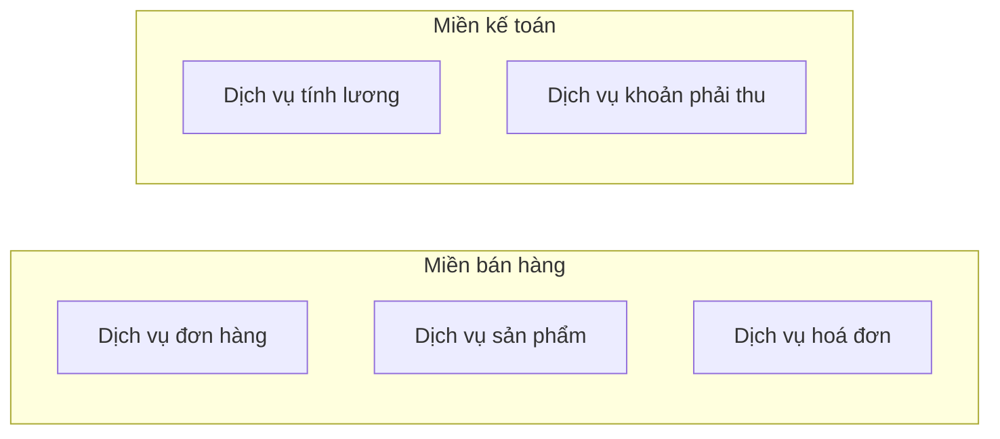
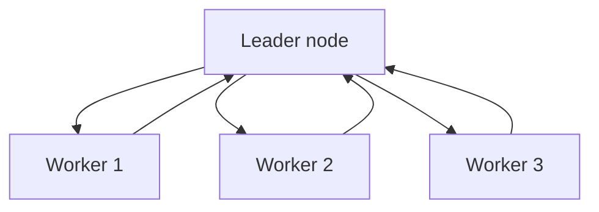
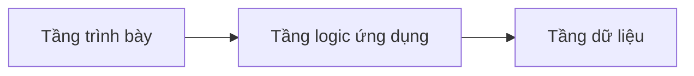
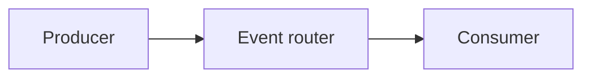

# Các khái niệm kiến trúc chính

Giữa vô số công cụ và kiến trúc mới xuất hiện mỗi tuần, ta không được quên mục tiêu chung: **lấy dữ liệu và biến nó thành thứ hữu ích cho khâu tiêu thụ ở hạ nguồn**. Bài này giới thiệu các khái niệm nền tảng cần có để thiết kế kiến trúc: miền và dịch vụ, hệ thống phân tán, liên kết chặt và lỏng (tầng, monolith, microservice), multitenancy, kiến trúc hướng sự kiện, và hai loại dự án brownfield và greenfield.

**Tương tự đơn giản:** hãy tưởng tượng một công ty như một toà nhà văn phòng. "Miền" là các phòng ban (bán hàng, kế toán), "dịch vụ" là từng bộ phận có nhiệm vụ riêng (lập hoá đơn). Hệ thống phân tán là nhiều toà nhà làm việc phối hợp; liên kết lỏng là mỗi toà tự vận hành được nhưng trao đổi qua cửa giao dịch chuẩn.

---

:::note[Ghi nhớ nhanh]

- ⭐ **Miền (domain)** là lĩnh vực thế giới thực bạn thiết kế; **dịch vụ (service)** là tập chức năng làm một nhiệm vụ. Một miền có nhiều dịch vụ, và dịch vụ có thể dùng chung giữa các miền.
- ⭐ **Liên kết lỏng lẻo là lý tưởng thực dụng**, nhưng monolith không hẳn xấu: có thể bắt đầu đơn giản rồi tách dần.
- Bốn đặc tính của hệ thống dữ liệu: **scalability, elasticity, availability, reliability**.
- Kiến trúc **một tầng** (single-tier) chỉ hợp cho thử nghiệm; production nên dùng **đa tầng** (multitier, thường ba tầng).
- Multitenancy: cân nhắc **hiệu năng (noisy neighbor)** và **bảo mật (cách ly dữ liệu)**.
- **Brownfield** (cải tạo cái cũ) dùng **strangler pattern** thay vì viết lại tất cả; **greenfield** coi chừng "hội chứng vật thể sáng bóng" và "phát triển hướng sơ yếu lý lịch".

:::

---

## Mục lục

- 1. Miền và dịch vụ
- 2. Hệ thống phân tán, khả năng mở rộng và thiết kế cho thất bại
- 3. Liên kết chặt và liên kết lỏng: tầng, monolith, microservice
- 4. Những cân nhắc riêng cho kiến trúc dữ liệu
- 5. Quyền truy cập người dùng: single-tenant và multitenant
- 6. Kiến trúc hướng sự kiện
- 7. Dự án brownfield và greenfield
- Tóm tắt

## 1. Miền và dịch vụ

Eric Evans định nghĩa miền là *một lĩnh vực của tri thức, ảnh hưởng hoặc hoạt động; lĩnh vực chủ đề mà người dùng áp dụng chương trình vào*.

- **Miền (domain):** lĩnh vực chủ đề trong **thế giới thực** mà bạn đang thiết kế.
- **Dịch vụ (service):** một tập hợp chức năng nhằm hoàn thành **một nhiệm vụ**. Ví dụ: dịch vụ xử lý đơn bán hàng chỉ xử lý đơn hàng khi chúng được tạo; nó không quản lý tồn kho hay cập nhật hồ sơ người dùng.

Một miền có thể chứa nhiều dịch vụ, và các miền có thể chia sẻ dịch vụ:

Ví dụ trong sách: miền bán hàng gồm đơn đặt hàng, lập hoá đơn và sản phẩm; miền kế toán gồm lập hoá đơn, tính lương và các khoản phải thu (AR). Hai miền **chia sẻ dịch vụ hoá đơn** vì bán hàng tạo ra hoá đơn và kế toán phải theo dõi để chắc chắn nhận được tiền; mỗi bên vẫn sở hữu miền riêng của mình.

**Cách xác định miền:** tập trung vào miền *đại diện cho cái gì trong thế giới thực* rồi suy ngược lại. Đừng sao chép mẫu có sẵn của công ty khác, vì chức năng bán hàng của công ty bạn có thể có điểm đặc thù. Lời khuyên tốt nhất: **đi nói chuyện với người dùng và các bên liên quan**, lắng nghe, rồi xây dịch vụ giúp họ làm việc; tránh cái bẫy "kiến trúc trong chân không" (architecting in a vacuum).

## 2. Hệ thống phân tán, khả năng mở rộng và thiết kế cho thất bại

Phần này gắn với nguyên tắc 2 và 3. Kỹ sư dữ liệu quan tâm bốn đặc tính liên quan chặt chẽ:

| Đặc tính | Ý nghĩa |
|---|---|
| **Scalability** (khả năng mở rộng) | Tăng công suất hệ thống để cải thiện hiệu năng và đáp ứng nhu cầu, ví dụ xử lý tỷ lệ truy vấn cao hoặc tập dữ liệu khổng lồ |
| **Elasticity** (độ đàn hồi) | Khả năng của hệ thống mở rộng được để tự động **tăng giảm quy mô** theo khối lượng công việc. Scale up khi nhu cầu tăng, scale down để tiết kiệm tiền; hệ thống hiện đại có thể **scale to zero** |
| **Availability** (tính sẵn sàng) | Phần trăm thời gian dịch vụ ở trạng thái hoạt động |
| **Reliability** (độ tin cậy) | Xác suất hệ thống đáp ứng tiêu chuẩn khi thực hiện chức năng trong khoảng thời gian xác định |

**Chúng liên quan thế nào?** Nếu hệ thống không đáp ứng yêu cầu hiệu năng trong một khoảng thời gian, nó có thể ngừng phản hồi; do đó độ tin cậy thấp có thể dẫn đến tính sẵn sàng thấp. Ngược lại, scale động giúp đảm bảo hiệu năng mà không cần kỹ sư can thiệp thủ công, nên **độ đàn hồi cải thiện độ tin cậy**.

### Scale up và scale out

- **Vertical scaling (scale dọc):** một máy mạnh hơn, tăng CPU, đĩa, bộ nhớ, I/O. Nhưng tài nguyên trên một máy có **giới hạn cứng**; và nếu máy đó chết thì sao? Máy đơn lẻ thường không thể cung cấp availability và reliability cao.
- **Horizontal scaling (scale ngang):** **thêm nhiều máy** để đáp ứng tải và tài nguyên. Đây là bản chất của **hệ thống phân tán**.

Hệ thống scale ngang phổ biến có một **nút lãnh đạo (leader node)** làm đầu mối chính để khởi tạo, theo dõi tiến độ và hoàn tất công việc; nó phân nhiệm vụ cho các **nút công nhân (worker node)**, rồi nhận kết quả trả về.

Các kiến trúc phân tán hiện đại cũng thường **dự phòng (redundant)**: dữ liệu được sao chép, nên nếu một máy hỏng, máy khác tiếp tục phần việc còn dang dở, và cụm có thể thêm máy để khôi phục công suất.

Gần như mọi object storage và data warehouse đám mây bạn dùng đều có yếu tố phân tán bên trong. Chi tiết quản lý thường được che đi để bạn tập trung vào kiến trúc cấp cao. Tuy vậy sách khuyên học thêm về hệ thống phân tán vì nó giúp hiểu và cải thiện hiệu năng pipeline; tài liệu gợi ý: *Designing Data-Intensive Applications* (Martin Kleppmann).

## 3. Liên kết chặt và liên kết lỏng: tầng, monolith, microservice

Khi thiết kế, bạn chọn mức độ phụ thuộc lẫn nhau giữa các miền, dịch vụ và tài nguyên:

- **Liên kết chặt (tightly coupled):** quy trình và phụ thuộc cực kỳ tập trung, mỗi phần phụ thuộc nhiều vào mọi phần khác.
- **Liên kết lỏng (loosely coupled):** các miền và dịch vụ **phi tập trung**, không phụ thuộc chặt vào nhau. Mặt trái: các nhóm phi tập trung có thể xây hệ thống mà dữ liệu của họ **đồng nghiệp không dùng được**. Cần chỉ định rõ tiêu chuẩn, quyền sở hữu và trách nhiệm.

Kiến trúc dữ liệu "tốt" là cân bằng giữa hai đầu này. Nhiều ý tưởng ở đây xuất phát từ phát triển phần mềm; sách giữ ngữ cảnh gốc rồi chỉ ra điểm khác biệt khi áp dụng cho dữ liệu.

### Các tầng kiến trúc

Kiến trúc có nhiều lớp (dữ liệu, ứng dụng, logic nghiệp vụ, trình bày...), cần biết cách tách chúng. Liên kết chặt giữa các lớp tạo ra điểm yếu rõ ràng.

**Một tầng (single-tier):** cơ sở dữ liệu và ứng dụng **gắn chặt**, nằm trên một máy chủ duy nhất (laptop hoặc một VM đám mây). Nếu máy chủ, cơ sở dữ liệu hay ứng dụng lỗi thì toàn bộ sụp. Phù hợp để **tạo nguyên mẫu và phát triển**, không khuyến nghị cho production. Ngay cả khi có dự phòng (replica failover), vẫn còn hạn chế khác: chạy truy vấn phân tích trực tiếp trên cơ sở dữ liệu ứng dụng đang chạy production là không thực tế (và không nên), vì có thể làm tràn cơ sở dữ liệu và khiến ứng dụng không khả dụng.

**Đa tầng (multitier / n-tier):** tách riêng các lớp: dữ liệu, ứng dụng, logic nghiệp vụ, trình bày... Các lớp xếp theo thứ bậc từ dưới lên: lớp trên phụ thuộc lớp dưới, không ngược lại. Ý tưởng là tách dữ liệu khỏi ứng dụng, và ứng dụng khỏi phần trình bày.

**Ba tầng (three-tier):** dạng phổ biến của đa tầng, thiết kế client-server được dùng rộng rãi, gồm **tầng dữ liệu, tầng logic ứng dụng, tầng trình bày**. Mỗi tầng tách biệt, cho phép **tách biệt mối quan tâm** (separation of concerns), và bạn tự do chọn công nghệ cho mỗi tầng.

Sách thấy nhiều kiến trúc một tầng ở production: đơn giản nhưng có giới hạn nghiêm trọng, "chạy tốt cho đến khi hết chạy tốt". Ví dụ, lớp dữ liệu và lớp logic cạnh tranh tài nguyên (đĩa, CPU, bộ nhớ). Lời khuyên: dùng khái niệm tầng để đánh giá kiến trúc phân lớp và các phụ thuộc; **bắt đầu đơn giản và tiến lên thêm tầng khi kiến trúc phức tạp hơn**.

#### Chia sẻ tài nguyên giữa các nút

Với hệ thống phân tán nhiều tầng, cần nghĩ xem các nút có chia sẻ tài nguyên không:

| Kiểu | Mô tả | Khi nào hợp |
|---|---|---|
| **Shared-nothing** (không chia sẻ gì) | Mỗi yêu cầu do một nút xử lý; các nút **không chia sẻ** bộ nhớ, đĩa, CPU với nhau. Dữ liệu và tài nguyên được cô lập theo nút | Muốn tránh tranh chấp tài nguyên |
| **Chia sẻ tài nguyên** | Nhiều nút xử lý nhiều yêu cầu và dùng chung tài nguyên | Chấp nhận rủi ro tranh chấp tài nguyên |
| **Shared-disk** (đĩa chia sẻ) | Các nút dùng chung đĩa và bộ nhớ mà tất cả nút truy cập được | Phổ biến khi muốn chia sẻ tài nguyên để chịu lỗi nút ngẫu nhiên |

### Monolith

Khái niệm chung: gom **càng nhiều càng tốt dưới một mái nhà**; ở dạng cực đoan là một codebase duy nhất chạy trên một máy, cung cấp cả logic ứng dụng và giao diện người dùng.

Khớp nối trong monolith xét theo hai cách:

- **Technical coupling (khớp nối kỹ thuật):** liên quan đến các tầng kiến trúc.
- **Domain coupling (khớp nối miền):** liên quan đến cách các miền gắn với nhau.

Hai loại này có thể độc lập: bạn có thể có ứng dụng đa tầng (tách lớp) nhưng vẫn chia sẻ nhiều miền; hoặc một kiến trúc một tầng chỉ phục vụ một miền.

Liên kết chặt nghĩa là **thiếu tính mô-đun**. Hoán đổi hay nâng cấp thành phần thường là "đổi nỗi đau này lấy nỗi đau khác"; tái sử dụng thành phần là khó hoặc bất khả. Cải thiện monolith giống **trò chơi mạo hiểm**: một thành phần tốt lên thường kéo theo hậu quả chưa biết ở chỗ khác. Các nhóm dữ liệu hay bỏ qua việc xử lý độ phức tạp tăng dần của monolith, để nó thành **big ball of mud**. (Chương 4 so sánh sâu hơn monolith với công nghệ phân tán, và nói về **distributed monolith**: dạng lai kỳ lạ khi xây hệ thống phân tán mà vẫn liên kết quá chặt.)

### Microservice

Đối lập với monolith (dịch vụ đan xen, tập trung, liên kết chặt), **microservice** gồm các dịch vụ **riêng biệt, phi tập trung, liên kết lỏng**. Mỗi dịch vụ có một chức năng cụ thể, tách rời khỏi dịch vụ khác trong miền. Nếu một dịch vụ tạm ngừng, nó **không ảnh hưởng** khả năng hoạt động của các dịch vụ khác.

Câu hỏi thường gặp: làm sao chuyển monolith thành nhiều microservice? Tuỳ vào độ phức tạp của monolith và công sức tách dịch vụ. Có khi monolith **không thể tách**; khi đó nên bắt đầu xây **kiến trúc song song mới** với các dịch vụ tách riêng kiểu thân thiện microservice. Sách không đề xuất cải tổ toàn bộ mà là **tách dần từng dịch vụ**. Monolith không xuất hiện trong một đêm và là vấn đề **công nghệ lẫn tổ chức**, nên cần sự ủng hộ của các bên liên quan nếu định chia nhỏ nó. Tài liệu gợi ý: *Software Architecture: The Hard Parts* (Neal Ford và cộng sự).

## 4. Những cân nhắc riêng cho kiến trúc dữ liệu

Các khái niệm liên kết chặt/lỏng bắt nguồn từ phát triển phần mềm (có cái cách đây hơn 20 năm). Dù thực hành kiến trúc dữ liệu đang vay mượn từ đó, ta vẫn thường thấy **kiến trúc dữ liệu rất monolith, liên kết chặt**, một phần do bản chất của công nghệ dữ liệu hiện có và cách chúng tích hợp.

Ví dụ: data pipeline hút dữ liệu từ nhiều nguồn vào một **data warehouse trung tâm**, vốn đã là monolith. "Microservice tương đương" cho data warehouse là tách quy trình thành **pipeline riêng theo miền**, nối vào data warehouse riêng theo miền: pipeline bán hàng nối vào warehouse bán hàng, tương tự cho miền tồn kho và sản phẩm.

Thay vì giáo điều "microservice tốt hơn monolith", sách khuyên: dùng **liên kết lỏng như một lý tưởng thực dụng**, đồng thời nhận ra hiện trạng và giới hạn của công nghệ dữ liệu đang dùng. Kết hợp lựa chọn công nghệ **đảo ngược được** để mô-đun hoá và liên kết lỏng bất cứ khi nào có thể.

Kiến trúc đa tầng giải quyết thách thức **kỹ thuật** của tài nguyên dùng chung nhưng chưa giải quyết độ phức tạp của việc **chia sẻ miền**. Ví dụ nhóm phân tích cần dữ liệu từ bán hàng và tồn kho; hai miền khác nhau và phải xem riêng. Có hai cách tiếp cận:

1. **Tập trung hoá:** một nhóm duy nhất thu thập dữ liệu từ mọi miền và đối chiếu để dùng toàn tổ chức (cách phổ biến trong data warehousing truyền thống).
2. **Data mesh:** mỗi nhóm phần mềm chịu trách nhiệm chuẩn bị dữ liệu của mình để phần còn lại của tổ chức dùng (xem bài 5).

**Lời khuyên của sách:** monolith không hẳn xấu; trong một số điều kiện, bắt đầu bằng monolith là hợp lý. Khi cần triển khai nhanh, nó thường là lựa chọn đơn giản hơn. Nhưng hãy **chuẩn bị tách nó thành các thành phần nhỏ hơn về sau** và đừng quá phụ thuộc vào cấu trúc ban đầu.

## 5. Quyền truy cập người dùng: single-tenant và multitenant

Kỹ sư dữ liệu phải quyết định có **chia sẻ hệ thống** giữa nhiều nhóm, tổ chức, khách hàng không. Theo một nghĩa nào đó mọi dịch vụ đám mây đều là **multitenant** (nhiều đối tượng thuê, tenant) ở nhiều mức: một instance điện toán thường nằm trên máy chủ dùng chung nhưng VM cho mức cách ly nhất định; object storage là hệ thống multitenant, nhà cung cấp đảm bảo bảo mật và cách ly *miễn là khách hàng cấu hình quyền đúng*.

Ở quy mô nhỏ hơn, bạn cũng phải quyết định: nhiều phòng ban trong một công ty lớn có dùng chung một data warehouse không? Có chia sẻ dữ liệu của nhiều khách hàng lớn trong cùng một bảng không?

Hai yếu tố cần cân nhắc:

| Yếu tố | Câu hỏi |
|---|---|
| **Hiệu năng** | Hệ thống có cho hiệu năng nhất quán cho mọi tenant, hay sẽ có vấn đề **noisy neighbor** (hàng xóm ồn ào): tenant này dùng nhiều làm giảm hiệu năng tenant khác? |
| **Bảo mật** | Dữ liệu của các tenant có được **cách ly đúng cách**? Với tenant là khách hàng bên ngoài, họ không được biết đến nhau, và kỹ sư phải **ngăn rò rỉ dữ liệu** |

Chiến lược cách ly khác nhau tuỳ hệ thống. Ví dụ dùng bảng multitenant và cách ly bằng **view** thường chấp nhận được, nhưng phải chắc chắn các view không thể làm rò rỉ dữ liệu. Hãy đọc tài liệu nhà cung cấp hoặc dự án để hiểu chiến lược và rủi ro phù hợp.

## 6. Kiến trúc hướng sự kiện

Doanh nghiệp hiếm khi tĩnh. Những điều hay xảy ra: có khách hàng mới, đơn hàng mới, một yêu cầu sản phẩm hoặc dịch vụ... Tất cả là **sự kiện (event)**, định nghĩa rộng là *điều gì đó đã xảy ra, điển hình là sự thay đổi trạng thái của một thứ*. Ví dụ khách tạo đơn hàng mới, rồi sau đó cập nhật nó.

**Quy trình hướng sự kiện (event-driven workflow)** gồm khả năng tạo, cập nhật và di chuyển sự kiện **không đồng bộ** qua các phần của vòng đời kỹ thuật dữ liệu. Nó xoay quanh ba việc: **sản xuất (produce), định tuyến (route), tiêu thụ (consume)** sự kiện. Sự kiện được tạo và chuyển đến nơi tiêu thụ **không có phụ thuộc chặt** giữa producer, bộ định tuyến sự kiện và consumer.

**Kiến trúc hướng sự kiện (event-driven architecture)** dùng quy trình trên để **giao tiếp giữa các dịch vụ**. Ưu điểm: phân phối trạng thái của sự kiện qua nhiều dịch vụ. Hữu ích khi một dịch vụ ngoại tuyến, một nút trong hệ thống phân tán lỗi, hoặc khi muốn nhiều consumer/dịch vụ truy cập cùng một sự kiện. **Bất cứ khi nào có các dịch vụ liên kết lỏng, đó là ứng viên cho kiến trúc hướng sự kiện.** Nhiều ví dụ sau trong chương có dạng này. (Chương 5 nói thêm về streaming và nhắn tin hướng sự kiện.)

*Ví dụ minh hoạ (do người ghi chép thêm):* dịch vụ đơn hàng phát sự kiện "OrderCreated"; dịch vụ kho trừ tồn, dịch vụ hoá đơn lập hoá đơn, và pipeline phân tích cùng tiêu thụ sự kiện đó mà dịch vụ đơn hàng không cần biết họ là ai.

## 7. Dự án brownfield và greenfield

Trước khi thiết kế, cần biết bạn bắt đầu từ **trang giấy trắng** hay **thiết kế lại cái đang có**. Mỗi loại cần đánh giá đánh đổi khác nhau.

### Brownfield

Dự án **brownfield** thường là tái cấu trúc và tổ chức lại kiến trúc hiện có, bị ràng buộc bởi các lựa chọn quá khứ và hiện tại. Vì quản lý thay đổi là phần quan trọng của kiến trúc, bạn phải tìm cách vượt qua những ràng buộc này và vạch con đường đạt mục tiêu kinh doanh, kỹ thuật mới. Cần **hiểu thấu kiến trúc cũ** và sự tương tác giữa công nghệ cũ và mới.

Dễ nhất là chỉ trích quyết định của nhóm trước; tốt hơn là **đào sâu, đặt câu hỏi và hiểu vì sao** họ quyết định như vậy. **Đồng cảm và ngữ cảnh** giúp chẩn đoán vấn đề, nhận ra cơ hội và cạm bẫy.

Cách giới thiệu kiến trúc mới và loại bỏ cái cũ:

- **Đại tu toàn bộ (wholesale rewrite):** nhiều nhóm lao vào, thường phát hiện việc ngừng dùng cái cũ giữa chừng. Phổ biến nhưng **không khuyến khích** vì rủi ro cao, thiếu kế hoạch, hay dẫn đến quyết định tốn kém không cứu vãn được. Việc của bạn là ra quyết định **đảo ngược được và có ROI cao**.
- **Strangler pattern (mẫu cây bóp cổ):** hệ thống mới **dần thay thế từng thành phần** của kiến trúc cũ cho đến khi cũ bị thay hoàn toàn. Hấp dẫn nhờ cách tiếp cận có chủ đích, "phẫu thuật", gỡ từng phần một, cho phép quyết định linh hoạt, đảo ngược được, đồng thời đánh giá tác động của việc ngừng dùng lên các hệ thống phụ thuộc.

Lưu ý: việc ngừng sử dụng (deprecation) có thể chỉ là lời khuyên "tháp ngà", không thực tế hoặc không thể làm được ở tổ chức lớn. Ai đó, ở đâu đó, đang dùng các thành phần legacy. Như câu nói trích trong sách: *"Legacy là cách nói trịch thượng để mô tả thứ gì đó đang kiếm ra tiền."* Nếu có thể ngừng dùng, hãy chứng minh giá trị trên nền tảng mới bằng cách tăng dần độ trưởng thành, đưa ra bằng chứng thành công, rồi mới thực hiện **kế hoạch rút lui** (exit plan) đóng các hệ thống cũ.

### Greenfield

Dự án **greenfield** cho phép bạn khởi đầu mới, không bị ràng buộc bởi lịch sử hay legacy. Chúng thường **dễ hơn brownfield** và nhiều kiến trúc sư thấy thú vị hơn: có dịp thử công cụ và mẫu kiến trúc mới nhất. Nhưng cần chú ý:

- **Hội chứng vật thể sáng bóng (shiny object syndrome):** cảm thấy bị thôi thúc dùng công nghệ mới nhất mà không hiểu nó tác động ra sao đến giá trị dự án.
- **Phát triển hướng sơ yếu lý lịch (resume-driven development):** tích hợp công nghệ ấn tượng mà không ưu tiên mục tiêu cuối cùng của dự án.

**Luôn ưu tiên yêu cầu hơn là xây thứ gì đó thú vị.**

Dù brownfield hay greenfield, hãy luôn bám các nguyên tắc kiến trúc "tốt": đánh giá đánh đổi, ra quyết định linh hoạt và đảo ngược được, và hướng tới ROI dương.

## Tóm tắt

| Khái niệm | Ý chốt |
|---|---|
| Miền, dịch vụ | Miền là lĩnh vực thế giới thực; dịch vụ làm một nhiệm vụ; có thể dùng chung giữa các miền |
| Scalability, elasticity, availability, reliability | Bốn đặc tính liên quan; độ đàn hồi cải thiện độ tin cậy |
| Scale dọc vs. ngang | Dọc có giới hạn cứng, ngang tạo hệ thống phân tán (leader và worker) |
| Một tầng vs. đa tầng | Một tầng chỉ hợp thử nghiệm; ba tầng là phổ biến |
| Shared-nothing, shared-disk | Mức độ chia sẻ tài nguyên giữa các nút |
| Monolith vs. microservice | Monolith không xấu để bắt đầu nhưng khó đổi; microservice liên kết lỏng |
| Multitenancy | Hiệu năng (noisy neighbor) và bảo mật (cách ly) |
| Hướng sự kiện | Producer, router, consumer; hợp với dịch vụ liên kết lỏng |
| Brownfield | Dùng strangler pattern, tránh viết lại toàn bộ |
| Greenfield | Đừng sa vào vật thể sáng bóng và resume-driven development |
