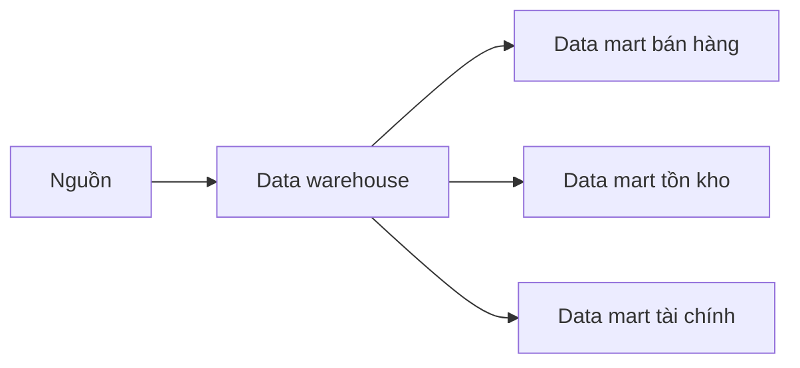
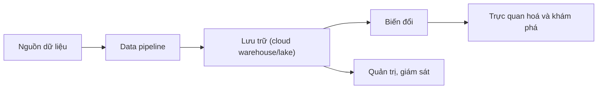

# Ví dụ kiến trúc dữ liệu (phần 1): data warehouse, data lake và Modern Data Stack

Kiến trúc dữ liệu là môn học trừu tượng nên học bằng ví dụ sẽ dễ hơn. Bài này đi qua nhóm kiến trúc thiên về **xử lý theo lô (batch)**: data warehouse (truyền thống và đám mây), data mart, data lake, sự hội tụ giữa lake và warehouse (data lakehouse, nền tảng dữ liệu) và Modern Data Stack. Danh sách không đầy đủ, mục đích là giúp bạn quen các mẫu phổ biến và thấy rõ sự linh hoạt cùng phân tích đánh đổi cần thiết.

**Tương tự đơn giản:** data warehouse giống một **thư viện đã phân loại và dán nhãn kỹ**, tìm sách rất nhanh nhưng nhập sách phải qua quy trình. Data lake giống một **nhà kho khổng lồ** cho phép vứt mọi thứ vào, rẻ và linh hoạt, nhưng nếu không dán nhãn thì thành bãi rác. Lakehouse là nhà kho có thêm hệ thống phân loại của thư viện.

---

:::note[Ghi nhớ nhanh]

- ⭐ **Data warehouse:** kho dữ liệu trung tâm, có cấu trúc cao, dùng cho báo cáo và phân tích; đặc trưng là **tách OLAP khỏi OLTP** và **tập trung, tổ chức dữ liệu**.
- ⭐ **Data lake 1.0 đã thất bại với nhiều tổ chức** (data swamp, WORN, khó xử lý, chi phí đội lên); hướng đi mới là **lakehouse** và **hội tụ** lake với warehouse.
- **ETL** (biến đổi trước khi tải) và **ELT** (tải thô rồi biến đổi trong warehouse) là hai cách nạp warehouse.
- **Cloud data warehouse** (Redshift, BigQuery, Snowflake) **tách compute khỏi storage**, dữ liệu ở object storage.
- **Data mart** là tập con của warehouse phục vụ một bộ phận; thêm một lớp biến đổi để truy vấn nhanh.
- **Modern Data Stack:** các thành phần cắm-và-chạy, mô-đun, dựa trên đám mây, giá minh bạch.

:::

---

## Mục lục

- 1. Data warehouse
- 2. Data warehouse đám mây
- 3. Data mart
- 4. Data lake
- 5. Hội tụ: lakehouse và nền tảng dữ liệu
- 6. Modern Data Stack
- Tóm tắt

## 1. Data warehouse

**Data warehouse** (kho dữ liệu) là một trung tâm dữ liệu dùng cho **báo cáo và phân tích**. Dữ liệu trong đó thường được định dạng và cấu trúc cao cho các use case phân tích. Đây là một trong những kiến trúc dữ liệu **lâu đời nhất, được thiết lập tốt nhất**.

Năm 1989, **Bill Inmon** khởi xướng khái niệm và mô tả nó là *"một bộ sưu tập dữ liệu hướng chủ đề (subject-oriented), tích hợp (integrated), không thay đổi (nonvolatile) và biến thiên theo thời gian (time-variant) để hỗ trợ các quyết định của ban quản lý"*. Dù kỹ thuật đã thay đổi lớn, sách cho rằng định nghĩa này vẫn còn giá trị.

Trước đây data warehouse chủ yếu thuộc về các doanh nghiệp ngân sách lớn (thường hàng triệu đô) vừa mua hệ thống vừa trả đội ngũ nội bộ bảo trì: rất tốn kém và nhiều công sức. Mô hình trả tiền theo nhu cầu có thể mở rộng đã đưa data warehouse đám mây đến cả công ty nhỏ; nhà cung cấp bên thứ ba quản lý hạ tầng nên công ty làm được nhiều việc hơn với ít người hơn.

### Hai loại kiến trúc data warehouse

- **Kiến trúc tổ chức (organizational):** tổ chức dữ liệu theo cấu trúc và quy trình của các nhóm kinh doanh.
- **Kiến trúc kỹ thuật (technical):** phản ánh bản chất kỹ thuật, ví dụ **MPP** (massively parallel processing, xử lý song song hàng loạt).

Một công ty có thể có data warehouse mà không có hệ thống MPP, hoặc chạy MPP mà không tổ chức thành data warehouse. Tuy vậy hai loại này "tồn tại trong một vòng tròn hoàn hảo" nên thường được đồng nhất.

### Hai đặc điểm của kiến trúc data warehouse tổ chức

1. **Tách OLAP khỏi cơ sở dữ liệu production (OLTP).** OLTP = xử lý giao dịch trực tuyến; OLAP = xử lý phân tích trực tuyến. Việc di chuyển dữ liệu sang hệ thống vật lý riêng **giảm tải cho hệ thống production** và cải thiện hiệu năng phân tích; điều này rất quan trọng khi doanh nghiệp phát triển.
2. **Tập trung và tổ chức dữ liệu.** Theo truyền thống, warehouse lấy dữ liệu từ hệ thống ứng dụng bằng **ETL**:
   - **Extract (trích xuất):** lấy dữ liệu từ hệ thống nguồn.
   - **Transform (biến đổi):** làm sạch, chuẩn hoá, tổ chức, áp logic nghiệp vụ thành dạng mô hình hoá cao (Chương 8 nói về biến đổi và mô hình hoá).
   - **Load (tải):** đẩy dữ liệu vào cơ sở dữ liệu đích của warehouse.

   Dữ liệu được nạp vào nhiều trung tâm dữ liệu phục vụ nhu cầu phân tích của các ngành, mảng, phòng ban. Data warehouse và ETL đi cùng cấu trúc kinh doanh cụ thể, gồm DBA và nhóm phát triển ETL thực hiện chỉ đạo của lãnh đạo để dữ liệu báo cáo, phân tích phù hợp quy trình kinh doanh.


### Kiến trúc kỹ thuật: MPP

Các hệ thống MPP đầu tiên ra đời cuối thập niên 1970 và phổ biến từ thập niên 1980. MPP về cơ bản hỗ trợ **cùng ngữ nghĩa SQL** như cơ sở dữ liệu quan hệ cho ứng dụng, nhưng được tối ưu để **quét song song lượng dữ liệu lớn**, nên tính toán thống kê và tổng hợp hiệu năng cao. Những năm gần đây, MPP chuyển từ kiến trúc **hàng (row)** sang **cột (columnar)** để phục vụ truy vấn và dữ liệu lớn hơn, đặc biệt ở warehouse đám mây. MPP là thiết yếu để chạy truy vấn hiệu năng cho doanh nghiệp lớn khi nhu cầu báo cáo tăng.

### ETL và ELT

**ELT** (Extract, Load, Transform) là biến thể của ETL: dữ liệu gần như được chuyển **thẳng từ hệ thống production vào vùng staging** trong warehouse. "Staging" ở đây nghĩa là dữ liệu còn **thô**. Thay vì dùng hệ thống bên ngoài, **các phép biến đổi chạy ngay trong warehouse**, tận dụng sức mạnh tính toán của warehouse đám mây và công cụ xử lý dữ liệu. Dữ liệu được xử lý theo lô và kết quả ghi vào bảng và view để phân tích. ELT cũng phổ biến trong cách bố trí streaming: sự kiện được stream từ quá trình **CDC** (change data capture, bắt thay đổi dữ liệu), lưu ở vùng staging rồi biến đổi trong warehouse.

| | ETL | ELT |
|---|---|---|
| Nơi biến đổi | Hệ thống/công cụ ngoài, **trước khi** tải | **Bên trong** warehouse, sau khi tải dữ liệu thô |
| Dữ liệu vào warehouse | Đã làm sạch, mô hình hoá | Thô, ở vùng staging |
| Khi nào hợp | Warehouse truyền thống, tính toán hạn chế | Warehouse đám mây, tính toán mạnh |

*Ví dụ minh hoạ (do người ghi chép thêm):* ELT thường là SQL chạy ngay trong warehouse sau khi dữ liệu thô đã được tải vào bảng staging.

```sql
-- Dữ liệu thô đã nằm ở bảng staging.orders_raw (đã tải bằng bước Load)
CREATE TABLE analytics.daily_revenue AS
SELECT order_date, SUM(amount) AS revenue
FROM staging.orders_raw
WHERE status = 'completed'
GROUP BY order_date;
```

Phiên bản ELT thứ hai (**transform-on-read**, biến đổi khi đọc) phổ biến trong làn sóng big data của hệ sinh thái Hadoop; sẽ nói ở mục data lake.

## 2. Data warehouse đám mây

Data warehouse đám mây là bước tiến lớn của kiến trúc warehouse tại chỗ, kéo theo thay đổi lớn ở kiến trúc tổ chức.

- **Amazon Redshift** khởi đầu cuộc cách mạng này. Thay vì phải ước lượng quy mô hệ thống MPP cho vài năm tới và ký hợp đồng hàng triệu đô, công ty có thể **tăng dần cụm Redshift theo yêu cầu**, thậm chí tạo cụm mới cho khối lượng công việc cụ thể rồi xoá khi hết cần.
- **Google BigQuery, Snowflake** và các đối thủ phổ biến ý tưởng **tách compute khỏi storage**: dữ liệu nằm trong **object storage** (gần như vô hạn), còn sức mạnh tính toán tăng theo yêu cầu, cho khả năng big data đặc biệt mà không phải trả chi phí dài hạn cho hàng nghìn nút.

Warehouse đám mây mở rộng khả năng của MPP để đáp ứng nhiều use case big data mà trước đây cần cụm Hadoop:

- Xử lý **petabyte trong một truy vấn**.
- Hỗ trợ cấu trúc dữ liệu cho phép lưu **hàng chục megabyte văn bản thô trên mỗi hàng**, hoặc tài liệu **JSON** phức tạp.
- Khi cloud warehouse và data lake trưởng thành, **ranh giới giữa chúng tiếp tục mờ đi**.

Tác động của các khả năng mới lớn đến mức sách cho rằng có thể xem xét bỏ hẳn thuật ngữ "data warehouse": các dịch vụ này đang tiến hoá thành **nền tảng dữ liệu mới** với khả năng rộng hơn nhiều so với MPP truyền thống.

## 3. Data mart

**Data mart** là tập con tinh gọn hơn của warehouse, thiết kế phục vụ phân tích và báo cáo cho **một tổ chức con, một bộ phận hoặc một mảng kinh doanh**; mỗi bộ phận có trung tâm dữ liệu riêng theo nhu cầu. Trái với data warehouse đầy đủ phục vụ cả tổ chức hoặc doanh nghiệp.

Data mart tồn tại vì hai lý do:

1. Giúp **nhà phân tích và nhà phát triển báo cáo truy cập dữ liệu dễ hơn**.
2. Cung cấp **thêm một giai đoạn biến đổi** sau giai đoạn của pipeline ETL hoặc ELT gốc. Điều này cải thiện đáng kể hiệu năng khi báo cáo hoặc truy vấn cần join và tổng hợp phức tạp, đặc biệt với dữ liệu thô lớn. Quá trình biến đổi có thể đưa dữ liệu đã join và tổng hợp sẵn vào data mart để truy vấn trực tiếp nhanh hơn.



(Chương 8 bàn thêm về data mart và mô hình hoá dữ liệu.)

## 4. Data lake

Trong số các kiến trúc phổ biến nhất của kỷ nguyên big data có **data lake** (hồ dữ liệu). Ý tưởng: thay vì áp những giới hạn cấu trúc chặt lên dữ liệu, cứ **đổ tất cả, có cấu trúc lẫn phi cấu trúc, vào một nơi trung tâm**. Data lake hứa hẹn "dân chủ hoá" dữ liệu và giải phóng doanh nghiệp khỏi nguồn dữ liệu vô hạn. Thế hệ đầu, **data lake 1.0**, đóng góp vững chắc nhưng nhìn chung **không thực hiện được lời hứa**.

Data lake 1.0 bắt đầu với **HDFS** (hệ thống file phân tán của Hadoop). Khi đám mây phổ biến, lake chuyển sang **object storage** rẻ và gần như vô hạn. Thay vì warehouse monolith với lưu trữ và tính toán gắn chặt, lake cho phép lưu lượng dữ liệu lớn ở mọi kích cỡ, mọi loại. Khi cần truy vấn hoặc biến đổi, bạn **quay cụm tính toán theo yêu cầu** và chọn công nghệ xử lý ưa thích: MapReduce, Spark, Ray, Presto, Hive...

### Vì sao data lake 1.0 thất bại với nhiều tổ chức

| Vấn đề | Chi tiết |
|---|---|
| **Thành bãi rác** | Xuất hiện các thuật ngữ **data swamp** (đầm lầy dữ liệu), **dark data** (dữ liệu tối) và **WORN** (write once, read never: ghi một lần, không bao giờ đọc). Dữ liệu phình đến mức không quản lý nổi, ít công cụ quản lý schema, data catalog, khám phá dữ liệu |
| **Chỉ ghi (write-only)** | Khái niệm ban đầu về cơ bản là chỉ thêm, nên gây đau đầu khi có quy định như **GDPR** yêu cầu xoá bản ghi của một người dùng |
| **Xử lý khó** | Biến đổi tầm thường như join cũng rất cực khi viết thành job MapReduce. Pig, Hive cải thiện phần nào nhưng chưa giải quyết vấn đề quản lý dữ liệu cơ bản. Các thao tác **DML** đơn giản của SQL (xoá, cập nhật hàng) rất khó, thường phải tạo lại cả bảng |
| **Không đạt lời hứa chi phí** | Phần mềm nguồn mở và phần cứng rẻ được quảng cáo thay thế MPP độc quyền đắt tiền, nhưng thực tế chi phí big data tăng vọt vì độ phức tạp quản lý cụm Hadoop buộc công ty thuê đội kỹ sư lớn lương cao, hoặc mua bản Hadoop thương mại của nhà cung cấp. Ngay cả công ty dùng object storage đám mây thay vì tự quản cụm cũng tốn nhiều nhân tài để viết job MapReduce |

Đối với phe data warehouse: warehouse cho sẵn khả năng quản lý dữ liệu cơ bản, và SQL là công cụ hiệu quả để viết truy vấn và biến đổi phức tạp.

Tuy vậy, **đừng đánh giá thấp** lake thế hệ đầu. Nhiều tổ chức thấy giá trị lớn, nhất là các công ty công nghệ khổng lồ, tập trung nhiều vào dữ liệu ở Thung lũng Silicon như **Netflix và Facebook**, có đủ nguồn lực xây thực hành dữ liệu thành công và tạo công cụ riêng dựa trên Hadoop. Nhưng với nhiều tổ chức khác, lake thành một "khu Superfund" nội bộ đầy lãng phí, thất vọng và chi phí tăng vọt.

## 5. Hội tụ: lakehouse và nền tảng dữ liệu

Để khắc phục giới hạn của lake thế hệ đầu, nhiều bên tìm cách hoàn thiện khái niệm này:

- **Data lakehouse** (Databricks đưa ra): kết hợp **cơ chế kiểm soát, quản lý dữ liệu và cấu trúc dữ liệu của warehouse**, trong khi vẫn **lưu dữ liệu trên object storage** và hỗ trợ **nhiều query engine và transformation engine**. Đặc biệt, lakehouse hỗ trợ **giao dịch ACID** (atomicity, consistency, isolation, durability), khác biệt lớn so với data lake ban đầu vốn chỉ đổ dữ liệu vào, không cập nhật hay xoá.
- Thuật ngữ lakehouse thể hiện sự **hội tụ giữa data lake và data warehouse**.

Ở chiều ngược lại, kiến trúc kỹ thuật của cloud data warehouse đã tiến hoá rất giống lake: **tách compute khỏi storage**, hỗ trợ truy vấn quy mô petabyte, lưu nhiều loại dữ liệu phi cấu trúc và bán cấu trúc, tích hợp với công nghệ xử lý nâng cao như **Spark hay Beam**.

Quan điểm của tác giả:

- Xu hướng hội tụ **sẽ tiếp tục**. Lake và warehouse vẫn tồn tại như các kiến trúc khác nhau, nhưng khả năng sẽ hội tụ đến mức người dùng ít nhận ra ranh giới trong công việc hằng ngày.
- Một số nhà cung cấp đang bán **nền tảng dữ liệu** kết hợp khả năng của lake và warehouse. Theo sách, **AWS, Azure, Google Cloud, Snowflake và Databricks** là các bên dẫn đầu, mỗi bên có bộ công cụ tích hợp chặt để làm việc với dữ liệu từ quan hệ đến hoàn toàn phi cấu trúc.
- Tương lai, kỹ sư dữ liệu sẽ **chọn nền tảng dữ liệu hội tụ** dựa trên nhiều yếu tố: nhà cung cấp, hệ sinh thái và mức độ mở tương đối, thay vì chọn "lake hay warehouse".

## 6. Modern Data Stack

**Modern Data Stack (MDS)** hiện là kiến trúc phân tích "hợp thời trang", minh hoạ kiểu trừu tượng mà sách kỳ vọng sẽ phổ biến hơn trong những năm tới. Trong khi các stack dữ liệu trước dựa vào bộ công cụ **monolith, đắt tiền**, mục tiêu chính của MDS là dùng các thành phần **có sẵn, cắm-và-chạy (plug-and-play), dễ dùng, trên nền tảng đám mây** để tạo kiến trúc dữ liệu **mô-đun và tiết kiệm chi phí**.

Các thành phần gồm: data pipeline, lưu trữ, biến đổi, quản lý/quản trị dữ liệu, giám sát, trực quan hoá và khám phá. Lĩnh vực này còn thay đổi nhanh, các công cụ cụ thể đổi liên tục, nhưng mục tiêu cốt lõi giữ nguyên: **giảm độ phức tạp và tăng tính mô-đun**. Khái niệm này tích hợp tự nhiên với ý tưởng nền tảng dữ liệu hội tụ ở mục trước.



**Kết quả chính của MDS:**

- Khả năng **tự phục vụ** (self-service) cả phân tích lẫn quy trình.
- Quản lý dữ liệu linh hoạt (agile data management).
- Dùng công cụ **nguồn mở** hoặc công cụ độc quyền đơn giản với **cấu trúc giá rõ ràng**.
- **Cộng đồng** là khía cạnh trung tâm: khác với sản phẩm cũ có bản phát hành và lộ trình ẩn khỏi người dùng, các dự án và công ty trong MDS thường có cơ sở người dùng mạnh, cộng đồng tham gia phát triển bằng cách dùng sớm, đề xuất tính năng và gửi pull request.

Tác giả cho rằng khái niệm cốt lõi, **mô-đun plug-and-play với giá và cách triển khai dễ hiểu**, là con đường của tương lai. Đặc biệt trong **analytics engineering**, MDS đang và sẽ là lựa chọn mặc định về kiến trúc dữ liệu. Xuyên suốt cuốn sách, các kiến trúc được nhắc đến gồm các phần của MDS như thành phần mô-đun cắm-và-chạy trên đám mây. (Chương 11 chia sẻ thêm suy nghĩ về tương lai.)

## Tóm tắt

| Kiến trúc | Đặc điểm | Điểm yếu / lưu ý |
|---|---|---|
| **Data warehouse** | Có cấu trúc cao, phục vụ báo cáo và phân tích; tách OLAP khỏi OLTP; ETL hoặc ELT; thường dùng MPP | Tốn kém khi tại chỗ; ít linh hoạt với dữ liệu phi cấu trúc |
| **Cloud data warehouse** | Tách compute và storage, trả theo mức dùng, mở rộng dễ, petabyte trong một truy vấn | Ranh giới với lake mờ dần |
| **Data mart** | Tập con của warehouse cho một bộ phận; thêm lớp biến đổi | Thêm một tầng cần quản lý |
| **Data lake 1.0** | Lưu mọi dữ liệu trên HDFS/object storage; chọn engine tuỳ ý | Data swamp, WORN, khó xoá/cập nhật, xử lý khó, chi phí cao |
| **Lakehouse / nền tảng dữ liệu hội tụ** | Quản lý kiểu warehouse + lưu trữ kiểu lake, hỗ trợ ACID | Chọn nhà cung cấp, hệ sinh thái, độ mở |
| **Modern Data Stack** | Mô-đun, cắm-và-chạy, dựa trên đám mây, tự phục vụ | Công cụ thay đổi nhanh |
