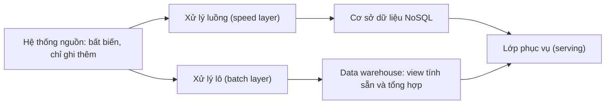
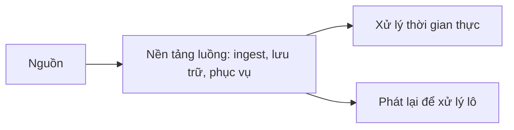
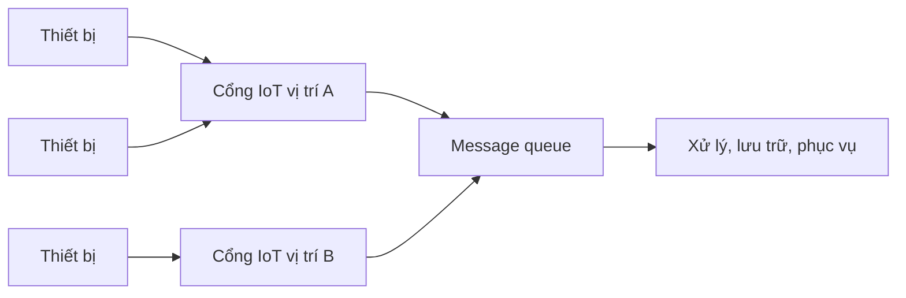
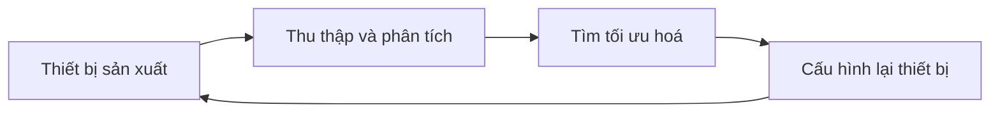
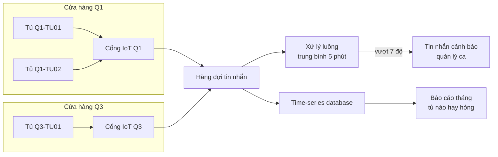
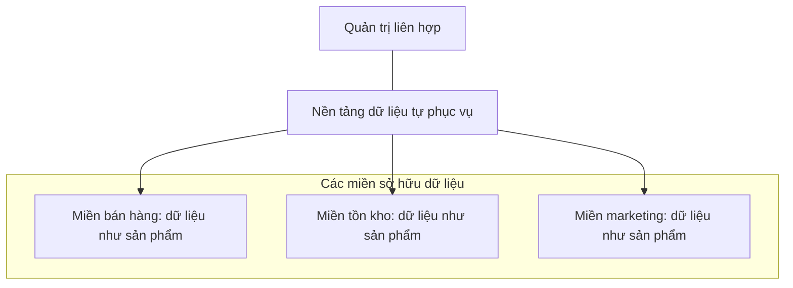

# Ví dụ kiến trúc dữ liệu (phần 2): Lambda, Kappa, Dataflow, IoT, data mesh

Bài cuối của chương đi qua các kiến trúc xoay quanh **dữ liệu streaming và bài toán hợp nhất batch với streaming** (Lambda, Kappa, mô hình Dataflow), rồi kiến trúc cho **IoT**, **data mesh** và các kiến trúc khác. Sau đó là phần nói về **ai tham gia thiết kế kiến trúc dữ liệu** và kết luận của chương.

**Tương tự đơn giản:** batch giống gom thư cả ngày rồi phát một lần; streaming giống nhận tin nhắn tức thời. Lambda là thuê hai đội: một đội phát nhanh, một đội phát kỹ rồi đối chiếu. Kappa là chỉ giữ một dòng tin nhắn và có thể "tua lại" để đọc lại từ đầu khi cần. Dataflow xem thư cả ngày chỉ là một đoạn giới hạn của dòng tin nhắn.

---

:::note[Ghi nhớ nhanh]

- ⭐ **Lambda** có ba lớp (batch, speed, serving) nhưng phải quản lý **hai codebase** nên dễ lỗi; sách **không** đề xuất nó là lựa chọn đầu tiên.
- ⭐ **Kappa** dùng **một nền tảng xử lý luồng** làm xương sống, nhưng ít được áp dụng vì streaming khó và đắt khi dữ liệu lịch sử lớn.
- **Dataflow model / Apache Beam:** batch chỉ là **luồng có giới hạn (bounded)**; một đường code cho cả batch và streaming; Flink, Spark đi cùng triết lý "batch là trường hợp đặc biệt của streaming".
- **IoT:** thiết bị (things), cổng IoT (gateway), message queue, lưu trữ theo độ trễ; coi chừng dữ liệu đến muộn, schema khác nhau, mất kết nối.
- **Data mesh:** phản hồi trước nền tảng dữ liệu monolith tập trung, dựa trên domain-driven design, có bốn thành phần của Dehghani.
- Kiến trúc sư dữ liệu hợp tác với kinh doanh; ở công ty nhỏ, **kỹ sư dữ liệu kiêm kiến trúc sư**.

:::

---

## Mục lục

- 1. Kiến trúc Lambda
- 2. Kiến trúc Kappa
- 3. Mô hình Dataflow và batch, streaming thống nhất
- 4. Kiến trúc cho IoT
- 5. Data mesh
- 6. Các ví dụ kiến trúc khác
- 7. Ai tham gia thiết kế kiến trúc dữ liệu?
- 8. Kết luận
- Tóm tắt

:::info[Thuật ngữ trong bài — hiểu nôm na]

Ví dụ trong bài dùng chuỗi trà sữa **Mây** (30 cửa hàng, mỗi cửa hàng có cảm biến nhiệt độ tủ mát, xem [phần giới thiệu](../intro.md)).

| Thuật ngữ | Nghĩa đời thường | Ví dụ ở chuỗi Mây |
| --- | --- | --- |
| Append-only (chỉ ghi thêm) | Sổ chỉ được viết thêm dòng mới, không tẩy xoá dòng cũ | Nhật ký số đo tủ mát |
| Codebase | Toàn bộ mã nguồn của một hệ thống | Bộ code tính doanh thu |
| NoSQL | Loại database không dùng bảng cố định, đọc ghi rất nhanh | Nơi giữ "doanh thu tạm tính hôm nay" cập nhật liên tục |
| Replay (phát lại) | Tua lại băng ghi để xử lý lại từ đầu | Đọc lại số đo tủ mát cả tháng để tính lại |
| Bounded / unbounded | Có điểm đầu điểm cuối / chảy mãi không dừng | Đơn ngày 1/3 / dòng số đo tủ mát |
| Window (cửa sổ) | Một khoảng thời gian để gom dữ liệu lại tính | "Nhiệt độ trung bình mỗi 5 phút" |
| Edge computing | Tính toán ngay tại thiết bị trước khi gửi | Cảm biến tự tính trung bình 1 phút rồi mới gửi |
| Gateway (cổng) | Trạm trung chuyển gom dữ liệu thiết bị gần đó rồi gửi lên Internet | Một hộp nhỏ ở mỗi cửa hàng gom số đo của 2 tủ |
| Time-series database | Database chuyên cho chuỗi số đo theo thời gian | Nơi lưu nhiệt độ từng phút của 60 tủ |
| Domain-driven design | Thiết kế phần mềm bám theo các mảng nghiệp vụ thật | Mảng bán hàng, mảng kho, mảng nhân sự |

:::

## 1. Kiến trúc Lambda

Vào "ngày xưa" (đầu đến giữa thập niên 2010), làm việc với dữ liệu streaming bùng nổ nhờ **Kafka** (message queue) và các framework mở rộng cao như **Apache Storm** và **Samza** cho phân tích streaming/thời gian thực. Công ty có thể làm các loại phân tích và mô hình hoá mới trên lượng dữ liệu lớn: tổng hợp, xếp hạng người dùng, gợi ý sản phẩm. Bài toán: **hoà giải dữ liệu batch và streaming vào một kiến trúc**. **Lambda** là một trong những lời giải phổ biến đầu tiên.

Trong Lambda có ba hệ thống hoạt động độc lập nhau: **batch, streaming và serving**.

- Hệ thống nguồn lý tưởng là **bất biến và chỉ thêm (append-only)**, gửi dữ liệu tới **hai đích**: luồng và lô.
- **Speed layer (lớp tốc độ):** xử lý luồng nhằm phục vụ dữ liệu với **độ trễ thấp nhất**, thường lưu trong cơ sở dữ liệu NoSQL.
- **Batch layer (lớp lô):** dữ liệu được xử lý và biến đổi trong hệ thống như data warehouse, tạo các **view tính sẵn và tổng hợp**.
- **Serving layer (lớp phục vụ):** cung cấp **view kết hợp** bằng cách gộp kết quả truy vấn từ hai lớp.

**Chỉ trích:** quản lý nhiều hệ thống với **các codebase khác nhau** nghe đã khó, tạo ra hệ thống **dễ lỗi**, với mã và dữ liệu cực kỳ khó điều hoà. Sách nhắc đến Lambda vì nó vẫn nổi bật trong kết quả tìm kiếm về kiến trúc dữ liệu, nhưng **không phải đề xuất đầu tiên** nếu bạn kết hợp dữ liệu streaming và batch cho phân tích; công nghệ và thực hành đã tiến lên.

### Áp vào chuỗi Mây: Lambda và nỗi khổ hai codebase

Giả sử chủ chuỗi muốn xem **doanh thu hôm nay** cập nhật liên tục. Theo Lambda, Mây có hai đường: speed layer cộng nhanh từng đơn trong ngày, batch layer tính lại cẩn thận mỗi đêm. Serving layer ghép "số chính xác đến hết hôm qua" với "số tạm tính hôm nay".

Rắc rối đến khi hai đội viết hai bộ code khác nhau. Đội streaming quên trừ đơn huỷ, đội batch thì nhớ. Bảng dưới cho thấy cùng một ngày, hai lớp ra hai số:

| Thời điểm | Speed layer (tạm tính) | Batch layer (chính xác) | Chủ chuỗi thấy |
| --- | --- | --- | --- |
| 1/3, 22:00 | 203.000đ | Chưa chạy | 203.000đ |
| 2/3, 07:00 | (đã chuyển sang ngày mới) | 173.000đ | 173.000đ |

Doanh thu "tự nhiên giảm" 30.000đ qua đêm (đúng bằng đơn DH004 đã huỷ), và chủ chuỗi hỏi "sao số bị tụt?". Đây chính là lời chỉ trích "mã và dữ liệu cực kỳ khó điều hoà" của sách.

## 2. Kiến trúc Kappa

Để khắc phục hạn chế của Lambda, **Jay Kreps** đề xuất **kiến trúc Kappa** (2014). Ý tưởng cốt lõi: dùng **một nền tảng xử lý luồng (stream-processing platform) làm xương sống** cho mọi thao tác dữ liệu: ingest, lưu trữ và phục vụ. Nhờ đó có kiến trúc **thực sự hướng sự kiện**. Xử lý batch và thời gian thực áp dụng liền mạch cho cùng dữ liệu bằng cách **đọc trực tiếp luồng sự kiện** và **phát lại (replay)** các khối dữ liệu lớn khi cần xử lý theo lô.

Dù bài viết gốc ra đời năm 2014, sách thấy Kappa **chưa được áp dụng rộng rãi**, có thể vì:

1. **Streaming vẫn là bí ẩn với nhiều công ty:** nói thì dễ, làm khó hơn dự kiến.
2. **Kappa thực tế phức tạp và tốn kém.** Một số hệ thống streaming có thể mở rộng tới khối lượng khổng lồ nhưng rất phức tạp và đắt; **lưu trữ và xử lý batch vẫn hiệu quả và rẻ hơn nhiều** cho các bộ dữ liệu lịch sử lớn.

## 3. Mô hình Dataflow và batch, streaming thống nhất

Cả Lambda và Kappa đều cố vượt qua giới hạn của hệ sinh thái Hadoop những năm 2010, vốn là sự ghép các công cụ phức tạp không khớp nhau. Thách thức cốt lõi, **thống nhất xử lý batch và stream**, vẫn còn đó; hai kiến trúc đã đặt nền móng và gợi ý cho các bước sau.

Một trong những vấn đề trọng tâm là **thống nhất nhiều đường code**. Kappa dựa trên lớp lưu trữ và xếp hàng thống nhất, nhưng vẫn phải dùng các công cụ khác nhau để thu thập số liệu thời gian thực hoặc chạy job tổng hợp batch.

**Google** giải quyết bằng **mô hình Dataflow** và framework **Apache Beam** triển khai mô hình này. Ý tưởng cốt lõi:

- Xem **mọi dữ liệu là sự kiện**, và việc tổng hợp thực hiện trên nhiều loại **cửa sổ (window)**.
- **Luồng sự kiện thời gian thực** đang diễn ra là **dữ liệu không giới hạn (unbounded)**.
- **Lô dữ liệu** chỉ là **luồng sự kiện có giới hạn (bounded)**; các ranh giới tạo thành cửa sổ tự nhiên.
- Kỹ sư chọn các loại cửa sổ để tổng hợp thời gian thực, ví dụ **sliding (trượt)** hoặc **tumbling (lật)**.
- Xử lý batch và thời gian thực chạy **trong cùng một hệ thống với code gần như giống hệt nhau**.

**Hai loại cửa sổ, minh hoạ bằng tủ mát Q1-TU01.** Giả sử số đo mỗi phút từ 08:00 như bảng dưới. **Tumbling window** (cửa sổ lật) cắt thành các khúc liền nhau, không chồng lấn. **Sliding window** (cửa sổ trượt) luôn nhìn "5 phút gần nhất" và trượt theo từng phút.

| Phút | 08:00 | 08:01 | 08:02 | 08:03 | 08:04 | 08:05 | 08:06 | 08:07 | 08:08 | 08:09 |
| --- | --- | --- | --- | --- | --- | --- | --- | --- | --- | --- |
| Nhiệt độ (°C) | 4 | 4 | 5 | 5 | 6 | 7 | 8 | 9 | 9 | 10 |

| Loại cửa sổ | Các khúc được tính | Kết quả trung bình |
| --- | --- | --- |
| Tumbling 5 phút | 08:00-08:04, 08:05-08:09 | 4,8°C rồi 8,6°C |
| Sliding 5 phút, trượt mỗi phút | 08:00-08:04, 08:01-08:05, 08:02-08:06, ... | 4,8 → 5,4 → 6,2 → 7,0 → 7,8 → 8,6°C |

Cửa sổ trượt cho thấy nhiệt độ tăng **dần từng phút**, nên báo động "trung bình 5 phút vượt 7°C" kêu ngay lúc 08:08 (trung bình 7,8°C), còn cửa sổ lật phải đợi hết khúc 08:05-08:09 mới tính được. Một phút sớm hơn với tủ sữa là đáng kể. Theo mô hình Dataflow, "toàn bộ số đo ngày 1/3" cũng chỉ là một cửa sổ rất lớn, có giới hạn, nên cùng một đoạn code tính trung bình dùng được cho cả hai.

Triết lý **"batch là trường hợp đặc biệt của streaming"** nay đã phổ biến hơn; **Flink và Spark** cũng áp dụng cách tiếp cận tương tự.

| | Lambda | Kappa | Dataflow / Beam |
|---|---|---|---|
| Số đường code | Hai (batch và stream) | Một nền tảng luồng, nhưng vẫn có công cụ khác nhau | Gần như một |
| Ý tưởng | Hai lớp song song và một lớp phục vụ | Mọi thứ là luồng, replay để batch | Batch là luồng có giới hạn |
| Nhược điểm | Dễ lỗi, khó đồng bộ | Phức tạp, đắt với dữ liệu lịch sử lớn | Cần framework hỗ trợ |

Áp vào chuỗi Mây, ba kiểu kiến trúc trên nên dùng khi nào:

| Nhu cầu của Mây | Lambda | Kappa | Dataflow / Beam | Nên chọn |
| --- | --- | --- | --- | --- |
| Doanh thu mỗi sáng | Thừa | Thừa | Thừa | Chỉ cần batch thường |
| Cảnh báo tủ mát quá nóng | Thừa | Được | Được | Một job streaming nhỏ là đủ |
| Doanh thu tạm tính trong ngày + số chính xác mỗi đêm | Được, nhưng dễ lệch số | Được, tốn kém | Tốt nhất: một bộ code | Dataflow, nếu Mây thật sự cần |

## 4. Kiến trúc cho IoT

**Internet of Things (IoT)** là tập hợp các thiết bị phân tán: máy tính, cảm biến, thiết bị di động, thiết bị nhà thông minh và mọi thứ nối internet. Thay vì sinh dữ liệu từ nhập liệu của con người, dữ liệu IoT sinh ra từ thiết bị **thu thập định kỳ hoặc liên tục** từ môi trường và gửi đến đích. Thiết bị IoT thường **công suất thấp**, hoạt động trong môi trường **ít tài nguyên và băng thông thấp**.

Khái niệm đã có từ vài thập kỷ, nhưng cuộc cách mạng smartphone tạo ra đàn IoT khổng lồ gần như chỉ sau một đêm; sau đó có nhiều loại mới: bộ điều nhiệt thông minh, hệ thống giải trí trên ô tô, TV và loa thông minh. IoT từ "ảo mộng tương lai" thành một lĩnh vực kỹ thuật dữ liệu khổng lồ, và sách kỳ vọng nó là một trong những cách chủ yếu để tạo và tiêu thụ dữ liệu.

### Thiết bị (things)

**Thiết bị** là phần cứng vật lý nối internet, cảm nhận môi trường, thu thập và truyền dữ liệu đến đích phía hạ nguồn. Ví dụ: camera chuông cửa, đồng hồ thông minh, bộ điều nhiệt; camera AI giám sát dây chuyền phát hiện linh kiện lỗi; thiết bị theo dõi GPS ghi vị trí xe; hay một Raspberry Pi được lập trình để tải tweet mới nhất và pha cà phê cho bạn.

Tối thiểu thiết bị phải thu thập và truyền dữ liệu; nó cũng có thể **xử lý dữ liệu hoặc chạy ML** ngay trên thiết bị trước khi gửi, gọi là **edge computing** (tính toán biên) và **edge machine learning**.

Kỹ sư dữ liệu không cần biết chi tiết bên trong thiết bị, nhưng cần biết: thiết bị **làm gì**, **thu thập dữ liệu gì**, có **tính toán biên/ML** nào trước khi truyền không, **tần suất gửi**; cũng cần biết hậu quả khi thiết bị hoặc internet ngừng hoạt động, các yếu tố môi trường hay bên ngoài ảnh hưởng đến việc thu thập và tác động của chúng lên dữ liệu về sau.

### Giao tiếp với thiết bị

**Cổng IoT (IoT gateway):** trung tâm kết nối thiết bị và **định tuyến an toàn** đến các điểm đến phù hợp trên internet. Có thể nối thiết bị thẳng internet không qua cổng, nhưng cổng cho phép thiết bị **kết nối với mức năng lượng cực thấp**, đóng vai trò trạm lưu giữ dữ liệu và quản lý kết nối internet tới đích cuối. Chuẩn WiFi công suất thấp mới có thể làm cổng ít quan trọng hơn trong tương lai nhưng mới đang triển khai. Thường một nhóm thiết bị dùng nhiều cổng, mỗi **vị trí vật lý** một cổng.

**Thu nạp (ingestion):** bắt đầu từ cổng IoT; từ đó, sự kiện và phép đo vào kiến trúc **ingest sự kiện**. Mô hình khác cũng có thể: cổng tích luỹ dữ liệu và **tải lên theo lô** để phân tích sau. Ở môi trường vật lý xa xôi, cổng có thể **mất kết nối mạng nhiều giờ** và chỉ tải lên khi vào vùng phủ sóng. Sự đa dạng của hệ thống IoT gây vấn đề phức tạp mà kỹ sư phải tính đến: **dữ liệu đến muộn, khác biệt cấu trúc và schema, hỏng dữ liệu, gián đoạn kết nối**.

**Lưu trữ (storage):** phụ thuộc nhiều vào yêu cầu **độ trễ**.

- Cảm biến từ xa thu thập dữ liệu khoa học để phân tích sau: **object storage theo lô** là hoàn toàn chấp nhận được.
- Giải pháp tự động hoá và giám sát nhà cần phản hồi gần thời gian thực: **message queue hoặc cơ sở dữ liệu chuỗi thời gian (time-series database)** phù hợp hơn. (Chương 6 nói chi tiết về lưu trữ.)

**Phục vụ (serving):** rất đa dạng.

- Ứng dụng khoa học theo batch: phân tích bằng cloud data warehouse rồi đưa vào báo cáo.
- Ứng dụng giám sát nhà: dữ liệu được phân tích gần thời gian thực bằng stream-processing hoặc truy vấn trong time-series database để tìm sự kiện quan trọng như **cháy, mất điện, đột nhập**; phát hiện **bất thường** kích hoạt cảnh báo cho chủ nhà, sở cứu hoả hay tổ chức khác. Vẫn có phần phân tích batch, ví dụ báo cáo hằng tháng về tình trạng ngôi nhà.
- Một mẫu phục vụ quan trọng giống **reverse ETL** (dù sách ít dùng thuật ngữ này trong ngữ cảnh IoT): dữ liệu cảm biến trên thiết bị sản xuất được thu thập, phân tích để tìm tối ưu hoá, kết quả được **gửi ngược lại để cấu hình lại thiết bị** hoạt động hiệu quả hơn.

Sách coi đây chỉ là giới thiệu sơ lược; kịch bản IoT rất phức tạp và kỹ sư dữ liệu, vốn quen dữ liệu kinh doanh, ít quen thuộc. Hy vọng nó khuyến khích bạn tìm hiểu thêm mảng hấp dẫn và đang phát triển nhanh này.

### Áp vào chuỗi Mây: hệ thống cảm biến tủ mát

Hệ thống IoT của Mây đi qua đủ các khâu sách mô tả. Sơ đồ dưới cho thấy dữ liệu tách thành hai nhánh: nhánh **gấp** (cảnh báo trong vài giây) và nhánh **thong thả** (cất để phân tích tháng).

Các vấn đề IoT của sách, ở Mây trông như sau:

| Vấn đề | Ở chuỗi Mây | Cách xử lý |
| --- | --- | --- |
| Mất kết nối | Cửa hàng Q7 rớt mạng 2 tiếng | Cổng IoT giữ số đo, có mạng lại thì gửi bù |
| Dữ liệu đến muộn | Số đo 08:15 tới lúc 10:20 | Ghi theo **giờ đo**, không theo giờ nhận; cảnh báo cũ thì không gửi nữa |
| Schema khác nhau | Tủ mới đời 2026 gửi thêm cột `do_am` | Chấp nhận cột mới, tủ cũ để trống |
| Dữ liệu hỏng | Cảm biến lỗi báo -40°C | Loại các giá trị ngoài khoảng hợp lý |
| "Reverse ETL" cho thiết bị | Phân tích thấy tủ Q1-TU02 hay vượt ngưỡng giờ trưa | Gửi lệnh hạ nhiệt độ cài đặt của tủ đó 1°C |

## 5. Data mesh

**Data mesh** là phản hồi gần đây trước các nền tảng dữ liệu monolith khổng lồ (data lake tập trung, data warehouse) và trước **"great divide of data"** (sự chia rẽ lớn của dữ liệu), nơi ngữ cảnh bị chia giữa dữ liệu vận hành và dữ liệu phân tích. Nó cố **đảo ngược các thách thức của kiến trúc dữ liệu tập trung**, dùng khái niệm **domain-driven design** (thiết kế hướng miền, thường dùng trong kiến trúc phần mềm) và áp vào kiến trúc dữ liệu.

Phần cốt lõi là **phi tập trung hoá**. Zhamak Dehghani viết (đại ý): để phi tập trung hoá nền tảng dữ liệu monolith, cần đảo ngược cách nghĩ về dữ liệu, vị trí và quyền sở hữu. Thay vì đẩy dữ liệu từ các miền vào một nền tảng hoặc data lake do trung tâm sở hữu, **các miền phải tự lưu trữ và phục vụ bộ dữ liệu của mình theo cách dễ dùng**.

Bốn thành phần chính của data mesh theo Dehghani:

| # | Thành phần | Ý nghĩa |
|---|---|---|
| 1 | **Kiến trúc và quyền sở hữu dữ liệu phi tập trung theo miền** | Mỗi miền sở hữu dữ liệu của mình |
| 2 | **Dữ liệu như một sản phẩm (data as a product)** | Miền xuất bản dữ liệu như sản phẩm cho người dùng khác |
| 3 | **Hạ tầng dữ liệu tự phục vụ như một nền tảng** | Nền tảng chung giúp các miền tự xây và phục vụ dữ liệu |
| 4 | **Quản trị tính toán liên hợp (federated computational governance)** | Quản trị chung nhưng thực thi phân tán và tự động |

Sơ đồ trên là phiên bản đơn giản do người ghi chép vẽ lại ý của hình trong sách. Để tìm hiểu sâu hơn, xem sách *Data Mesh* (O'Reilly) của Dehghani. Vì data mesh thu hút nhiều chú ý gần đây nên bạn nên biết về nó.

### Áp vào chuỗi Mây: có nên làm data mesh?

Data mesh chỉ có ý nghĩa khi có **nhiều miền lớn**, mỗi miền đủ người để tự lo dữ liệu. Bảng dưới so sánh Mây hôm nay với "Tập đoàn Mây" giả định trong tương lai.

| | Chuỗi Mây hôm nay | Tập đoàn Mây tương lai (trà sữa, cà phê, bánh, giao hàng) |
| --- | --- | --- |
| Số miền | 3 (bán hàng, kho, nhân sự) | Hơn 10 |
| Đội dữ liệu | 2-3 kỹ sư chung | Mỗi thương hiệu có đội kỹ thuật riêng |
| Nút cổ chai | Chưa có | Đội dữ liệu trung tâm nhận 200 yêu cầu mỗi tháng, xử lý không kịp |
| Dữ liệu như sản phẩm | Đội trung tâm làm bảng doanh thu | Thương hiệu cà phê tự xuất bản bảng "doanh thu cà phê" có cam kết chất lượng |
| Nên chọn | **Kho tập trung** | Cân nhắc **data mesh** |

Data mesh không phải nâng cấp kỹ thuật mà là thay đổi **cách tổ chức con người**. Với Mây 30 cửa hàng, làm data mesh là "dùng dao mổ trâu giết gà".

## 6. Các ví dụ kiến trúc khác

Còn nhiều biến thể khác: **data fabric**, kiến trúc **data hub quy mô lớn**, kiến trúc **ưu tiên metadata (metadata-first)**, kiến trúc **hướng sự kiện**, **live data stack** (Chương 11)... Các kiến trúc mới sẽ tiếp tục xuất hiện khi thực hành được củng cố và công cụ đơn giản, tốt hơn. Sách tập trung vào các mẫu quan trọng nhất, hoặc đã được thiết lập rất tốt, hoặc phát triển nhanh, hoặc cả hai.

Lời khuyên cho kỹ sư dữ liệu: chú ý cách kiến trúc mới có thể giúp tổ chức; theo kịp bằng cách duy trì nhận thức cấp cao về sự phát triển của hệ sinh thái; **cởi mở và đừng gắn bó cảm xúc với một cách tiếp cận**. Khi thấy giá trị tiềm năng, hãy học sâu hơn rồi ra quyết định cụ thể. Làm đúng, những chỉnh sửa nhỏ, hoặc cải tiến lớn, trong kiến trúc có thể tác động tích cực đến kinh doanh.

## 7. Ai tham gia thiết kế kiến trúc dữ liệu?

Kiến trúc dữ liệu **không được thiết kế trong chân không**. Các công ty lớn vẫn có thể thuê kiến trúc sư dữ liệu, nhưng họ phải bắt kịp xu hướng và hiện trạng công nghệ. Thời kiến trúc dữ liệu "tháp ngà" đã qua. Trước đây kiến trúc phần lớn **trực giao với kỹ thuật**; sách hy vọng ranh giới này mờ đi khi kỹ thuật dữ liệu nói riêng và kỹ thuật nói chung phát triển nhanh, linh hoạt hơn, ít tách biệt giữa kỹ thuật và kiến trúc.

- Lý tưởng: kỹ sư dữ liệu làm việc cùng một **kiến trúc sư dữ liệu chuyên trách**.
- Nếu công ty nhỏ hoặc mức trưởng thành dữ liệu thấp, **kỹ sư dữ liệu có thể kiêm vai kiến trúc sư**.
- Vì kiến trúc dữ liệu là yếu tố xuyên suốt của vòng đời, kỹ sư dữ liệu phải hiểu kiến trúc "tốt" và các loại kiến trúc.

Khi thiết kế, bạn làm việc cùng **các bên liên quan kinh doanh** để đánh giá đánh đổi. Một số câu hỏi sách nêu: đánh đổi vốn có của cloud data warehouse so với data lake là gì? Đánh đổi giữa các nền tảng đám mây khác nhau? Khi nào framework batch/streaming thống nhất (Beam, Flink) là lựa chọn hợp lý? Nghiên cứu các lựa chọn một cách trừu tượng giúp bạn chuẩn bị ra quyết định cụ thể, có giá trị.

## 8. Kết luận

Bạn đã thấy kiến trúc dữ liệu khớp với vòng đời kỹ thuật dữ liệu thế nào, điều gì làm nên kiến trúc "tốt", và một số ví dụ kiến trúc. Vì kiến trúc là nền tảng then chốt cho thành công, sách khuyến khích **đầu tư thời gian nghiên cứu sâu** và hiểu đánh đổi vốn có của mọi kiến trúc, để bạn sẵn sàng vạch ra kiến trúc phù hợp yêu cầu riêng của tổ chức. Chương tiếp theo (Chương 4) bàn về cách **chọn công nghệ** phù hợp để dùng trong kiến trúc và vòng đời kỹ thuật dữ liệu.

## Tóm tắt

| Chủ đề | Ý chốt |
|---|---|
| Lambda | Ba lớp batch, speed, serving; hai codebase nên khó và dễ lỗi |
| Kappa | Một nền tảng luồng cho mọi thứ, replay để batch; ít phổ biến vì phức tạp và đắt |
| Dataflow / Beam | Batch là luồng bounded; một đường code; Flink, Spark theo hướng tương tự |
| IoT | Thiết bị, cổng, message queue; xử lý dữ liệu đến muộn, schema khác nhau, mất kết nối; có thể có reverse-ETL kiểu cấu hình lại thiết bị |
| Data mesh | Phi tập trung theo miền: miền sở hữu, dữ liệu như sản phẩm, nền tảng tự phục vụ, quản trị liên hợp |
| Ai thiết kế | Kiến trúc sư hợp tác với kỹ sư và kinh doanh; công ty nhỏ thì kỹ sư kiêm kiến trúc sư |
| Thông điệp chương | Kiến trúc tốt là linh hoạt, đảo ngược được, cân nhắc đánh đổi; luôn học và cởi mở với kiến trúc mới |
