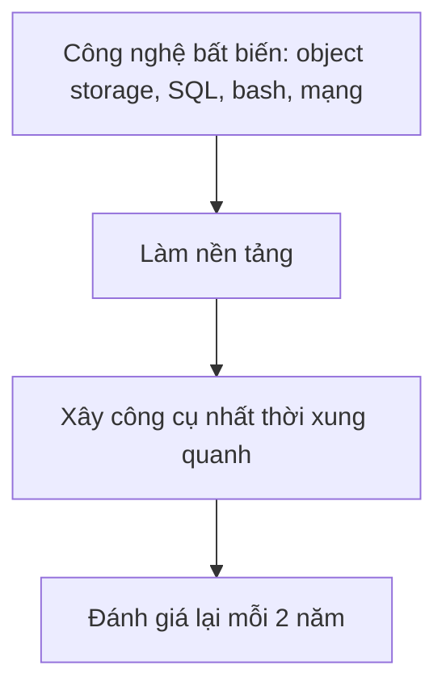
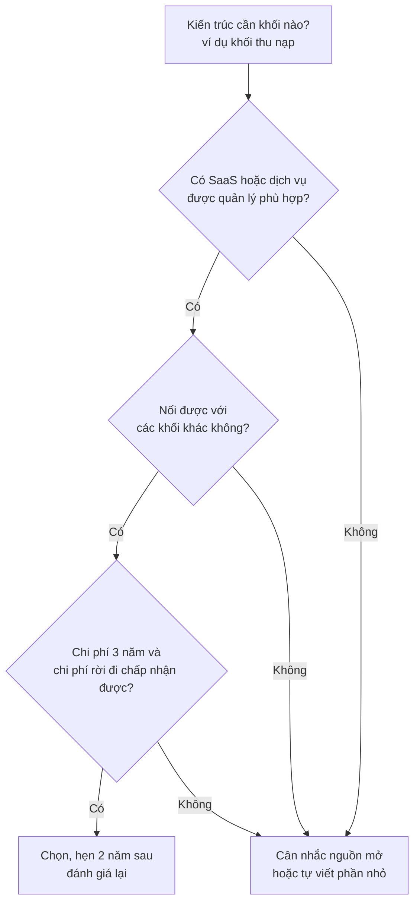

# Kiến trúc trước, công nghệ sau: các tiêu chí nền tảng

Chương 3 đã nói về kiến trúc dữ liệu "tốt". Chương 4 trả lời câu hỏi tiếp theo: khi đã có bản thiết kế kiến trúc, ta chọn **công nghệ** nào để hiện thực hóa nó. Bài này mở đầu chương, nêu nguyên tắc "kiến trúc trước, công nghệ sau" và năm tiêu chí đầu tiên: quy mô nhóm, tốc độ ra thị trường, khả năng tương tác, chi phí và công nghệ bất biến so với nhất thời.

**Tương tự đơn giản:** kỹ sư kết cấu chỉ chọn thép, bê tông, kính sau khi kiến trúc sư đã vẽ xong bản thiết kế tòa nhà. Chọn vật liệu trước khi có bản vẽ thì ra một cái nhà kỳ quặc.

---

:::note[Ghi nhớ nhanh]

- ⭐ **Kiến trúc mang tính chiến lược, công cụ mang tính chiến thuật** — kiến trúc là "cái gì, tại sao, khi nào"; công cụ là "cách thức". Đừng nói "kiến trúc của chúng tôi là công cụ X, Y, Z".
- ⭐ **Tiêu chí duy nhất để chọn công nghệ**: nó có tăng thêm giá trị cho sản phẩm dữ liệu và cho hoạt động kinh doanh rộng hơn không?
- **Nhóm nhỏ** nên dùng tối đa SaaS và dịch vụ được quản lý, tránh bắt chước công nghệ của các hãng khổng lồ (cargo cult engineering).
- **Chi phí** nhìn qua ba lăng kính: TCO, TOCO (chi phí cơ hội) và FinOps.
- **Công nghệ bất biến** (object storage, SQL, bash) làm nền; **công nghệ nhất thời** xây xung quanh; đánh giá lại hai năm một lần.

:::

---

## Mục lục

- 0. Kiến trúc trước, công nghệ sau
- 1. Quy mô và năng lực của nhóm
- 2. Tốc độ tiếp cận thị trường
- 3. Khả năng tương tác
- 4. Tối ưu hóa chi phí và giá trị kinh doanh (TCO, TOCO, FinOps)
- 5. Hôm nay và tương lai: công nghệ bất biến và nhất thời
- Tóm tắt

## 0. Kiến trúc trước, công nghệ sau

Kỹ sư dữ liệu ngày nay "bối rối vì quá giàu": công nghệ dữ liệu có sẵn dưới mọi hình thức — nguồn mở, nguồn mở được quản lý, phần mềm độc quyền, dịch vụ độc quyền... Rất dễ sa vào việc đuổi theo công nghệ mới mà quên mục đích cốt lõi: thiết kế hệ thống **mạnh mẽ, đáng tin cậy** để chuyển dữ liệu qua toàn bộ vòng đời và phục vụ (serving) nhu cầu người dùng cuối.

Sách nhấn mạnh sự khác biệt:

| | Kiến trúc | Công cụ |
|---|---|---|
| Tính chất | Chiến lược | Chiến thuật |
| Trả lời | Cái gì, tại sao, khi nào | Như thế nào |
| Là gì | Thiết kế cấp cao, lộ trình, bản thiết kế hệ thống dữ liệu để đáp ứng mục tiêu chiến lược của doanh nghiệp | Thứ dùng để biến kiến trúc thành hiện thực |

Các nhóm hay làm ngược (chọn công nghệ trước) vì ba lý do: **hội chứng vật thể sáng bóng** (shiny object syndrome), **phát triển hướng sơ yếu lý lịch** (resume-driven development — chọn công nghệ để tô CV) và **thiếu chuyên môn kiến trúc**. Kết quả thường là một "cỗ máy tưởng tượng kiểu Tiến sĩ Seuss" chứ không phải kiến trúc dữ liệu thật. Lời khuyên: **kiến trúc trước, công nghệ thứ hai**.

Chương liệt kê các cân nhắc khi chọn công nghệ trong vòng đời: quy mô và năng lực nhóm; tốc độ ra thị trường; khả năng tương tác; chi phí và giá trị kinh doanh; hôm nay và tương lai (bất biến/nhất thời); vị trí (cloud, on premises, hybrid, multicloud); xây dựng so với mua; monolith so với modular; serverless so với máy chủ; tối ưu hóa, hiệu suất và "chiến tranh benchmark"; các yếu tố xuyên suốt (undercurrents).

### Thuật ngữ trong bài — hiểu nôm na

Ví dụ trong chương này dùng chuỗi trà sữa **Mây** (30 cửa hàng, xem [phần giới thiệu](../intro.md)). Kiến trúc của Mây đã được bàn ở [Chương 3](../03-kien-truc-du-lieu/4_kien-truc-theo-lo.md); chương này hỏi: **dùng công cụ nào** để dựng nó.

| Thuật ngữ | Nghĩa đời thường | Ví dụ ở chuỗi Mây |
| --- | --- | --- |
| SaaS | Phần mềm thuê theo tháng qua Internet, nhà cung cấp lo vận hành | Thuê công cụ vẽ dashboard |
| Managed service (dịch vụ được quản lý) | Dịch vụ đám mây mà nhà cung cấp lo cài đặt, cập nhật, sao lưu | Kho dữ liệu đám mây, Mây chỉ việc dùng |
| Open source (nguồn mở) | Phần mềm miễn phí, ai cũng xem được mã, nhưng tự lo vận hành | Tự cài công cụ điều phối trên máy riêng |
| Low-code / code-first | Làm bằng kéo thả / làm bằng viết code | Kéo thả tạo đường ống / viết Python |
| Connector | "Ổ cắm" có sẵn để một công cụ nối được với một hệ thống | Connector cho phần mềm kế toán |
| JDBC / ODBC | Chuẩn chung để phần mềm kết nối với database, như ổ cắm điện chuẩn | Công cụ dashboard kết nối kho dữ liệu qua ODBC |
| REST API | Cách phổ biến để hai phần mềm trao đổi qua Internet, nhưng mỗi nơi làm một kiểu | App giao hàng đối tác cho lấy đơn qua REST API |
| Capex / Opex | Chi tiền mua đứt một lần / chi đều đặn theo mức dùng | Mua máy chủ 200 triệu / trả 5 triệu mỗi tháng cho đám mây |
| ROI | Bỏ ra bao nhiêu, thu về bao nhiêu | Dashboard giúp giảm 10% nguyên liệu hỏng |
| Over-engineering | Làm phức tạp quá mức cần | Dựng hệ thống streaming cho báo cáo xem mỗi sáng |

## 1. Quy mô và năng lực của nhóm

Điều đầu tiên cần đánh giá là **nhóm của bạn lớn cỡ nào và dùng được công nghệ gì**.

- Bạn ở nhóm nhỏ (có thể một người) phải kiêm nhiều vai, hay nhóm đủ lớn để chuyên môn hóa? Vài người gánh nhiều giai đoạn vòng đời hay mỗi người một mảng?
- Quy mô nhóm gần như quyết định **băng thông** có thể dành cho các giải pháp phức tạp.

**Cargo cult engineering (kỹ thuật sùng bái hàng hóa):** nhóm nhỏ đọc blog về công nghệ tiên tiến của một công ty công nghệ khổng lồ rồi cố sao chép hệ thống cực phức tạp đó. Sách gọi đây là sai lầm lớn, tốn nhiều thời gian và tiền bạc mà thường không đem lại gì.

Lời khuyên cho nhóm nhỏ hoặc kỹ thuật còn yếu: **dùng càng nhiều SaaS và dịch vụ được quản lý càng tốt**, dành băng thông hạn chế cho các vấn đề phức tạp trực tiếp tạo giá trị kinh doanh.

**Kiểm kê kỹ năng của nhóm:**

- Thiên về công cụ low-code hay code-first?
- Giỏi ngôn ngữ nào (Java, Python, Go...)?
- Công nghệ có đủ mọi sở thích từ low-code đến code nặng — hãy **gắn bó với công nghệ và quy trình nhóm đã quen**.
- Học công nghệ/ngôn ngữ/công cụ mới là khoản đầu tư thời gian đáng kể; đã có nhóm tốn nhiều thời gian học mà không bao giờ đưa vào production. Hãy đầu tư khôn ngoan.

### Áp vào chuỗi Mây: nhóm 1 người khác nhóm 10 người

Cùng nhu cầu "dashboard doanh thu mỗi sáng", lựa chọn công cụ thay đổi theo quy mô đội. Bảng dưới cho thấy vì sao đội nhỏ nên thuê nhiều hơn tự làm.

| Phần việc | Mây có 1 kỹ sư dữ liệu | Mây có 10 kỹ sư dữ liệu |
| --- | --- | --- |
| Kéo dữ liệu từ POS, app | Công cụ SaaS có sẵn connector | Có thể tự viết cho nguồn đặc thù |
| Lưu trữ | Kho dữ liệu đám mây được quản lý | Vẫn kho đám mây (không có lý do tự vận hành) |
| Điều phối | Lịch chạy có sẵn trong công cụ kéo dữ liệu | Công cụ điều phối riêng, nhiều DAG |
| Dashboard | Công cụ BI thuê theo tháng | Công cụ BI thuê theo tháng |
| Bẫy cần tránh | Bắt chước kiến trúc streaming của Grab, Shopee (cargo cult) | Mỗi người chọn một công cụ, không ai bảo trì nổi |

## 2. Tốc độ tiếp cận thị trường

Trong công nghệ, **time-to-market** thường chiếm ưu thế: chọn đúng công nghệ giúp giao tính năng và dữ liệu nhanh hơn mà vẫn giữ chất lượng và bảo mật. Nghĩa là làm việc trong vòng phản hồi chặt: ra mắt, học hỏi, lặp lại, cải tiến.

- **Hoàn hảo là kẻ thù của điều tốt.** Có nhóm cân nhắc chọn công nghệ hàng tháng, hàng năm mà không ra quyết định. Quyết định chậm và đầu ra chậm là "nụ hôn thần chết" — tác giả đã thấy nhiều nhóm dữ liệu bị giải thể vì chạy quá chậm, không đem lại giá trị mà họ được thuê để tạo ra.
- **Giao giá trị sớm và thường xuyên.** Dùng cái đã hiệu quả; thành viên thường tận dụng tốt hơn các công cụ họ đã biết.
- Tránh **undifferentiated heavy lifting** (việc nặng nhọc không tạo khác biệt) — những việc phức tạp không cần thiết, ít hoặc không đem lại giá trị.
- Chọn công cụ giúp bạn đi nhanh, tin cậy, an toàn và bảo mật.

## 3. Khả năng tương tác (interoperability)

Hiếm khi bạn chỉ dùng một công nghệ. **Khả năng tương tác** mô tả cách các công nghệ/hệ thống kết nối, trao đổi thông tin và tương tác với nhau.

Khi đánh giá công nghệ A và B, hãy hỏi: A tích hợp với B dễ đến đâu? Mức độ khó trải từ liền mạch đến tốn thời gian: tích hợp đã dựng sẵn trong sản phẩm hay phải cấu hình tay nhiều?

- Nhà cung cấp và dự án nguồn mở thường nhắm đến một số nền tảng cụ thể. Phần lớn công cụ ingestion và visualization đã tích hợp sẵn với data warehouse và data lake phổ biến; công cụ ingestion phổ biến tích hợp với API/dịch vụ như CRM, phần mềm kế toán.
- **Có tiêu chuẩn:** hầu hết cơ sở dữ liệu cho phép kết nối qua **JDBC** (Java Database Connectivity) hoặc **ODBC** (Open Database Connectivity), nên dễ kết nối.
- **Không có tiêu chuẩn:** **REST** thực ra không phải là tiêu chuẩn API; mỗi API REST đều có điểm kỳ quặc riêng. Khi đó trách nhiệm tích hợp suôn sẻ thuộc về nhà cung cấp hoặc dự án nguồn mở.

Hãy thiết kế **theo mô-đun** để dễ thay công nghệ khi có phương pháp hoặc giải pháp thay thế mới.

Áp vào chuỗi Mây, các nguồn dữ liệu kết nối dễ khó rất khác nhau:

| Nguồn của Mây | Cách lấy dữ liệu | Mức dễ | Ghi chú |
| --- | --- | --- | --- |
| Kho dữ liệu → công cụ dashboard | ODBC/JDBC chuẩn | Rất dễ | Cắm là chạy |
| Phần mềm kho nguyên liệu | REST API có tài liệu | Dễ | Công cụ kéo dữ liệu có sẵn connector |
| Máy POS hãng nhỏ | Chỉ xuất được file CSV mỗi đêm | Trung bình | Phải tự viết bước lấy file |
| App giao hàng đối tác | REST API riêng, đổi phiên bản liên tục | Khó | Mỗi lần đối tác đổi API là phải sửa |

Khi chọn hãng máy POS mới, Mây nên hỏi "có API hoặc connector với các công cụ phổ biến không?" ngay từ đầu, đó là câu hỏi về khả năng tương tác.

## 4. Tối ưu hóa chi phí và giá trị kinh doanh

Thế giới hoàn hảo cho phép thử mọi công nghệ mới mà không lo chi phí. Thực tế, ngân sách và thời gian hữu hạn; tổ chức kỳ vọng **ROI dương** từ dự án dữ liệu, nên bạn phải hiểu chi phí mình kiểm soát được. Công nghệ là yếu tố chi phí chính. Sách xét chi phí qua ba lăng kính: **TCO, TOCO, FinOps**.

### 4.1. Tổng chi phí sở hữu (TCO)

**TCO (Total Cost of Ownership)** là tổng chi phí ước tính của một sáng kiến, gồm chi phí **trực tiếp** và **gián tiếp** của sản phẩm/dịch vụ dùng.

- **Chi phí trực tiếp:** quy thẳng cho sáng kiến, ví dụ lương của nhóm làm sáng kiến đó, hóa đơn AWS cho các dịch vụ dùng.
- **Chi phí gián tiếp (overhead):** độc lập với sáng kiến, phải trả bất kể phân bổ ở đâu.

Cách mua cũng ảnh hưởng đến hạch toán, chia hai nhóm:

| | Capex (chi phí vốn) | Opex (chi phí hoạt động) |
|---|---|---|
| Thanh toán | Trả trước, cần vốn ngay | Dàn trải dần theo thời gian |
| Tầm nhìn | Dài hạn, hàng trăm nghìn đến hàng triệu USD, khấu hao như tài sản | Ngắn hạn, trả theo mức dùng, rất linh hoạt |
| Ví dụ | Mua phần cứng/phần mềm, đầu tư phòng máy chủ, data center, colocation | Dịch vụ đám mây tính tiền theo tiêu thụ |
| Phân bổ vào dự án | Khó hơn | Gần chi phí trực tiếp, dễ phân bổ |

Trước đây opex gần như không phải lựa chọn cho dự án dữ liệu lớn vì hệ thống thường cần hợp đồng hàng triệu USD. Đám mây thay đổi điều đó: dịch vụ nền tảng dữ liệu cho phép trả tiền theo tiêu thụ, và các nhóm có thể lặp nhanh với nhiều cấu hình, thường không tốn kém.

Quan điểm của sách: bối cảnh dữ liệu đổi quá nhanh để đầu tư phần cứng dài hạn (sẽ lỗi thời, khó mở rộng, cản trở việc thử cái mới). Vì thế sách kêu gọi **tiếp cận "opex-first"**: tập trung vào đám mây và các công nghệ linh hoạt, trả tiền theo mức dùng.

### 4.2. Tổng chi phí cơ hội sở hữu (TOCO)

**TOCO (Total Opportunity Cost of Ownership)** là chi phí của **các cơ hội bị bỏ lỡ** khi chọn một công nghệ, kiến trúc hay quy trình. "Sở hữu" ở đây không nhất thiết là mua phần cứng hay giấy phép dài hạn: ngay trên cloud, ta vẫn "sở hữu" một công nghệ khi nó thành phần cốt lõi của pipeline production và khó gỡ bỏ. Theo tác giả, kỹ sư dữ liệu thường **không đánh giá TOCO** khi bắt đầu dự án — đây là điểm mù lớn.

Chọn data stack A nghĩa là bạn chọn lợi ích của A và loại trừ B, C, D; bạn cam kết với A cùng mọi thứ đi kèm: nhóm hỗ trợ, đào tạo, thiết lập, bảo trì. Hãy tự hỏi:

- Nếu A là lựa chọn tồi, hoặc trở nên lỗi thời, bạn còn chuyển sang cái khác được không?
- Chuyển sang thứ mới tốt hơn nhanh và rẻ đến đâu?
- Chuyên môn xây trên A có dùng được cho làn sóng tiếp theo không? Hay có thể thay từng thành phần của A để "mua thời gian và lựa chọn"?

Bước đầu giảm chi phí cơ hội là đánh giá nó một cách **tỉnh táo, nhìn xa**. Sách ví công nghệ không linh hoạt như **bẫy gấu (bear trap)**: dễ bước vào, cực kỳ đau đớn khi thoát ra.

#### Áp vào chuỗi Mây: so sánh TCO và TOCO của hai phương án

Mây cần nơi chứa dữ liệu cho 3 năm tới. Hai phương án (số liệu giả định để minh hoạ):

| Khoản | Phương án A: tự mua máy chủ đặt ở văn phòng | Phương án B: kho dữ liệu đám mây |
| --- | --- | --- |
| Tiền ban đầu (capex) | 250 triệu mua máy, bản quyền | 0 |
| Chi hằng tháng (opex) | Điện, mạng: 3 triệu | Theo mức dùng: khoảng 5 triệu |
| Người vận hành | Cần nửa thời gian một kỹ sư lo máy, sao lưu, vá lỗi | Gần như không |
| Tổng 3 năm (chưa tính người) | 250 + 3 × 36 = 358 triệu | 5 × 36 = 180 triệu |
| Khi Mây mở thêm 30 cửa hàng | Có thể phải mua máy mới | Tự tăng theo, trả thêm theo dùng |
| Máy hỏng lúc 2 giờ sáng | Kỹ sư phải dậy sửa | Nhà cung cấp lo |

**TOCO**, tức chi phí cơ hội, mới là phần dễ bị bỏ qua. Với phương án A, nửa thời gian kỹ sư dành để "chăm máy" là nửa thời gian **không** dùng để làm dự báo trân châu hay danh sách voucher. Nếu sau 1 năm Mây muốn chuyển sang công nghệ khác, chiếc máy 250 triệu thành "bẫy gấu": đã trót mua thì khó bỏ.

### 4.3. FinOps

**FinOps** (đã nói ở Nguyên tắc 9 của Chương 3): chi tiêu trên đám mây về bản chất là opex — công ty trả tiền cho dịch vụ chạy pipeline thay vì mua trước. Mục tiêu của FinOps là vận hành đầy đủ **trách nhiệm tài chính và giá trị kinh doanh**, bằng cách giám sát và điều chỉnh hệ thống linh hoạt giống DevOps.

Điều sách muốn nhấn mạnh ở chương này (trích từ FinOps Foundation): **FinOps không chỉ để tiết kiệm tiền mà là để kiếm tiền.** Chi tiêu cloud có thể thúc đẩy doanh thu, báo hiệu tăng trưởng khách hàng, tăng tốc phát hành tính năng, hoặc giúp đóng một data center. Với kỹ thuật dữ liệu, khả năng lặp nhanh và co giãn linh hoạt là vô giá để tạo giá trị — và là một động lực chính để chuyển workload dữ liệu lên cloud.

## 5. Hôm nay và tương lai: công nghệ bất biến và nhất thời

Dễ bị cuốn vào một tương lai đang đổi nhanh mà bỏ qua nhu cầu hiện tại. Ý định xây tương lai tốt đẹp là cao quý nhưng thường dẫn đến **over-architecture và over-engineering**; công cụ chọn cho tương lai có thể đã cũ khi tương lai đến, và tương lai thường không như ta hình dung. Lời khuyên: **tập trung vào hiện tại**, chọn công nghệ tốt nhất cho hiện tại và tương lai gần, nhưng theo cách hỗ trợ những điều chưa biết và sự phát triển sau này. Hãy hỏi: hôm nay bạn đang ở đâu và mục tiêu tương lai là gì?

Muốn vậy cần hiểu cái gì thay đổi, cái gì có xu hướng giữ nguyên. Có hai loại công nghệ:

### Công nghệ bất biến (immutable)

Là các thành phần nền tảng của cloud, hoặc ngôn ngữ và mô hình đã đứng vững trước thời gian. Ví dụ trên cloud: **object storage, mạng, máy chủ, bảo mật**. Object storage như Amazon S3 và Azure Blob Storage sẽ còn tồn tại ít nhất đến hết thập kỷ này, nhiều khả năng lâu hơn; lưu dữ liệu trong object storage là lựa chọn sáng suốt. Về ngôn ngữ: **SQL và bash** đã tồn tại hàng chục năm và sẽ không biến mất sớm.

Các công nghệ bất biến hưởng **hiệu ứng Lindy**: công nghệ đã tồn tại càng lâu thì càng có khả năng còn được dùng lâu. Hãy nghĩ đến lưới điện, cơ sở dữ liệu quan hệ, ngôn ngữ C, kiến trúc x86. Sách khuyên dùng hiệu ứng Lindy làm **phép thử** xem một công nghệ có khả năng bất biến hay không.

### Công nghệ nhất thời (transitory)

Là công nghệ đến rồi đi: quỹ đạo điển hình là rất nhiều cường điệu, nổi tiếng nhanh, rồi dần chìm vào quên lãng. Ví dụ cổ điển là mảng framework JavaScript phía giao diện: Backbone.js, Ember.js, Knockout phổ biến đầu những năm 2010, còn React và Vue.js hiện chiếm mindshare lớn — ba năm nữa là gì thì ai biết.

Công cụ dữ liệu mới và dự án nguồn mở xuất hiện mỗi ngày, ai cũng nói sẽ "thay đổi ngành". Phần lớn không có sức hút bền vững. Ngay cả các quỹ đầu tư mạo hiểm hàng đầu cũng biết hầu hết các khoản đặt cược vào công cụ dữ liệu sẽ thất bại — nhìn bức tranh **MAD (Machine Learning, AI and Data) landscape** của Matt Turck (Hình 4-1 trong sách) để thấy số lượng công nghệ. Kể cả công nghệ khá thành công cũng nhanh tàn: đầu những năm 2010 **Hive** được đón nhận vì cho phép truy vấn tập dữ liệu khổng lồ mà không phải viết tay job MapReduce; cảm hứng từ Hive nhưng muốn khắc phục khuyết điểm, các kỹ sư tạo ra **Presto** và các công nghệ khác; nay Hive chủ yếu còn trong hệ thống cũ.

### Lời khuyên của sách

- **Đánh giá lại công cụ hai năm một lần** (Hình 4-2).
- Bất cứ khi nào có thể, tìm công nghệ bất biến làm cơ sở; xây công cụ nhất thời xung quanh chúng.
- Vì xác suất thất bại của nhiều công nghệ dữ liệu khá cao, hãy xét **dễ rời đi đến đâu** (rào cản rời bỏ là gì), tránh bẫy gấu. Bước vào công nghệ mới với "đôi mắt mở to": dự án có thể bị bỏ dở, công ty có thể không trụ nổi, hoặc công nghệ đơn giản là không còn phù hợp.

### Áp vào chuỗi Mây: phần nào bất biến, phần nào nhất thời

Bảng dưới xếp các lựa chọn công nghệ của Mây theo hiệu ứng Lindy. Phần bất biến là "móng nhà", phần nhất thời là "đồ nội thất" có thể thay.

| Thành phần ở Mây | Bất biến hay nhất thời | Cách đối xử |
| --- | --- | --- |
| Cất file thô trong object storage | Bất biến | Dùng yên tâm, làm nền |
| Viết biến đổi bằng SQL | Bất biến | Kỹ năng nên đầu tư |
| Định dạng file mở (CSV, Parquet) | Gần bất biến | Giúp sau này đổi công cụ dễ |
| Công cụ kéo dữ liệu hãng X | Nhất thời | Dùng, nhưng xem lại mỗi 2 năm |
| Công cụ dashboard hãng Y | Nhất thời | Dùng, giữ logic tính toán trong kho chứ không trong dashboard |
| Thư viện dự báo mới nổi | Nhất thời | Thử nghiệm nhỏ trước khi dựa vào |

Gộp cả bài lại, cách Mây chọn một công cụ có thể đi theo các câu hỏi dưới, theo đúng thứ tự: kiến trúc trước, công nghệ sau.

## Tóm tắt

| Tiêu chí | Câu hỏi cốt lõi |
|---|---|
| Kiến trúc trước | Công nghệ này phục vụ kiến trúc nào, có tăng giá trị cho sản phẩm dữ liệu không? |
| Quy mô và năng lực nhóm | Nhóm có đủ băng thông và kỹ năng không? Nhóm nhỏ thì ưu tiên SaaS/managed |
| Time-to-market | Có giúp giao giá trị sớm và thường xuyên không? |
| Khả năng tương tác | Kết nối với các công nghệ khác dễ đến đâu (JDBC/ODBC, API)? |
| TCO | Tổng chi phí trực tiếp và gián tiếp, capex hay opex? |
| TOCO | Chi phí cơ hội và rào cản rời đi (bẫy gấu) |
| FinOps | Chi tiêu cloud có tạo ra giá trị kinh doanh không? |
| Bất biến và nhất thời | Dựa vào nền bất biến, đánh giá lại mỗi 2 năm |
