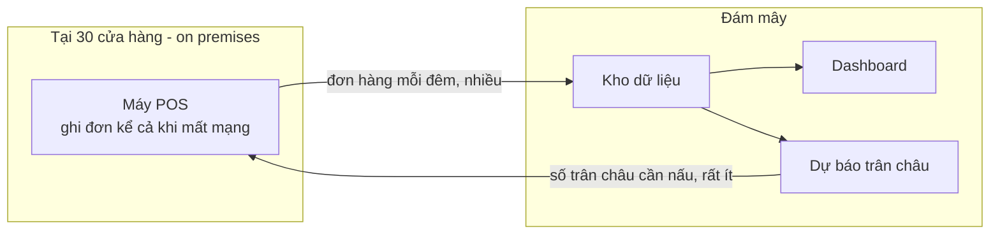
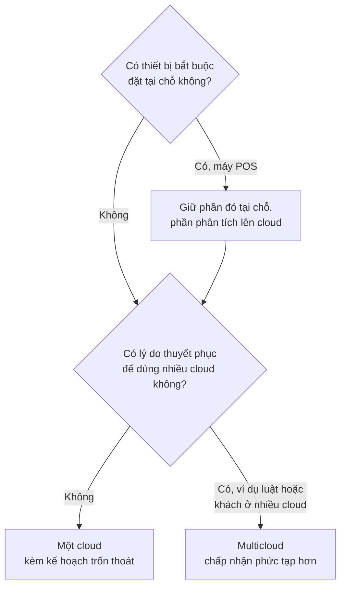

# Vị trí triển khai: on premises, cloud, hybrid, multicloud

Công ty nên chạy hệ thống công nghệ dữ liệu ở đâu? Bài này đi qua các lựa chọn: tại chỗ (**on premises**), đám mây (**cloud**), đám mây lai (**hybrid cloud**), đa đám mây (**multicloud**), cùng xu hướng phi tập trung và cuộc tranh luận về **cloud repatriation** (đưa workload từ cloud về lại máy chủ riêng).

**Tương tự đơn giản:** on premises giống như mua nhà và tự sửa chữa; cloud giống thuê căn hộ dịch vụ, trả theo tháng, có người lo bảo trì; hybrid là vừa giữ nhà cũ vừa thuê thêm căn hộ; multicloud là thuê ở nhiều tòa nhà của nhiều chủ khác nhau.

---

:::note[Ghi nhớ nhanh]

- ⭐ **Cloud không phải là on premises thuê ngoài** — chạy server lâu dài trên cloud đắt hơn đáng kể so với on premises nếu giữ nguyên cách làm cũ ("lift and shift"). Phải tối ưu theo mô hình giá của cloud.
- ⭐ **Đừng chọn multicloud/hybrid phức tạp trừ khi có lý do thuyết phục**; mặc định chọn một cloud, nhưng luôn có "kế hoạch trốn thoát".
- **Data gravity và phí data egress** (lấy dữ liệu ra) là lực kéo giữ bạn ở lại với nhà cung cấp.
- **Bạn không phải Dropbox**: hồi hương chỉ hợp lý ở quy mô cloud thật sự (exabyte dữ liệu, terabit/giây lưu lượng).
- Xu hướng chung: từ IaaS sang PaaS, SaaS, serverless — ngày càng trừu tượng.

:::

---

## Mục lục

- 1. On premises
- 2. Cloud (IaaS, PaaS, SaaS, serverless; kinh tế đám mây; data gravity)
- 3. Hybrid cloud
- 4. Multicloud
- 5. Phi tập trung: blockchain và edge
- 6. Lời khuyên: chọn cho hiện tại nhưng hướng tới tương lai
- 7. Cloud repatriation
- Tóm tắt

Bối cảnh: một thập kỷ qua, nhiều CTO coi quyết định nơi đặt công nghệ là vấn đề sống còn. Di chuyển quá chậm thì bị đối thủ nhanh nhẹn bỏ lại; di chuyển lên cloud được lên kế hoạch kém thì có thể thất bại kỹ thuật và chi phí thảm khốc.

:::info[Thuật ngữ trong bài — hiểu nôm na]

Ví dụ trong bài dùng chuỗi trà sữa **Mây** (30 cửa hàng, xem [phần giới thiệu](../intro.md)).

| Thuật ngữ | Nghĩa đời thường | Ví dụ ở chuỗi Mây |
| --- | --- | --- |
| On premises | Tự mua máy, đặt ở chỗ mình, tự lo | Máy chủ đặt trong kho của Mây |
| Colocation | Thuê chỗ đặt máy của mình trong trung tâm dữ liệu người khác | Gửi máy chủ của Mây vào trung tâm dữ liệu ở quận 7 |
| VM (máy ảo) | Một "máy tính" được chia ra từ máy thật, thuê theo giây | Một máy ảo chạy đường ống mỗi đêm |
| Autoscaling | Tự thêm bớt máy theo tải | Ngày sinh nhật Mây tự thêm máy xử lý đơn |
| IOPS | Số lần đọc ghi đĩa mỗi giây | Đĩa nhanh hay chậm khi đọc nhiều file nhỏ |
| Egress fee (phí lấy dữ liệu ra) | Tiền trả khi chuyển dữ liệu ra khỏi một nhà cung cấp đám mây | Chuyển 3 năm đơn hàng sang nhà cung cấp khác |
| Lock-in (khoá chặt) | Bị "trói" vào một nhà cung cấp, muốn đổi rất tốn | Viết toàn bộ logic bằng tính năng riêng của một hãng |
| CDN | Mạng máy chủ đặt khắp nơi để giao nội dung nhanh tới người xem | Ảnh món trên app được giao từ máy chủ gần khách |
| Peak load (đỉnh tải) | Lúc hệ thống bận nhất | Giờ trưa và ngày khuyến mãi mua 1 tặng 1 |

:::

## 1. On premises

Khi startup ngày càng sinh ra trên cloud, hệ thống **on premises** (tại chỗ) vẫn là mặc định của các công ty lâu đời. Họ sở hữu phần cứng, đặt trong data center của mình hoặc không gian thuê (colocation), và **tự chịu trách nhiệm vận hành** cả phần cứng lẫn phần mềm:

- Phần cứng hỏng thì tự sửa hoặc thay.
- Quản lý chu kỳ nâng cấp vài năm một lần khi phần cứng cũ trở nên kém tin cậy.
- Phải đảm bảo đủ năng lực cho **đỉnh tải**: nhà bán lẻ online phải chuẩn bị cho Black Friday. Với kỹ sư dữ liệu, nghĩa là mua hệ thống đủ lớn cho tải đỉnh và job lớn, mà không mua quá tay hay chi quá mức.

**Mặt tốt:** công ty lâu đời đã có phương pháp vận hành hiệu quả: giải quyết bài toán chi phí và nhân sự để vận hành phần cứng, quản lý môi trường phần mềm, triển khai code, chạy cơ sở dữ liệu và hệ thống big data.

**Mặt áp lực:** đối thủ trẻ, linh hoạt hơn mở rộng nhanh và tận dụng dịch vụ được quản lý trên cloud; kể cả đối thủ lâu đời cũng đang tiến sâu vào cloud để tạm thời tăng quy mô tính toán cho job dữ liệu khổng lồ hay đợt Black Friday. Trong lĩnh vực cạnh tranh, công ty thường không có lựa chọn đứng yên vì luôn có nguy cơ bị "gián đoạn" bởi đối thủ được rót vốn mạnh. Mỗi công ty phải giữ hệ thống hiện tại chạy tốt đồng thời quyết định bước tiếp theo — có thể là áp dụng DevOps hiện đại (container, Kubernetes, microservice, continuous deployment) trong khi vẫn giữ phần cứng tại chỗ, hoặc chuyển hẳn lên cloud.

Áp vào chuỗi Mây: lượng đơn mỗi ngày không đều. Ngày thường khoảng 9.000 đơn, nhưng ngày sinh nhật Mây (khuyến mãi mua 1 tặng 1) lên 30.000 đơn. Nếu tự mua máy (on premises), Mây phải mua máy đủ sức cho **ngày đông nhất**, và 364 ngày còn lại máy chạy gần như không tải.

| Ngày | Số đơn | Máy on premises (mua cho đỉnh 30.000) | Cloud co giãn |
| --- | --- | --- | --- |
| Ngày thường | 9.000 | Dùng khoảng 30% công suất, vẫn trả đủ tiền | Chỉ trả cho 9.000 đơn |
| Cuối tuần | 14.000 | Dùng khoảng 47% | Trả cho 14.000 đơn |
| Sinh nhật Mây | 30.000 | Dùng 100% | Tự tăng, trả thêm đúng ngày đó |

## 2. Cloud

Cloud đảo ngược mô hình on premises: thay vì mua phần cứng, bạn **thuê** phần cứng và dịch vụ được quản lý từ nhà cung cấp (AWS, Azure, Google Cloud). Tài nguyên có thể được cấp trong thời gian cực ngắn: máy ảo lên trong chưa đầy một phút và tính phí theo từng giây. Người dùng co giãn tài nguyên linh hoạt, điều on premises không làm được. Kỹ sư có thể khởi động dự án, thử nghiệm nhanh mà không lo lập kế hoạch phần cứng mất thời gian; rất hấp dẫn với startup eo hẹp ngân sách và thời gian.

### Các tầng dịch vụ

| Tầng | Ý nghĩa | Ví dụ |
|---|---|---|
| **IaaS** (Infrastructure as a Service) | Về cơ bản là phần cứng thuê: máy ảo, ổ đĩa ảo. Kỷ nguyên cloud đầu tiên bị IaaS chi phối | Amazon EC2 |
| **PaaS** (Platform as a Service) | Gồm IaaS và thêm dịch vụ quản lý phức tạp hơn để hỗ trợ ứng dụng; kỹ sư bỏ qua chi tiết vận hành từng máy và triển khai framework trên hệ thống phân tán | Amazon RDS, Google Cloud SQL, Amazon Kinesis, SQS, GKE, AKS |
| **SaaS** (Software as a Service) | Một bậc trừu tượng cao hơn: nền tảng phần mềm doanh nghiệp đầy đủ chức năng, ít phải vận hành | Salesforce, Google Workspace, Microsoft 365, Zoom, Fivetran |
| **Serverless** | Tự động co giãn từ 0 đến mức sử dụng cực cao, tính tiền theo mức dùng, không cần biết máy chủ bên dưới | AWS Lambda, BigQuery |

Một cách dễ nhớ các tầng dịch vụ là hỏi "**ai lo việc gì**". Bảng dưới lấy việc "chạy cơ sở dữ liệu đơn hàng" của Mây làm ví dụ; càng xuống dưới, Mây càng ít phải tự lo.

| Việc phải làm | On premises | IaaS (thuê máy ảo) | PaaS (database được quản lý) | SaaS / serverless |
| --- | --- | --- | --- | --- |
| Mua, sửa phần cứng | Mây | Nhà cung cấp | Nhà cung cấp | Nhà cung cấp |
| Cài, vá hệ điều hành | Mây | Mây | Nhà cung cấp | Nhà cung cấp |
| Cài, sao lưu database | Mây | Mây | Nhà cung cấp | Nhà cung cấp |
| Thêm máy khi đông đơn | Mây | Mây | Một phần tự động | Tự động hoàn toàn |
| Thiết kế bảng, viết truy vấn | Mây | Mây | Mây | Mây (nếu có) |

Về cái tên "serverless": nhiều người phản đối vì code vẫn chạy ở đâu đó; trên thực tế serverless thường nghĩa là "nhiều máy chủ vô hình". Cloud ngày càng hấp dẫn với công ty có data center sẵn, nhất là doanh nghiệp có **tính thời vụ** (Black Friday) hoặc tải web tăng đột biến. COVID-19 năm 2020 là động lực lớn thúc đẩy dùng cloud: các công ty cần nhanh chóng mở rộng xử lý dữ liệu trong môi trường kinh doanh biến động, đồng thời tải tăng vì mua sắm online, dùng ứng dụng web và làm việc từ xa.

Chuyển lên cloud đòi hỏi **thay đổi tư duy**, nhất là về giá (liên quan chặt chẽ đến FinOps). Nhiều doanh nghiệp mắc lỗi triển khai lớn vì không điều chỉnh cách làm theo mô hình giá của cloud.

### Sơ lược kinh tế đám mây

Để dùng cloud hiệu quả cần biết **cloud kiếm tiền như thế nào**. Đây là khái niệm phức tạp mà nhà cung cấp rất ít minh bạch; sách coi phần này là điểm khởi đầu để bạn tự nghiên cứu.

**Dịch vụ cloud và credit default swap (CDS).** Sách đưa một phép so sánh: nhiều dịch vụ cloud giống công cụ tài chính phái sinh (như CDS, vốn trở nên tai tiếng sau khủng hoảng tài chính 2007 — cơ chế bán các mức rủi ro khác nhau gắn với một tài sản). Nhà cung cấp cloud không chỉ chia phần cứng thành các phần nhỏ bằng ảo hóa mà còn bán các phần đó với **thông số khác nhau và kèm rủi ro khác nhau**.

Ví dụ trong sách (là phỏng đoán có cơ sở của tác giả): GCP công khai nói lưu trữ lớp archive chạy trên cùng cụm với lưu trữ chuẩn, nhưng giá mỗi GB mỗi tháng chỉ bằng khoảng 1/17. Giải thích có thể là mỗi đĩa có ba đặc tính: **dung lượng** (ví dụ 10 TB), **IOPS** (số thao tác I/O mỗi giây, ví dụ 100) và **băng thông** (tốc độ đọc tối đa, ví dụ 200 MB/s với ổ từ). Bất kỳ giới hạn nào trong ba cái đều có thể là nút thắt. Nếu một đĩa đã chạm IOPS tối đa dù mới chứa 3 TB, nhà cung cấp có thể bán 7 TB trống còn lại với giá rẻ nhưng không kèm IOPS, tức là lưu trữ rẻ, đọc đắt để ngăn người ta đọc. Với archive, bạn đang mua một kiểu "bảo hiểm": lưu mỗi tháng rất rẻ, nhưng nếu cần lấy dữ liệu ra thì phải trả giá cao, một cái giá chấp nhận được trong tình huống khẩn cấp thật sự.

Tương tự cho hầu hết dịch vụ cloud: thay vì chỉ tính theo lõi CPU, bộ nhớ, tính năng như server on premises (bán như phần cứng hàng hóa), nhà cung cấp cloud kiếm tiền từ **độ bền, độ tin cậy, tuổi thọ và khả năng dự đoán**; nhiều nền tảng tính toán giảm giá cho workload tạm thời hoặc có thể bị ngắt bất kỳ lúc nào khi cần năng lực ở chỗ khác.

**Cloud ≠ on premises.** Niềm tin rằng dịch vụ cloud giống server on premises quen thuộc là lỗi nhận thức phổ biến, dẫn đến di chuyển khó khăn và hóa đơn khủng. Sách gọi tổng quát là **lời nguyền của sự quen thuộc** (curse of familiarity): nhiều sản phẩm mới cố ý trông giống thứ quen thuộc để dễ dùng, nhưng vẫn có những điểm tinh tế mà người dùng phải học.

- **Lift and shift** (nâng và dịch chuyển đơn giản — chuyển từng server on premises thành VM trên cloud) là chiến lược hợp lý cho giai đoạn đầu, nhất là khi công ty đang chịu áp lực tài chính (ví dụ sắp phải ký hợp đồng thuê hoặc mua phần cứng mới). Nhưng để tài sản cloud ở trạng thái đó thì sẽ "sốc": so trực tiếp, server chạy dài hạn trên cloud **đắt hơn đáng kể** server on premises.
- Chìa khóa là hiểu và tối ưu **mô hình giá cloud**: thay vì server chạy dài đủ cho tải tối đa, dùng **autoscaling** để thu về hạ tầng tối thiểu lúc tải nhẹ và mở rộng thành cụm lớn lúc cao điểm. Để được chiết khấu cho workload tạm thời, kém bền hơn, dùng **reserved instance** hoặc **spot instance**, hoặc dùng hàm **serverless** thay cho server.
- Không chỉ nhắm giảm chi phí mà còn **tăng giá trị kinh doanh** bằng cách khai thác tính năng động của cloud: làm điều không thể on premises, ví dụ nhanh chóng dựng cụm tính toán lớn để chạy biến đổi phức tạp ở quy mô mà phần cứng on premises không kham nổi.

Áp vào chuỗi Mây, lỗi "lift and shift" trông như sau (số liệu giả định để minh hoạ):

| Cách dùng cloud | Mây làm gì | Chi phí tháng |
| --- | --- | --- |
| Lift and shift | Thuê một máy ảo cấu hình bằng máy chủ cũ, bật 24/7 | 8 triệu |
| Tối ưu theo mô hình giá cloud | Kho dữ liệu trả theo truy vấn, máy chạy đường ống chỉ bật 1 tiếng mỗi đêm | 3 triệu |

Cùng một việc, cách thứ hai rẻ hơn gần ba lần, vì Mây chỉ trả tiền lúc có việc thật.

**Data gravity (trọng lực dữ liệu).** Nhà cung cấp muốn khóa bạn vào sản phẩm của họ. Tải dữ liệu lên hầu hết nền tảng cloud thì rẻ hoặc miễn phí, nhưng **lấy dữ liệu ra** có thể cực kỳ đắt (**data egress fee**). Hãy để ý phí egress và tác động dài hạn của nó trước khi bị "bất ngờ" bởi hóa đơn lớn. Data gravity là có thật: một khi dữ liệu đã lên cloud, chi phí trích xuất và di chuyển có thể rất cao.

Ở Mây, trọng lực dữ liệu thể hiện rõ nếu sau 3 năm Mây muốn đổi nhà cung cấp đám mây: đưa dữ liệu lên gần như miễn phí, nhưng kéo toàn bộ đơn hàng, ảnh hoá đơn, log app ra thì phải trả phí egress tính theo từng GB. Dữ liệu càng nhiều, càng "nặng", càng khó dời đi. Đây là lý do nên cất dữ liệu ở định dạng mở và biết trước biểu phí egress ngay từ ngày đầu.

## 3. Hybrid cloud

Khi ngày càng nhiều doanh nghiệp lâu đời chuyển lên cloud, mô hình **hybrid cloud** càng quan trọng. Hầu như không doanh nghiệp nào chuyển hết workload trong một đêm; hybrid giả định tổ chức sẽ **giữ vô thời hạn một số workload ngoài cloud**.

Lý do chọn hybrid: tổ chức có thể tin rằng họ đã đạt sự xuất sắc vận hành ở một số mảng (ví dụ nhóm ứng dụng và phần cứng liên quan), nên chỉ chuyển những workload thấy lợi ích ngay lập tức. Ví dụ: chuyển stack **Spark** on premises sang các cụm cloud tạm thời, giảm gánh nặng vận hành phần mềm/phần cứng cho nhóm data engineering và cho phép mở rộng nhanh cho job dữ liệu lớn.

Mẫu "đưa analytics lên cloud" rất đẹp vì dữ liệu chủ yếu chảy **một chiều**, giảm thiểu chi phí egress (Hình 4-3):

Áp vào chuỗi Mây, mô hình hybrid rất tự nhiên: máy POS **phải** nằm tại cửa hàng (để bán được cả khi mất mạng), còn phân tích thì đưa lên cloud. Dữ liệu chủ yếu chảy một chiều, nên phí egress gần như không đáng kể.

Thế hệ dịch vụ hybrid cloud được quản lý mới còn cho phép khách hàng đặt các máy chủ do cloud quản lý ngay trong data center của họ, kết hợp tính năng tốt nhất của từng cloud với hạ tầng tại chỗ.

## 4. Multicloud

**Multicloud** đơn giản là triển khai workload lên **nhiều cloud công cộng**. Các động lực:

- **Nền tảng SaaS** muốn đặt dịch vụ gần workload cloud của khách hàng. **Snowflake** và **Databricks** cung cấp dịch vụ trên nhiều cloud vì lý do này — quan trọng với ứng dụng nhiều dữ liệu, nơi độ trễ mạng, hạn chế băng thông ảnh hưởng hiệu năng và phí egress rất cao.
- **Tận dụng dịch vụ tốt nhất ở mỗi cloud.** Ví dụ một công ty xử lý dữ liệu Google Ads và Analytics trên Google Cloud, chạy Kubernetes qua GKE, dùng Azure cho workload Microsoft, và thích AWS vì có dịch vụ tốt (như AWS Lambda) cùng mindshare lớn nên dễ tuyển kỹ sư giỏi AWS. Vì các cloud lớn cạnh tranh gay gắt, họ sẽ cung cấp nhiều dịch vụ tốt, khiến multicloud càng hấp dẫn.

**Nhược điểm:** phí data egress và nghẽn mạng; độ phức tạp tăng đáng kể (vô số dịch vụ trên nhiều cloud, tích hợp và bảo mật khó, mạng multicloud rất phức tạp).

**"Cloud của các cloud" (cloud of clouds)**: thế hệ dịch vụ mới nhằm hỗ trợ multicloud với độ phức tạp thấp hơn, cung cấp dịch vụ xuyên các cloud, sao chép dữ liệu liền mạch hoặc quản lý workload qua một giao diện duy nhất. Ví dụ: một tài khoản Snowflake chạy trên một vùng cloud, nhưng khách hàng dễ dàng tạo tài khoản khác trên GCP, AWS hay Azure; Snowflake cho phép sao chép dữ liệu theo lịch giữa các tài khoản, và giao diện giống nhau ở mọi tài khoản nên không phải đào tạo lại. Mảng này phát triển nhanh; kỹ sư và kiến trúc sư nên theo dõi.

## 5. Phi tập trung: blockchain và edge

Hiện chưa dùng rộng rãi, nhưng đáng nhắc ngắn gọn vì có thể trở nên phổ biến trong thập kỷ tới: **điện toán phi tập trung**. Ngày nay ứng dụng chủ yếu chạy on premises và cloud, nhưng sự phát triển của **blockchain, Web 3.0 và edge computing** có thể đảo ngược. Các nền tảng phi tập trung đã rất nổi nhưng chưa tác động đáng kể đến không gian dữ liệu; dù vậy nên theo dõi khi đánh giá công nghệ.

## 6. Lời khuyên: chọn cho hiện tại nhưng hướng tới tương lai

Theo tác giả, chúng ta vẫn đang ở **giai đoạn đầu** của quá trình chuyển lên cloud, nên bằng chứng và lập luận về việc sắp xếp workload luôn thay đổi. Bản thân cloud cũng đổi: từ mô hình IaaS xoay quanh Amazon EC2 (thứ thúc đẩy giai đoạn đầu của AWS) sang các dịch vụ được quản lý nhiều hơn như AWS Glue, Google BigQuery, Snowflake. Việc trừu tượng hóa vị trí workload cũng nổi lên: on premises ngày càng giống cloud, hybrid cho chạy dịch vụ được quản lý hoàn toàn trong "bốn bức tường" của khách hàng, và "cloud của các cloud" đang hình thành.

Vì không gian quyết định sẽ rất khác sau 5 đến 10 năm, hãy tránh "cái bẫy phân tích vô tận" (tính mọi hoán vị kiến trúc tương lai). Thay vào đó:

- **Lập kế hoạch cho hiện tại**: chọn công nghệ tốt nhất cho nhu cầu hiện tại và kế hoạch cụ thể cho tương lai gần; chọn nền tảng triển khai theo nhu cầu kinh doanh thực, tập trung vào **đơn giản và linh hoạt**.
- **Đừng chọn multicloud hoặc hybrid phức tạp trừ khi có lý do thuyết phục.** Tự hỏi: có cần phân phối dữ liệu gần khách hàng trên nhiều cloud không? Quy định ngành có bắt lưu một số dữ liệu trong data center của mình không? Có nhu cầu công nghệ hấp dẫn cho dịch vụ cụ thể ở hai cloud khác nhau không? Nếu không, hãy chọn chiến lược **một cloud**.
- **Có kế hoạch trốn thoát.** Mọi công nghệ, kể cả mã nguồn mở, đều có mức độ khóa (lock-in) nhất định. Chiến lược một cloud có lợi thế lớn về đơn giản và tích hợp nhưng đi kèm ràng buộc đáng kể. "Kế hoạch trốn thoát" ở đây chủ yếu là **sự linh hoạt trong tư duy**: khả năng đánh giá lại hiện trạng và hình dung phương án thay thế. Lý tưởng thì kế hoạch kín kẽ, nhưng chỉ cần chuẩn bị nó cũng giúp quyết định hiện tại tốt hơn và cho một lối thoát nếu mọi thứ xấu đi.

### Áp vào chuỗi Mây: chọn vị trí triển khai

Sơ đồ quyết định dưới gom các lời khuyên trong bài thành câu hỏi cụ thể cho Mây. Mây đi theo nhánh in đậm: **một cloud**, máy POS giữ tại chỗ.

| Lựa chọn | Hợp với Mây không | Vì sao |
| --- | --- | --- |
| Toàn bộ on premises | Không | Tốn tiền mua máy cho ngày đỉnh, cần người trực máy |
| Một cloud | **Có** | Đơn giản, trả theo dùng, đội nhỏ vận hành được |
| Hybrid (POS tại chỗ + phân tích trên cloud) | **Có**, đây thực chất là cách Mây đang làm | Máy POS phải chạy được khi mất mạng |
| Multicloud | Không | Không có lý do thuyết phục, chỉ thêm phức tạp |

## 7. Cloud repatriation

Khi sách được viết, Sarah Wang và Martin Casado xuất bản bài **"The Cost of Cloud, a Trillion Dollar Paradox"**, gây tranh luận lớn. Nhiều người hiểu nó như lời kêu gọi chuyển workload cloud về server on premises. Thực ra lập luận tinh tế hơn: công ty nên dành nguồn lực đáng kể để kiểm soát chi tiêu cloud và xem **repatriation** (hồi hương) là lựa chọn khả thi. Bài dẫn ví dụ **Dropbox** chuyển một lượng lớn workload từ AWS sang máy chủ do Dropbox sở hữu.

### Bạn không phải Dropbox, cũng không phải Cloudflare

Sách cho rằng ví dụ này thường bị dùng thiếu ngữ cảnh — một ví dụ của lỗi logic "ngụy biện tương đương". Dropbox đặc thù ở bốn điểm:

1. **Lưu lượng dữ liệu khổng lồ**: rất nhiều exabyte và đang tăng.
2. **Lưu lượng mạng khổng lồ**: năm 2017 họ phải thêm hàng trăm gigabit kết nối Internet và hàng trăm đối tác peering mới. Phí data egress trên cloud công cộng sẽ cực cao.
3. **Về bản chất là nhà cung cấp dịch vụ lưu trữ**, với sản phẩm chuyên biệt kết hợp đặc tính object storage và block storage. Năng lực cốt lõi là hệ thống cập nhật tệp dạng diff, đồng bộ hiệu quả các tệp đang chỉnh sửa giữa nhiều người dùng, giảm tối đa mạng và CPU. Sản phẩm này không khớp với object storage, block storage hay dịch vụ cloud chuẩn; Dropbox hưởng lợi từ việc xây một stack phần cứng và phần mềm tùy chỉnh, tích hợp cao.
4. **Vẫn chạy nhiều workload khác trên AWS**: họ chuyển sản phẩm cốt lõi sang phần cứng riêng nhưng vẫn dùng AWS cho các mảng khác như phân tích dữ liệu, để tập trung vào năng lực cốt lõi.

Các câu chuyện hay được dẫn khác cũng cho bài học tương tự:

- **Backblaze**: khởi đầu là sản phẩm sao lưu cá nhân, sau cung cấp B2 (dịch vụ object storage tương tự S3), hiện lưu hơn một exabyte.
- **Cloudflare**: tuyên bố phục vụ hơn 25 triệu tài sản internet, có mặt ở hơn 200 thành phố, tổng dung lượng mạng 51 Tbps.
- **Netflix**: nổi tiếng chạy trên AWS nhưng chỉ đúng một phần. Họ chạy video transcoding (khoảng 70% nhu cầu điện toán năm 2017), backend ứng dụng và phân tích dữ liệu trên AWS; nhưng thay vì dùng CDN của AWS, họ xây **CDN tùy chỉnh** cùng các ISP, kết hợp phần mềm và phần cứng chuyên biệt. Với công ty chiếm một phần đáng kể lưu lượng internet, đây là cách giao video chất lượng cao cho lượng khách khổng lồ với chi phí hiệu quả.

**Bài học:** các câu chuyện thành công hiện đại đều liên quan đến **quy mô đặc biệt** (exabyte dữ liệu, terabit/giây băng thông) và **trường hợp sử dụng hẹp** nơi công ty có lợi thế cạnh tranh nhờ stack phần cứng-phần mềm tích hợp cao. Tất cả đều tiêu thụ băng thông mạng khổng lồ, nên phí egress sẽ là khoản chi lớn nếu chạy hoàn toàn trên cloud công cộng.

**Khi nào cân nhắc hồi hương?** Hãy cân nhắc chạy on premises hoặc đưa workload về nếu bạn chạy dịch vụ thật sự ở **quy mô cloud**: lưu hàng exabyte dữ liệu hoặc xử lý hàng terabit mỗi giây lưu lượng ra/vào internet (lưu lượng mạng nội bộ thì dễ đạt). Cũng nên cân nhắc tự sở hữu server nếu chi phí truyền dữ liệu là yếu tố chính của doanh nghiệp. Ví dụ cụ thể sách nêu: **Apple** có thể đạt lợi thế đáng kể về tài chính và hiệu năng khi chuyển bộ nhớ iCloud sang máy chủ riêng.

### Áp vào chuỗi Mây: Mây không phải Dropbox

Bảng dưới đặt quy mô của Mây cạnh ngưỡng "quy mô cloud" mà sách nêu. Khoảng cách là hàng triệu lần, nên câu hỏi "có nên tự mua máy để tiết kiệm như Dropbox" không đặt ra với Mây.

| Chỉ số | Chuỗi Mây | Ngưỡng đáng cân nhắc hồi hương |
| --- | --- | --- |
| Dữ liệu lưu trữ | Vài trăm GB (kể cả ảnh hoá đơn) | Hàng exabyte (1 exabyte = 1 tỷ GB) |
| Lưu lượng ra Internet | Rất nhỏ | Hàng terabit mỗi giây |
| Sản phẩm cốt lõi có phải hạ tầng lưu trữ, mạng | Không, là trà sữa | Có (Dropbox, Cloudflare) |

## Tóm tắt

| Lựa chọn | Ưu điểm chính | Rủi ro/lưu ý |
|---|---|---|
| On premises | Quen thuộc, kiểm soát hoàn toàn | Capex lớn, tự vận hành, phải mua cho tải đỉnh |
| Cloud | Co giãn, opex, khởi động nhanh | Hiểu sai mô hình giá, egress, lock-in |
| Hybrid | Chuyển dần, giữ workload nhạy cảm; dòng dữ liệu một chiều giảm egress | Độ phức tạp tích hợp |
| Multicloud | Dịch vụ tốt nhất ở mỗi cloud, gần khách hàng | Egress, bảo mật và mạng phức tạp |
| Repatriation | Lợi thế ở quy mô cloud thật sự | Chỉ hợp lý với exabyte/Tbps; đa số công ty không đạt ngưỡng |

Nguyên tắc chung: mặc định một cloud, đơn giản và linh hoạt, nhưng luôn có kế hoạch trốn thoát.
