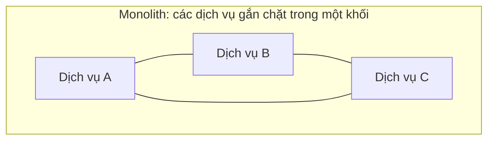
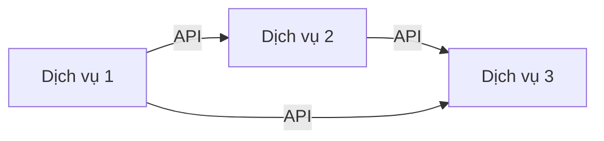

# Xây dựng so với mua; monolith so với modular

Hai cuộc tranh luận lâu đời của ngành phần mềm áp dụng thẳng vào kỹ thuật dữ liệu. Thứ nhất: **tự xây** hay **mua/dùng cái có sẵn** (nguồn mở, COSS, độc quyền). Thứ hai: dùng một hệ thống **nguyên khối** (monolith) hay ghép các thành phần **mô-đun** (modular).

**Tương tự đơn giản:** cần lốp mới cho xe, bạn đâu lấy cao su thô tự làm lốp, mà mua lốp rồi nhờ người lắp. Còn monolith giống một chiếc máy đa năng "tất cả trong một", modular giống bộ dụng cụ gồm nhiều món chuyên dụng ghép lại.

---

:::note[Ghi nhớ nhanh]

- ⭐ **Chỉ tự xây khi nó tạo lợi thế cạnh tranh**; còn lại hãy "đứng trên vai người khổng lồ" và dùng cái có sẵn. Mặc định ưu tiên OSS và COSS.
- ⭐ **Modular mạnh hơn monolith** cho kỹ thuật dữ liệu vì giữ được khả năng thay công cụ (quyết định đảo ngược được), nhưng đổi lại là nhiều thứ phải hiểu và tích hợp, nên orchestration trở nên quan trọng.
- **OSS có hai loại**: do cộng đồng quản lý và thương mại (COSS); mỗi loại có bảng tiêu chí đánh giá riêng.
- **Vườn có tường độc quyền** gồm dịch vụ độc lập và dịch vụ độc quyền của nền tảng cloud.
- **Monolith phân tán** (Hadoop, Airflow) vẫn gánh nhược điểm monolith; giải pháp là hạ tầng tạm thời hoặc container.

:::

---

## Mục lục

- 1. Xây dựng so với mua
- 2. Phần mềm nguồn mở (OSS do cộng đồng, COSS)
- 3. Vườn có tường độc quyền (dịch vụ độc lập, dịch vụ cloud)
- 4. Lời khuyên về xây dựng so với mua
- 5. Monolith so với modular
- Tóm tắt

## 1. Xây dựng so với mua

**Lập luận cho việc xây:** bạn kiểm soát từ đầu đến cuối và không phụ thuộc nhà cung cấp hay cộng đồng nguồn mở. **Lập luận cho việc mua:** xuất phát từ hạn chế về nguồn lực và chuyên môn — bạn có đủ chuyên môn để xây giải pháp tốt hơn cái đã có không? Quyết định xoay quanh **TCO, TOCO** và việc giải pháp có mang lại **lợi thế cạnh tranh** cho tổ chức hay không.

Quan điểm của sách: nếu bạn nắm được một chủ đề xuyên suốt cuốn sách thì hãy đầu tư xây và tùy chỉnh **khi nó mang lại lợi thế cạnh tranh**. Nếu không, hãy dùng thứ đã có trên thị trường. Với số lượng dịch vụ nguồn mở và trả phí (đều có thể có cộng đồng tình nguyện hoặc đội kỹ sư giỏi được trả lương cao), tự xây mọi thứ là "ngu ngốc". Sách kể đã thấy nhóm tự viết cơ sở dữ liệu từ đầu; một RDBMS nguồn mở đơn giản phục vụ họ tốt hơn nhiều nếu xem xét kỹ — ROI thấp, TCO và chi phí cơ hội cao.

Liên hệ với **kỹ sư dữ liệu loại A (abstraction) và loại B (build)**: hai vai trò này thường nằm trong cùng một kỹ sư, nhất là ở tổ chức nhỏ. Hãy **nghiêng về hành vi loại A**: tránh việc nặng nhọc không tạo khác biệt (undifferentiated heavy lifting), nắm lấy sự trừu tượng; dùng framework nguồn mở, hoặc nếu quá rắc rối thì mua giải pháp độc quyền/được quản lý phù hợp. Cả hai nhóm đều có nhiều dịch vụ mô-đun tuyệt vời.

Một thay đổi thực tế: trước đây **IT quyết định mua và dùng phần mềm theo kiểu từ trên xuống**; ngày nay việc áp dụng phần mềm đi **từ dưới lên**, do developer, kỹ sư dữ liệu, nhà khoa học dữ liệu và các vai trò kỹ thuật thúc đẩy — thành một quá trình hữu cơ, liên tục.

## 2. Phần mềm nguồn mở (OSS)

**OSS (Open Source Software)** là mô hình phân phối trong đó phần mềm và codebase bên dưới được công khai cho mọi người dùng, thường theo điều khoản giấy phép cụ thể. Thường do một nhóm cộng tác viên phân tán tạo và duy trì. OSS dùng, sửa, phân phối miễn phí trong hầu hết trường hợp nhưng có lưu ý: nhiều giấy phép yêu cầu phải kèm mã nguồn khi phân phối lại phần mềm có gốc nguồn mở. Động cơ tạo ra OSS đa dạng: có khi từ một cá nhân/nhóm nhỏ tự phát hành, có khi một công ty đưa công cụ ra công chúng theo giấy phép OSS.

OSS có **hai loại chính**: do cộng đồng quản lý và thương mại.

### 2.1. OSS do cộng đồng quản lý

Dự án OSS thành công có cộng đồng vững và người dùng sôi động; cộng đồng mang lại tốc độ đổi mới và đóng góp cao từ nhà phát triển toàn cầu. Các yếu tố cần xét:

| Yếu tố | Câu hỏi cần đặt ra |
|---|---|
| **Mức độ quan tâm của cộng đồng** | Có sức hút không? Xem số star, fork, khối lượng commit, lượt tải gần đây, hoạt động trên chat/diễn đàn. Cộng đồng mạnh tạo vòng lặp tích cực: dễ có hỗ trợ kỹ thuật và dễ tìm người biết framework |
| **Độ trưởng thành (maturity)** | Dự án tồn tại bao lâu, hiện hoạt động thế nào, có nhiều người dùng trong production không? |
| **Khắc phục sự cố** | Gặp lỗi thì tự sửa hay cộng đồng giúp được? |
| **Quản lý dự án** | Xem các issue trên Git được giải quyết nhanh không; quy trình gửi và xử lý issue thế nào? |
| **Đội ngũ (team)** | Có công ty nào tài trợ không? Ai là contributor cốt lõi? |
| **Developer relations và quản lý cộng đồng** | Dự án khuyến khích tiếp nhận ra sao? Có cộng đồng chat (ví dụ Slack) sôi động không? |
| **Đóng góp** | Có chấp nhận pull request không? Quy trình và thời gian để PR được merge? |
| **Lộ trình (roadmap)** | Có roadmap rõ ràng, minh bạch không? |
| **Tự lưu trữ và bảo trì** | Đủ tài nguyên tự host/duy trì không? TCO và TOCO so với mua dịch vụ được quản lý từ nhà cung cấp OSS? |
| **Trả lại cho cộng đồng** | Nếu dùng tích cực thì đóng góp code, giúp ở diễn đàn, quyên góp. Nhiều maintainer có công việc toàn thời gian khác và làm OSS vì tình yêu mà không đủ sống |

### 2.2. OSS thương mại (COSS)

OSS có nhược điểm: bạn phải tự host và duy trì trong môi trường của mình — có thể tầm thường hoặc cực kỳ phức tạp. Các nhà cung cấp thương mại giải quyết bằng cách **host và quản lý giải pháp OSS cho bạn**, thường dưới dạng SaaS trên cloud. Ví dụ: **Databricks (Spark), Confluent (Kafka), dbt Labs (dbt)**, và nhiều nhà cung cấp khác. Mô hình này gọi là **COSS (Commercial Open Source Software)**: nhà cung cấp thường để "lõi" miễn phí, và tính phí cho phần cải tiến, phân phối code được quản lý hoặc dịch vụ quản lý hoàn toàn.

Kịch bản phổ biến: một dự án OSS nổi tiếng, công ty liên kết huy động nhiều vốn VC để thương mại hóa, rồi tăng trưởng như "tên lửa". Khi đó kỹ sư dữ liệu có hai lựa chọn: tiếp tục dùng bản cộng đồng và tự duy trì (cập nhật, bảo trì server/container, pull request sửa lỗi...), hoặc trả tiền cho nhà cung cấp để họ lo phần quản trị.

Các yếu tố khi đánh giá COSS:

- **Giá trị:** nhà cung cấp có mang lại giá trị tốt hơn việc bạn tự quản lý OSS không? Họ thường thêm tính năng không có trong bản cộng đồng; chúng có hấp dẫn bạn không?
- **Mô hình cung cấp (delivery model):** truy cập qua tải về, API hay giao diện web/mobile? Đảm bảo dễ truy cập bản đầu tiên lẫn các bản phát hành sau.
- **Hỗ trợ:** thường bán thêm phí; hiểu rõ chi phí, cái gì được hỗ trợ và không. Phần không được hỗ trợ thuộc trách nhiệm của bạn.
- **Phát hành và sửa lỗi:** có minh bạch về lịch phát hành, cải tiến, sửa lỗi không?
- **Chu kỳ bán hàng và giá:** thường báo giá theo yêu cầu, giảm giá nếu cam kết gia hạn. Cân nhắc trả theo đợt hay trả trước; tiền nên dùng chỗ khác tốt hơn không?
- **Tình hình tài chính công ty:** có khả thi không? Nếu đã gọi vốn VC, có thể tra trên Crunchbase; họ còn bao nhiêu "đường băng" (runway)?
- **Logo so với doanh thu:** công ty tập trung tăng số khách hàng (logo) hay doanh thu? Nhiều công ty chỉ quan tâm số khách, GitHub star, thành viên Slack mà không có doanh thu để có nguồn tài chính lành mạnh.
- **Hỗ trợ cộng đồng:** công ty có thực sự hỗ trợ bản cộng đồng và đóng góp bao nhiêu cho codebase OSS không? Từng có tranh cãi về nhà cung cấp "thu hút" dự án OSS rồi trả lại rất ít. Sản phẩm có sống được như dự án do cộng đồng hỗ trợ nếu công ty đóng cửa?

**Lưu ý:** các cloud cũng cung cấp sản phẩm nguồn mở được quản lý của riêng mình, từ Linux nguồn mở trên VM đến Kafka được quản lý hoàn toàn. Động lực đơn giản: cloud thu tiền theo mức dùng; hệ sinh thái càng nhiều dịch vụ thì khách càng gắn bó và chi nhiều hơn.

## 3. Vườn có tường độc quyền (proprietary walled gardens)

Dù OSS có mặt khắp nơi, vẫn tồn tại thị trường lớn cho công nghệ không phải OSS; một số công ty lớn nhất ngành dữ liệu bán sản phẩm mã đóng. Có hai loại "vườn có tường bao": **dịch vụ độc lập** và **dịch vụ nền tảng cloud**.

### 3.1. Dịch vụ độc lập (standalone)

Bối cảnh công cụ dữ liệu tăng trưởng theo cấp số nhân; mỗi ngày lại có dịch vụ độc lập mới. Nhờ huy động vốn từ các quỹ VC, họ thuê được đội kỹ thuật, bán hàng và marketing giỏi. Người dùng có nhiều lựa chọn sản phẩm tốt nhưng phải vượt qua vô số rắc rối về tiếp thị và bán hàng. (Sách ghi nhận thời kỳ vốn rẻ dồi dào cho công ty dữ liệu đang sắp kết thúc.) Các công ty này thường không phát hành OSS mà bán giải pháp độc quyền; dù kém minh bạch hơn OSS, giải pháp độc quyền độc lập có thể chạy rất tốt, nhất là dịch vụ được quản lý hoàn toàn trên cloud.

Tiêu chí đánh giá:

- **Khả năng tương tác:** tương thích với công cụ khác bạn đã chọn (OSS, dịch vụ độc lập khác, dịch vụ cloud)? Hãy thử trước khi mua.
- **Mindshare và thị phần:** có phổ biến không? Có hiện diện trên thị trường, đánh giá khách hàng tốt không?
- **Tài liệu và hỗ trợ:** sự cố và câu hỏi chắc chắn sẽ phát sinh; có rõ cách giải quyết qua tài liệu hoặc hỗ trợ không?
- **Định giá:** có dễ hiểu không? Vạch kịch bản dùng mức thấp, trung bình, cao cùng chi phí. Có thương lượng được hợp đồng kèm giảm giá không? Ký hợp đồng thì mất bao nhiêu linh hoạt (khi đàm phán và khi thử lựa chọn mới)? Có chốt được cam kết về giá tương lai?
- **Tuổi thọ:** công ty có tồn tại đủ lâu để bạn nhận giá trị không? Xem tình hình gọi vốn, đánh giá người dùng, hỏi bạn bè và mạng xã hội. Biết rõ mình đang tham gia vào cái gì.

### 3.2. Dịch vụ độc quyền của nền tảng cloud

Nhà cung cấp cloud phát triển và bán dịch vụ độc quyền về lưu trữ, cơ sở dữ liệu... Nhiều dịch vụ là công cụ nội bộ của công ty anh em. Ví dụ: Amazon tạo cơ sở dữ liệu **DynamoDB** để vượt hạn chế của CSDL quan hệ truyền thống và xử lý lượng lớn dữ liệu người dùng, đơn hàng khi Amazon.com lớn dần; sau đó Amazon bán DynamoDB riêng trên AWS, nay là sản phẩm xếp hạng cao cho mọi quy mô. Nhà cung cấp cloud đóng gói sản phẩm để **chạy tốt với nhau**, tạo hệ sinh thái tích hợp mạnh để giữ chân khách hàng.

Tiêu chí: **so sánh hiệu suất và giá** (bản cloud có tốt hơn đáng kể bản độc lập hoặc OSS không? TCO của việc chọn dịch vụ cloud?), và **cân nhắc mua hàng** (giá on-demand có thể đắt; có giảm chi phí bằng reserved capacity hoặc cam kết dài hạn không?).

## 4. Lời khuyên về xây dựng so với mua

- Xây hay mua gắn với việc biết **lợi thế cạnh tranh của bạn** và đâu là chỗ đáng đầu tư tùy chỉnh.
- Nói chung **ưu tiên OSS và COSS theo mặc định**, để tập trung cải thiện những mảng mà các lựa chọn đó chưa đủ. Chỉ tập trung vào vài mảng mà việc xây giúp tăng giá trị đáng kể hoặc giảm ma sát rõ rệt.
- **Đừng coi chi phí vận hành nội bộ là chi phí chìm.** Nâng kỹ năng nhóm hiện có để xây hệ thống tinh vi trên nền tảng được quản lý đem lại giá trị tuyệt vời, hơn là "trông coi" server on premises.
- **Hãy nghĩ cách công ty bán hàng kiếm tiền**, nhất là nhóm sales và customer experience: điều này thường cho biết bạn sẽ được đối xử thế nào trong chu kỳ bán hàng và khi đã là khách trả tiền.
- **Ai nắm ngân sách ở công ty bạn?** Họ quyết định dự án và công nghệ nào được tài trợ ra sao? Trước khi lập business case cho COSS hoặc dịch vụ được quản lý, thử dùng OSS trước có hợp lý không? Điều tệ nhất là lựa chọn công nghệ bị treo chờ duyệt ngân sách. Như người ta nói, "thời gian giết chết thương vụ" — càng ở lâu trong trạng thái lửng lơ thì cơ hội được duyệt càng thấp. Biết trước ai kiểm soát ngân sách và cái gì sẽ được duyệt thành công.

## 5. Monolith so với modular

**Monolith** khép kín, thường làm nhiều chức năng trong một hệ thống. Phe nguyên khối thích sự đơn giản khi mọi thứ ở một chỗ: dễ suy luận, ít bộ phận chuyển động nên di chuyển nhanh. Phe **modular** nghiêng về các công nghệ tốt nhất ở từng việc, tách rời, ghép lại; với tốc độ đổi của sản phẩm dữ liệu, họ cho rằng nên hướng tới khả năng tương tác giữa một tập giải pháp luôn thay đổi.

### 5.1. Monolith

Monolith là trụ cột công nghệ nhiều thập kỷ. Thời **waterfall**, phần mềm phát hành lớn, gắn kết chặt, nhịp chậm; nhóm lớn cùng làm một codebase duy nhất. Hệ thống dữ liệu nguyên khối vẫn tồn tại: phần mềm cũ như **Informatica** và framework nguồn mở như **Spark**.

**Ưu điểm:** dễ suy luận, gánh nặng nhận thức và chuyển ngữ cảnh (context switching) thấp vì mọi thứ khép kín; thay vì hàng chục công nghệ, bạn xử lý "một" công nghệ, thường một ngôn ngữ chính. Lựa chọn tuyệt vời nếu muốn đơn giản trong suy luận về kiến trúc và quy trình.

**Nhược điểm:**

- **Giòn (brittle):** nhiều bộ phận chuyển động nên cập nhật và phát hành lâu, thường gom thành bản "bồn rửa bát" (kitchen sink). Một lỗi có thể làm hỏng cả hệ thống.
- **Vấn đề do người dùng gây ra:** sách kể một pipeline ETL nguyên khối chạy 48 giờ; hỏng ở bất kỳ đâu thì phải chạy lại từ đầu; người dùng kinh doanh chờ báo cáo vốn đã mặc định trễ hai ngày và thường đến muộn hơn nhiều. Sự cố phổ biến đến mức monolith này cuối cùng bị loại bỏ.
- **Multitenancy** khó: tách biệt workload nhiều người dùng là thách thức. Trong data warehouse on premises, một hàm do người dùng định nghĩa (UDF) có thể ngốn đủ CPU làm chậm người khác; xung đột phụ thuộc và tranh chấp tài nguyên là nỗi đau thường xuyên.
- **Khó chuyển đi:** nếu nhà cung cấp hoặc dự án nguồn mở ngừng hoạt động, vì mọi quy trình nằm trong monolith nên việc thoát ra và chuyển sang nền tảng mới tốn cả thời gian và tiền.

### 5.2. Tính mô-đun (modularity)

Modularity là khái niệm cũ trong kỹ thuật phần mềm, nhưng hệ thống phân tán mô-đun thực sự thịnh hành cùng **microservice**. Thay vì một monolith khổng lồ, ta chia hệ thống và quy trình thành các mảng quan tâm khép kín, giao tiếp qua **API**, để nhà phát triển tập trung vào miền của mình mà vẫn cho dịch vụ khác truy cập.

Các công ty công nghệ lớn là động lực của phong trào microservice. **Sứ mệnh API của Bezos** (API mandate) giảm ghép nối giữa ứng dụng, cho phép tái cấu trúc và phân tách. Bezos cũng đặt **quy tắc hai chiếc pizza** (không nhóm nào lớn đến mức hai chiếc pizza không nuôi nổi), thực tế là tối đa khoảng năm người. Giới hạn này cũng hạn chế độ phức tạp của phạm vi trách nhiệm (đặc biệt là codebase nhóm quản lý được). Ứng dụng nguyên khối lớn có thể cần nhóm một trăm người; chia thành nhóm năm người buộc ứng dụng phải chia thành các phần nhỏ, quản lý được, liên kết lỏng.

Trong môi trường microservice mô-đun, các thành phần **hoán đổi được** và có thể là ứng dụng **polyglot** (đa ngôn ngữ): một dịch vụ Java có thể thay dịch vụ viết bằng Python; khách hàng chỉ cần lo đặc tả API, không cần biết chi tiết cài đặt.

**Trong thế giới dữ liệu:** công nghệ xử lý dữ liệu đã chuyển sang mô-đun nhờ hỗ trợ mạnh khả năng tương tác. Dữ liệu nằm trong object storage ở định dạng chuẩn như **Parquet** trong data lake và lakehouse; mọi công cụ xử lý hỗ trợ định dạng đó đều đọc được và ghi kết quả lại vào lake cho công cụ khác xử lý. Data warehouse cloud tương tác với object storage qua import/export định dạng chuẩn và **external table** (truy vấn chạy trực tiếp trên dữ liệu trong data lake).

Công nghệ mới xuất hiện chóng mặt và phần lớn nhanh lỗi thời ("rửa sạch và lặp lại"), nên khả năng đổi công cụ khi công nghệ đổi là vô giá. Sách coi **modular data là mô hình mạnh hơn kỹ thuật dữ liệu nguyên khối**: cho phép chọn công nghệ tốt nhất cho từng việc hoặc từng bước.

**Nhược điểm:** có nhiều thứ hơn để lo. Thay vì một hệ thống, bạn có vô số hệ thống phải hiểu và vận hành; khả năng tương tác có thể là nỗi đau đầu, chỉ mong chúng phối hợp tốt. Chính vấn đề này khiến tác giả tách **orchestration** thành một yếu tố xuyên suốt riêng thay vì đặt dưới data management. Orchestration cũng quan trọng với kiến trúc nguyên khối (ví dụ Control-M của BMC Software trong data warehousing truyền thống), nhưng điều phối năm hay mười công cụ phức tạp hơn nhiều so với một. Orchestration trở thành **chất keo** gắn các mô-đun của data stack.

### 5.3. Mẫu monolith phân tán (distributed monolith pattern)

Là kiến trúc **phân tán nhưng vẫn mang nhiều hạn chế của monolith**: chạy hệ thống phân tán với các dịch vụ khác nhau làm các nhiệm vụ khác nhau, nhưng các dịch vụ và node **dùng chung một tập phụ thuộc hoặc một codebase**.

- **Ví dụ chuẩn: cụm Hadoop truyền thống.** Một cụm có thể host nhiều framework (Hive, Pig, Spark) và có nhiều phụ thuộc nội bộ, chạy các thành phần lõi: thư viện chung Hadoop, HDFS, YARN, Java. Thực tế cụm thường chỉ cài một phiên bản của mỗi thành phần. Hệ thống Hadoop on premises tiêu chuẩn phải quản lý một môi trường chung hợp với mọi người dùng và mọi job; nâng cấp và cài đặt là thách thức lớn. Ép job nâng cấp phụ thuộc có nguy cơ làm hỏng; duy trì hai phiên bản của một framework làm tăng độ phức tạp.
- **Apache Airflow** cũng gặp vấn đề tương tự: dù kiến trúc tách rời cao và bất đồng bộ, mọi dịch vụ chạy cùng một codebase với cùng phụ thuộc. Bất kỳ executor nào cũng có thể chạy bất kỳ task nào, nên thư viện client cho một task trong một DAG phải được cài trên toàn cụm. Điều phối nhiều công cụ đòi hỏi cài thư viện client cho hàng loạt API; **xung đột phụ thuộc** là vấn đề thường xuyên.

**Hai hướng giải quyết:**

1. **Hạ tầng tạm thời (ephemeral) trên cloud:** mỗi job có server/cụm tạm thời cài sẵn phụ thuộc riêng. Mỗi cụm vẫn nguyên khối nhưng việc tách job giảm hẳn xung đột. Mẫu này khá phổ biến với Spark qua dịch vụ như **Amazon EMR** và **Google Cloud Dataproc**.
2. **Tách monolith phân tán thành nhiều môi trường phần mềm bằng container** (xem bài kế tiếp về serverless và máy chủ).

### 5.4. Lời khuyên

Monolith hấp dẫn vì dễ hiểu và giảm độ phức tạp, nhưng cái giá là **mất tính linh hoạt, chi phí cơ hội và chu kỳ phát triển nhiều ma sát**. Khi so sánh monolith và modular, hãy cân nhắc:

- **Khả năng tương tác:** thiết kế để chia sẻ và tương tác.
- **Tránh "bẫy gấu":** thứ dễ vướng vào có thể đau đớn hoặc không thể thoát ra.
- **Tính linh hoạt:** không gian dữ liệu đang chuyển động rất nhanh; cam kết vào monolith làm giảm linh hoạt và làm giảm khả năng đảo ngược quyết định.

## Tóm tắt

| Chủ đề | Điểm chốt |
|---|---|
| Xây dựng so với mua | Chỉ xây khi tạo lợi thế cạnh tranh; còn lại mua/dùng cái có sẵn; nghiêng về hành vi loại A |
| OSS cộng đồng | Đánh giá sức hút, độ trưởng thành, quản lý dự án, chi phí tự host; nên trả lại cho cộng đồng |
| COSS | Đánh giá giá trị, hỗ trợ, tài chính công ty, "logo so với doanh thu", cam kết với bản cộng đồng |
| Độc quyền | Dịch vụ độc lập (tương tác, định giá, tuổi thọ) và dịch vụ cloud (giá/hiệu năng, mua dự trữ) |
| Monolith | Đơn giản nhưng giòn, khó multitenant, khó rời đi |
| Modular | Thay công cụ dễ, đảo ngược được quyết định; đổi lại phức tạp tích hợp nên cần orchestration |
| Monolith phân tán | Hadoop, Airflow; giải bằng hạ tầng tạm thời hoặc container |
