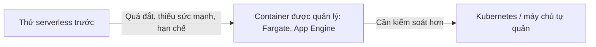

# Serverless so với máy chủ, chiến tranh benchmark và các yếu tố xuyên suốt

Bài cuối của chương đi qua ba nhóm: quyết định giữa **serverless** và **máy chủ** (kèm container), cách nhìn tỉnh táo trước các **benchmark** (điểm chuẩn) của nhà cung cấp, và tác động của các **yếu tố xuyên suốt** (undercurrents) lên việc chọn công nghệ. Phần cuối có ví dụ về orchestration với **Apache Airflow**.

**Tương tự đơn giản:** serverless như đi taxi (trả theo chuyến, không lo bảo dưỡng xe), còn máy chủ như sở hữu xe (đi nhiều thì rẻ hơn, được tùy biến, nhưng phải tự bảo trì).

---

:::note[Ghi nhớ nhanh]

- ⭐ **Trừu tượng có xu hướng thắng**: thử serverless trước, khi hết lựa chọn serverless thì dùng máy chủ (có container và orchestration).
- ⭐ **Benchmark dễ bị thao túng**: dataset nhỏ, so chi phí vô nghĩa, tối ưu bất đối xứng. Người mua hãy cẩn thận, tự mô phỏng nhu cầu thật.
- **Serverless có thể bất ngờ đắt** khi số sự kiện tăng; phải giám sát chi phí mỗi sự kiện và lập mô hình cả tình huống xấu (bot, DDoS).
- **Container** là "VM nhẹ", giải một phần vấn đề monolith phân tán nhưng cách ly kém hơn VM, rủi ro khi multitenant.
- Khi đánh giá công nghệ, luôn hỏi nó hỗ trợ **data management, DataOps, kiến trúc, orchestration, kỹ thuật phần mềm** ra sao.

:::

---

## Mục lục

- 1. Serverless so với máy chủ
- 2. Tối ưu hóa, hiệu suất và chiến tranh benchmark
- 3. Các yếu tố xuyên suốt và tác động đến lựa chọn công nghệ (gồm ví dụ orchestration: Airflow)
- 4. Kỹ thuật phần mềm
- Kết luận và tài nguyên
- Tóm tắt

:::info[Thuật ngữ trong bài — hiểu nôm na]

Ví dụ trong bài dùng chuỗi trà sữa **Mây** (30 cửa hàng, 60 tủ mát có cảm biến, xem [phần giới thiệu](../intro.md)).

| Thuật ngữ | Nghĩa đời thường | Ví dụ ở chuỗi Mây |
| --- | --- | --- |
| Serverless | Đi taxi: trả theo chuyến, không lo xe | Đoạn code kiểm tra nhiệt độ chỉ chạy khi có số đo mới |
| FaaS (Function as a Service) | Thuê chạy từng "hàm" nhỏ theo sự kiện | Mỗi số đo tủ mát gọi một hàm kiểm tra |
| Concurrency | Số việc chạy cùng lúc | 60 tủ gửi số đo cùng một phút |
| Container | Hộp đóng gói chương trình cùng mọi thứ nó cần | Bước làm sạch đơn chạy trong hộp riêng |
| Kubernetes | Hệ thống quản lý rất nhiều container | Quá nặng cho quy mô của Mây |
| Bootstrap script / image | Kịch bản tự cài đặt / bản chụp máy đã cài sẵn | Máy chạy đường ống tự dựng lại từ bản chụp mỗi đêm |
| Benchmark | Bài đo tốc độ để so sánh | "Kho X nhanh gấp 3 lần kho Y" |
| Cache | Bộ nhớ tạm để lần sau trả lời nhanh hơn | Truy vấn lặp lại lần hai nhanh bất thường vì đã nhớ kết quả |
| SLA | Cam kết chất lượng dịch vụ của nhà cung cấp | "Kho dữ liệu chạy 99,9% thời gian, sập thì hoàn tiền" |
| DDoS | Tấn công bằng cách gửi ồ ạt yêu cầu giả | Bot gửi hàng triệu đơn ảo vào app |

:::

## 1. Serverless so với máy chủ

Một xu hướng lớn của nhà cung cấp cloud là **serverless**: cho phép developer và kỹ sư dữ liệu chạy ứng dụng mà không quản lý máy chủ phía sau. Nó cho thời gian đánh giá nhanh với các use case phù hợp, nhưng với trường hợp khác có thể không thích hợp.

### 1.1. Serverless

Dù serverless đã có từ trước, làn sóng mạnh bắt đầu với **AWS Lambda năm 2014**: hứa hẹn chạy đoạn code nhỏ theo yêu cầu mà không quản lý server. Lý do nổi tiếng chính là **chi phí và sự tiện lợi**: thay vì trả tiền server, chỉ trả khi code được kích hoạt.

Serverless có nhiều hương vị. **FaaS (Function as a Service)** rất phổ biến, nhưng hệ thống serverless đã có trước Lambda. Ví dụ **Google BigQuery** là serverless: kỹ sư không cần quản lý hạ tầng phía sau, hệ thống co về 0 và tự mở rộng để xử lý truy vấn lớn. Chỉ cần nạp dữ liệu và truy vấn; trả tiền theo lượng dữ liệu truy vấn quét cộng một khoản nhỏ phí lưu trữ. Mô hình "trả tiền cho tiêu thụ và lưu trữ" ngày càng phổ biến.

**Khi nào serverless hợp lý?** Tùy trường hợp; kỹ sư dữ liệu phải hiểu kỹ giá cloud để dự đoán khi nào serverless trở nên đắt.

- Mặt tốt: có kỹ sư tìm ra thủ thuật chạy workload batch với chi phí thấp trên AWS Lambda.
- Mặt xấu: hàm serverless có **sự kém hiệu quả chi phí cố hữu**. Xử lý một sự kiện cho mỗi lần gọi hàm ở tốc độ sự kiện cao có thể đắt khủng khiếp, nhất là khi các cách đơn giản như đa luồng hoặc đa tiến trình là phương án thay thế tuyệt vời.
- Cần **giám sát** (xác định chi phí mỗi sự kiện trong môi trường thực và thời gian thực thi tối đa) và **lập mô hình** (dùng chi phí mỗi sự kiện để tính tổng chi phí khi tốc độ sự kiện tăng), gồm cả tình huống xấu nhất: điều gì xảy ra nếu website bị một đàn bot hoặc DDoS tấn công?

#### Áp vào chuỗi Mây: khi nào serverless rẻ, khi nào đắt

Mây cân nhắc dùng hàm serverless để kiểm tra mỗi số đo tủ mát. Bảng dưới (số liệu giả định: 5.000đ cho mỗi 1 triệu lần gọi hàm; một máy chủ nhỏ chạy 24/7 là 1,5 triệu đồng mỗi tháng) cho thấy phải lập mô hình chi phí cho **cả tình huống xấu**.

| Tình huống | Số sự kiện mỗi tháng | Chi phí serverless | Chi phí máy chủ chạy suốt | Bên rẻ hơn |
| --- | --- | --- | --- | --- |
| 60 tủ, mỗi phút một số đo | ~2,6 triệu | ~13.000đ | 1,5 triệu | Serverless |
| Mở rộng 600 tủ, mỗi giây một số đo | ~1,5 tỷ | ~7,8 triệu | 1,5 triệu (có thể cần máy lớn hơn) | Máy chủ |
| Bot tấn công app, mỗi lượt gọi một hàm | ~3 tỷ trong 1 tuần | ~15 triệu | Máy chủ quá tải nhưng hoá đơn không tăng | Phải có giới hạn chi tiêu |

Ở quy mô hiện tại, serverless gần như miễn phí với Mây. Nhưng nếu Mây gắn cảm biến dày hơn, hoặc bị tấn công, hoá đơn có thể tăng gấp nghìn lần. Vì vậy cần đo "chi phí mỗi sự kiện" và đặt cảnh báo ngân sách ngay từ đầu.

### 1.2. Container

Cùng với serverless và microservice, **container** là một trong những công nghệ vận hành nổi bật nhất. Container đóng vai trò trong cả serverless lẫn microservice.

- Container thường được gọi là **"VM nhẹ"**. VM truyền thống đóng gói cả hệ điều hành; container đóng gói một **không gian người dùng biệt lập** (hệ thống tệp và vài tiến trình), nhiều container cùng tồn tại trên một OS máy chủ. Chúng cho lợi ích chính của ảo hóa (cách ly phụ thuộc và code) mà không phải mang theo cả nhân OS.
- Một node phần cứng có thể host nhiều container với phân bổ tài nguyên chi tiết. **Kubernetes** là hệ thống quản lý container. Môi trường serverless thường chạy ngầm trên container. Thậm chí Kubernetes là một dạng môi trường serverless vì cho phép nhóm dev/ops triển khai microservice mà không lo chi tiết máy bên dưới.
- Container giải **một phần** vấn đề monolith phân tán (đã nêu ở bài trước): ví dụ Hadoop hiện hỗ trợ container, cho phép mỗi job có phụ thuộc riêng.

**Lưu ý bảo mật:** cụm container không cách ly và bảo mật như VM đầy đủ. **Container escape** (code trong container giành đặc quyền ngoài container ở cấp OS) đủ phổ biến để coi là rủi ro cho môi trường **multitenant**. Amazon EC2 là môi trường multitenant với VM của nhiều khách hàng trên cùng phần cứng, nhưng cụm Kubernetes chỉ nên chạy code trong môi trường **tin cậy lẫn nhau** (ví dụ trong nội bộ một công ty). Quy trình review code và quét lỗ hổng cũng rất quan trọng.

**Các biến thể thêm tính năng serverless cho container:** nền tảng hàm đóng container chạy container như đơn vị tạm thời được kích hoạt theo sự kiện thay vì dịch vụ chạy liên tục. Điều này cho sự đơn giản của AWS Lambda cùng tính linh hoạt đầy đủ của môi trường container, thay vì runtime Lambda hạn chế. Dịch vụ như **AWS Fargate** và **Google App Engine** chạy container mà không phải quản lý cụm tính toán như Kubernetes, và cách ly container hoàn toàn nên tránh vấn đề bảo mật multitenant.

Sự trừu tượng sẽ tiếp tục leo thang: Kubernetes cũng được cung cấp rộng rãi như dịch vụ được quản lý. "Sau Kubernetes sẽ là gì?" — tác giả cũng háo hức như bạn.

### 1.3. Cách đánh giá máy chủ so với serverless

Vì sao vẫn chạy server riêng? **Chi phí** là yếu tố lớn: serverless kém hợp lý khi mức dùng và chi phí vượt chi phí vận hành, bảo trì server liên tục (Hình 4-6); ở một quy mô nhất định, lợi thế kinh tế của serverless giảm và chạy server hấp dẫn hơn. **Tùy biến, sức mạnh và kiểm soát** là lý do chính khác: một số framework serverless không đủ mạnh hoặc bị giới hạn ở một số use case.

Khi dùng máy chủ (nhất là trên cloud, nơi tài nguyên server là tạm thời):

| Nguyên tắc | Ý nghĩa |
|---|---|
| **Mong đợi server hỏng** | Tránh server "bông tuyết đặc biệt" (snowflake) bị tùy chỉnh quá mức, dễ vỡ. Coi server là tài nguyên tạm thời, tạo khi cần rồi xóa. Cần cài code cụ thể thì dùng bootstrap script hoặc tạo image; triển khai code qua CI/CD |
| **Dùng cụm và autoscaling** | Tận dụng khả năng co giãn của cloud; gom server ứng dụng thành cụm và để autoscaling mở rộng ngang theo nhu cầu |
| **Coi hạ tầng như code** | Tự động hóa cả hạ tầng bằng công cụ như Terraform, AWS CloudFormation, Google Cloud Deployment Manager |
| **Dùng container** | Cho workload phức tạp, nặng, nhiều phụ thuộc: container trên server hoặc Kubernetes |

### 1.4. Lời khuyên: serverless có hợp với bạn không?

| Tiêu chí | Ý nghĩa |
|---|---|
| **Khối lượng và độ phức tạp workload** | Serverless hợp nhất với tác vụ đơn giản, rời rạc. Không hợp nếu nhiều bộ phận chuyển động hoặc cần nhiều CPU/bộ nhớ; khi đó cân nhắc container và framework orchestration container như Kubernetes |
| **Tần suất và thời gian thực thi** | Bao nhiêu request mỗi giây, mỗi request mất bao lâu? Nền tảng serverless có giới hạn về tần suất, concurrency, thời lượng. Nếu không vừa các giới hạn thì xem hướng container |
| **Yêu cầu và kết nối mạng** | Serverless thường dùng mạng đơn giản hóa, không hỗ trợ đủ tính năng mạng ảo của cloud như VPC và firewall |
| **Ngôn ngữ** | Ngôn ngữ bạn dùng không được nền tảng hỗ trợ chính thức thì cân nhắc container |
| **Giới hạn runtime** | Không có OS đầy đủ, chỉ có image runtime cụ thể |
| **Chi phí** | Rất tiện nhưng có thể đắt: ít sự kiện thì rẻ, tăng nhanh khi số sự kiện tăng; nguồn thường gặp của hóa đơn cloud bất ngờ |

Kết luận của sách: **trừu tượng có xu hướng thắng**. Hãy xét serverless trước, rồi mới đến máy chủ (có container và orchestration nếu có thể) khi đã hết lựa chọn serverless.

### Áp vào chuỗi Mây: mỗi việc chạy ở đâu

Theo lời khuyên "thử serverless trước", các việc của Mây được xếp như sau:

| Việc ở Mây | Đặc điểm | Nên chạy bằng | Vì sao |
| --- | --- | --- | --- |
| Kiểm tra nhiệt độ từng số đo | Nhỏ, rời rạc, theo sự kiện | Hàm serverless | Rẻ, tự co giãn |
| Truy vấn doanh thu | Thất thường, lúc nhiều lúc không | Kho dữ liệu serverless (trả theo dữ liệu quét) | Không phải giữ máy chạy suốt |
| Làm sạch đơn mỗi đêm, cần thư viện đọc Excel và CSV | Chạy 20-40 phút, nhiều phụ thuộc | Container được quản lý | Vượt giới hạn thời gian của hàm serverless, cần thư viện riêng |
| Huấn luyện lại mô hình dự báo mỗi tuần | Cần nhiều bộ nhớ, chạy 1-2 tiếng | Máy ảo tạm thời, xong thì xoá | Cần sức mạnh, nhưng không cần chạy suốt |
| Cụm Kubernetes riêng | | Không cần | Quá phức tạp cho đội 1-3 người |

## 2. Tối ưu hóa, hiệu suất và chiến tranh benchmark

Hãy tưởng tượng bạn là tỷ phú đang chọn phương tiện, thu hẹp còn hai lựa chọn: một máy bay phản lực thương gia thân rộng (tầm bay khoảng 9.945 hải lý, tốc độ hành trình 0,85 Mach...) và một siêu xe điện Tesla Model S Plaid (0-100 km/h trong 2,1 giây, 1020 mã lực...). Cái nào "hiệu suất tốt hơn"? Không cần biết nhiều về xe hay máy bay cũng thấy đó là so sánh vô nghĩa: một bên thiết kế để bay xuyên lục địa, một bên là siêu xe.

Tác giả thấy so sánh "táo với cam" như vậy suốt trong không gian cơ sở dữ liệu: benchmark so sánh cơ sở dữ liệu tối ưu cho use case hoàn toàn khác, hoặc dùng kịch bản kiểm thử không giống nhu cầu thực. Gần đây có đợt **benchmark war** mới giữa các nhà cung cấp dữ liệu lớn. Sách hoan nghênh benchmark và vui vì nhiều nhà cung cấp cuối cùng đã bỏ **điều khoản DeWitt** (điều khoản trong hợp đồng cấm công bố kết quả benchmark) khỏi hợp đồng khách hàng, nhưng vẫn cảnh báo: người mua hãy cẩn thận, không gian dữ liệu đầy những benchmark vô nghĩa. Các thủ thuật phổ biến:

| Thủ thuật | Cách hoạt động | Cách phòng |
|---|---|---|
| **Big data... cho những năm 1990** | Sản phẩm tuyên bố hỗ trợ "big data" quy mô petabyte nhưng dùng dataset nhỏ đến mức nằm gọn trong bộ nhớ điện thoại. Với hệ thống dựa vào cache, dataset thử nghiệm nằm hoàn toàn trong SSD hoặc RAM, truy vấn lặp đi lặp lại cùng dữ liệu nên hiệu năng rất cao; dataset nhỏ còn giảm chi phí RAM/SSD khi so giá | Mô phỏng kích thước truy vấn và dữ liệu thực tế; đánh giá hiệu năng truy vấn và chi phí tài nguyên dựa trên nhu cầu chi tiết của bạn |
| **So sánh chi phí vô nghĩa** | Nhiều hệ thống MPP không dễ tạo và xóa dù trên cloud, chạy liên tục nhiều năm sau khi cấu hình; các cơ sở dữ liệu khác tính toán động và tính phí theo truy vấn hoặc theo giây. So sánh hệ thống tạm thời và không tạm thời theo chi phí mỗi giây là vô nghĩa nhưng rất hay gặp | So sánh trên cùng mô hình sử dụng thực tế |
| **Tối ưu hóa bất đối xứng** | Ví dụ: so hệ thống MPP hướng hàng với cơ sở dữ liệu cột bằng benchmark chạy join phức tạp trên dữ liệu chuẩn hóa cao. Mô hình chuẩn hóa tối ưu cho hệ thống hướng hàng, còn hệ thống cột chỉ phát huy hết khi đổi schema. Tệ hơn, nhà cung cấp tối ưu thêm join cho hệ thống của mình (ví dụ lập chỉ mục trước) mà không áp dụng tương đương cho đối thủ (ví dụ đặt join vào materialized view) | Kiểm tra mỗi hệ thống được tối ưu đồng đều như nhau |

Áp vào chuỗi Mây: hai hãng kho dữ liệu đều khoe benchmark "nhanh nhất". Thay vì tin, Mây tự làm một bài thử nhỏ mô phỏng **nhu cầu thật của mình**:

| Bước | Mây làm gì | Tránh thủ thuật nào |
| --- | --- | --- |
| Dữ liệu thử | Nạp đúng 3 năm đơn hàng thật (khoảng 10 triệu dòng), không dùng bộ mẫu của hãng | Dataset nhỏ nằm gọn trong RAM |
| Truy vấn thử | 5 truy vấn mà dashboard dùng hằng ngày, chạy mỗi truy vấn với tham số khác nhau | Truy vấn lặp lại trúng cache |
| Cách tính tiền | Ước tính hoá đơn **cả tháng** theo cách Mây dùng thật, không so "giá mỗi giây" | So sánh chi phí vô nghĩa |
| Tối ưu | Áp cùng mức tinh chỉnh cho cả hai hãng | Tối ưu bất đối xứng |

**Lời kết:** như mọi thứ trong công nghệ dữ liệu, *caveat emptor* (người mua hãy cẩn thận). Hãy làm bài tập về nhà trước khi mù quáng tin benchmark của nhà cung cấp để đánh giá và chọn công nghệ.

## 3. Các yếu tố xuyên suốt và tác động đến lựa chọn công nghệ

Dù chọn công nghệ nào, hãy hiểu nó hỗ trợ các **yếu tố xuyên suốt** (undercurrents) của vòng đời kỹ thuật dữ liệu ra sao.

### 3.1. Quản lý dữ liệu (data management)

Quản lý dữ liệu là lĩnh vực rộng, và không phải lúc nào cũng rõ công nghệ có coi nó là mối quan tâm chính hay không. Ví dụ, nhà cung cấp bên thứ ba có thể áp dụng thực hành tốt (tuân thủ quy định, bảo mật, quyền riêng tư, chất lượng dữ liệu, quản trị) nhưng che sau giao diện hạn chế. Khi đánh giá sản phẩm, hãy hỏi thẳng nhà cung cấp. Câu hỏi mẫu:

- Bạn bảo vệ dữ liệu khỏi vi phạm thế nào, cả từ bên ngoài lẫn bên trong?
- Sản phẩm tuân thủ GDPR, CCPA và các quy định riêng tư dữ liệu khác ra sao?
- Có cho phép tôi lưu dữ liệu tại chỗ của mình để tuân thủ các quy định này không?
- Làm sao đảm bảo chất lượng dữ liệu và tôi đang xem dữ liệu chính xác trong giải pháp của bạn?

Các câu hỏi tương tự cũng nên áp dụng cho các giải pháp OSS bạn đang cân nhắc.

### 3.2. DataOps

Sự cố rồi sẽ xảy ra: server hoặc cơ sở dữ liệu ngừng chạy, cloud region down, bạn triển khai code lỗi, dữ liệu xấu vào data warehouse. Khi đánh giá công nghệ mới, hãy hỏi: bạn kiểm soát việc triển khai code mới tới đâu, được cảnh báo ra sao khi có sự cố, và bạn phản hồi thế nào?

- Nếu là **OSS**, bạn có thể chịu trách nhiệm thiết lập giám sát, hosting, triển khai code; bạn xử lý vấn đề và phản ứng sự cố thế nào?
- Nếu là **dịch vụ được quản lý**, phần lớn vận hành nằm ngoài tầm kiểm soát. Xem **SLA** của nhà cung cấp, cách họ cảnh báo vấn đề, và họ có minh bạch khi xử lý sự cố không (kể cả đưa ETA khắc phục).

### 3.3. Kiến trúc dữ liệu

Như Chương 3: kiến trúc tốt là đánh giá các sự đánh đổi, chọn công cụ tốt nhất cho việc đồng thời giữ quyết định **đảo ngược được**. Bối cảnh đổi chóng mặt nên "công cụ tốt nhất cho việc" là mục tiêu di động. Mục tiêu chính: **tránh lock-in không cần thiết, đảm bảo khả năng tương tác xuyên suốt data stack, và tạo ROI cao**.

#### Áp vào chuỗi Mây: bảng câu hỏi trước khi ký với nhà cung cấp

Gom các câu hỏi về yếu tố xuyên suốt thành một bảng kiểm mà Mây mang theo khi gặp nhà cung cấp công cụ kéo dữ liệu:

| Yếu tố xuyên suốt | Câu hỏi Mây cần hỏi | Câu trả lời đáng lo |
| --- | --- | --- |
| Bảo mật | Số điện thoại khách đi qua hệ thống của anh có được mã hoá không? | "Chúng tôi lưu tạm dạng thường để xử lý nhanh" |
| Quản lý dữ liệu | Dữ liệu có được lưu ở Việt Nam hoặc vùng Mây chọn không? | "Chỉ có máy chủ ở Mỹ" (nếu luật yêu cầu lưu trong nước) |
| DataOps | Khi connector lỗi, Mây được báo thế nào, bao lâu sửa? | "Khách tự kiểm tra trên trang quản trị" |
| Kiến trúc | Muốn rời đi, Mây lấy cấu hình và dữ liệu ra bằng cách nào? | "Chỉ xuất được định dạng riêng của chúng tôi" |
| Orchestration | Công cụ có cho công cụ điều phối của Mây gọi chạy qua API không? | "Chỉ chạy theo lịch cố định" |

### 3.4. Orchestration: ví dụ Airflow

Phần lớn chương tác giả chủ động tránh bàn rộng về công nghệ cụ thể, **ngoại lệ là orchestration** vì không gian này hiện bị một công nghệ nguồn mở chi phối: **Apache Airflow**.

**Lịch sử:** Maxime Beauchemin khởi động Airflow tại Airbnb năm 2014, ngay từ đầu là dự án nguồn mở phi thương mại. Nhanh chóng có mindshare ngoài Airbnb, thành dự án Apache Incubator năm 2016 và dự án Apache cấp cao năm 2019.

**Ưu điểm** (phần lớn nhờ vị thế thống trị):

1. Dự án rất năng động: tỷ lệ commit cao, phản hồi nhanh với lỗi và vấn đề bảo mật; vừa phát hành **Airflow 2**, một lần tái cấu trúc lớn codebase.
2. **Mindshare** rất lớn: cộng đồng sôi động trên Slack, Stack Overflow, GitHub; dễ tìm câu trả lời.
3. Có sẵn dưới dạng dịch vụ quản lý hoặc phân phối phần mềm qua nhiều nhà cung cấp, gồm GCP, AWS và Astronomer.io.

**Nhược điểm:**

- Dựa trên một số thành phần lõi **không mở rộng được** (cơ sở dữ liệu scheduler và backend) có thể là điểm nghẽn về hiệu năng, quy mô, độ tin cậy; phần mở rộng được vẫn theo mô hình **monolith phân tán** (xem bài trước).
- Thiếu hỗ trợ nhiều cấu trúc gốc dữ liệu như quản lý schema, lineage (dòng dõi), catalog; phát triển và kiểm thử workflow Airflow là thách thức.

Về lựa chọn thay thế, sách chỉ nhắc vài đối thủ chính lúc viết: **Prefect** và **Dagster**, nhằm giải một số vấn đề trên bằng cách nghĩ lại các thành phần kiến trúc Airflow. Sẽ còn framework khác chưa được bàn ở đây — hãy "lên kế hoạch cho điều đó". Ai chọn công nghệ orchestration nên khảo sát các lựa chọn và theo dõi diễn biến mới.

## 4. Kỹ thuật phần mềm

Là kỹ sư dữ liệu, hãy cố **đơn giản hóa và trừu tượng hóa toàn bộ data stack**. Mua hoặc dùng giải pháp nguồn mở dựng sẵn bất cứ khi nào có thể. Loại bỏ **undifferentiated heavy lifting** là mục tiêu lớn. Tập trung nguồn lực (code và công cụ tùy chỉnh) vào các mảng cho bạn **lợi thế cạnh tranh vững chắc**.

- Ví dụ: tự code tay một connector giữa cơ sở dữ liệu production và data warehouse cloud có phải lợi thế cạnh tranh không? Có lẽ không, vì đây là bài toán đã được giải rất nhiều. Hãy chọn giải pháp có sẵn (nguồn mở hoặc SaaS được quản lý). Thế giới không cần thêm "connector từ cơ sở dữ liệu lên cloud warehouse" thứ một triệu lẻ một.
- Mặt khác, hãy hỏi vì sao khách hàng mua hàng của bạn. Doanh nghiệp có thể có điều đặc biệt trong cách làm, ví dụ một thuật toán cụ thể chạy nền tảng fintech của bạn. Bằng cách loại bỏ nhiều quy trình dư thừa, bạn tiếp tục tinh chỉnh và tùy biến những thứ quyết định hoạt động kinh doanh.

## Kết luận và tài nguyên

Chọn công nghệ phù hợp không dễ, nhất là khi công nghệ và mẫu hình mới xuất hiện mỗi ngày; có lẽ nay là thời điểm khó hiểu nhất trong lịch sử cho việc đánh giá và chọn công nghệ. Lựa chọn công nghệ là sự **cân bằng giữa use case, chi phí, xây dựng so với mua, và mô-đun hóa**. Hãy tiếp cận công nghệ như tiếp cận kiến trúc: **đánh giá các đánh đổi và hướng tới quyết định đảo ngược được**.

**Tài nguyên bổ sung** (do sách liệt kê):

- *Cloud FinOps* — J. R. Storment và Mike Fuller (O'Reilly)
- *Cloud Infrastructure: The Definitive Guide for Beginners* — Matthew Smith
- *The Cost of Cloud, a Trillion Dollar Paradox* — Sarah Wang và Martin Casado
- Trang web "What Is FinOps" của FinOps Foundation
- *Red Hot: The 2021 Machine Learning, AI and Data (MAD) Landscape* — Matt Turck
- Video "What's Next for Analytical Databases? w/ Jordan Tigani (MotherDuck)" của Ternary Data
- *The Unfulfilled Promise of Serverless* — Corey Quinn
- *What Is the Modern Data Stack?* — Charles Wang

## Tóm tắt

| Chủ đề | Điểm chốt |
|---|---|
| Serverless | Rất tiện, co giãn từ 0; nhưng giới hạn runtime/thời lượng, có thể đắt khi sự kiện nhiều; phải giám sát và mô hình hóa chi phí |
| Container | "VM nhẹ", giải một phần monolith phân tán; cách ly kém hơn VM, chỉ dùng multitenant khi tin cậy lẫn nhau hoặc qua Fargate/App Engine |
| Máy chủ | Khi cần tùy biến, kiểm soát, quy mô lớn; coi server là tạm thời, dùng autoscaling, IaC, CI/CD |
| Benchmark | Cẩn thận 3 thủ thuật: dataset nhỏ, so chi phí vô nghĩa, tối ưu bất đối xứng |
| Yếu tố xuyên suốt | Hỏi nhà cung cấp về data management, DataOps (SLA), kiến trúc (tránh lock-in) |
| Airflow | Thống trị nhưng là monolith phân tán, thiếu lineage/catalog; có Prefect, Dagster |
| Kỹ thuật phần mềm | Mua/dùng cái có sẵn, chỉ tùy biến nơi tạo lợi thế cạnh tranh |
