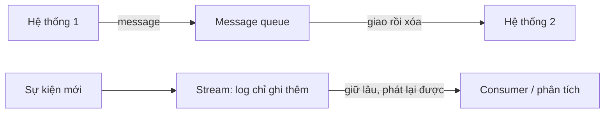

# Nguồn dữ liệu và các ý tưởng chính về hệ thống nguồn

Chương 5 nói về giai đoạn đầu tiên của vòng đời kỹ thuật dữ liệu: **dữ liệu được tạo ra trong hệ thống nguồn** (source system). Trước khi lấy được dữ liệu thô, kỹ sư dữ liệu phải hiểu dữ liệu nằm ở đâu, được sinh ra thế nào và có những "tính khí" gì. Bài này đi qua phần mở đầu và mục "Hệ thống nguồn: Ý tưởng chính" — các khái niệm nền tảng gặp lại ở hầu hết hệ thống nguồn.

**Tương tự đơn giản:** hệ thống nguồn giống như nhà bếp của một nhà hàng. Bạn (kỹ sư dữ liệu) là người nhận nguyên liệu từ bếp để đem đi chế biến. Muốn lấy đúng và không làm hỏng bếp, bạn phải biết bếp nấu thế nào, giờ nào bận, và ai là bếp trưởng.

---

:::note[Ghi nhớ nhanh]

- ⭐ **Phải hiểu hệ thống nguồn trước khi thu nạp** — đọc tài liệu, hiểu cách nó ghi, commit, truy vấn và các điểm kỳ quặc, vì chúng ảnh hưởng trực tiếp đến việc lấy dữ liệu.
- ⭐ **OLTP khác OLAP**: OLTP đọc/ghi từng bản ghi rất nhanh cho ứng dụng; OLAP quét lượng lớn dữ liệu cho phân tích. Chạy phân tích nặng trên OLTP sẽ làm chậm ứng dụng.
- **CDC** (thu thập dữ liệu thay đổi) lấy từng sự kiện insert/update/delete, thường dựa vào nhật ký (log) của cơ sở dữ liệu.
- **Mẫu insert-only** giữ lịch sử bằng cách chèn bản ghi mới thay vì sửa bản ghi cũ.
- **Message khác stream**: message bị xóa sau khi tiêu thụ; stream là nhật ký chỉ ghi thêm, lưu lâu và phát lại được.
- Luôn ghi lại **event time, ingestion time, processing time**.

:::

---

## Mục lục

- 1. Dữ liệu được tạo ra như thế nào
- 2. Tệp và dữ liệu phi cấu trúc
- 3. API
- 4. Cơ sở dữ liệu ứng dụng (OLTP) và ACID
- 5. OLTP và phân tích, OLAP
- 6. Change Data Capture (CDC)
- 7. Nhật ký (logs)
- 8. CRUD và insert-only
- 9. Message và stream
- 10. Các loại thời gian
- Tóm tắt

## 1. Dữ liệu được tạo ra như thế nào

Sách mô tả vai trò của kỹ sư dữ liệu: lấy dữ liệu từ hệ thống nguồn, xử lý, rồi làm cho nó hữu ích cho các mục đích phía sau. Nhưng trước đó phải hiểu dữ liệu tồn tại ở đâu, được tạo ra thế nào và đặc điểm của nó.

Các tác giả dự đoán rằng khi việc **chia sẻ dữ liệu** (data sharing) phát triển, việc "chuyển dữ liệu từ A sang B" sẽ ngày càng đơn giản. Vì vậy, hiểu **bản chất của dữ liệu ở nguồn** và sự tương tác giữa nguồn với đích sẽ quan trọng hơn.

Dữ liệu là tập hợp các sự kiện và con số chưa có tổ chức, chưa có ngữ cảnh. Có hai cách tạo ra:

- **Analog** (tương tự): xảy ra trong thế giới thực — lời nói, ngôn ngữ ký hiệu, viết tay, chơi nhạc cụ. Loại này thường thoáng qua (một cuộc trò chuyện xong là nội dung mất).
- **Digital** (số): hoặc chuyển đổi từ analog (ứng dụng nhắn tin biến giọng nói thành văn bản), hoặc là sản phẩm gốc của hệ thống số (một giao dịch thẻ tín dụng trên sàn thương mại điện tử, được lưu vào nhiều cơ sở dữ liệu).

Dữ liệu có ở khắp nơi: thiết bị IoT, máy quẹt thẻ, cảm biến kính thiên văn, giao dịch chứng khoán... Lời khuyên của sách: làm quen với hệ thống nguồn, **đọc tài liệu**, hiểu các mẫu hoạt động và điểm kỳ quặc của nó. Nếu nguồn là RDBMS, hãy hiểu cách nó ghi, commit, truy vấn — vì những chi tiết đó ảnh hưởng đến khả năng thu nạp của bạn.

## 2. Tệp và dữ liệu phi cấu trúc

**Tệp** (file) là một chuỗi byte, thường nằm trên đĩa. Ứng dụng ghi tham số, sự kiện, log, hình ảnh, âm thanh vào tệp. Tệp cũng là phương tiện trao đổi dữ liệu rất phổ biến: kỹ sư dữ liệu mong lấy dữ liệu bằng chương trình, nhưng phần lớn thế giới vẫn gửi nhận tệp. Ví dụ dữ liệu từ cơ quan nhà nước thường là Excel, CSV hoặc gửi qua email.

Các định dạng nguồn bạn hay gặp (do con người tạo tay hoặc do tiến trình hệ thống xuất ra):

| Định dạng | Mức cấu trúc |
|---|---|
| Excel | Có cấu trúc |
| CSV | Có cấu trúc, đôi khi bán cấu trúc hoặc không cấu trúc |
| JSON, XML | Bán cấu trúc |
| TXT | Không cấu trúc |

Các định dạng "của kỹ sư dữ liệu" như Parquet, ORC, Avro được bàn ở chương Lưu trữ (Chương 6).

## 3. API

**API** (Application Programming Interface — giao diện lập trình ứng dụng) là cách chuẩn để trao đổi dữ liệu giữa các hệ thống. Về lý thuyết API làm việc thu nạp dễ hơn; thực tế nhiều API vẫn phức tạp, kỹ sư thường tốn nhiều công duy trì các kết nối API tùy chỉnh dù đã có nhiều dịch vụ/framework tự động hóa. Phần chi tiết về API nằm trong bài sau.

## 4. Cơ sở dữ liệu ứng dụng (OLTP) và ACID

**Cơ sở dữ liệu ứng dụng** lưu **trạng thái** (state) của ứng dụng. Ví dụ kinh điển: cơ sở dữ liệu lưu số dư tài khoản ngân hàng; mỗi lần giao dịch, ứng dụng cập nhật số dư.

Thường đó là hệ thống **OLTP** (Online Transaction Processing — xử lý giao dịch trực tuyến): cơ sở dữ liệu đọc và ghi từng bản ghi riêng lẻ với tốc độ cao. Người ta hay gọi là "cơ sở dữ liệu giao dịch", nhưng điều này không nhất thiết có nghĩa nó hỗ trợ giao dịch nguyên tử. Tổng quát hơn, OLTP nghĩa là **độ trễ thấp** và **đồng thời cao**:

- RDBMS có thể chọn hoặc cập nhật một hàng trong chưa đầy một phần nghìn giây (chưa tính độ trễ mạng), xử lý hàng nghìn đọc/ghi mỗi giây.
- Cụm cơ sở dữ liệu tài liệu (document) có thể commit nhanh hơn nữa, nhưng đánh đổi bằng khả năng thiếu nhất quán.
- Một số cơ sở dữ liệu đồ thị cũng xử lý được giao dịch.

OLTP là backend tốt khi hàng nghìn đến hàng triệu người dùng cùng đọc/ghi. Nó **không phù hợp** với phân tích quy mô lớn, nơi một truy vấn phải quét rất nhiều dữ liệu.

### ACID

Hỗ trợ **giao dịch nguyên tử** là một trong các đặc tính gọi chung là **ACID** (đã nhắc ở Chương 3):

- **Atomicity** (nguyên tử): nhiều thay đổi thực hiện như một khối — hoặc xong hết, hoặc không gì cả.
- **Consistency** (nhất quán): mỗi lần đọc trả về phiên bản được ghi gần nhất.
- **Isolation** (cô lập): hai cập nhật đồng thời trên cùng một mục cho kết quả như thể chúng chạy tuần tự theo thứ tự gửi.
- **Durability** (bền vững): dữ liệu đã commit không mất, kể cả khi mất điện.

Backend ứng dụng **không bắt buộc** phải ACID; nới lỏng có thể tăng hiệu năng và quy mô. Nhưng ACID giúp cơ sở dữ liệu giữ bức tranh nhất quán, đơn giản hóa việc của lập trình viên. Một số cơ sở dữ liệu phân tán dùng nhất quán lỏng hơn, như **eventual consistency** (nhất quán sau cùng). Hiểu mô hình nhất quán bạn đang dùng giúp tránh thảm họa.

### Giao dịch nguyên tử — ví dụ chuyển khoản

Ứng dụng ngân hàng trên RDBMS kiểm tra số dư tài khoản A (nguồn) và B (đích); nếu A đủ tiền thì chuyển từ A sang B. Toàn bộ thao tác hoặc cập nhật cả hai số dư, hoặc thất bại mà không cập nhật số dư nào — nghĩa là một giao dịch duy nhất.

Ví dụ minh hoạ (do người ghi chép thêm, không phải của sách):

```sql
BEGIN;
UPDATE accounts SET balance = balance - 100 WHERE id = 'A' AND balance >= 100;
UPDATE accounts SET balance = balance + 100 WHERE id = 'B';
COMMIT;  -- nếu có lỗi giữa chừng thì ROLLBACK, cả hai cùng không đổi
```

## 5. OLTP và phân tích, OLAP

### Chạy phân tích trên OLTP

Công ty nhỏ thường chạy phân tích thẳng trên OLTP. Cách này dùng được một thời gian nhưng cuối cùng **không mở rộng được**: truy vấn phân tích gặp vấn đề hiệu năng do hạn chế cấu trúc của OLTP hoặc tranh chấp tài nguyên với khối lượng giao dịch. Kỹ sư dữ liệu phải hiểu bên trong OLTP và backend ứng dụng để tích hợp với hệ thống phân tích mà **không làm giảm hiệu năng ứng dụng sản xuất**.

Khi nhiều ứng dụng SaaS tích hợp phân tích, nhu cầu **kết hợp** (cập nhật nhanh cùng khả năng phân tích) tạo thách thức mới. Sách dùng thuật ngữ **ứng dụng dữ liệu** (data application) cho ứng dụng kết hợp khối lượng giao dịch và phân tích.

### OLAP

Ngược lại, **OLAP** (Online Analytical Processing) được xây để chạy truy vấn phân tích lớn và thường kém hiệu quả khi tra cứu từng bản ghi. Ví dụ cơ sở dữ liệu cột hiện đại tối ưu cho quét khối lượng lớn, bỏ chỉ mục để tăng khả năng mở rộng và tốc độ quét. Một truy vấn thường quét tối thiểu một khối dữ liệu cỡ 100 MB trở lên; cố tra cứu hàng nghìn mục lẻ mỗi giây sẽ làm hệ thống chật vật, trừ khi có lớp cache dành riêng.

Lưu ý: sách dùng "OLAP" để chỉ mọi hệ cơ sở dữ liệu hỗ trợ truy vấn phân tích tương tác quy mô lớn, không chỉ giới hạn ở "khối OLAP" (mảng dữ liệu nhiều chiều). Phần "online" nghĩa là hệ thống luôn lắng nghe truy vấn đến, hợp với phân tích tương tác.

Vì sao nói OLAP trong chương về hệ thống nguồn? Vì kỹ sư thường phải **đọc dữ liệu từ OLAP**: data warehouse có thể cung cấp dữ liệu để huấn luyện mô hình ML, hoặc phục vụ luồng **reverse ETL** — dữ liệu dẫn xuất trong hệ phân tích được gửi ngược về hệ thống nguồn như CRM, nền tảng SaaS hay ứng dụng giao dịch.

| | OLTP | OLAP |
|---|---|---|
| Mục tiêu | Đọc/ghi bản ghi lẻ, trạng thái ứng dụng | Truy vấn phân tích quét nhiều dữ liệu |
| Điểm mạnh | Độ trễ thấp, đồng thời cao | Quét khối lớn, tổng hợp |
| Điểm yếu | Quét phân tích lớn | Tra cứu hàng nghìn bản ghi lẻ mỗi giây |

## 6. Change Data Capture (CDC)

**CDC** (thu thập dữ liệu thay đổi) là phương pháp trích xuất **từng sự kiện thay đổi** (insert, update, delete) xảy ra trong cơ sở dữ liệu. Thường dùng để sao chép giữa các cơ sở dữ liệu gần thời gian thực, hoặc tạo luồng sự kiện cho xử lý tiếp. Cách thực hiện tùy công nghệ: cơ sở dữ liệu quan hệ thường tạo log sự kiện lưu ngay trên máy chủ DB, có thể xử lý thành luồng; nhiều cơ sở dữ liệu NoSQL trên đám mây có thể đẩy log hoặc luồng sự kiện đến nơi lưu đích.

## 7. Nhật ký (logs)

**Log** ghi lại thông tin về các sự kiện xảy ra trong hệ thống: lưu lượng truy cập web server, sự kiện khởi động/crash của hệ điều hành... Log là nguồn dữ liệu giàu giá trị cho phân tích, ML và tự động hóa. Nguồn log quen thuộc: hệ điều hành, ứng dụng, server, container, mạng, thiết bị IoT.

Mọi log theo dõi sự kiện và metadata của nó; tối thiểu phải có ba thứ:

- **Ai**: tài khoản người/hệ thống/dịch vụ liên quan (ví dụ user agent của trình duyệt hoặc user ID).
- **Chuyện gì đã xảy ra**: sự kiện và metadata liên quan.
- **Khi nào**: dấu thời gian.

### Mã hóa log

| Loại | Đặc điểm |
|---|---|
| Log mã hóa nhị phân | Định dạng nhỏ gọn tùy chỉnh, tiết kiệm không gian, I/O nhanh. Ví dụ chuẩn: log cơ sở dữ liệu. |
| Log bán cấu trúc | Văn bản ở dạng tuần tự hóa đối tượng (thường JSON). Máy đọc được, di động, nhưng kém hiệu quả hơn nhị phân và thường cần code tùy chỉnh để trích giá trị. |
| Log văn bản thuần (không cấu trúc) | Về cơ bản là đầu ra console của phần mềm; không có chuẩn chung, trích thông tin có thể phức tạp. |

### Độ phân giải và mức log

**Độ phân giải log** là lượng dữ liệu sự kiện được ghi. Log cơ sở dữ liệu ghi đủ để dựng lại trạng thái DB tại bất kỳ thời điểm nào. Ngược lại, với hệ thống dữ liệu lớn, ghi mọi thay đổi thường không thực tế, log có thể chỉ ghi rằng một loại sự kiện commit đã xảy ra. **Mức log** (log level) là điều kiện để một mục được ghi, nhất là liên quan lỗi và debug: phần mềm có thể cấu hình ghi mọi sự kiện hoặc chỉ ghi lỗi.

### Độ trễ log: batch hay real-time

Log batch thường được ghi liên tục vào tệp. Từng mục log lẻ có thể được ghi vào hệ thống nhắn tin như Kafka hoặc Pulsar cho ứng dụng thời gian thực.

### Log cơ sở dữ liệu

Log cơ sở dữ liệu đủ quan trọng để được nói riêng. **Write-ahead log** (nhật ký ghi trước) — thường là tệp nhị phân theo định dạng riêng của DB — đóng vai trò then chốt cho độ bền và khả năng phục hồi. Máy chủ DB nhận yêu cầu ghi/cập nhật vào bảng và **lưu mỗi thao tác vào log trước khi xác nhận**. Nhờ đó dù máy chủ lỗi, nó vẫn có thể khôi phục trạng thái khi khởi động lại bằng cách hoàn tất phần việc còn dở trong log. Log DB rất hữu ích cho CDC để tạo luồng sự kiện từ thay đổi DB.

## 8. CRUD và insert-only

**CRUD** (Create, Read, Update, Delete) là mẫu giao dịch phổ biến nhất để lưu trạng thái ứng dụng trong DB. Nguyên lý: dữ liệu phải được tạo trước khi dùng, sau đó đọc và cập nhật, cuối cùng có thể bị hủy. CRUD hay gặp ở API (như HTTP RESTful) và cơ sở dữ liệu. Với DB dùng CRUD, ta có thể trích xuất theo **snapshot** (ảnh chụp nhanh), hoặc dùng CDC để có **toàn bộ lịch sử hoạt động** và khả năng phân tích gần thời gian thực.

### Mẫu insert-only

Mẫu **insert-only** giữ lịch sử ngay trong bảng dữ liệu: thay vì cập nhật bản ghi, ta **chèn bản ghi mới kèm dấu thời gian**. Ví dụ với bảng địa chỉ khách hàng: CRUD thì sửa bản ghi khi khách đổi địa chỉ; insert-only thì chèn địa chỉ mới với cùng customer ID. Muốn biết địa chỉ hiện tại, tra bản ghi mới nhất theo ID.

| Record ID | Value | Timestamp |
|---|---|---|
| 1 | 40 | 2021-09-19T00:10:23+00:00 |
| 1 | 51 | 2021-09-30T00:12:00+00:00 |

Có thể xem đây là duy trì log DB ngay trong bảng, rất hữu ích khi ứng dụng cần truy cập lịch sử (ví dụ ngân hàng hiển thị lịch sử địa chỉ). Phía phân tích thường dùng **insert-only riêng** trên bảng CRUD của ứng dụng: pipeline chèn một bản ghi mới vào bảng phân tích đích mỗi khi bảng CRUD có cập nhật.

Nhược điểm:

1. Bảng có thể phình to, nhất là khi dữ liệu thay đổi nhiều (mỗi thay đổi là một dòng). Đôi khi người ta xóa bản ghi theo ngày kết thúc hoặc số phiên bản tối đa để giữ kích thước hợp lý.
2. Tra cứu tốn thêm chi phí vì lấy trạng thái hiện tại phải chạy kiểu `MAX(created_timestamp)`; nếu một ID có hàng trăm hay hàng nghìn bản ghi thì thao tác này đắt.

## 9. Message và stream

Trong kiến trúc hướng sự kiện, hai thuật ngữ hay bị dùng lẫn lộn là **message queue** và **nền tảng streaming**, nhưng có khác biệt tinh tế mà thiết yếu.

- **Message** là dữ liệu thô truyền giữa hai hay nhiều hệ thống (hai microservice, server gửi cho hàm serverless...). Thường gửi qua message queue từ publisher đến consumer, và **sau khi được tiêu thụ thì bị xóa khỏi hàng đợi**. Ví dụ: thiết bị IoT gửi message nhiệt độ mới nhất; một dịch vụ nhận để quyết định bật/tắt lò; bộ điều khiển lò thực hiện; message bị xóa.
- **Stream** là **nhật ký chỉ ghi thêm** (append-only) các bản ghi sự kiện, tích lũy theo thứ tự; dấu thời gian hoặc ID có thể dùng để sắp xếp. (Sự kiện không phải lúc nào cũng được giao đúng thứ tự do độ phức tạp của hệ phân tán.) Bản ghi trong stream được giữ trong **thời gian lưu giữ dài** — thường hàng tuần hoặc hàng tháng — cho phép các thao tác phức tạp như tổng hợp trên nhiều bản ghi hoặc **tua lại** về một thời điểm.

Dùng stream khi bạn quan tâm đến chuyện đã xảy ra qua nhiều sự kiện. Hai thứ này hay đi cùng: hệ thống xử lý stream xử lý được message, và nền tảng streaming thường dùng để truyền message. Ta thường tích lũy message vào stream khi muốn phân tích; trong ví dụ IoT, chỉ số nhiệt độ vừa kích hoạt lò, vừa có thể được phân tích sau để tìm xu hướng và thống kê.



## 10. Các loại thời gian

Thời gian quan trọng với mọi hoạt động thu nạp, nhưng càng quan trọng và tinh tế trong bối cảnh streaming, nơi dữ liệu liên tục và được kỳ vọng dùng ngay. Có ba loại chính:

- **Event time** (thời gian sự kiện): lúc sự kiện được tạo ở hệ thống nguồn, gồm cả dấu thời gian của chính sự kiện gốc. Có một độ trễ không xác định giữa lúc tạo và lúc được thu nạp.
- **Ingestion time** (thời gian thu nạp): lúc sự kiện được nhập từ nguồn vào message queue, bộ đệm, bộ nhớ, object storage, cơ sở dữ liệu hay nơi lưu khác. Sau đó dữ liệu có thể xử lý ngay, vài phút/giờ/ngày sau, hoặc nằm đó vô thời hạn.
- **Process time** (thời gian xử lý): xảy ra sau ingestion time, khi dữ liệu được xử lý (thường là một phép biến đổi); tính bằng giây, phút, giờ...

Lời khuyên: **luôn đóng dấu thời gian cho từng giai đoạn** sự kiện đi qua (tạo, thu nạp, xử lý), tốt nhất là tự động, và thiết lập giám sát dọc pipeline để theo dõi chính xác dữ liệu di chuyển ra sao.

## Tóm tắt

| Khái niệm | Ý chính |
|---|---|
| Tệp | Chuỗi byte; Excel, CSV, JSON, XML, TXT; vẫn là cách trao đổi phổ biến |
| API | Chuẩn trao đổi giữa hệ thống, nhưng vẫn phức tạp |
| OLTP | Ghi/đọc bản ghi lẻ nhanh; backend ứng dụng; không hợp phân tích lớn |
| ACID | Atomicity, Consistency, Isolation, Durability; có thể nới lỏng để tăng quy mô |
| OLAP | Quét lượng lớn dữ liệu để phân tích; có thể là nguồn cho ML, reverse ETL |
| CDC | Lấy từng sự kiện thay đổi, thường từ log DB |
| Log | Ai, chuyện gì, khi nào; nhị phân, bán cấu trúc hoặc văn bản thuần |
| CRUD / insert-only | CRUD sửa tại chỗ; insert-only giữ lịch sử bằng bản ghi mới |
| Message / stream | Message bị xóa sau khi dùng; stream lưu lâu và phát lại được |
| Ba loại thời gian | Event, ingestion, process — nên ghi lại cả ba |
