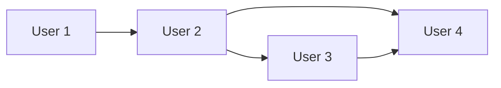
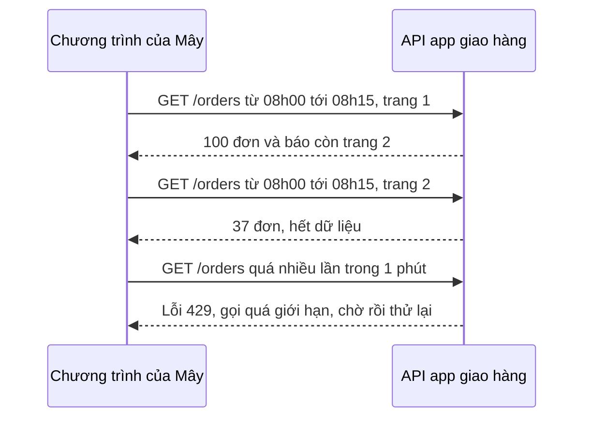
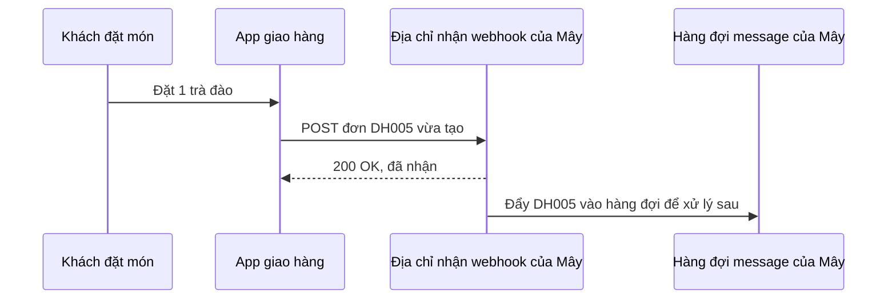

# Chi tiết thực hành về hệ thống nguồn: cơ sở dữ liệu và API

Bài trước nói về các ý tưởng chính (ít thay đổi theo thời gian). Bài này đi vào mục "Chi tiết thực hành về hệ thống nguồn": các loại cơ sở dữ liệu và API bạn sẽ gặp khi làm việc. Sách lưu ý phần này có **hạn sử dụng ngắn hơn** — framework API và cơ sở dữ liệu phổ biến thay đổi nhanh — nhưng vẫn là kiến thức nền cần có.

**Tương tự đơn giản:** mỗi loại cơ sở dữ liệu giống một dụng cụ trong hộp đồ nghề. Búa, tua vít, cưa đều hữu ích, nhưng dùng sai dụng cụ cho việc thì tốn công và dễ hỏng việc.

---

:::note[Ghi nhớ nhanh]

- ⭐ **Mỗi loại cơ sở dữ liệu có "tính khí" riêng** (tra cứu, tối ưu, mở rộng, mô hình hóa, CRUD, nhất quán). Hiểu chúng để biết cách lấy dữ liệu mà không làm hại hệ thống nguồn.
- ⭐ **Quét toàn bộ (full scan) có thể chậm DB và tốn tiền** (nhất là dịch vụ serverless); CDC thường là lựa chọn tốt hơn.
- **NoSQL** gồm key-value, document, wide-column, graph, search, time-series, mỗi loại hợp một bài toán.
- **API**: REST phổ biến nhất; còn GraphQL, webhook (API đảo ngược), gRPC.
- **Chia sẻ dữ liệu** và **dữ liệu bên thứ ba** ngày càng phổ biến.

:::

---

## Mục lục

- 1. Cân nhắc chính khi hiểu công nghệ cơ sở dữ liệu
- 2. Cơ sở dữ liệu quan hệ
- 3. Cơ sở dữ liệu phi quan hệ (NoSQL)
- 4. API: REST, GraphQL, webhook, RPC/gRPC
- 5. Chia sẻ dữ liệu
- 6. Nguồn dữ liệu bên thứ ba
- Tóm tắt

## 1. Cân nhắc chính khi hiểu công nghệ cơ sở dữ liệu

Các ý tưởng sau xuất hiện ở nhiều công nghệ cơ sở dữ liệu, cả loại phục vụ ứng dụng lẫn loại phục vụ phân tích:

| Khía cạnh | Câu hỏi cần đặt ra |
|---|---|
| Hệ quản trị CSDL (DBMS) | Dùng để lưu và phục vụ dữ liệu; gồm storage engine, query optimizer, khắc phục thảm họa và các thành phần quản lý khác. |
| Tra cứu (lookup) | CSDL tìm và lấy dữ liệu thế nào? Có chỉ mục không? Mẫu thiết kế/duy trì chỉ mục tốt nhất là gì? Nên biết các loại chỉ mục chính như **B-tree** và **log-structured merge-tree (LSM)**. |
| Query optimizer | Có dùng trình tối ưu hóa không, đặc điểm của nó ra sao? |
| Mở rộng và phân phối | Mở rộng theo nhu cầu không? Theo chiều ngang (thêm nút) hay chiều dọc (thêm tài nguyên cho một máy)? |
| Mẫu mô hình hóa | Mô hình nào hợp nhất (chuẩn hóa hay bảng rộng)? (Xem Chương 8.) |
| CRUD | Dữ liệu được truy vấn, tạo, cập nhật, xóa thế nào? Mỗi loại xử lý khác nhau. |
| Nhất quán | Nhất quán hoàn toàn hay nới lỏng (eventual consistency)? Có chế độ đọc/ghi nhất quán tùy chọn (như strongly consistent read) không? |

Sách chia cơ sở dữ liệu thành quan hệ và phi quan hệ. Nhóm phi quan hệ đa dạng hơn nhiều, nhưng CSDL quan hệ vẫn chiếm phần lớn backend ứng dụng.

### Thuật ngữ trong bài — hiểu nôm na

Bảng trên dùng nhiều từ chuyên môn. Dưới đây là cách hiểu bằng lời thường, kèm ví dụ ở chuỗi trà sữa Mây (30 cửa hàng, có máy POS ở quầy, app đặt món, phần mềm kho, cảm biến tủ mát).

| Thuật ngữ | Nghĩa đời thường | Ví dụ ở chuỗi Mây |
|---|---|---|
| CSDL / DBMS | Phần mềm quản lý "cuốn sổ" dữ liệu: cất, tìm, sửa, sao lưu | Phần mềm đứng sau máy POS |
| Backend ứng dụng | Phần "hậu trường" của app, nơi lưu và xử lý dữ liệu | Máy chủ của app đặt món |
| Schema | "Mẫu biểu" quy định sổ có những cột nào, mỗi cột chứa kiểu gì | Bảng đơn hàng phải có `order_id` (chữ), `so_luong` (số nguyên), `gia` (số) |
| Index (chỉ mục) | Mục lục cuối sách giúp lật thẳng tới trang cần tìm | Tìm nhanh đơn theo `order_id` mà không lật cả sổ |
| Query optimizer | "Người tính đường đi" chọn cách tìm dữ liệu nhanh nhất | Tự quyết dùng mục lục hay đọc cả bảng |
| Mở rộng ngang / dọc | Thêm máy (ngang) hay nâng cấp một máy mạnh hơn (dọc) | Thêm máy chủ khi mở cửa hàng thứ 50, hay mua máy chủ to hơn |
| Full scan | Đọc từ trang đầu đến trang cuối cuốn sổ | Đếm tổng số ly bán từ trước tới nay |
| Eventual consistency | "Rồi sẽ khớp": các bản sao có thể lệch nhau vài giây rồi mới giống nhau | Điểm tích luỹ trên app cập nhật chậm hơn quầy vài giây |
| NoSQL | Mọi loại CSDL không lưu theo kiểu bảng–hàng–cột truyền thống | Lưu giỏ hàng trên app dạng JSON |
| Endpoint | Một "địa chỉ" cụ thể của API để gửi yêu cầu | Địa chỉ `/orders` của app giao hàng |

## 2. Cơ sở dữ liệu quan hệ

**RDBMS** (hệ quản trị cơ sở dữ liệu quan hệ) là một trong những backend ứng dụng phổ biến nhất. Cơ sở dữ liệu quan hệ do IBM phát triển từ những năm 1970 và được Oracle phổ biến những năm 1980. Sự bùng nổ Internet kéo theo bộ **LAMP** (Linux, Apache, MySQL, PHP) và nhiều lựa chọn RDBMS mã nguồn mở lẫn thương mại. Dù NoSQL phát triển, CSDL quan hệ vẫn cực kỳ phổ biến.

Đặc điểm chính:

- Dữ liệu lưu trong **bảng** gồm các hàng (quan hệ); mỗi hàng có nhiều trường (cột). Sách dùng "cột" và "trường" thay thế nhau.
- Mọi hàng trong bảng cùng một **schema** (chuỗi cột có kiểu tĩnh: chuỗi, số nguyên, số thực...). Các hàng thường lưu thành chuỗi byte **liền kề trên đĩa**, nên RDBMS đọc/ghi ở mức **hàng**.
- Bảng thường được lập chỉ mục theo **primary key** (trường duy nhất cho mỗi hàng); chiến lược chỉ mục khóa chính gắn chặt với cách bố trí bảng trên đĩa.
- **Foreign key** là trường có giá trị trỏ tới primary key ở bảng khác, giúp nối (join) và cho phép schema phức tạp phân tán dữ liệu qua nhiều bảng.
- Có thể thiết kế schema **chuẩn hóa** (normalization): đảm bảo dữ liệu không bị lặp ở nhiều nơi, tránh phải cập nhật nhiều chỗ cùng lúc và ngăn thiếu nhất quán.
- RDBMS thường tuân thủ ACID. Chuẩn hóa + ACID + hỗ trợ tốc độ giao dịch cao khiến chúng lý tưởng để lưu trạng thái ứng dụng thay đổi nhanh. **Thách thức của kỹ sư dữ liệu là nắm bắt thông tin trạng thái theo thời gian.**

Sách khuyên tự tìm hiểu thêm về RDBMS, đại số quan hệ và chuẩn hóa vì sẽ gặp rất thường xuyên.

### Áp vào chuỗi Mây: primary key, foreign key và chuẩn hoá

Giả sử máy POS ghi mọi thứ vào **một bảng duy nhất**. Địa chỉ cửa hàng bị chép lại ở từng đơn:

| order_id | cua_hang | dia_chi_cua_hang | mon | so_luong | gia |
|---|---|---|---|---|---|
| DH001 | Q1-Lê Lợi | 12 Lê Lợi, Q1 | Trà sữa trân châu | 2 | 35000 |
| DH003 | Q1-Lê Lợi | 12 Lê Lợi, Q1 | Trà đào | 1 | 40000 |
| DH004 | Q1-Lê Lợi | 12 Lê Lợi, Quận 1 | Trà sữa trân châu | 1 | 35000 |

Dòng DH004 ghi địa chỉ hơi khác (`Quận 1` thay vì `Q1`) — đó là kiểu lệch dữ liệu sinh ra khi một thông tin bị chép ở nhiều nơi. Nếu cửa hàng chuyển địa điểm, phải sửa hàng nghìn dòng.

Sau khi **chuẩn hoá**, địa chỉ chỉ nằm ở một chỗ. Bảng đơn hàng chỉ giữ mã cửa hàng (**foreign key**) trỏ tới bảng cửa hàng (nơi mã đó là **primary key**):

| ma_cua_hang (primary key) | ten | dia_chi |
|---|---|---|
| CH01 | Q1-Lê Lợi | 12 Lê Lợi, Q1 |

| order_id (primary key) | ma_cua_hang (foreign key) | mon | so_luong | gia |
|---|---|---|---|---|
| DH001 | CH01 | Trà sữa trân châu | 2 | 35000 |
| DH003 | CH01 | Trà đào | 1 | 40000 |
| DH004 | CH01 | Trà sữa trân châu | 1 | 35000 |

Với kỹ sư dữ liệu, chuẩn hoá có hai mặt: ở nguồn thì dữ liệu sạch, nhưng khi lấy về phân tích phải **nối (join)** nhiều bảng lại với nhau mới có bức tranh đầy đủ.

## 3. Cơ sở dữ liệu phi quan hệ (NoSQL)

CSDL quan hệ tuyệt vời cho nhiều trường hợp nhưng không phải cho mọi trường hợp. Nhiều người bắt đầu với nó vì nghĩ nó đa dụng; khi yêu cầu dữ liệu và truy vấn thay đổi, nó có thể "sụp đổ dưới sức nặng của chính mình". Lúc đó nên chọn CSDL hợp với khối lượng công việc cụ thể. **NoSQL** ("not only SQL") chỉ cả lớp CSDL từ bỏ mô hình quan hệ.

Bỏ ràng buộc quan hệ có thể cải thiện hiệu năng, khả năng mở rộng và độ linh hoạt schema, nhưng đánh đổi: NoSQL thường bỏ luôn strong consistency, join hoặc schema cố định.

**Lịch sử ngắn:** đầu những năm 2000, các công ty như Google và Amazon bắt đầu vượt ra ngoài CSDL quan hệ và tiên phong CSDL phi quan hệ phân tán để mở rộng nền tảng web. Thuật ngữ NoSQL xuất hiện lần đầu năm 1998; phiên bản hiện đại do Eric Evans đặt ra vào những năm 2000. Ông kể (blog 2009) rằng cái tên được nghĩ ra rất nhanh cho buổi gặp mặt đầu tiên của Johan Oskarsson, và điều ông tiếc không phải là tên gọi nói gì mà là nó **không nói** gì: nó mơ hồ, mở ra thảo luận về bất cứ thứ gì lưu dữ liệu mà không phải RDBMS. Đến nay NoSQL vẫn mơ hồ nhưng được dùng rộng rãi cho các lựa chọn thay thế CSDL quan hệ.

Sách xét sáu loại: **key-value, document, wide-column, graph, search, time-series**.

### Key-value store

CSDL key-value truy xuất bản ghi bằng một **khóa** nhận diện duy nhất, giống hash map hay dictionary trong ngôn ngữ lập trình nhưng mở rộng tốt hơn. Nhóm này bao gồm cả document store và wide-column.

- Loại **in-memory** (trong bộ nhớ) rất phổ biến để cache dữ liệu phiên cho web/mobile, cần tra cứu cực nhanh và đồng thời cao. Lưu trữ thường tạm thời: DB tắt thì dữ liệu mất. Cache kiểu này giảm áp lực lên DB ứng dụng chính.
- Key-value cũng phục vụ ứng dụng cần **độ bền cao**. Ví dụ ứng dụng thương mại điện tử: người dùng đăng nhập, bấm quanh các màn hình, thêm hàng vào giỏ, thanh toán; mỗi sự kiện phải được lưu bền để phục hồi. Khi đó dữ liệu lưu xuống đĩa và qua nhiều nút.

### Document store

Document store là key-value store chuyên biệt. **Document** (tài liệu) là một đối tượng lồng nhau, trên thực tế có thể xem như một đối tượng JSON. Tài liệu lưu trong **collection** (bộ sưu tập) và truy xuất bằng khóa. Collection gần tương đương một bảng quan hệ:

| RDBMS | Document database |
|---|---|
| Table | Collection |
| Row | Document, item, entity |

Điểm khác chính: document store **thường không hỗ trợ join**, nên dữ liệu khó chuẩn hóa (tách thành nhiều bảng). Ứng dụng vẫn có thể join thủ công trong code (lấy một document, trích thuộc tính, rồi lấy document khác). Lý tưởng là mọi dữ liệu liên quan nằm trong cùng một document. Nhiều khi cùng dữ liệu phải lưu ở nhiều document thuộc nhiều collection, nên lập trình viên phải cẩn thận cập nhật một thuộc tính ở mọi nơi nó xuất hiện (nhiều document store hỗ trợ transaction để làm việc này).

Document store thường **không ép schema hay kiểu** — vừa là "phước" vừa là "lời nguyền". Linh hoạt, schema tiến hóa cùng ứng dụng; nhưng nếu quản lý tiến hóa schema không cẩn thận, dữ liệu trở nên không nhất quán và cồng kềnh, có thể làm vỡ việc thu nạp phía sau nếu không báo trước (trước khi deploy).

Ví dụ trong sách: collection `users`, khóa là `id`, mỗi document có tên (first, last) và mảng band yêu thích:

```json
{
  "users": [
    {
      "id": 1234,
      "name": { "first": "Joe", "last": "Reis" },
      "favorite_bands": ["AC/DC", "Slayer", "WuTang Clan", "Action Bronson"]
    },
    {
      "id": 1235,
      "name": { "first": "Matt", "last": "Housley" },
      "favorite_bands": ["Dave Matthews Band", "Creed", "Nickelback"]
    }
  ]
}
```

Có thể truy vấn theo khóa; hầu hết document DB còn hỗ trợ chỉ mục và bảng tra cứu để lấy document theo thuộc tính (ví dụ chỉ mục theo tên).

Lưu ý cho kỹ sư dữ liệu:

- Document store thường **không ACID**; nhiều cái chỉ eventual consistency. Phân phối dữ liệu trên cụm giúp mở rộng và hiệu năng nhưng có thể thành thảm họa nếu kỹ sư và nhà phát triển không hiểu hệ quả. Cần chuyên môn về từng hệ cụ thể (hiệu năng, tinh chỉnh, cấu hình, ghi, nhất quán, độ bền).
- Để phân tích, thường phải **quét toàn bộ** collection hoặc dùng **CDC** gửi sự kiện đến một luồng đích. Full scan ảnh hưởng cả hiệu năng lẫn chi phí: nó thường làm chậm DB khi chạy, và nhiều dịch vụ serverless đám mây tính phí đáng kể cho mỗi lần quét. Tạo chỉ mục cũng giúp tăng tốc truy vấn (Chương 8 bàn thêm).

### Wide-column (cột rộng)

CSDL wide-column tối ưu để lưu **lượng dữ liệu khổng lồ** với **tốc độ giao dịch cao** và **độ trễ cực thấp**: hỗ trợ petabyte dữ liệu, hàng triệu yêu cầu mỗi giây, độ trễ dưới 10 mili giây. Vì thế phổ biến ở thương mại điện tử, fintech, ad tech, IoT và ứng dụng cá nhân hóa thời gian thực. Kỹ sư dữ liệu cần biết đặc điểm vận hành của hệ họ dùng để cấu hình đúng, thiết kế schema và chọn **row key** phù hợp.

Hạn chế: quét nhanh nhưng **không hỗ trợ truy vấn phức tạp**; chỉ có **một chỉ mục duy nhất (row key)** để tra cứu. Vì vậy kỹ sư thường phải trích xuất và đẩy dữ liệu sang hệ phân tích thứ cấp để chạy truy vấn phức tạp, bằng quét lớn hoặc CDC.

### Graph (đồ thị)

CSDL đồ thị lưu dữ liệu rõ ràng theo cấu trúc đồ thị toán học (tập **nút** và **cạnh**). Neo4j rất phổ biến; Amazon, Oracle và nhiều hãng khác cũng có sản phẩm. Hợp khi muốn phân tích **khả năng kết nối giữa các phần tử**.

Ví dụ của sách: với document store mỗi user một document, thêm mảng "connections" chứa ID user kết nối trực tiếp. Đếm số kết nối trực tiếp dễ. Nhưng hỏi "đi qua hai kết nối thì tiếp cận được bao nhiêu user?" thì phải viết code phức tạp, mỗi truy vấn chậm và tốn tài nguyên — document store không tối ưu cho việc này. CSDL đồ thị được thiết kế đúng cho loại truy vấn đường đi phức tạp đó. Chúng dùng các ngôn ngữ truy vấn chuyên dụng như SPARQL (truy vấn dữ liệu dạng RDF), GQL, Cypher. RDF thực ra là mô hình dữ liệu chứ không phải ngôn ngữ truy vấn, dù hay được nhắc cùng nhóm.

Ví dụ mạng xã hội 4 người: User 1 theo dõi User 2; User 2 theo dõi User 3 và User 4; User 3 cũng theo dõi User 4.



Sách dự đoán ứng dụng CSDL đồ thị sẽ tăng mạnh ngoài các công ty công nghệ. Với kỹ sư dữ liệu, đây là thách thức vì quen xử lý dữ liệu quan hệ/tài liệu/phi cấu trúc hơn. Kỹ sư phải chọn một trong các hướng:

- Ánh xạ dữ liệu đồ thị của nguồn vào một mô hình ưa thích sẵn có.
- Phân tích dữ liệu đồ thị ngay trong hệ thống nguồn.
- Áp dụng công cụ phân tích riêng cho đồ thị.

Dữ liệu đồ thị có thể mã hóa lại thành các hàng trong CSDL quan hệ, tùy trường hợp phân tích. CSDL đồ thị giao dịch cũng thiết kế cho phân tích, nhưng truy vấn lớn có thể làm quá tải hệ thống sản xuất; CSDL đồ thị đám mây hiện đại hỗ trợ phân tích đồ thị nặng đọc trên lượng dữ liệu lớn.

### Search (tìm kiếm)

CSDL tìm kiếm là phi quan hệ dùng để tìm đặc điểm cấu trúc và ngữ nghĩa, đơn giản lẫn phức tạp. Hai trường hợp nổi bật:

- **Tìm kiếm văn bản**: tìm từ khóa/cụm từ, khớp chính xác, mờ (fuzzy) hoặc tương tự về ngữ nghĩa.
- **Phân tích log**: phát hiện bất thường, giám sát thời gian thực, phân tích bảo mật và vận hành. Truy vấn tăng tốc bằng chỉ mục.

Tùy công ty bạn có thể dùng thường xuyên hoặc không, nhưng nên biết chúng tồn tại. Ví dụ trang thương mại điện tử dùng CSDL tìm kiếm cho tìm sản phẩm. Kỹ sư có thể phải đưa dữ liệu từ Elasticsearch, Apache Solr/Lucene hoặc Algolia vào báo cáo KPI phía sau.

### Time-series (chuỗi thời gian)

**Chuỗi thời gian** là chuỗi giá trị sắp theo thời gian, ví dụ giá cổ phiếu thay đổi theo giao dịch trong ngày, hoặc cảm biến thời tiết đo nhiệt độ mỗi phút. Bất kỳ sự kiện nào ghi theo thời gian (đều hoặc không đều) đều là dữ liệu chuỗi thời gian. CSDL chuỗi thời gian tối ưu để truy xuất và xử lý thống kê loại dữ liệu này.

Dữ liệu như đơn hàng, vận đơn, log từng được lưu trong CSDL quan hệ khi khối lượng nhỏ. Khi dữ liệu lớn nhanh hơn (IoT, log sự kiện và ứng dụng, ad tech, fintech...), cần CSDL chuyên dụng. Khối lượng này thường **nặng ghi**, nên CSDL chuỗi thời gian hay dùng bộ nhớ đệm để ghi và đọc nhanh.

Phân biệt hai loại dữ liệu:

- **Dữ liệu đo lường** (measurement): tạo đều đặn, như cảm biến nhiệt độ hoặc chất lượng không khí.
- **Dữ liệu dựa trên sự kiện**: không đều, sinh ra mỗi khi có sự kiện, như cảm biến chuyển động phát hiện chuyển động.

Schema chuỗi thời gian thường gồm dấu thời gian và một tập nhỏ trường; dữ liệu sắp theo dấu thời gian. Vì vậy hợp với **phân tích vận hành** nhưng không hợp với BI. Join không phổ biến, dù vài hệ gần chuỗi thời gian như Apache Druid hỗ trợ join. Có cả lựa chọn mã nguồn mở và trả phí.

### Bảng so sánh các loại NoSQL

Bảng tổng hợp do người ghi chép tóm lại từ nội dung sách:

| Loại | Điểm mạnh | Hạn chế / lưu ý |
|---|---|---|
| Key-value | Tra cứu theo khóa cực nhanh; cache; bền nếu lưu đĩa | Chỉ tra theo khóa |
| Document | Schema linh hoạt, JSON lồng nhau | Thường không join, không ACID; schema dễ lộn xộn |
| Wide-column | Petabyte, triệu yêu cầu/giây, dưới 10 ms | Một chỉ mục (row key), không truy vấn phức tạp |
| Graph | Truy vấn kết nối, đường đi phức tạp | Truy vấn lớn có thể quá tải hệ sản xuất |
| Search | Tìm văn bản, phân tích log | Thường dùng bổ trợ |
| Time-series | Ghi nhanh, thống kê theo thời gian | Hợp phân tích vận hành hơn BI; ít join |

### Áp vào chuỗi Mây: mỗi việc một loại cơ sở dữ liệu

Không có loại CSDL nào "tốt nhất"; chỉ có loại hợp việc. Bảng dưới gợi ý Mây có thể gặp loại nào ở đâu, và kỹ sư dữ liệu cần lưu ý gì khi lấy dữ liệu từ đó.

| Việc ở Mây | Loại CSDL hợp | Vì sao | Lưu ý khi lấy dữ liệu |
|---|---|---|---|
| Ghi đơn tại quầy, trừ kho | Quan hệ (RDBMS) | Cần ACID, dữ liệu có cấu trúc rõ | Không chạy truy vấn nặng giờ cao điểm, ưu tiên CDC |
| Giỏ hàng, phiên đăng nhập trên app | Key-value trong bộ nhớ | Tra theo mã khách cực nhanh | Dữ liệu tạm, thường không cần đưa vào kho |
| Hồ sơ món (topping, size, ảnh) thay đổi thường xuyên | Document | Mỗi món có thuộc tính khác nhau | Schema hay đổi, phải theo dõi để pipeline không vỡ |
| Khách giới thiệu bạn bè dùng app | Graph | Hỏi "bạn của bạn" dễ | Phải chuyển sang dạng bảng nếu muốn phân tích chung |
| Ô tìm món trên app | Search | Gõ "tra dao" vẫn ra "Trà đào" | Ít khi là nguồn chính cho báo cáo |
| Nhiệt độ tủ mát mỗi phút | Time-series | Ghi liên tục, hỏi theo khoảng thời gian | Dữ liệu rất nhiều, thường tổng hợp theo giờ trước khi đưa vào kho |

## 4. API: REST, GraphQL, webhook, RPC/gRPC

API hiện là cách trao đổi dữ liệu tiêu chuẩn trên đám mây, với nền tảng SaaS và giữa các hệ thống nội bộ. Có nhiều loại giao diện, nhưng sách chủ yếu quan tâm loại xây trên **HTTP**.

### REST

**REST** (Representational State Transfer — chuyển giao trạng thái đại diện) là mô hình API đang chiếm ưu thế, do Roy Fielding trình bày năm 2000 trong luận án tiến sĩ. REST xoay quanh các **động từ HTTP** như GET và PUT; REST hiện đại chỉ dùng một số ánh xạ động từ trong luận án gốc.

Ý tưởng chính là **tương tác không trạng thái** (stateless): không như phiên terminal Linux có biến trạng thái (ví dụ thư mục làm việc), mỗi lệnh gọi REST độc lập. Lệnh gọi có thể thay đổi trạng thái hệ thống, nhưng thay đổi đó mang tính toàn cục, không thuộc về phiên hiện tại.

Giới hạn: giới phê bình chỉ ra REST **không phải một đặc tả đầy đủ**. Nó quy định thuộc tính cơ bản của tương tác, nhưng người dùng API vẫn cần nhiều kiến thức miền để xây ứng dụng hay lấy dữ liệu hiệu quả. Mức trừu tượng hóa API cũng rất khác nhau: có API chỉ là lớp bọc mỏng bảo vệ hệ thống, có API dữ liệu REST là "kiệt tác kỹ thuật" chuẩn bị dữ liệu cho phân tích và báo cáo nâng cao.

Hai bước phát triển giúp việc thu nạp từ REST dễ hơn:

1. Nhà cung cấp dữ liệu thường có **thư viện client** (nhiều ngôn ngữ, đặc biệt Python), xử lý xác thực và ánh xạ phương thức thành lớp dễ dùng.
2. Nhiều dịch vụ và thư viện mã nguồn mở, SaaS cung cấp **connector dựng sẵn** cho API phổ biến; nền tảng cũng đơn giản hóa việc tự xây connector.

Tuy vậy nhiều API dữ liệu chưa có thư viện client hay connector. Sách nhấn mạnh nên giảm "việc nặng nhọc không tạo khác biệt" bằng công cụ có sẵn, nhưng ở hầu hết công ty lớn, kỹ sư vẫn phải **viết và duy trì code tùy chỉnh** để lấy dữ liệu từ API: hiểu cấu trúc dữ liệu, viết code trích xuất và chọn chiến lược đồng bộ phù hợp.

### GraphQL

**GraphQL** do Facebook tạo ra như ngôn ngữ truy vấn dữ liệu ứng dụng, là lựa chọn thay thế cho REST chung. Trong khi REST thường giới hạn truy vấn trong một mô hình dữ liệu cụ thể, GraphQL cho phép **lấy nhiều mô hình dữ liệu trong một yêu cầu**, linh hoạt và giàu biểu cảm hơn. GraphQL dựa trên JSON và trả về dữ liệu có hình dạng giống truy vấn. Có "cuộc chiến thần thánh" REST và GraphQL, nhưng trên thực tế kỹ sư sẽ gặp cả hai.

### Webhook

**Webhook** là mẫu truyền dữ liệu hướng sự kiện đơn giản. Nguồn dữ liệu (backend ứng dụng, website, app di động) khi xảy ra sự kiện chỉ định sẽ **gọi tới một endpoint HTTP do bên tiêu thụ lưu trữ**. Kết nối đi **từ nguồn tới nơi chứa dữ liệu**, ngược với API thông thường, nên webhook hay được gọi là **reverse API** (API đảo ngược).

Endpoint có thể làm nhiều việc với dữ liệu sự kiện được POST: kích hoạt quy trình phía sau hoặc lưu dữ liệu để dùng sau. Để phân tích, ta quan tâm việc thu thập các sự kiện này; kỹ sư thường dùng **message queue** để thu nạp với tốc độ và khối lượng cao (bàn ở bài sau).

### RPC và gRPC

**RPC** (Remote Procedure Call — gọi thủ tục từ xa) hay dùng trong điện toán phân tán: chạy một thủ tục trên hệ thống từ xa.

**gRPC** là thư viện RPC do Google phát triển nội bộ năm 2015, sau đó phát hành thành chuẩn mở. Nhiều dịch vụ của Google như Google Ads và GCP cung cấp API gRPC. Nó xây trên chuẩn tuần tự hóa dữ liệu mở **Protocol Buffers** (cũng của Google).

gRPC nhấn mạnh trao đổi dữ liệu **hai chiều hiệu quả** qua **HTTP/2**; hiệu quả ở đây gồm CPU, điện năng, thời lượng pin, băng thông. Giống GraphQL, gRPC áp đặt chuẩn kỹ thuật cụ thể hơn REST, nên cho phép dùng thư viện client phổ biến và giúp kỹ sư phát triển kỹ năng áp dụng cho mọi code tương tác gRPC.

| API | Ý tưởng chính |
|---|---|
| REST | Dựa trên động từ HTTP, stateless, phổ biến nhất |
| GraphQL | Truy vấn nhiều mô hình dữ liệu trong một yêu cầu, kết quả theo hình dạng truy vấn |
| Webhook | Nguồn chủ động gọi endpoint của bên nhận khi có sự kiện (API đảo ngược) |
| gRPC | RPC hiệu quả, hai chiều qua HTTP/2, dùng Protocol Buffers |

### Áp vào chuỗi Mây: kéo đơn từ app giao hàng bằng REST và nhận báo bằng webhook

Hình dung API như **quầy giao dịch ngân hàng**: bạn điền phiếu đúng mẫu (yêu cầu), nhân viên trả giấy tờ (dữ liệu). Bạn không được vào thẳng kho hồ sơ. Mây bán qua một app giao hàng của đối tác; kỹ sư dữ liệu có hai cách lấy đơn.

**Cách 1 — REST, Mây chủ động hỏi (pull).** Mỗi 15 phút, chương trình của Mây gửi yêu cầu. Vì đơn nhiều, đối tác trả từng "trang" một (gọi là phân trang).



**Cách 2 — Webhook, đối tác chủ động báo (push).** Mây đăng ký một địa chỉ nhận; có đơn mới là đối tác gọi tới ngay.



| | REST (pull) | Webhook (push) |
|---|---|---|
| Ai bắt đầu | Mây hỏi | Đối tác báo |
| Độ tươi dữ liệu | Trễ tới 15 phút (theo lịch hỏi) | Gần như tức thì |
| Rủi ro | Bị giới hạn số lần gọi, phải xử lý phân trang | Mây sập lúc đối tác gọi thì có thể mất sự kiện |
| Ở Mây nên dùng khi | Đối soát cuối ngày, lấy lại dữ liệu cũ | Cập nhật đơn mới cho màn hình bếp, cảnh báo |

Thực tế Mây hay **dùng cả hai**: webhook cho tốc độ, REST chạy mỗi đêm để "vá" những đơn webhook lỡ bỏ sót.

## 5. Chia sẻ dữ liệu

Khái niệm cốt lõi của **chia sẻ dữ liệu trên đám mây**: hệ thống **đa đối tượng thuê** (multitenant) hỗ trợ chính sách bảo mật để chia sẻ dữ liệu giữa các tenant. Cụ thể, bất kỳ hệ object storage đám mây công cộng nào có hệ thống cấp quyền chi tiết đều có thể làm nền tảng chia sẻ; các nền tảng data warehouse đám mây phổ biến cũng hỗ trợ. Dĩ nhiên vẫn có thể chia sẻ bằng tải xuống hoặc email, nhưng hệ multitenant làm dễ hơn nhiều.

Nhiều nền tảng chia sẻ hiện đại (nhất là data warehouse đám mây) hỗ trợ **lọc hàng, cột và dữ liệu nhạy cảm**. Chia sẻ dữ liệu cũng hợp lý hóa khái niệm **chợ dữ liệu** (data marketplace) có trên nhiều nền tảng dữ liệu và đám mây: nơi tập trung để mua bán dữ liệu, nhà cung cấp quảng bá và bán dịch vụ mà không phải lo chi tiết quản lý quyền truy cập mạng.

Trong tổ chức, chia sẻ dữ liệu cũng làm pipeline gọn hơn: các đơn vị tự quản lý dữ liệu và chia sẻ có chọn lọc cho đơn vị khác, đồng thời quản lý chi phí tính toán và truy vấn riêng, tạo điều kiện **phân cấp dữ liệu** và các mô hình quản lý phi tập trung như **data mesh**. Điều này khớp với triết lý "thành phần kiến trúc chung" của sách (Chương 3): chọn thành phần chung để trao đổi dữ liệu và kiến thức đơn giản, hiệu quả, thay vì công nghệ phức tạp và "hào nhoáng" nhất.

## 6. Nguồn dữ liệu bên thứ ba

Công nghệ phổ biến khiến công ty nào nay cũng gần như là công ty công nghệ. Hệ quả: các công ty, và ngày càng nhiều cơ quan chính phủ, muốn cung cấp dữ liệu cho khách hàng và người dùng, như một phần dịch vụ hoặc một gói đăng ký riêng. Ví dụ: Cục Thống kê Lao động Hoa Kỳ công bố số liệu thị trường lao động; NASA công bố dữ liệu từ các sáng kiến nghiên cứu; Facebook chia sẻ dữ liệu cho nhà quảng cáo trên nền tảng.

Vì sao họ muốn cung cấp dữ liệu? Để tạo **độ gắn kết và "bánh đà"**: cho người dùng tích hợp và mở rộng ứng dụng của họ vào ứng dụng của người dùng. Càng nhiều người dùng chấp nhận, càng nhiều dữ liệu, càng nhiều dữ liệu có thể tích hợp. Tác dụng phụ: nay có lượng nguồn dữ liệu bên thứ ba gần như vô tận.

Truy cập thường qua **API**, **chia sẻ dữ liệu trên nền tảng đám mây** hoặc **tải xuống**. API thường cho tích hợp sâu, kéo và đẩy dữ liệu. Ví dụ phổ biến sách nêu: lấy dữ liệu từ CRM, trộn qua mô hình chấm điểm khách hàng (lead scoring), rồi dùng **reverse ETL** gửi ngược về CRM để nhân viên bán hàng liên hệ khách tiềm năng chất lượng hơn.

### Áp vào chuỗi Mây: dữ liệu không do Mây tạo ra

Mây cũng dùng dữ liệu "mượn" từ bên ngoài. Bảng dưới liệt kê vài nguồn bên thứ ba, cách lấy, và việc chúng giúp được.

| Nguồn bên thứ ba | Cách lấy | Mây dùng để làm gì |
|---|---|---|
| Dự báo thời tiết | API | Trời nóng bán nhiều trà trái cây — nhà khoa học dữ liệu đưa vào mô hình dự báo nhu cầu |
| Đánh giá, bình luận trên mạng xã hội | API (có giới hạn số lần gọi) | Marketing theo dõi khách khen chê cửa hàng nào |
| Báo cáo doanh số từ app giao hàng đối tác | Chia sẻ dữ liệu trên nền tảng đám mây, hoặc file tải về | Kế toán đối soát tiền đối tác phải trả |
| Lịch lễ, sự kiện của thành phố | File tải về | Chuẩn bị thêm nguyên liệu cho ngày đông khách |

Thuật ngữ **reverse ETL** nghe lạ nhưng ý đơn giản: dữ liệu đã phân tích xong được **gửi ngược** về phần mềm vận hành. Ví dụ Mây tính được "khách sắp bỏ đi" trong kho dữ liệu, rồi đẩy danh sách đó sang phần mềm gửi voucher của bộ phận marketing.

## Tóm tắt

| Chủ đề | Điểm cốt lõi |
|---|---|
| Hiểu một CSDL | Tra cứu, optimizer, mở rộng, mô hình hóa, CRUD, nhất quán |
| RDBMS | Hàng/bảng, schema, khóa chính/ngoại, chuẩn hóa, ACID; thách thức là nắm bắt trạng thái theo thời gian |
| NoSQL | Key-value, document, wide-column, graph, search, time-series; mỗi loại đánh đổi riêng |
| Lấy dữ liệu từ NoSQL | Tránh full scan nặng; ưu tiên CDC hoặc xuất sang hệ phân tích |
| API | REST (phổ biến), GraphQL, webhook, gRPC; vẫn thường phải viết code tùy chỉnh |
| Chia sẻ dữ liệu | Multitenant, lọc hàng/cột, data marketplace, hỗ trợ data mesh |
| Bên thứ ba | Qua API, chia sẻ đám mây hoặc tải xuống; có thể kèm reverse ETL |
