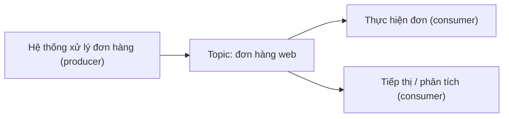

# Message queue, bên liên quan và các yếu tố xuyên suốt

Bài cuối của Chương 5 nói về message queue và nền tảng streaming sự kiện (với tư cách hệ thống nguồn), những người bạn phải làm việc cùng khi truy cập hệ thống nguồn, tác động của các **undercurrents** (yếu tố xuyên suốt) lên giai đoạn này, và phần kết luận của chương.

**Tương tự đơn giản:** message queue giống hộp thư giao nhận việc giữa các bộ phận; còn nền tảng streaming giống cuốn sổ nhật ký chung mà ai cũng có thể lật lại đọc từ đầu. Và làm việc với hệ thống nguồn giống làm khách trong nhà người khác: giữ quan hệ tốt với chủ nhà quan trọng không kém biết đường đi trong nhà.

---

:::note[Ghi nhớ nhanh]

- ⭐ **Hệ thống nguồn thường nằm ngoài tầm kiểm soát của bạn** — vì vậy quan hệ với các bên liên quan (stakeholder) và vòng phản hồi là sống còn. Dùng **hợp đồng dữ liệu** và SLA/SLO để đặt kỳ vọng.
- ⭐ **Không được coi hệ thống nguồn là "vấn đề của người khác"** — lạm dụng nó có thể làm sập hệ thống sản xuất.
- **Message queue**: lưu ý thứ tự, tần suất giao (exactly-once / at-least-once), khả năng mở rộng; hãy thiết kế **idempotent**.
- **Nền tảng streaming**: topic, phân vùng (partition), khóa phân vùng, tránh **hotspot**, chịu lỗi.
- Áp dụng 6 undercurrents: bảo mật, quản lý dữ liệu, DataOps, kiến trúc dữ liệu, orchestration, kỹ thuật phần mềm.

:::

---

## Mục lục

- 1. Message queue
- 2. Nền tảng streaming sự kiện
- 3. Bạn sẽ làm việc với ai
- 4. Yếu tố xuyên suốt và tác động lên hệ thống nguồn
- 5. Kết luận
- Tài nguyên bổ sung
- Tóm tắt

## 1. Message queue

Kiến trúc hướng sự kiện đang phổ biến trong ứng dụng phần mềm và sẽ còn phổ biến hơn, vì hai lý do. Thứ nhất, message queue và nền tảng streaming sự kiện (các lớp quan trọng của kiến trúc này) dễ thiết lập và quản lý hơn trên đám mây. Thứ hai, **ứng dụng dữ liệu** (tích hợp trực tiếp phân tích thời gian thực) đang tăng mạnh. Kiến trúc hướng sự kiện lý tưởng ở đây vì sự kiện vừa kích hoạt hoạt động trong ứng dụng, vừa cấp dữ liệu gần thời gian thực cho phân tích.

Dữ liệu streaming (message và stream) đi qua **nhiều giai đoạn** của vòng đời kỹ thuật dữ liệu. Khác với RDBMS thường gắn trực tiếp vào ứng dụng, các dòng streaming đôi khi ít hiển nhiên hơn. Chúng được dùng làm hệ thống nguồn nhưng thường **cắt ngang** vòng đời do tính nhất thời: cùng một nền tảng streaming có thể vừa truyền message trong ứng dụng hướng sự kiện (nguồn), vừa dùng ở giai đoạn thu nạp và biến đổi để xử lý phân tích thời gian thực. Là hệ thống nguồn, chúng được dùng từ định tuyến message giữa các microservice đến hàng triệu sự kiện mỗi giây từ ứng dụng web, mobile và IoT.

**Message queue** là cơ chế gửi dữ liệu **bất đồng bộ** (thường là các message nhỏ, cỡ kilobyte) giữa các hệ thống riêng biệt theo mô hình **publish/subscribe** (xuất bản và đăng ký). Dữ liệu được xuất bản vào queue và giao cho một hoặc nhiều subscriber; subscriber xác nhận đã nhận rồi message bị xóa khỏi queue.

Message queue giúp **tách rời** (decouple) ứng dụng và hệ thống, dùng rộng rãi trong kiến trúc microservice. Nó đệm message để chịu các đợt tải tăng đột biến tạm thời và làm message bền vững nhờ kiến trúc phân tán có sao chép. Ba điều cần chú ý: thứ tự message, tần suất giao và khả năng mở rộng.

### Thứ tự và giao message

Thứ tự tạo, gửi, nhận message có thể tác động lớn đến subscriber phía cuối, và thứ tự trong queue phân tán là bài toán phức tạp. Queue thường áp dụng khái niệm **FIFO** (vào trước, ra trước) một cách "mờ". FIFO nghiêm ngặt nghĩa là message A vào trước B thì A luôn giao trước B; thực tế message có thể xuất bản và nhận không theo thứ tự, nhất là ở hệ rất phân tán. Ví dụ hàng đợi tiêu chuẩn của Amazon SQS cố gắng hết sức giữ thứ tự (best effort), còn SQS cũng có **hàng đợi FIFO** với đảm bảo mạnh hơn nhưng tốn thêm phí.

Quy tắc: đừng giả định message được giao đúng thứ tự trừ khi công nghệ của bạn **đảm bảo**; thường bạn phải **thiết kế để chịu được việc giao không theo thứ tự**.

### Tần suất giao

Message có thể giao **đúng một lần** (exactly-once) hoặc **ít nhất một lần** (at-least-once). Exactly-once: khi subscriber xác nhận, message biến mất và không giao lại. At-least-once: message có thể bị nhiều subscriber, hoặc cùng một subscriber, tiêu thụ nhiều lần — ổn khi trùng lặp không thành vấn đề.

Lý tưởng nhất là hệ thống **idempotent** (lũy đẳng): kết quả xử lý một message một lần giống hệt xử lý nhiều lần. Điều này cứu bạn trong nhiều tình huống khó nhận ra. Ví dụ: dù hệ thống đảm bảo exactly-once, consumer vẫn có thể xử lý xong message rồi lỗi ngay trước khi gửi xác nhận; thực tế message bị xử lý hai lần, nhưng hệ idempotent xử lý an toàn.

Ví dụ minh hoạ do người ghi chép thêm (không phải của sách): xử lý đơn hàng bằng upsert theo khóa để xử lý trùng không gây hại.

```sql
-- Xử lý lại cùng một message đơn hàng 12345 vẫn cho đúng một dòng kết quả
INSERT INTO orders (order_id, amount)
VALUES (12345, 100)
ON CONFLICT (order_id) DO UPDATE SET amount = EXCLUDED.amount;
```

### Khả năng mở rộng

Các message queue phổ biến trong ứng dụng hướng sự kiện **mở rộng theo chiều ngang**, chạy trên nhiều server. Nhờ vậy chúng co giãn linh hoạt, đệm message khi hệ thống bị tụt lại, và lưu message bền để phục hồi khi lỗi. Cái giá là các rắc rối đã nói: giao nhiều lần và thứ tự không rõ ràng.

## 2. Nền tảng streaming sự kiện

Nền tảng streaming sự kiện, theo một nghĩa, là sự tiếp nối của message queue: message cũng đi từ **producer** đến **consumer**. Khác biệt lớn: message queue chủ yếu để **định tuyến message** với vài đảm bảo giao; còn nền tảng streaming dùng để **thu nạp và xử lý dữ liệu** trong **nhật ký bản ghi có thứ tự**. Trong nền tảng streaming, dữ liệu được **giữ lại một thời gian** và có thể **phát lại** message từ một thời điểm trong quá khứ.

Một **sự kiện** (Chương 3) là "điều gì đó đã xảy ra, điển hình là sự thay đổi trạng thái của một thứ". Sự kiện có khóa, giá trị và dấu thời gian (có thể chứa nhiều cặp khóa-giá trị). Ví dụ sự kiện đơn hàng thương mại điện tử:

```json
{
  "Key": "Order # 12345",
  "Value": "SKU 123, purchase price of $100",
  "Timestamp": "2023-01-02 06:01:00"
}
```

### Topic (chủ đề)

Producer đẩy sự kiện đến một **topic** — tập hợp các sự kiện liên quan, ví dụ cảnh báo gian lận, đơn đặt hàng của khách, hoặc chỉ số nhiệt độ từ thiết bị IoT. Trên hầu hết nền tảng, một topic có thể có không, một hoặc nhiều producer và consumer.

Ví dụ của sách: topic là "đơn hàng web", gửi cho hai consumer là bộ phận thực hiện đơn (fulfillment) và tiếp thị. Fulfillment dùng sự kiện để kích hoạt quy trình giao hàng, còn tiếp thị chạy phân tích thời gian thực hoặc huấn luyện/chạy mô hình ML để điều chỉnh chiến dịch. Đây là ví dụ rõ về **ranh giới mờ** giữa phân tích và hệ thống hướng sự kiện.



### Phân vùng luồng (stream partition)

**Phân vùng luồng** là chia một stream thành nhiều stream. Tương tự: đường cao tốc nhiều làn — nhiều làn cho phép xử lý song song và thông lượng cao hơn. Message được phân phối giữa các partition bằng **khóa phân vùng** (partition key); message cùng khóa luôn vào cùng một partition.

Ví dụ trong sách: mỗi message có ID số làm khóa phân vùng; chia cho 3 lấy số dư để chọn partition (số dư 0, 1, 2 ứng với ba partition).

Hãy đặt khóa sao cho các message cần xử lý cùng nhau có cùng khóa. Ví dụ IoT: muốn mọi message của một thiết bị đến cùng một server xử lý, dùng **device ID** làm khóa phân vùng rồi cho mỗi server tiêu thụ một partition.

Mối lo chính là khóa phân vùng **không được tạo hotspot** (điểm nóng) — một partition nhận số message không cân xứng. Ví dụ: nếu dùng "bang của Hoa Kỳ" làm khóa trong khi số thiết bị tỷ lệ với dân số bang, các partition chứa California, Texas, Florida, New York sẽ quá tải, partition khác ít việc. Hãy đảm bảo khóa phân phối message đồng đều.

### Chịu lỗi và khả năng phục hồi

Nền tảng streaming thường là hệ phân tán, stream lưu trên nhiều nút. Nếu một nút hỏng, nút khác thay thế và stream vẫn truy cập được. Bản ghi không bị mất (bạn có thể chọn xóa, nhưng đó là chuyện khác). Khả năng chịu lỗi và phục hồi nhanh khiến nền tảng streaming phù hợp khi cần hệ thống **tạo, lưu và thu nạp dữ liệu sự kiện một cách đáng tin cậy**.

| | Message queue | Nền tảng streaming sự kiện |
|---|---|---|
| Mục đích chính | Định tuyến message, có đảm bảo giao | Thu nạp và xử lý dữ liệu trong log có thứ tự |
| Sau khi tiêu thụ | Message bị xóa khỏi hàng đợi | Dữ liệu được lưu giữ, có thể phát lại |
| Lưu ý chính | Thứ tự, tần suất giao, mở rộng | Topic, partition, khóa phân vùng, hotspot, chịu lỗi |

## 3. Bạn sẽ làm việc với ai

Khi truy cập hệ thống nguồn, cần hiểu những người bạn làm việc cùng. Theo kinh nghiệm tác giả, **khả năng ngoại giao và quan hệ tốt với các bên liên quan** của hệ thống nguồn là phần quan trọng và bị đánh giá thấp của kỹ thuật dữ liệu thành công.

Thường có hai loại bên liên quan:

- **Bên liên quan của hệ thống** (system stakeholder): xây dựng và duy trì hệ thống nguồn — kỹ sư phần mềm, nhà phát triển ứng dụng, bên thứ ba.
- **Bên liên quan của dữ liệu** (data stakeholder): sở hữu và kiểm soát quyền truy cập vào dữ liệu bạn cần — thường là bộ phận CNTT, nhóm quản trị dữ liệu hoặc bên thứ ba.

Hai nhóm này thường là người/nhóm khác nhau, đôi khi là một.

Bạn phụ thuộc vào việc họ tuân theo thực hành phát triển, quản lý CSDL và kỹ thuật phần mềm đúng đắn. Lý tưởng là họ làm **DevOps** và làm việc **agile**. Sách khuyên tạo **vòng phản hồi** giữa kỹ sư dữ liệu và các bên liên quan của hệ thống nguồn để họ biết dữ liệu được tiêu thụ và dùng ra sao — một trong những lĩnh vực bị bỏ qua nhiều nhất nhưng mang lại rất nhiều giá trị. Khi có chuyện xảy ra ở thượng nguồn (đổi schema hay dữ liệu, server hoặc CSDL lỗi, sự kiện quan trọng khác — và chắc chắn sẽ có), bạn cần biết tác động của nó lên hệ thống kỹ thuật dữ liệu.

### Hợp đồng dữ liệu (data contract)

Sách trích định nghĩa của James Denmore: hợp đồng dữ liệu là **thỏa thuận bằng văn bản** giữa chủ sở hữu hệ thống nguồn và nhóm thu nạp dữ liệu từ hệ thống đó để dùng trong pipeline. Hợp đồng nên nêu rõ:

- Dữ liệu nào được trích xuất.
- Bằng phương pháp nào (toàn bộ hay tăng dần).
- Tần suất.
- Ai (người, nhóm) là đầu mối liên hệ của cả hệ thống nguồn và bên thu nạp.

Nên lưu hợp đồng ở nơi nổi tiếng, dễ tìm (kho GitHub hoặc trang tài liệu nội bộ) và nếu được, định dạng chuẩn hóa để tích hợp vào quy trình phát triển hoặc truy vấn bằng chương trình.

### SLA và SLO

Nên cân nhắc thiết lập **SLA** (Service Level Agreement) với nhà cung cấp thượng nguồn: nêu kỳ vọng về những gì bạn có thể trông chờ từ hệ thống nguồn. Ví dụ SLA: "dữ liệu từ hệ thống nguồn sẽ sẵn sàng đáng tin cậy và chất lượng cao". **SLO** (Service Level Objective) đo hiệu năng so với điều đã cam kết trong SLA, ví dụ: "hệ thống nguồn sẽ có 99% thời gian hoạt động (uptime)".

Nếu hợp đồng dữ liệu hay SLA/SLO có vẻ quá hình thức, ít nhất hãy **đặt kỳ vọng bằng lời** về uptime, chất lượng dữ liệu và bất cứ điều gì quan trọng với bạn. Chủ sở hữu thượng nguồn cần hiểu yêu cầu của bạn để cung cấp đúng dữ liệu.

## 4. Yếu tố xuyên suốt và tác động lên hệ thống nguồn

Khác các phần khác của vòng đời, hệ thống nguồn thường **nằm ngoài tầm kiểm soát** của kỹ sư dữ liệu. Có một giả định ngầm (có người gọi là hy vọng) rằng chủ sở hữu hệ thống nguồn tuân theo thực hành tốt về quản lý dữ liệu, kiến trúc dữ liệu, orchestration, DataOps/DevOps và DODD (data-obsessed design, nhắc ở Chương 2). Kỹ sư dữ liệu nên tranh thủ nhiều hỗ trợ thượng nguồn nhất có thể để các undercurrents được áp dụng ngay khi dữ liệu sinh ra; làm vậy giúp các bước sau trơn tru hơn nhiều.

### Bảo mật

Điều cuối cùng bạn muốn là vô tình tạo ra điểm yếu trong hệ thống nguồn. Câu hỏi cần xem xét:

- Dữ liệu có được bảo mật và mã hóa cả khi **lưu trữ** (at rest) lẫn khi **truyền** (in transit) không?
- Bạn truy cập nguồn qua internet công cộng hay qua **VPN**?
- Mật khẩu, token, thông tin đăng nhập có được giữ an toàn không? Ví dụ khóa SSH nên dùng trình quản lý khóa; mật khẩu nên dùng trình quản lý mật khẩu hoặc nhà cung cấp đăng nhập một lần (SSO).
- Bạn có tin hệ thống nguồn không? Hãy tin nhưng **xác minh** nguồn là hợp pháp — đừng thành người nhận dữ liệu từ một tác nhân độc hại.

### Quản lý dữ liệu

Bạn thường chỉ có quyền kiểm soát ngoại vi (nếu có) với nguồn và dữ liệu nó tạo ra. Trong phạm vi có thể, hãy hiểu cách dữ liệu được quản lý ở nguồn vì nó ảnh hưởng trực tiếp đến cách bạn thu nạp, lưu trữ, biến đổi.

| Lĩnh vực | Câu hỏi |
|---|---|
| Quản trị dữ liệu (governance) | Dữ liệu và hệ thống thượng nguồn được quản trị đáng tin cậy, dễ hiểu không? Ai quản lý? |
| Chất lượng dữ liệu | Đảm bảo chất lượng và tính toàn vẹn ở thượng nguồn thế nào? Làm việc với nhóm nguồn để đặt kỳ vọng. |
| Schema | Schema thượng nguồn rồi sẽ đổi. Hãy phối hợp để được báo trước thay đổi schema. |
| Master data management | Việc tạo bản ghi thượng nguồn có được hệ thống/phương pháp quản lý dữ liệu chủ kiểm soát không? |
| Quyền riêng tư và đạo đức | Bạn truy cập dữ liệu thô hay đã che/xáo trộn? Dữ liệu giữ trong bao lâu? Có đổi nơi lưu theo chính sách lưu giữ không? |
| Quy định (regulatory) | Theo quy định, bạn có được phép truy cập dữ liệu không? |

### DataOps

Hoạt động xuất sắc (DevOps, DataOps, MLOps, XOps) nên trải suốt cả ngăn xếp, hỗ trợ kỹ thuật dữ liệu và vòng đời; lý tưởng nhưng thường chưa thực hiện đủ. Vì bạn làm việc với bên kiểm soát cả hệ thống nguồn lẫn dữ liệu, bạn cần **quan sát và giám sát** uptime, mức sử dụng của nguồn, và **ứng phó khi sự cố**. Ví dụ: khi CSDL ứng dụng mà bạn dùng CDC vượt dung lượng I/O và cần đổi kích thước, khả năng lấy dữ liệu của bạn bị ảnh hưởng thế nào? Dữ liệu có sẵn hay không cho đến khi đổi kích thước xong? Báo cáo bị tác động ra sao? Hoặc nếu đội phần mềm triển khai liên tục, thay đổi code có thể gây lỗi bất ngờ trong ứng dụng, ảnh hưởng thế nào tới việc truy cập CSDL của bạn?

Hãy thiết lập **kênh liên lạc rõ ràng** giữa kỹ thuật dữ liệu và các nhóm hỗ trợ hệ thống nguồn. Kỹ sư dữ liệu cũng cần hòa vào hoạt động DevOps của các bên liên quan và ngược lại; DataOps thành công khi mọi người cùng tham gia, tập trung làm cả hệ thống vận hành tốt.

Một số cân nhắc:

- **Tự động hóa**: có tự động hóa tác động lên nguồn (cập nhật code, tính năng mới) và tự động hóa DataOps của bạn. Sự cố ở tự động hóa nguồn có ảnh hưởng tự động hóa pipeline của bạn không? Nếu có, hãy cân nhắc **tách rời** để chạy độc lập.
- **Khả năng quan sát (observability)**: làm sao biết nguồn có sự cố (ngừng hoạt động, vấn đề chất lượng dữ liệu)? Giám sát uptime của nguồn (hoặc dùng giám sát của nhóm sở hữu). Đặt các bước kiểm tra để dữ liệu phù hợp với kỳ vọng của việc dùng phía sau: chất lượng tốt không, schema đúng không, hồ sơ khách hàng nhất quán không, dữ liệu có được băm theo chính sách nội bộ không?
- **Ứng phó sự cố**: kế hoạch nếu có chuyện xấu? Pipeline sẽ ra sao nếu nguồn ngoại tuyến? Kế hoạch **lấp đầy (backfill) dữ liệu "bị mất"** sau khi nguồn trở lại?

### Kiến trúc dữ liệu

Giống quản lý dữ liệu, trừ khi bạn tham gia thiết kế và bảo trì kiến trúc nguồn, bạn ít ảnh hưởng đến nó. Nhưng cần hiểu kiến trúc thượng nguồn được thiết kế thế nào, điểm mạnh và điểm yếu, để thiết kế pipeline phù hợp. Hãy trao đổi thường xuyên với nhóm chịu trách nhiệm.

| Yếu tố | Câu hỏi |
|---|---|
| Độ tin cậy (reliability) | Mọi hệ thống đều gặp entropy; đầu ra sẽ lệch kỳ vọng. Hệ thống có cho đầu ra dự đoán được không? Bao lâu lỗi một lần? Thời gian trung bình để sửa (MTTR) là bao lâu? |
| Độ bền (durability) | Mọi thứ đều có thể hỏng: server, zone/region đám mây ngoại tuyến... Nguồn xử lý mất dữ liệu do lỗi phần cứng hoặc mất mạng thế nào? Kế hoạch cho sự cố dài và giới hạn phạm vi ảnh hưởng? |
| Tính sẵn sàng (availability) | Điều gì bảo đảm nguồn luôn chạy và sẵn sàng khi cần? |
| Con người | Ai thiết kế hệ thống nguồn? Làm sao biết khi có thay đổi phá vỡ (breaking change) trong kiến trúc? Nên có SLA với nhóm nguồn để đặt kỳ vọng về lỗi tiềm ẩn. |

### Orchestration

Khi orchestrate pipeline, bạn chủ yếu cần đảm bảo orchestrator **truy cập được** hệ thống nguồn, vốn yêu cầu quyền truy cập, xác thực và ủy quyền mạng đúng.

- **Nhịp và tần số**: dữ liệu có sẵn theo lịch cố định hay bạn lấy dữ liệu mới bất cứ lúc nào?
- **Framework chung**: kỹ sư phần mềm và kỹ sư dữ liệu có dùng cùng trình quản lý container như Kubernetes không? Có nên đưa khối lượng công việc ứng dụng và dữ liệu vào cùng một cụm Kubernetes? Nếu dùng orchestrator như Airflow, có nên tích hợp với nhóm ứng dụng thượng nguồn? Không có đáp án chính xác; cần cân bằng lợi ích tích hợp với rủi ro **ghép nối chặt** (tight coupling).

### Kỹ thuật phần mềm

Khi các công cụ đơn giản hóa và tự động hóa truy cập nguồn, nhiều khả năng bạn vẫn phải viết code. Các cân nhắc khi viết code truy cập hệ thống nguồn:

| Khía cạnh | Câu hỏi |
|---|---|
| Mạng | Code có truy cập được mạng chứa nguồn không? Luôn nghĩ đến mạng an toàn: HTTPS qua internet công cộng, SSH hay VPN? |
| Xác thực và ủy quyền | Có đúng thông tin xác thực (token, user/password)? Lưu ở đâu để không lộ trong code hoặc quản lý phiên bản? Có đúng vai trò IAM để thực hiện tác vụ? |
| Mẫu truy cập | Truy cập bằng cách nào? Nếu dùng API thì xử lý REST/GraphQL, khối lượng dữ liệu trả về và phân trang (pagination) ra sao? Nếu dùng driver CSDL thì driver có tương thích CSDL không? Với cả hai: xử lý retry và timeout thế nào? |
| Orchestration | Code có tích hợp với framework orchestration và chạy được như workflow được orchestrate không? |
| Song song hóa | Quản lý và mở rộng truy cập song song vào nguồn thế nào? |
| Triển khai | Xử lý việc triển khai thay đổi mã nguồn ra sao? |

Ví dụ minh hoạ do người ghi chép thêm (không phải của sách): đọc dữ liệu từ một API có phân trang, có retry và timeout, lấy token từ biến môi trường thay vì ghi cứng trong code.

```python
import os
import time
import requests

API_URL = "https://api.example.com/v1/orders"
TOKEN = os.environ["SOURCE_API_TOKEN"]  # không ghi cứng thông tin đăng nhập


def fetch_page(page, retries=3):
    for attempt in range(retries):
        try:
            resp = requests.get(
                API_URL,
                params={"page": page},
                headers={"Authorization": f"Bearer {TOKEN}"},
                timeout=10,
            )
            resp.raise_for_status()
            return resp.json()
        except requests.RequestException:
            time.sleep(2 ** attempt)  # chờ lâu dần giữa các lần thử lại
    raise RuntimeError(f"Không lấy được trang {page} sau {retries} lần thử")
```

## 5. Kết luận

Hệ thống nguồn và dữ liệu của chúng rất quan trọng trong vòng đời kỹ thuật dữ liệu. Kỹ sư dữ liệu có xu hướng coi nguồn là "vấn đề của người khác" — **làm vậy là nguy hiểm**. Kỹ sư dữ liệu lạm dụng hệ thống nguồn có thể phải đi tìm việc khác khi hệ thống sản xuất ngừng hoạt động.

Nhưng cũng có "củ cà rốt": cộng tác tốt hơn với nhóm hệ thống nguồn dẫn đến dữ liệu chất lượng cao hơn, kết quả thành công hơn và sản phẩm dữ liệu tốt hơn. Hãy:

- Tạo luồng liên lạc **hai chiều** với đối tác trong các nhóm này.
- Thiết lập quy trình để được thông báo về thay đổi schema và ứng dụng ảnh hưởng đến phân tích và ML.
- Chủ động truyền đạt nhu cầu dữ liệu của bạn để hỗ trợ các nhóm ứng dụng trong quy trình kỹ thuật dữ liệu.

Sự tích hợp giữa kỹ sư dữ liệu và nhóm nguồn ngày càng tăng. Ví dụ là **reverse ETL** (từ lâu ẩn mình, gần đây nổi lên) và nền tảng streaming sự kiện, nơi một hệ thống nguồn cũng có thể là một hệ thống kỹ thuật dữ liệu. Xây hệ thống dùng chung để làm việc này hợp lý. Hãy tìm cơ hội xây **sản phẩm dữ liệu hướng người dùng**: trao đổi với nhóm ứng dụng về phân tích họ muốn trình bày cho người dùng hoặc nơi ML có thể cải thiện trải nghiệm; biến nhóm ứng dụng thành bên liên quan của kỹ thuật dữ liệu và chia sẻ thành công. Chương tiếp theo (Chương 6) xem cách lưu trữ dữ liệu này.

## Tài nguyên bổ sung

Sách gợi ý các tài liệu:

- Confluent, tài liệu "Schema Evolution and Compatibility"
- Database Internals (Alex Petrov, O'Reilly)
- Database System Concepts (Abraham Silberschatz và cộng sự, McGraw Hill)
- "The Log: What Every Software Engineer Should Know About Real-Time Data's Unifying Abstraction" (Jay Kreps)
- "Modernizing Business Data Indexing" (Benjamin Douglas, Mohammad Mohtasham)
- "NoSQL: What's in a Name" (Eric Evans)
- "Test Data Quality at Scale with Deequ" (Dustin Lange và cộng sự)
- "The What, Why, and When of Single-Table Design with DynamoDB" (Alex DeBrie)

## Tóm tắt

| Chủ đề | Điểm cốt lõi |
|---|---|
| Message queue | Bất đồng bộ, pub/sub, tách rời hệ thống; chú ý thứ tự, tần suất giao, mở rộng; thiết kế idempotent |
| Nền tảng streaming | Log có thứ tự, giữ lại và phát lại được; topic, partition, khóa phân vùng, tránh hotspot, chịu lỗi |
| Bên liên quan | Bên của hệ thống và bên của dữ liệu; cần vòng phản hồi |
| Hợp đồng dữ liệu, SLA, SLO | Đặt kỳ vọng bằng văn bản (hoặc ít nhất bằng lời) về dữ liệu, tần suất, uptime, chất lượng |
| Undercurrents | Bảo mật, quản lý dữ liệu, DataOps, kiến trúc dữ liệu, orchestration, kỹ thuật phần mềm đều tác động tới nguồn |
| Kết luận | Đừng coi nguồn là việc của người khác; cộng tác hai chiều mang lại dữ liệu và sản phẩm tốt hơn |
