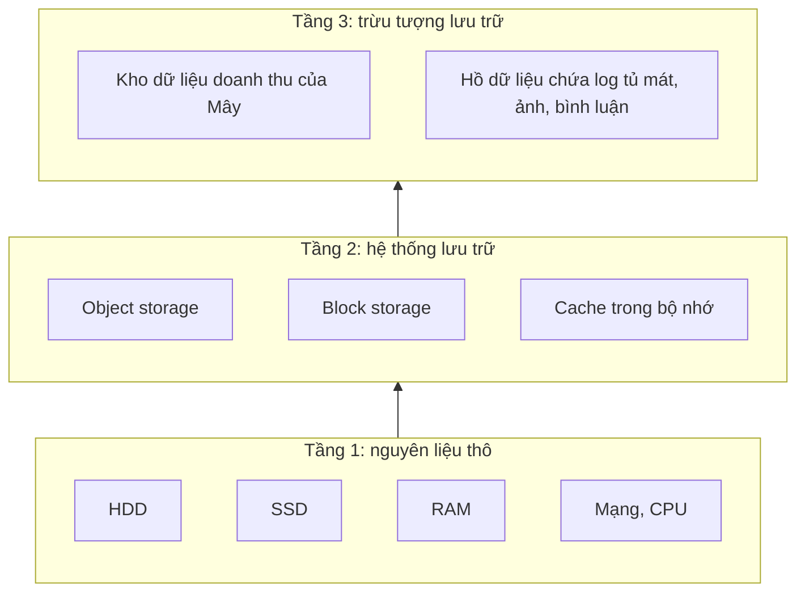
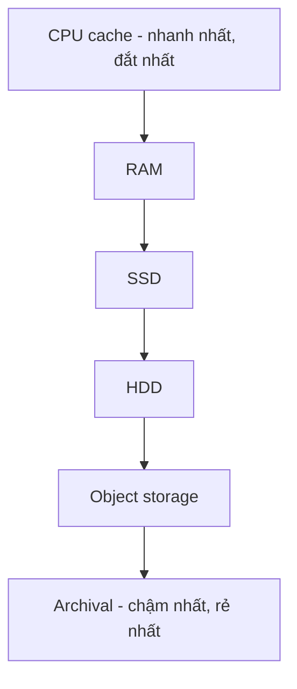

# Nguyên liệu thô của lưu trữ

Chương 6 nói về **lưu trữ (storage)** — nền móng của toàn bộ vòng đời kỹ thuật dữ liệu, vì dữ liệu được lưu đi lưu lại nhiều lần trong ingestion, transformation và serving. Chương đi theo ba tầng: **nguyên liệu thô** (ổ cứng, SSD, RAM...) → **hệ thống lưu trữ** (object storage, HDFS, Kafka...) → **trừu tượng lưu trữ** (data warehouse, data lake, lakehouse...). Bài này là tầng thấp nhất: các "nguyên liệu" vật lý và phần mềm để dựng nên mọi hệ thống lưu trữ.

**Tương tự đơn giản:** nấu một món ăn. Trước khi bàn về công thức (hệ thống) hay thực đơn (trừu tượng), bạn phải biết gạo, thịt, rau có đặc tính gì — cái nào rẻ, cái nào nhanh chín, cái nào để được lâu.

---

:::note[Ghi nhớ nhanh]

- ⭐ **Mỗi loại phương tiện lưu trữ là một đánh đổi giữa tốc độ, giá và độ bền** — HDD rẻ nhưng chậm, SSD nhanh nhưng đắt gấp ~10 lần, RAM nhanh nhất nhưng đắt nhất và mất dữ liệu khi mất điện.
- ⭐ **Cache hierarchy** (phân tầng bộ nhớ đệm) là cách nhìn chung: càng nhanh càng đắt và càng ít dung lượng; archival storage là "reverse cache".
- **HDD** có giới hạn vật lý (seek time, rotational latency, tốc độ truyền không tăng theo dung lượng) nhưng vẫn là xương sống của lưu trữ khối lượng lớn nhờ giá rẻ và song song hoá.
- **Serialization** (tuần tự hoá) và **compression** (nén) là hai "nguyên liệu phần mềm" ảnh hưởng trực tiếp tới hiệu năng truy vấn và chi phí.
- **Mạng và CPU** cũng là nguyên liệu: lưu trữ phân tán hiện đại thực chất là một ứng dụng web có API, load balancing.

:::

---

## Mục lục

- 1. Bức tranh ba tầng của chương
- 2. Ổ đĩa từ (HDD)
- 3. Ổ thể rắn (SSD)
- 4. RAM
- 5. Mạng và CPU
- 6. Serialization
- 7. Compression
- 8. Caching và cache hierarchy
- Tóm tắt

## 1. Bức tranh ba tầng của chương

| Tầng | Ví dụ | Ghi chú |
|---|---|---|
| Nguyên liệu thô | HDD, SSD, RAM, mạng, CPU, serialization, compression, caching | Bài này |
| Hệ thống lưu trữ | Block/file/object storage, HDFS, Kafka, Redis | Bài 2 và 3 |
| Trừu tượng lưu trữ | Data warehouse, data lake, lakehouse, data catalog | Bài 4 |

Thực tế ta không đụng trực tiếp vào RAM hay ổ cứng. Các thành phần vật lý nằm trong server và cluster, được truy cập qua các mô hình truy cập khác nhau. Đến lượt mình, các hệ thống lưu trữ được ghép lại thành cloud data warehouse, data lake... và kỹ sư dữ liệu chọn trừu tượng phù hợp cho từng giai đoạn của pipeline.

Cũng cần phân biệt với Chương 5: ở đó là **hệ thống nguồn** (thường không do kỹ sư dữ liệu quản lý). Ở chương này là phần lưu trữ mà kỹ sư dữ liệu **trực tiếp** xử lý, từ lúc nhập dữ liệu đến lúc phân phối.

Tác giả nhận xét nhiều kỹ sư dùng lưu trữ mỗi ngày mà không hiểu nó chạy ra sao và đánh đổi gì, dẫn tới những cách dùng "khá thú vị". Dù dịch vụ managed giúp khỏi phải quản server, bạn vẫn cần biết đặc tính cốt lõi, hiệu năng, độ bền và chi phí của các thành phần bên dưới.

### Ẩn dụ kho bãi: ba tầng lưu trữ của chuỗi trà sữa Mây

Hãy hình dung chuỗi trà sữa Mây (30 cửa hàng) cần chỗ cất **hàng hoá thật**. Ba tầng của chương giống ba cấp độ khi xây hệ thống kho:

- **Nguyên liệu thô** = gạch, kệ sắt, tủ lạnh, xe tải — từng món có giá và độ bền riêng.
- **Hệ thống lưu trữ** = từng loại kho dựng từ các món đó: kho lạnh, kho container, tủ trưng bày ở quầy.
- **Trừu tượng lưu trữ** = "trung tâm phân phối" mà quản lý chỉ cần gọi tên: "lấy cho tôi số liệu bán tháng 3", không cần biết hàng nằm kệ nào.

Sơ đồ đọc từ dưới lên: chủ chuỗi chỉ nhìn thấy tầng 3, nhưng chi phí và tốc độ của tầng 3 do tầng 1 quyết định.

### Thuật ngữ trong bài — hiểu nôm na

| Thuật ngữ | Nghĩa đời thường | Ví dụ ở chuỗi Mây |
|---|---|---|
| Storage (lưu trữ) | Nơi cất dữ liệu để dùng lại sau | Chỗ giữ toàn bộ đơn hàng 3 năm qua |
| HDD | Ổ cứng có đĩa quay, như máy hát đĩa than | Ổ chứa bản sao lưu đơn hàng cũ |
| SSD | Ổ cứng không có bộ phận chuyển động, như thẻ nhớ cỡ lớn | Ổ của máy chủ POS, cần ghi đơn thật nhanh |
| RAM | "Mặt bàn làm việc" của máy tính: rất nhanh nhưng tắt điện là trống | Nơi giữ menu và giỏ hàng đang mở trên app |
| Latency (độ trễ) | Thời gian chờ từ lúc hỏi đến lúc dữ liệu bắt đầu về | Bấm xem báo cáo, đợi bao lâu mới thấy số đầu tiên |
| Bandwidth / throughput (băng thông) | Bao nhiêu dữ liệu chảy qua mỗi giây, như độ rộng ống nước | Tải 1 năm đơn hàng mất bao lâu |
| IOPS | Số lần đọc/ghi lẻ mỗi giây | Số đơn POS ghi được mỗi giây giờ cao điểm |
| Volatile | "Dễ bay hơi": mất điện là mất dữ liệu | RAM |
| Serialization | Gói dữ liệu thành dạng chuẩn để cất hoặc gửi đi, như đóng thùng hàng | Xuất đơn hàng ra file CSV hoặc Parquet |
| Compression (nén) | Ép dữ liệu cho gọn, như hút chân không quần áo | Nén log tủ mát trước khi cất lâu dài |
| Cache | Kệ "hàng hay dùng" đặt sát tay | Giữ doanh thu hôm nay trong RAM để dashboard mở nhanh |
| Archival storage | Kho lưu trữ hồ sơ ở ngoại ô: rẻ nhưng lấy ra mất nửa ngày | Hoá đơn 7 năm trước, chỉ cần khi thanh tra thuế |

## 2. Ổ đĩa từ (Magnetic disk drive, HDD)

**Cơ chế:** các đĩa quay phủ màng sắt từ. Đầu đọc/ghi từ hoá màng để mã hoá bit khi ghi, và đọc từ trường để ra dòng bit khi đọc. Công nghệ do IBM phát triển từ thập niên 1950 (ổ IBM 350 đầu tiên chỉ có 3,75 MB; nay có ổ 20 TB). Nhờ các kỹ thuật như HAMR, SMR, ổ chứa khí heli, dung lượng vẫn tăng đều.

**Vì sao vẫn dùng:** rẻ hơn SSD rất nhiều, khoảng **3 cent mỗi GB**.

**Các giới hạn do vật lý:**

1. **Tốc độ truyền không tăng theo dung lượng.** Dung lượng tăng theo mật độ diện tích (areal density), còn tốc độ truyền tăng theo mật độ tuyến tính. Dung lượng gấp 4 thì tốc độ chỉ gấp 2. Ổ data center hiện chỉ đạt khoảng 200–300 MB/s. Ví dụ: đọc hết một ổ 30 TB ở 300 MB/s mất hơn **20 giờ**.
2. **Seek time:** phải di chuyển đầu đọc tới đúng track.
3. **Rotational latency:** phải chờ dữ liệu quay tới dưới đầu đọc. Với ổ 7.200 RPM, hai yếu tố này cho độ trễ trung bình hơn 4 ms.
4. **IOPS** (số thao tác I/O mỗi giây — quan trọng với transactional database): chỉ 50–500.

Có nhiều mẹo (quay nhanh hơn, giới hạn bán kính đĩa, chỉ ghi vào một dải hẹp) nhưng không giúp HDD cạnh tranh được với SSD ở truy cập ngẫu nhiên.

**Điểm hay: song song hoá.** HDD đơn lẻ chậm, nhưng khi dữ liệu rải trên hàng nghìn đĩa trong cluster và đọc đồng thời, băng thông tổng tăng vọt, bị giới hạn chủ yếu bởi **mạng** chứ không phải tốc độ đĩa. Đây là ý tưởng cốt lõi đằng sau **cloud object storage**. Vì thế mạng và CPU cũng là nguyên liệu thô (xem mục 5).

## 3. Ổ thể rắn (Solid-state drive, SSD)

SSD lưu dữ liệu dưới dạng điện tích trong các ô **flash memory**, không có bộ phận cơ học, đọc hoàn toàn bằng điện tử.

- Tra cứu ngẫu nhiên dưới 0,1 ms (100 micro giây).
- Chia nhỏ thành nhiều phân vùng với nhiều controller chạy song song, nên tốc độ truyền và IOPS đều mở rộng được: hàng GB/s và hàng chục nghìn IOPS.
- Đã cách mạng hoá **transactional database**: PostgreSQL, MySQL, SQL Server xử lý hàng nghìn giao dịch mỗi giây; SSD là chuẩn cho hệ thống **OLTP** thương mại.

**Nhược điểm: giá.** Khoảng 20–30 cent/GB, gấp gần 10 lần HDD. Vì vậy SSD chưa phải mặc định cho lưu trữ phân tích quy mô lớn; **object storage trên đĩa từ** mới là lựa chọn hàng đầu cho data lake và cloud data warehouse.

SSD vẫn có vai trò trong **OLAP**: một số cơ sở dữ liệu OLAP dùng SSD làm cache cho dữ liệu hay truy cập để truy vấn nhanh. Khi OLAP độ trễ thấp phổ biến hơn, SSD sẽ được dùng nhiều hơn.

## 4. Bộ nhớ truy cập ngẫu nhiên (RAM)

Về lý thuyết HDD và SSD cũng là "bộ nhớ truy cập ngẫu nhiên", nhưng khi nói RAM ta ngụ ý các đặc điểm sau:

- Gắn với CPU, ánh xạ vào không gian địa chỉ của CPU.
- Chứa mã mà CPU thực thi và dữ liệu mà mã đó xử lý trực tiếp.
- **Volatile (dễ bay hơi):** mất dữ liệu trong chưa đầy một giây khi mất điện, trong khi ổ đĩa là nonvolatile.
- Nhanh hơn SSD rất nhiều: DDR5 có độ trễ cỡ 100 ns (nhanh hơn SSD khoảng 1.000 lần), băng thông cỡ 100 GB/s, hàng triệu IOPS.
- Đắt hơn SSD nhiều: cỡ **10 USD/GB**.
- Lượng RAM gắn vào mỗi CPU/memory controller bị giới hạn, làm tăng độ phức tạp và chi phí (server nhiều RAM thường gồm nhiều CPU nối với nhau, mỗi CPU một khối RAM).
- Vẫn chậm hơn **CPU cache** (bộ nhớ nằm ngay trên die của CPU, có nhiều tầng) — nơi giữ dữ liệu vừa/hay truy cập để xử lý siêu nhanh.

Khi nói "bộ nhớ hệ thống", hầu như luôn là **DRAM** (dynamic RAM): mật độ cao, giá rẻ, lưu dữ liệu dưới dạng điện tích trong tụ điện. Tụ bị rò nên phải liên tục "làm tươi" (đọc rồi ghi lại); phần cứng memory controller lo việc này, kỹ sư chỉ cần quan tâm băng thông và độ trễ. SRAM dùng cho trường hợp đặc biệt như CPU cache.

Về kiến trúc, CPU hiện nay gần như luôn theo **von Neumann** (mã và dữ liệu chung một không gian bộ nhớ), nhưng thường cho phép cấm thực thi mã trên một số trang nhớ để tăng bảo mật — gợi nhớ kiến trúc Harvard (tách mã và dữ liệu).

**Cách RAM được dùng trong hệ thống dữ liệu:** làm cache, xử lý dữ liệu, chỉ mục (index). Một số database coi RAM là tầng lưu trữ chính để đọc/ghi siêu nhanh. Khi đó phải luôn nhớ tính volatile: dù dữ liệu được nhân bản trên cluster, mất điện làm sập nhiều node cùng lúc vẫn có thể mất dữ liệu. Kiến trúc cần lưu bền thường dùng pin dự phòng và tự động đổ toàn bộ dữ liệu xuống đĩa khi mất điện.

## 5. Mạng và CPU

Vì sao mạng và CPU là nguyên liệu của lưu trữ? Vì lưu trữ ngày càng **phân tán** để tăng hiệu năng, độ bền, tính sẵn sàng.

- Một đĩa đơn có tốc độ truyền thấp, nhưng cả cluster đĩa đọc song song thì tăng rất mạnh.
- **RAID** (redundant arrays of independent disks) song song hoá trên một server; cloud object storage làm điều đó ở quy mô lớn hơn nhiều, với đĩa rải qua mạng, thậm chí nhiều data center và **availability zone**.
- **Availability zone (AZ):** khái niệm của cloud, là các môi trường tính toán có nguồn điện, nước... độc lập. Lưu trữ nhiều AZ tăng cả tính sẵn sàng (availability) lẫn độ bền (durability).
- CPU lo việc phục vụ yêu cầu, gom kết quả đọc, phân phối ghi. Lưu trữ trở thành một **ứng dụng web** với API, các thành phần dịch vụ backend và load balancing. Hiệu năng thiết bị mạng và topology mạng là yếu tố then chốt.

Kỹ sư dữ liệu phải liên tục cân bằng: rải dữ liệu rộng về địa lý (bền, sẵn sàng hơn) so với giữ gọn trong vùng nhỏ gần nơi đọc/ghi (nhanh hơn, rẻ hơn). Phụ lục B của sách bàn thêm về mạng cloud.

## 6. Serialization (tuần tự hoá)

Dữ liệu trong bộ nhớ do phần mềm quản lý thường không có định dạng phù hợp để lưu xuống đĩa hay truyền qua mạng. **Serialization** là quá trình "làm phẳng" và đóng gói dữ liệu thành một định dạng chuẩn mà bên đọc giải mã được. Ví dụ: mã hoá theo hàng thành file XML, JSON hoặc CSV, gửi cho người khác rồi họ dùng thư viện chuẩn để giải mã.

Một thuật toán serialization có logic xử lý kiểu dữ liệu, áp đặt quy tắc về cấu trúc, cho phép trao đổi giữa ngôn ngữ lập trình và CPU khác nhau, và có quy tắc xử lý ngoại lệ. Ví dụ: đối tượng Python có thể chứa tham chiếu vòng; thuật toán có thể báo lỗi hoặc giới hạn độ sâu lồng nhau khi gặp vòng đó.

Cách tổ chức dữ liệu ở tầng thấp của database cũng là một dạng serialization:

| Kiểu | Cách tổ chức | Mạnh ở |
|---|---|---|
| Row-oriented (hướng hàng) | Dữ liệu xếp theo hàng trên đĩa | Tra cứu nhanh, cập nhật tại chỗ |
| Columnar (hướng cột) | Dữ liệu xếp thành file theo cột | Nén rất hiệu quả, quét nhanh khối lượng lớn |

Mỗi lựa chọn là một đánh đổi, và kỹ sư tinh chỉnh theo yêu cầu. Quyết định serialization ảnh hưởng hiệu năng truy vấn qua mạng, chi phí CPU, độ trễ... Ví dụ thiết kế data lake là chọn hệ lưu trữ nền (như Amazon S3) và chuẩn serialization cân bằng giữa khả năng tương tác và hiệu năng.

Sách khuyên làm quen với các định dạng phổ biến, đặc biệt **Apache Parquet**, định dạng lai **Apache Hudi** và dạng trong bộ nhớ **Apache Arrow** (chi tiết ở Phụ lục A).

### Áp vào chuỗi Mây: lưu theo hàng hay theo cột

Lấy bảng đơn hàng của Mây:

| order_id | thoi_gian | cua_hang | mon | so_luong | gia | kenh |
|---|---|---|---|---|---|---|
| DH001 | 2026-03-01 08:15 | Q1-Lê Lợi | Trà sữa trân châu | 2 | 35000 | quầy |
| DH002 | 2026-03-01 08:20 | Q3-Võ Văn Tần | Trà đào | 1 | 40000 | app |
| DH003 | 2026-03-01 08:22 | Q1-Lê Lợi | Trà đào | 1 | 40000 | quầy |

Trên đĩa, dữ liệu là một dải dài liên tục. Hai cách xếp cùng bảng trên thành dải:

| Cách xếp | Dải dữ liệu trên đĩa (đọc từ trái sang phải) |
|---|---|
| Theo hàng (row-oriented) | `DH001, 08:15, Q1-Lê Lợi, Trà sữa trân châu, 2, 35000, quầy` → `DH002, 08:20, Q3-Võ Văn Tần, ...` → `DH003, ...` |
| Theo cột (columnar) | `DH001, DH002, DH003` → `08:15, 08:20, 08:22` → `Q1-Lê Lợi, Q3-Võ Văn Tần, Q1-Lê Lợi` → ... → `35000, 40000, 40000` → ... |

Giờ đặt hai câu hỏi thực tế ở Mây và xem mỗi cách phải đọc bao nhiêu:

| Câu hỏi | Lưu theo hàng | Lưu theo cột | Bên thắng |
|---|---|---|---|
| Thu ngân: "Cho xem toàn bộ đơn DH002" | Đọc đúng 1 đoạn liền nhau | Phải nhặt ở 7 chỗ khác nhau (mỗi cột một chỗ) | Hàng |
| Chủ chuỗi: "Tổng tiền bán năm nay?" (cần `so_luong` và `gia`) | Đọc cả 7 cột của mọi đơn dù chỉ cần 2 | Chỉ đọc 2 cột, bỏ qua 5 cột còn lại | Cột |

Vì thế máy POS (hỏi từng đơn) dùng lưu trữ theo hàng, còn kho dữ liệu phân tích (cộng hàng triệu đơn) dùng lưu trữ theo cột như Parquet. Với 10 triệu đơn và 7 cột, câu hỏi tổng tiền ở dạng cột chỉ phải đọc khoảng 2/7 dữ liệu — chưa tính phần nén thêm ở mục sau.

## 7. Compression (nén)

Nén làm dữ liệu nhỏ hơn, nhưng thuật toán nén tương tác với các chi tiết khác của hệ lưu trữ một cách phức tạp. Ba lợi ích chính:

1. Dữ liệu nhỏ hơn nên chiếm ít chỗ trên đĩa.
2. Tăng tốc độ quét thực tế trên mỗi đĩa. Ví dụ tỉ lệ nén 10:1 biến 200 MB/s mỗi đĩa HDD thành tốc độ hiệu dụng 2 GB/s.
3. Tăng hiệu năng mạng. Ví dụ kết nối EC2–S3 có 10 Gbps; nén 10:1 nâng băng thông hiệu dụng lên 100 Gbps.

**Nhược điểm:** nén/giải nén tốn thêm thời gian và tài nguyên khi đọc hoặc ghi. Chi tiết các thuật toán và đánh đổi ở Phụ lục A.

### Áp vào chuỗi Mây: vì sao dữ liệu cột nén rất tốt

Trong một cột, các giá trị thường giống nhau. Cột `kenh` của Mây chỉ có hai giá trị "quầy" và "app"; cột `cua_hang` lặp lại tên 30 cửa hàng. Một cách nén đơn giản là ghi "giá trị × số lần lặp liên tiếp" (gọi là run-length encoding):

| | Dữ liệu cột `kenh` của 10 đơn liên tiếp |
|---|---|
| Trước khi nén | quầy, quầy, quầy, quầy, quầy, quầy, app, app, quầy, quầy |
| Sau khi nén | quầy × 6, app × 2, quầy × 2 |

Ở dạng lưu theo hàng, "quầy" nằm xen giữa tên món, giá, giờ... nên khó gom như vậy. Đây là lý do định dạng cột vừa đọc ít hơn vừa nén gọn hơn — hai lợi ích cộng dồn cho các câu hỏi phân tích.

## 8. Caching và cache hierarchy

Ý tưởng cốt lõi: giữ dữ liệu được truy cập thường xuyên hoặc vừa mới truy cập trong một **tầng truy cập nhanh**. Cache càng nhanh thì càng đắt và dung lượng càng nhỏ; dữ liệu ít dùng hơn nằm ở nơi rẻ và chậm hơn. Cache quan trọng với serving, xử lý và transformation.

Khi phân tích hệ lưu trữ, nên xếp mọi loại lưu trữ vào một **cache hierarchy**. Hầu hết hệ thống thực tế dựa vào nhiều tầng cache ghép từ các lưu trữ có đặc tính khác nhau: bắt đầu ngay trong CPU (tới 4 tầng cache), đi xuống RAM, SSD; **cloud object storage** là tầng thấp hơn, giữ dữ liệu lâu dài và vẫn cho phép serving và di chuyển dữ liệu linh hoạt trong pipeline.

Bảng 6-1 của sách (con số xấp xỉ, mang tính heuristic):

| Loại lưu trữ | Độ trễ lấy dữ liệu | Băng thông | Giá |
|---|---|---|---|
| CPU cache | 1 nanosecond | 1 TB/s | không áp dụng |
| RAM | 0,1 microsecond | 100 GB/s | 10 USD/GB |
| SSD | 0,1 millisecond | 4 GB/s | 0,20 USD/GB |
| HDD | 4 millisecond | 300 MB/s | 0,03 USD/GB |
| Object storage | 100 millisecond | 10 GB/s | 0,02 USD/GB mỗi tháng |
| Archival storage | 12 giờ | Như object storage khi dữ liệu đã sẵn sàng | 0,004 USD/GB mỗi tháng |

(1 microsecond bằng 1.000 nanosecond; 1 millisecond bằng 1.000 microsecond.)

**Archival storage là "reverse cache"** (cache ngược): truy cập kém nhưng giá rất rẻ. Dùng để sao lưu và đáp ứng yêu cầu lưu giữ theo quy định; thường chỉ truy cập khi khẩn cấp (mất dữ liệu cần khôi phục, hoặc cần xem lại dữ liệu lịch sử cho mục đích pháp lý).

### Áp vào chuỗi Mây: dữ liệu nào để ở tầng nào

Con số nano giây, mili giây khó hình dung. Thử phóng đại: nếu lấy dữ liệu từ CPU cache mất **1 giây**, thì theo tỉ lệ Bảng 6-1, RAM mất gần 2 phút, SSD hơn 1 ngày, HDD khoảng 1,5 tháng, object storage hơn 3 năm, còn archival hơn một triệu năm. Khoảng chênh lớn đến vậy nên chọn sai tầng là chậm hoặc tốn tiền thấy rõ.

Bảng dưới là cách Mây xếp dữ liệu vào từng tầng, dựa trên "hay dùng tới mức nào" và "cần nhanh tới mức nào".

| Dữ liệu ở Mây | Bao lâu dùng một lần | Tầng phù hợp | Lý do |
|---|---|---|---|
| Menu, giá món đang bán | Mỗi lần khách mở app | RAM (cache) | Hàng nghìn lượt xem mỗi phút, cần tức thì |
| Đơn hàng đang ghi ở quầy | Liên tục | SSD (máy chủ POS) | Nhiều thao tác ghi lẻ, cần IOPS cao |
| Đơn hàng 3 năm cho phân tích | Mỗi ngày khi chạy báo cáo | Object storage | Rất nhiều dữ liệu, cần rẻ, đọc song song được |
| Log nhiệt độ tủ mát năm ngoái | Hiếm khi | Object storage lớp rẻ | Chỉ xem khi điều tra sự cố |
| Hoá đơn 7 năm theo luật thuế | Gần như không bao giờ | Archival | Rẻ nhất, chấp nhận chờ nửa ngày khi cần |

## Tóm tắt

| Nguyên liệu | Ý chính cần nhớ |
|---|---|
| HDD | Rẻ (~0,03 USD/GB), chậm vì vật lý (seek, rotation), mạnh khi song song hoá thành cluster |
| SSD | Nhanh, IOPS cao, chuẩn cho OLTP; đắt gấp ~10 lần HDD nên ít dùng cho lưu trữ phân tích lớn |
| RAM | Nhanh nhất (ngoài CPU cache), đắt, volatile |
| Mạng và CPU | Biến cụm đĩa thành dịch vụ lưu trữ; cân bằng độ bền/sẵn sàng và hiệu năng/chi phí |
| Serialization | Định dạng lưu/truyền dữ liệu; hàng so với cột |
| Compression | Giảm dung lượng, tăng tốc quét và băng thông, đổi lại tốn CPU |
| Caching | Phân tầng theo tốc độ và giá; archival là cache ngược |
