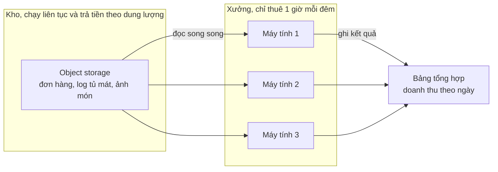
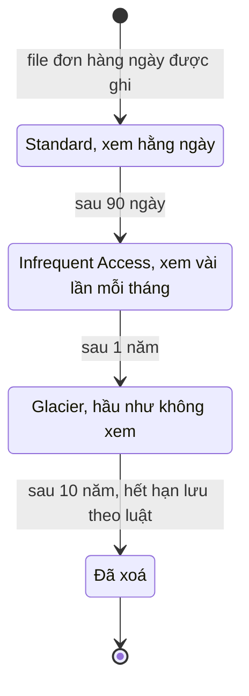

# Object storage, HDFS, streaming và index

Bài này tiếp tục phần hệ thống lưu trữ với loại quan trọng nhất cho kỹ thuật dữ liệu hiện đại: **object storage**. Sau đó là lưu trữ dựa trên bộ nhớ (cache), HDFS, lưu trữ cho dữ liệu streaming, và cuối cùng là cách tổ chức dữ liệu để truy vấn nhanh: index, partition, clustering.

**Tương tự đơn giản:** object storage như một nhà kho khổng lồ có hệ thống nhãn: bạn đưa kiện hàng vào cùng một cái nhãn (key), muốn sửa hàng thì phải gửi kiện mới thay thế cả kiện cũ chứ không mở ra sửa từng món.

---

:::note[Ghi nhớ nhanh]

- ⭐ **Object storage** là key-value store cho các object **bất biến (immutable)**; không có append hay ghi ngẫu nhiên, nhưng đọc/ghi song song cực lớn. Nó là nền tảng của data lake và là chìa khoá để **tách compute khỏi storage**.
- ⭐ **"Thư mục" trong object store chỉ là ảo**: thực chất chỉ là tiền tố của key, nên thao tác kiểu "liệt kê thư mục" có thể tốn kém.
- **Storage class/tier** (Standard, Infrequent Access, Glacier...) giảm giá lưu trữ nhưng tăng giá và thời gian truy xuất.
- **HDFS** gộp compute và storage trên cùng node; dữ liệu chia thành block, mỗi block nhân bản 3 lần; "Hadoop chưa chết" nhưng không còn là công nghệ nóng.
- Dữ liệu analytics: từ **index** chuyển sang **columnar + partition + clustering**; Snowflake dùng **micro-partition** và metadata thay cho index.

:::

---

## Mục lục

- 1. Object storage
- 2. Hệ thống cache và lưu trữ trên bộ nhớ
- 3. Hadoop Distributed File System (HDFS)
- 4. Streaming storage
- 5. Index, partition và clustering
- Tóm tắt

## 1. Object storage

**Object storage** chứa các object đủ hình dạng và kích thước: TXT, CSV, JSON, ảnh, video, âm thanh. Từ "object" ở đây gây nhầm lẫn vì trong lập trình nó có nhiều nghĩa; ở đây nó chỉ một cấu trúc giống file nhưng chuyên biệt.

Object store lên ngôi cùng big data và cloud. Phổ biến: **Amazon S3, Azure Blob Storage, Google Cloud Storage (GCS)**. Nhiều cloud data warehouse (và ngày càng nhiều database) dùng object storage làm tầng lưu trữ, và cloud data lake thường nằm trên object store.

Về vận hành, điểm hấp dẫn là nó **dễ quản lý và dễ dùng**: có thể coi là một trong những dịch vụ "serverless" đầu tiên, kỹ sư không phải để ý đặc tính cụm server hay đĩa bên dưới.

### Thuật ngữ trong bài — hiểu nôm na

| Thuật ngữ | Nghĩa đời thường | Ví dụ ở chuỗi trà sữa Mây |
|---|---|---|
| Object | Một "kiện hàng" dữ liệu đóng gói kín, kèm nhãn | File đơn hàng ngày 01/03 của cửa hàng Q1 |
| Bucket | Một khu kho lớn có tên riêng | Khu kho `may-data-lake` |
| Key | Mã dán trên kiện hàng, dùng để tìm lại | `don_hang/2026/03/01/q1.parquet` |
| Immutable (bất biến) | Đã đóng thùng thì không mở ra sửa, chỉ thay thùng mới | Muốn sửa 1 đơn sai giá thì ghi lại cả file của ngày đó |
| Serverless | Dùng dịch vụ mà không phải lo máy chủ bên dưới | Chỉ việc bỏ file vào kho, không cần biết bao nhiêu ổ đĩa |
| Tách compute khỏi storage | Kho để hàng và xưởng chế biến là hai nơi riêng, xưởng chỉ thuê khi cần | Thuê máy tính báo cáo 1 tiếng mỗi đêm, dữ liệu vẫn nằm yên trong kho |
| Storage class | Hạng kho: kho mặt tiền đắt mà lấy nhanh, kho ngoại ô rẻ mà lấy lâu | Đơn tháng này để hạng thường, đơn 5 năm trước để hạng lưu trữ |
| Versioning | Giữ mọi phiên bản cũ của một kiện hàng | Lỡ ghi đè file đơn hàng sai thì lấy lại bản hôm qua |
| Replay | Tua lại cuốn băng sự kiện để xem lại từ một thời điểm | Chạy lại toàn bộ đơn từ 8h sáng sau khi sửa lỗi tính tiền |
| Index | Mục lục giúp tìm từng dòng nhanh | Tra đơn DH001 tức thì |
| Partition | Chia bảng thành các ngăn theo một trường, thường là ngày | Mỗi ngày bán hàng là một ngăn riêng |
| Clustering | Trong mỗi ngăn, xếp các dòng giống nhau cạnh nhau | Trong ngăn ngày 01/03, đơn của cùng cửa hàng nằm liền nhau |

### 1.1. Bản chất: key-value store cho dữ liệu bất biến

Mất đi nhiều sự linh hoạt khi ghi so với file cục bộ:

- **Không** có ghi ngẫu nhiên hay append. Object được ghi **một lần** dưới dạng luồng byte và sau đó **bất biến**. Muốn sửa hay nối thêm dữ liệu, phải ghi lại toàn bộ object.
- Thường hỗ trợ đọc ngẫu nhiên qua **range request**, nhưng có thể kém xa đọc ngẫu nhiên trên SSD.

Với lập trình viên quen file cục bộ đây giống ràng buộc, nhưng "ít hơn là nhiều hơn": vì không cần khoá hay đồng bộ thay đổi nên có thể lưu dữ liệu trên cụm đĩa khổng lồ, đọc/ghi luồng song song cực hiệu quả trên nhiều đĩa mà kỹ sư không cần làm việc với từng đĩa. Trên cloud, tốc độ ghi tăng theo số luồng ghi (tới hạn mức nhà cung cấp); băng thông đọc tăng theo số request song song, số VM và số lõi CPU. Do đó rất hợp để phục vụ lưu lượng web lớn hoặc cấp dữ liệu cho các query engine phân tán song song cao.

**Độ bền và sẵn sàng:** thường lưu qua nhiều availability zone, giảm mạnh khả năng offline hoặc mất dữ liệu không phục hồi được. Chi phí đã bao gồm điều này; nhà cung cấp có các storage class rẻ hơn đổi lấy độ bền/sẵn sàng thấp hơn.

**Tách compute khỏi storage:** object storage là nguyên liệu quan trọng để xử lý dữ liệu bằng các cluster tạm thời (ephemeral), mở rộng lên xuống theo nhu cầu. Điều này đưa big data tới các tổ chức nhỏ không đủ tiền sở hữu phần cứng cho job chỉ chạy thỉnh thoảng. Một số hãng công nghệ lớn vẫn chạy cluster Hadoop thường trực, nhưng xu hướng chung: dùng object store làm tầng lưu trữ và serving chính, xử lý bằng cluster tạm thời.

**Dung lượng** gần như không giới hạn: giới hạn thực tế của khách hàng public cloud chủ yếu là ngân sách, không cần lên kế hoạch mua server/đĩa trước hàng tháng.

### Áp vào chuỗi Mây: "không sửa, chỉ thay" và "kho riêng, xưởng thuê"

Log nhiệt độ tủ mát của Mây được gom thành từng file theo giờ. Bảng dưới so sánh việc "thêm một chỉ số đến muộn" trên ổ đĩa thường và trên object storage — đây là ràng buộc bất biến ở mục 1.1.

| Bước | Ổ đĩa thường (file) | Object storage |
|---|---|---|
| Có sẵn | File `tu_mat_14h` có 59 dòng | Object `tu_mat/2026/03/01/14h.json` có 59 dòng |
| Chỉ số lúc 14:59 đến muộn | Mở file, nối thêm 1 dòng | Không nối được |
| Cách làm | Xong ngay | Đọc 59 dòng, thêm dòng mới, ghi lại **cả** object 60 dòng dưới cùng key |

Vì vậy ở Mây, dữ liệu đến liên tục (như từng chỉ số tủ mát) thường được **gom lại một lúc** rồi mới ghi thành object, chứ không ghi từng dòng.

Đổi lại, object storage cho phép tách "kho" khỏi "xưởng". Sơ đồ dưới là cách Mây chạy báo cáo mỗi đêm mà không phải nuôi máy chủ cả ngày.



Bảng tổng hợp cũng được ghi lại vào object storage. Xong việc, ba máy tính được tắt và không tốn thêm đồng nào; dữ liệu vẫn nằm yên trong kho cho lần chạy sau.

### 1.2. Object store trong kỹ thuật dữ liệu

- Hiệu năng xuất sắc cho **đọc/ghi batch lớn**, hợp với hệ OLAP lớn.
- "Giai thoại" rằng object store không hợp để cập nhật chỉ đúng một phần: không phù hợp với tải giao dịch có nhiều cập nhật nhỏ mỗi giây (nên dùng database giao dịch hoặc block storage), nhưng hợp với **ít** thao tác cập nhật mà mỗi thao tác đụng khối lượng dữ liệu lớn.
- Hiện là **tiêu chuẩn vàng** cho data lake. Thuở đầu data lake theo **WORM (write once, read many)**, nhưng nguyên nhân là độ phức tạp quản lý phiên bản dữ liệu và file hơn là giới hạn của HDFS hay object store. Sau đó **Apache Hudi** và **Delta Lake** ra đời để quản lý độ phức tạp này, và luật riêng tư như **GDPR, CCPA** khiến khả năng xoá/cập nhật trở nên bắt buộc. Quản lý cập nhật trên object storage là ý tưởng trung tâm của **data lakehouse** (đã giới thiệu ở Chương 3).
- Là kho chứa lý tưởng cho **dữ liệu phi cấu trúc** ở mọi định dạng; thường xuất hiện trong pipeline ML cho văn bản thô, ảnh, video, âm thanh.

### 1.3. Tra cứu object (object lookup)

Khác file store, object store **không dùng cây thư mục** để tìm object. Nó dùng một container logic cấp cao nhất (**bucket** trong S3 và GCS) và tham chiếu object bằng **key**. Ví dụ `S3://oreilly-data-engineering-book/data-example.json`: phần đầu là tên bucket (duy nhất trên toàn AWS), `data-example.json` là key (duy nhất trong bucket).

Dù giao diện cloud có vẻ hỗ trợ "thư mục", ví dụ key `project-data/11/23/2021/data.txt` trông như chuỗi thư mục lồng nhau và công cụ dòng lệnh cho phép `ls` trong "thư mục", thực chất hệ thống chỉ thấy **một key** tình cờ có dạng đường dẫn. Hệ quả: một số thao tác ở mức "thư mục" **tốn kém**. Để liệt kê `project-data/11/`, object store phải lọc key theo tiền tố; với bucket hàng triệu object, thao tác này có thể chậm dù "thư mục" chỉ chứa vài object.

Ví dụ ở Mây: bucket `may-data-lake` có các key dưới đây. Giao diện hiển thị như cây thư mục, nhưng thực chất chỉ là **danh sách phẳng** các chuỗi ký tự.

| Giao diện hiển thị như thư mục | Thực tế object store lưu |
|---|---|
| `don_hang` → `2026` → `03` → `01` → `q1.parquet` | Một key duy nhất `don_hang/2026/03/01/q1.parquet` |
| `don_hang` → `2026` → `03` → `01` → `q3.parquet` | Một key duy nhất `don_hang/2026/03/01/q3.parquet` |
| `tu_mat` → `2026` → `03` → `01` → `14h.json` | Một key duy nhất `tu_mat/2026/03/01/14h.json` |

Khi kỹ sư "mở thư mục" `don_hang/2026/03/`, hệ thống phải dò mọi key bắt đầu bằng chuỗi đó — giống tìm trong danh bạ mọi tên bắt đầu bằng "Nguyễn".

### 1.4. Nhất quán và versioning

Vì không cập nhật tại chỗ, ta ghi object mới **cùng key** để cập nhật. Cần biết object store nhất quán eventual hay strong. Ví dụ S3 trước đây là eventually consistent: sau khi ghi bản mới dưới cùng key, đôi lúc vẫn trả về bản cũ; "eventual" nghĩa là sau đủ thời gian chỉ còn trả về bản mới nhất. (Ngược lại, đĩa cục bộ có strong consistency: đọc sau ghi trả về dữ liệu mới nhất.) Lưu ý thêm (ghi chú của người tóm tắt): từ cuối năm 2020, Amazon S3 đã chuyển sang nhất quán mạnh kiểu read-after-write cho mọi thao tác ghi và đọc object; nhưng bài học "phải biết mô hình nhất quán của hệ mình dùng" vẫn nguyên giá trị với các object store khác.

**Cách ép strong consistency lên object store** (một cách phổ biến): thêm một database nhất quán mạnh (ví dụ PostgreSQL).

Ghi object gồm 2 bước:
1. Ghi object.
2. Ghi metadata phiên bản trả về (hash hoặc timestamp) vào database nhất quán mạnh.

Đọc object:
1. Lấy metadata mới nhất từ database nhất quán mạnh.
2. Truy vấn metadata của object bằng key; nếu khớp với metadata lấy từ database thì đọc dữ liệu.
3. Nếu không khớp, lặp lại bước 2 cho đến khi nhận được bản mới nhất.

Triển khai thực tế phải xử lý các trường hợp biên (ví dụ object bị ghi lại giữa lúc truy vấn). Có thể đóng gói sau một API để người đọc thấy object store nhất quán mạnh, đổi lại độ trễ truy cập cao hơn.

**Object versioning** liên quan chặt với nhất quán. Khi ghi lại object dưới key cũ, thực chất ta ghi object hoàn toàn mới, đặt tham chiếu từ key tới object mới và xoá tham chiếu cũ. Cập nhật mọi tham chiếu trong cluster cần thời gian, nên có thể đọc dữ liệu cũ. Sau đó **garbage collector** của cluster sẽ giải phóng dung lượng của dữ liệu không còn tham chiếu.

Khi bật versioning: thêm metadata phiên bản cho object; tham chiếu mặc định trỏ tới object mới nhưng vẫn giữ con trỏ tới các bản trước và một danh sách phiên bản để client lấy danh sách rồi kéo một phiên bản cụ thể. Các bản cũ vẫn được tham chiếu nên không bị garbage collector dọn. Nếu truy cập bằng **key + version**, vấn đề nhất quán biến mất (cặp này xác định duy nhất một object bất biến); vấn đề vẫn còn khi yêu cầu phiên bản "mặc định/mới nhất".

**Chi phí của versioning:** các phiên bản cũ tốn dung lượng như bản hiện tại; có thể không đáng kể hoặc cực kỳ đắt tuỳ kích thước dữ liệu và tần suất cập nhật. Chú ý đây là versioning "vét cạn": object store thường lưu toàn bộ dữ liệu mỗi phiên bản, không phải snapshot khác biệt.

**Lifecycle policy** cho phép tự động xoá phiên bản cũ khi đủ điều kiện (ví dụ đủ tuổi hoặc đã có nhiều phiên bản mới hơn), và quản lý chuyển sang các tầng archive giá rẻ.

### 1.5. Storage class và tier

Nhà cung cấp cung cấp các storage class giảm giá lưu trữ đổi lấy **giảm truy cập** hoặc giảm độ bền. ("Giảm truy cập" vì nhiều tầng vẫn rất sẵn sàng nhưng phí truy xuất cao.) Ví dụ S3:

| Storage class | Đặc điểm |
|---|---|
| S3 Standard-Infrequent Access | Giảm giá lưu mỗi tháng, tăng phí truy xuất |
| S3 One Zone-Infrequent Access | Chỉ nhân bản trong 1 zone; độ sẵn sàng giảm từ 99,9% xuống 99,5%; vẫn bền cao nhưng mất dữ liệu nếu zone bị phá huỷ |
| S3 Glacier (archive) | Giảm mạnh chi phí lưu dài hạn, phí truy xuất rất cao; tuỳ chọn tốc độ lấy từ vài phút tới vài giờ |
| S3 Glacier Deep Archive | Từ khoảng 1 USD/TB mỗi tháng; khôi phục mất 12 giờ; dành cho dữ liệu lưu 7–10 năm, chỉ truy cập 1–2 lần mỗi năm |

Cẩn thận khi dùng archival: dễ đưa dữ liệu vào nhưng truy xuất thường đắt, nhất là nếu cần dùng thường xuyên hơn dự tính (xem Chương 4 về kinh tế lưu trữ archival).

### Áp vào chuỗi Mây: vòng đời của file đơn hàng

Dữ liệu đơn hàng càng cũ càng ít ai xem. Mây đặt **lifecycle policy** để kho tự chuyển file xuống hạng rẻ hơn theo tuổi, giống đẩy hàng cũ từ kệ mặt tiền ra kho ngoại ô. Sơ đồ trạng thái dưới cho thấy hành trình của một file đơn hàng ngày.



| Tuổi dữ liệu | Ai dùng ở Mây | Hạng lưu | Đánh đổi |
|---|---|---|---|
| Dưới 90 ngày | Dashboard doanh thu, mô hình dự báo trân châu | Standard | Đắt nhất khi lưu, đọc thoải mái |
| 90 ngày – 1 năm | So sánh cùng kỳ, báo cáo quý | Infrequent Access | Lưu rẻ hơn, mỗi lần đọc mất phí |
| 1 – 10 năm | Kế toán khi thanh tra thuế | Glacier | Lưu rất rẻ, lấy ra mất từ vài phút tới vài giờ và tốn phí cao |

### 1.6. Hệ file dựa trên object store

Các công cụ như **s3fs** và **Amazon S3 File Gateway** cho phép mount một S3 bucket như ổ cục bộ. Cần hiểu cách ghi vào hệ file này tương tác thế nào với đặc tính và giá của object storage. File Gateway xử lý thay đổi khá hiệu quả bằng cách ghép các phần object thành object mới, nhưng ghi giao dịch tốc độ cao sẽ làm quá tải khả năng cập nhật của object store. Mount tốt cho file ít khi cập nhật.

## 2. Hệ thống cache và lưu trữ trên bộ nhớ

RAM có độ trễ và tốc độ truyền xuất sắc, nhưng RAM truyền thống rất dễ mất dữ liệu (mất điện dù một giây cũng xoá sạch). Vì vậy hệ lưu trữ dựa trên RAM thường tập trung vào **caching**, phục vụ dữ liệu truy cập nhanh với băng thông cao; dữ liệu cần lưu giữ vẫn nên ghi sang phương tiện bền hơn.

| Hệ thống | Đặc điểm |
|---|---|
| **Memcached** | Key-value store để cache kết quả truy vấn database, phản hồi API...; cấu trúc dữ liệu đơn giản (chuỗi hoặc số nguyên); độ trễ rất thấp và giảm tải cho hệ backend |
| **Redis** | Cũng là key-value store nhưng hỗ trợ kiểu dữ liệu phức tạp hơn (list, set); có sẵn nhiều cơ chế lưu bền gồm snapshot và journaling; cấu hình điển hình ghi dữ liệu khoảng mỗi 2 giây, hợp ứng dụng hiệu năng cực cao có thể chấp nhận mất một ít dữ liệu |

## 3. Hadoop Distributed File System (HDFS)

Một thời "Hadoop" gần như đồng nghĩa với "big data". HDFS dựa trên Google File System (GFS), ban đầu thiết kế để xử lý dữ liệu bằng mô hình lập trình **MapReduce**. Giống object storage nhưng khác biệt then chốt: **Hadoop gộp compute và storage trên cùng các node**, còn object store thường hỗ trợ xử lý nội bộ rất hạn chế.

**Cơ chế:**

- File lớn được chia thành **block** (mỗi cục dữ liệu nhỏ hơn vài trăm MB).
- **NameNode** quản lý hệ file: giữ thư mục, metadata file và danh mục chi tiết vị trí các block trong cluster.
- Cấu hình điển hình: mỗi block nhân bản tới **3 node**, tăng độ bền và sẵn sàng. Nếu đĩa/node hỏng, hệ số nhân bản của một số block tụt xuống dưới 3; NameNode ra lệnh cho các node khác nhân bản lại cho đủ. Xác suất mất dữ liệu rất thấp, trừ lỗi tương quan (sách đùa: một tiểu hành tinh đâm vào data center).
- Hadoop không chỉ là hệ lưu trữ: nó kết hợp tài nguyên tính toán với node lưu trữ để xử lý ngay tại chỗ (MapReduce, bàn ở Chương 8).

**"Hadoop đã chết. Hadoop muôn năm!"** Tuyên bố Hadoop chết chỉ đúng một phần:

- Hadoop không còn là công nghệ nóng; nhiều công cụ hệ sinh thái (như Apache Pig) chỉ còn để chạy job cũ; mô hình MapReduce thuần đã lụi dần.
- HDFS vẫn được dùng rộng rãi. Nhiều tổ chức đã đầu tư thời kỳ big data chưa có kế hoạch di chuyển; hợp lý nếu chạy cluster rất lớn (hàng nghìn node) và đủ nguồn lực vận hành on-premises. Công ty nhỏ nên cân nhắc lại chi phí và giới hạn mở rộng khi chạy cụm Hadoop nhỏ so với chuyển lên cloud.
- HDFS vẫn là nguyên liệu của nhiều engine big data hiện nay như Amazon EMR; Apache Spark vẫn thường chạy trên cụm HDFS.

## 4. Streaming storage

Dữ liệu streaming có yêu cầu lưu trữ khác. Với message queue, dữ liệu mang tính **tạm thời**, kỳ vọng biến mất sau một khoảng thời gian. Nhưng các framework streaming phân tán, mở rộng như **Apache Kafka** nay cho phép **lưu giữ dữ liệu streaming rất lâu**; Kafka hỗ trợ lưu vô hạn bằng cách đẩy các message cũ, ít truy cập xuống object storage. Các đối thủ như Amazon Kinesis, Apache Pulsar, Google Cloud Pub/Sub cũng hỗ trợ lưu lâu.

Liên quan chặt là khái niệm **replay**: cho phép hệ streaming trả về một khoảng dữ liệu lịch sử đã lưu. Replay là cơ chế truy xuất dữ liệu **chuẩn** của streaming storage. Có thể dùng để chạy truy vấn batch trên một khoảng thời gian hoặc xử lý lại dữ liệu trong pipeline streaming (Chương 7 bàn sâu hơn).

Ngoài ra còn có các storage engine mới cho ứng dụng phân tích thời gian thực. Theo nghĩa nào đó, database giao dịch là query engine thời gian thực đầu tiên (dữ liệu hiện ra ngay khi ghi), nhưng chúng có giới hạn nổi tiếng về mở rộng và khoá, nhất là với truy vấn phân tích trên khối lượng lớn; các bản mở rộng được của database giao dịch hướng hàng vẫn chưa thật sự tối ưu cho phân tích quy mô lớn.

## 5. Index, partition và clustering

**Index (chỉ mục)** là "bản đồ" của bảng cho các trường nhất định, cho phép tra cứu từng bản ghi cực nhanh. Không có index, database phải quét cả bảng để tìm bản ghi thoả điều kiện WHERE. Trong RDBMS, index thường dùng cho khoá chính (nhận diện duy nhất hàng) và khoá ngoại (join bảng), và có thể áp cho cột khác. Nhờ index, RDBMS tra cứu và cập nhật hàng nghìn hàng mỗi giây.

Sách không đi sâu vào database giao dịch mà quan tâm đến sự **tiến hoá rời khỏi index** trong lưu trữ phục vụ phân tích.

### 5.1. Từ hàng sang cột

- Data warehouse đời đầu dựng trên cùng loại RDBMS dùng cho giao dịch. Sự phổ biến của **MPP** (massively parallel processing) đưa đến xử lý song song, tăng mạnh hiệu năng quét khối lượng lớn; nhưng các MPP hướng hàng này vẫn dùng index để hỗ trợ join và kiểm tra điều kiện.
- **Columnar serialization** (đã nói ở bài 1) cho phép chỉ quét các cột cần cho truy vấn, đôi khi giảm mạnh lượng dữ liệu phải đọc. Xếp theo cột còn gom các giá trị giống nhau lại gần nhau, cho tỉ lệ nén cao với chi phí nén tối thiểu; quét nhanh hơn từ đĩa và qua mạng.
- Database cột **kém** với tải giao dịch (tra cứu bất đồng bộ rất nhiều hàng riêng lẻ) nhưng **rất tốt** khi phải quét lượng dữ liệu lớn: biến đổi phức tạp, tổng hợp, tính toán thống kê, đánh giá điều kiện phức tạp trên dataset lớn.
- Trước đây database cột join kém nên lời khuyên là **denormalize** (schema rộng, mảng, dữ liệu lồng nhau). Hiệu năng join đã cải thiện rất nhiều, denormalize vẫn có thể có lợi nhưng không còn bắt buộc (xem Chương 8).

### 5.2. Từ index sang partition và clustering

Dù quét cột nhanh, vẫn nên giảm tối đa lượng dữ liệu bị quét.

- **Partition (phân vùng):** chia bảng thành nhiều bảng con theo một trường. Phân tích thường quét theo khoảng thời gian, nên partition theo ngày/giờ rất phổ biến; database cột cũng hỗ trợ nhiều sơ đồ khác.
- **Clustering:** tổ chức chi tiết hơn bên trong partition: sắp xếp dữ liệu theo một hoặc vài trường, đặt các giá trị giống nhau gần nhau, cải thiện hiệu năng lọc, sắp xếp, join trên các giá trị đó.

*Ví dụ minh hoạ (do người viết thêm):* bảng `events` partition theo `event_date` và cluster theo `user_id` — truy vấn một ngày chỉ đụng partition của ngày đó, và bên trong partition các hàng cùng `user_id` nằm gần nhau.

### Áp vào chuỗi Mây: partition và clustering bảng đơn hàng

Mây có khoảng 10 triệu đơn mỗi năm. Kế toán hỏi: "Doanh thu cửa hàng Q1-Lê Lợi ngày 01/03 là bao nhiêu?". Bảng dưới cho thấy lượng dữ liệu phải lục tìm thay đổi thế nào qua từng cách tổ chức.

| Cách tổ chức bảng | Phải đọc | Ước lượng (1 năm, 30 cửa hàng) |
|---|---|---|
| Một bảng lớn, không chia | Toàn bộ đơn của cả năm | ~10 triệu đơn |
| Partition theo ngày | Chỉ ngăn ngày 01/03 | ~27 nghìn đơn (1/365) |
| Partition theo ngày + clustering theo cửa hàng | Chỉ đoạn của Q1 trong ngăn 01/03 | ~1 nghìn đơn |

Hình dung partition như xếp hoá đơn vào **365 hộp**, mỗi hộp một ngày; clustering là trong mỗi hộp lại **kẹp hoá đơn theo cửa hàng**. Ngăn ngày 01/03 sau khi clustering trông như sau:

| order_id | thoi_gian | cua_hang | mon | so_luong | gia | kenh |
|---|---|---|---|---|---|---|
| DH001 | 2026-03-01 08:15 | Q1-Lê Lợi | Trà sữa trân châu | 2 | 35000 | quầy |
| DH003 | 2026-03-01 08:22 | Q1-Lê Lợi | Trà đào | 1 | 40000 | quầy |
| DH002 | 2026-03-01 08:20 | Q3-Võ Văn Tần | Trà đào | 1 | 40000 | app |

Các đơn của Q1 nằm liền nhau dù không theo thứ tự thời gian, nên hệ thống đọc một đoạn là đủ. Chọn trường partition sai (ví dụ theo `mon`) thì câu hỏi theo ngày lại phải mở mọi ngăn.

### 5.3. Ví dụ: micro-partitioning của Snowflake

Đây là ví dụ cho sự phát triển của lưu trữ cột. **Micro-partition** là tập các hàng có kích thước 50–500 MB (chưa nén). Snowflake dùng cách tiếp cận theo **thuật toán** để gom các hàng tương tự lại, khác với cách ngây thơ truyền thống là partition theo một trường chỉ định (như ngày). Nó tìm các giá trị lặp lại nhiều trong một trường, cho phép **cắt tỉa (pruning)** mạnh theo điều kiện:

```sql
WHERE created_date = '2022-01-02'
```

Với truy vấn này, Snowflake loại bỏ các micro-partition không chứa ngày đó. Snowflake cũng cho phép micro-partition chồng lấn, có thể partition theo nhiều trường lặp lại đáng kể.

Việc cắt tỉa hiệu quả nhờ **cơ sở dữ liệu metadata** của Snowflake, lưu mô tả từng micro-partition (số hàng, khoảng giá trị của các trường). Ở mỗi giai đoạn truy vấn, Snowflake phân tích để biết partition nào cần quét. Snowflake gọi đây là **hybrid columnar storage** (bảng chia thành các nhóm hàng nhỏ dù lưu trữ về căn bản là cột). Database metadata này đóng vai trò giống index trong database quan hệ truyền thống.

## Tóm tắt

| Chủ đề | Ý chính |
|---|---|
| Object storage | Key-value, object bất biến, song song hoá cực lớn; chuẩn vàng cho data lake; nền của tách compute/storage |
| Thư mục ảo | Chỉ là tiền tố key; thao tác kiểu thư mục có thể chậm |
| Nhất quán và versioning | Có thể eventual hoặc strong; thêm DB nhất quán mạnh để ép strong; versioning tốn dung lượng; dùng lifecycle policy |
| Storage class | Standard, IA, One Zone-IA, Glacier, Deep Archive: giá lưu giảm, giá/độ trễ truy xuất tăng |
| Memcached, Redis | Cache trên RAM; Redis có lưu bền tuỳ chọn |
| HDFS | Gộp compute và storage; block nhân bản 3 lần; NameNode quản metadata; vẫn còn dùng |
| Streaming storage | Kafka và các hệ tương tự lưu lâu; replay là cơ chế truy xuất chuẩn |
| Index, partition, clustering | Columnar thay dần index; partition theo thời gian; clustering sắp xếp trong partition; Snowflake micro-partition + metadata |
