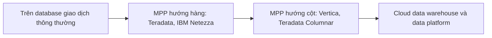
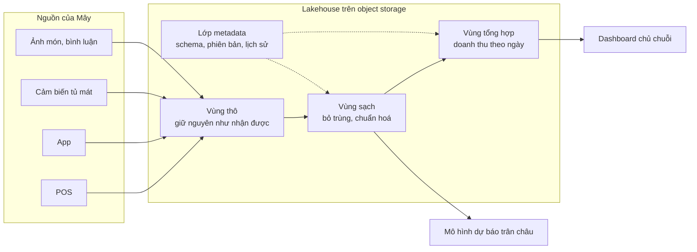
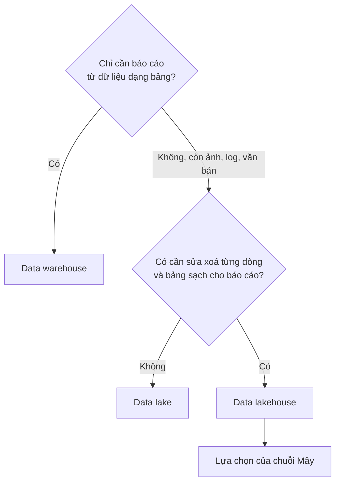
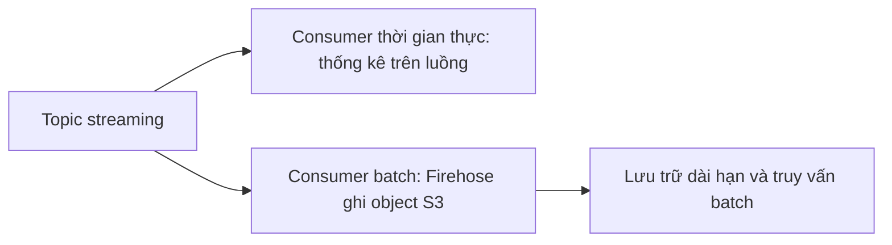

# Các trừu tượng lưu trữ: warehouse, lake, lakehouse

Nếu bài 2 và 3 nói về hệ thống lưu trữ (block, file, object, HDFS...), bài này đi lên tầng cao nhất: các **storage abstraction** (trừu tượng lưu trữ) — các mẫu tổ chức và truy vấn dữ liệu xây trên những hệ thống đó. Đây là những thứ kỹ sư dữ liệu chọn khi thiết kế pipeline cho khoa học dữ liệu, phân tích và báo cáo: data warehouse, data lake, data lakehouse, data platform, và kiến trúc stream-to-batch.

**Tương tự đơn giản:** data warehouse như một thư viện đã phân loại, đóng gáy ngăn nắp; data lake như một kho chứa mọi thứ thô; lakehouse là kho chứa thô nhưng có thủ thư và hệ thống mục lục như thư viện.

---

:::note[Ghi nhớ nhanh]

- ⭐ **Chọn trừu tượng dựa trên 4 câu hỏi:** mục đích/ca sử dụng, kiểu cập nhật (bulk, streaming insert, upsert), chi phí, và tách hay gộp compute với storage.
- ⭐ **Lakehouse = data lake + tính năng của warehouse** (schema, bảng, update/delete, lịch sử, rollback) trên object storage, với lợi thế **tương tác** nhờ định dạng file mở.
- Ranh giới giữa **cloud data warehouse** và **data lake** ngày càng mờ; tương lai có thể chỉ khác nhau về tên.
- **Data platform** là hệ sinh thái công cụ tích hợp chặt vào lớp lưu trữ lõi: tiện nhưng nguy cơ **vendor lock-in**.
- **Stream-to-batch**: dữ liệu streaming được ghi đồng thời cho consumer thời gian thực và consumer batch để lưu lâu dài.

:::

---

## Mục lục

- 1. Bốn câu hỏi khi chọn trừu tượng lưu trữ
- 2. Data warehouse
- 3. Data lake
- 4. Data lakehouse
- 5. Data platform
- 6. Kiến trúc stream-to-batch
- Tóm tắt

## 1. Bốn câu hỏi khi chọn trừu tượng lưu trữ

| Yếu tố | Câu hỏi cần trả lời |
|---|---|
| Mục đích và ca sử dụng | Lưu dữ liệu này để làm gì? |
| Kiểu cập nhật | Trừu tượng này tối ưu cho bulk update, streaming insert hay upsert? |
| Chi phí | Chi phí tài chính trực tiếp và gián tiếp? Thời gian ra giá trị (time to value)? Chi phí cơ hội? |
| Tách storage và compute | Xu hướng là tách, nhưng hầu hết hệ thống là lai giữa tách và gộp (mục "Hybrid separation and colocation" ở bài 5) |

Cần biết rằng việc tách storage khỏi compute ngày càng phổ biến làm ranh giới giữa **database OLAP** và **data lake** càng mờ. Các cloud data warehouse lớn và data lake đang "đâm vào nhau"; sau này khác biệt có thể chỉ còn trên danh nghĩa vì bên dưới chúng giống nhau cả về chức năng lẫn kỹ thuật.

### Thuật ngữ trong bài — hiểu nôm na

| Thuật ngữ | Nghĩa đời thường | Ví dụ ở chuỗi trà sữa Mây |
|---|---|---|
| Storage abstraction | "Cách tổ chức kho" mà người dùng nhìn thấy, che đi ổ đĩa và máy chủ bên dưới | Chủ chuỗi chỉ thấy "kho dữ liệu doanh thu" |
| Data warehouse | Siêu thị: hàng đã làm sạch, dán nhãn, xếp kệ theo ngành hàng | Bảng doanh thu sạch theo ngày, cửa hàng, món |
| Data lake | Bãi tập kết: hàng gì cũng đổ vào, chưa phân loại | File log tủ mát, ảnh món, bình luận khách, file Excel lương |
| Data lakehouse | Bãi tập kết có thêm quản lý kho, sổ sách và kệ cho phần hàng cần ngăn nắp | Vẫn giữ file thô, nhưng phần đơn hàng có bảng chuẩn, sửa/xoá được |
| Schema | Mẫu quy định cột và kiểu dữ liệu | Bảng doanh thu luôn có `ngay`, `cua_hang`, `doanh_thu` |
| Upsert | "Có thì sửa, chưa có thì thêm" | Đơn DH001 đã có thì cập nhật giá, chưa có thì thêm dòng mới |
| Metadata | Dữ liệu mô tả dữ liệu, như nhãn ghi trên thùng hàng | "File này gồm đơn ngày 01/03, 2.315 dòng, cập nhật lúc 23:00" |
| Rollback | Quay về phiên bản trước khi lỡ làm hỏng | Lỡ chạy sai bước làm sạch, quay bảng về trạng thái tối qua |
| Định dạng file mở | Định dạng ai cũng đọc được, không phụ thuộc một hãng | Parquet: công cụ BI và công cụ ML cùng đọc được |
| Vendor lock-in | Bị "trói" vào một nhà cung cấp, muốn đổi thì rất tốn | Mọi báo cáo viết riêng cho một hãng, chuyển hãng phải làm lại từ đầu |

### Áp vào chuỗi Mây: trả lời bốn câu hỏi

| Câu hỏi | Câu trả lời của Mây |
|---|---|
| Mục đích | Dashboard doanh thu mỗi sáng, dự báo nhu cầu trân châu, lưu ảnh món và bình luận khách cho marketing |
| Kiểu cập nhật | Đơn hàng đổ vào hằng giờ (thêm mới), thỉnh thoảng sửa đơn bị huỷ (upsert); log tủ mát đến liên tục (streaming) |
| Chi phí | Đội dữ liệu chỉ 2 người, ngân sách nhỏ: ưu tiên dịch vụ cloud trả theo mức dùng |
| Tách hay gộp compute và storage | Tách: dữ liệu nằm trên object storage, chỉ thuê sức tính khi chạy báo cáo |

## 2. Data warehouse

Data warehouse là kiến trúc dữ liệu **OLAP** tiêu chuẩn. Như ở Chương 3, thuật ngữ này chỉ: nền tảng công nghệ (như Google BigQuery, Teradata), kiến trúc tập trung hoá dữ liệu, và mẫu tổ chức trong công ty.

**Tiến hoá về lưu trữ:**

Trong thực tế, cloud data warehouse thường dùng để tổ chức dữ liệu thành **data lake** — vùng lưu lượng lớn dữ liệu thô chưa xử lý, theo ý tưởng gốc của James Dixon. Chúng xử lý được lượng lớn văn bản thô và tài liệu JSON phức tạp. **Giới hạn:** không xử lý được dữ liệu thực sự phi cấu trúc như ảnh, video, âm thanh (khác data lake thực thụ). Có thể kết hợp cloud data warehouse với object storage để có giải pháp data lake hoàn chỉnh.

## 3. Data lake

Data lake ban đầu được hình dung là kho lớn giữ dữ liệu ở dạng **thô, chưa xử lý**. Ban đầu xây chủ yếu trên Hadoop, nơi lưu trữ rẻ cho phép giữ khối lượng khổng lồ mà không tốn chi phí cho hệ MPP độc quyền.

Năm năm gần đây (tính tại thời điểm viết sách) có hai chuyển biến lớn:

1. **Chuyển sang tách compute khỏi storage:** rời Hadoop, hướng tới cloud object storage để giữ dữ liệu dài hạn.
2. **Nhận ra giá trị của tính năng MPP:** các kỹ sư thấy nhiều chức năng của hệ MPP (quản lý schema; update, merge, delete) — vốn bị bỏ qua trong cơn sốt data lake — thực ra rất hữu ích. Điều này dẫn tới ý tưởng **lakehouse**.

## 4. Data lakehouse

**Data lakehouse** là kiến trúc kết hợp các khía cạnh của data warehouse và data lake. Thường hiểu là: lưu dữ liệu trên object storage như lake, nhưng bổ sung các tính năng giúp quản lý dữ liệu dễ hơn và trải nghiệm kỹ thuật giống warehouse:

- Hỗ trợ bảng và schema vững chắc.
- Quản lý cập nhật tăng dần (incremental update) và xoá.
- Thường có **lịch sử bảng và rollback**, thực hiện bằng cách giữ các phiên bản cũ của file và metadata.

Một hệ lakehouse là một **lớp quản lý metadata và file** triển khai cùng công cụ quản lý và biến đổi dữ liệu. **Databricks** quảng bá mạnh khái niệm này với **Delta Lake** (hệ quản lý lưu trữ mã nguồn mở). Đối thủ mới nổi: **Apache Hudi** và **Apache Iceberg** (chi tiết ở Phụ lục A).

**Lưu ý của tác giả:** kiến trúc lakehouse tương tự kiến trúc của nhiều nền tảng dữ liệu thương mại như **BigQuery** và **Snowflake**: lưu dữ liệu trên object storage, có quản lý metadata tự động, lịch sử bảng, update/delete, và ẩn hoàn toàn độ phức tạp quản lý file bên dưới khỏi người dùng.

**Ưu điểm then chốt so với công cụ độc quyền: khả năng tương tác (interoperability).** Trao đổi dữ liệu giữa các công cụ dễ hơn nhiều khi dữ liệu ở **định dạng file mở**. Phải reserialize từ định dạng database độc quyền tốn chi phí xử lý, thời gian và tiền. Trong lakehouse, nhiều công cụ cùng kết nối lớp metadata và đọc trực tiếp từ object storage.

**Cũng cần nhấn mạnh:** nhiều dữ liệu trong lakehouse có thể không bị áp cấu trúc bảng. Ta chỉ áp tính năng kiểu warehouse ở nơi cần, phần còn lại để thô hoặc phi cấu trúc.

Công nghệ lakehouse đang phát triển rất nhanh.

### Ẩn dụ kho bãi: siêu thị, bãi tập kết và bãi có quản lý

Để thấy ba trừu tượng khác nhau ở đâu, hãy nhìn **cùng một dữ liệu** của Mây ở từng nơi. Đây là vài đơn hàng **thô** đổ vào data lake từ POS và app — trùng đơn, ngày ghi lộn xộn, thiếu giá:

| order_id | thoi_gian | cua_hang | mon | so_luong | gia | kenh |
|---|---|---|---|---|---|---|
| DH001 | 2026-03-01 08:15 | Q1-Lê Lợi | Trà sữa trân châu | 2 | 35000 | quầy |
| DH001 | 2026-03-01 08:15 | Q1-Lê Lợi | Trà sữa trân châu | 2 | 35000 | quầy |
| DH002 | 01/03/2026 8:20 AM | q3-vo van tan | Trà đào | 1 | 40000 | app |
| DH003 | 2026-03-01 08:22 | Q1-Lê Lợi | Trà đào | 1 | | quầy |

Trong **data warehouse**, dữ liệu chỉ được đưa vào sau khi đã làm sạch: bỏ dòng trùng, thống nhất định dạng ngày và tên cửa hàng, bù giá từ bảng menu.

| order_id | thoi_gian | cua_hang | mon | so_luong | gia | kenh |
|---|---|---|---|---|---|---|
| DH001 | 2026-03-01 08:15 | Q1-Lê Lợi | Trà sữa trân châu | 2 | 35000 | quầy |
| DH002 | 2026-03-01 08:20 | Q3-Võ Văn Tần | Trà đào | 1 | 40000 | app |
| DH003 | 2026-03-01 08:22 | Q1-Lê Lợi | Trà đào | 1 | 40000 | quầy |

Rồi tổng hợp thành bảng chủ chuỗi xem mỗi sáng:

| ngay | cua_hang | so_ly | doanh_thu |
|---|---|---|---|
| 2026-03-01 | Q1-Lê Lợi | 3 | 110000 |
| 2026-03-01 | Q3-Võ Văn Tần | 1 | 40000 |

**Lakehouse** giữ cả ba bảng trên cùng một kho object storage: bảng thô vẫn còn để tra lại khi nghi ngờ, bảng sạch và bảng tổng hợp có schema, sửa/xoá được, quay lại phiên bản cũ được. Ảnh món và bình luận khách nằm cạnh đó ở dạng thô.

Bảng so sánh dưới gom lại ba lựa chọn, kèm gợi ý cho Mây.

| Tiêu chí | Data warehouse | Data lake | Data lakehouse |
|---|---|---|---|
| Ẩn dụ | Siêu thị, hàng xếp kệ sẵn | Bãi tập kết, đổ gì cũng được | Bãi tập kết có quản lý kho và kệ |
| Dữ liệu chứa | Bảng có cấu trúc, đã sạch | Mọi thứ thô: bảng, JSON, ảnh, video | Cả hai |
| Áp schema lúc nào | Trước khi ghi vào | Lúc đọc ra dùng | Tuỳ vùng: thô thì lúc đọc, sạch thì lúc ghi |
| Sửa/xoá từng dòng | Dễ | Khó, phải ghi lại cả file | Dễ, nhờ lớp metadata |
| Ảnh, video, âm thanh | Không | Có | Có |
| Người dùng hợp | Phân tích viên, chủ chuỗi xem báo cáo | Nhà khoa học dữ liệu thích dữ liệu thô | Cả hai nhóm |
| Rủi ro | Đắt nếu nhồi mọi thứ vào | Thành "đầm lầy dữ liệu" không ai tìm được gì | Công nghệ còn mới, cần người hiểu |
| Ở chuỗi Mây | Đủ dùng nếu chỉ cần báo cáo doanh thu | Không nên dùng một mình vì kế toán cần số liệu sạch | **Hợp nhất**: vừa báo cáo, vừa giữ ảnh và log cho ML |

Sơ đồ quyết định dưới tóm lại cách Mây chọn.

## 5. Data platform

Ngày càng nhiều nhà cung cấp gọi sản phẩm của mình là **data platform**: họ dựng hệ sinh thái công cụ có thể tương tác, tích hợp chặt vào lớp lưu trữ dữ liệu lõi.

- Khi đánh giá nền tảng, kỹ sư phải bảo đảm các công cụ cung cấp đáp ứng nhu cầu. Công cụ không có sẵn trong nền tảng vẫn kết nối được nhưng có thêm chi phí trao đổi dữ liệu.
- Nền tảng cũng nhấn mạnh tích hợp chặt với object storage cho ca dữ liệu phi cấu trúc (như đã nói với cloud data warehouse).
- Thành thật mà nói, khái niệm data platform **chưa thật sự hoàn chỉnh**. Nhưng cuộc đua đã bắt đầu để tạo ra "khu vườn có tường bao" (walled garden) gồm các công cụ dữ liệu: vừa đơn giản hoá công việc kỹ thuật dữ liệu vừa tạo **vendor lock-in** đáng kể.

## 6. Kiến trúc stream-to-batch

Kiến trúc lưu trữ **stream-to-batch** có nhiều điểm tương đồng với **kiến trúc Lambda** (có thể tranh cãi chi tiết kỹ thuật). Về cơ bản: dữ liệu chảy qua một topic trong hệ lưu trữ streaming được ghi ra cho **nhiều consumer**.

- Một số consumer là hệ xử lý thời gian thực, tạo thống kê trên luồng.
- Một consumer **batch storage** ghi dữ liệu cho lưu trữ lâu dài và truy vấn batch. Ví dụ AWS Kinesis Firehose có thể tạo object S3 theo trigger cấu hình được (thời gian, kích thước batch).
- Các hệ như BigQuery nhập dữ liệu streaming vào một **streaming buffer**, sau đó tự động reserialize thành object storage dạng cột. Query engine truy vấn liền mạch cả streaming buffer lẫn dữ liệu object, cho người dùng góc nhìn hiện hành, gần thời gian thực của bảng.

### Áp vào chuỗi Mây: một luồng tủ mát, hai cách dùng

Chỉ số nhiệt độ từ 30 tủ mát chảy vào một topic. Cùng dòng dữ liệu đó phục vụ hai nhu cầu rất khác nhau — đó chính là ý của stream-to-batch.

| | Consumer thời gian thực | Consumer batch |
|---|---|---|
| Làm gì | Thấy tủ nào trên 8°C quá 10 phút thì nhắn quản lý cửa hàng | Gom chỉ số mỗi giờ thành một file, ghi vào object storage |
| Cần nhanh đến đâu | Vài giây | Chậm một giờ cũng được |
| Ai dùng | Quản lý cửa hàng | Nhà khoa học dữ liệu tìm tủ sắp hỏng, kế toán tính hao hụt sữa |
| Giữ dữ liệu bao lâu | Vài phút gần nhất | Nhiều năm |

## Tóm tắt

| Trừu tượng | Đặc trưng | Lưu ý |
|---|---|---|
| Data warehouse | OLAP chuẩn; từ RDBMS, MPP hàng, MPP cột đến cloud | Không xử lý được dữ liệu phi cấu trúc thực sự (ảnh, video, âm thanh) |
| Data lake | Kho dữ liệu thô; từ Hadoop sang object storage | Thiếu schema, update/delete nếu không có lớp quản lý |
| Data lakehouse | Lake trên object storage + bảng, schema, update/delete, lịch sử, rollback | Mạnh về interoperability; Delta Lake, Hudi, Iceberg |
| Data platform | Hệ sinh thái tích hợp quanh lớp lưu trữ | Tiện nhưng có nguy cơ vendor lock-in |
| Stream-to-batch | Một topic ghi cho cả consumer thời gian thực và batch | Tương tự Lambda; BigQuery có streaming buffer |
