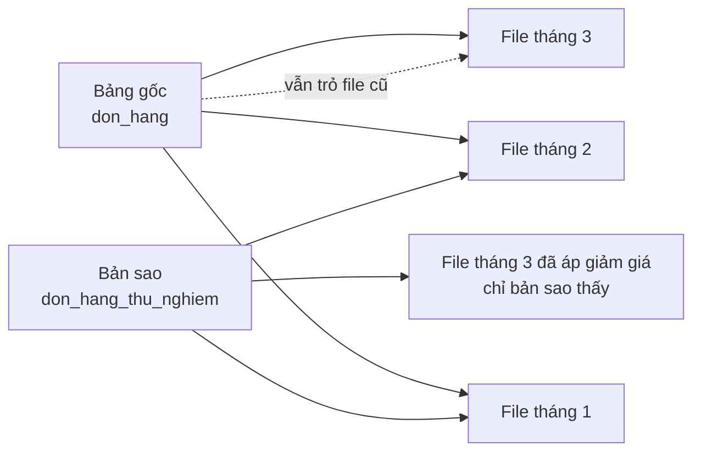

# Big ideas, xu hướng và undercurrents của lưu trữ

Bài cuối của chương gom các **ý tưởng lớn và xu hướng** cần ghi nhớ khi xây kiến trúc lưu trữ: data catalog, data sharing, schema, tách compute khỏi storage, zero-copy cloning, vòng đời và lưu giữ dữ liệu, single-tenant so với multitenant. Sau đó là phần làm việc với ai, các **undercurrents** áp dụng cho lưu trữ, và kết luận chương.

**Tương tự đơn giản:** nếu bài 1–4 là kho hàng và kệ hàng, bài này là sổ quản lý kho: ai được lấy gì, hàng nào để ngoài cửa (nóng), hàng nào cất xuống hầm (lạnh), cất bao lâu thì bỏ, và các khách thuê chung hay riêng kho.

---

:::note[Ghi nhớ nhanh]

- ⭐ **Tách compute khỏi storage** là mô hình chuẩn của kỷ nguyên cloud: dùng object storage làm nơi lưu và cụm compute tạm thời để xử lý; thực tế luôn **lai** (multitier caching, hybrid object storage).
- ⭐ **Hot / warm / cold**: dữ liệu nóng nằm ở nơi nhanh và đắt, lạnh nằm ở nơi rẻ nhưng truy xuất đắt/chậm; dùng **lifecycle policy** để tự động chuyển tầng.
- **Data retention** cần cân nhắc giá trị, thời gian, tuân thủ, chi phí.
- **Schema on write** (ép chuẩn từ lúc ghi) so với **schema on read** (linh hoạt nhưng khó dùng về sau).
- **Zero-copy cloning** tạo bản sao "ảo" bằng con trỏ; cẩn thận khi xoá file gốc.
- Undercurrents: ít đặc quyền (least privilege), metadata/catalog/lineage, privacy (GDPR), monitoring, FinOps, ưu tiên hệ managed.

:::

---

## Mục lục

- 1. Data catalog
- 2. Data sharing
- 3. Schema
- 4. Tách compute khỏi storage
- 5. Zero-copy cloning
- 6. Vòng đời lưu trữ và lưu giữ dữ liệu
- 7. Single-tenant so với multitenant
- 8. Làm việc với ai
- 9. Undercurrents
- 10. Kết luận
- Tóm tắt

## 1. Data catalog

**Data catalog** là kho metadata tập trung cho toàn bộ dữ liệu trong tổ chức. Nói chặt chẽ, nó không phải trừu tượng lưu trữ cấp cao nhất nhưng tích hợp với nhiều hệ thống và trừu tượng. Thường bao phủ cả nguồn dữ liệu vận hành lẫn phân tích, tích hợp **data lineage** (dòng dõi dữ liệu) và hiển thị quan hệ giữa dữ liệu, cho phép người dùng chỉnh sửa mô tả dữ liệu. Là nơi trung tâm để mọi người xem dữ liệu, truy vấn và lưu trữ. Kỹ sư dữ liệu thường chịu trách nhiệm thiết lập và duy trì các tích hợp giữa pipeline/hệ lưu trữ với catalog, cũng như tính toàn vẹn của catalog.

Các thành phần:

- **Catalog application integration:** lý tưởng nhất, ứng dụng dữ liệu được thiết kế để gọi API catalog xử lý metadata và cập nhật trực tiếp. Catalog càng được dùng rộng trong tổ chức thì càng tiến gần lý tưởng này.
- **Automated scanning:** thực tế thường cần lớp quét tự động thu thập metadata từ data lake, warehouse, database vận hành. Có thể thu metadata sẵn có và suy luận thêm (quan hệ khoá, sự hiện diện dữ liệu nhạy cảm).
- **Data portal và social layer:** giao diện web để tìm dữ liệu và xem quan hệ. Lớp xã hội kiểu wiki cho phép người dùng mô tả dataset, hỏi người khác, đăng cập nhật.

**Ca sử dụng:** về kỹ thuật, cấp metadata cho hệ thống (ví dụ catalog là thành phần chủ chốt của lakehouse, cho phép khám phá bảng khi truy vấn). Về tổ chức, giúp người dùng nghiệp vụ, analyst, data scientist, kỹ sư tìm dữ liệu để trả lời câu hỏi, và hợp lý hoá giao tiếp, cộng tác giữa các nhóm.

### Thuật ngữ trong bài — hiểu nôm na

| Thuật ngữ | Nghĩa đời thường | Ví dụ ở chuỗi trà sữa Mây |
|---|---|---|
| Data catalog | Sổ danh mục kho: hàng gì, để đâu, ai phụ trách | Tra "doanh thu theo ngày" ra ngay bảng nào, ai làm |
| Metadata | Nhãn dán trên thùng hàng | "Bảng này cập nhật lúc 6h sáng, đơn vị là đồng" |
| Data lineage (dòng dõi dữ liệu) | Gia phả của một con số: nó được tính từ đâu | Doanh thu trên dashboard ← bảng sạch ← đơn POS và đơn app |
| Data sharing | Cho người khác xem một phần kho mà không phải gửi bản sao | Cho đối tác app giao hàng xem đơn của họ |
| Zero-copy cloning | Photo "ảo" một bảng: chỉ ghi chú "dùng chung dữ liệu với bảng gốc" | Tạo bảng thử nghiệm từ bảng đơn hàng trong 1 giây |
| Hot / warm / cold | Hàng hay lấy để ở kệ trước, ít lấy để kho sau, gần như không lấy để kho ngoại ô | Đơn tuần này / đơn năm ngoái / hoá đơn 7 năm trước |
| Data retention | Quy định giữ dữ liệu bao lâu rồi bỏ | Giữ log tủ mát 2 năm, hoá đơn 10 năm |
| TTL (time to live) | "Hạn sử dụng" gắn lên dữ liệu, hết hạn tự xoá | Cache doanh thu hôm nay hết hạn sau 5 phút |
| Tenant | Một "khách thuê" dùng chung hạ tầng | Mỗi đối tác nhượng quyền thương hiệu Mây |
| Least privilege | Chỉ đưa chìa khoá đúng phòng cần vào | Quản lý cửa hàng chỉ xem được số liệu cửa hàng mình |
| FinOps | Quản lý hoá đơn cloud như quản lý chi phí nguyên liệu | Theo dõi tiền lưu trữ và tiền chạy truy vấn mỗi tháng |

### Áp vào chuỗi Mây: một mục trong data catalog

Khi nhà khoa học dữ liệu mới vào Mây hỏi "dữ liệu bán hàng ở đâu?", thay vì đi hỏi từng người, họ tra catalog. Một mục trong catalog trông như sau:

| Trường | Nội dung |
|---|---|
| Tên bảng | `doanh_thu_ngay` |
| Mô tả | Doanh thu và số ly theo ngày, theo cửa hàng, gồm cả quầy và app |
| Cột | `ngay` (ngày), `cua_hang` (chữ), `so_ly` (số nguyên), `doanh_thu` (đồng) |
| Cập nhật | Mỗi ngày lúc 6h sáng |
| Phụ trách | Đội dữ liệu |
| Lineage | Tính từ `don_hang_sach`, vốn lấy từ DB của POS và API app giao hàng |
| Nhạy cảm | Không chứa thông tin cá nhân khách |
| Ghi chú của người dùng | "Đơn huỷ đã bị loại, đừng cộng lại" — Kế toán |

## 2. Data sharing

**Data sharing** cho phép tổ chức và cá nhân chia sẻ dữ liệu cụ thể với các thực thể cụ thể, kèm quyền được định nghĩa cẩn thận. Trong nội bộ: data scientist chia sẻ dữ liệu từ sandbox cho cộng sự. Giữa tổ chức: hỗ trợ cộng tác giữa đối tác (ví dụ công ty ad tech chia sẻ dữ liệu quảng cáo cho khách hàng).

Môi trường cloud multitenant làm cộng tác liên tổ chức dễ hơn nhiều nhưng sinh thách thức bảo mật mới: phải kiểm soát chặt chính sách ai được chia sẻ dữ liệu với ai để tránh lộ vô ý hoặc đánh cắp có chủ đích (exfiltration). Data sharing là tính năng lõi của nhiều nền tảng dữ liệu cloud (xem Chương 5).

## 3. Schema

Dữ liệu có hình dạng ra sao? Định dạng file gì? Có cấu trúc, bán cấu trúc hay phi cấu trúc? Kiểu dữ liệu nào? Nằm trong hệ phân cấp nào? Có liên kết với dữ liệu khác qua khoá chung hay quan hệ khác không?

**Schema không nhất thiết là quan hệ.** Càng biết nhiều về cấu trúc và tổ chức của dữ liệu thì dữ liệu càng hữu dụng. Với ảnh trong data lake, thông tin schema có thể là định dạng ảnh, độ phân giải, và vị trí của ảnh trong phân cấp lớn hơn. Schema như một "Rosetta stone": hướng dẫn cách đọc dữ liệu. Có hai mẫu chính:

| Mẫu | Mô tả | Ưu | Nhược |
|---|---|---|---|
| **Schema on write** | Mẫu data warehouse truyền thống: bảng có schema tích hợp, mọi lần ghi phải tuân thủ. Data lake muốn hỗ trợ cần có schema metastore | Ép chuẩn dữ liệu, sau này dễ dùng hơn | Kém linh hoạt |
| **Schema on read** | Không ép schema lúc ghi (dữ liệu đến sao ghi vậy); người đọc phải tự xác định schema khi đọc | Linh hoạt: ghi gần như mọi dữ liệu | Khó tiêu thụ dữ liệu hơn về sau |

Với schema on read, lý tưởng là dùng định dạng file có thông tin schema tích hợp như **Parquet** hoặc **JSON**. **CSV** nổi tiếng không nhất quán về schema và không được khuyến nghị trong bối cảnh này.

### Áp vào chuỗi Mây: schema on write và schema on read với file lương

Mỗi tháng, 30 cửa hàng gửi file Excel chấm công. Mỗi nơi đặt tên cột một kiểu:

| Cửa hàng | Các cột trong file gửi lên |
|---|---|
| Q1-Lê Lợi | `Họ tên`, `Số giờ`, `Tháng` |
| Q3-Võ Văn Tần | `Nhân viên`, `Giờ làm`, `Thang` |
| Q7 | `ten_nv`, `gio`, `thang`, `ghi_chu` |

Hai cách xử lý cho kết quả khác nhau:

| | Schema on write | Schema on read |
|---|---|---|
| Lúc nhận file | Bắt buộc khớp mẫu `ho_ten`, `so_gio`, `thang`; file sai mẫu bị trả lại cho cửa hàng | Nhận hết, cất nguyên trạng vào data lake |
| Ai vất vả | Cửa hàng phải sửa file trước khi gửi | Kế toán, người đọc dữ liệu, phải tự đoán `gio` với `Giờ làm` là một |
| Cuối tháng tính lương | Chạy ngay, số liệu đồng nhất | Phải viết bước "ánh xạ tên cột" cho từng cửa hàng, dễ sót |
| Thêm cột mới (`ghi_chu`) | Phải sửa mẫu chung trước | Cứ thế thêm, không ai cản |
| Ở Mây nên chọn | **Có** cho dữ liệu lương vì cần chính xác | Hợp cho bình luận khách, ảnh món, nơi cấu trúc thay đổi liên tục |

## 4. Tách compute khỏi storage

Một ý tưởng xuyên suốt cuốn sách và đã thành mô hình chuẩn truy cập/truy vấn dữ liệu trong kỷ nguyên cloud. Data lake lưu dữ liệu trên object store và bật năng lực tính toán tạm thời để đọc, xử lý. Hầu hết sản phẩm OLAP managed nay dựa vào object storage phía sau. Để hiểu động cơ tách, trước hết nhìn sự gộp.

### 4.1. Colocation (gộp compute và storage)

Từ lâu là cách chuẩn tăng hiệu năng database. Với database giao dịch, dữ liệu đặt cạnh compute cho đọc đĩa nhanh, độ trễ thấp, băng thông cao (ngay cả khi ảo hoá như EBS, dữ liệu vẫn tương đối gần host).

Hệ truy vấn phân tích trên cụm nhiều máy cũng vậy. Với HDFS và MapReduce, cách chuẩn là xác định vị trí các block cần quét trong cluster rồi đẩy từng job map tới các block đó; quét và xử lý ở bước map hoàn toàn cục bộ. Bước reduce cần xáo trộn (shuffle) dữ liệu qua cluster; giữ bước map cục bộ giữ lại nhiều băng thông cho shuffle, và các bước map lọc mạnh giảm đáng kể lượng dữ liệu phải shuffle.

### 4.2. Vì sao vẫn tách?

- **Tính ephemeral và khả năng mở rộng.** Mua và tự đặt server rẻ hơn thuê cloud, *nếu* chạy 24/7 liên tục nhiều năm. Thực tế tải biến động mạnh nên mô hình trả theo dùng (pay-as-you-go) có hiệu quả lớn nếu server co giãn lên xuống. Đúng cho web server bán lẻ trực tuyến, và cho cả job batch big data chỉ chạy định kỳ. Compute tạm thời cho phép bật cluster khổng lồ để hoàn thành job đúng hạn rồi xoá; lợi ích hiệu năng của việc chạy tạm thời ở quy mô cực lớn có thể vượt giới hạn băng thông của object storage.
- **Độ bền và sẵn sàng của dữ liệu.** Object store cloud giảm mạnh rủi ro mất dữ liệu và thường có uptime cực cao. Ví dụ S3 lưu qua nhiều zone; thiên tai phá một zone thì dữ liệu vẫn còn ở zone khác; sự cố một zone cũng có thể dựng lại tài nguyên ở zone khác. Rủi ro cấu hình sai làm mất dữ liệu vẫn đáng sợ, nhưng có giảm thiểu đơn giản: sao chép dữ liệu sang nhiều region (vì thay đổi cấu hình thường chỉ triển khai từng region một), hoặc nhân bản sang nhiều nhà cung cấp lưu trữ.

### 4.3. Lai giữa tách và gộp (hybrid)

Thực tế phức tạp hơn: luôn **lai** để có lợi ích của cả hai, thường theo hai cách: **multitier caching** (dùng object storage cho lưu giữ và truy cập dài hạn, nhưng dựng lưu trữ cục bộ dùng trong truy vấn và các giai đoạn pipeline) và **hybrid object storage** (object storage tích hợp chặt với compute; Google và Amazon đều có phiên bản).

| Ví dụ | Cách lai |
|---|---|
| **AWS EMR với S3 và HDFS** | Bật cụm HDFS tạm thời trên SSD, kéo dữ liệu từ S3, lưu kết quả trung gian trên HDFS cục bộ, nhanh hơn nhiều so với xử lý trực tiếp từ S3. Xong thì ghi kết quả đầy đủ về S3, xoá cluster và HDFS; consumer khác đọc đầu ra từ S3 |
| **Apache Spark** | Thường chạy job trên HDFS hoặc hệ file phân tán tạm thời để lưu dữ liệu giữa các bước; còn dựa mạnh vào lưu trong bộ nhớ. Tự sở hữu hạ tầng thì DRAM rất đắt; tách compute/storage trên cloud cho phép thuê lượng lớn bộ nhớ rồi trả lại khi job xong |
| **Apache Druid** | Dựa mạnh vào SSD để có hiệu năng cao. SSD đắt hơn đĩa từ nên Druid chỉ giữ **một bản** dữ liệu trong cluster, giảm chi phí lưu "sống" 3 lần; độ bền do object store đảm nhận. Dữ liệu nhập vào được xử lý, serialize thành cột nén, ghi lên SSD cluster và object storage; node hỏng hoặc hỏng dữ liệu thì tự khôi phục sang node mới |
| **Hybrid object storage** | Hệ file Colossus của Google cho kiểm soát chi tiết vị trí block dữ liệu (không phơi bày trực tiếp cho công chúng); BigQuery dùng để đặt các bảng khách hàng cùng một chỗ, cho băng thông truy vấn cực cao. Amazon có khái niệm tương tự qua **S3 Select**, lọc dữ liệu S3 ngay trên cluster S3 trước khi trả qua mạng |

Tác giả đoán các public cloud sẽ áp dụng hybrid object storage rộng rãi hơn. Khái niệm này nhấn mạnh rằng việc có quyền truy cập mức thấp vào phần cứng vẫn có lợi thế so với phụ thuộc public cloud của người khác (xem Chương 4). Họ cũng cho rằng nhiều nhà cung cấp dịch vụ dữ liệu siêu lớn hiện chạy trên cloud của hãng khác có thể sẽ tự xây data center sau này, nhưng tích hợp mạng sâu với public cloud.

## 5. Zero-copy cloning

Hệ thống cloud dựa trên object storage hỗ trợ **zero-copy cloning**: tạo một bản sao **ảo** mới của đối tượng (ví dụ một bảng mới) mà không cần sao chép vật lý dữ liệu bên dưới. Thực chất tạo con trỏ mới tới các file dữ liệu thô; thay đổi sau này ở bản sao không ghi vào bảng cũ. Giống bản sao "nông" (shallow copy) trong Python.

Tính năng hấp dẫn nhưng phải hiểu điểm mạnh và giới hạn:

- Trong môi trường data lake, nhân bản một đối tượng rồi xoá file của bản gốc có thể **xoá luôn bản sao mới**.
- Với hệ managed hoàn toàn dựa trên object store (Snowflake, BigQuery), cần biết chính xác giới hạn của shallow copy.
- Với hệ data lake như Databricks, kỹ sư có quyền truy cập object storage bên dưới nhiều hơn — vừa là phước vừa là hoạ. Hãy cực kỳ thận trọng trước khi xoá file thô trong object store nền.
- Databricks và các công nghệ quản lý data lake khác đôi khi hỗ trợ **deep copy** (sao chép toàn bộ object dữ liệu bên dưới): đắt hơn nhưng bền vững hơn khi file bị mất hoặc xoá ngoài ý muốn.

### Áp vào chuỗi Mây: bản sao "ảo" để thử khuyến mãi

Marketing muốn thử công thức "giảm 10% cho đơn trên 100.000 đồng" trên dữ liệu đơn hàng năm ngoái mà không đụng bảng thật. Kỹ sư dùng zero-copy cloning tạo bảng `don_hang_thu_nghiem`. Sơ đồ dưới cho thấy hai bảng **dùng chung** file dữ liệu; chỉ phần bị sửa mới sinh file riêng.

| | Bảng gốc | Bản sao zero-copy |
|---|---|---|
| Tạo mất bao lâu | — | Vài giây, không chép dữ liệu |
| Tốn thêm dung lượng | — | Chỉ phần bị sửa (file tháng 3 mới) |
| Nếu ai đó xoá thẳng "File tháng 1" trong object storage | Mất dữ liệu tháng 1 | **Cũng mất** tháng 1 — đây là cái bẫy sách cảnh báo |

## 6. Vòng đời lưu trữ và lưu giữ dữ liệu

Lưu dữ liệu không đơn giản là ghi vào object storage hay đĩa rồi quên. Phải nghĩ tới **data storage lifecycle** ("dữ liệu quan trọng với người dùng hạ nguồn thế nào, họ cần truy cập bao nhiêu lần?") và **data retention** ("giữ dữ liệu này bao lâu? vô thời hạn hay bỏ sau một mốc?").

### 6.1. Dữ liệu nóng, ấm, lạnh (hot, warm, cold)

Dữ liệu có "nhiệt độ" tuỳ tần suất truy cập. Thường dữ liệu mới được truy vấn nhiều hơn dữ liệu cũ.

| Mức | Truy cập | Hạ tầng | Chi phí |
|---|---|---|---|
| **Hot** | Tức thì hoặc thường xuyên | SSD, bộ nhớ | Lưu đắt nhất, truy xuất thường rẻ. Ví dụ gợi ý sản phẩm, kết quả trang sản phẩm, **query results cache** (engine lưu kết quả truy vấn, chạy lại cùng truy vấn thì trả từ cache thay vì quét lại) |
| **Warm** | Bán thường xuyên, ví dụ mỗi tháng một lần | Tầng object storage cho dữ liệu ấm: S3 Infrequent Access, Google Cloud Nearline | Lưu rẻ hơn hot, truy xuất hơi đắt hơn |
| **Cold** | Hiếm khi | Rẻ và bền: HDD, băng từ, hệ archive trên cloud. Mục đích lưu trữ dài hạn, gần như không có ý định truy cập | Lưu rẻ, truy xuất thường đắt |

**Cân nhắc khi chọn tầng:** để mọi thứ ở hot thì truy cập nhanh nhưng giá cắt cổ; để hết ở cold thì rẻ nhưng truy xuất chậm và tốn kém khi cần. Giá lưu giảm dần từ lưu trữ nhanh/hiệu năng cao xuống lưu trữ chậm. Trước đây cold storage là bản sao lưu vật lý gửi cho bên thứ ba cất trong kho; nay cold storage trên cloud rất phổ biến, mọi nhà cung cấp đều có, nên cần cân nhắc chi phí đẩy dữ liệu vào so với chi phí và thời gian lấy ra.

**Spillover (tràn):** bộ nhớ đắt và hữu hạn; dữ liệu nóng trong bộ nhớ có thể bị tràn xuống đĩa khi dữ liệu mới quá nhiều. Một số database chuyển dữ liệu ít truy cập sang tầng ấm/lạnh (HDD hoặc object storage — ngày càng phổ biến vì object storage tiết kiệm). Dùng dịch vụ managed trên cloud thì spillover tự động.

**Lời khuyên:** với object storage cloud hãy tạo **lifecycle policy tự động**. Ví dụ chỉ cần truy cập mỗi tháng một lần thì chuyển sang tầng infrequent access; dữ liệu 180 ngày tuổi mà truy vấn hiện tại không dùng thì chuyển sang tầng archive. Nhưng nhớ cân nhắc chi phí và thời gian truy xuất; một số nhà cung cấp làm cho việc đưa vào archive rất dễ và rẻ nhưng lấy ra lại chậm và đắt.

### 6.2. Data retention

Thuở đầu big data có xu hướng tích trữ mọi dữ liệu có thể, bất kể hữu ích hay không ("biết đâu sau này cần"). Việc tích trữ này tất yếu trở nên cồng kềnh và bẩn, sinh ra **data swamp** (đầm lầy dữ liệu) và các biện pháp siết quy định về lưu giữ dữ liệu. Nay kỹ sư phải cân nhắc: cần giữ dữ liệu nào và giữ bao lâu? Bốn yếu tố:

- **Giá trị (value):** dữ liệu là tài sản; giá trị mang tính chủ quan, tuỳ ca sử dụng trước mắt và tổ chức rộng hơn. Dữ liệu này không thể tái tạo hay dễ tạo lại bằng cách truy vấn hệ thượng nguồn? Tác động tới người dùng hạ nguồn nếu có hoặc không có nó?
- **Thời gian (time):** dữ liệu mới thường giá trị hơn và truy cập nhiều hơn. Giới hạn kỹ thuật có thể quy định thời gian lưu ở một tầng. Ví dụ dữ liệu nóng ở cache/bộ nhớ thường phải đặt **TTL (time to live)** để hết hạn sau một mốc hoặc chuyển sang tầng ấm/lạnh; nếu không tầng nóng đầy và truy vấn bị chậm.
- **Tuân thủ (compliance):** một số quy định (ví dụ HIPAA, PCI) yêu cầu giữ dữ liệu trong một thời gian, phải truy cập được khi được yêu cầu dù khả năng bị yêu cầu thấp. Quy định khác chỉ cho giữ trong thời hạn giới hạn và cần khả năng xoá thông tin cụ thể đúng hạn. Cần quy trình lưu trữ/archive cùng khả năng tìm kiếm dữ liệu phù hợp. Dĩ nhiên phải cân bằng tuân thủ với chi phí.
- **Chi phí (cost):** dữ liệu là tài sản (hy vọng) có ROI; phía chi phí có chi phí lưu trữ. Dùng quản lý vòng đời tự động, chuyển dữ liệu sang cold storage khi không cần sau ngày hết hạn giữ, hoặc xoá hẳn nếu thật sự không cần.

### Áp vào chuỗi Mây: nhiệt độ và hạn giữ của từng loại dữ liệu

Bảng dưới áp hai ý tưởng "nhiệt độ dữ liệu" và "data retention" vào kho của Mây. (Hành trình chuyển tầng tự động của một file đơn hàng đã được vẽ ở [bài trước](./3_object-storage-hdfs-streaming-va-index.md).)

| Dữ liệu ở Mây | Nhiệt độ | Để ở đâu | Giữ bao lâu | Vì sao giữ như vậy |
|---|---|---|---|---|
| Doanh thu hôm nay trên dashboard | Hot | Cache trong bộ nhớ, TTL 5 phút | Vài phút | Chủ chuỗi mở liên tục, số liệu tự làm mới |
| Đơn hàng 3 tháng gần nhất | Hot | Kho dữ liệu, object storage hạng thường | Sau 90 ngày chuyển xuống warm | Dùng hằng ngày cho báo cáo, dự báo |
| Đơn hàng 3 tháng – 1 năm | Warm | Object storage hạng truy cập không thường xuyên | Sau 1 năm chuyển xuống cold | So sánh cùng kỳ, báo cáo quý |
| Hoá đơn trên 1 năm | Cold | Lưu trữ archive | Theo luật kế toán, thuế | **Tuân thủ**: phải xuất trình được khi thanh tra |
| Log tủ mát chi tiết từng phút | Warm rồi cold | Object storage | 2 năm, sau đó chỉ giữ bản tổng hợp theo giờ | **Giá trị** giảm nhanh theo thời gian, **chi phí** tăng đều |
| Số điện thoại khách đã yêu cầu xoá tài khoản | — | — | Xoá khi khách yêu cầu | **Riêng tư**: luật bảo vệ dữ liệu cá nhân |

## 7. Single-tenant so với multitenant

Chương 3 đã nói đánh đổi giữa kiến trúc single-tenant và multitenant. Tóm tắt: **single-tenant** cho mỗi nhóm tenant (người dùng, nhóm người dùng, tài khoản, khách hàng) một bộ tài nguyên riêng (mạng, compute, lưu trữ); **multitenant** thì chia sẻ tài nguyên cho các nhóm.

- **Single-tenant storage:** mỗi tenant có lưu trữ riêng, ví dụ mỗi tenant một database; không chia sẻ dữ liệu, cô lập hoàn toàn. Dùng khi dữ liệu mỗi khách hàng phải cô lập và không được trộn với khách khác. Schema, cấu trúc bucket... đều tách biệt độc lập, nên có thể thiết kế môi trường lưu trữ mỗi tenant đồng nhất hoặc để mỗi cái tiến hoá riêng. Khác biệt schema giữa khách hàng vừa là lợi thế vừa gây phức tạp: nếu schema các tenant không đồng nhất thì việc truy vấn nhiều bảng tenant để tạo góc nhìn hợp nhất sẽ có hệ quả lớn.
- **Multitenant storage:** nhiều tenant trong cùng một database; ví dụ nhiều khách hàng nằm chung schema hoặc bảng. Dữ liệu mọi tenant lưu cùng chỗ.

Cần biết cách truy vấn cả hai (Chương 8 sẽ bàn kỹ).

## 8. Làm việc với ai

Lưu trữ nằm ở trung tâm hạ tầng kỹ thuật dữ liệu. Bạn sẽ tương tác với những người sở hữu hạ tầng CNTT: thường là **DevOps, bảo mật, kiến trúc sư cloud**. Cần xác định rõ phạm vi trách nhiệm giữa kỹ thuật dữ liệu và các nhóm khác: kỹ sư dữ liệu có quyền tự triển khai hạ tầng trong tài khoản AWS không, hay nhóm khác phải làm? Hãy cùng xây quy trình gọn để các nhóm phối hợp nhanh.

Phân chia trách nhiệm phụ thuộc **độ trưởng thành dữ liệu** của tổ chức: công ty còn sớm thì kỹ sư dữ liệu có thể quản lý toàn bộ hệ lưu trữ và workflow; công ty trưởng thành hơn thì chỉ quản lý một phần, và tương tác với kỹ sư ở hai phía của lưu trữ (ingestion và transformation).

Kỹ sư dữ liệu cần đảm bảo hệ lưu trữ mà người dùng hạ nguồn dùng: **sẵn sàng một cách an toàn, chứa dữ liệu chất lượng cao, đủ dung lượng, và hoạt động tốt** khi chạy truy vấn và biến đổi.

## 9. Undercurrents

Undercurrents của lưu trữ đặc biệt quan trọng vì lưu trữ là trung tâm của mọi giai đoạn trong vòng đời.

### 9.1. Security

Đừng coi bảo mật là vật cản; hãy coi là **yếu tố cho phép**. Bảo mật vững (khi lưu và khi truyền) cùng kiểm soát truy cập dữ liệu chi tiết cho phép chia sẻ và tiêu thụ dữ liệu rộng hơn trong doanh nghiệp, giá trị dữ liệu tăng mạnh. Luôn áp dụng **nguyên tắc ít đặc quyền** (least privilege): đừng cấp toàn quyền database cho ai trừ khi cần; thực tế đa số kỹ sư dữ liệu không cần toàn quyền. Chú ý kiểm soát truy cập mức cột, hàng và ô: chỉ cho người dùng thấy đúng thông tin họ cần.

### 9.2. Data management

- **Data catalog và metadata:** metadata vững làm dữ liệu giá trị hơn. Catalog giúp data scientist, analyst, kỹ sư ML khám phá dữ liệu. **Data lineage** rút ngắn thời gian truy tìm sự cố dữ liệu và cho người dùng thấy nguồn thô thượng nguồn. Hãy đầu tư vào metadata; tích hợp data dictionary với các công cụ này cho phép ghi nhận và chia sẻ tri thức tổ chức một cách bền vững. Metadata còn tăng cường data governance: ngoài catalog và lineage thụ động, nên triển khai phân tích trên các hệ thống này để có bức tranh chủ động về dữ liệu.
- **Data versioning trong object storage:** các object storage cloud lớn bật được versioning, hỗ trợ phục hồi lỗi khi tiến trình hỏng làm dữ liệu hỏng, và theo dõi lịch sử dataset dùng để huấn luyện mô hình. Như version control mã nguồn giúp lần ra commit gây lỗi, version control dữ liệu giúp kỹ sư ML lần ra thay đổi làm giảm hiệu năng mô hình.
- **Privacy:** GDPR và các luật riêng tư khác đã ảnh hưởng lớn đến thiết kế hệ lưu trữ. Dữ liệu có hàm ý riêng tư có vòng đời mà kỹ sư phải quản lý; phải sẵn sàng đáp ứng yêu cầu xoá và chọn lọc loại bỏ dữ liệu. Có thể đáp ứng riêng tư và bảo mật bằng **anonymization** (ẩn danh hoá) và **masking** (che dữ liệu).

### 9.3. DataOps

DataOps liên quan quản lý dữ liệu, có phần chồng lấn đáng kể. Gồm giám sát vận hành truyền thống của hệ lưu trữ và giám sát chính dữ liệu (không tách rời metadata và chất lượng).

- **Giám sát hệ thống:** giám sát thành phần hạ tầng lưu trữ (nếu có), cả object storage và hệ "serverless". Kỹ sư dữ liệu nên dẫn đầu ở **FinOps** (quản lý chi phí), giám sát bảo mật và giám sát truy cập.
- **Quan sát và giám sát dữ liệu:** metadata quan trọng, nhưng kỹ thuật tốt phải tính tới bản chất **entropy** (xu hướng hỗn loạn) của dữ liệu: chủ động tìm hiểu đặc điểm dữ liệu và theo dõi thay đổi lớn. Có thể theo dõi thống kê dữ liệu, dùng phát hiện bất thường hoặc luật đơn giản, chủ động kiểm thử và xác thực các mâu thuẫn logic.

### 9.4. Data architecture

Chương 3 nói kiến trúc dữ liệu cơ bản; lưu trữ là "phần bụng" quan trọng của vòng đời. Một số lời khuyên:

- Thiết kế theo độ tin cậy và độ bền cần thiết.
- Hiểu hệ thống nguồn thượng nguồn và dữ liệu sau khi nhập sẽ được lưu, truy cập thế nào.
- Hiểu các loại mô hình dữ liệu và truy vấn sẽ xảy ra ở hạ nguồn.
- Nếu dữ liệu dự kiến tăng, có thể thương lượng giá lưu trữ với nhà cung cấp cloud không? Chủ động với **FinOps**, coi nó là phần trung tâm của các cuộc thảo luận kiến trúc. Đừng tối ưu hoá sớm, nhưng chuẩn bị cho quy mô lớn nếu có cơ hội kinh doanh khi vận hành trên khối lượng dữ liệu lớn.
- Nghiêng về **hệ thống fully managed** và hiểu SLA của nhà cung cấp: hệ managed thường bền vững và mở rộng tốt hơn nhiều so với hệ phải "trông nom".

### 9.5. Orchestration

Orchestration gắn chặt với lưu trữ: lưu trữ cho dữ liệu chảy qua pipeline, còn orchestration là **cái bơm**. Orchestration cũng giúp kỹ sư đối phó với độ phức tạp của hệ thống dữ liệu, có thể kết hợp nhiều hệ lưu trữ và query engine.

### 9.6. Software engineering

Hai cách nghĩ về kỹ thuật phần mềm trong bối cảnh lưu trữ:

1. Mã bạn viết phải hoạt động tốt với hệ lưu trữ: lưu dữ liệu đúng, không vô tình gây rò rỉ dữ liệu, rò rỉ bộ nhớ hay vấn đề hiệu năng.
2. Định nghĩa hạ tầng lưu trữ **dưới dạng mã (infrastructure as code)** và dùng tài nguyên compute tạm thời khi cần xử lý. Vì lưu trữ ngày càng tách khỏi compute, có thể tự động bật/tắt tài nguyên trong khi dữ liệu vẫn nằm trong object storage; giữ hạ tầng gọn và tránh ghép chặt tầng lưu trữ với tầng truy vấn.

## 10. Kết luận

Lưu trữ có mặt ở mọi nơi và nằm bên dưới nhiều giai đoạn của vòng đời kỹ thuật dữ liệu. Chương này đã đi qua nguyên liệu thô, các loại, trừu tượng và ý tưởng lớn quanh hệ lưu trữ. Lời khuyên của sách: nắm sâu cách hoạt động bên trong và giới hạn của hệ lưu trữ bạn dùng; biết kiểu dữ liệu, hoạt động và khối lượng công việc phù hợp với chúng.

Tài liệu tham khảo trong sách gồm: trang Wikipedia "Column-Oriented DBMS", bài của Daniel Abadi và cộng sự về thiết kế hệ cơ sở dữ liệu hướng cột hiện đại, cuốn *Designing Data-Intensive Applications* của Martin Kleppmann, bài "Diving Into Delta Lake" của Burak Yavuz và cộng sự, bài "Hot Data vs. Cold Data: Why It Matters", và nhiều bài khác về object storage, vector database, incremental load.

## Tóm tắt

| Chủ đề | Ý chính |
|---|---|
| Data catalog | Kho metadata tập trung; tích hợp ứng dụng, quét tự động, portal và lớp xã hội |
| Data sharing | Chia sẻ dữ liệu có kiểm soát trong và ngoài tổ chức; cần chính sách chặt |
| Schema | Schema on write (chuẩn, kém linh hoạt) so với on read (linh hoạt, khó dùng); tránh CSV cho schema on read |
| Tách compute/storage | Chuẩn của cloud; thực tế lai (multitier caching, hybrid object storage) |
| Zero-copy cloning | Bản sao ảo bằng con trỏ; cẩn thận khi xoá file gốc; deep copy bền hơn nhưng đắt |
| Hot/warm/cold | Chọn tầng cân bằng giá lưu và giá truy xuất; dùng lifecycle policy |
| Data retention | Cân nhắc giá trị, thời gian (TTL), tuân thủ, chi phí; tránh data swamp |
| Single-tenant so với multitenant | Cô lập hoàn toàn so với dùng chung; ảnh hưởng thiết kế schema và truy vấn |
| Undercurrents | Least privilege, metadata và lineage, privacy, monitoring, FinOps, ưu tiên hệ managed, hạ tầng dưới dạng mã |
