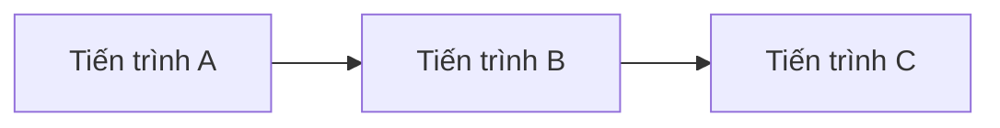
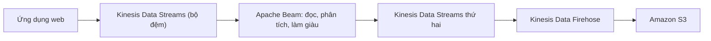
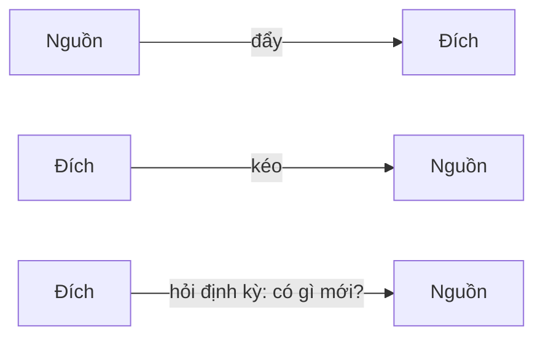

# Thu nạp dữ liệu: khái niệm và các cân nhắc kỹ thuật chính

Chương 7 đi vào **ingestion** (thu nạp dữ liệu) - giai đoạn đầu tiên trong vòng đời kỹ thuật dữ liệu, sau khi ta đã biết các hệ thống nguồn (Chương 5) và cách lưu trữ (Chương 6). Bài này định nghĩa ingestion, định nghĩa **data pipeline**, rồi đi qua danh sách các yếu tố kỹ thuật phải cân nhắc trước khi thiết kế hệ thống thu nạp, dù là batch hay streaming.

**Tương tự đơn giản:** thu nạp dữ liệu giống việc đặt hệ thống đường ống nước cho một toà nhà. Trước khi xây bể chứa hay máy lọc, bạn phải trả lời: nước lấy từ đâu, bao nhiêu, chảy liên tục hay theo đợt, ống to cỡ nào, ống vỡ thì sao.

---

:::note[Ghi nhớ nhanh]

- ⭐ **Ingestion = di chuyển dữ liệu từ nguồn vào bộ lưu trữ** trong vòng đời; khác với **data integration** (kết hợp nhiều nguồn thành tập mới) và khác với sao chép dữ liệu nội bộ trong một hệ thống.
- ⭐ **Data pipeline = kiến trúc + hệ thống + quy trình** di chuyển dữ liệu qua các giai đoạn vòng đời; định nghĩa cố ý rộng để gồm ETL, ELT, reverse ETL, chia sẻ dữ liệu...
- **Mọi dữ liệu đều unbounded cho đến khi bị giới hạn (bounded)** - batch chỉ là cách cắt dữ liệu liên tục thành lô.
- Không có hệ thống nào thực sự "real time"; chỉ là gần thời gian thực. Và phía sau streaming thường vẫn có batch.
- Cần cân nhắc: tần suất, đồng bộ/không đồng bộ, serialization, thông lượng, độ tin cậy/độ bền, payload, đẩy/kéo/thăm dò.

:::

---

## Mục lục

- [1. Thu nạp dữ liệu là gì](#1-thu-nạp-dữ-liệu-là-gì)
- [2. Định nghĩa data pipeline](#2-định-nghĩa-data-pipeline)
- [3. Những câu hỏi cần tự hỏi](#3-những-câu-hỏi-cần-tự-hỏi)
- [4. Bounded và unbounded](#4-bounded-và-unbounded)
- [5. Tần suất](#5-tần-suất)
- [6. Đồng bộ và không đồng bộ](#6-đồng-bộ-và-không-đồng-bộ)
- [7. Serialization và deserialization](#7-serialization-và-deserialization)
- [8. Thông lượng và khả năng mở rộng](#8-thông-lượng-và-khả-năng-mở-rộng)
- [9. Độ tin cậy và độ bền](#9-độ-tin-cậy-và-độ-bền)
- [10. Payload](#10-payload)
- [11. Mô hình đẩy, kéo và thăm dò](#11-mô-hình-đẩy-kéo-và-thăm-dò)
- [Tóm tắt](#tóm-tắt)

## 1. Thu nạp dữ liệu là gì

**Ingestion** là quá trình di chuyển dữ liệu từ nơi này sang nơi khác. Trong vòng đời kỹ thuật dữ liệu, nó nghĩa là chuyển dữ liệu từ **hệ thống nguồn** vào **bộ lưu trữ**; ingestion là bước trung gian giữa hai thứ đó.

Cần phân biệt với hai khái niệm dễ nhầm:

| Khái niệm | Làm gì | Ví dụ |
|---|---|---|
| **Ingestion** | Di chuyển dữ liệu từ điểm A đến điểm B | Kéo bảng `orders` từ PostgreSQL về S3 |
| **Data integration** | Kết hợp dữ liệu từ nhiều nguồn thành một tập dữ liệu mới | Gộp CRM + dữ liệu quảng cáo + phân tích web thành hồ sơ người dùng trong warehouse |
| **Sao chép nội bộ** | Chép bảng này sang bảng khác trong cùng một hệ thống, hoặc lưu tạm trong luồng | `INSERT INTO ... SELECT` trong cùng database |

Sách xếp data integration vào phần **transformation** (Chương 8), còn **reverse ETL** (đẩy hồ sơ người dùng mới tạo ngược về CRM để nhân viên sales ưu tiên khách tiềm năng) nằm ở Chương 9. Việc sao chép dữ liệu nội bộ cũng được coi là một phần của chuyển đổi, không phải ingestion.

## 2. Định nghĩa data pipeline

Một data pipeline **bắt đầu từ hệ thống nguồn**, nhưng ingestion là giai đoạn mà kỹ sư dữ liệu bắt đầu **chủ động thiết kế** hoạt động của pipeline.

Trong lĩnh vực này có nhiều tranh luận về các mẫu xử lý và di chuyển dữ liệu: ETL (đã có từ lâu), ELT (mới hơn), reverse ETL (tên mới cho việc đã làm từ lâu), chia sẻ dữ liệu... Tác giả gom tất cả vào ý niệm data pipeline. Điều cần thiết là hiểu chi tiết từng mẫu và biết rằng một pipeline hiện đại **bao gồm tất cả chúng**.

Lý do: thế giới đang rời bỏ cách tiếp cận nguyên khối (monolith) cứng nhắc để chuyển sang hệ sinh thái mở gồm các dịch vụ đám mây ghép lại như **LEGO**. Kỹ sư dữ liệu nên chọn công cụ phù hợp với kết quả mong muốn, thay vì bám vào một triết lý di chuyển dữ liệu hẹp.

Định nghĩa của sách:

> **Data pipeline là sự kết hợp giữa kiến trúc, hệ thống và quy trình di chuyển dữ liệu qua các giai đoạn của vòng đời kỹ thuật dữ liệu.**

Định nghĩa này cố ý linh hoạt và hơi mơ hồ để kỹ sư đưa vào bất cứ thứ gì cần cho nhiệm vụ. Hai cực ví dụ trong sách:

- Một hệ thống ETL truyền thống: lấy dữ liệu từ hệ thống giao dịch tại chỗ, đi qua một bộ xử lý nguyên khối, ghi vào data warehouse.
- Một pipeline trên đám mây: lấy dữ liệu từ 100 nguồn, kết hợp thành 20 bảng rộng, huấn luyện 5 mô hình ML, triển khai lên production và theo dõi hiệu suất liên tục.

Pipeline phải đủ linh hoạt cho mọi nhu cầu trong suốt vòng đời.

## 3. Những câu hỏi cần tự hỏi

Khi chuẩn bị xây kiến trúc thu nạp, sách đề nghị tự hỏi:

- Trường hợp sử dụng (use case) của dữ liệu đang nhập là gì?
- Có thể **tái sử dụng** dữ liệu này, tránh có nhiều phiên bản của cùng một tập dữ liệu không?
- Dữ liệu đi đâu? Điểm đến là gì?
- Cập nhật từ nguồn **bao lâu một lần**?
- **Khối lượng** dữ liệu dự kiến?
- Dữ liệu ở **định dạng** nào? Lưu trữ và chuyển đổi phía sau có chấp nhận định dạng đó không?
- Dữ liệu nguồn đã ở trạng thái đủ tốt để dùng ngay chưa (chất lượng)? Cần hậu xử lý gì? Rủi ro chất lượng là gì (ví dụ lưu lượng bot làm bẩn dữ liệu)?
- Nếu nguồn là streaming, dữ liệu có cần xử lý ngay trong lúc thu nạp không?

Các câu hỏi này áp dụng cho cả batch và streaming. Và bất kể tần suất nào, cần xem xét thêm 8 yếu tố: bounded/unbounded, tần suất, đồng bộ/không đồng bộ, serialization/deserialization, thông lượng và khả năng mở rộng, độ tin cậy và độ bền, payload, đẩy/kéo/thăm dò. Các mục dưới đây lần lượt đi qua.

## 4. Bounded và unbounded

Như Chương 3 đã nói, dữ liệu có hai dạng:

- **Unbounded** (không bị ràng buộc): dữ liệu như nó tồn tại trong thực tế - các sự kiện xảy ra rời rạc hoặc liên tục, tiếp diễn không ngừng.
- **Bounded** (bị ràng buộc): cách thuận tiện để gom dữ liệu theo một ranh giới nào đó, ví dụ một khoảng thời gian.

Sách đưa ra một "câu thần chú": **mọi dữ liệu đều unbounded cho đến khi nó bị bounded**. Câu này không đúng 100% (danh sách đi chợ tác giả viết nguệch ngoạc là dữ liệu bounded), nhưng đúng cho phần lớn dữ liệu kinh doanh. Một nhà bán lẻ online xử lý giao dịch 24/24 cho đến khi doanh nghiệp phá sản.

Các quy trình kinh doanh từ lâu đã áp **giới hạn nhân tạo** bằng cách cắt thành các lô rời rạc. Hãy nhớ tính không giới hạn thật sự của dữ liệu: hệ thống thu nạp trực tuyến (streaming) chỉ là công cụ **giữ nguyên bản chất unbounded** để các bước sau cũng xử lý liên tục.

## 5. Tần suất

Tần suất thu nạp là một quyết định thiết kế quan trọng. Có thể là **batch**, **micro-batch** hoặc **real time**, trải dài từ chậm đến nhanh:

| Mức | Ví dụ |
|---|---|
| Rất chậm | Doanh nghiệp gửi dữ liệu thuế cho công ty kế toán mỗi năm một lần |
| Trung bình | Hệ thống CDC lấy bản cập nhật log mới từ database nguồn mỗi phút |
| Rất nhanh | Liên tục thu nạp sự kiện cảm biến IoT và xử lý trong vài giây |

Một công ty thường dùng nhiều tần suất khác nhau tùy use case và công nghệ.

**"Real time" trong dấu ngoặc kép:** không có hệ thống thu nạp nào thực sự real time. Mọi database, queue hay pipeline đều có độ trễ cố hữu. Nói "gần thời gian thực" chính xác hơn, nhưng sách dùng "real time" và "streaming" thay thế nhau cho ngắn gọn. Mẫu gần real time thường không có tần suất cập nhật rõ ràng: sự kiện được xử lý từng cái khi đến, hoặc theo từng lô nhỏ trong khoảng ngắn.

**Streaming thường đi kèm batch.** Dù thu nạp trực tuyến, xử lý batch phía sau vẫn khá chuẩn: ở thời điểm viết sách, mô hình ML thường được huấn luyện theo lô (huấn luyện online liên tục đang tăng dần). Hiếm khi kỹ sư xây được pipeline gần real time hoàn toàn không có thành phần batch; họ chọn **nơi đặt ranh giới batch**. Khi dữ liệu chạm tới bước batch, **tần suất batch trở thành nút thắt cổ chai** của mọi xử lý tiếp theo.

Ngoài ra, streaming hợp với nhiều loại nguồn. Với IoT, mẫu điển hình là mỗi cảm biến ghi sự kiện vào hệ thống streaming khi nó xảy ra. Tuy ghi thẳng vào database được, nền tảng thu nạp streaming như Amazon Kinesis hay Apache Kafka phù hợp hơn. Ứng dụng phần mềm cũng có thể ghi sự kiện vào message queue ngay khi xảy ra, thay vì chờ tiến trình trích xuất kéo từ database; mẫu này đặc biệt hợp với **kiến trúc hướng sự kiện** vốn đã trao đổi message qua queue.

## 6. Đồng bộ và không đồng bộ

**Thu nạp đồng bộ (synchronous):** nguồn, quy trình thu nạp và đích phụ thuộc phức tạp, gắn chặt với nhau. Mỗi giai đoạn có các tiến trình A, B, C phụ thuộc trực tiếp: A hỏng thì B và C không chạy; B hỏng thì C không bắt đầu. Kiểu này phổ biến trong ETL cũ, nơi dữ liệu phải được chuyển đổi xong mới nạp vào warehouse. Các bước sau không thể bắt đầu cho đến khi **toàn bộ lô** được thu nạp. Nếu thu nạp hoặc chuyển đổi lỗi, phải **chạy lại toàn bộ**.

**Câu chuyện cảnh báo trong sách:** ở một công ty, phần chuyển đổi là chuỗi hàng chục quy trình đồng bộ gắn chặt nhau, chạy trọn hơn 24 giờ. Nếu bất kỳ bước nào hỏng, phải chạy lại từ đầu. Thông báo lỗi hoặc không có hoặc khó hiểu nên sửa pipeline giống trò chơi "đập chuột chũi" và mất hơn một tuần để chẩn đoán. Trong lúc đó doanh nghiệp không có báo cáo cập nhật, và mọi người không vui.

**Thu nạp không đồng bộ (asynchronous):** phụ thuộc hoạt động ở **mức sự kiện riêng lẻ**, như backend phần mềm xây từ microservice. Mỗi sự kiện sẵn sàng trong bộ lưu trữ ngay khi nó được thu nạp.

Ví dụ trong sách (AWS): ứng dụng web phát sự kiện vào **Kinesis Data Streams** (đóng vai trò bộ đệm). Luồng này được **Apache Beam** đọc, phân tích và làm giàu sự kiện, rồi chuyển tiếp sang luồng Kinesis thứ hai; **Kinesis Data Firehose** gộp sự kiện và ghi đối tượng vào **S3**.

Ý lớn: thay vì mỗi giai đoạn chờ lô đầu vào kết thúc rồi mới chạy, mỗi giai đoạn xử lý từng mục dữ liệu **ngay khi có**, song song trên cụm Beam. Tốc độ phụ thuộc tài nguyên sẵn có. Luồng Kinesis đóng vai **bộ giảm chấn**: điều tiết tải để đợt sự kiện tăng đột biến không đè bẹp xử lý phía sau. Khi lượng sự kiện thấp và hết tồn đọng, sự kiện chạy qua pipeline rất nhanh. Ta cũng có thể biến kịch bản này để dùng Kinesis làm nơi lưu trữ, rồi trích sự kiện sang S3 trước khi chúng hết hạn khỏi luồng.

## 7. Serialization và deserialization

Di chuyển dữ liệu từ nguồn đến đích luôn kéo theo **serialization** (tuần tự hóa: mã hóa dữ liệu từ nguồn, chuẩn bị cấu trúc để truyền và lưu trung gian) và **deserialization** (giải tuần tự hóa: ngược lại).

Khi thu nạp, phải bảo đảm **đích có thể deserialize** dữ liệu nhận được. Sách từng thấy dữ liệu được thu nạp từ nguồn rồi nằm im, không dùng được ở đích vì không deserialize đúng cách. Phần thảo luận chi tiết về serialization nằm ở Phụ lục A.

## 8. Thông lượng và khả năng mở rộng

Về lý thuyết, thu nạp không bao giờ nghẽn. Thực tế, **nghẽn ở cửa vào khá phổ biến**. Khối lượng dữ liệu tăng và yêu cầu đổi thì throughput và khả năng mở rộng hệ thống trở nên quan trọng. Thiết kế hệ thống để **scale lên và scale xuống** linh hoạt theo throughput mong muốn.

Các điểm cần nghĩ tới:

- **Hệ thống ngược dòng gặp sự cố:** nếu database nguồn sập rồi online trở lại và cố bù hàng loạt dữ liệu trễ, thu nạp của bạn có theo kịp luồng dữ liệu tồn đọng đột ngột đó không?
- **Dữ liệu bùng nổ (burst):** dữ liệu hiếm khi sinh ra với tốc độ không đổi. Cần **bộ đệm tích hợp sẵn** để gom sự kiện khi tốc độ tăng đột biến, tránh mất dữ liệu. Bộ đệm làm cầu nối trong lúc hệ thống scale, và giúp lưu trữ đáp ứng đợt tăng vọt, ngay cả với hệ thống tự co giãn.
- **Dùng dịch vụ được quản lý** (managed) để tự xử lý scale throughput khi có thể. Có thể làm thủ công bằng cách thêm máy chủ, shard, worker, nhưng đó thường là việc không tạo giá trị gia tăng và dễ bỏ sót. Phần lớn công việc nặng nhọc này đã được tự động hóa. Đừng phát minh lại "bánh xe thu nạp".

## 9. Độ tin cậy và độ bền

- **Độ tin cậy (reliability):** thời gian hoạt động cao và khả năng failover hợp lý cho hệ thống thu nạp.
- **Độ bền (durability):** dữ liệu không bị mất hoặc hỏng.

Một số nguồn (thiết bị IoT, bộ nhớ đệm/cache) **không giữ lại dữ liệu** nếu không được thu nạp đúng lúc; mất là mất vĩnh viễn. Theo nghĩa này, độ tin cậy của hệ thống thu nạp quyết định trực tiếp độ bền của dữ liệu sinh ra. Còn nếu dữ liệu đã được thu nạp, các quy trình phía sau về lý thuyết có thể chạy trễ khi tạm hỏng.

Lời khuyên: **đánh giá rủi ro** và xây mức dự phòng, khả năng tự phục hồi phù hợp dựa trên **tác động và chi phí** của việc mất dữ liệu. Reliability và durability có cả chi phí trực tiếp lẫn gián tiếp. Một vài câu hỏi tác giả đặt ra: thu nạp có tiếp tục nếu một AWS region ngưng hoạt động? Cả một vùng địa lý? Lưới điện hay internet thì sao? Và tốn bao nhiêu tiền? Bạn có thể xây hệ thống dự phòng rất cao cùng một đội trực 24/24, nhưng chi phí nhân công và cloud sẽ cao ngất (chi phí trực tiếp), còn việc trực liên tục gây hại đáng kể cho đội (chi phí gián tiếp).

Không có câu trả lời đúng duy nhất. Đừng cho rằng có thể xây hệ thống thu nạp đáng tin cậy trong mọi tình huống - ngay cả ngân sách gần như vô hạn của chính phủ Mỹ cũng không đảm bảo được. Trong nhiều tình huống cực đoan (internet sập hoàn toàn), thu nạp cũng chẳng còn ý nghĩa. Hãy liên tục cân nhắc sự đánh đổi và chi phí.

## 10. Payload

**Payload** là tập dữ liệu bạn đang thu nạp, với các đặc điểm: **kind** (loại), **shape** (hình dạng), **size** (kích thước), **schema và kiểu dữ liệu**, và **metadata**.

### 10.1. Kind (loại)

Loại gồm **type** và **format**. Dữ liệu có một type (dạng bảng, hình ảnh, video, văn bản...), type này ảnh hưởng trực tiếp tới **format**: cách biểu diễn bằng byte, tên và phần mở rộng tệp. Ví dụ dữ liệu dạng bảng có thể là CSV hoặc Parquet, mỗi định dạng có mẫu byte khác nhau cho serialization/deserialization. Hình ảnh thì là JPG hoặc PNG và vốn không có cấu trúc.

### 10.2. Shape (hình dạng)

Hình dạng mô tả "kích cỡ" của dữ liệu và rất quan trọng suốt vòng đời. Ví dụ: kích thước pixel và RGB của ảnh cần cho huấn luyện deep learning; hoặc nếu CSV có nhiều cột hơn bảng database đích thì thu nạp sẽ lỗi.

| Loại dữ liệu | Hình dạng điển hình |
|---|---|
| Dạng bảng (tabular) | Số hàng M và số cột N |
| JSON bán cấu trúc | Các cặp key-value và độ sâu lồng nhau của phần tử con |
| Văn bản phi cấu trúc | Số từ, ký tự hoặc byte |
| Hình ảnh | Chiều rộng, chiều cao, độ sâu màu RGB (ví dụ 8 bit mỗi pixel) |
| Âm thanh không nén | Số kênh (stereo = 2), độ sâu mẫu (ví dụ 16 bit), tốc độ lấy mẫu (ví dụ 48 kHz), độ dài (ví dụ 10.003 giây) |

### 10.3. Size (kích thước)

Kích thước là số byte của payload, từ một byte đến terabyte hay hơn. Có thể giảm bằng **nén** (ZIP, TAR; xem Phụ lục A). Payload lớn cũng có thể được **chia thành nhiều phần**: khi tải tệp lớn lên object storage hay cloud warehouse đây là thực hành phổ biến, vì các tệp nhỏ dễ truyền qua mạng hơn (nhất là khi đã nén). Các phần được gửi tới đích rồi ghép lại khi đủ dữ liệu.

### 10.4. Schema và kiểu dữ liệu

Nhiều payload có schema (dữ liệu dạng bảng, bán cấu trúc): mô tả các trường và kiểu dữ liệu. Văn bản, hình ảnh, âm thanh phi cấu trúc thì không có schema rõ ràng, nhưng có thể đi kèm mô tả kỹ thuật về hình dạng, định dạng, mã hóa, kích thước...

Kết nối vào database có nhiều cách (xuất tệp, CDC, JDBC/ODBC) và **việc kết nối thì dễ**. Thách thức kỹ thuật lớn là **hiểu schema bên dưới**. Mỗi ứng dụng tổ chức dữ liệu một kiểu, kỹ sư phải nắm cách tổ chức và các mẫu cập nhật. Vấn đề nặng hơn vì **ORM** (object-relational mapping) tự sinh schema từ cấu trúc đối tượng trong Java hay Python; cấu trúc tự nhiên của ngôn ngữ hướng đối tượng thường ánh xạ thành thứ khá lộn xộn trong database vận hành. Kỹ sư dữ liệu có thể phải làm quen với cấu trúc class trong mã ứng dụng.

Schema không chỉ ở database. **API** cũng có độ phức tạp về schema. Nhiều API của nhà cung cấp có phương thức báo cáo thân thiện để chuẩn bị dữ liệu cho phân tích; số khác chỉ là lớp bọc mỏng quanh hệ thống bên dưới, buộc kỹ sư hiểu nội bộ ứng dụng.

Phần lớn công việc xử lý schema nguồn diễn ra ở giai đoạn **transformation** (Chương 8), nhưng kỹ sư nên nghiên cứu schema nguồn ngay khi dự định thu nạp từ nguồn mới. **Giao tiếp** là chìa khóa để hiểu dữ liệu nguồn, và cũng là cơ hội đảo chiều: giúp kỹ sư phần mềm cải thiện dữ liệu ngay nơi nó sinh ra (xem bài 4).

**Phát hiện và xử lý thay đổi schema ngược dòng.** Hệ thống nguồn hay đổi schema và thường nằm ngoài tầm kiểm soát của kỹ sư dữ liệu: thêm cột, đổi kiểu cột, tạo bảng mới, đổi tên cột. Ngày càng nhiều công cụ thu nạp **tự động phát hiện** thay đổi, thậm chí tự cập nhật bảng đích. Nhưng đó là "may mắn lẫn lộn": thay đổi schema vẫn có thể làm gãy pipeline phía sau (staging, ingestion). Kỹ sư vẫn cần chiến lược tự phản hồi và **cảnh báo** về thay đổi không tự xử lý được. Analyst và data scientist dựa vào dữ liệu cần được thông báo về thay đổi vi phạm giả định hiện có. Ngay cả khi tự động hóa điều chỉnh được, schema mới có thể ảnh hưởng xấu đến hiệu năng báo cáo và mô hình. **Liên lạc giữa người đổi schema và người bị ảnh hưởng quan trọng không kém tự động hóa.**

**Schema registry.** Trong data streaming, mỗi message đều có schema và schema có thể tiến hóa giữa producer và consumer. **Schema registry** là kho metadata để duy trì tính toàn vẹn schema và kiểu dữ liệu trước các schema luôn thay đổi. Nó cũng theo dõi phiên bản và lịch sử schema, mô tả mô hình dữ liệu của message để serialization/deserialization nhất quán giữa producer và consumer. Hầu hết công cụ dữ liệu và đám mây lớn đều có schema registry.

### 10.5. Metadata

Payload thường kèm **metadata** (dữ liệu về dữ liệu), có thể quan trọng ngang chính dữ liệu. Một hạn chế lớn của cách tiếp cận data lake thuở đầu - biến thành "đầm lầy dữ liệu" (data swamp), thậm chí thành "bãi dữ liệu độc hại" - là hoàn toàn thiếu chú ý tới metadata. Không có mô tả chi tiết thì dữ liệu ít giá trị.

## 11. Mô hình đẩy, kéo và thăm dò

Đã nhắc ở Chương 2 khi giới thiệu vòng đời:

- **Push (đẩy):** hệ thống nguồn gửi dữ liệu tới đích.
- **Pull (kéo):** đích đọc dữ liệu trực tiếp từ nguồn.
- **Polling (thăm dò):** một dạng của kéo. Định kỳ kiểm tra nguồn xem có thay đổi không; khi phát hiện thay đổi, đích kéo dữ liệu như kéo thông thường.

Ranh giới giữa push và pull khá mờ.

## Tóm tắt

| Chủ đề | Ý chính |
|---|---|
| Định nghĩa | Ingestion là di chuyển nguồn -> lưu trữ; khác integration và sao chép nội bộ |
| Data pipeline | Kiến trúc + hệ thống + quy trình, bao trùm ETL/ELT/reverse ETL/chia sẻ dữ liệu |
| Bounded/unbounded | Mọi dữ liệu unbounded cho đến khi bị giới hạn |
| Tần suất | Từ batch đến "real time"; ranh giới batch là nút thắt |
| Đồng bộ/không đồng bộ | Đồng bộ gắn chặt và dễ gãy; không đồng bộ xử lý theo sự kiện, có bộ đệm |
| Serialization | Đích phải deserialize được |
| Throughput | Có bộ đệm, ưu tiên dịch vụ managed |
| Reliability/durability | Cân đối chi phí - rủi ro, không có hệ thống hoàn hảo |
| Payload | Kind, shape, size, schema, metadata; chú ý thay đổi schema và schema registry |
| Push/pull/poll | Ba mô hình lấy dữ liệu từ nguồn |
