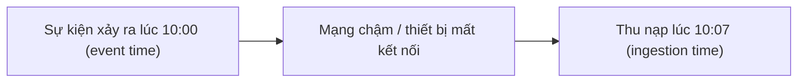
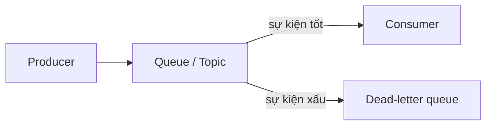

# Cân nhắc khi nhập batch và nhập message/streaming

Sau các yếu tố chung, chương đi vào hai nhóm mẫu thu nạp: **batch** (theo lô) và **message/stream** (theo sự kiện). Mỗi nhóm có những cạm bẫy riêng: batch lo về snapshot hay vi sai, kích thước lô, di chuyển dữ liệu; streaming lo về schema evolution, dữ liệu đến muộn, TTL, dead-letter queue.

**Tương tự đơn giản:** batch giống xe tải chở hàng theo chuyến (gom đủ hàng rồi mới chạy), còn streaming giống băng chuyền chạy liên tục - hàng nào tới là đi luôn, nhưng băng chuyền cũng có thể kẹt, lệch thứ tự hoặc rơi mất kiện.

---

:::note[Ghi nhớ nhanh]

- ⭐ **Hệ thống hướng lô ghét nhiều thao tác nhỏ:** nên làm ít thao tác lớn thay vì nhiều insert/update từng hàng, đặc biệt với database dạng cột.
- ⭐ **Streaming:** phải tính tới schema evolution, dữ liệu đến muộn, thứ tự và gửi lặp, TTL, kích thước message, và dead-letter queue.
- **Snapshot đầy đủ vs vi sai (differential):** vi sai tiết kiệm mạng và lưu trữ, nhưng snapshot đầy đủ vẫn rất phổ biến vì đơn giản.
- **Xuất tệp là kiểu đẩy** (push): bên nguồn tự chuẩn bị và xuất, an toàn hơn cho kỹ sư hệ thống nguồn kiểm soát.
- Phần khó nhất của di chuyển database thường là **chuyển các kết nối pipeline**, chứ không phải chuyển dữ liệu.

:::

---

## Mục lục

- [1. Nhập batch](#1-nhập-batch)
- [2. Nhập message và streaming](#2-nhập-message-và-streaming)
- [Tóm tắt](#tóm-tắt)

## 1. Nhập batch

**Nhập batch** là thu nạp bằng cách lấy một **tập con** dữ liệu từ hệ thống nguồn, dựa trên **khoảng thời gian** hoặc **kích thước** dữ liệu tích lũy.

- **Batch theo thời gian:** phổ biến trong ETL kinh doanh truyền thống để nạp vào data warehouse. Thường xử lý mỗi ngày một lần, qua đêm (ngoài giờ làm việc), để có báo cáo hằng ngày, nhưng cũng có thể dùng tần suất khác.
- **Batch theo kích thước:** phổ biến khi chuyển dữ liệu từ hệ thống dựa trên luồng sang object storage; cuối cùng phải cắt dữ liệu thành các khối rời để xử lý sau trong data lake. Một số hệ thống chia dữ liệu thành các đối tượng dựa trên tiêu chí khác nhau, ví dụ tổng kích thước byte của các sự kiện.

Các mẫu batch thường gặp (sẽ bàn lần lượt): snapshot hoặc trích xuất vi sai; xuất và nhập dựa trên tệp; ETL so với ELT; kích thước chèn/cập nhật; di chuyển dữ liệu.

### 1.1. Snapshot hay trích xuất vi sai

Kỹ sư phải chọn giữa:

- **Snapshot đầy đủ:** mỗi lần đọc, nắm bắt **toàn bộ trạng thái hiện tại** của hệ thống nguồn.
- **Cập nhật vi sai (differential, đôi khi gọi là incremental):** chỉ lấy **các thay đổi kể từ lần đọc trước**.

Vi sai lý tưởng để giảm lưu lượng mạng và dung lượng lưu trữ ở đích, nhưng snapshot đầy đủ vẫn **cực kỳ phổ biến vì đơn giản**.

*Ví dụ minh hoạ (do người viết ghi chép thêm):* bảng `customers` có 10 triệu hàng, mỗi ngày chỉ đổi khoảng 5.000 hàng. Snapshot đầy đủ kéo 10 triệu hàng mỗi đêm; vi sai chỉ kéo 5.000 hàng, nhưng đòi hỏi bạn có cách xác định "hàng nào đổi" (xem mục CDC ở bài 3).

### 1.2. Xuất và nhập dựa trên tệp

Dữ liệu thường di chuyển giữa các hệ thống bằng **tệp**: dữ liệu được serialize thành tệp ở định dạng trao đổi được, rồi cung cấp cho hệ thống thu nạp. Sách coi **xuất tệp là kiểu thu nạp dựa trên push**, vì việc chuẩn bị và xuất dữ liệu diễn ra ở phía hệ thống nguồn.

Lợi thế so với kết nối database trực tiếp:

- Cấp quyền truy cập trực tiếp vào backend vì lý do bảo mật thường **không mong muốn**.
- Quá trình xuất chạy ở phía nguồn, nên kỹ sư hệ thống nguồn **toàn quyền kiểm soát** dữ liệu nào được xuất và cách tiền xử lý.
- Khi tệp xong, có thể chuyển cho hệ thống đích bằng nhiều cách: **object storage**, **SFTP** (giao thức truyền tệp an toàn), **EDI** (trao đổi dữ liệu điện tử), **SCP** (sao chép an toàn).

### 1.3. ETL và ELT

Chương 3 đã giới thiệu ETL và ELT, hai kiểu thu nạp - lưu trữ - chuyển đổi cực phổ biến trong khối lượng công việc batch. Định nghĩa gọn cho hai bước đầu:

- **Extract (trích xuất):** lấy dữ liệu từ hệ thống nguồn. Nghe như "kéo", nhưng cũng có thể dựa trên push. Có thể cần đọc metadata và thay đổi schema.
- **Load (tải):** sau khi trích xuất, dữ liệu có thể được chuyển đổi trước khi tải vào đích lưu trữ (**ETL**), hoặc tải thẳng vào lưu trữ để chuyển đổi sau (**ELT**). Khi tải cần để ý loại hệ thống đang tải vào, schema dữ liệu, và tác động hiệu năng của việc tải.

ETL và ELT được bàn chi tiết hơn ở Chương 8.

### 1.4. Chèn, cập nhật và kích thước batch

Hệ thống hướng lô thường chạy kém nếu người dùng làm **nhiều thao tác lô nhỏ** thay vì **ít thao tác lớn**.

- Chèn từng hàng một là bình thường với database giao dịch, nhưng là mẫu xấu với nhiều database dạng cột: nó tạo ra nhiều **tệp nhỏ, dưới tối ưu** và buộc hệ thống chạy nhiều thao tác tạo đối tượng.
- Chạy nhiều **update nhỏ tại chỗ** còn tệ hơn: database phải quét **từng tệp cột hiện có** để áp bản cập nhật.

Hãy hiểu mẫu cập nhật phù hợp với database hoặc warehouse bạn dùng, và biết rằng có công nghệ được xây riêng cho tốc độ insert cao:

| Công nghệ | Đặc điểm theo sách |
|---|---|
| Apache Druid, Apache Pinot | Xử lý tốc độ insert cao |
| SingleStore | Quản lý khối lượng hỗn hợp, vừa OLAP vừa OLTP |
| BigQuery | Kém với insert từng hàng SQL chuẩn, nhưng rất tốt nếu đưa dữ liệu vào qua **stream buffer** của nó |

Thông điệp: biết giới hạn và đặc điểm của công cụ.

*Ví dụ minh hoạ (người viết thêm):* thay vì vòng lặp Python chạy 1 triệu lệnh `INSERT` đơn lẻ vào warehouse, hãy gom thành tệp Parquet vài trăm MB rồi nạp bằng một lệnh bulk load.

### 1.5. Di chuyển dữ liệu

Chuyển dữ liệu sang database hoặc môi trường mới thường không đơn giản, và phải di chuyển hàng loạt, đôi khi hàng trăm terabyte trở lên: từng bảng cụ thể hoặc cả database và hệ thống. Kỹ sư dữ liệu không làm việc này thường xuyên, nhưng nên quen thuộc.

- **Quản lý schema** luôn là vấn đề then chốt. Dù hai database giống nhau thế nào (ví dụ SQL Server sang Snowflake), vẫn hầu như luôn có khác biệt nhỏ trong cách xử lý schema. May là khá dễ thử thu nạp một **mẫu dữ liệu nhỏ** để phát hiện vấn đề schema trước khi di chuyển trọn bảng.
- Hầu hết hệ thống dữ liệu chạy tốt nhất khi di chuyển **hàng loạt** thay vì từng hàng/sự kiện. Lưu trữ tệp hoặc object storage thường là **giai đoạn trung gian** tốt.
- Một trong những thách thức lớn nhất không phải là chuyển dữ liệu mà là **chuyển các kết nối data pipeline** từ hệ thống cũ sang hệ thống mới.
- Có nhiều công cụ tự động hóa các loại migration; với migration lớn và phức tạp, nên xem các công cụ này trước khi làm thủ công hoặc tự viết giải pháp.

## 2. Nhập message và streaming

Thu nạp dữ liệu sự kiện rất phổ biến. Phần này dựa trên các chủ đề ở Chương 5 và 6.

### 2.1. Schema evolution (tiến hóa schema)

Khi xử lý sự kiện, schema thường thay đổi: thêm hoặc xóa trường, hoặc đổi kiểu giá trị (ví dụ chuỗi thành số nguyên). Sự thay đổi có thể gây tác động ngoài ý muốn lên pipeline và đích. Ví dụ: thiết bị IoT nhận bản cập nhật firmware thêm trường mới vào sự kiện nó phát; hay API bên thứ ba thay đổi payload sự kiện.

Ba gợi ý giảm vấn đề:

1. Nếu framework xử lý sự kiện có **schema registry**, hãy dùng nó để **đánh phiên bản** các thay đổi schema.
2. **Dead-letter queue** (mô tả bên dưới) giúp điều tra các sự kiện không xử lý được.
3. Cách "low-tech" và hiệu quả nhất: **thường xuyên liên lạc** với các bên liên quan ở thượng nguồn về thay đổi schema tiềm năng, và chủ động xử lý cùng các nhóm đưa ra thay đổi, thay vì bị động đối phó khi thay đổi phá vỡ pipeline.

### 2.2. Dữ liệu đến muộn

Dữ liệu sự kiện có thể **đến muộn**. Một nhóm sự kiện xảy ra trong cùng khung thời gian (**event time** tương tự), nhưng một số đến muộn hơn (**ingestion time** muộn) vì nhiều lý do. Ví dụ: thiết bị IoT gửi message trễ do độ trễ internet. Điều này phổ biến, và cần chú ý tác động lên hệ thống phía sau.

Nếu bạn giả định thời điểm thu nạp hay xử lý bằng thời điểm xảy ra sự kiện, báo cáo/phân tích cần mô tả chính xác thời điểm sự kiện xảy ra có thể cho kết quả lạ. Để xử lý, cần đặt **mốc thời gian giới hạn**: sau đó dữ liệu đến muộn sẽ không được xử lý nữa.

### 2.3. Thứ tự và việc gửi lặp message

Nền tảng streaming thường xây trên **distributed system**, dễ gây phức tạp. Cụ thể, message có thể bị giao **sai thứ tự** và **nhiều hơn một lần** (at-least-once delivery). Chi tiết ở phần event-streaming platform của Chương 5. Thực tế nghĩa là pipeline nên được thiết kế để **chịu được trùng lặp** (idempotent) và không dựa hoàn toàn vào thứ tự đến.

### 2.4. Replay (phát lại)

**Replay** cho phép consumer yêu cầu một loạt message từ lịch sử, "tua lại" lịch sử sự kiện tới một thời điểm cụ thể. Đây là tính năng quan trọng ở nhiều nền tảng thu nạp streaming, đặc biệt hữu ích khi cần thu nạp và xử lý lại dữ liệu của một khoảng thời gian. RabbitMQ thường **xóa message** sau khi mọi subscriber đã dùng; Kafka, Kinesis và Pub/Sub đều hỗ trợ **lưu giữ và replay** sự kiện.

### 2.5. Time to live (TTL)

Bạn lưu hồ sơ sự kiện bao lâu? Thông số chính là **thời gian lưu giữ message tối đa**, gọi là **TTL** (thời gian tồn tại): cấu hình khoảng thời gian sự kiện được phép tồn tại trước khi được xác nhận (ack) và thu nạp. Sự kiện chưa được ack và chưa thu nạp khi TTL hết hạn sẽ **tự biến mất**. Điều này hữu ích để giảm **back pressure** (áp lực ngược) và lượng sự kiện không cần thiết trong pipeline.

Phải cân bằng:

- TTL cực ngắn (mili giây, giây) có thể làm hầu hết message biến mất trước khi được xử lý.
- TTL rất dài (vài tuần, vài tháng) tạo ra tồn đọng lớn các message chưa xử lý, dẫn đến thời gian chờ dài.

Một số nền tảng tại thời điểm viết sách:

| Nền tảng | Thời gian lưu giữ |
|---|---|
| Google Cloud Pub/Sub | Tối đa 7 ngày |
| Amazon Kinesis Data Streams | Tối đa 365 ngày |
| Kafka | Cấu hình được lưu vô thời hạn, giới hạn bởi dung lượng đĩa; có tùy chọn ghi message cũ ra object storage để lưu gần như không giới hạn |

### 2.6. Kích thước message

Dễ bị bỏ qua: phải đảm bảo framework streaming xử lý được **kích thước message tối đa** dự kiến. Amazon Kinesis hỗ trợ tối đa **1 MB**. Kafka mặc định cũng khoảng đó nhưng có thể cấu hình tới 20 MB hoặc hơn. (Khả năng cấu hình có thể khác trên dịch vụ managed.)

### 2.7. Xử lý lỗi và dead-letter queue (DLQ)

Đôi khi sự kiện không thu nạp thành công: gửi tới topic hoặc queue không tồn tại, message quá lớn, hoặc sự kiện hết hạn vì quá TTL. Những sự kiện này cần được **định tuyến lại và lưu ở nơi riêng** gọi là **dead-letter queue**.

DLQ tách sự kiện có vấn đề khỏi sự kiện consumer chấp nhận được. Nếu không chuyển sang DLQ, các sự kiện lỗi có nguy cơ **chặn** việc thu nạp các message khác. Kỹ sư dùng DLQ để chẩn đoán nguyên nhân lỗi và sửa pipeline, và có thể **xử lý lại** một số message sau khi khắc phục nguyên nhân gốc.

### 2.8. Consumer pull và push

Consumer đăng ký một topic nhận sự kiện theo hai cách: **kéo** hoặc **đẩy**.

- **Kafka và Kinesis** chỉ hỗ trợ **pull subscription**: subscriber đọc message từ topic và ack khi xử lý xong.
- **Pub/Sub và RabbitMQ** hỗ trợ cả pull lẫn **push subscription** (dịch vụ ghi message tới listener).

Pull là lựa chọn mặc định cho hầu hết ứng dụng kỹ thuật dữ liệu; push nên cân nhắc cho ứng dụng chuyên biệt. Hệ thống chỉ hỗ trợ pull vẫn có thể "đẩy" nếu bạn thêm một lớp bổ sung để xử lý.

### 2.9. Vị trí (location)

Thường cần tích hợp streaming **qua nhiều vị trí** để tăng dự phòng và dùng dữ liệu gần nơi sinh ra. Nguyên tắc chung: thu nạp càng **gần nơi dữ liệu phát sinh**, băng thông và độ trễ càng tốt. Nhưng phải cân với **chi phí di chuyển dữ liệu giữa các region** để phân tích trên tập dữ liệu gộp. Như mọi khi, chi phí **data egress** có thể tăng rất nhanh, nên đánh giá kỹ đánh đổi khi xây kiến trúc.

## Tóm tắt

| Chủ đề | Điểm cần nhớ |
|---|---|
| Batch theo thời gian vs kích thước | Thời gian cho ETL truyền thống; kích thước cho chuyển stream sang object storage |
| Snapshot vs vi sai | Vi sai tiết kiệm tài nguyên; snapshot đơn giản nên vẫn phổ biến |
| Xuất tệp | Kiểu push, an toàn, nguồn kiểm soát; qua object storage, SFTP, EDI, SCP |
| Kích thước batch | Ít thao tác lớn tốt hơn nhiều thao tác nhỏ; biết giới hạn công cụ |
| Di chuyển dữ liệu | Thử mẫu nhỏ để bắt lỗi schema; khó nhất là chuyển kết nối pipeline |
| Schema evolution | Schema registry, DLQ, và quan trọng nhất là liên lạc với nhóm ngược dòng |
| Dữ liệu đến muộn | Phân biệt event time và ingestion time; đặt mốc cắt |
| Thứ tự, gửi lặp | At-least-once, thiết kế chịu trùng lặp |
| Replay, TTL | Kafka/Kinesis/Pub/Sub giữ và replay; RabbitMQ thường xóa; TTL cần cân bằng |
| Kích thước message | Kinesis 1 MB, Kafka cấu hình được đến 20 MB+ |
| DLQ | Cách ly sự kiện lỗi để không chặn luồng và để điều tra |
| Pull/push | Kafka, Kinesis chỉ pull; Pub/Sub, RabbitMQ có cả push |
| Vị trí | Gần nguồn thì nhanh, nhưng coi chừng chi phí egress |
