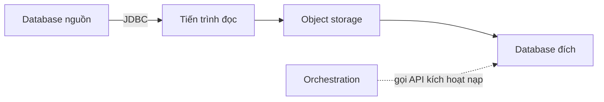
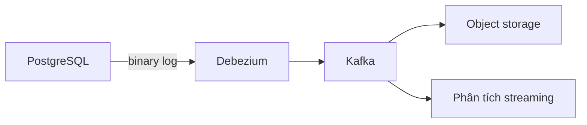
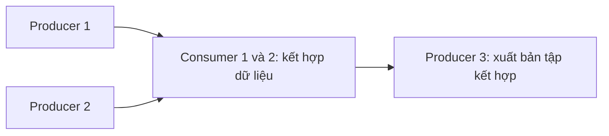
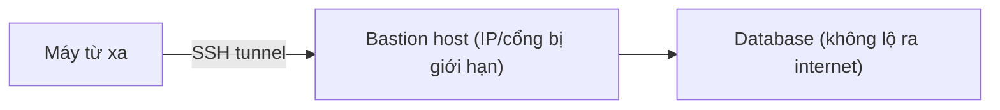
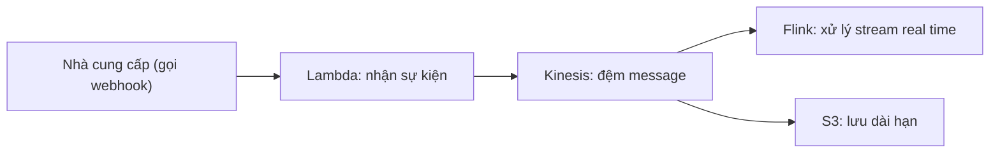

# Các cách thu nạp dữ liệu

Sau các mẫu nền tảng của batch và streaming, chương liệt kê các **cách cụ thể** để thu nạp dữ liệu: kết nối database trực tiếp, CDC, API, message queue, trình kết nối managed, object storage, EDI, xuất tệp, shell, SSH, SFTP/SCP, webhook, giao diện web, web scraping, thiết bị vận chuyển vật lý và chia sẻ dữ liệu. Sách nhấn mạnh danh sách này không đầy đủ: thế giới công nghệ thu nạp rất rộng và thay đổi mỗi ngày.

**Tương tự đơn giản:** giống các cách chuyển hàng từ kho này sang kho khác: nhân viên tự vào lấy (kết nối trực tiếp), kho gửi sang (xuất tệp), đăng ký nhận thông báo mỗi khi có hàng mới (webhook), thuê dịch vụ vận chuyển (managed connector), hay thuê xe tải chở nguyên cả kho (thiết bị vận chuyển).

---

:::note[Ghi nhớ nhanh]

- ⭐ **Ưu tiên trình kết nối managed** thay vì tự viết; viết connector thường là "công việc nặng nhọc không tạo khác biệt".
- ⭐ **CDC** có hai kiểu: batch (dựa trên cột `updated_at`, có thể mất các thay đổi trung gian) và liên tục (dựa trên log, coi mỗi lần ghi là một sự kiện).
- **JDBC/ODBC** là chuẩn vàng lâu năm nhưng đang lỗi thời: gửi theo hàng, vụng với dữ liệu lồng nhau; xuất tệp gốc (Parquet, ORC, Avro) thường tốt hơn.
- **Object storage** là cách tối ưu và an toàn để trao đổi tệp; **CSV** là định dạng dễ lỗi, nên ưu tiên Parquet, Avro, Arrow, ORC.
- Dữ liệu từ 100 TB trở lên: cân nhắc **thiết bị vận chuyển vật lý** (Snowball, Snowmobile).
- **Chia sẻ dữ liệu** không phải thu nạp đúng nghĩa vì bạn không sở hữu dữ liệu.

:::

---

## Mục lục

- [1. Kết nối database trực tiếp (JDBC/ODBC)](#1-kết-nối-database-trực-tiếp-jdbcodbc)
- [2. Change Data Capture](#2-change-data-capture)
- [3. API](#3-api)
- [4. Message queue và nền tảng streaming sự kiện](#4-message-queue-và-nền-tảng-streaming-sự-kiện)
- [5. Trình kết nối dữ liệu managed](#5-trình-kết-nối-dữ-liệu-managed)
- [6. Di chuyển dữ liệu bằng object storage](#6-di-chuyển-dữ-liệu-bằng-object-storage)
- [7. EDI](#7-edi)
- [8. Database và xuất tệp](#8-database-và-xuất-tệp)
- [9. Shell, SSH, SFTP và SCP](#9-shell-ssh-sftp-và-scp)
- [10. Webhook](#10-webhook)
- [11. Giao diện web và web scraping](#11-giao-diện-web-và-web-scraping)
- [12. Thiết bị chuyên dụng để di chuyển dữ liệu](#12-thiết-bị-chuyên-dụng-để-di-chuyển-dữ-liệu)
- [13. Chia sẻ dữ liệu](#13-chia-sẻ-dữ-liệu)
- [Tóm tắt](#tóm-tắt)

## 1. Kết nối database trực tiếp (JDBC/ODBC)

Có thể lấy dữ liệu từ database bằng cách **truy vấn và đọc qua kết nối mạng**, thường qua **ODBC** hoặc **JDBC**.

- **ODBC:** máy khách dùng một **driver** để dịch các lệnh gọi theo API ODBC chuẩn thành lệnh riêng của database. Database trả kết quả qua mạng, driver nhận và dịch lại về dạng chuẩn. Ứng dụng dùng driver ODBC chính là một công cụ thu nạp; có thể lấy dữ liệu qua nhiều truy vấn nhỏ hoặc một truy vấn lớn.
- **JDBC:** về khái niệm rất giống ODBC, nhưng là driver Java, đóng vai lớp dịch giữa API JDBC chuẩn và giao diện mạng gốc của database đích.

Vì sao có API database dành riêng cho một ngôn ngữ? Vì **JVM** là máy chuẩn, di động trên nhiều kiến trúc phần cứng/hệ điều hành, và cho hiệu suất mã biên dịch nhờ JIT. Driver ODBC là **nhị phân gốc** của hệ điều hành và kiến trúc, nên nhà cung cấp phải duy trì phiên bản cho từng tổ hợp. Còn với JDBC, nhà cung cấp chỉ cần phát hành **một driver** dùng được cho mọi ngôn ngữ JVM (Java, Scala, Clojure, Kotlin) và các framework dữ liệu JVM (như Spark). JDBC phổ biến đến mức cả ngôn ngữ ngoài JVM như Python cũng dùng được qua các công cụ dịch.

**Tăng tốc:** nhiều framework có thể **song song hóa** kết nối và truy vấn phân vùng đồng thời để lấy dữ liệu song song. Nhưng không có gì miễn phí: kết nối song song **tăng tải lên database nguồn**.

**Hạn chế:** JDBC/ODBC từng là "tiêu chuẩn vàng" nhưng đang lỗi thời với nhiều ứng dụng kỹ thuật dữ liệu: chúng vụng với **dữ liệu lồng nhau** và gửi dữ liệu **theo hàng**. Dữ liệu lồng nhau gốc phải được mã hóa lại thành chuỗi để gửi qua mạng, và cột từ database dạng cột phải được serialize lại thành hàng. Hiện nhiều database hỗ trợ **xuất tệp gốc** bỏ qua JDBC/ODBC, xuất thẳng ra Parquet, ORC, Avro; nhiều cloud data warehouse còn cung cấp REST API trực tiếp.

JDBC thường phải kết hợp với công nghệ thu nạp khác. Mẫu hay dùng: một tiến trình đọc kết nối database qua JDBC, ghi dữ liệu trích xuất vào nhiều đối tượng trên object storage, rồi điều phối việc nạp vào hệ thống đích. Tiến trình đọc có thể chạy trong một instance cloud tạm thời hoặc trong hệ thống orchestration.



*Ví dụ minh hoạ (người viết thêm):* đọc song song bằng Spark có thể chia khoảng khóa chính thành 8 phân vùng, mỗi phân vùng một kết nối JDBC.

```python
df = (spark.read.format("jdbc")
      .option("url", "jdbc:postgresql://host:5432/shop")
      .option("dbtable", "orders")
      .option("partitionColumn", "id")
      .option("lowerBound", 1).option("upperBound", 8000000)
      .option("numPartitions", 8)
      .load())
```

Lưu ý: 8 kết nối song song nghĩa là 8 truy vấn đè lên database nguồn.

## 2. Change Data Capture

**CDC** (Change Data Capture - thu thập dữ liệu thay đổi), giới thiệu từ Chương 2, là quá trình **tiếp nhận các thay đổi** từ database nguồn. Ví dụ: PostgreSQL nguồn phục vụ một ứng dụng, và ta thu nạp các thay đổi bảng định kỳ hoặc liên tục để phân tích. Sách khuyên đọc tài liệu của database cụ thể để biết chi tiết chiến lược CDC.

### 2.1. CDC hướng batch

Nếu bảng có trường `updated_at` chứa lần cuối bản ghi được ghi hoặc cập nhật, ta truy vấn các hàng có `updated_at` lớn hơn thời điểm lần thu nạp trước, rồi cập nhật vi sai vào bảng đích.

```sql
-- Ví dụ minh hoạ (người viết thêm)
SELECT *
FROM accounts
WHERE updated_at > :last_extracted_at;
```

**Hạn chế chính:** ta dễ xác định hàng nào đổi kể từ một thời điểm, nhưng **không nhất thiết có mọi thay đổi** áp lên hàng đó. Ví dụ bảng số dư tài khoản ngân hàng, chạy CDC batch mỗi 24 giờ: nếu khách rút tiền năm lần trong ngày, truy vấn chỉ trả về **số dư cuối cùng** trong 24 giờ; bốn trạng thái trung gian không xuất hiện. Có thể giảm nhẹ bằng schema **insert-only**, nơi mỗi giao dịch là một bản ghi mới trong bảng.

### 2.2. CDC liên tục

CDC liên tục ghi lại **toàn bộ lịch sử bảng**, hỗ trợ thu nạp gần real time, sao chép database theo thời gian thực hoặc phân tích streaming. Thay vì chạy truy vấn định kỳ lấy lô thay đổi, mỗi lần ghi vào database được coi là một **sự kiện**.

Cách phổ biến nhất với database giao dịch như PostgreSQL là **CDC dựa trên log**: binary log của database ghi lại tuần tự mọi thay đổi. Công cụ CDC đọc log này và gửi sự kiện tới đích, ví dụ nền tảng streaming **Apache Kafka** với **Debezium**. Một số database hỗ trợ mô hình CDC managed, đơn giản: nhiều database trên cloud có thể cấu hình để **kích hoạt hàm serverless** hoặc **ghi vào event stream** mỗi khi có thay đổi, giải phóng kỹ sư khỏi chi tiết cách sự kiện được ghi và chuyển tiếp.



### 2.3. CDC và sao chép database

CDC có thể dùng để **sao chép** giữa database: sự kiện được đệm vào luồng và ghi **không đồng bộ** vào database thứ hai. Tuy nhiên nhiều database còn hỗ trợ **sao chép đồng bộ** liên kết chặt để giữ replica đồng bộ hoàn toàn với database chính. Sao chép đồng bộ thường yêu cầu chính và replica **cùng loại** (ví dụ PostgreSQL sang PostgreSQL).

| | Sao chép đồng bộ | CDC không đồng bộ |
|---|---|---|
| Liên kết | Chặt | Lỏng |
| Đồng bộ với bản chính | Hoàn toàn; truy vấn trả kết quả giống nhau | Có thể trễ nhẹ |
| Loại database | Thường phải cùng loại | Khác loại được |
| Lợi ích | Replica gánh bớt đọc từ bản chính; failover không mất dữ liệu | Có thể chuyển sự kiện tới nhiều đích (object storage, phân tích streaming...) cùng lúc |

Replica chỉ đọc hay được dùng cho thu nạp batch để chạy các lần quét lớn mà không làm quá tải database production chính.

### 2.4. Những lưu ý với CDC

CDC **không miễn phí**: tiêu tốn bộ nhớ, băng thông đĩa, lưu trữ, CPU và băng thông mạng của database. Kỹ sư nên **làm việc với đội production** và chạy thử trước khi bật CDC trên production. Điều tương tự áp dụng cho sao chép đồng bộ.

Với CDC batch: truy vấn batch lớn trên hệ thống giao dịch production có thể gây tải quá mức. Chỉ chạy **ngoài giờ làm việc** hoặc dùng **replica chỉ đọc**.

## 3. API

> "Phần lớn công nghệ phần mềm chỉ là hệ thống ống nước." - Karl Hughes

API là nguồn dữ liệu ngày càng quan trọng. Một tổ chức điển hình có thể có hàng trăm nguồn bên ngoài như nền tảng SaaS hoặc công ty đối tác. Khó khăn thực tế: **không có tiêu chuẩn phù hợp** để trao đổi dữ liệu qua API, nên kỹ sư có thể mất nhiều thời gian đọc tài liệu, liên lạc với chủ sở hữu dữ liệu, viết và bảo trì mã kết nối.

Ba xu hướng đang cải thiện tình trạng này:

1. Nhiều nhà cung cấp có **thư viện client API** cho nhiều ngôn ngữ, bớt phần lớn độ phức tạp.
2. Nhiều **nền tảng kết nối dữ liệu** dạng SaaS, mã nguồn mở hoặc nguồn mở managed: cung cấp kết nối trọn gói cho nhiều nguồn, và có framework để viết connector tùy chỉnh cho nguồn chưa hỗ trợ (xem mục 5).
3. Sự nổi lên của **chia sẻ dữ liệu** (Chương 5): trao đổi dữ liệu qua nền tảng chuẩn như BigQuery, Snowflake, Redshift hoặc S3. Khi dữ liệu đã ở một trong các nền tảng này, lưu, xử lý hay chuyển đi đều đơn giản.

**Đừng phát minh lại bánh xe** khi không thể chia sẻ dữ liệu và buộc phải truy cập API trực tiếp. Dịch vụ managed có vẻ đắt, nhưng hãy cân **giá trị thời gian** của bạn và **chi phí cơ hội** của việc xây connector API khi có thể làm việc giá trị cao hơn. Nhiều dịch vụ managed còn hỗ trợ connector tùy chỉnh: cung cấp đặc tả API theo định dạng chuẩn hoặc viết mã connector chạy trong framework serverless (như AWS Lambda), trong khi dịch vụ lo lập lịch và đồng bộ.

Dành công việc connector tùy chỉnh cho các API mà framework hiện có hỗ trợ kém; vẫn còn nhiều việc để làm. Xử lý connector API tùy chỉnh có hai khía cạnh: **phát triển phần mềm** (kiểm soát phiên bản, CI/CD, kiểm thử tự động) và **vận hành** (thực hành DevOps tốt, cân nhắc framework orchestration để giảm gánh nặng vận hành).

## 4. Message queue và nền tảng streaming sự kiện

Message queue và event-streaming platform là cách phổ biến thu thập dữ liệu real time từ ứng dụng web/mobile, cảm biến IoT và thiết bị thông minh. Chúng đã được nhắc ở Chương 5 như hệ thống nguồn, nhưng cũng là **cách thu nạp**: bạn tiêu thụ sự kiện từ publisher mà mình đăng ký.

Nhắc lại khác biệt **message** và **stream**:

- **Message:** xử lý ở mức sự kiện riêng lẻ, mang tính **tạm thời**. Khi được dùng, message được ack và **xóa khỏi queue**.
- **Stream:** ghi sự kiện vào một **log có thứ tự**, tồn tại trong thời gian bạn muốn, cho phép truy vấn sự kiện theo nhiều phạm vi, tổng hợp, kết hợp với luồng khác để tạo các biến đổi mới và xuất bản cho người dùng cuối.

Ví dụ trong sách: hai producer gửi sự kiện cho hai consumer, các sự kiện này được kết hợp thành tập dữ liệu mới và xuất bản cho một producer mới (producer 3) để dùng tiếp.



**Khác biệt cơ bản giữa batch và streaming:** batch thường là **quy trình tĩnh** (thu nạp, lưu, chuyển đổi, phục vụ), còn message/stream rất **linh hoạt**: thu nạp có thể **phi tuyến**, dữ liệu được xuất bản, tiêu thụ, xuất bản lại, tiêu thụ lại. Khi thiết kế, hãy để ý dữ liệu sẽ truyền như thế nào.

Cân nhắc khác: **thông lượng**. Message và sự kiện phải truyền với độ trễ thấp nhất, nên cấp đủ băng thông và throughput của partition (shard), đủ bộ nhớ, đĩa, CPU. Nếu tự quản lý pipeline real time, hãy bật **autoscaling** để xử lý đột biến và tiết kiệm tiền khi tải giảm. Vì vậy quản lý nền tảng streaming có thể tốn kém đáng kể; hãy cân nhắc **dịch vụ managed** và tập trung vào cách lấy giá trị từ dữ liệu real time.

## 5. Trình kết nối dữ liệu managed

Ngày nay, nếu bạn định viết connector thu nạp vào database hoặc API, hãy tự hỏi: **connector này đã có ai làm chưa?** Có dịch vụ nào quản lý chi tiết kết nối này cho tôi không? Các nền tảng và framework connector managed ngày càng phổ biến, cung cấp bộ đầu nối chuẩn có sẵn để kỹ sư khỏi tự dựng "ống nước" phức tạp cho từng nguồn. Thay vì tạo và quản lý connector, bạn **thuê ngoài** cho bên thứ ba.

Thông thường người dùng:

- chọn nguồn và đích,
- chọn kiểu thu nạp (CDC, replication, truncate và reload...),
- đặt quyền và thông tin xác thực,
- cấu hình tần suất cập nhật,
- bắt đầu đồng bộ.

Nhà cung cấp hay cloud lo quản lý và giám sát đồng bộ. Nếu đồng bộ lỗi, bạn nhận **cảnh báo** kèm thông tin về nguyên nhân.

Khuyến nghị của sách: **dùng nền tảng connector managed thay vì tự tạo và quản lý**. Mỗi nhà cung cấp và dự án OSS thường có hàng trăm connector dựng sẵn, và dễ tạo connector tùy chỉnh. Ngày nay tạo và quản lý connector phần lớn là **công việc nặng nhọc không tạo khác biệt**, nên thuê ngoài khi có thể. Tên các công cụ được nhắc ở phần kỹ thuật phần mềm: Fivetran, Matillion, Airbyte.

## 6. Di chuyển dữ liệu bằng object storage

**Object storage** là hệ thống **multitenant** trên public cloud, lưu được lượng dữ liệu khổng lồ, nên lý tưởng để chuyển dữ liệu vào/ra **data lake**, giữa các đội, và truyền dữ liệu giữa các tổ chức. Có thể cấp quyền truy cập ngắn hạn vào một đối tượng bằng **signed URL** (cấp quyền tạm thời cho người dùng).

Theo quan điểm sách, object storage là cách **tối ưu và an toàn nhất** để trao đổi tệp: lưu trữ public cloud áp dụng chuẩn bảo mật mới nhất, có thành tích mạnh về khả năng mở rộng và độ tin cậy, nhận tệp thuộc mọi loại và kích thước, và cung cấp di chuyển dữ liệu hiệu năng cao. Đã bàn rộng ở Chương 6.

## 7. EDI

**EDI** (Electronic Data Interchange - trao đổi dữ liệu điện tử) là thực tế mà kỹ sư dữ liệu gặp. Thuật ngữ đủ mơ hồ để chỉ bất kỳ phương pháp di chuyển dữ liệu nào, nhưng thường chỉ các phương tiện trao đổi tệp **hơi cổ xưa** như **email** hay **ổ USB**. Một số nguồn dữ liệu không hỗ trợ cách hiện đại hơn, thường do hệ thống IT cổ hoặc hạn chế về quy trình con người.

Ít nhất kỹ sư có thể **nâng cấp EDI bằng tự động hóa**: ví dụ thiết lập máy chủ email trên cloud để **lưu tệp vào object storage** ngay khi nhận, rồi kích hoạt quy trình orchestration để thu nạp và xử lý. Mạnh hơn nhiều so với cảnh nhân viên tải tệp đính kèm rồi tự tay upload vào hệ thống nội bộ.

## 8. Database và xuất tệp

Kỹ sư cần biết hệ thống database nguồn xử lý xuất tệp ra sao. Xuất tệp gồm các lần **quét dữ liệu lớn** gây tải đáng kể lên nhiều hệ thống giao dịch. Kỹ sư hệ thống nguồn phải đánh giá khi nào chạy được mà không ảnh hưởng hiệu năng ứng dụng, và có thể chọn chiến lược giảm tải:

- Chia truy vấn xuất thành các lần xuất nhỏ hơn theo **khoảng khóa** hoặc **từng partition**.
- Dùng **replica chỉ đọc**, đặc biệt khi xuất nhiều lần trong ngày, trùng giờ tải nguồn cao.

Các cloud data warehouse lớn được tối ưu cao cho xuất tệp trực tiếp: Snowflake, BigQuery, Redshift... hỗ trợ xuất thẳng sang object storage ở nhiều định dạng.

### Vấn đề thực tế với định dạng tệp phổ biến

Cần lưu ý định dạng xuất. **CSV** vẫn phổ biến và rất **dễ lỗi**. Dấu phân cách mặc định lại là một trong những ký tự quen thuộc nhất: dấu phẩy. CSV thực ra **không phải một định dạng thống nhất**: kỹ sư phải quy định dấu phân cách, ký tự trích dẫn và ký tự escape để xử lý đúng dữ liệu chuỗi. CSV cũng **không mã hóa schema gốc** hay hỗ trợ trực tiếp cấu trúc lồng nhau. Thông tin schema và mã hóa tệp CSV phải cấu hình ở hệ thống đích. **Tự động phát hiện** (autodetect) là tính năng tiện lợi của nhiều môi trường cloud nhưng **không phù hợp cho production**. Tốt nhất là ghi chi tiết schema và encoding CSV trong metadata của tệp.

Các định dạng mạnh và biểu đạt hơn: **Parquet, Avro, Arrow, ORC, JSON**. Chúng mã hóa schema gốc, xử lý chuỗi tùy ý không cần can thiệp, và nhiều định dạng xử lý gốc cấu trúc lồng nhau (trường JSON lưu bằng cấu trúc lồng nội bộ thay vì chuỗi trần). Với database dạng cột, định dạng cột (Parquet, Arrow, ORC) cho phép xuất hiệu quả hơn vì cột có thể chuyển mã trực tiếp giữa các định dạng; chúng cũng thường tối ưu hơn cho query engine. **Arrow** được thiết kế để ánh xạ thẳng vào bộ nhớ của engine xử lý, cho hiệu năng cao trong môi trường data lake.

**Nhược điểm:** nhiều định dạng mới chưa được hệ thống nguồn hỗ trợ gốc. Kỹ sư thường buộc phải làm việc với CSV, rồi xây dựng xử lý ngoại lệ và phát hiện lỗi mạnh để đảm bảo chất lượng dữ liệu khi thu nạp. Xem thêm Phụ lục A.

| | CSV | Parquet / Avro / ORC / Arrow |
|---|---|---|
| Schema | Không mã hóa | Mã hóa sẵn |
| Dữ liệu lồng nhau | Không hỗ trợ trực tiếp | Hỗ trợ gốc |
| Chuỗi chứa dấu phẩy, xuống dòng | Phải tự quy định quote/escape | Xử lý tự nhiên |
| Hỗ trợ ở nguồn | Gần như ở đâu cũng có | Không phải nguồn nào cũng hỗ trợ |

## 9. Shell, SSH, SFTP và SCP

### Shell

**Shell** là giao diện để thực thi lệnh thu nạp dữ liệu. Dùng cho quy trình script với hầu như mọi công cụ phần mềm, và shell script **vẫn được dùng rộng rãi** trong thu nạp. Script có thể đọc dữ liệu từ database, serialize sang định dạng tệp khác, upload lên object storage và kích hoạt thu nạp vào database đích. Dù chạy trên một instance/máy chủ đơn không scale cao, nhiều nguồn dữ liệu không quá lớn nên cách này vẫn ổn. Các nhà cung cấp cloud cũng có công cụ **CLI** mạnh; có thể chạy quy trình thu nạp phức tạp chỉ bằng lệnh **AWS CLI**. Khi thu nạp phức tạp dần và SLA khắt khe hơn, nên chuyển sang hệ thống orchestration thích hợp.

### SSH

**SSH** không phải chiến lược thu nạp mà là **giao thức dùng kèm** các chiến lược khác. Hai cách dùng chính:

1. Truyền tệp bằng **SCP**.
2. **Đường hầm SSH (SSH tunnel)** để kết nối an toàn, tách biệt tới database. Database ứng dụng **không bao giờ** nên phơi trực tiếp ra internet. Thay vào đó dựng một **bastion host** (máy chủ pháo đài): một instance trung gian kết nối được tới database, phơi ra internet nhưng khóa chặt chỉ cho phép từ các địa chỉ IP chỉ định tới các cổng chỉ định. Máy từ xa mở đường hầm SSH tới bastion, rồi kết nối từ bastion tới database.



### SFTP và SCP

**SFTP** (FTP bảo mật) và **SCP** (secure copy) là kỹ thuật nên quen dù kỹ sư dữ liệu không dùng thường xuyên (IT hoặc bảo mật/SecOps thường lo). Nhiều kỹ sư ngán SFTP (thỉnh thoảng còn thấy FTP trần dùng trong production), nhưng SFTP vẫn là thực tế đối với nhiều doanh nghiệp làm việc với đối tác dùng hoặc cung cấp dữ liệu qua SFTP và không muốn chuyển sang chuẩn khác. Để tránh rò rỉ dữ liệu, **phân tích bảo mật** rất quan trọng trong các tình huống này.

**SCP** là giao thức trao đổi tệp chạy trên kết nối SSH. Có thể là lựa chọn truyền tệp an toàn nếu cấu hình đúng. Nên bổ sung kiểm soát truy cập mạng (**defense in depth** - phòng thủ theo chiều sâu) để tăng cường bảo mật.

## 10. Webhook

**Webhook** (nhắc ở Chương 5) thường được gọi là **reverse API** (API đảo ngược). Với REST API thông thường, nhà cung cấp đưa đặc tả API để kỹ sư viết mã thu nạp: mã gửi request và nhận dữ liệu trong response.

Với webhook, nhà cung cấp dữ liệu **định nghĩa đặc tả request**, nhưng **chính họ thực hiện lời gọi API** thay vì nhận lời gọi. **Consumer** phải cung cấp một **endpoint API** để nhà cung cấp gọi vào, chịu trách nhiệm nhận từng request, rồi xử lý tổng hợp, lưu trữ và xử lý dữ liệu.

Kiến trúc thu nạp dựa trên webhook có thể **mong manh, khó bảo trì và kém hiệu quả**. Dùng công cụ phù hợp sẽ dựng được kiến trúc vững hơn, chi phí hạ tầng và bảo trì thấp hơn. Ví dụ mẫu webhook trên AWS:



Kiến trúc này làm nhiều hơn chỉ thu nạp, cho thấy thu nạp **gắn chặt** với các giai đoạn khác của vòng đời; thường không thể xác định kiến trúc thu nạp mà không quyết định về lưu trữ và xử lý.

## 11. Giao diện web và web scraping

### Giao diện web

Truy cập dữ liệu qua giao diện web vẫn là thực tế. Thường gặp tình huống không phải mọi dữ liệu và chức năng trong nền tảng SaaS được mở qua giao diện tự động như API hoặc thả tệp. Thay vào đó có người phải vào giao diện web thủ công, tạo báo cáo và tải tệp về máy. Nhược điểm hiển nhiên: người ta quên chạy báo cáo, hoặc laptop hết pin. Nếu có thể, hãy chọn công cụ và quy trình cho phép truy cập dữ liệu **tự động**.

### Web scraping

**Web scraping** tự động trích dữ liệu từ trang web, thường bằng cách phân tích các phần tử HTML. Ví dụ: cào trang thương mại điện tử lấy giá sản phẩm, hoặc cào nhiều trang tin cho công cụ tổng hợp tin. Rất phổ biến, nhưng cũng là **vùng xám** nơi ranh giới đạo đức và pháp lý mờ.

Lời khuyên trước khi làm dự án scraping:

1. Tự hỏi có nên cào hay đã có dữ liệu từ bên thứ ba. Nếu quyết cào, hãy là **"công dân tốt"**: đừng vô tình gây tấn công **DoS** và đừng để IP bị chặn. Hiểu lượng traffic mình tạo ra và tăng dần cho phù hợp. Có thể tạo hàng nghìn hàm Lambda đồng thời không có nghĩa là nên làm; scraping quá mức có thể dẫn tới **vô hiệu hóa tài khoản AWS**.
2. Nhận thức **hệ quả pháp lý**: tạo tấn công DoS có thể bị truy cứu; hành vi vi phạm điều khoản dịch vụ có thể gây rắc rối cho chủ lao động hoặc cá nhân bạn.
3. Trang web liên tục đổi cấu trúc HTML, nên khó cập nhật scraper. Hãy tự hỏi công sức bảo trì có đáng không.

Scraping cũng có ý nghĩa cho giai đoạn xử lý phía sau: bạn định làm gì với dữ liệu? Chỉ lấy các trường cần từ HTML bằng Python rồi ghi vào database? Hay giữ lại HTML đầy đủ và xử lý bằng framework như Spark? Mỗi lựa chọn dẫn tới kiến trúc rất khác ở hạ nguồn.

## 12. Thiết bị chuyên dụng để di chuyển dữ liệu

Với lượng dữ liệu khổng lồ (**100 TB trở lên**), truyền thẳng qua internet có thể chậm và đắt. Ở quy mô này, cách nhanh và hiệu quả nhất không phải qua "dây" mà bằng **xe tải**. Nhà cung cấp cloud cho phép gửi dữ liệu bằng một "hộp ổ cứng" vật lý: đặt mua thiết bị lưu trữ (**transfer appliance**), chép dữ liệu từ máy chủ của bạn vào, rồi gửi về nhà cung cấp để họ tải dữ liệu lên.

Gợi ý: cân nhắc thiết bị này khi dữ liệu quanh mức **100 TB**. AWS còn có **Snowmobile**: thiết bị vận chuyển gửi bằng **xe đầu kéo sơ mi rơ moóc**, dành để chuyển nguyên cả data center, khi dữ liệu cỡ **petabyte** trở lên.

Thiết bị chuyển giao cũng tiện cho thiết lập **hybrid** hoặc **multicloud**. Ví dụ **AWS Snowball** hỗ trợ cả nhập và xuất: để chuyển sang cloud thứ hai, người dùng egress dữ liệu ra Snowball, rồi nạp sang một thiết bị truyền thứ hai để chuyển sang GCP hoặc Azure. Nghe bất tiện, nhưng ngay cả khi đẩy qua internet giữa các cloud khả thi, **phí truyền dữ liệu** khiến nó rất đắt. Khi khối lượng lớn, thiết bị vật lý là phương án rẻ hơn.

Lưu ý: thiết bị truyền và dịch vụ di chuyển dữ liệu là **sự kiện thu nạp một lần**, không khuyến nghị cho khối lượng công việc liên tục. Nếu bạn có workload cần di chuyển dữ liệu liên tục trong kịch bản hybrid/multicloud, dữ liệu của bạn có lẽ đang được chia lô hoặc streaming với kích thước nhỏ hơn nhiều.

## 13. Chia sẻ dữ liệu

**Chia sẻ dữ liệu** đang trở thành lựa chọn phổ biến để tiêu thụ dữ liệu (Chương 5 và 6). Nhà cung cấp dữ liệu cung cấp tập dữ liệu cho subscriber bên thứ ba, miễn phí hoặc tính phí. Các tập này thường chia sẻ ở chế độ **chỉ đọc**: bạn có thể tích hợp với dữ liệu của mình (và các tập bên thứ ba khác) nhưng **không sở hữu** tập dữ liệu được chia sẻ. Hiểu chặt chẽ, đây **không phải thu nạp** vì bạn không có quyền sở hữu vật lý với dữ liệu. Nếu nhà cung cấp thu hồi quyền truy cập, bạn mất quyền dùng.

Nhiều nền tảng cloud hỗ trợ data sharing, cho phép chia sẻ dữ liệu của bạn và dùng dữ liệu từ nhiều nhà cung cấp. Một số còn có **data marketplace** (chợ dữ liệu) nơi công ty và tổ chức chào bán dữ liệu.

## Tóm tắt

| Cách thu nạp | Điểm đáng nhớ |
|---|---|
| JDBC/ODBC | Chuẩn vàng cũ; gửi theo hàng, vụng với dữ liệu lồng nhau; song song hóa tăng tải nguồn |
| CDC batch | Dựa trên `updated_at`; có thể mất thay đổi trung gian |
| CDC liên tục | Dựa trên log, mỗi ghi là một sự kiện; tốn tài nguyên nguồn, cần thử trước |
| API | Không có chuẩn chung; dùng thư viện client, connector managed, hay data sharing |
| Message queue / stream | Linh hoạt, phi tuyến; cần đủ throughput; cân nhắc managed |
| Connector managed | Khuyến nghị mặc định thay vì tự viết (Fivetran, Matillion, Airbyte) |
| Object storage | Cách trao đổi tệp tối ưu và an toàn; có signed URL |
| EDI | Email, USB...; nâng cấp bằng tự động hóa |
| Xuất tệp | Giảm tải bằng replica và chia nhỏ; CSV dễ lỗi, ưu tiên Parquet/Avro/ORC/Arrow |
| Shell, SSH, SFTP, SCP | Script, CLI, bastion host, SFTP vẫn phổ biến dù bị chê |
| Webhook | API đảo ngược; consumer cung cấp endpoint; xây bằng Lambda + Kinesis + Flink + S3 |
| Web scraping | Vùng xám đạo đức/pháp lý; cẩn thận DoS và điều khoản dịch vụ |
| Thiết bị vận chuyển | Từ khoảng 100 TB; Snowball, Snowmobile; chỉ dùng cho di chuyển một lần |
| Chia sẻ dữ liệu | Chỉ đọc, không sở hữu; không phải thu nạp đúng nghĩa |
