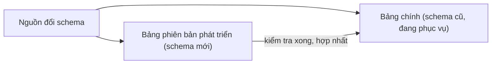
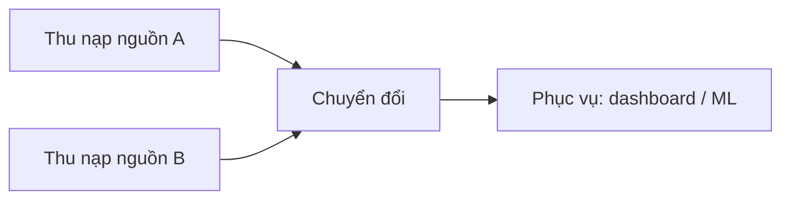

# Làm việc với ai, các yếu tố xuyên suốt và kết luận

Phần cuối Chương 7 chuyển từ kỹ thuật sang **con người và vận hành**: thu nạp nằm ở nhiều ranh giới tổ chức nên kỹ sư dữ liệu phải làm việc với các bên ngược dòng (producer) và xuôi dòng (consumer). Sau đó sách điểm lại các **yếu tố xuyên suốt** (undercurrents) nổi bật nhất ở giai đoạn thu nạp: bảo mật, quản lý dữ liệu, DataOps, orchestration, kỹ thuật phần mềm.

**Tương tự đơn giản:** đường ống nước đẹp đến mấy cũng vô dụng nếu bạn không biết nhà máy nước đang thay đổi gì, người dùng cuối cần gì, và không có đồng hồ đo để biết ống đang rò.

---

:::note[Ghi nhớ nhanh]

- ⭐ **Giao tiếp với kỹ sư phần mềm (ngược dòng)** là bước cải thiện chất lượng dữ liệu đầu tiên và rẻ nhất; mời họ trở thành bên liên quan, thu hút cả product manager.
- ⭐ **Giám sát pipeline thu nạp ngay từ đầu:** uptime, độ trễ, khối lượng dữ liệu; theo dõi các loại thời gian (tạo, nhập, xử lý).
- **Hãy hỏi "có cần dữ liệu nhạy cảm này không?"** trước khi mã hóa. Dữ liệu không thu thập thì không thể rò rỉ.
- **Schema change** là vấn đề chưa giải quyết; sách gợi ý hướng "kiểu Git": nhiều phiên bản bảng song song.
- Dữ liệu hồi quy âm thầm nguy hiểm hơn lỗi hệ thống rõ ràng; cần kiểm tra chất lượng, kể cả kiểm tra thống kê.
- Thu nạp tốn nhiều công sức nhưng là điều kiện để mọi ứng dụng dữ liệu hấp dẫn (analytics, ML) tồn tại.

:::

---

## Mục lục

- [1. Bạn sẽ làm việc với ai](#1-bạn-sẽ-làm-việc-với-ai)
- [2. Yếu tố xuyên suốt](#2-yếu-tố-xuyên-suốt)
- [3. Kết luận](#3-kết-luận)
- [Tóm tắt](#tóm-tắt)

## 1. Bạn sẽ làm việc với ai

Thu nạp nằm ở một số ranh giới tổ chức. Khi phát triển và quản lý pipeline thu nạp, kỹ sư dữ liệu làm việc với cả **con người và hệ thống** ở ngược dòng (producer dữ liệu) và xuôi dòng (consumer dữ liệu).

### 1.1. Các bên liên quan ngược dòng

Thường có **sự mất kết nối đáng kể** giữa những người tạo ra dữ liệu (thường là **kỹ sư phần mềm**) và kỹ sư dữ liệu (người chuẩn bị dữ liệu cho phân tích và data science). Hai nhóm thường ở các khu vực tổ chức riêng; nếu kỹ sư phần mềm có nghĩ về kỹ sư dữ liệu, họ thường chỉ coi đó là **consumer cuối dòng** hút dữ liệu từ ứng dụng của mình chứ không phải bên liên quan (stakeholder).

Sách xem đây vừa là **vấn đề** vừa là **cơ hội**. Kỹ sư dữ liệu có thể nâng chất lượng dữ liệu bằng cách **mời kỹ sư phần mềm làm stakeholder** trong kết quả của kỹ thuật dữ liệu. Đa số kỹ sư phần mềm biết rõ giá trị của analytics và data science, nhưng không nhất thiết có động lực phù hợp để đóng góp trực tiếp.

Các việc nên làm:

- **Cải thiện giao tiếp** là bước đầu quan trọng. Kỹ sư phần mềm thường đã nhận ra dữ liệu có giá trị tiềm năng cho hạ nguồn. Mở kênh liên lạc khuyến khích họ **hoàn thiện dữ liệu cho consumer** và **báo trước các thay đổi** để tránh làm hỏng pipeline (regression).
- **Làm nổi bật đóng góp** của kỹ sư phần mềm với đồng đội, lãnh đạo và đặc biệt là **product manager**. Khi product manager tham gia vào kết quả và coi việc xử lý dữ liệu phía sau là một phần của sản phẩm, họ sẽ sẵn lòng phân bổ nguồn lực phát triển phần mềm khan hiếm để cộng tác với kỹ sư dữ liệu.
- Lý tưởng: kỹ sư phần mềm làm việc **một phần như phần mở rộng của đội kỹ thuật dữ liệu**, cùng cộng tác trên các dự án như dựng **kiến trúc hướng sự kiện** để cho phép phân tích real time.

### 1.2. Các bên liên quan xuôi dòng

Ai là khách hàng cuối của thu nạp? Kỹ sư dữ liệu tập trung vào người làm dữ liệu và lãnh đạo kỹ thuật: data scientist, analyst, CTO. Nhưng cũng cần nhớ vòng tròn rộng hơn: CMO, phó chủ tịch chuỗi cung ứng, CEO.

Sách thường thấy kỹ sư dữ liệu theo đuổi **dự án phức tạp** (như streaming bus real time hay hệ thống dữ liệu tinh vi) trong khi nhà quản lý digital marketing ngồi cạnh vẫn **tải thủ công báo cáo Google Ads**. Hãy xem kỹ thuật dữ liệu như một **doanh nghiệp** và biết khách hàng của mình là ai. Tự động hóa thu nạp cơ bản thường có giá trị đáng kể, nhất là với các bộ phận như marketing: kiểm soát ngân sách lớn và là trung tâm tạo doanh thu. Công việc thu nạp cơ bản có vẻ tẻ nhạt, nhưng mang lại giá trị cho các bộ phận cốt lõi sẽ mở ra **cơ hội kỹ thuật dữ liệu dài hạn thú vị hơn và ngân sách lớn hơn**.

Cũng có thể mời **cấp điều hành** tham gia. Văn hóa dựa trên dữ liệu (data-driven) khá phổ biến ở lãnh đạo, nhưng kỹ sư dữ liệu và người làm dữ liệu có trách nhiệm **hướng dẫn họ về cấu trúc tốt nhất cho doanh nghiệp dựa trên dữ liệu**: truyền đạt giá trị của việc giảm rào cản giữa producer và kỹ sư dữ liệu, giúp lãnh đạo phá bỏ rào cản và đặt ra các cơ chế khuyến khích tạo nên một văn hóa dữ liệu thống nhất hơn.

Một lần nữa, **giao tiếp là khẩu hiệu**: trung thực, sớm và thường xuyên với các bên liên quan để thu nạp thực sự tăng thêm giá trị.

## 2. Yếu tố xuyên suốt

Hầu như mọi yếu tố xuyên suốt đều chạm tới giai đoạn thu nạp; sách nhấn mạnh những yếu tố nổi bật nhất.

### 2.1. Bảo mật

Di chuyển dữ liệu tạo ra **lỗ hổng bảo mật** vì phải chuyển giữa các vị trí. Điều cuối cùng bạn muốn là dữ liệu bị chặn bắt hoặc xâm phạm khi đang di chuyển.

- Xem xét dữ liệu **đang ở đâu** và **sẽ đi đâu**.
- Dữ liệu di chuyển trong **VPC** nên dùng endpoint an toàn và **không rời khỏi** biên VPC.
- Dùng **VPN** hoặc **kết nối riêng chuyên dụng** khi gửi dữ liệu giữa cloud và mạng tại chỗ. Tốn tiền, nhưng bảo mật là khoản đầu tư tốt.
- Nếu dữ liệu đi qua internet công cộng, phải đảm bảo đường truyền được **mã hóa**. Mã hóa dữ liệu trên mạng luôn là thực hành tốt.

### 2.2. Quản lý dữ liệu

Quản lý dữ liệu bắt đầu từ lúc thu nạp: đây là điểm khởi đầu cho **lập danh mục dữ liệu** (catalog) và **data lineage** (dòng dõi dữ liệu). Từ đây kỹ sư cần nghĩ về thay đổi schema, đạo đức, quyền riêng tư và tuân thủ.

#### Thay đổi schema

Theo sách, thay đổi schema (thêm, đổi, xóa cột trong bảng) vẫn là **vấn đề chưa giải quyết** trong quản lý dữ liệu. Hai cực:

- **Cực truyền thống:** quy trình xem xét kiểu "chỉ huy và kiểm soát" cẩn thận. Làm việc với khách hàng doanh nghiệp lớn, tác giả từng nghe báo thời gian thực hiện **sáu tháng** cho việc thêm **một** trường. Đây là rào cản không chấp nhận được với sự nhanh nhẹn.
- **Cực ngược lại:** mọi thay đổi schema ở nguồn kích hoạt việc **tạo lại bảng đích** với schema mới. Giải quyết vấn đề schema ở bước thu nạp nhưng vẫn có thể phá vỡ pipeline xuôi dòng và hệ thống lưu trữ đích.

**Hướng gợi ý của các tác giả:** áp dụng cách tiếp cận tiên phong bởi **Git**. Khi Linus Torvalds phát triển Git, nhiều lựa chọn của ông lấy cảm hứng từ hạn chế của **CVS** (Concurrent Versions System): CVS hoàn toàn tập trung, chỉ hỗ trợ một phiên bản mã chính thức duy nhất trên máy chủ trung tâm. Để Git thành hệ thống phân tán thật sự, Torvalds dùng khái niệm **cây**: mỗi developer có thể duy trì nhánh riêng rồi merge từ/đến các nhánh khác.

Với dữ liệu, cách này từng không tưởng tượng nổi: hệ thống MPP tại chỗ thường chạy ở mức dung lượng gần tối đa. Nhưng **lưu trữ trong data warehouse và cloud rất rẻ**, nên có thể duy trì **nhiều phiên bản của một bảng** với schema khác nhau, thậm chí với các phép biến đổi ngược dòng khác nhau. Các đội có thể hỗ trợ các phiên bản bảng "phát triển" khác nhau bằng công cụ orchestration như **Airflow**; thay đổi schema, biến đổi ngược dòng và thay đổi mã xuất hiện trước trong các bảng phát triển, rồi mới tới thay đổi chính thức ở bảng chính.

#### Đạo đức dữ liệu, quyền riêng tư và tuân thủ

Khách hàng thường hỏi cách **mã hóa dữ liệu nhạy cảm** trong database. Câu hỏi gốc phải đặt ra: **bạn có cần dữ liệu nhạy cảm đó không?** Câu hỏi này hay bị bỏ qua khi đặt yêu cầu và giải quyết vấn đề.

Kỹ sư dữ liệu nên **tự rèn thói quen** đặt câu hỏi này khi dựng pipeline. Khuynh hướng tự nhiên là hút dữ liệu nhạy cảm vào rồi chuyển sang bước tiếp theo. Nhưng nếu không cần thì tại sao thu thập? Tại sao không **loại bỏ các trường nhạy cảm trước khi lưu**? **Dữ liệu không thể bị rò rỉ nếu chưa từng được thu thập.**

Khi thực sự cần theo dõi danh tính nhạy cảm, thông lệ là dùng **tokenization** (mã thông báo) để ẩn danh danh tính trong huấn luyện và phân tích mô hình. Nhưng cần xem xét **nơi** dùng token. Nếu có thể, **băm** (hash) dữ liệu ngay tại thời điểm thu nạp.

Đôi khi không tránh được dữ liệu nhạy cảm (một số hệ thống phân tích phải trình bày thông tin định danh). Khi đó phải hành xử theo **chuẩn đạo đức cao nhất**, và có thể áp dụng các biện pháp giảm tiếp xúc trực tiếp:

- Hướng tới **zero-touch production** (production không chạm tay): kỹ sư phát triển và kiểm thử mã trên dữ liệu **mô phỏng hoặc đã làm sạch** ở môi trường dev và staging, nhưng **tự động triển khai** mã lên production.
- Zero-touch là lý tưởng; vẫn sẽ có tình huống không tái hiện được ở dev/staging (lỗi chỉ tái tạo được khi xem dữ liệu thật). Với những trường hợp này, áp dụng quy trình **"break-glass" (kính vỡ)**: cần **ít nhất hai người phê duyệt** quyền truy cập dữ liệu nhạy cảm trên production. Quyền truy cập phải giới hạn chặt cho **một vấn đề cụ thể** và có **ngày hết hạn**.

Lời khuyên cuối: cảnh giác với **giải pháp công nghệ ngây thơ cho vấn đề con người**. Mã hóa và tokenization thường bị coi là "viên đạn bạc" cho quyền riêng tư. Hầu hết hệ thống lưu trữ cloud và gần như mọi database đã **mã hóa dữ liệu ở trạng thái nghỉ và đang truyền theo mặc định**. Theo sách, vấn đề thường không phải mã hóa mà là **truy cập dữ liệu**: nên thêm một lớp mã hóa cho một trường, hay kiểm soát quyền truy cập vào trường đó? Rốt cuộc vẫn phải quản lý chặt quyền truy cập vào khóa mã hóa. Có trường hợp hợp lệ cho mã hóa một trường, nhưng hãy đề phòng "mã hóa theo nghi thức" (cargo cult).

Về tokenization, dùng thường thức và đánh giá các kịch bản truy cập: nếu ai đó có email một khách hàng, họ có băm email đó dễ dàng rồi tìm thấy khách hàng trong dữ liệu của bạn không? Băm thiếu suy nghĩ, không thêm **salt** (muối) và chiến lược khác, có thể không bảo vệ quyền riêng tư tốt như bạn nghĩ.

### 2.3. DataOps

Data pipeline đáng tin cậy là **nền tảng** của vòng đời kỹ thuật dữ liệu. Khi chúng hỏng, mọi thứ phụ thuộc phía sau đều dừng: warehouse và lake không được nạp dữ liệu mới, data scientist và analyst không làm việc được, doanh nghiệp "bay mù".

**Giám sát** pipeline là bước quan trọng cho độ tin cậy và ứng phó sự cố. Nếu có một giai đoạn nào mà giám sát đặc biệt quan trọng thì đó là thu nạp. Giám sát yếu hoặc không có nghĩa là pipeline có thể chạy hoặc không mà bạn không biết. Nhớ theo dõi các khía cạnh thời gian: thời điểm **tạo, thu nạp, xử lý** và thời điểm xảy ra sự kiện. Pipeline phải xử lý dữ liệu batch hoặc stream một cách **có thể dự đoán**.

Sách đã thấy vô số ví dụ báo cáo và mô hình ML được dựng từ **dữ liệu cũ**. Trong một trường hợp cực đoan, lỗi pipeline thu nạp không bị phát hiện suốt **sáu tháng**. Điều này tránh được nhiều nhờ giám sát đúng cách.

Nên theo dõi gì? **Uptime, độ trễ và khối lượng dữ liệu được xử lý** là điểm xuất phát tốt. Nếu job thu nạp lỗi, bạn phản ứng thế nào? Nói chung, **xây giám sát vào pipeline ngay từ đầu**, đừng chờ đến khi triển khai.

Cũng cần hiểu hoạt động của **hệ thống ngược dòng** bạn phụ thuộc và cách chúng sinh dữ liệu: biết số sự kiện sinh ra trong mỗi khoảng thời gian bạn quan tâm (sự kiện/phút, sự kiện/giây) và **kích thước trung bình** mỗi sự kiện. Pipeline phải xử lý được cả **tần suất lẫn kích thước** sự kiện.

Điều này cũng áp dụng cho **dịch vụ bên thứ ba**. Khi dùng chúng, thứ bạn đạt được ở hiệu quả vận hành tinh gọn (ít nhân sự hơn) bị đánh đổi bằng việc tin vào các hệ thống **ngoài tầm kiểm soát**. Câu hỏi: bạn sẽ được cảnh báo thế nào khi dịch vụ đó ngừng hoạt động? Kế hoạch ứng phó khi dịch vụ phụ thuộc đột ngột sập là gì? Đáng buồn là **không có kế hoạch ứng phó chung** cho lỗi bên thứ ba. Nếu có thể failover sang máy chủ khác, tốt nhất ở region/khu vực khác, hãy thiết lập.

Nếu pipeline thu nạp **tự xây**, bạn có tự động hóa triển khai và kiểm thử để đảm bảo mã chạy được trên production? Nếu mã lỗi, bạn có **rollback** về phiên bản chạy được không?

### 2.4. Kiểm tra chất lượng dữ liệu

Sách thường coi dữ liệu là **kẻ giết người thầm lặng**. Nếu dữ liệu chất lượng, hợp lệ là nền tảng thành công, thì dùng **dữ liệu xấu để ra quyết định còn tệ hơn không có dữ liệu**. Dữ liệu xấu đã gây thiệt hại khôn lường; các thảm họa này đôi khi gọi là **data cascades** (dữ liệu "thác lũ", lỗi dữ liệu lan chuyền thành hậu quả lớn).

Dữ liệu có tính **entropic**: hay thay đổi theo cách không ngờ mà không báo trước. Một khác biệt cố hữu giữa **DevOps** và **DataOps**: với phần mềm ta chỉ mong đợi hồi quy (regression) khi **triển khai thay đổi**, còn dữ liệu thường **hồi quy độc lập** do các sự kiện ngoài tầm kiểm soát.

Kỹ sư DevOps phát hiện sự cố bằng **điều kiện nhị phân**: tỷ lệ request lỗi có vượt ngưỡng? Độ trễ phản hồi thế nào? Trong không gian dữ liệu, hồi quy thường biểu hiện thành **những biến dạng thống kê tinh vi**. Thay đổi thống kê về cụm từ tìm kiếm có phải do hành vi khách hàng? Hay lưu lượng bot tăng vọt lọt qua? Hay do công cụ kiểm thử website triển khai ở bộ phận khác?

Một số hồi quy dữ liệu **lộ ngay**. Ví dụ đầu những năm 2000, Google cung cấp cụm từ tìm kiếm cho website khi người dùng đến từ tìm kiếm. Năm 2011, Google bắt đầu **giữ lại** thông tin này trong một số trường hợp để bảo vệ quyền riêng tư; các nhà phân tích nhanh chóng thấy dòng **"not provided"** nổi lên đầu báo cáo.

Hồi quy dữ liệu thực sự nguy hiểm thì **âm thầm**, có thể đến từ trong hoặc ngoài doanh nghiệp: developer ứng dụng đổi ý nghĩa trường database mà không thông báo đủ cho đội dữ liệu; thay đổi ở nguồn bên thứ ba không ai để ý. Trường hợp tốt nhất báo cáo hỏng rõ ràng; thường thì **số liệu kinh doanh bị bóp méo** mà người ra quyết định không biết.

Khuyến nghị:

- Khi có thể, **làm việc với kỹ sư phần mềm để sửa chất lượng dữ liệu ngay tại nguồn**. Nhiều vấn đề chất lượng giải quyết được chỉ bằng cách tôn trọng thực hành cơ bản tốt nhất của kỹ thuật phần mềm: **log** để ghi lịch sử thay đổi dữ liệu, kiểm tra (null...), xử lý ngoại lệ (try/catch).
- Công cụ kiểm tra dữ liệu truyền thống dựa trên **logic nhị phân** đơn giản: giá trị null có xuất hiện ở trường không được null không? Có mục mới bất ngờ trong cột phân loại không? **Kiểm tra dữ liệu thống kê** là lĩnh vực mới nhưng có khả năng phát triển đáng kể trong khoảng 5 năm tới.

*Ví dụ minh hoạ (người viết thêm):* kiểm tra nhị phân hỏi "cột `country` có null không"; kiểm tra thống kê hỏi "tỉ lệ đơn hàng từ Việt Nam hôm nay có bất thường so với trung bình 30 ngày không".

### 2.5. Orchestration

Thu nạp thường nằm ở **đầu một đồ thị dữ liệu lớn và phức tạp**: vì là giai đoạn đầu tiên, dữ liệu thu nạp chảy qua nhiều bước xử lý khác, và dữ liệu từ nhiều nguồn kết hợp theo cách phức tạp. Orchestration là quá trình quan trọng để điều phối các bước này.

Tổ chức ở giai đoạn đầu của độ chín dữ liệu có thể chọn triển khai thu nạp bằng **cron job** (job định kỳ đơn giản). Nhưng cách này **mong manh** và có thể làm chậm tốc độ triển khai và phát triển kỹ thuật dữ liệu.

Khi pipeline phức tạp lên, cần **orchestration thực sự**: hệ thống có khả năng lập lịch **cả đồ thị tác vụ** chứ không phải từng tác vụ riêng lẻ. Orchestration khởi động từng job thu nạp đúng giờ; các bước xử lý và chuyển đổi xuôi dòng bắt đầu khi job thu nạp hoàn tất; và các bước xử lý tiếp tục dẫn tới các bước bổ sung.

### 2.6. Kỹ thuật phần mềm

Giai đoạn thu nạp **rất sâu về kỹ thuật**. Nó nằm ở **rìa** của miền kỹ thuật dữ liệu và thường giao tiếp với các hệ thống bên ngoài, nơi kỹ sư phần mềm và dữ liệu phải dựng nhiều "ống nước" tùy chỉnh.

Đằng sau hậu trường, thu nạp cực kỳ phức tạp: có đội vận hành framework mã nguồn mở như **Kafka** hoặc **Pulsar**, hay một số công ty công nghệ lớn nhất vận hành giải pháp thu nạp tự fork hoặc "cây nhà lá vườn". Như đã bàn, các connector dữ liệu managed (**Fivetran, Matillion, Airbyte**) đã đơn giản hóa thu nạp. Kỹ sư dữ liệu nên tận dụng công cụ tốt nhất hiện có, chủ yếu là công cụ và dịch vụ managed lo phần nặng nhọc, và **phát triển năng lực phần mềm cao ở các lĩnh vực then chốt**. Nên dùng **kiểm soát phiên bản, code review** thích hợp và triển khai **kiểm thử** phù hợp, ngay cả cho mã liên quan thu nạp.

Khi viết phần mềm, mã phải **được tách rời (decoupled)**. Tránh viết monolith có phụ thuộc chặt vào hệ thống nguồn hoặc đích.

## 3. Kết luận

Với kỹ sư dữ liệu, thu nạp có thể sẽ chiếm **phần đáng kể năng lượng và công sức**. Trọng tâm là "hệ thống ống nước": nối pipeline với pipeline khác, bảo đảm dữ liệu truyền **nhất quán và an toàn** tới đích. Đôi khi các chi tiết vụn vặt khiến công việc có vẻ tẻ nhạt, nhưng các ứng dụng dữ liệu hấp dẫn (analytics, ML) **không thể có nếu thiếu nó**.

Chúng ta cũng đang ở giữa một **chuyển dịch lớn từ batch sang streaming**. Đây là cơ hội để kỹ sư dữ liệu khám phá các ứng dụng streaming thú vị, truyền đạt chúng cho doanh nghiệp và triển khai công nghệ mới.

**Tài nguyên bổ sung** (theo sách):

- Trang web "Connections and Sync Modes" của Airbyte.
- Chương 6 "Batch Is a Special Case of Streaming" trong *Introduction to Apache Flink* (Ellen Friedman, Kostas Tzoumas, O'Reilly).
- Bài báo "The Dataflow Model: A Practical Approach to Balancing Correctness, Latency, and Cost in Massive-Scale, Unbounded, Out-of-Order Data Processing" (Tyler Akidau và cộng sự).
- Trang "Streaming Pipelines" của Google Cloud.
- Tài liệu "Snapshot Window (Azure Stream Analytics)" của Microsoft.

## Tóm tắt

| Chủ đề | Điểm cần nhớ |
|---|---|
| Bên ngược dòng | Kỹ sư phần mềm và product manager; mở kênh giao tiếp, coi họ là stakeholder |
| Bên xuôi dòng | Data scientist, analyst và cả lãnh đạo kinh doanh; tự động hóa cơ bản cho marketing có giá trị lớn |
| Bảo mật | Dùng VPC endpoint, VPN/đường riêng, mã hóa trên đường truyền |
| Schema change | Tránh cả quy trình quá chậm lẫn tái tạo bảng tự động; hướng gợi ý: nhiều phiên bản bảng kiểu Git |
| Quyền riêng tư | Hỏi có cần dữ liệu nhạy cảm không; băm khi thu nạp; zero-touch production; break-glass 2 người duyệt |
| DataOps | Giám sát uptime, độ trễ, khối lượng; có kế hoạch cho lỗi bên thứ ba; tự động triển khai và rollback |
| Chất lượng dữ liệu | Hồi quy dữ liệu âm thầm; sửa ở nguồn; kiểm tra thống kê sẽ phát triển |
| Orchestration | Từ cron job sang điều phối cả đồ thị tác vụ |
| Kỹ thuật phần mềm | Dùng công cụ managed; version control, review, test; mã tách rời |
