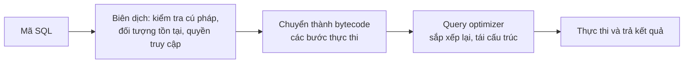
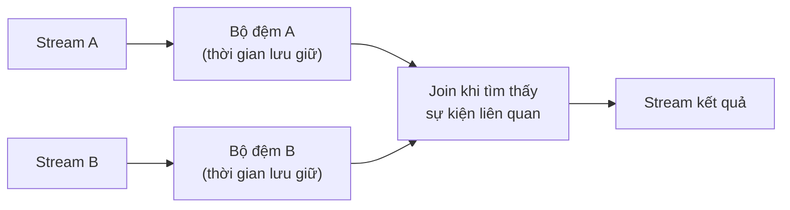

# Truy vấn (Queries)

Các chương trước chủ yếu nói về việc đưa dữ liệu từ nơi này sang nơi khác hoặc lưu trữ nó. Chương 8 trả lời câu hỏi: **làm sao để dữ liệu thực sự hữu ích**, thông qua ba việc là truy vấn (query), mô hình hoá (data modeling) và chuyển đổi (transformation). Bài này mở đầu chương và đi sâu vào phần **truy vấn**: truy vấn là gì, chạy thế nào, làm sao cho nhanh và rẻ, và truy vấn trên dữ liệu streaming khác gì batch.

Sách tập trung vào truy vấn trên hệ thống **OLAP** (data warehouse, data lake) với dữ liệu có cấu trúc và bán cấu trúc, dùng SQL làm ngôn ngữ chính. Để cho gọn, sách dùng từ "cơ sở dữ liệu" (database) để chỉ chung query engine cùng nơi lưu trữ mà nó truy vấn, kể cả data warehouse đám mây hay Spark đọc file Parquet trên S3.

**Tương tự đơn giản:** viết SQL giống như gọi món ở nhà hàng. Bạn chỉ nói "tôi muốn gì", còn bếp (query engine và optimizer) quyết định nấu theo thứ tự nào cho nhanh. Hiểu cách bếp làm việc giúp bạn gọi món để bếp đỡ vất vả và hoá đơn đỡ đắt.

---

:::note[Ghi nhớ nhanh]

- ⭐ **Query optimizer quyết định tốc độ truy vấn** — bạn không điều khiển trực tiếp, nhưng đọc được `EXPLAIN` plan và hiểu nó làm gì sẽ giúp viết truy vấn tốt hơn nhiều.
- ⭐ **Chỉ quét dữ liệu bạn cần** — tránh `SELECT *` không điều kiện, dùng pruning (chọn cột, partition, clustering key, index) để giảm lượng dữ liệu quét, đặc biệt với DB tính tiền theo lượng quét.
- **Cẩn thận row explosion** khi join các khoá bị lặp, và ưu tiên CTE thay cho subquery lồng nhau để dễ đọc.
- **Mô hình commit khác nhau giữa các DB** (PostgreSQL, BigQuery, MongoDB) — phải biết DB của mình xử lý nhất quán và ghi đồng thời ra sao.
- **Truy vấn streaming** dựa trên cửa sổ (session, tumbling, sliding), trigger và watermark; join stream cần bộ đệm có thời gian lưu giữ.

:::

---

## Mục lục

- 1. Truy vấn là gì (DDL, DML, DCL, TCL)
- 2. Vòng đời của một truy vấn và query optimizer
- 3. Cải thiện hiệu suất truy vấn
- 4. Truy vấn trên dữ liệu streaming
- Tóm tắt

---

## 1. Truy vấn là gì

Truy vấn cho phép bạn **truy xuất và tác động lên dữ liệu**. Nhắc lại CRUD ở Chương 5: khi truy vấn lấy dữ liệu, đó là thao tác **R (Read)**. Ví dụ:

```sql
SELECT * FROM foo;            -- lấy mọi bản ghi của bảng foo
SELECT * FROM foo WHERE id=1; -- dùng predicate (điều kiện lọc) để chỉ lấy bản ghi có id = 1
```

Nhiều DB còn cho phép **C, U, D** (tạo, cập nhật, xoá). Các nhóm lệnh SQL thường gặp:

### DDL (Data Definition Language) — ngôn ngữ định nghĩa dữ liệu

Dùng để tạo và định nghĩa **đối tượng** trong DB (database, schema, bảng, người dùng). DDL quy định *trạng thái* của các đối tượng đó. Các lệnh thường dùng: `CREATE`, `DROP`, và sửa đổi cấu trúc (sách ghi là `UPDATE`, nhưng trong SQL chuẩn lệnh sửa cấu trúc đối tượng là `ALTER`).

```sql
CREATE DATABASE bar;
CREATE TABLE bar_table (...);
DROP TABLE bar_table;
```

### DML (Data Manipulation Language) — ngôn ngữ thao tác dữ liệu

Sau khi có đối tượng, DML thêm và thay đổi **dữ liệu** bên trong: `SELECT`, `INSERT`, `UPDATE`, `DELETE`, `COPY`, `MERGE`. Ví dụ: `INSERT` một bản ghi mới, `UPDATE` bản ghi sẵn có, `SELECT` những bản ghi cụ thể.

### DCL (Data Control Language) — ngôn ngữ kiểm soát dữ liệu

Kiểm soát **quyền truy cập**: `GRANT`, `DENY`, `REVOKE`. Ví dụ sách đưa ra: nhà khoa học dữ liệu mới tên Sarah cần quyền đọc `data_science_db`; vài tháng sau cô nghỉ việc nên phải thu hồi quyền.

```sql
-- Cấp quyền đọc cho Sarah
GRANT SELECT ON data_science_db TO Sarah;
-- Thu hồi quyền khi cô ấy rời công ty (cú pháp chuẩn dùng FROM)
REVOKE SELECT ON data_science_db FROM Sarah;
```

Hiểu DCL giúp bạn xử lý khi ai đó không truy cập được dữ liệu cần thiết, và ngược lại ngăn người không nên thấy dữ liệu.

### TCL (Transaction Control Language) — ngôn ngữ kiểm soát giao dịch

Điều khiển chi tiết giao dịch: xác định điểm commit, điều kiện để rollback. Hai lệnh phổ biến: `COMMIT` và `ROLLBACK`.

| Nhóm | Mục đích | Lệnh tiêu biểu |
|---|---|---|
| DDL | Định nghĩa đối tượng DB | CREATE, DROP, ALTER |
| DML | Đọc/ghi dữ liệu | SELECT, INSERT, UPDATE, DELETE, COPY, MERGE |
| DCL | Phân quyền | GRANT, DENY, REVOKE |
| TCL | Giao dịch | COMMIT, ROLLBACK |

---

## 2. Vòng đời của một truy vấn và query optimizer

Chạy SQL trông đơn giản (viết, chạy, nhận kết quả) nhưng bên dưới có nhiều bước:



1. DB **biên dịch** SQL: phân tích cú pháp, kiểm tra ngữ nghĩa, xác nhận các đối tượng được tham chiếu có tồn tại và người dùng hiện tại có quyền.
2. SQL được chuyển thành **bytecode** (mã trung gian): biểu diễn các bước phải làm theo dạng máy đọc được, hiệu quả.
3. **Query optimizer** phân tích bytecode để quyết định cách thực hiện, sắp xếp lại và tái cấu trúc sao cho dùng tài nguyên hiệu quả nhất.
4. Truy vấn được **thực thi** và trả kết quả.

### Query optimizer

Cùng một truy vấn có thể chạy nhanh chậm rất khác nhau tuỳ cách thực thi. Việc của optimizer là chia truy vấn thành các bước hợp lý theo thứ tự hiệu quả, dựa trên join, index, kích thước dữ liệu phải quét và nhiều yếu tố khác, để **tốn ít chi phí nhất**. Mỗi DB có optimizer khác nhau. Bạn không làm việc trực tiếp với optimizer, nhưng hiểu chức năng của nó giúp viết truy vấn hiệu quả hơn, và bạn cần biết phân tích hiệu suất bằng `EXPLAIN` plan hoặc công cụ profiling truy vấn.

---

## 3. Cải thiện hiệu suất truy vấn

Gặp truy vấn chậm là chuyện tất yếu. Nguyên tắc của sách: **đừng chống lại DB của bạn**, hãy học cách phát huy điểm mạnh và bù đắp điểm yếu của nó.

### 3.1. Tối ưu chiến lược join và schema

Một tập dữ liệu đơn lẻ hiếm khi hữu ích; giá trị đến từ việc kết hợp nhiều tập. Sách giả định bạn đã quen các loại join (inner, outer, left, cross) và các kiểu quan hệ (1-1, 1-nhiều, nhiều-1, nhiều-nhiều). Ngay cả DB dạng cột (trước đây nổi tiếng join chậm) nay thường join rất tốt.

Các kỹ thuật:

- **Pre-join (nối trước dữ liệu):** nếu các truy vấn phân tích cứ lặp đi lặp lại cùng một phép join, hãy nối sẵn một lần rồi cho truy vấn đọc từ bản đã nối. Cách làm: nới lỏng chuẩn hoá để làm bảng rộng hơn, dùng kiểu dữ liệu mới (array, struct) thay cho quan hệ thực thể hay phải join; hoặc giữ schema chuẩn hoá nhưng tạo thêm các bảng nối sẵn cho những use case phổ biến; hoặc dùng materialized view (xem bài 4).
- **Đơn giản hoá điều kiện join:** logic join phức tạp tốn nhiều tính toán. Nhiều DB hướng hàng cho phép đánh index trên giá trị tính toán, ví dụ PostgreSQL cho tạo index trên chuỗi đã chuyển chữ thường; khi optimizer gặp hàm `lower()` trong predicate nó có thể dùng index. Hoặc tạo cột dẫn xuất mới để join (nhưng phải hướng dẫn người dùng join trên cột này).

### 3.2. Row explosion (bùng nổ số hàng)

Xảy ra khi có rất nhiều kết quả khớp **nhiều-nhiều** do khoá join bị lặp hoặc do logic join.

**Ví dụ:** khoá join trong bảng A có giá trị X lặp 5 lần, bảng B cũng có X lặp 10 lần. Kết quả là tích chéo: 5 × 10 = 50 hàng đầu ra. Nếu còn nhiều khoá lặp khác nữa, số hàng tăng vọt, ngốn tài nguyên hoặc làm truy vấn thất bại.

Cần biết optimizer của DB xử lý join thế nào. Có DB tự sắp xếp lại join và predicate, có DB thì không. Nếu row explosion xảy ra ở giai đoạn đầu của truy vấn thì truy vấn có thể thất bại dù predicate phía sau sẽ loại bỏ các bản lặp. Đưa predicate lên sớm có thể giảm mạnh tài nguyên.

### 3.3. Dùng CTE thay vì subquery lồng nhau

**CTE (Common Table Expression, biểu thức bảng chung)** cho phép soạn truy vấn phức tạp theo cách dễ đọc, dễ nắm luồng xử lý. Khả năng đọc của truy vấn phức tạp rất quan trọng. CTE cũng thường nhanh hơn việc tạo bảng trung gian bằng script; nếu buộc phải tạo bảng trung gian thì cân nhắc bảng tạm (temporary table).

```sql
-- Ví dụ minh hoạ (do người ghi chép thêm)
WITH don_hang_ngay AS (
    SELECT customer_id, COUNT(*) AS so_don, SUM(amount) AS tong_tien
    FROM orders
    WHERE order_date = '2022-03-01'
    GROUP BY customer_id
)
SELECT c.name, d.so_don, d.tong_tien
FROM don_hang_ngay d
JOIN customers c ON c.id = d.customer_id;
```

### 3.4. Dùng EXPLAIN plan và theo dõi hiệu suất

`EXPLAIN` plan cho biết optimizer chọn kế hoạch rẻ nhất ra sao, các đối tượng DB được dùng (bảng, index, cache...), cùng thống kê hiệu suất và mức tiêu thụ tài nguyên ở từng giai đoạn. Một số DB hiển thị trực quan, số khác trả về qua lệnh `EXPLAIN` bằng SQL.

Ngoài `EXPLAIN`, nên **giám sát** các chỉ số:

- Mức dùng tài nguyên quan trọng: đĩa, bộ nhớ, mạng.
- Thời gian tải dữ liệu so với thời gian xử lý (processing time).
- Thời gian chạy truy vấn, số bản ghi, kích thước dữ liệu quét, lượng dữ liệu bị shuffle.
- Các truy vấn cạnh tranh gây tranh chấp tài nguyên.
- Số kết nối đồng thời đang dùng so với số kết nối có sẵn (đăng ký quá mức sẽ khiến người dùng không kết nối được).

### 3.5. Tránh quét toàn bộ bảng (full table scan)

Mọi truy vấn đều quét dữ liệu nhưng không phải lần quét nào cũng như nhau. Nguyên tắc: **chỉ truy vấn dữ liệu bạn cần**. `SELECT *` không predicate là quét cả bảng, lấy mọi hàng và cột, rất kém và tốn kém, nhất là với DB trả tiền theo lượng byte quét hoặc thời gian tính toán.

Hãy dùng **pruning (cắt tỉa)** để giảm lượng dữ liệu quét. Cách làm khác nhau theo kiểu DB:

| Kiểu DB | Cách pruning |
|---|---|
| Hướng cột (columnar) | Chỉ chọn những cột cần dùng. Với bảng rất lớn (hàng terabyte), Snowflake và BigQuery cho định nghĩa **clustering key** để sắp xếp dữ liệu giúp truy cập từng phần hiệu quả. BigQuery còn cho **partition** bảng thành các phân đoạn nhỏ để chỉ truy vấn partition cần thiết. (Chọn clustering/partition key không phù hợp có thể làm giảm hiệu suất.) |
| Hướng hàng (row-oriented) | Chủ yếu dựa vào **index** của bảng (đã học ở Chương 6). Tạo index phục vụ các truy vấn nhạy cảm nhất về hiệu suất, nhưng không đánh quá nhiều index vì sẽ làm chậm lại. |

### 3.6. Hiểu cách DB xử lý commit

**Commit** là một thay đổi trong DB: tạo, cập nhật, xoá bản ghi, bảng hoặc đối tượng khác. Nhiều DB hỗ trợ **transaction (giao dịch)**: thực hiện nhiều thao tác cùng lúc mà vẫn giữ trạng thái nhất quán, kể cả khi có lỗi, và xử lý cô lập (isolation) khi nhiều sự kiện đồng thời đọc, ghi, xoá cùng một đối tượng. (Thuật ngữ "transaction" hơi bị dùng quá tải, xem lại Chương 5.)

Bạn cần biết DB của mình xử lý commit và giao dịch thế nào và mức nhất quán của kết quả truy vấn là gì. Nó có tuân thủ **ACID** không? Nếu không, có thể gặp **dirty read** (đọc một hàng mà giao dịch chưa commit đã thay đổi). Dirty read có phải hành vi chấp nhận được không, và bạn xử lý nó thế nào? Ngoài ra, khi cập nhật/xoá theo giao dịch, một số DB tạo file mới để biểu diễn trạng thái mới và giữ file cũ làm điểm tham chiếu khi lỗi. Chạy rất nhiều commit nhỏ trong các DB này tạo ra nhiều file rác, tốn lưu trữ và phải dọn định kỳ.

Sách so sánh ba DB (tính đến thời điểm viết sách):

| DB | Mô hình commit | Ưu điểm | Nhược điểm |
|---|---|---|---|
| **PostgreSQL** (RDBMS, ACID) | Mỗi giao dịch là một gói thao tác cùng thành công hoặc cùng thất bại; truy vấn phân tích thấy bức tranh nhất quán tại một thời điểm | Tính nhất quán chặt | Cần **khoá hàng** (chặn đọc/ghi một số hàng), làm giảm hiệu suất; không tối ưu cho quét lớn hay lượng dữ liệu khổng lồ của phân tích quy mô lớn |
| **BigQuery** | Commit toàn bảng theo thời điểm (snapshot) | Truy vấn đọc luôn đọc từ snapshot đã commit mới nhất, dù chạy 1 giây hay 2 giờ; không khoá bảng khi đọc; ghi tiếp theo tạo commit và snapshot mới | Chỉ cho **một thao tác ghi tại một thời điểm** (ghi đồng thời bị xếp hàng theo thứ tự đến), dù một truy vấn ghi vẫn song song hoá ghi lượng lớn dữ liệu. Snowflake, Spark và các hệ khác dùng mô hình tương tự |
| **MongoDB** | Nhất quán thay đổi được (variable consistency): cấu hình mức nhất quán ở cả cấp DB và từng truy vấn | Khả năng mở rộng và ghi đồng thời rất tốt | Ở một số chế độ, khi quá tải nó có thể **âm thầm loại bỏ ngẫu nhiên các thao tác ghi**. Hợp với ứng dụng chấp nhận mất một phần dữ liệu (ví dụ IoT chỉ cần nhiều phép đo), không hợp với ứng dụng cần dữ liệu và số liệu chính xác |

Sách nhấn mạnh: đây đều là DB tốt khi chọn đúng ứng dụng và cấu hình đúng. Kỹ sư phải hiểu sâu bài toán và công cụ; chọn và cấu hình công nghệ đúng có thể là khác biệt giữa thành công và thất bại lớn (xem thêm Chương 6 về tính nhất quán).

### 3.7. Dọn bản ghi đã xoá bằng VACUUM

Do giao dịch cập nhật/xoá/lập index tạo ra bản ghi mới nhưng vẫn giữ bản ghi cũ (để có thể quay lại trạng thái trước), các **dead record** (bản ghi chết) tích tụ dần và hết cần thiết. Quy trình loại bỏ chúng gọi là **VACUUM**; có thể VACUUM một bảng, nhiều bảng hoặc cả DB.

Lý do cần VACUUM:

1. Giải phóng chỗ cho bản ghi mới: bảng bớt phình, truy vấn nhanh hơn.
2. Bản ghi mới, đúng giúp **query plan chính xác hơn**; bản ghi lỗi thời khiến optimizer đưa ra kế hoạch dưới tối ưu.
3. Loại bỏ các index xấu, cải thiện hiệu suất index.

Cách xử lý theo loại DB:

- **DB dựa trên object storage (BigQuery, Snowflake, Databricks):** nhược điểm duy nhất của việc giữ dữ liệu cũ là tốn dung lượng (chi phí tuỳ mô hình giá lưu trữ). Snowflake không cho VACUUM trực tiếp, bạn chỉnh khoảng thời gian **time travel** để quyết định giữ snapshot bao lâu trước khi tự động VACUUM. BigQuery dùng cửa sổ lịch sử cố định 7 ngày. Databricks thường giữ dữ liệu vô thời hạn cho đến khi VACUUM thủ công; VACUUM quan trọng để kiểm soát chi phí lưu trữ S3.
- **Amazon Redshift:** VACUUM chạy tự động ở nền, nhưng đôi khi người dùng chạy thủ công để tinh chỉnh vì nó ảnh hưởng hiệu suất và dung lượng.
- **DB quan hệ như PostgreSQL, MySQL:** VACUUM càng quan trọng, vì lượng lớn giao dịch có thể làm dead record tích tụ nhanh; kỹ sư cần nắm rõ chi tiết và tác động của nó.

### 3.8. Tận dụng cache kết quả truy vấn

Giả sử một truy vấn nặng chạy thường xuyên trên DB tính phí theo lượng dữ liệu truy vấn; mỗi lần chạy đều tốn tiền. Nhiều DB OLAP đám mây **cache kết quả truy vấn**. Lần đầu chạy là **cold query** (truy vấn nguội, tương tự khái niệm dữ liệu nguội ở Chương 6): lấy dữ liệu từ nhiều nguồn, lọc, join, ví dụ mất 40 giây. Chạy lại cùng truy vấn có thể trả kết quả trong 1 giây hoặc ít hơn vì kết quả đã được cache. Hãy tận dụng để giảm áp lực lên DB và cho trải nghiệm tốt hơn với các truy vấn chạy thường xuyên. Materialized view cũng là một dạng cache truy vấn khác (xem bài 4).

---

## 4. Truy vấn trên dữ liệu streaming

Dữ liệu streaming **luôn chuyển động**, nên truy vấn nó khác truy vấn batch: ta phải điều chỉnh mẫu truy vấn cho hợp với bản chất thời gian thực. Các hệ thống như Kafka và Pulsar giúp truy vấn nguồn streaming dễ hơn.

### 4.1. Các mẫu truy vấn cơ bản trên stream

#### Fast-follower (CDC theo sát)

Nhắc lại CDC liên tục ở Chương 7: về cơ bản nó biến DB phân tích thành một DB "bám sát" (follower) DB production. Một trong những mẫu truy vấn streaming lâu đời nhất là truy vấn DB phân tích này để lấy kết quả và tổng hợp thống kê với độ trễ nhỏ so với production.

Vì sao không chạy thẳng trên DB production? Về nguyên tắc được, trên thực tế thì không: DB production thường không đủ sức vừa xử lý workload production vừa chạy quét phân tích lớn, nên có thể làm chậm hoặc làm sập ứng dụng. Mẫu CDC cơ bản cho phép phân tích gần thời gian thực mà tác động tối thiểu lên production.

Có thể dùng DB giao dịch thường làm follower, nhưng hệ thống hướng OLAP thực thụ có lợi thế rõ rệt. Druid và BigQuery kết hợp **bộ đệm streaming** với **lưu trữ cột dài hạn**, hơi giống kiến trúc Lambda (Chương 3), rất hiệu quả để tính thống kê trên dữ liệu lịch sử rộng với cập nhật gần thời gian thực.

**Giới hạn:** cách này không thay đổi căn bản mẫu truy vấn batch. Bạn vẫn chạy `SELECT` trên trạng thái hiện tại của bảng và bỏ lỡ cơ hội kích hoạt sự kiện một cách động dựa trên thay đổi trong stream.

#### Kiến trúc Kappa

Kappa (Chương 3) coi mọi dữ liệu là **sự kiện** và lưu chúng dưới dạng **stream** thay vì bảng. Nguồn là DB production thì lưu các sự kiện CDC; stream cũng có thể đến trực tiếp từ backend ứng dụng, đội thiết bị IoT hoặc hệ thống bất kỳ sinh sự kiện. Thay vì chỉ xem hệ thống lưu trữ streaming là bộ đệm, Kappa **giữ sự kiện lâu hơn** (tháng hoặc năm, trong khi hệ thống thời gian thực thuần tuý thường chỉ giữ tối đa khoảng một tuần) và cho truy vấn trực tiếp từ đó.

"Ý tưởng lớn" của Kappa: coi hệ lưu trữ streaming vừa là **lớp vận chuyển thời gian thực**, vừa là **DB để truy xuất và truy vấn dữ liệu lịch sử**. Truy vấn có thể thực hiện bằng khả năng truy vấn sẵn có của hệ thống (ví dụ Kafka KSQL hỗ trợ tổng hợp, thống kê, thậm chí sessionization) hoặc công cụ ngoài. Nếu truy vấn phức tạp hơn hoặc cần kết hợp nguồn khác, công cụ như Spark đọc một khoảng thời gian dữ liệu từ Kafka rồi tính kết quả. Hệ lưu trữ streaming cũng có thể cấp dữ liệu cho ứng dụng khác hoặc stream processor như Flink, Beam.

### 4.2. Cửa sổ, trigger, emitted metric và dữ liệu đến muộn

Điểm hạn chế cơ bản của truy vấn batch truyền thống: query engine giống một **người quan sát bên ngoài**, có tác nhân bên ngoài kích hoạt (job theo giờ, quản lý sản phẩm mở dashboard). Ngược lại, hầu hết hệ thống streaming phổ biến hỗ trợ tính toán **kích hoạt trực tiếp từ dữ liệu**: ví dụ đưa ra trung bình/median mỗi khi thu đủ một số bản ghi trong bộ đệm, hay xuất bản tóm tắt khi một phiên người dùng đóng.

**Window (cửa sổ)** là tính năng thiết yếu: các lô nhỏ được xử lý dựa trên trigger động, tạo động theo thời gian. Ba loại thường gặp: session, tumbling (cố định), sliding.

#### Session window

Nhóm các sự kiện xảy ra gần nhau và lọc bỏ các khoảng không hoạt động. Ví dụ: một phiên là khoảng thời gian không có quãng im lặng 5 phút trở lên. Với batch, hệ thống nhóm dữ liệu theo user ID, sắp xếp sự kiện, tìm khoảng trống và ranh giới phiên rồi tính thống kê từng phiên (kỹ sư thường "sessionize" hồi cứu như vậy).

Với streaming, quá trình này diễn ra **động**. Session window được định nghĩa **theo từng khoá** (mỗi user có tập cửa sổ riêng). Hệ thống tích luỹ dữ liệu theo từng user; nếu im lặng 5 phút thì đóng cửa sổ, gửi kết quả và giải phóng dữ liệu; có sự kiện mới của user đó thì mở cửa sổ mới. Session window cũng xử lý dữ liệu đến muộn: ví dụ cho phép trễ tối đa 5 phút để chịu đựng mạng và system latency; nếu một sự kiện đến muộn cho thấy thực ra user vẫn hoạt động trong vòng dưới 5 phút kể từ sự kiện cuối thì hệ thống mở lại cửa sổ.

Giá trị thay đổi lớn khi sessionize động gần thời gian thực: với bản hồi cứu, bạn có thể tự động hoá hành động một ngày hay một giờ sau khi phiên kết thúc (ví dụ email kèm phiếu giảm giá cho sản phẩm user đã xem); với bản động, user có thể nhận thông báo trong app *ngay lập tức* dựa trên hoạt động 15 phút vừa qua.

#### Tumbling window (cửa sổ cố định)

Có các khoảng **cố định**, chạy theo lịch cố định, xử lý toàn bộ dữ liệu từ khi cửa sổ trước đóng. Ví dụ đóng cửa sổ mỗi 20 giây và tính trung bình/median trên dữ liệu đến trong 20 giây đó; thống kê xuất ngay sau khi cửa sổ đóng. Nó tương tự ETL batch hằng ngày/hằng giờ, chỉ khác là mở cửa sổ thường xuyên hơn và kết quả có độ trễ thấp hơn. Sách nhấn mạnh nhiều lần: **batch là trường hợp đặc biệt của streaming**.

#### Sliding window (cửa sổ trượt)

Các sự kiện được nhóm vào cửa sổ có độ dài cố định nhưng các cửa sổ **có thể chồng lên nhau**. Ví dụ tạo cửa sổ 60 giây mới mỗi 30 giây. Cách trượt có thể thay đổi: coi cửa sổ trượt liên tục nhưng chỉ phát thống kê khi thoả điều kiện (trigger), ví dụ cửa sổ trượt 30 giây liên tục nhưng chỉ tính khi user bấm vào một banner cụ thể. Khi nhiều người bấm banner thì tần suất đầu ra rất cao, lúc vắng thì không cần tính.

| Loại cửa sổ | Đặc điểm | Ví dụ |
|---|---|---|
| Session | Theo từng khoá, đóng khi im lặng đủ lâu | Phiên người dùng, đóng sau 5 phút không hoạt động |
| Tumbling | Độ dài cố định, không chồng nhau | Thống kê mỗi 20 giây |
| Sliding | Độ dài cố định, chồng nhau | Cửa sổ 60 giây tạo mỗi 30 giây |

#### Watermark

Dữ liệu đôi khi đến không đúng thứ tự (Chương 7). **Watermark** là ngưỡng mà cửa sổ dùng để xác định dữ liệu có nằm trong khoảng thời gian đã định hay bị coi là **muộn**. Nếu dữ liệu đến là mới với cửa sổ nhưng có timestamp cũ hơn watermark thì nó được coi là dữ liệu đến muộn (late-arriving data).

### 4.3. Kết hợp stream với dữ liệu khác

Cũng như batch, giá trị thường đến từ việc kết hợp dữ liệu. Có thể kết hợp nhiều stream, hoặc một stream với dữ liệu batch lịch sử.

- **Join bảng thông thường:** một số bảng có thể được cấp dữ liệu bởi stream; cách cơ bản nhất là join hai bảng này trong DB như bình thường, stream có thể nuôi một hoặc cả hai bảng.
- **Enrichment (làm giàu):** join một stream với dữ liệu khác để làm giàu thành stream mới. Ví dụ: nhà bán lẻ trực tuyến nhận stream sự kiện từ đối tác chứa product ID và user ID, muốn bổ sung chi tiết sản phẩm và nhân khẩu học người dùng. Họ đưa sự kiện qua hàm serverless để tra cứu sản phẩm và user trong DB trong bộ nhớ (như cache), thêm thông tin vào sự kiện và xuất sang stream khác. Nguồn làm giàu có thể ở bất cứ đâu (bảng trong data warehouse hay RDBMS, file trong object storage); chỉ cần đọc từ nguồn rồi lưu dữ liệu làm giàu ở chỗ stream truy xuất được.
- **Stream-to-stream join:** ngày càng nhiều hệ thống hỗ trợ join trực tiếp giữa các stream. Ví dụ nhà bán lẻ muốn kết hợp sự kiện web với stream từ nền tảng quảng cáo. Có thể đưa cả hai vào Spark nhưng phát sinh phức tạp: hai stream có thể đến điểm join với độ trễ chênh lệch lớn (nền tảng quảng cáo có thể trễ 5 phút; một số sự kiện như đóng phiên hay sự kiện trên điện thoại offline có thể trễ nhiều). Vì vậy kiến trúc join stream điển hình dựa vào **bộ đệm streaming** với thời gian lưu giữ cấu hình được: giữ lâu hơn thì tốn nhiều bộ nhớ và tài nguyên hơn. Mỗi sự kiện được join với dữ liệu trong bộ đệm và cuối cùng bị loại bỏ khi hết thời gian lưu giữ.



---

## Tóm tắt

| Chủ đề | Ý chính |
|---|---|
| Các nhóm lệnh SQL | DDL (đối tượng), DML (dữ liệu), DCL (quyền), TCL (giao dịch) |
| Vòng đời truy vấn | Biên dịch, bytecode, optimizer, thực thi |
| Join | Pre-join, đơn giản hoá điều kiện, coi chừng row explosion, dùng CTE |
| Giám sát | `EXPLAIN`, tài nguyên, kết nối, tranh chấp |
| Giảm quét | Chọn cột, partition, clustering, index; tránh `SELECT *` |
| Commit | PostgreSQL (khoá hàng), BigQuery (snapshot, 1 ghi một lúc), MongoDB (nhất quán tuỳ chỉnh) |
| VACUUM | Dọn dead record, cải thiện tốc độ và độ chính xác query plan |
| Cache | Tận dụng cache kết quả truy vấn để giảm chi phí và độ trễ |
| Streaming | Fast-follower CDC, Kappa; cửa sổ session/tumbling/sliding; watermark; enrichment và stream join qua bộ đệm |
