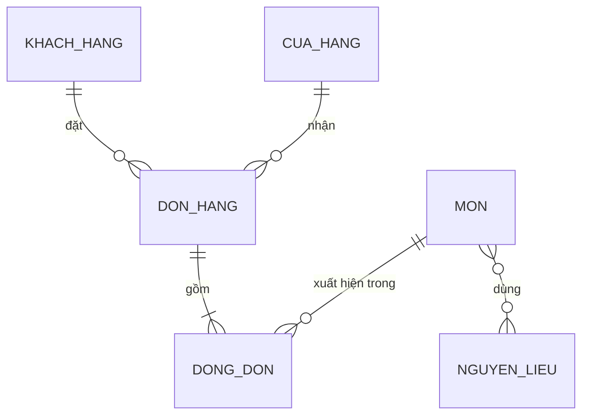
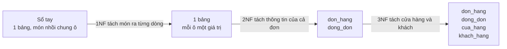

# Mô hình hoá dữ liệu và chuẩn hoá

Sau khi hiểu truy vấn, sách chuyển sang **data modeling (mô hình hoá dữ liệu)**: chọn có chủ đích một cấu trúc mạch lạc cho dữ liệu để phản ánh logic nghiệp vụ của tổ chức. Bài này trình bày mô hình hoá là gì, ba tầng mô hình (khái niệm, logic, vật lý), khái niệm độ chi tiết (grain), và đặc biệt là **chuẩn hoá (normalization)** cùng ví dụ từng bước từ denormalized đến 3NF.

**Tương tự đơn giản:** mô hình dữ liệu giống bản quy hoạch đô thị. Không có nó, nhà cửa vẫn mọc lên nhưng đường xá lộn xộn, địa chỉ trùng lặp, không ai biết "phố X" nghĩa là gì. Có quy hoạch, mọi người dùng chung bản đồ.

---

:::note[Ghi nhớ nhanh]

- ⭐ **Mô hình dữ liệu tốt phản ánh logic nghiệp vụ** và có định nghĩa nhất quán (ví dụ "khách hàng" là ai?); phải có các bên liên quan nghiệp vụ tham gia ngay từ đầu.
- ⭐ **Mô hình hoá ở độ chi tiết thấp nhất có thể (grain nhỏ nhất)**: từ dữ liệu chi tiết có thể tổng hợp lên, nhưng dữ liệu đã tổng hợp thì không thể khôi phục chi tiết.
- Ba tầng: **khái niệm** (ER, quy tắc nghiệp vụ), **logic** (kiểu dữ liệu, khoá chính/ngoại), **vật lý** (DB, schema, bảng, cấu hình cụ thể).
- **Chuẩn hoá** (Codd, đầu thập niên 1970) loại bỏ dư thừa dữ liệu và đảm bảo toàn vẹn tham chiếu; DB thường được coi là "chuẩn hoá" khi đạt **3NF**.
- Mức chuẩn hoá phù hợp tuỳ use case; denormalization rất phổ biến trong OLAP.

:::

---

## Mục lục

- 1. Bối cảnh: mô hình hoá dữ liệu "lên rồi xuống rồi lại lên"
- 2. Mô hình dữ liệu là gì
- 3. Mô hình khái niệm, logic và vật lý
- 4. Độ chi tiết (grain) của dữ liệu
- 5. Chuẩn hoá (normalization)
- 6. Ví dụ từng bước: từ denormalized đến 3NF
- 7. Áp vào chuỗi trà sữa Mây: chuẩn hoá bảng đơn hàng
- Tóm tắt

---

## 1. Bối cảnh: mô hình hoá dữ liệu "lên rồi xuống rồi lại lên"

Sách nhận xét mô hình hoá dữ liệu thường bị **bỏ qua một cách đáng lo ngại**: nhiều nhóm dữ liệu lao vào xây hệ thống mà không có kế hoạch sắp xếp dữ liệu sao cho hữu ích với doanh nghiệp. Đó là sai lầm, vì kiến trúc dữ liệu tốt phải phản ánh mục tiêu và logic kinh doanh.

Lịch sử "con lắc":

- Mô hình hoá đã có hàng chục năm: các kỹ thuật chuẩn hoá có từ thời đầu của RDBMS; mô hình hoá data warehouse xuất hiện ít nhất từ đầu những năm 1990.
- Giữa những năm 2010, mô hình hoá bị coi là lỗi thời. Sự nổi lên của **data lake 1.0**, NoSQL và các hệ big data cho phép kỹ sư bỏ qua mô hình hoá truyền thống, đôi khi để đạt hiệu năng hợp lý. Nhưng thiếu mô hình hoá chặt chẽ đã tạo ra các "đầm lầy dữ liệu" (data swamp) chứa nhiều dữ liệu dư thừa, không khớp, hoặc đơn giản là sai.
- Ngày nay con lắc quay lại: sự nổi bật của **quản lý dữ liệu** (data governance, data quality) thúc đẩy nhu cầu logic nghiệp vụ mạch lạc; và việc dữ liệu ngày càng quan trọng khiến người ta nhận ra mô hình hoá cần thiết để hiện thực hoá giá trị ở các tầng cao của kim tự tháp nhu cầu khoa học dữ liệu (Data Science Hierarchy of Needs).
- Tuy vậy, tác giả tin rằng cần có **mô hình mới** thực sự đáp ứng nhu cầu streaming và ML (xem bài 3).

---

## 2. Mô hình dữ liệu là gì

**Mô hình dữ liệu** thể hiện cách dữ liệu liên hệ với thế giới thực. Nó phản ánh cách dữ liệu cần được cấu trúc và chuẩn hoá để thể hiện tốt nhất các quy trình, định nghĩa, workflow và logic của tổ chức. Mô hình tốt nắm bắt được cách giao tiếp và làm việc diễn ra tự nhiên trong tổ chức; mô hình kém (hoặc không có) thì lộn xộn, khó hiểu, thiếu mạch lạc.

Một số người coi mô hình hoá là việc tẻ nhạt, "chỉ dành cho doanh nghiệp lớn". Sách so sánh nó với những thói quen vệ sinh tốt như dùng chỉ nha khoa hay ngủ đủ giấc: ai cũng biết nên làm nhưng thường bỏ qua. Lý tưởng nhất, mọi tổ chức đều nên mô hình hoá dữ liệu, ít nhất để đảm bảo logic và quy tắc kinh doanh được chuyển vào tầng dữ liệu.

Khi mô hình hoá, hãy tập trung chuyển mô hình thành **kết quả kinh doanh**: mô hình tốt phải tương quan với các quyết định kinh doanh có tác động.

**Ví dụ của sách:** "khách hàng" có thể nghĩa khác nhau với từng phòng ban. Người mua hàng trong 30 ngày qua có phải khách hàng không? Còn người đã không mua trong 6 tháng hay 1 năm? Định nghĩa và mô hình hoá cẩn thận dữ liệu khách hàng ảnh hưởng lớn đến các báo cáo hành vi khách hàng và mô hình churn (rời bỏ), nơi "thời gian kể từ lần mua cuối" là biến quan trọng. Mô hình tốt chứa **các định nghĩa nhất quán**; thực tế các định nghĩa thường lộn xộn trong toàn công ty. Hãy thử nghĩ ra khái niệm nào trong công ty bạn mà mỗi người hiểu một kiểu.

### Ở chuỗi Mây: "khách hàng" là ai?

Cùng chữ "khách hàng", mỗi bộ phận của chuỗi trà sữa Mây lại đếm theo một kiểu. Nếu không thống nhất, hai báo cáo cùng tên "số khách tháng 3" sẽ ra hai con số khác nhau và cuộc họp biến thành cãi nhau xem ai đúng.

| Bộ phận | Họ hiểu "khách hàng" là | Số khách tháng 3 theo cách hiểu đó |
|---|---|---|
| Marketing | Ai có tài khoản app, kể cả chưa từng mua | 42.000 |
| Chủ chuỗi | Ai có ít nhất một đơn trong tháng, ở quầy hay qua app | 25.000 (ước tính, vì khách mua ở quầy không để lại tên) |
| Bộ phận chăm sóc khách | Ai mua qua app trong 30 ngày gần nhất | 18.000 |
| Nhà khoa học dữ liệu (mô hình churn) | Ai từng mua, nhưng coi là "đã rời bỏ" nếu 60 ngày không mua | 18.000 đang hoạt động, 9.000 đã rời bỏ |

Mô hình dữ liệu tốt sẽ chốt **một định nghĩa chính thức** (ví dụ "khách hoạt động = có đơn qua app trong 30 ngày") và đặt tên khác cho các khái niệm còn lại ("người đăng ký app", "khách rời bỏ"), để mọi bảng, mọi dashboard dùng chung.

Phần thảo luận chủ yếu về **batch** vì phần lớn kỹ thuật mô hình hoá sinh ra ở đó; sau đó sách bàn cách tiếp cận cho streaming.

---

## 3. Mô hình khái niệm, logic và vật lý

Mô hình hoá đi từ **trừu tượng đến cụ thể**, qua ba mô hình chính (đây là nền tảng cho các kỹ thuật ở bài sau):


| Mô hình | Nội dung | Ví dụ |
|---|---|---|
| **Khái niệm (conceptual)** | Chứa logic và quy tắc nghiệp vụ, mô tả dữ liệu hệ thống như schema, bảng, trường (tên và loại). Thường trực quan hoá bằng **sơ đồ quan hệ thực thể (ER diagram)** để thể hiện quan hệ giữa các thực thể (đơn hàng, khách hàng, sản phẩm) | Sơ đồ ER nối ID khách hàng, tên, địa chỉ và các đơn hàng của khách |
| **Logic (logical)** | Chi tiết hoá cách hiện thực mô hình khái niệm: thêm kiểu dữ liệu, vạch ra khoá chính và khoá ngoại | Thêm kiểu cho ID khách hàng, tên, địa chỉ; chỉ rõ PK/FK |
| **Vật lý (physical)** | Xác định cách hiện thực mô hình logic trong hệ DB cụ thể: thêm DB, schema, bảng cụ thể, bao gồm chi tiết cấu hình | Bảng nào nằm trong schema nào của DB nào, cấu hình ra sao |

Mô hình hoá thành công cần **các bên liên quan nghiệp vụ tham gia từ đầu**: kỹ sư phải lấy được định nghĩa và mục tiêu kinh doanh cho dữ liệu. Sách gọi đó là "môn thể thao tiếp xúc hoàn toàn", với mục tiêu cung cấp dữ liệu chất lượng để có insight hành động được và tự động hoá thông minh; mọi người phải liên tục tham gia.

### Ba tầng mô hình ở chuỗi Mây

Hình dung như xây một quán mới: **khái niệm** là bản phác thảo trên giấy ăn ("quầy ở đây, bếp ở kia"), **logic** là bản vẽ kỹ thuật có kích thước, **vật lý** là quán thật với gạch, điện, nước cụ thể. Bảng dưới đi qua ba tầng với cùng một nhu cầu: lưu đơn hàng của Mây.

| Tầng | Câu hỏi trả lời | Ở chuỗi Mây | Ai tham gia |
|---|---|---|---|
| Khái niệm | Có những "thứ" gì và chúng liên hệ ra sao? | Khách đặt đơn. Mỗi đơn thuộc một cửa hàng, gồm nhiều món. Mỗi món dùng nhiều nguyên liệu | Chủ chuỗi, quản lý cửa hàng, kỹ sư |
| Logic | Mỗi thứ có những thuộc tính nào, kiểu gì, nhận diện bằng gì? | `don_hang` có `order_id` (chuỗi, khoá chính), `thoi_gian` (ngày giờ), `ma_cua_hang` (khoá ngoại sang `cua_hang`) | Kỹ sư dữ liệu, nhà phân tích |
| Vật lý | Đặt vào hệ thống nào, cấu hình ra sao? | Bảng `don_hang` trong BigQuery, schema `ban_hang`, partition theo ngày, cluster theo `ma_cua_hang` | Kỹ sư dữ liệu |

Sơ đồ khái niệm (ER) của Mây, mỗi hộp là một "thứ" và mỗi đường nối là một quan hệ:



Đọc sơ đồ: một khách có thể đặt **không hoặc nhiều** đơn; một đơn **phải có ít nhất một** dòng món; một món có thể dùng nhiều nguyên liệu và một nguyên liệu (trân châu) có mặt trong nhiều món.

---

## 4. Độ chi tiết (grain) của dữ liệu

Một yếu tố quan trọng khác là **độ phân giải (grain)**: mức độ chi tiết mà dữ liệu được lưu và truy vấn. Thông thường grain nằm ở mức khoá chính của bảng (ID khách hàng, ID đơn hàng, ID sản phẩm), thường kèm ngày hoặc timestamp để tăng độ chính xác.

**Ví dụ của sách:** một công ty nhỏ mới bắt đầu làm báo cáo BI, một người vừa là kỹ sư vừa là analyst. Có yêu cầu làm báo cáo tóm tắt đơn hàng hằng ngày của khách: liệt kê khách đã đặt hàng, số đơn trong ngày và tổng tiền đã chi.

- Báo cáo này vốn "thô" (không có chi tiết từng đơn hay từng mặt hàng). Người này có thể chỉ nạp dữ liệu tổng hợp tối thiểu vào bảng báo cáo. Nhưng khi có yêu cầu báo cáo chi tiết hơn, sẽ phải làm lại từ đầu.
- Vì có kinh nghiệm, kỹ sư chọn tạo bảng với dữ liệu **chi tiết từng đơn hàng**: từng đơn, từng mặt hàng, giá, ID mặt hàng... Grain là cấp độ chi tiết đơn hàng của khách. Bảng này có thể phân tích nguyên trạng hoặc tổng hợp lên.

**Quy tắc:** hãy mô hình hoá ở **mức chi tiết thấp nhất có thể**. Từ dữ liệu grain nhỏ, tổng hợp lên rất dễ; chiều ngược lại thì không, thông thường không thể khôi phục chi tiết đã bị tổng hợp.

### Grain ở chuỗi Mây: giữ hạt gạo hay giữ nồi cơm?

Grain giống như việc giữ **hạt gạo** hay chỉ giữ **nồi cơm đã nấu**. Có gạo thì muốn nấu cơm, cháo hay bánh đều được; đã thành cơm thì không tách lại thành gạo được nữa.

Grain chi tiết (mỗi dòng là một món trong một đơn):

| order_id | thoi_gian | cua_hang | mon | so_luong | gia | kenh |
|---|---|---|---|---|---|---|
| DH001 | 2026-03-01 08:15 | Q1-Lê Lợi | Trà sữa trân châu | 2 | 35000 | quầy |
| DH002 | 2026-03-01 08:20 | Q1-Lê Lợi | Trà đào | 1 | 30000 | app |
| DH003 | 2026-03-01 14:05 | Q1-Lê Lợi | Trà sữa trân châu | 1 | 35000 | app |

Grain tổng hợp (mỗi dòng là một cửa hàng trong một ngày):

| ngay | cua_hang | so_ly | doanh_thu |
|---|---|---|---|
| 2026-03-01 | Q1-Lê Lợi | 4 | 135000 |

Từ bảng trên luôn tính ra được bảng dưới. Nhưng nếu chỉ lưu bảng dưới, các câu hỏi sau sẽ **không trả lời được**:

| Câu hỏi mới phát sinh | Cần thông tin gì | Bảng tổng hợp có không? |
|---|---|---|
| Buổi sáng hay buổi chiều bán chạy hơn? | Giờ của từng đơn | Không |
| Trà sữa trân châu chiếm bao nhiêu phần doanh thu? | Món của từng đơn | Không |
| Kênh app đóng góp bao nhiêu? | Kênh của từng đơn | Không |
| Dự báo cần bao nhiêu trân châu mỗi ngày? | Số ly trà sữa trân châu theo ngày | Không |

---

## 5. Chuẩn hoá (normalization)

**Chuẩn hoá** là phương pháp mô hình hoá DB nhằm **kiểm soát chặt chẽ quan hệ giữa các bảng và cột**. Mục tiêu là loại bỏ dư thừa dữ liệu và đảm bảo **toàn vẹn tham chiếu (referential integrity)**. Về bản chất nó là nguyên tắc **DRY (Don't Repeat Yourself)** áp dụng cho dữ liệu trong DB.

Chuẩn hoá thường áp dụng cho DB quan hệ gồm bảng, hàng, cột (sách dùng "cột" và "trường" thay thế nhau). Nó do nhà tiên phong DB quan hệ **Edgar Codd** giới thiệu đầu thập niên 1970. Codd nêu bốn mục tiêu chính:

1. Giải phóng tập các quan hệ khỏi các phụ thuộc chèn, cập nhật, xoá không mong muốn.
2. Giảm nhu cầu tái cấu trúc tập quan hệ khi có loại dữ liệu mới, do đó tăng tuổi thọ chương trình ứng dụng.
3. Làm mô hình quan hệ giàu thông tin hơn đối với người dùng.
4. Làm tập quan hệ **trung lập với thống kê truy vấn**, vì thống kê này có thể thay đổi theo thời gian.

Codd đưa ra khái niệm **dạng chuẩn (normal form)**. Các dạng chuẩn mang tính **tuần tự**: mỗi dạng bao gồm điều kiện của các dạng trước.

| Mức | Điều kiện |
|---|---|
| **Denormalized** | Không áp dụng chuẩn hoá; cho phép dữ liệu lồng nhau và dư thừa |
| **1NF** | Mỗi cột duy nhất và chứa một giá trị duy nhất. Bảng có một khoá chính duy nhất |
| **2NF** | Thoả 1NF, cộng với việc loại bỏ mọi **phụ thuộc từng phần (partial dependency)** |
| **3NF** | Thoả 2NF, cộng với việc mỗi bảng chỉ chứa các trường liên quan đến khoá chính của nó, không có **phụ thuộc bắc cầu (transitive dependency)** |

Giải thích thuật ngữ:

- **Khoá chính duy nhất (unique primary key):** một trường hoặc tập nhiều trường xác định duy nhất một hàng. Mỗi giá trị khoá xuất hiện nhiều nhất một lần; do đó mọi giá trị khác trong hàng đều phụ thuộc vào khoá (xác định được từ khoá).
- **Phụ thuộc từng phần:** xảy ra khi một **tập con** các trường trong khoá **tổng hợp (composite key)** đủ để xác định một cột không phải khoá.
- **Phụ thuộc bắc cầu:** xảy ra khi một trường không phải khoá lại phụ thuộc vào một trường không phải khoá khác.

### Dư thừa thì có gì sai? Ba "tai nạn" kinh điển

Nói nôm na, chuẩn hoá là nguyên tắc **"mỗi sự thật chỉ ghi ở một chỗ"**. Khi một sự thật bị chép ra nhiều chỗ, sớm muộn sẽ có chỗ được sửa, chỗ bị quên. Bảng dưới là ba lỗi thường gặp nếu Mây lưu mọi thứ trong một bảng đơn hàng duy nhất có cả địa chỉ cửa hàng và giá món.

| Tai nạn | Chuyện xảy ra ở Mây | Hậu quả |
|---|---|---|
| Lỗi cập nhật (update anomaly) | Cửa hàng Q1 chuyển địa chỉ, nhưng địa chỉ được chép trong 200.000 dòng đơn hàng; script chỉ sửa được một nửa | Cùng một cửa hàng có hai địa chỉ, shipper đi nhầm |
| Lỗi chèn (insert anomaly) | Muốn thêm món mới "Trà vải" vào menu nhưng chưa ai mua, mà bảng chỉ có dòng khi có đơn | Không có chỗ để ghi món mới |
| Lỗi xoá (delete anomaly) | Xoá đơn duy nhất có món "Sữa tươi khoai môn" vì đơn bị huỷ | Mất luôn thông tin giá của món đó |

---

## 6. Ví dụ từng bước: từ denormalized đến 3NF

Ví dụ thương mại điện tử về đơn đặt hàng của khách hàng.

### Bước 0: bảng OrderDetail (denormalized)

Bảng có 5 trường, khoá chính là `OrderID`. Trường `OrderItems` chứa một đối tượng **lồng nhau** gồm hai SKU cùng giá, số lượng, tên.

| OrderID | OrderItems | CustomerID | CustomerName | OrderDate |
|---|---|---|---|---|
| 100 | (xem JSON bên dưới) | 5 | Joe Reis | 2022-03-01 |

```json
[
  {"sku": 1, "price": 50, "quantity": 1, "name": "Thingamajig"},
  {"sku": 2, "price": 25, "quantity": 2, "name": "Whatchamacallit"}
]
```

### Bước 1: đạt 1NF

Tách `OrderItems` thành bốn trường (Sku, Price, Quantity, ProductName) để các trường không còn dữ liệu lặp hay lồng nhau:

| OrderID | Sku | Price | Quantity | ProductName | CustomerID | CustomerName | OrderDate |
|---|---|---|---|---|---|---|---|
| 100 | 1 | 50 | 1 | Thingamajig | 5 | Joe Reis | 2022-03-01 |
| 100 | 2 | 25 | 2 | Whatchamacallit | 5 | Joe Reis | 2022-03-01 |
| 101 | 3 | 75 | 1 | Whozeewhatzit | 7 | Matt Housley | 2022-03-01 |
| 102 | 1 | 50 | 1 | Thingamajig | 7 | Matt Housley | 2022-03-01 |

Vấn đề: giờ không còn khoá chính duy nhất, vì `100` xuất hiện ở hai hàng. Giải pháp: thêm cột **LineItemNumber** để đánh số các dòng. Khoá ghép `(OrderID, LineItemNumber)` trở thành khoá chính duy nhất.

| OrderID | LineItemNumber | Sku | Price | Quantity | ProductName | CustomerID | CustomerName | OrderDate |
|---|---|---|---|---|---|---|---|---|
| 100 | 1 | 1 | 50 | 1 | Thingamajig | 5 | Joe Reis | 2022-03-01 |
| 100 | 2 | 2 | 25 | 2 | Whatchamacallit | 5 | Joe Reis | 2022-03-01 |
| 101 | 1 | 3 | 75 | 1 | Whozeewhatzit | 7 | Matt Housley | 2022-03-01 |
| 102 | 1 | 1 | 50 | 1 | Thingamajig | 7 | Matt Housley | 2022-03-01 |

### Bước 2: đạt 2NF

Cần loại bỏ **phụ thuộc từng phần**: cột không phải khoá bị xác định đầy đủ bởi một *tập con* của khoá chính tổng hợp. Ở đây, các cột `CustomerID`, `CustomerName`, `OrderDate` chỉ phụ thuộc vào `OrderID` (không cần `LineItemNumber`). Tách `OrderDetail` thành hai bảng **Orders** và **OrderLineItem**:

**Orders** (khoá chính: OrderID)

| OrderID | CustomerID | CustomerName | OrderDate |
|---|---|---|---|
| 100 | 5 | Joe Reis | 2022-03-01 |
| 101 | 7 | Matt Housley | 2022-03-01 |
| 102 | 7 | Matt Housley | 2022-03-01 |

**OrderLineItem** (khoá chính: OrderID + LineItemNumber)

| OrderID | LineItemNumber | Sku | Price | Quantity | ProductName |
|---|---|---|---|---|---|
| 100 | 1 | 1 | 50 | 1 | Thingamajig |
| 100 | 2 | 2 | 25 | 2 | Whatchamacallit |
| 101 | 1 | 3 | 75 | 1 | Whozeewhatzit |
| 102 | 1 | 1 | 50 | 1 | Thingamajig |

### Bước 3: đạt 3NF

Trong `OrderLineItem`, `Sku` xác định `ProductName`: tức `ProductName` phụ thuộc vào `Sku`, và `Sku` phụ thuộc vào khoá tổng hợp. Đây là **phụ thuộc bắc cầu**. Tách thành `OrderLineItem` và `Skus`:

**OrderLineItem**

| OrderID | LineItemNumber | Sku | Price | Quantity |
|---|---|---|---|---|
| 100 | 1 | 1 | 50 | 1 |
| 100 | 2 | 2 | 25 | 2 |
| 101 | 1 | 3 | 75 | 1 |
| 102 | 1 | 1 | 50 | 1 |

**Skus**

| Sku | ProductName |
|---|---|
| 1 | Thingamajig |
| 2 | Whatchamacallit |
| 3 | Whozeewhatzit |

Giờ `OrderLineItem` và `Skus` đều ở 3NF. Lưu ý: bảng **Orders chưa đạt 3NF**. Sách đặt câu hỏi cho người đọc: phụ thuộc bắc cầu nào đang có và sửa thế nào?

> Gợi ý (do người ghi chép thêm, suy ra từ ví dụ): trong `Orders`, `CustomerName` được xác định bởi `CustomerID`, mà `CustomerID` phụ thuộc vào `OrderID`. Tách thành bảng `Orders` (OrderID, CustomerID, OrderDate) và bảng `Customers` (CustomerID, CustomerName) là cách khắc phục.

### Lưu ý chung

Có các dạng chuẩn cao hơn (đến 6NF, bao gồm Boyce-Codd) nhưng ít phổ biến hơn nhiều ba dạng đầu. Một DB thường được coi là **chuẩn hoá** nếu ở **3NF**, và đó là quy ước sách dùng.

Mức chuẩn hoá cần áp dụng phụ thuộc use case; **không có giải pháp một cỡ cho tất cả**, nhất là trong các DB mà một số thao tác denormalization mang lại lợi thế hiệu năng. Denormalization nghe như phản mẫu (anti-pattern) nhưng rất phổ biến trong nhiều hệ OLAP lưu dữ liệu bán cấu trúc. Hãy nghiên cứu quy ước chuẩn hoá và best practice của DB để chọn chiến lược phù hợp.

---

## 7. Áp vào chuỗi trà sữa Mây: chuẩn hoá bảng đơn hàng

Lặp lại đúng các bước ở mục 6, nhưng với dữ liệu quen thuộc của Mây, để thấy bảng "trông" thế nào sau mỗi bước.

### Trước: bảng ghi chép kiểu sổ tay (denormalized)

Nhân viên cửa hàng ghi mỗi đơn trên một dòng, các món nhồi chung một ô:

| order_id | ngay | cua_hang | dia_chi_cua_hang | khach | sdt_khach | cac_mon |
|---|---|---|---|---|---|---|
| DH001 | 2026-03-01 | Q1-Lê Lợi | 12 Lê Lợi, Q1 | Lan | 0901 | 2 Trà sữa trân châu (35k), 1 Trà đào (30k) |
| DH002 | 2026-03-01 | Q3-Võ Văn Tần | 88 Võ Văn Tần, Q3 | Minh | 0902 | 1 Trà sữa matcha (40k) |
| DH003 | 2026-03-02 | Q1-Lê Lợi | 12 Lê Lợi, Q1 | Lan | 0901 | 1 Trà sữa trân châu (35k) |

Muốn biết "tháng 3 bán bao nhiêu ly trà sữa trân châu" phải đọc từng ô `cac_mon` và tách chữ, rất dễ sai.

### Sau 1NF: mỗi ô một giá trị, có khoá chính

Tách mỗi món thành một dòng, thêm `dong` (số thứ tự dòng trong đơn). Khoá chính là `(order_id, dong)`:

| order_id | dong | ngay | cua_hang | dia_chi_cua_hang | khach | sdt_khach | mon | so_luong | gia |
|---|---|---|---|---|---|---|---|---|---|
| DH001 | 1 | 2026-03-01 | Q1-Lê Lợi | 12 Lê Lợi, Q1 | Lan | 0901 | Trà sữa trân châu | 2 | 35000 |
| DH001 | 2 | 2026-03-01 | Q1-Lê Lợi | 12 Lê Lợi, Q1 | Lan | 0901 | Trà đào | 1 | 30000 |
| DH002 | 1 | 2026-03-01 | Q3-Võ Văn Tần | 88 Võ Văn Tần, Q3 | Minh | 0902 | Trà sữa matcha | 1 | 40000 |
| DH003 | 1 | 2026-03-02 | Q1-Lê Lợi | 12 Lê Lợi, Q1 | Lan | 0901 | Trà sữa trân châu | 1 | 35000 |

Giờ đếm ly đã dễ. Nhưng thông tin của đơn DH001 (ngày, cửa hàng, khách) bị chép lại ở hai dòng.

### Sau 2NF: tách thông tin thuộc về cả đơn

`ngay`, `cua_hang`, `dia_chi_cua_hang`, `khach`, `sdt_khach` chỉ phụ thuộc vào `order_id`, không cần `dong`. Đó là phụ thuộc từng phần, nên tách ra:

**don_hang** (khoá: order_id)

| order_id | ngay | cua_hang | dia_chi_cua_hang | khach | sdt_khach |
|---|---|---|---|---|---|
| DH001 | 2026-03-01 | Q1-Lê Lợi | 12 Lê Lợi, Q1 | Lan | 0901 |
| DH002 | 2026-03-01 | Q3-Võ Văn Tần | 88 Võ Văn Tần, Q3 | Minh | 0902 |
| DH003 | 2026-03-02 | Q1-Lê Lợi | 12 Lê Lợi, Q1 | Lan | 0901 |

**dong_don** (khoá: order_id + dong)

| order_id | dong | mon | so_luong | gia |
|---|---|---|---|---|
| DH001 | 1 | Trà sữa trân châu | 2 | 35000 |
| DH001 | 2 | Trà đào | 1 | 30000 |
| DH002 | 1 | Trà sữa matcha | 1 | 40000 |
| DH003 | 1 | Trà sữa trân châu | 1 | 35000 |

### Sau 3NF: tách những gì "phụ thuộc gián tiếp"

Trong `don_hang`, địa chỉ phụ thuộc vào cửa hàng, số điện thoại phụ thuộc vào khách, chứ không trực tiếp vào đơn. Đó là phụ thuộc bắc cầu. Tách tiếp thành bảng `cua_hang` và `khach_hang`:

**don_hang**

| order_id | ngay | ma_cua_hang | ma_khach |
|---|---|---|---|
| DH001 | 2026-03-01 | CH01 | K01 |
| DH002 | 2026-03-01 | CH02 | K02 |
| DH003 | 2026-03-02 | CH01 | K01 |

**cua_hang**

| ma_cua_hang | ten | dia_chi |
|---|---|---|
| CH01 | Q1-Lê Lợi | 12 Lê Lợi, Q1 |
| CH02 | Q3-Võ Văn Tần | 88 Võ Văn Tần, Q3 |

**khach_hang**

| ma_khach | ten | sdt |
|---|---|---|
| K01 | Lan | 0901 |
| K02 | Minh | 0902 |

Giờ cửa hàng Q1 chuyển địa chỉ thì chỉ sửa **một ô** trong bảng `cua_hang`. (Có thể tách tiếp tên món sang bảng `mon` giống bước Skus ở mục 6; và `gia` trong `dong_don` nên giữ lại vì đó là giá **tại thời điểm bán**, có thể khác giá menu hiện tại.)

Sơ đồ dưới tóm tắt hành trình từ một bảng thành bốn bảng:



### Vậy có nên luôn chuẩn hoá tới 3NF?

| Tiêu chí | Bảng chuẩn hoá (3NF) | Bảng gộp (denormalized) | Ở Mây nên chọn |
|---|---|---|---|
| Sửa dữ liệu | Sửa một chỗ, không lệch | Sửa nhiều chỗ, dễ quên | 3NF cho hệ thống bán hàng, kho |
| Đọc để phân tích | Phải join nhiều bảng | Đọc thẳng một bảng | Bảng gộp cho dashboard của chủ chuỗi |
| Dung lượng | Gọn | Lặp nhiều | Lưu trữ đám mây rẻ, nên không phải lý do chính |
| Ai dùng | Phần mềm POS, phần mềm kho | Nhà phân tích, marketing | Cả hai, mỗi loại ở đúng chỗ |

Bài 3 sẽ đi tiếp: từ các bảng 3NF này, các trường phái Inmon, Kimball, Data Vault và bảng rộng sắp xếp lại dữ liệu cho mục đích phân tích ra sao.

---

## Tóm tắt

| Khái niệm | Ý chính |
|---|---|
| Mô hình hoá | Chọn có chủ đích cấu trúc dữ liệu phản ánh logic nghiệp vụ; con lắc đang quay lại sau thời kỳ data swamp |
| Định nghĩa nhất quán | Ví dụ "khách hàng" phải được thống nhất; cần các bên liên quan nghiệp vụ tham gia |
| Khái niệm, logic, vật lý | Từ ER và quy tắc nghiệp vụ, đến kiểu dữ liệu và khoá, đến DB và bảng cụ thể |
| Grain | Mô hình hoá ở mức chi tiết thấp nhất để tổng hợp lên được |
| Chuẩn hoá | DRY cho dữ liệu: 1NF (không lặp/lồng, có khoá chính), 2NF (không phụ thuộc từng phần), 3NF (không phụ thuộc bắc cầu) |
| Thực tế | Denormalization hợp lệ và phổ biến ở OLAP; chọn mức chuẩn hoá theo use case |
