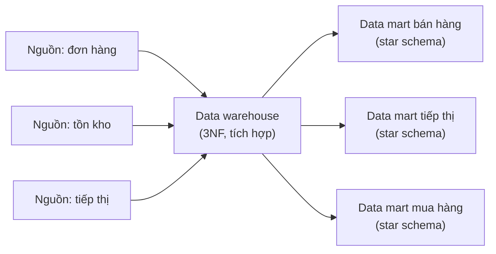
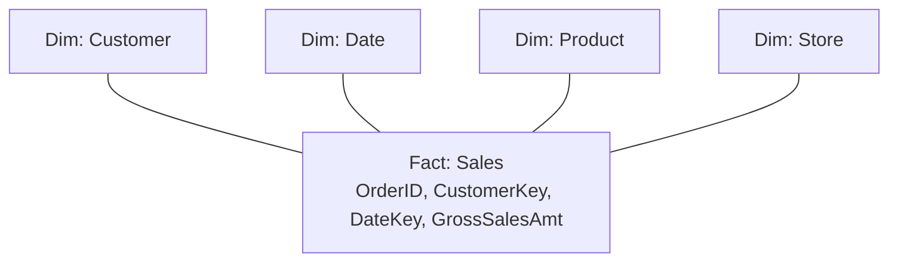
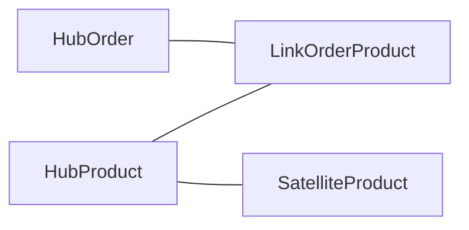

# Inmon, Kimball, Data Vault, bảng rộng và mô hình hoá streaming

Bài này đi qua các kỹ thuật mô hình hoá dữ liệu phân tích **batch** phổ biến: **Inmon**, **Kimball**, **Data Vault**, **bảng denormalized rộng (wide table)**, cũng như lựa chọn "không mô hình hoá" và hiện trạng của mô hình hoá dữ liệu **streaming**. Tất cả dùng chung một ví dụ: các giao dịch trong hệ thống đặt hàng thương mại điện tử.

**Tương tự đơn giản:** hãy tưởng tượng quản lý một thư viện khổng lồ. Inmon xây một kho trung tâm chuẩn hoá hoàn chỉnh rồi chia ra từng phòng đọc theo chủ đề; Kimball dựng ngay các phòng đọc theo bộ phận với giá sách thiết kế để tìm nhanh; Data Vault chỉ ghi nhận "ai, cái gì, liên kết với ai, khi nào" thật trung thực rồi để người đọc tự diễn giải; còn bảng rộng là đổ tất cả vào một bàn khổng lồ cho đỡ phải đi tìm.

---

:::note[Ghi nhớ nhanh]

- ⭐ **Inmon**: data warehouse tích hợp, chuẩn hoá cao (3NF), nguồn sự thật duy nhất; phục vụ bộ phận qua **data mart** phía dưới. **Kimball**: từ dưới lên, **star schema** (fact + dimension) denormalized, phục vụ phân tích ngay trong warehouse.
- ⭐ **Kimball**: fact table hẹp, dài, bất biến (chỉ thêm), grain nhỏ nhất; dimension rộng, ngắn; **SCD Type 2** là loại hay gặp nhất trong thực tế.
- **Data Vault** tách cấu trúc (hub, link) khỏi thuộc tính (satellite); chỉ chèn (insert-only), business logic áp dụng khi truy vấn.
- **Bảng rộng** đánh đổi tính chặt chẽ lấy tốc độ và linh hoạt, hợp với DB cột và lưu trữ rẻ; nhược điểm là mất logic nghiệp vụ và cập nhật khó.
- **Mô hình hoá streaming chưa có đồng thuận**; lời khuyên: dự đoán thay đổi schema, giữ schema linh hoạt.

:::

---

## Mục lục

- 1. Tổng quan các cách tiếp cận cho batch
- 2. Inmon
- 3. Kimball
- 4. Data Vault
- 5. Bảng denormalized rộng
- 6. Nếu không mô hình hoá dữ liệu
- 7. Mô hình hoá dữ liệu streaming
- Tóm tắt

---

## 1. Tổng quan các cách tiếp cận cho batch

Khi mô hình hoá cho data lake hay data warehouse, hãy giả định dữ liệu thô có nhiều dạng (có cấu trúc, bán cấu trúc) nhưng **đầu ra là mô hình có cấu trúc gồm hàng và cột**. Ba cách tiếp cận lớn: **Kimball, Inmon, Data Vault**. Thực tế có thể kết hợp, ví dụ nhiều nhóm bắt đầu với Data Vault rồi thêm star schema Kimball lên trên.

Tác giả lưu ý phần trình bày ba phương pháp này rất sơ lược, chưa phản ánh đúng độ phức tạp của từng cái. Cuối mỗi phương pháp sách có liệt kê sách kinh điển của người sáng lập; các sách này được coi là bắt buộc đọc với kỹ sư dữ liệu (xem phần tài nguyên ở cuối chương).

---

## 2. Inmon

**Bill Inmon**, "cha đẻ của data warehouse", tạo ra phương pháp của mình vào năm **1989**. Trước data warehouse, phân tích diễn ra thẳng trên hệ nguồn, khiến DB giao dịch production bị sa lầy bởi truy vấn dài. Mục tiêu của data warehouse là **tách hệ nguồn khỏi hệ phân tích**.

Inmon định nghĩa: data warehouse là tập hợp dữ liệu **định hướng chủ đề, tích hợp, không biến đổi (nonvolatile) và biến thiên theo thời gian (time-variant)** để hỗ trợ quyết định quản lý; chứa dữ liệu chi tiết của công ty, dùng được cho nhiều mục đích kể cả những yêu cầu tương lai chưa biết.

| Đặc tính | Ý nghĩa |
|---|---|
| **Định hướng chủ đề (subject-oriented)** | Tập trung vào một lĩnh vực như bán hàng hay tiếp thị. Mô hình logic chứa mọi chi tiết liên quan: khoá nghiệp vụ, quan hệ, thuộc tính |
| **Tích hợp (integrated)** | Dữ liệu từ các nguồn khác nhau được hợp nhất và chuẩn hoá thành mô hình thống nhất, chuẩn hoá cao |
| **Không thay đổi sau khi lưu (nonvolatile)** | Dữ liệu đã vào warehouse thì không bị biến đổi |
| **Biến thiên theo thời gian (time-variant)** | Truy vấn được nhiều khoảng thời gian khác nhau; về lý thuyết truy vấn lại dữ liệu gốc miễn là lịch sử còn lưu |

Inmon coi **tích hợp** là khía cạnh quan trọng nhất: dữ liệu từ nhiều nguồn được biến đổi, định dạng lại, sắp xếp lại, tóm tắt, để khi nằm trong warehouse nó có **một hình ảnh vật lý duy nhất** của công ty.

Cách hoạt động:

- Dữ liệu từ các hệ nguồn nghiệp vụ chính được **ETL** vào warehouse, lưu ở **3NF**, thường gần giống cấu trúc chuẩn hoá của chính hệ nguồn; nạp tăng dần, bắt đầu từ lĩnh vực kinh doanh ưu tiên cao nhất.
- Yêu cầu chuẩn hoá nghiêm ngặt giúp ít trùng lặp, ít sai lệch phân tích phía sau, làm warehouse thành **"nguồn sự thật duy nhất"** (single source of truth).
- Để phục vụ nhu cầu cụ thể của bộ phận, một quy trình ETL khác lấy dữ liệu từ warehouse, biến đổi và đưa vào các **data mart** phía dưới. Data mart thường dùng **star schema** (xem phần Kimball), nhưng mô hình nào dễ truy cập cũng được. Mỗi bộ phận có cấu trúc dữ liệu riêng, tối ưu cho nhu cầu của mình.



Inmon tiếp tục đổi mới (hiện tập trung vào "ETL văn bản" trong warehouse), đã viết khoảng 60 cuốn sách và vô số bài báo.

---

## 3. Kimball

Kimball là **đối cực của Inmon**. Do **Ralph Kimball** tạo ra đầu những năm 1990, cách tiếp cận này **ít chú trọng chuẩn hoá**, trong vài trường hợp chấp nhận denormalization. Về quan hệ giữa warehouse và data mart, Inmon từng nói "data mart không bao giờ có thể thay thế data warehouse".

Khác biệt chính:

- Inmon: tích hợp dữ liệu toàn doanh nghiệp trong warehouse rồi phục vụ phân tích từng bộ phận qua data mart.
- Kimball: mô hình **từ dưới lên**, khuyến khích mô hình hoá và phục vụ phân tích của bộ phận hoặc doanh nghiệp **ngay trong warehouse** (Inmon cho rằng cách này làm sai lệch định nghĩa warehouse). Về thực chất data mart trở thành warehouse. Cách này cho phép lặp và mô hình hoá nhanh hơn Inmon, đổi lại tích hợp dữ liệu lỏng lẻo hơn, dư thừa và sao chép dữ liệu nhiều hơn.

Kimball mô hình hoá dữ liệu bằng hai loại bảng chung: **fact (sự kiện)** và **dimension (chiều)**. Hãy hình dung fact table là bảng **số liệu**, dimension table là dữ liệu **định tính** cung cấp ngữ cảnh cho sự kiện. Các dimension bao quanh một fact table duy nhất tạo nên **star schema**.

### 3.1. Fact table

Chứa dữ liệu **định lượng, liên quan đến sự kiện**. Vì sự kiện đã xảy ra là bất biến, fact table **không thay đổi, chỉ thêm (append-only)**. Đặc điểm:

- **Hẹp và dài:** ít cột nhưng rất nhiều hàng (mỗi hàng là một sự kiện).
- Nên ở **mức chi tiết thấp nhất** có thể; mỗi hàng phải biểu diễn đúng **grain**.
- Truy vấn trên star schema **bắt đầu từ fact table**.
- Tránh tổng hợp hoặc tính dữ liệu dẫn xuất ngay trong fact table; nếu cần, làm ở truy vấn phía dưới, bảng data mart hoặc view.
- Fact table **không tham chiếu fact table khác**; chỉ tham chiếu dimension.

**Ví dụ:** câu hỏi phổ biến "cho tôi tổng doanh thu theo từng đơn hàng của khách, theo ngày". Fact table có mức chi tiết thấp nhất: ID đơn hàng, khách hàng, ngày, tổng tiền. Mọi cột đều là kiểu số (không có chuỗi); thay vào đó là **khoá** tham chiếu đến các dimension.

| OrderID | CustomerKey | DateKey | GrossSalesAmt |
|---|---|---|---|
| 100 | 5 | 20220301 | 100.00 |
| 101 | 7 | 20220301 | 75.00 |
| 102 | 7 | 20220301 | 50.00 |

(Khách hàng 7 có hai đơn trong cùng ngày, phản ánh nội dung bảng.)

### 3.2. Dimension table

Cung cấp **dữ liệu tham chiếu, thuộc tính và ngữ cảnh quan hệ** cho các sự kiện trong fact table. Nhỏ hơn fact table và có hình dạng đối lập: **rộng và ngắn**. Khi join với fact, dimension mô tả sự kiện là gì, xảy ra ở đâu, khi nào. Dimension **được denormalize** và có thể chứa dữ liệu trùng lặp; điều này được chấp nhận trong Kimball.

**Date dimension** (chiều ngày): ngày thường lưu trong một dimension riêng, tham chiếu bằng `DateKey`. Nhờ đó dễ trả lời "tổng doanh số quý 1 năm 2022?" hay "bao nhiêu khách mua vào thứ Ba nhiều hơn thứ Tư?". Bạn có thể thêm bao nhiêu trường mới tuỳ ý.

| DateKey | Date-ISO | Year | Quarter | Month | Day-of-week |
|---|---|---|---|---|---|
| 20220301 | 2022-03-01 | 2022 | 1 | 3 | Tuesday |
| 20220302 | 2022-03-02 | 2022 | 1 | 3 | Wednesday |
| 20220303 | 2022-03-03 | 2022 | 1 | 3 | Thursday |

**Customer dimension** (chiều khách hàng, dạng SCD Type 2): chứa họ tên, mã zip và các trường ngày hiệu lực.

| CustomerKey | FirstName | LastName | ZipCode | EFF_StartDate | EFF_EndDate |
|---|---|---|---|---|---|
| 5 | Joe | Reis | 84108 | 2019-01-04 | 9999-01-01 |
| 7 | Matt | Housley | 84101 | 2020-05-04 | 2021-09-19 |
| 7 | Matt | Housley | 84123 | 2021-09-19 | 9999-01-01 |
| 11 | Lana | Belle | 90210 | 2022-02-04 | 9999-01-01 |

Cách đọc: khách 5 (Joe) có hồ sơ tạo ngày 2019-01-04, ngày kết thúc `9999-01-01` nghĩa là **bản ghi đang hoạt động, chưa bị thay đổi**. Khách 7 (Matt) có hai dòng: anh đổi mã zip vào 2021-09-19 nên dòng cũ được đóng ngày kết thúc và một dòng mới được tạo. Muốn lấy bản ghi hiện tại thì truy vấn những dòng có ngày kết thúc bằng `9999-01-01`.

```sql
-- Lấy trạng thái hiện tại của khách hàng (SCD Type 2)
SELECT * FROM dim_customer WHERE EFF_EndDate = '9999-01-01';
```

### 3.3. Slowly changing dimension (SCD)

**SCD** cần thiết để theo dõi thay đổi của dimension. Có tới bảy loại; ba loại phổ biến nhất:

| Loại | Cách làm | Ưu và nhược |
|---|---|---|
| **Type 1** | **Ghi đè** bản ghi dimension hiện có | Cực kỳ đơn giản, nhưng mất quyền truy cập lịch sử vì bản ghi cũ bị xoá |
| **Type 2** | Giữ **toàn bộ lịch sử**. Khi bản ghi đổi, bản ghi cũ được đánh dấu đã đổi (đóng ngày hiệu lực) và tạo bản ghi dimension mới phản ánh trạng thái hiện tại | Giữ được lịch sử; là loại thấy dùng nhiều nhất trong thực tế |
| **Type 3** | Giống Type 2 nhưng thay vì tạo **hàng mới** thì tạo **trường (cột) mới** | Tiết kiệm hàng, nhưng chỉ giữ được số phiên bản giới hạn |

Ví dụ Type 3: ban đầu Matt có `ZipCode = 84101`. Khi anh chuyển, bảng có thêm cột và đổi tên cột cũ:

| CustomerKey | FirstName | LastName | Original ZipCode | Current ZipCode | CurrentDate |
|---|---|---|---|---|---|
| 7 | Matt | Housley | 84101 | 84123 | 2021-09-19 |

Type 1 là hành vi mặc định của hầu hết data warehouse; Type 2 là loại thường thấy nhất trong thực tế.

### 3.4. Star schema

Star schema thể hiện mô hình dữ liệu của doanh nghiệp: **một fact table được bao quanh bởi các dimension cần thiết**. So với mô hình chuẩn hoá cao, nó có **ít join hơn**, tăng tốc truy vấn, và được cho là dễ hiểu, dễ dùng hơn với người dùng nghiệp vụ.



Lưu ý:

- Star schema **không phản ánh một báo cáo cụ thể** (dù có thể mô hình hoá báo cáo ở data mart phía dưới hoặc trong công cụ BI). Nó phải nắm bắt các sự kiện và thuộc tính của logic nghiệp vụ và đủ linh hoạt để trả lời các câu hỏi quan trọng.
- Mỗi star schema có một fact table, nên có thể có **nhiều star schema** cho các fact khác nhau của doanh nghiệp. Hãy giảm số dimension khi có thể vì dữ liệu tham chiếu này tái sử dụng được giữa nhiều fact table.
- Một dimension dùng lại trên nhiều star schema với cùng các trường gọi là **conformed dimension**; nó cho phép kết hợp nhiều fact table trên nhiều star schema. Kimball chấp nhận dữ liệu dư thừa, nhưng cần tránh nhân bản các dimension table giống hệt nhau để không làm sai lệch định nghĩa nghiệp vụ và toàn vẹn dữ liệu.
- Mô hình Kimball **chỉ phù hợp với dữ liệu batch**, không phù hợp streaming. Vì rất phổ biến nên bạn nhiều khả năng sẽ gặp nó.

---

## 4. Data Vault

Trong khi Kimball và Inmon tập trung vào cấu trúc logic nghiệp vụ trong warehouse, **Data Vault** (do **Dan Linstedt** tạo ra vào những năm 1990) là hướng khác: **tách các khía cạnh cấu trúc của dữ liệu hệ nguồn khỏi các thuộc tính của nó**. Thay vì thể hiện logic nghiệp vụ trong fact, dimension hay bảng chuẩn hoá, Data Vault nạp trực tiếp dữ liệu hệ nguồn vào một số bảng chuyên dụng theo kiểu **chỉ chèn (insert-only)**. Khác các phương pháp khác, **không có khái niệm dữ liệu tốt, xấu hay phù hợp** trong Data Vault.

Mục tiêu: dữ liệu di chuyển nhanh nên mô hình cần nhanh nhẹn, linh hoạt, mở rộng được; giữ dữ liệu bám sát doanh nghiệp nhất có thể ngay cả khi doanh nghiệp thay đổi.

Ba loại bảng chính: **hub, link, satellite**.

| Bảng | Vai trò |
|---|---|
| **Hub** | Lưu các **business key** duy nhất |
| **Link** | Duy trì **quan hệ** giữa các business key (giữa các hub) |
| **Satellite** | Lưu **thuộc tính và bối cảnh** của business key |

Người dùng truy vấn một hub, hub liên kết đến bảng satellite chứa các thuộc tính liên quan.

### 4.1. Hub

Truy vấn thường tìm theo business key (ID khách hàng, ID đơn hàng...). Hub là thực thể trung tâm lưu bản ghi mọi business key duy nhất được nạp vào Vault. Hub luôn có các trường chuẩn:

- **Hash key:** khoá chính dùng để join dữ liệu giữa các hệ thống; là trường băm (MD5 hoặc tương tự).
- **Load date:** ngày dữ liệu được nạp vào hub.
- **Record source:** nguồn mà bản ghi duy nhất được lấy.
- **Business key(s):** khoá dùng để xác định bản ghi duy nhất.

Hub **chỉ chèn**; dữ liệu một khi vào hub thì tồn tại vĩnh viễn. Khi thiết kế hub phải xác định đúng business key: hãy tự hỏi "yếu tố kinh doanh nhận dạng được là gì", nói cách khác người dùng thường tìm dữ liệu bằng gì. Lý tưởng nhất là phát hiện ra khi xây mô hình khái niệm, trước khi bắt đầu xây Vault.

**HubProduct** (thiết kế vật lý: ProductHashKey, LoadDate, RecordSource, ProductID) với dữ liệu mẫu, ba sản phẩm nạp từ ERP vào hai ngày:

| ProductHashKey | LoadDate | RecordSource | ProductID |
|---|---|---|---|
| 4041fd80ab... | 2020-01-02 | ERP | 1 |
| de8435530d... | 2021-03-09 | ERP | 2 |
| cf27369bd8... | 2021-03-09 | ERP | 3 |

**HubOrder** dùng cùng schema:

| OrderHashKey | LoadDate | RecordSource | OrderID |
|---|---|---|---|
| f899139df5... | 2022-03-01 | Website | 100 |
| 38b3eff8ba... | 2022-03-01 | Website | 101 |
| ec8956637a... | 2022-03-01 | Website | 102 |

### 4.2. Link

Theo dõi **quan hệ giữa các business key** của các hub, lý tưởng ở mức thấp nhất có thể. Vì nối dữ liệu từ nhiều hub nên link rất nhiều. Quan hệ trong Data Vault đơn giản và xử lý bằng cách thay đổi link, mang lại sự linh hoạt lớn khi dữ liệu nền tảng thay đổi: chỉ cần tạo link mới gắn các khái niệm (hub) để biểu diễn quan hệ mới.

**LinkOrderProduct** (OrderProductHashKey, LoadDate, RecordSource, ProductHashKey, OrderHashKey):

| OrderProductHashKey | LoadDate | RecordSource | ProductHashKey | OrderHashKey |
|---|---|---|---|---|
| ff64ec193d... | 2022-03-01 | Website | 4041fd80ab... | f899139df5... |
| ff64ec193d... | 2022-03-01 | Website | de8435530d... | f899139df5... |
| e232628c25... | 2022-03-01 | Website | cf27369bd8... | 38b3eff8ba... |
| 26166a5871... | 2022-03-01 | Website | 4041fd80ab... | ec8956637a... |

(Ví dụ dùng record source của đơn hàng. Lưu ý: dữ liệu mẫu trong sách có hai dòng cùng `OrderProductHashKey` ff64ec193d..., đó là ví dụ minh hoạ của sách.)

### 4.3. Satellite

Hub và link mới chỉ nói về khoá, ngày nạp, nguồn. **Satellite** là các thuộc tính mô tả mang lại **ý nghĩa và bối cảnh**; có thể gắn vào hub hoặc link. Trường bắt buộc duy nhất là khoá chính gồm business key của hub chính và ngày nạp; ngoài ra có thể có nhiều thuộc tính có ý nghĩa.

**SatelliteProduct** (ProductHashKey, LoadDate, RecordSource, ProductName, Price):

| ProductHashKey | LoadDate | RecordSource | ProductName | Price |
|---|---|---|---|---|
| 4041fd80ab... | 2020-01-02 | ERP | Thingamajig | 50 |
| de8435530d... | 2021-03-09 | ERP | Whatchamacallit | 25 |
| cf27369bd8... | 2021-03-09 | ERP | Whozeewhatzit | 75 |



### 4.4. Khác biệt và cách dùng

Còn có các loại bảng khác như **point-in-time (PIT)** và **bridge**; sách chỉ nhắc để thấy Data Vault khá toàn diện.

Khác các kỹ thuật trước, trong Data Vault **business logic được tạo và diễn giải khi truy vấn** dữ liệu từ các bảng này. Data Vault có thể kết hợp với các kỹ thuật khác: thường nó là **landing zone** cho dữ liệu phân tích, sau đó dữ liệu được mô hình hoá riêng trong warehouse, thường bằng star schema. Data Vault cũng có thể thích ứng cho nguồn NoSQL và streaming. Đây là chủ đề rất lớn; phần này chỉ để bạn biết đến nó.

| Tiêu chí | Inmon | Kimball | Data Vault |
|---|---|---|---|
| Năm xuất hiện | 1989 | Đầu những năm 1990 | Những năm 1990 |
| Triết lý | Warehouse tích hợp trung tâm, chuẩn hoá cao | Từ dưới lên, star schema denormalized | Tách cấu trúc khỏi thuộc tính, chỉ chèn |
| Cấu trúc | 3NF + data mart | Fact + dimension | Hub + link + satellite |
| Business logic | Áp dụng khi ETL vào warehouse/mart | Nằm trong fact và dimension | Áp dụng khi truy vấn |

---

## 5. Bảng denormalized rộng

Các phương pháp chặt chẽ (đặc biệt Kimball và Inmon) ra đời khi data warehouse **đắt, đặt tại chỗ, bị hạn chế tài nguyên và gắn chặt tính toán với lưu trữ**. Nay các cách tiếp cận thoải mái hơn trở nên phổ biến vì:

1. **Đám mây làm lưu trữ cực rẻ.** Lưu dữ liệu rẻ hơn nhiều so với "đau đầu" tìm cách biểu diễn tối ưu.
2. **Dữ liệu lồng nhau (JSON và tương tự) phổ biến**, nên schema ở hệ nguồn và hệ phân tích rất linh hoạt.

Bạn có thể mô hình hoá chặt như trên hoặc đưa mọi thứ vào **một bảng rộng (wide table)**: tập hợp rất rộng, denormalized cao gồm nhiều trường, thường tạo trong DB cột. Một trường có thể là giá trị đơn hoặc dữ liệu lồng nhau; dữ liệu tổ chức theo một hoặc nhiều khoá gắn chặt với chi tiết dữ liệu.

Đặc điểm và lý do bảng rộng hợp với DB cột:

- Có thể có **hàng nghìn cột**, trong khi bảng DB quan hệ thường dưới 100 cột.
- Thường **thưa (sparse)**: phần lớn giá trị trong một trường có thể là null. Với DB quan hệ truyền thống điều này rất tốn kém vì phân bổ không gian cố định cho mỗi trường; với DB cột, null hầu như không chiếm dung lượng và chỉ đọc các cột được chọn, đọc null gần như miễn phí. Schema rộng trong DB quan hệ làm đọc chậm đi vì phải đọc toàn bộ hàng.
- Thường hình thành qua **schema evolution**: thêm trường dần theo thời gian. Trong DB quan hệ việc này chậm và tốn tài nguyên; trong DB cột, thêm trường ban đầu chỉ là thay đổi metadata, khi ghi dữ liệu vào trường mới thì thêm file mới vào cột.
- Truy vấn phân tích trên bảng rộng thường **nhanh hơn** truy vấn tương đương trên dữ liệu chuẩn hoá cao cần nhiều join. Loại bỏ join có tác động lớn đến hiệu năng quét. Fact và dimension nằm cùng một bảng.
- Ít phải suy nghĩ về mô hình: nạp dữ liệu vào một bảng rộng rồi truy vấn. Hợp với dữ liệu từ giao dịch khối lượng lớn và schema hệ nguồn ngày càng linh hoạt; lưu dạng lồng nhau trong lưu trữ phân tích có nhiều lợi ích.

**Chỉ trích:** lớn nhất là khi trộn dữ liệu bạn **mất logic nghiệp vụ** trong phân tích. Nhược điểm khác: hiệu năng **cập nhật** (ví dụ một phần tử trong mảng) có thể rất khó.

**Ví dụ:** bảng denormalized ban đầu ở bài trước, nay thêm các cột như Site và Site Region (thực tế có thể hàng trăm cột):

| OrderID | OrderItems | CustomerID | CustomerName | OrderDate | Site | Site Region |
|---|---|---|---|---|---|---|
| 100 | `[{sku:1, price:50, qty:1, name:Thingamajig}, {sku:2, price:25, qty:2, name:Whatchamacallit}]` | 5 | Joe Reis | 2022-03-01 | abc.com | US |

**Khuyến nghị của sách:** dùng bảng rộng khi bạn **không quan tâm mô hình hoá** hoặc khi có nhiều dữ liệu cần linh hoạt hơn mức nghiêm ngặt của mô hình hoá truyền thống. Bảng rộng cũng có thể hợp với streaming. Khi dữ liệu chuyển sang schema thay đổi nhanh và ưu tiên streaming, sách kỳ vọng sẽ có làn sóng mô hình hoá mới, có lẽ là **"chuẩn hoá thoải mái" (relaxed normalization)**.

---

## 6. Nếu không mô hình hoá dữ liệu

Bạn cũng có thể **không mô hình hoá**, chỉ truy vấn trực tiếp nguồn dữ liệu. Mẫu này phổ biến, nhất là ở công ty mới bắt đầu cần insight nhanh hoặc chia sẻ phân tích. Nó trả lời được nhiều câu hỏi nhưng hãy tự hỏi:

- Nếu không mô hình hoá, làm sao biết kết quả truy vấn **nhất quán**?
- Mình có định nghĩa chính xác về logic nghiệp vụ trong hệ nguồn không, và truy vấn có cho câu trả lời **trung thực** không?
- Mình đang đặt **tải truy vấn** nào lên hệ nguồn, ảnh hưởng người dùng các hệ thống đó ra sao?

Đến một lúc nào đó bạn nhiều khả năng sẽ hướng tới mô hình batch chặt chẽ hơn và kiến trúc dữ liệu chuyên dụng, không phụ thuộc hệ nguồn cho các việc nặng.

---

## 7. Mô hình hoá dữ liệu streaming

Nhiều kỹ thuật mô hình hoá đã được thiết lập tốt cho batch, nhưng **streaming thì chưa**. Do tính liên tục và không giới hạn của stream, chuyển các kỹ thuật batch như Kimball sang streaming là rất khó, nếu không muốn nói là không thể. Ví dụ: với một stream, làm sao cập nhật liên tục **SCD Type 2** mà không làm warehouse "ngạt thở"?

Thế giới đang chuyển từ batch sang streaming và từ on-premises lên cloud; các ràng buộc của phương pháp batch cũ không còn áp dụng. Nhưng vẫn còn câu hỏi lớn: cân bằng giữa logic nghiệp vụ với schema thay đổi linh hoạt, dữ liệu chuyển động nhanh và tự phục vụ ra sao? **Chưa có cách tiếp cận được đồng thuận** cho mô hình hoá streaming. Nhiều chuyên gia tác giả trao đổi nói mô hình hoá batch truyền thống không áp dụng cho streaming; một số đề xuất **Data Vault** là lựa chọn.

Thách thức: có hai loại stream chính (**event stream** và **CDC**), dữ liệu thường bán cấu trúc (JSON), và **schema của payload có thể thay đổi bất chợt**:

- Thiết bị IoT nâng cấp firmware, thêm một trường mới; warehouse đích hoặc pipeline phía sau không biết thay đổi này và bị gián đoạn.
- Hệ thống CDC viết lại một trường sang kiểu khác (ví dụ chuỗi thay vì định dạng datetime ISO). Đích xử lý thay đổi ngẫu nhiên này thế nào?

Lời khuyên của các chuyên gia streaming: **dự đoán thay đổi ở nguồn và duy trì schema linh hoạt**. Nghĩa là không có mô hình dữ liệu cứng nhắc trong DB phân tích. Thay vào đó, giả định hệ nguồn cung cấp dữ liệu chính xác với định nghĩa và logic nghiệp vụ đúng như hiện nay; vì lưu trữ rẻ, hãy lưu dữ liệu lịch sử và dữ liệu streaming gần đây sao cho truy vấn chung được, tối ưu cho phân tích toàn diện trên tập dữ liệu có schema linh hoạt. Hơn nữa, thay vì chỉ phản ứng với báo cáo, hãy tạo **tự động hoá** phản hồi các bất thường và thay đổi trong stream.

Sách dự đoán sẽ sớm có một thay đổi lớn trong mô hình hoá dữ liệu: các cách tiếp cận mới có thể kết hợp **lớp metrics và lớp ngữ nghĩa (semantic layer)**, data pipeline và quy trình phân tích truyền thống thành **một lớp streaming** nằm ngay trên hệ nguồn. Khi dữ liệu được tạo theo thời gian thực, việc tách nhân tạo hệ nguồn và hệ phân tích thành hai nhóm có thể không còn nhiều ý nghĩa như khi dữ liệu chậm và dễ đoán. Chương 11 sẽ nói thêm về tương lai này.

---

## Tóm tắt

| Chủ đề | Ý chính |
|---|---|
| Inmon | Warehouse tích hợp, 3NF, nguồn sự thật duy nhất, phục vụ qua data mart (thường star schema) |
| Kimball | Từ dưới lên; fact (hẹp, dài, bất biến) + dimension (rộng, ngắn, denormalized); conformed dimension; SCD Type 1/2/3 |
| Data Vault | Hub (business key), link (quan hệ), satellite (thuộc tính); chỉ chèn; logic áp dụng khi truy vấn; thường làm landing zone |
| Bảng rộng | Hàng nghìn cột, thưa, lồng nhau; hợp DB cột và lưu trữ rẻ; đánh đổi: mất logic nghiệp vụ, cập nhật khó |
| Không mô hình hoá | Nhanh nhưng rủi ro về nhất quán, định nghĩa và tải lên hệ nguồn |
| Streaming | Chưa có đồng thuận; giữ schema linh hoạt, lưu lịch sử và stream cùng nhau, tạo tự động hoá phản hồi bất thường |
