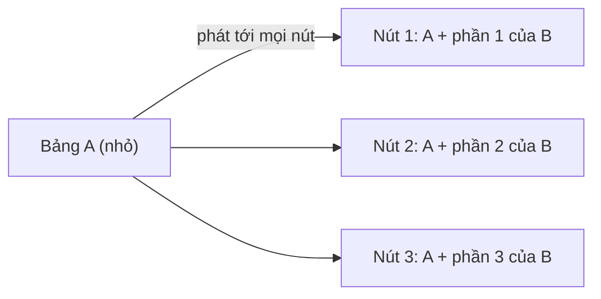
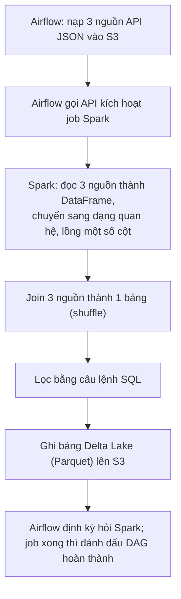
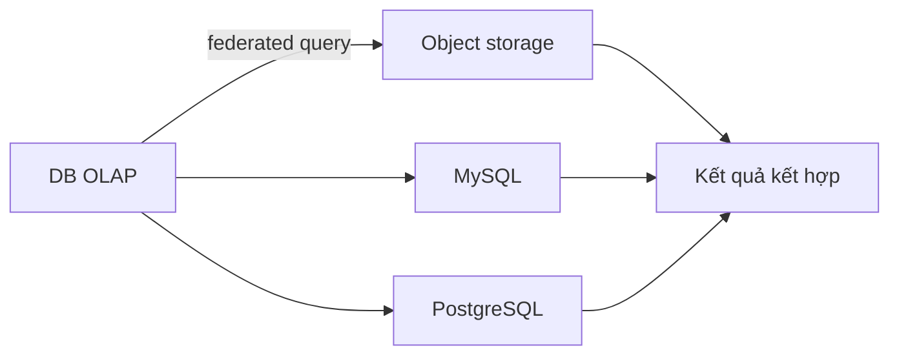

# Chuyển đổi (Transformation) batch

Truy vấn lấy dữ liệu ra; **chuyển đổi (transformation)** thì **lưu kết quả lại** để dùng tiếp, và thường phức tạp hơn nhiều. Bài này mở đầu phần Transformation của Chương 8 rồi đi sâu vào **chuyển đổi batch**: distributed join, ETL và ELT, SQL so với code, các mẫu cập nhật, cập nhật schema, data wrangling, ví dụ Spark, logic nghiệp vụ và dữ liệu dẫn xuất, MapReduce, và các kỹ thuật "ảo hoá" kết quả truy vấn (view, materialized view, federated query, data virtualization).

**Tương tự đơn giản:** truy vấn giống việc nấu một bữa theo yêu cầu rồi ăn ngay; chuyển đổi giống nấu sẵn một mẻ lớn, đóng hộp, để cả tuần ai cần cứ lấy ra hâm lại, khỏi phải đi chợ và nấu từ đầu mỗi lần.

---

:::note[Ghi nhớ nhanh]

- ⭐ **Transformation khác query ở hai điểm**: nó **lưu kết quả** (tạm thời hoặc lâu dài) để dùng tiếp, và thường là **pipeline phức tạp** cần orchestration.
- ⭐ **ETL và ELT chỉ nên bàn ở cấp "vi mô"** (từng pipeline), không phải chuẩn của cả tổ chức; "nạp rồi biến đổi sau" mà không có kế hoạch dễ thành data swamp.
- **SQL khai báo vẫn xây được DAG phức tạp**; nhưng dùng Spark/Python khi SQL quá khó, khó đọc, hoặc cần thư viện tái sử dụng. Với Spark: lọc sớm, dùng API gốc, cẩn thận UDF, kết hợp SQL.
- **Update pattern**: truncate và reload, insert-only, delete (cứng, mềm, insert-delete), upsert/merge; DB cột dùng copy-on-write nên cập nhật và merge rất tốn kém nếu quá thường xuyên.
- **Materialized view, federated query, data virtualization** giúp trình bày kết quả như bảng; query pushdown giảm tải và lượng dữ liệu truyền qua mạng.

:::

---

## Mục lục

- 1. Chuyển đổi là gì và khác truy vấn thế nào
- 2. Distributed join
- 3. ETL, ELT và data pipeline
- 4. Công cụ chuyển đổi dựa trên SQL và dựa trên code
- 5. Các mẫu cập nhật (update patterns)
- 6. Cập nhật schema
- 7. Data wrangling
- 8. Ví dụ chuyển đổi dữ liệu trong Spark
- 9. Logic nghiệp vụ và dữ liệu dẫn xuất
- 10. MapReduce và sau MapReduce
- 11. View, materialized view, federated query và data virtualization
- Tóm tắt

---

## 1. Chuyển đổi là gì và khác truy vấn thế nào

Sách mở đầu bằng câu của Bill Inmon: kết quả cuối cùng của chuyển đổi dữ liệu là khả năng **thống nhất và tích hợp** dữ liệu; sau khi biến đổi, dữ liệu có thể được xem như một thực thể duy nhất. Không chuyển đổi thì không có cái nhìn thống nhất trên toàn tổ chức.

Nếu đã có thể mô hình hoá, truy vấn và nhận kết quả, tại sao cần chuyển đổi? Hãy tưởng tượng bạn chạy một truy vấn mỗi lần muốn xem kết quả từ một tập dữ liệu, hàng chục hoặc hàng trăm lần mỗi ngày, mà truy vấn gồm parse, làm sạch, join, hợp nhất, tổng hợp trên 20 tập dữ liệu, chạy 30 phút, tốn tài nguyên và phí cloud đáng kể qua nhiều lần chạy. Bạn và các bên liên quan sẽ phát điên. Thay vào đó, bạn có thể **lưu kết quả** hoặc chỉ chạy một lần những phần nặng nhất để các truy vấn sau đơn giản đi.

Hai điểm khác biệt giữa transformation và query:

1. **Tính bền vững (persistence):** truy vấn lấy dữ liệu từ nhiều nguồn dựa trên lọc và join; transformation **duy trì kết quả** để dùng bởi các transformation hoặc truy vấn tiếp theo, tạm thời hoặc vĩnh viễn.
2. **Độ phức tạp:** bạn thường xây các pipeline phức tạp kết hợp dữ liệu từ nhiều nguồn và tái sử dụng kết quả trung gian cho nhiều đầu ra. Pipeline có thể chuẩn hoá, mô hình hoá, tổng hợp hoặc tạo đặc trưng (featurize) dữ liệu. Có thể dồn mọi thứ vào một truy vấn qua CTE, script hay DAG, nhưng nhanh chóng trở nên khó dùng, thiếu nhất quán và khó hiểu.

Transformation dựa nhiều vào một yếu tố xuyên suốt chính: **orchestration**. Orchestration kết hợp nhiều hoạt động riêng lẻ (transformation trung gian, lưu trữ tạm hoặc vĩnh viễn, phân phối phía dưới). Ngày càng nhiều, pipeline không chỉ trải qua nhiều bảng, tập dữ liệu mà còn qua **nhiều hệ thống**.

**Chuyển đổi batch** chạy trên các **khối dữ liệu rời rạc**, trái với streaming xử lý liên tục khi dữ liệu đến. Chạy theo lịch cố định (hằng ngày, hằng giờ, 15 phút) để hỗ trợ báo cáo, phân tích và mô hình ML liên tục.

---

## 2. Distributed join

Ý tưởng cơ bản: chia một **join logic** (join xác định bởi logic truy vấn) thành nhiều **join nút** nhỏ hơn chạy trên từng máy trong cụm. Mẫu cơ bản áp dụng dù ở MapReduce, BigQuery, Snowflake hay Spark; chỉ khác chi tiết về lưu trữ trung gian giữa các bước (đĩa hay bộ nhớ). Có hai kiểu:

### 2.1. Broadcast join

Thường **bất đối xứng**: một bảng lớn phân tán trên các nút và một bảng nhỏ đủ vừa trên một nút. Query engine "phát" (broadcast) bảng nhỏ (bảng A) tới **mọi nút**, nơi nó được join với từng phần của bảng lớn (bảng B). Broadcast join ít tốn tính toán hơn nhiều so với shuffle hash join.

Thực tế bảng A thường là bảng lớn hơn đã được **lọc nhỏ lại** rồi phát đi. Một ưu tiên hàng đầu của optimizer là **sắp xếp lại thứ tự join**: áp bộ lọc sớm và đưa bảng nhỏ sang trái (với left join) giúp giảm đáng kể dữ liệu xử lý ở mỗi join. Lọc trước dữ liệu để tạo được broadcast join, nếu có thể, cải thiện mạnh hiệu năng và giảm tài nguyên.



### 2.2. Shuffle hash join

Khi không bảng nào đủ nhỏ để vừa một nút, query engine dùng **shuffle hash join**. Ban đầu bảng A và B được phân vùng trên các nút, thường **chẳng liên quan gì đến khoá join**. Một **sơ đồ băm (hash scheme)** được dùng để phân vùng lại dữ liệu theo khoá join: ví dụ chia khoá join thành 3 phần, mỗi phần gán cho một nút. Sau đó dữ liệu được **shuffle** (xáo trộn) đến nút phù hợp và các phân vùng mới của A và B trên mỗi nút được join. Shuffle hash join thường tốn tài nguyên hơn broadcast join.

| | Broadcast join | Shuffle hash join |
|---|---|---|
| Điều kiện | Một bảng nhỏ vừa một nút | Không bảng nào đủ nhỏ |
| Cách làm | Phát bảng nhỏ tới mọi nút | Băm lại cả hai bảng theo khoá join và xáo trộn |
| Chi phí | Thấp hơn | Cao hơn |

---

## 3. ETL, ELT và data pipeline

Như đã nói ở Chương 3, **ETL batch** có từ thời đầu của DB quan hệ: một hệ chuyển đổi bên ngoài **kéo, biến đổi, làm sạch** dữ liệu và chuẩn bị theo schema đích (data mart hay star schema Kimball), rồi **nạp** vào hệ đích như data warehouse.

ETL bị chi phối bởi giới hạn của cả nguồn lẫn đích: bước extract hay là nút cổ chai lớn vì ràng buộc của RDBMS nguồn hạn chế tốc độ lấy dữ liệu; còn transform nằm ở hệ chuyên dụng vì hệ đích cực kỳ hạn chế tài nguyên (cả lưu trữ lẫn CPU).

**ELT** là sự tiến hoá phổ biến: khi data warehouse mạnh hơn về hiệu năng và lưu trữ, người ta **trích dữ liệu thô, nạp vào warehouse với biến đổi tối thiểu, rồi làm sạch và biến đổi ngay trong warehouse**.

Có một khái niệm ELT thứ hai, hơi khác, phổ biến cùng **data lake**: dữ liệu **không** được biến đổi lúc nạp, có thể nạp lượng lớn mà không chuẩn bị hay kế hoạch, với giả định bước chuyển đổi sẽ xảy ra vào một thời điểm chưa xác định trong tương lai. Nạp dữ liệu không có kế hoạch là công thức tuyệt vời cho **data swamp**. Inmon nói đại ý: ông luôn thích ETL vì nó buộc bạn biến đổi dữ liệu thành dạng làm việc được *trước khi* chuyển đi; ông đã thấy quá nhiều tổ chức nói "cứ nạp vào rồi biến đổi sau", và sáu tháng sau dữ liệu đó chưa bao giờ được đụng tới.

Ranh giới giữa ETL và ELT cũng ngày càng mờ: với **object storage** làm lớp nền, không còn rõ cái gì "trong DB" và "ngoài DB", càng mờ hơn với federated query, data virtualization và live table. Tác giả cho rằng thuật ngữ ETL/ELT chỉ nên áp dụng ở **cấp vi mô** (từng pipeline) thay vì ở **cấp vĩ mô** (mô tả mẫu chuyển đổi của cả tổ chức). Tổ chức không cần chuẩn hoá ETL hay ELT mà nên tập trung chọn kỹ thuật phù hợp cho từng trường hợp khi xây pipeline.

---

## 4. Công cụ chuyển đổi dựa trên SQL và dựa trên code

Ranh giới giữa hệ chuyển đổi dựa trên SQL và không dựa trên SQL hơi nhân tạo. Từ khi Hive ra đời trên Hadoop, SQL là "công dân hạng nhất" của hệ sinh thái big data: Spark SQL là tính năng sớm của Spark, và các framework streaming như Kafka, Flink, Beam cũng hỗ trợ SQL ở các mức khác nhau. Hợp lý hơn là phân biệt công cụ **chỉ SQL** với công cụ hỗ trợ mô hình lập trình đa dụng mạnh hơn.

**SQL là khai báo (declarative) nhưng vẫn xây được luồng dữ liệu phức tạp.** Người ta hay nói SQL bị chê vì "không mang tính thủ tục". Về kỹ thuật là đúng: người viết SQL mô tả đặc điểm của dữ liệu đầu ra bằng ngôn ngữ lý thuyết tập hợp, còn trình biên dịch và optimizer quyết định các bước. Nhưng ngụ ý rằng vì thế SQL không xây được quy trình phức tạp là **sai**: SQL xây được DAG phức tạp bằng CTE, script SQL hoặc công cụ orchestration.

Tuy vậy SQL có giới hạn, và sách thường thấy kỹ sư làm bằng Python/Spark những việc dễ và hiệu quả hơn nếu viết bằng SQL.

### 4.1. Khi nào nên tránh SQL (ví dụ với Spark)

Khi quyết định dùng Spark/PySpark gốc hay Spark SQL (hoặc công cụ SQL khác), hãy tự hỏi:

1. Mã hoá phép biến đổi bằng SQL **khó đến mức nào**?
2. Mã SQL thu được sẽ **dễ đọc và bảo trì** đến đâu?
3. Có nên đưa một phần mã biến đổi vào **thư viện tuỳ chỉnh** để tái sử dụng trong tổ chức không?

Về câu 1: nhiều phép biến đổi mã hoá trong Spark có thể làm bằng SQL đơn giản. Ngược lại nếu không thể hoặc cực khó trong SQL thì Spark gốc hợp hơn. Ví dụ **stemming** (rút từ về gốc): trong SQL phải thêm hậu tố vào một bảng, join, dùng hàm parse để tìm hậu tố, rồi dùng hàm substring cắt từ về gốc; quá phức tạp với nhiều trường hợp. Ngôn ngữ thủ tục mạnh hơn phù hợp hơn. Câu 2 liên quan chặt: truy vấn stemming sẽ không đọc được cũng không bảo trì được.

Về câu 3: một hạn chế lớn của SQL là **không có khái niệm tự nhiên về thư viện hay mã tái sử dụng**. Ngoại lệ: một số engine SQL cho giữ **UDF (user-defined function)** như đối tượng trong DB, nhưng chúng không được commit vào Git nếu không có CI/CD bên ngoài để quản lý triển khai. SQL cũng không có khái niệm tái sử dụng tốt cho các thành phần truy vấn phức tạp hơn. Trong Spark/PySpark tạo thư viện tái sử dụng rất dễ.

Có hai cách tái chế SQL:

- Dùng lại **kết quả** của truy vấn SQL bằng cách commit vào bảng hoặc tạo view, thường tốt nhất xử lý trong công cụ orchestration như Airflow để truy vấn phía dưới bắt đầu khi truy vấn nguồn kết thúc.
- **dbt (data build tool)** hỗ trợ tái sử dụng câu lệnh SQL và cung cấp ngôn ngữ **templating** giúp tuỳ biến dễ hơn.

### 4.2. Tối ưu Spark và các framework nặng về code

Người ủng hộ Spark hay phàn nàn SQL không cho họ kiểm soát việc xử lý. Công cụ SQL nhận câu lệnh, tối ưu và biên dịch thành các bước. Phàn nàn này công bằng, nhưng hệ quả là: với Spark và framework nặng về code, **người viết code chịu trách nhiệm phần lớn việc tối ưu** vốn tự động trong công cụ SQL. API Spark mạnh và phức tạp, không dễ xác định chỗ nào nên sắp xếp lại, kết hợp hay tách ra. Nhóm kỹ thuật dữ liệu cần chủ động tham gia vào tối ưu Spark, nhất là với job đắt và chạy lâu: xây chuyên môn tối ưu trong nhóm và dạy từng kỹ sư.

Bốn điều cấp cao khi code Spark gốc:

1. **Lọc sớm và thường xuyên.** Cũng đúng với tối ưu SQL, nhưng Spark có thể không tự sắp xếp lại mọi thứ như SQL. Càng xử lý ít dữ liệu thì code càng ít tốn tài nguyên và nhanh hơn.
2. **Dựa chủ yếu vào API Spark lõi** và học cách làm theo kiểu Spark gốc; nếu API gốc không hỗ trợ use case thì cố dùng thư viện công cộng được bảo trì tốt. Code Spark tốt về cơ bản là khai báo. Nếu thấy mình viết mã tuỳ chỉnh cực phức tạp, hãy dừng lại và xem có cách "bản địa" hơn không: đọc ví dụ công khai, làm hướng dẫn.
3. **Cẩn thận với UDF.** Đặc biệt quan trọng với PySpark: PySpark nhìn chung là vỏ bọc API cho Scala Spark; code của bạn đẩy việc vào code Scala chạy trong JVM thông qua API. Chạy UDF Python buộc dữ liệu chuyển sang Python nơi xử lý kém hiệu quả. Nếu phải dùng UDF, cân nhắc viết lại bằng Scala hoặc Java.
4. **Cân nhắc trộn SQL.** SQL cho phép dùng bộ tối ưu **Catalyst** của Spark, đạt hiệu năng có thể cao hơn code Spark gốc, và thường dễ viết, bảo trì hơn cho thao tác đơn giản. Kết hợp Spark gốc và SQL tận dụng cả hai: đa dụng mạnh mẽ cộng với sự đơn giản khi có thể.

Phần lớn lời khuyên này cũng áp dụng cho Apache Beam. Điểm chính: API xử lý dữ liệu lập trình được đòi hỏi tinh chỉnh tối ưu nhiều hơn SQL, có lẽ kém mạnh mẽ và dễ dùng hơn.

---

## 5. Các mẫu cập nhật (update patterns)

Vì transformation lưu dữ liệu, ta thường phải **cập nhật tại chỗ** dữ liệu đã lưu. Cập nhật dữ liệu là điểm đau lớn của các nhóm kỹ thuật dữ liệu, nhất là khi chuyển giữa các công nghệ. Đây là DML trong SQL đã giới thiệu ở bài 1.

Khái niệm data lake ban đầu không thực sự tính đến cập nhật; điều này nay thành vô lý vì nhiều lý do: cập nhật luôn là phần quan trọng khi xử lý kết quả biến đổi dữ liệu, và thật ngớ ngẩn khi chạy lại cả lượng việc lớn chỉ vì không cập nhật được. Vì vậy **data lakehouse** nay có sẵn cập nhật. Thêm nữa, GDPR và các chuẩn xoá dữ liệu khác yêu cầu tổ chức **xoá dữ liệu có mục tiêu**, kể cả trong dữ liệu thô.

### 5.1. Truncate và reload

**Truncate** là mẫu "cập nhật" mà không cập nhật gì: chỉ **xoá sạch dữ liệu cũ**. Trong mẫu truncate-and-reload, bảng được xoá sạch dữ liệu, các transformation chạy lại và nạp vào bảng đó, tạo phiên bản bảng mới.

### 5.2. Insert-only (chỉ chèn)

Chỉ **chèn bản ghi mới**, không đổi hay xoá bản ghi cũ. Có thể dùng để duy trì "góc nhìn hiện tại": chèn phiên bản mới của bản ghi mà không xoá bản cũ; truy vấn hoặc view có thể hiển thị trạng thái hiện tại bằng cách tìm bản ghi **mới nhất theo khoá chính**. Lưu ý DB cột thường **không thực thi khoá chính**; khoá chính chỉ là cấu trúc kỹ sư dùng để duy trì khái niệm trạng thái hiện tại.

Nhược điểm: tìm bản ghi mới nhất lúc truy vấn có thể **rất tốn tính toán**. Thay thế: dùng materialized view, hoặc duy trì song song bảng insert-only (giữ mọi bản ghi) với bảng đích truncate-reload chứa trạng thái hiện tại.

```sql
-- Ví dụ minh hoạ (do người ghi chép thêm): lấy phiên bản mới nhất theo khoá
SELECT *
FROM (
  SELECT t.*,
         ROW_NUMBER() OVER (PARTITION BY id ORDER BY updated_at DESC) AS rn
  FROM customers_history t
) x
WHERE rn = 1;
```

**Phản mẫu (antipattern) khi nạp vào DB cột OLAP:** kỹ sư chuyển từ hệ hướng hàng cố gắng **chèn từng hàng một**. Điều này tạo tải lớn lên hệ thống, khiến dữ liệu bị ghi vào nhiều file nhỏ (rất kém cho lần đọc sau, và phải phân cụm lại). Nên nạp theo **batch hoặc micro-batch**. Một ngoại lệ là kiến trúc Lambda nâng cao của **BigQuery và Apache Druid**, kết hợp bộ đệm streaming với lưu trữ cột. Xoá và cập nhật tại chỗ vẫn có thể đắt (xem dưới).

### 5.3. Delete (xoá)

Xoá rất quan trọng khi hệ nguồn xoá dữ liệu và để đáp ứng thay đổi quy định. Trong hệ cột và data lake, **xoá đắt hơn chèn**. Cân nhắc:

- **Xoá cứng (hard delete):** xoá vĩnh viễn bản ghi khỏi DB. Dùng khi cần xoá vì hiệu năng (bảng quá lớn) hoặc vì lý do pháp lý/tuân thủ.
- **Xoá mềm (soft delete):** đánh dấu bản ghi là "đã xoá". Dùng khi không muốn xoá hẳn nhưng muốn lọc khỏi kết quả truy vấn.
- **Insert-delete (chèn bản ghi xoá):** gần với soft delete, **chèn một bản ghi mới có cờ đã xoá** mà không sửa phiên bản trước. Giữ được mẫu insert-only nhưng vẫn tính đến xoá. Truy vấn lấy trạng thái mới nhất phức tạp hơn một chút: phải loại trùng, tìm phiên bản mới nhất của từng bản ghi theo khoá, và không hiển thị bản ghi nào có phiên bản mới nhất bị đánh dấu xoá.

### 5.4. Upsert và merge

Hai mẫu này **luôn gây rắc rối nhất** cho nhóm kỹ thuật dữ liệu, nhất là những ai chuyển từ warehouse hướng hàng sang hệ cột trên đám mây.

- **Upsert:** lấy tập bản ghi nguồn và tìm kết quả khớp với bảng đích theo khoá chính hoặc điều kiện logic (nhóm dữ liệu phải tự quản lý khoá chính bằng truy vấn phù hợp, vì hầu hết hệ cột không thực thi tính duy nhất). Khi khớp khoá, bản ghi đích được cập nhật (thay bằng bản mới); không khớp thì chèn bản ghi mới.
- **Merge:** bổ sung thêm khả năng **xoá** bản ghi.

```sql
-- Ví dụ minh hoạ MERGE (do người ghi chép thêm)
MERGE INTO dim_customer t
USING staging_customer s
  ON t.customer_id = s.customer_id
WHEN MATCHED THEN UPDATE SET t.zip = s.zip
WHEN NOT MATCHED THEN INSERT (customer_id, zip) VALUES (s.customer_id, s.zip);
```

**Vì sao rắc rối?** Mẫu upsert/merge ban đầu thiết kế cho DB hướng hàng, nơi cập nhật rất tự nhiên: DB tra cứu bản ghi và sửa tại chỗ. Các hệ dựa trên **file** thì không thực sự hỗ trợ cập nhật file tại chỗ; tất cả dùng **copy-on-write (COW)**: nếu một bản ghi trong file bị đổi hoặc xoá, **cả file phải được ghi lại** với thay đổi. Đó là một phần lý do những người dùng big data và data lake sơ khai từ chối cập nhật: quản lý file và cập nhật trông quá phức tạp. Họ chỉ dùng insert-only và giả định người dùng dữ liệu tự xác định trạng thái hiện tại lúc truy vấn hoặc ở transformation phía dưới. Thực tế các DB cột như Vertica từ lâu hỗ trợ cập nhật tại chỗ bằng cách giấu độ phức tạp của COW: quét file, đổi bản ghi liên quan, ghi file mới và đổi con trỏ file của bảng. Các data warehouse cột đám mây lớn đều hỗ trợ update và merge, nhưng nếu cân nhắc công nghệ lạ thì hãy kiểm tra hỗ trợ cập nhật.

Vài điều quan trọng:

- Dù hệ cột phân tán hỗ trợ lệnh update gốc, **merge vẫn tốn kém**: tác động hiệu năng của việc cập nhật hoặc xoá một bản ghi có thể khá cao. Mặt khác merge có thể **rất hiệu quả với tập cập nhật lớn**, thậm chí vượt DB giao dịch.
- COW hiếm khi cần ghi lại **toàn bộ bảng**. Tuỳ DB, COW hoạt động ở các độ phân giải khác nhau (partition, cluster, block). Để cập nhật hiệu năng cao, hãy phát triển chiến lược **partition và clustering** phù hợp dựa trên nhu cầu và cấu trúc bên trong của DB.
- Cẩn thận tần suất update/merge. Nhiều nhóm chuyển hệ DB rồi cố làm merge gần thời gian thực từ CDC như trên hệ cũ; **điều đó đơn giản là không chạy được**. Dù hệ CDC tốt đến đâu, cách này làm hầu hết warehouse cột "bó tay"; sách thấy có hệ thống bị chậm cập nhật hàng tuần trong khi merge theo giờ hợp lý hơn nhiều.

Các cách đưa DB cột lại gần thời gian thực: BigQuery cho chèn bản ghi mới vào bảng rồi hỗ trợ **materialized view chuyên biệt** để hiển thị góc nhìn bảng đã loại trùng gần thời gian thực; Druid dùng lưu trữ hai tầng và SSD để hỗ trợ truy vấn thời gian thực cực nhanh.

| Mẫu | Cách làm | Lưu ý |
|---|---|---|
| Truncate và reload | Xoá sạch, chạy lại transformation | Đơn giản, tạo bảng phiên bản mới |
| Insert-only | Chỉ thêm bản ghi mới | Truy vấn "mới nhất" tốn kém; dùng view/MV |
| Delete | Cứng, mềm, hoặc insert-delete | Xoá đắt hơn chèn trong hệ cột |
| Upsert/Merge | Khớp theo khoá rồi cập nhật/chèn (và xoá) | COW; không merge quá thường xuyên |

---

## 6. Cập nhật schema

Dữ liệu có **entropy**: có thể thay đổi mà bạn không kiểm soát hay đồng ý. Nguồn bên ngoài đổi schema, hoặc nhóm phát triển ứng dụng thêm trường mới. Ưu điểm của hệ cột so với hệ hàng: dù cập nhật dữ liệu khó hơn, **cập nhật schema dễ hơn**; cột thường thêm, xoá, đổi tên được.

Dù vậy, quản lý schema ở mức tổ chức vẫn nhiều thách thức:

- Có nên **tự động** một số cập nhật schema không? (Fivetran làm vậy khi sao chép từ nguồn.) Tiện nhưng có nguy cơ làm hỏng các transformation phía dưới.
- Có quy trình yêu cầu cập nhật schema đơn giản không? Ví dụ nhóm data science muốn thêm cột từ nguồn chưa nạp: review thế nào? Pipeline phía dưới có hỏng không (có truy vấn nào chạy `SELECT *` thay vì chọn cột tường minh không; thường là cách làm xấu với DB cột)? Mất bao lâu? Có thể tạo một **fork của bảng**, tức phiên bản bảng mới riêng cho dự án này?

Một lựa chọn mới cho dữ liệu bán cấu trúc: mượn ý từ document store, nhiều data warehouse đám mây nay hỗ trợ kiểu dữ liệu mã hoá **JSON tuỳ ý**. Một cách tiếp cận: lưu **JSON thô** trong một trường, đồng thời lưu dữ liệu hay truy cập vào các **trường phẳng liền kề**. Tốn thêm dung lượng nhưng cho dữ liệu đã làm phẳng tiện dùng, cộng với sự linh hoạt của dữ liệu bán cấu trúc cho người dùng nâng cao. Dữ liệu hay dùng trong JSON có thể được thêm dần vào schema theo thời gian. Cách này rất hiệu quả khi kỹ sư phải nạp dữ liệu từ document store ứng dụng có schema đổi thường xuyên. Dữ liệu bán cấu trúc là "công dân hạng nhất" trong warehouse mở ra cơ hội mới cho analyst và data scientist vì dữ liệu không còn bị giới hạn ở hàng và cột.

---

## 7. Data wrangling

**Data wrangling** lấy dữ liệu **lộn xộn, sai định dạng** và biến thành dữ liệu **sạch, hữu ích**; thường là một transformation batch. Từ lâu đây là nỗi đau chính và cũng là thứ "đảm bảo việc làm" cho kỹ sư dữ liệu.

**Ví dụ:** nhận dữ liệu **EDI** (Chương 7) từ đối tác về giao dịch và hoá đơn, hỗn hợp dữ liệu có cấu trúc và văn bản. Quy trình điển hình: thử nạp trước; dữ liệu thường sai định dạng nên phải xử lý nhiều văn bản. Có thể nạp thành bảng một trường văn bản duy nhất (cả hàng thành một trường), rồi viết truy vấn parse và tách dần. Theo thời gian phát hiện bất thường và edge case. Cuối cùng mới có dữ liệu ở dạng thô dùng được; chỉ khi đó transformation phía dưới mới bắt đầu.

**Công cụ wrangling** đơn giản hoá phần lớn quy trình này. Chúng thường khiến kỹ sư dữ liệu e ngại vì quảng cáo "no-code", nhưng sách thích coi chúng như **IDE cho dữ liệu sai định dạng**. Công cụ đồ hoạ thường hiện một mẫu dữ liệu trong giao diện trực quan, với kiểu suy ra, thống kê (phân phối, dị thường, outlier, null). Người dùng thêm các bước xử lý để sửa lỗi: hướng dẫn xử lý dữ liệu nhập sai, tách trường văn bản thành nhiều phần, join với bảng tra cứu. Khi toàn bộ job sẵn sàng, chạy trên tập đầy đủ, thường đẩy sang hệ xử lý mở rộng như Spark cho dữ liệu lớn. Chạy xong, job trả về lỗi và ngoại lệ chưa xử lý để tinh chỉnh "công thức" tiếp.

Sách khuyên cả kỹ sư mới lẫn dày dạn thử nghiệm các công cụ này; các nhà cung cấp cloud lớn bán phiên bản riêng và có nhiều lựa chọn bên thứ ba. Về tổ chức, nhóm có thể xem xét đào tạo **chuyên gia wrangling** nếu thường xuyên nạp từ nguồn mới, lộn xộn; công cụ cũng cho phép giao bớt việc parse và nạp cho analyst.

---

## 8. Ví dụ chuyển đổi dữ liệu trong Spark

Một ví dụ cụ thể: pipeline nạp dữ liệu từ **ba nguồn API định dạng JSON**. Bước nạp ban đầu xử lý trong **Airflow**; mỗi nguồn có một prefix (đường dẫn file) trong một bucket S3.



Diễn biến bên trong:

1. Spark tạo **DAG các bước** dựa trên mã bạn viết để nạp, join và ghi. Việc nạp dữ liệu diễn ra trong **bộ nhớ cụm**, nhưng một nguồn đủ lớn nên phải **tràn xuống đĩa (spill)** khi nạp (ghi vào lưu trữ cụm, sẽ nạp lại vào bộ nhớ cho các bước sau).
2. **Join** cần một thao tác **shuffle**: dùng khoá để phân phối lại dữ liệu khắp cụm; lại có spill khi dữ liệu được ghi vào mỗi nút.
3. Phép biến đổi SQL lọc qua các hàng trong bộ nhớ và loại hàng không dùng.
4. Cuối cùng Spark chuyển dữ liệu sang **Parquet**, nén và ghi lại vào S3 (bảng Delta Lake).
5. Airflow định kỳ gọi lại Spark để xem job xong chưa; xác nhận xong thì đánh dấu cả Airflow DAG hoàn thành. Lưu ý có **hai cấu trúc DAG**: DAG Airflow và DAG riêng của job Spark.

---

## 9. Logic nghiệp vụ và dữ liệu dẫn xuất

Một trong những use case phổ biến nhất của transformation là **hiển thị logic nghiệp vụ**. (Thường xảy ra ở batch nhưng cũng có thể ở streaming pipeline.)

**Ví dụ của sách:** một công ty dùng nhiều cách tính **lợi nhuận** nội bộ chuyên biệt: một phiên bản tính lợi nhuận **trước chi phí tiếp thị**, phiên bản khác **sau khi trừ chi phí tiếp thị**. Nghe như bài tập kế toán đơn giản nhưng mỗi số liệu đều phức tạp:

- **Lợi nhuận trước chi phí tiếp thị** có thể phải tính đến **đơn hàng gian lận**. Ước tính lợi nhuận hợp lý cho ngày hôm trước đòi hỏi ước tính phần trăm doanh thu và lợi nhuận sẽ mất vì đơn bị huỷ trong những ngày tới khi đội chống gian lận điều tra đơn nghi ngờ. Có cờ đặc biệt cho đơn nhiều khả năng gian lận hay đã tự huỷ không? Doanh nghiệp có giả định một tỷ lệ đơn sẽ bị huỷ do gian lận ngay cả trước khi đánh giá rủi ro xong không?
- **Lợi nhuận sau chi phí tiếp thị** phải tính mọi phức tạp trên **cộng chi phí tiếp thị được quy cho đơn hàng cụ thể**. Mô hình phân bổ đơn giản (ví dụ chi phí chia theo giá mặt hàng)? Hay chia theo phòng ban/danh mục, hoặc ở tổ chức phức tạp nhất, theo từng mặt hàng dựa trên số lần nhấp quảng cáo của người dùng?

Transformation logic nghiệp vụ tạo phiên bản lợi nhuận đầy sắc thái này phải tích hợp mọi tinh tế của **attribution** (mô hình gắn đơn hàng với quảng cáo cụ thể và chi phí quảng cáo). Dữ liệu phân bổ nằm trong script ETL hay được lấy từ bảng tự sinh từ dữ liệu nền tảng quảng cáo?

Loại dữ liệu báo cáo này là ví dụ điển hình của **dữ liệu dẫn xuất (derived data)**: dữ liệu tính từ dữ liệu khác trong hệ thống. Người chỉ trích dữ liệu dẫn xuất nói ETL khó giữ **nhất quán** cho các số liệu dẫn xuất: nếu công ty đổi mô hình phân bổ, thay đổi này có thể phải hợp nhất vào nhiều script ETL cho báo cáo (script ETL nổi tiếng vi phạm DRY). Cập nhật chúng là quy trình thủ công, tốn công, đòi hỏi kiến thức miền, và các script cập nhật phải được kiểm tra tính nhất quán và chính xác.

Quan điểm của tác giả: đây là lời chỉ trích chính đáng nhưng **không hẳn mang tính xây dựng**, vì phương án thay thế cũng khó chịu không kém. Nếu không lưu dữ liệu lợi nhuận trong warehouse, analyst phải chạy truy vấn báo cáo kèm logic lợi nhuận. Cập nhật script ETL phức tạp để phản ánh đúng thay đổi logic nghiệp vụ đã nặng nề; bắt analyst cập nhật truy vấn báo cáo nhất quán còn **gần như không thể**.

Một giải pháp thay thế thú vị là đẩy logic nghiệp vụ vào **metrics layer (lớp số liệu)** nhưng vẫn dùng warehouse hoặc công cụ khác làm phần tính toán nặng. Lớp metrics mã hoá logic nghiệp vụ, cho analyst và người dùng dashboard dựng phân tích phức tạp từ thư viện các metric đã định nghĩa; nó sinh truy vấn từ metric và gửi tới DB. (Semantic layer và metrics layer sẽ được bàn kỹ hơn ở Chương 9.)

---

## 10. MapReduce và sau MapReduce

Không bàn về chuyển đổi batch được mà bỏ qua **MapReduce**. Không phải vì ngày nay nó được dùng rộng rãi, mà vì nó là **mẫu chuyển đổi batch xác định của kỷ nguyên big data**, vẫn ảnh hưởng đến nhiều công nghệ phân tán đang dùng, và cần hiểu ở mức cơ bản. Google giới thiệu MapReduce sau bài báo về GFS; ban đầu nó là mẫu xử lý mặc định của **Hadoop** (bản mã nguồn mở của GFS, đã giới thiệu ở Chương 6).

Job MapReduce đơn giản gồm: một tập **map task** đọc từng khối dữ liệu rải trên các nút, sau đó là **shuffle** phân phối lại kết quả khắp cụm, rồi bước **reduce** tổng hợp dữ liệu trên mỗi nút.

**Ví dụ:** chạy truy vấn

```sql
SELECT COUNT(*), user_id
FROM user_events
GROUP BY user_id;
```

- Dữ liệu bảng trải trên các nút theo khối; job tạo một **map task cho mỗi khối**, mỗi task đếm số lần xuất hiện của từng user ID trong khối đó. Mỗi khối có thể vài trăm megabyte nhưng cả bảng có thể cỡ petabyte; phần map là ví dụ gần như hoàn hảo của **tính song song "đáng xấu hổ" (embarrassingly parallel)**: tốc độ quét dữ liệu toàn cụm tỷ lệ tuyến tính với số nút.
- Sau đó cần **tổng hợp (reduce)** để gom kết quả toàn cụm. Không gom về một nút; thay vào đó **phân phối lại kết quả theo khoá** sao cho mỗi khoá nằm trên một và chỉ một nút. Đây là bước **shuffle**, thường dùng thuật toán băm trên khoá. Sau shuffle, ta cộng kết quả cho từng khoá. Các cặp khoá/đếm có thể ghi ra đĩa cục bộ trên nút tính ra chúng, rồi thu thập từ các nút để xem kết quả đầy đủ.

Job MapReduce thực tế phức tạp hơn nhiều: truy vấn lọc bằng `WHERE`, join ba bảng và áp hàm cửa sổ gồm nhiều giai đoạn map và reduce.

### Sau MapReduce

Mẫu MapReduce gốc của Google rất mạnh nhưng nay bị coi là **quá cứng nhắc**. Nó dùng nhiều task ngắn hạn đọc/ghi đĩa; đặc biệt **không giữ trạng thái trung gian trong bộ nhớ**, mọi dữ liệu giữa các task đều qua đĩa hoặc mạng. Điều này đơn giản hoá quản lý trạng thái và workflow, giảm tiêu thụ bộ nhớ, nhưng cũng đẩy cao băng thông đĩa và tăng processing time.

MapReduce dựa trên giả định dung lượng và băng thông đĩa từ rẻ đến mức "ném" cả đống đĩa vào dữ liệu để truy vấn cực nhanh là hợp lý. Một mức độ nào đó đúng: MapReduce liên tục lập kỷ lục xử lý dữ liệu thời Hadoop đầu. Nhưng ta đã sống trong thế giới **hậu MapReduce** được một thời gian. Xử lý hậu MapReduce không loại bỏ MapReduce; vẫn có thành phần map, shuffle, reduce, nhưng **nới lỏng ràng buộc để cho phép cache trong bộ nhớ**. RAM nhanh hơn nhiều so với SSD và HDD về tốc độ truyền và thời gian seek; giữ ngay cả lượng nhỏ dữ liệu chọn lọc trong bộ nhớ có thể tăng tốc đáng kể một số tác vụ và vượt xa MapReduce.

Ví dụ **Spark, BigQuery** và nhiều framework khác thiết kế xoay quanh **xử lý trong bộ nhớ**: coi dữ liệu như một tập phân tán nằm trong bộ nhớ; nếu dữ liệu tràn bộ nhớ thì spill xuống đĩa, coi đĩa là lớp lưu trữ hạng hai cho xử lý (dù vẫn có giá trị cao). **Đám mây** là một động lực của việc cache bộ nhớ rộng rãi hơn: thuê bộ nhớ cho một job xử lý hiệu quả hơn nhiều so với sở hữu nó 24 giờ mỗi ngày.

---

## 11. View, materialized view, federated query và data virtualization

Phần này xem xét các kỹ thuật **ảo hoá kết quả truy vấn** bằng cách trình bày chúng như đối tượng giống bảng. Chúng có thể là một phần của pipeline chuyển đổi hoặc xảy ra ngay trước khi người dùng cuối dùng dữ liệu.

### 11.1. View (khung nhìn)

View là một đối tượng DB mà ta `SELECT` như bất kỳ bảng nào. Thực chất view **chỉ là một truy vấn tham chiếu các bảng khác**. Khi chọn từ view, DB tạo truy vấn mới kết hợp truy vấn con của view với truy vấn của bạn; optimizer sau đó tối ưu và chạy truy vấn đầy đủ.

View đóng nhiều vai trò:

1. **Bảo mật:** view chỉ chọn một số cột và lọc hàng nhất định, tạo quyền truy cập dữ liệu bị giới hạn; có thể tạo nhiều view cho các vai trò công việc khác nhau.
2. **Góc nhìn hiện tại đã loại trùng:** với mẫu insert-only, view trả về phiên bản đã loại trùng của bảng chỉ hiển thị phiên bản mới nhất của mỗi bản ghi.
3. **Trình bày mẫu truy cập phổ biến:** ví dụ analyst tiếp thị thường chạy truy vấn join năm bảng; tạo view gộp năm bảng thành một bảng rộng để analyst chỉ việc lọc và tổng hợp.

### 11.2. Materialized view (khung nhìn vật hoá)

Nhược điểm của view thường là **không tính trước** gì cả: với view join năm bảng, join phải chạy mỗi lần analyst truy vấn, và có thể cực đắt. **Materialized view** thực hiện trước một phần hoặc toàn bộ tính toán của view: ví dụ lưu kết quả join năm bảng mỗi khi bảng nguồn thay đổi; khi người dùng tham chiếu view thì truy vấn từ dữ liệu đã join sẵn. Về bản chất nó là một transformation, nhưng DB quản lý việc thực thi cho thuận tiện.

Materialized view còn có thể là **tối ưu truy vấn** quan trọng tuỳ DB, **ngay cả với truy vấn không tham chiếu trực tiếp** tới nó: nhiều optimizer nhận ra truy vấn "trông giống" một MV, ví dụ analyst dùng bộ lọc có trong MV; optimizer viết lại truy vấn để chọn từ kết quả đã tính trước.

### 11.3. Materialized view composable (kết hợp được)

Nhìn chung MV **không cho phép composition**, tức MV không chọn từ MV khác. Gần đây xuất hiện công cụ hỗ trợ khả năng này. Ví dụ Databricks giới thiệu khái niệm **live table**: mỗi bảng được cập nhật khi dữ liệu đến từ nguồn và dữ liệu chảy xuống các bảng tiếp theo **bất đồng bộ**.

### 11.4. Federated query (truy vấn liên kết)

Tính năng DB cho phép DB OLAP **chọn từ nguồn dữ liệu bên ngoài** như object storage hoặc RDBMS. Ví dụ cần kết hợp dữ liệu trong object storage với các bảng khác nhau của MySQL và PostgreSQL; warehouse của bạn đưa truy vấn liên kết tới các nguồn này và trả kết quả tổng hợp.



Ví dụ khác: Snowflake hỗ trợ **external table** định nghĩa trên bucket S3. Vị trí dữ liệu bên ngoài và định dạng file được xác định khi tạo bảng nhưng dữ liệu chưa được nạp. Khi truy vấn external table, Snowflake đọc từ S3 và xử lý theo tham số lúc tạo. Có thể thậm chí join dữ liệu S3 vào các bảng DB nội bộ, giúp Snowflake và các DB tương tự tương thích hơn với môi trường data lake. Một số hệ OLAP có thể chuyển federated query thành **materialized view**, cho phần lớn hiệu năng của bảng gốc mà không cần nạp thủ công mỗi khi nguồn ngoài đổi; MV được cập nhật bất cứ khi nào dữ liệu ngoài thay đổi.

### 11.5. Data virtualization (ảo hoá dữ liệu)

Liên quan chặt với federated query, nhưng thường cần một **hệ truy vấn và xử lý không lưu dữ liệu nội bộ**. Ví dụ tiêu biểu: **Trino** (ví dụ Starburst) và **Presto**. Bất kỳ engine truy vấn/xử lý nào hỗ trợ external table đều có thể đóng vai trò công cụ ảo hoá. Cân nhắc quan trọng nhất: các **nguồn được hỗ trợ** và **hiệu năng**.

**Query pushdown (đẩy truy vấn xuống):** ví dụ muốn truy vấn dữ liệu từ Snowflake, join dữ liệu từ DB MySQL và lọc kết quả. Pushdown nhằm **chuyển càng nhiều việc càng tốt sang DB nguồn**: engine tìm cách đẩy các predicate lọc vào truy vấn trên hệ nguồn. Hai mục đích: giảm tải tính toán khỏi lớp ảo hoá (tận dụng hiệu năng truy vấn của nguồn) và có thể giảm lượng dữ liệu phải truyền qua mạng, vốn là nút cổ chai nghiêm trọng của ảo hoá.

Ảo hoá dữ liệu tốt cho tổ chức có dữ liệu ở nhiều nguồn, nhưng **không nên dùng tuỳ tiện**. Ví dụ ảo hoá DB MySQL production không giải quyết vấn đề cốt lõi là truy vấn phân tích gây hại cho hệ production, vì Trino không lưu dữ liệu nội bộ nên **mỗi lần chạy truy vấn nó đều lấy dữ liệu từ MySQL**. Có thể dùng ảo hoá như một thành phần của pipeline xử lý và nạp: ví dụ dùng Trino chọn từ MySQL mỗi ngày một lần lúc nửa đêm khi tải production thấp, lưu kết quả vào S3 cho transformation và truy vấn hằng ngày, bảo vệ MySQL khỏi truy vấn phân tích trực tiếp.

Ảo hoá dữ liệu có thể xem là công cụ mở rộng data lake sang nhiều nguồn hơn bằng cách **xoá rào cản** khi lưu dữ liệu giữa các đơn vị tổ chức: tổ chức có thể lưu dữ liệu đã biến đổi, hay truy cập, trong S3 và ảo hoá quyền truy cập giữa các bộ phận. Rất hợp với khái niệm **data mesh** (Chương 3), nơi các nhóm nhỏ tự chịu trách nhiệm chuẩn bị dữ liệu để phân tích và chia sẻ cho cả công ty; ảo hoá có thể là lớp truy cập quan trọng để chia sẻ thực tế.

| Kỹ thuật | Lưu dữ liệu? | Ý chính |
|---|---|---|
| View | Không (chỉ là truy vấn) | Bảo mật, dedup, trình bày mẫu truy cập |
| Materialized view | Có (kết quả tính trước) | Tính sẵn, tối ưu truy vấn, DB quản lý |
| Federated query | Không (đọc nguồn ngoài) | DB OLAP chọn từ object storage, RDBMS khác |
| Data virtualization | Không lưu nội bộ | Trino/Presto; pushdown; cẩn thận tải lên hệ production |

---

## Tóm tắt

| Chủ đề | Ý chính |
|---|---|
| Transformation vs query | Lưu kết quả và phức tạp hơn; dựa vào orchestration |
| Distributed join | Broadcast join (bảng nhỏ phát đi) rẻ hơn shuffle hash join |
| ETL/ELT | Chỉ nên bàn ở cấp vi mô; tránh "nạp rồi tính sau" thành data swamp |
| SQL vs code | SQL xây được DAG phức tạp; dùng code khi SQL quá khó, khó đọc, cần thư viện; dbt cho tái sử dụng SQL |
| Spark | Lọc sớm, API gốc, cẩn thận UDF, trộn SQL |
| Update pattern | Truncate-reload, insert-only, delete, upsert/merge; COW làm cập nhật đắt trong hệ cột |
| Schema | Hệ cột dễ đổi schema; cân nhắc tự động hoá, quy trình, JSON cạnh các cột phẳng |
| Wrangling | Công cụ như IDE cho dữ liệu sai định dạng |
| Dữ liệu dẫn xuất | ETL khó nhất quán nhưng thay thế còn tệ hơn; metrics layer là hướng thú vị |
| MapReduce | Map, shuffle, reduce; hậu MapReduce dùng bộ nhớ (Spark, BigQuery) |
| MV, federated, virtualization | Trình bày kết quả như bảng; pushdown giảm tải và dữ liệu qua mạng |
