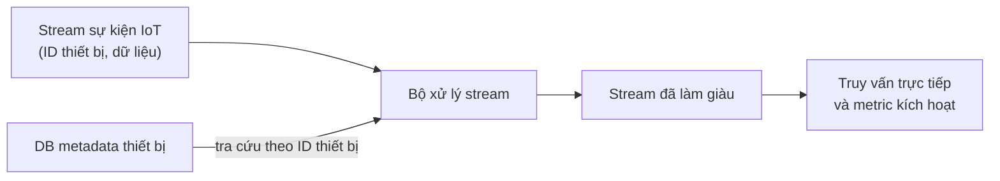
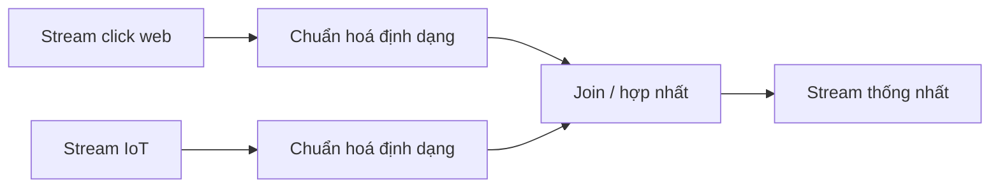

# Chuyển đổi streaming, các bên liên quan và yếu tố xuyên suốt

Bài cuối của Chương 8 nói về **chuyển đổi và xử lý streaming**, quan hệ giữa transformation và query trên stream, **streaming DAG**, cuộc tranh luận **micro-batch so với streaming thực sự**; sau đó là **bạn sẽ làm việc với ai** (các bên liên quan thượng nguồn và hạ nguồn), các **yếu tố xuyên suốt (undercurrents)** áp dụng cho giai đoạn này, và phần kết luận của chương.

**Tương tự đơn giản:** batch giống đổ nguyên một xe hàng vào kho rồi mới kiểm đếm; streaming giống băng chuyền, hàng chạy qua đâu là soát, gắn nhãn, đóng gói ngay đó, và đôi khi cũng gom từng nhóm nhỏ trên băng chuyền để đếm.

---

:::note[Ghi nhớ nhanh]

- ⭐ **Truy vấn streaming** hiển thị góc nhìn dữ liệu hiện tại, còn **chuyển đổi streaming** chuẩn bị dữ liệu cho hạ nguồn; nhưng ranh giới giữa hai thứ rất mờ, trên một phổ liên tục.
- ⭐ **Micro-batch hay true streaming không có đáp án chung**; phụ thuộc yêu cầu độ trễ, năng lực nhóm và thử nghiệm thực tế (cẩn thận benchmark của nhà cung cấp).
- **Streaming DAG** mở rộng orchestration sang thời gian thực; Pulsar cho định nghĩa DAG như mã trong một hệ.
- **Các bên liên quan:** thượng nguồn (người kiểm soát định nghĩa nghiệp vụ và người kiểm soát hệ nguồn), hạ nguồn (analyst, data scientist, ML engineer, kinh doanh).
- **Undercurrents:** bảo mật (kiểm soát đến cột/hàng/ô), quản lý dữ liệu (định nghĩa, MDM, lineage), DataOps (chất lượng dữ liệu và vận hành, FinOps), kiến trúc, orchestration, kỹ thuật phần mềm.

:::

---

## Mục lục

- 1. Chuyển đổi và xử lý streaming
- 2. Streaming DAG
- 3. Micro-batch so với streaming thực sự
- 4. Bạn sẽ làm việc với ai
- 5. Các yếu tố xuyên suốt (undercurrents)
- 6. Kết luận và tài nguyên bổ sung
- Tóm tắt

---

## 1. Chuyển đổi và xử lý streaming

Việc xử lý stream đã được bàn trong ngữ cảnh truy vấn (bài 1). Sự khác biệt giữa **chuyển đổi streaming** và **truy vấn streaming** rất nhỏ, nên cần giải thích thêm.

### 1.1. Khái niệm cơ bản

- **Truy vấn streaming** chạy **động** để hiển thị góc nhìn dữ liệu hiện tại (như đã bàn).
- **Chuyển đổi streaming** nhằm **chuẩn bị dữ liệu cho tiêu thụ ở hạ nguồn**.

**Ví dụ của sách:** nhóm kỹ thuật dữ liệu có stream đến mang sự kiện từ nguồn IoT, mỗi sự kiện có ID thiết bị và dữ liệu sự kiện. Họ muốn **làm giàu** (enrich) các sự kiện này một cách động bằng metadata khác của thiết bị, lưu trong một DB riêng. Bộ xử lý stream truy vấn DB riêng chứa metadata đó theo ID thiết bị, tạo sự kiện mới có thêm dữ liệu, rồi chuyển sang một stream khác. Truy vấn trực tiếp và các metric kích hoạt (triggered metrics) chạy trên stream đã làm giàu này.

### 1.2. Chuyển đổi và truy vấn nằm trên một phổ liên tục

Ranh giới giữa transformation và query cũng mờ ở batch, nhưng ở streaming còn **tinh tế hơn**. Ví dụ: nếu ta tính động thống kê tổng hợp trên các cửa sổ rồi gửi kết quả vào stream đích, đó là transformation hay query? Có thể rồi người ta sẽ dùng thuật ngữ mới cho xử lý stream để phản ánh tốt hơn use case thực tế; hiện tại sách cố gắng hết sức với thuật ngữ đang có.

---

## 2. Streaming DAG

Một khái niệm thú vị liên quan chặt với enrichment và join stream là **streaming DAG**. Ý tưởng này đã xuất hiện khi bàn về orchestration ở Chương 2. Orchestration về bản chất là khái niệm batch, nhưng nếu muốn **làm giàu, hợp nhất và tách nhiều stream theo thời gian thực** thì sao?

**Ví dụ:** muốn kết hợp dữ liệu stream **clickstream của website** với **dữ liệu IoT** để có cái nhìn thống nhất về hoạt động người dùng. Hơn nữa, mỗi luồng dữ liệu cần được **tiền xử lý về một định dạng chuẩn** trước.

Điều này từ lâu có thể làm bằng cách kết hợp **kho streaming** (như Kafka) với **bộ xử lý stream** (như Flink). Nhưng tạo DAG như vậy giống xây một **cỗ máy Rube Goldberg** phức tạp, nhiều topic và job xử lý nối với nhau. **Pulsar** đơn giản hoá đáng kể bằng cách coi DAG như một **trừu tượng streaming cốt lõi**: thay vì quản lý các stream trên nhiều hệ thống, kỹ sư định nghĩa streaming DAG **dưới dạng mã bên trong một hệ**.

---

## 3. Micro-batch so với streaming thực sự

Có một cuộc chiến kéo dài giữa tiếp cận **micro-batch** và **true streaming**. Điều quan trọng là hiểu **use case, yêu cầu hiệu năng và năng lực thực sự của framework**.

- **Micro-batch:** dùng framework hướng batch và áp dụng vào bối cảnh streaming; mỗi micro-batch có thể chạy từ khoảng **hai phút một lần đến mỗi giây một lần**. Một số framework micro-batch (ví dụ **Spark Streaming**) được thiết kế cho use case này và chạy tốt nếu được cấp tài nguyên phù hợp ở tần suất batch cao. (Thực tế DBA và kỹ sư từ lâu đã dùng micro-batch với DB truyền thống, thường dẫn đến hiệu năng và tiêu thụ tài nguyên tồi tệ.)
- **True streaming (streaming thực sự):** các hệ như **Beam và Flink** thiết kế để xử lý **một sự kiện tại một thời điểm**. Cái giá là **chi phí đáng kể**. Hơn nữa, ngay cả trong các hệ này, **nhiều quy trình vẫn diễn ra theo batch**: một quy trình enrichment cơ bản thêm dữ liệu vào từng sự kiện có thể cho từng sự kiện một với độ trễ thấp, nhưng metric kích hoạt trên cửa sổ có thể chạy vài giây hoặc vài phút một lần.

Khi dùng cửa sổ và trigger (tức xử lý theo batch), hãy hỏi: **tần suất cửa sổ** là bao nhiêu? **Độ trễ chấp nhận được** là bao nhiêu?

| Tình huống | Gợi ý của sách |
|---|---|
| Thu số liệu bán hàng ngày Black Friday, xuất bản vài phút một lần | Micro-batch có thể ổn, miễn là đặt tần suất phù hợp |
| Đội vận hành tính metric mỗi giây để phát hiện tấn công DDoS | True streaming có thể phù hợp |
| Nhóm đã có chuyên môn Spark | Có thể dựng giải pháp Spark Streaming (micro-batch) rất nhanh |

**Khi nào dùng cái nào?** Thành thật: **không có câu trả lời chung**. Thuật ngữ "micro-batch" thường được dùng để loại bỏ công nghệ đối thủ, nhưng nó có thể chạy tốt cho use case của bạn và có thể vượt trội ở nhiều mặt. **Không gì thay thế được kiến thức miền và thử nghiệm thực tế.** Hãy nói chuyện với chuyên gia để có ý kiến công bằng, và dễ dàng thử các lựa chọn bằng thí nghiệm trên hạ tầng cloud. Cũng cẩn thận với **benchmark giả do nhà cung cấp đưa ra**: nhà cung cấp nổi tiếng chọn benchmark có lợi và dựng ví dụ nhân tạo không giống thực tế (nhớ cuộc trò chuyện về benchmark ở Chương 4); họ thể hiện lợi thế lớn trong kết quả nhưng không thể hiện trong thế giới thực cho use case của bạn.

---

## 4. Bạn sẽ làm việc với ai

Truy vấn, chuyển đổi và mô hình hoá tác động lên **mọi bên liên quan** trong vòng đời kỹ thuật dữ liệu. Về kỹ thuật, **data engineer** thiết kế, xây dựng và duy trì tính toàn vẹn của các hệ truy vấn và chuyển đổi, đồng thời **triển khai các mô hình dữ liệu** trong các hệ này. Đây là giai đoạn "tiếp xúc hoàn toàn" nhất, nơi trọng tâm là gia tăng giá trị nhiều nhất có thể, cả về hệ thống vận hành lẫn dữ liệu đáng tin cậy.

### 4.1. Bên liên quan thượng nguồn

Với transformation, thượng nguồn chia hai nhóm chính: **người kiểm soát định nghĩa nghiệp vụ** và **người kiểm soát các hệ tạo ra dữ liệu**.

- Khi trao đổi với họ về định nghĩa và logic nghiệp vụ, bạn cần biết các nguồn dữ liệu: chúng là gì, dùng thế nào, và logic cùng định nghĩa nghiệp vụ liên quan. Bạn sẽ làm việc với kỹ sư phụ trách các hệ nguồn và các bên liên quan nghiệp vụ giám sát sản phẩm và ứng dụng. Data engineer có thể làm việc cùng "doanh nghiệp" và các bên kỹ thuật về mô hình dữ liệu.
- Data engineer cần tham gia **thiết kế mô hình dữ liệu** và các cập nhật sau này do thay đổi logic nghiệp vụ hoặc quy trình mới. Transformation đủ dễ làm (viết truy vấn, đưa kết quả vào bảng hoặc view); làm cho chúng vừa hiệu quả vừa **có giá trị với doanh nghiệp** mới là chuyện khác. Luôn đặt yêu cầu và kỳ vọng của doanh nghiệp lên hàng đầu.
- Các bên liên quan của hệ nguồn muốn truy vấn và transformation của bạn **tác động tối thiểu** lên hệ của họ. Đảm bảo giao tiếp **hai chiều** về thay đổi mô hình dữ liệu (đổi cột, index) ở hệ nguồn, vì chúng có thể ảnh hưởng trực tiếp đến truy vấn, transformation và mô hình phân tích. Data engineer cần biết các thay đổi schema: thêm hoặc xoá trường, đổi kiểu dữ liệu, và mọi thứ có thể ảnh hưởng nghiêm trọng khả năng truy vấn và biến đổi dữ liệu.

### 4.2. Bên liên quan hạ nguồn

Transformation là nơi dữ liệu bắt đầu **cung cấp tiện ích** cho hạ nguồn: data analyst, data scientist, ML engineer và "doanh nghiệp". Hãy cộng tác với họ để mô hình dữ liệu và transformation hoạt động hiệu quả và hữu ích.

- **Hiệu năng:** truy vấn phải chạy nhanh nhất có thể theo cách tiết kiệm chi phí nhất.
- **Hữu ích:** analyst, data scientist và ML engineer phải truy vấn nguồn dữ liệu với tin tưởng rằng dữ liệu có **chất lượng và độ đầy đủ cao nhất**, và tích hợp được vào workflow và sản phẩm dữ liệu của họ. Doanh nghiệp phải tin rằng dữ liệu đã biến đổi **chính xác và hành động được**.

---

## 5. Các yếu tố xuyên suốt (undercurrents)

Giai đoạn chuyển đổi là nơi dữ liệu biến thành thứ hữu ích cho doanh nghiệp. Vì có nhiều bộ phận chuyển động, các yếu tố xuyên suốt đặc biệt quan trọng ở đây.

### 5.1. Bảo mật

Truy vấn và transformation kết hợp các tập dữ liệu thành tập mới. **Ai có quyền truy cập tập mới này?** Nếu ai đó có quyền truy cập tập dữ liệu, hãy tiếp tục kiểm soát quyền ở cấp **cột, hàng và ô (cell)**.

- Nhận biết các **vector tấn công** nhằm vào DB lúc truy vấn. Đặc quyền đọc/ghi vào DB phải được giám sát và kiểm soát chặt; quyền truy cập truy vấn phải được kiểm soát giống cách bạn kiểm soát truy cập hệ thống và môi trường của tổ chức.
- **Giữ kín thông tin xác thực:** tránh sao chép dán mật khẩu, access token hay credential vào mã hoặc file không mã hoá. (Sách kể thấy mã trong repo GitHub dán thẳng username và password DB vào codebase!) Không chia sẻ mật khẩu với người dùng khác.
- Không bao giờ cho phép dữ liệu chưa được bảo vệ hoặc chưa mã hoá đi qua internet công cộng.

### 5.2. Quản lý dữ liệu (Data management)

Quản lý dữ liệu cần ở mọi giai đoạn, nhưng đặc biệt quan trọng ở transformation vì chúng **tạo ra tập dữ liệu mới cần được quản lý**. Cần có sự tham gia của mọi bên liên quan trong mô hình dữ liệu và transformation, và quản lý kỳ vọng của họ.

- **Quy ước đặt tên:** mọi người thống nhất tên khớp với định nghĩa nghiệp vụ tương ứng; tên trường dễ hiểu. Người dùng cũng nên tra **data catalog** để hiểu rõ nghĩa của trường, ai bảo trì tập dữ liệu và các thông tin liên quan.
- **Độ chính xác của định nghĩa** là chìa khoá ở giai đoạn này: transformation có tuân theo logic nghiệp vụ mong đợi không? Ngày càng phổ biến khái niệm **semantic layer hoặc metrics layer độc lập với transformation**: thay vì thực thi logic nghiệp vụ trong transformation lúc chạy, giữ các định nghĩa này như một giai đoạn độc lập **trước** lớp transformation. Dù còn sớm, kỳ vọng các lớp này sẽ ngày càng phổ biến.
- **MDM (master data management):** vì transformation thay đổi dữ liệu, phải đảm bảo dữ liệu bạn dùng không có lỗi và thể hiện sự thật nền tảng. Nếu MDM là lựa chọn ở công ty, hãy theo đuổi triển khai nó: các dimension phù hợp (conformed dimension) và các transformation khác dựa vào MDM để giữ tính toàn vẹn và tính "sự thật" của dữ liệu. Nếu không làm được MDM, hãy làm việc với các bên liên quan thượng nguồn kiểm soát dữ liệu để đảm bảo dữ liệu bạn biến đổi chính xác và tuân thủ logic nghiệp vụ đã thoả thuận.
- **Data lineage:** transformation khiến khó biết một tập dữ liệu được tạo ra theo dòng nào. Như đã bàn về data catalog ở Chương 6, khi biến đổi dữ liệu thì **công cụ data lineage vô giá**: giúp kỹ sư hiểu các bước biến đổi trước đó khi tạo transformation mới, và giúp analyst hiểu dữ liệu đến từ đâu khi chạy truy vấn và dựng báo cáo.
- **Tuân thủ quy định:** tác động đến mô hình và transformation của bạn thế nào? Dữ liệu ở trường nhạy cảm có được **che (mask) hoặc làm xáo trộn (obfuscate)** khi cần không? Bạn có khả năng **xoá dữ liệu** để đáp ứng yêu cầu xoá không? Theo dõi lineage có cho bạn thấy dữ liệu nào được dẫn xuất từ dữ liệu đã xoá và chạy lại transformation để loại bỏ dữ liệu ở tận đầu nguồn thô không?

### 5.3. DataOps

Với truy vấn và transformation, DataOps có hai mảng cần quan tâm: **dữ liệu** và **hệ thống**. Cần giám sát và cảnh báo thay đổi hoặc bất thường ở cả hai. Mảng **data observability** đang bùng nổ với trọng tâm lớn là độ tin cậy dữ liệu; thậm chí có chức danh mới là **data reliability engineer**.

**Mặt dữ liệu:**

- Khi truy vấn, đầu vào và đầu ra có chính xác không? Làm sao biết?
- Nếu kết quả lưu vào bảng, schema có đúng không? Hình dạng dữ liệu và thống kê liên quan (min/max, số null...) thế nào?
- Chạy **kiểm tra chất lượng dữ liệu** trên tập đầu vào và tập đã biến đổi để đảm bảo đáp ứng kỳ vọng của người dùng thượng nguồn và hạ nguồn. Nếu có vấn đề chất lượng trong transformation, bạn phải có khả năng **gắn cờ, rollback thay đổi và điều tra nguyên nhân gốc**.

**Mặt vận hành (Ops):**

- Hệ thống đang chạy thế nào? Giám sát: độ dài hàng đợi truy vấn, tính đồng thời của truy vấn, mức dùng bộ nhớ, mức dùng lưu trữ, độ trễ mạng, I/O đĩa.
- Dùng dữ liệu metric để phát hiện nút cổ chai và các truy vấn kém, ứng viên để refactor và tinh chỉnh. Nếu truy vấn ổn, bạn biết nên tinh chỉnh chính DB (ví dụ **clustering** bảng để tra cứu nhanh hơn), hoặc có thể cần nâng tài nguyên tính toán. DB cloud và SaaS cho phép nâng (và hạ) hệ thống nhanh. Hãy tiếp cận theo hướng **dựa trên dữ liệu**, dùng metric observability để xác định vấn đề nằm ở truy vấn hay hệ thống.

**FinOps:** chuyển sang DB phân tích SaaS thay đổi đồ thị chi phí tiêu thụ dữ liệu. Thời warehouse on-premises, hệ thống và license mua trước, không tốn thêm chi phí sử dụng; kỹ sư truyền thống tập trung tối ưu hiệu năng để khai thác tối đa giá trị từ khoản mua đắt đỏ. Kỹ sư làm việc với warehouse cloud **tính phí theo mức tiêu thụ** cần tập trung vào **quản lý và tối ưu chi phí**. Đây là thực hành **FinOps** (Chương 4).

### 5.4. Kiến trúc dữ liệu

Các nguyên tắc kiến trúc tốt ở Chương 3 áp dụng cho giai đoạn transformation. Xây hệ thống mạnh mẽ xử lý và biến đổi dữ liệu mà không hỏng. Lựa chọn nạp và lưu trữ **tác động trực tiếp** đến khả năng thực hiện truy vấn và transformation đáng tin cậy. Nếu nạp và lưu trữ khớp với mẫu truy vấn và transformation, bạn đang ở vị thế tuyệt vời; ngược lại sẽ gặp nhiều khó khăn.

**Ví dụ:** sách thường thấy nhóm dữ liệu **dùng sai data pipeline và DB cho việc**. Họ nối pipeline thời gian thực vào **RDBMS hoặc Elasticsearch** và dùng nó làm data warehouse. Các hệ này không tối ưu cho truy vấn OLAP tổng hợp khối lượng lớn và sẽ "gục" dưới workload đó. Nhóm này rõ ràng không hiểu lựa chọn kiến trúc tác động đến hiệu năng truy vấn thế nào. Hãy dành thời gian hiểu đánh đổi vốn có trong lựa chọn kiến trúc; rõ ràng về cách mô hình dữ liệu hoạt động với hệ nạp và lưu trữ và cách truy vấn sẽ chạy.

### 5.5. Orchestration

Nhóm dữ liệu thường quản lý pipeline transformation bằng **lịch theo thời gian đơn giản** (như cron job). Ban đầu khá ổn nhưng thành **cơn ác mộng** khi workflow phức tạp dần. Hãy dùng orchestration để quản lý pipeline phức tạp bằng cách tiếp cận **dựa trên phụ thuộc (dependency-based)**. Orchestration cũng là **chất keo** giúp ráp các pipeline trải qua nhiều hệ thống.

### 5.6. Kỹ thuật phần mềm

Khi viết mã transformation bạn có thể dùng nhiều ngôn ngữ (SQL, Python, JVM) và nhiều nền tảng (từ warehouse đến cụm tính toán phân tán). Mỗi ngôn ngữ và nền tảng có điểm mạnh và đặc thù, nên hãy biết best practice cho công cụ của mình. Ví dụ viết transformation bằng Python trên hệ phân tán như Spark hoặc Dask: bạn có đang dùng **UDF** khi hàm gốc có thể nhanh hơn nhiều không? Sách từng thấy UDF viết kém, chậm bị thay bằng lệnh SQL tích hợp, hiệu năng cải thiện tức thì và đáng kể.

**Analytics engineering** mang thực hành kỹ thuật phần mềm đến người dùng cuối, với khái niệm **analytics as code**. Các công cụ như **dbt** trở nên phổ biến, cho analyst và data scientist **viết transformation trong DB bằng SQL** mà không cần DBA hay data engineer can thiệp trực tiếp. Khi đó data engineer chịu trách nhiệm **thiết lập repo mã và pipeline CI/CD** mà analyst và data scientist dùng. Đây là thay đổi lớn trong vai trò của data engineer, người trước đây xây và quản lý hạ tầng nền tảng và tạo ra transformation. Khi công cụ dữ liệu hạ thấp rào cản và dân chủ hoá, sẽ thú vị xem workflow của các nhóm dữ liệu thay đổi ra sao.

Với công cụ **low-code dựa trên GUI**, bạn có hình ảnh trực quan hữu ích về transformation, nhưng vẫn cần hiểu **chuyện gì đang xảy ra "dưới mui xe"**. Các công cụ này thường sinh SQL hoặc ngôn ngữ khác ở hậu trường. Mục đích low-code là giảm nhu cầu đụng chi tiết cấp thấp, nhưng hiểu mã phía sau giúp **debug và tối ưu hiệu năng**; **giả định mù quáng rằng công cụ sinh mã hiệu năng cao là sai lầm**.

Sách khuyên data engineer đặc biệt chú ý **best practice kỹ thuật phần mềm** ở giai đoạn truy vấn và chuyển đổi. Dù hấp dẫn khi ném thêm tài nguyên xử lý vào tập dữ liệu, biết cách viết mã **rõ ràng, hiệu quả** là cách tiếp cận tốt hơn nhiều.

| Undercurrent | Điểm chính ở giai đoạn truy vấn, mô hình hoá, chuyển đổi |
|---|---|
| Bảo mật | Kiểm soát đến cột, hàng, ô; bảo vệ credential; mã hoá khi truyền |
| Quản lý dữ liệu | Quy ước đặt tên, catalog, semantic/metrics layer, MDM, lineage, tuân thủ (mask, xoá) |
| DataOps | Chất lượng dữ liệu và observability; giám sát hệ thống; FinOps cho warehouse tính theo tiêu thụ |
| Kiến trúc | Chọn đúng DB và pipeline cho khối lượng OLAP; nạp và lưu trữ phải khớp mẫu truy vấn |
| Orchestration | Dựa trên phụ thuộc thay vì chỉ cron; keo dính các pipeline đa hệ thống |
| Kỹ thuật phần mềm | Tránh UDF khi có hàm gốc; analytics as code (dbt, CI/CD); hiểu mã do công cụ low-code sinh |

---

## 6. Kết luận và tài nguyên bổ sung

**Chuyển đổi nằm ở trung tâm của data pipeline.** Hãy nhớ mục đích của nó: cuối cùng kỹ sư được thuê **không phải để chơi đồ chơi công nghệ mới nhất** mà để **phục vụ khách hàng** của họ. Transformation là nơi dữ liệu thêm giá trị và ROI cho doanh nghiệp.

Quan điểm của tác giả: có thể áp dụng các công nghệ transformation thú vị **và** phục vụ các bên liên quan. Chương 11 nói về **live data stack**, về cơ bản là cấu hình lại data stack xung quanh streaming và đưa transformation đến gần hơn với chính ứng dụng hệ nguồn. Các nhóm kỹ thuật coi dữ liệu thời gian thực là công nghệ vì công nghệ sẽ lặp lại sai lầm của kỷ nguyên big data. Nhưng thực tế, phần lớn tổ chức mà tác giả làm việc **có use case kinh doanh sẽ hưởng lợi từ streaming**. Điều quan trọng là xác định những use case này và **tập trung vào giá trị trước khi chọn công nghệ và hệ thống phức tạp**.

Khi bước sang giai đoạn **serving** (phục vụ dữ liệu) của vòng đời ở Chương 9, hãy xem công nghệ như công cụ để hiện thực hoá mục tiêu tổ chức. Nếu bạn là data engineer đang làm việc, hãy nghĩ cách cải tiến hệ transformation giúp phục vụ khách hàng cuối tốt hơn. Nếu mới vào nghề, hãy nghĩ về loại vấn đề kinh doanh bạn muốn giải bằng công nghệ.

**Tài nguyên bổ sung (sách đề xuất, chọn lọc):**

- *The Data Warehouse Toolkit* — Ralph Kimball và Margy Ross (Wiley)
- *Building the Data Warehouse*, *Corporate Information Factory*, *The Unified Star Schema* — W. H. (Bill) Inmon
- *Building a Scalable Data Warehouse with Data Vault 2.0* — Daniel Linstedt và Michael Olschimke (Morgan Kaufmann)
- "Data Vault 2.0 Modeling Basics" — Kent Graziano; "Building a Real-Time Data Vault in Snowflake"
- Các trang của Kimball Group về Four-Step Dimensional Design Process, Conformed Dimensions, Dimensional Modeling Techniques
- Tài liệu về query caching của Snowflake và Google Cloud; bài về SQL query optimization, fan-out issues, symmetric aggregates

---

## Tóm tắt

| Chủ đề | Ý chính |
|---|---|
| Transformation vs query trên stream | Query hiển thị góc nhìn hiện tại; transformation chuẩn bị cho hạ nguồn; ranh giới mờ |
| Streaming DAG | Mở rộng orchestration sang thời gian thực; Pulsar cho định nghĩa DAG như mã |
| Micro-batch vs true streaming | Không có đáp án chung; tuỳ độ trễ cần thiết, năng lực nhóm, thử nghiệm; đề phòng benchmark nhà cung cấp |
| Thượng nguồn | Người kiểm soát định nghĩa nghiệp vụ và hệ nguồn; giao tiếp hai chiều về thay đổi schema |
| Hạ nguồn | Analyst, data scientist, ML engineer, kinh doanh; cần dữ liệu nhanh, đáng tin, hành động được |
| Undercurrents | Bảo mật, quản lý dữ liệu, DataOps/FinOps, kiến trúc, orchestration, kỹ thuật phần mềm |
| Kết luận | Transformation tạo giá trị và ROI; tập trung giá trị kinh doanh trước công nghệ |
