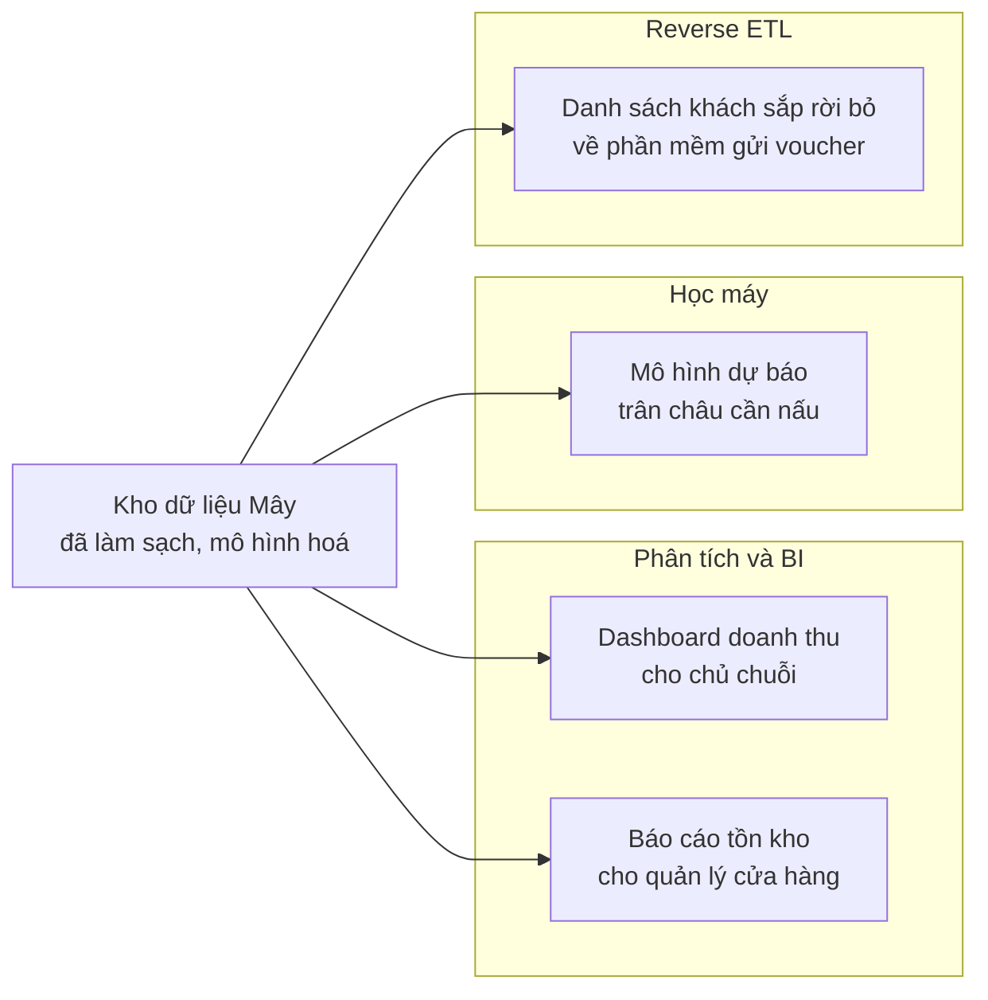
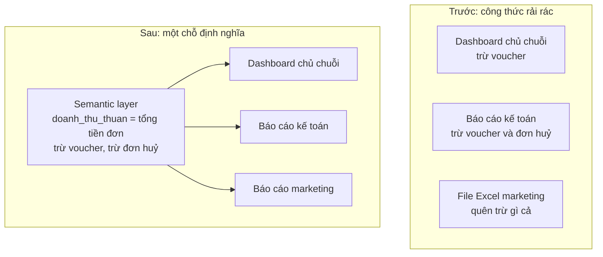

# Những cân nhắc chung khi cung cấp dữ liệu

Chương 9 nói về **giai đoạn cuối cùng của vòng đời kỹ thuật dữ liệu: serving data** (cung cấp/phân phát dữ liệu cho các trường hợp sử dụng ở phía sau). Có ba mảng chính: phân tích và BI, học máy (ML), và Reverse ETL. Bài này đi qua phần mở đầu chung: chuyện niềm tin, người dùng, sản phẩm dữ liệu, tự phục vụ, định nghĩa/logic dữ liệu và data mesh.

**Tương tự đơn giản:** Data pipeline giống một nhà bếp, còn serving là khâu bê món ra bàn. Món nấu ngon đến mấy mà khách không tin vệ sinh, hoặc ra trễ, hoặc không đúng món họ cần thì nhà hàng vẫn thất bại.

---

:::note[Ghi nhớ nhanh]

- ⭐ **Niềm tin là tất cả** — mất niềm tin vào dữ liệu là "hồi chuông báo tử thầm lặng" của một dự án dữ liệu; kiếm thì lâu, mất thì dễ.
- ⭐ **Bắt đầu từ use case và người dùng, không phải từ công cụ** — luôn hỏi "dữ liệu này kích hoạt hành động gì, ai thực hiện, có tự động hoá được không?".
- **SLA / SLO** là cam kết giữa kỹ sư dữ liệu và người dùng; giao tiếp liên tục quan trọng ngang việc đạt chỉ tiêu.
- **Sản phẩm dữ liệu** tốt có vòng phản hồi tích cực và được nghĩ theo "công việc cần hoàn thành" (jobs to be done).
- **Tự phục vụ** (self-service) phần lớn vẫn là khát vọng; chỉ hợp với đúng nhóm đối tượng.
- **Định nghĩa dữ liệu và logic dữ liệu** phải được ghi chính thức (data catalog, semantic layer), không để thành "kiến thức truyền miệng".

:::

---

## Mục lục

- 1. Giai đoạn cuối và ba hướng phục vụ
- 2. Niềm tin
- 3. Use case là gì, người dùng là ai
- 4. Sản phẩm dữ liệu
- 5. Tự phục vụ hay không
- 6. Định nghĩa dữ liệu và logic dữ liệu
- 7. Data mesh
- 8. Áp vào chuỗi trà sữa Mây
- Tóm tắt

## 1. Giai đoạn cuối và ba hướng phục vụ

Vòng đời kỹ thuật dữ liệu đi từ tạo ra, thu nạp, lưu trữ, biến đổi, và kết thúc ở **serving**. Có ba hướng chính:

| Hướng | Mục tiêu | Ghi chú |
|---|---|---|
| **Phân tích và BI** | Chuẩn bị dữ liệu cho phân tích thống kê, báo cáo, dashboard | Mảng truyền thống nhất, có từ trước cả CNTT và cơ sở dữ liệu |
| **Học máy (ML)** | Thu thập, biến đổi, cung cấp dữ liệu để huấn luyện mô hình | Làm việc cùng data scientist và ML engineer; không có dữ liệu chất lượng thì không có ML |
| **Reverse ETL** | Đẩy dữ liệu đã xử lý ngược về hệ thống nguồn | Ví dụ: thu dữ liệu từ nền tảng quảng cáo, chạy thống kê để tính giá thầu cho mỗi lượt click, rồi nạp ngược giá thầu vào nền tảng quảng cáo. Gắn chặt với BI và ML |

**Thuật ngữ trong bài — hiểu nôm na:**

| Thuật ngữ | Nghĩa đời thường | Ví dụ ở chuỗi Mây |
|---|---|---|
| Serving | Khâu "bê món ra bàn": đưa dữ liệu đã xử lý tới người hoặc hệ thống cần dùng | Dashboard doanh thu hiện lúc 6 giờ sáng |
| BI (Business Intelligence) | Báo cáo, biểu đồ giúp người kinh doanh ra quyết định | Biểu đồ doanh thu theo cửa hàng |
| Dashboard | Bảng điều khiển: một màn hình gom các chỉ số quan trọng | Màn hình chủ chuỗi mở mỗi sáng |
| Reverse ETL | Đẩy kết quả phân tích **ngược** về phần mềm tác nghiệp | Gửi danh sách khách sắp rời bỏ về phần mềm gửi voucher |
| SLA, SLO | Lời hứa về chất lượng dịch vụ và con số đo lời hứa đó | "Dashboard có số liệu trước 6 giờ sáng, 99% số ngày" |
| Semantic layer | Một "từ điển công thức" dùng chung cho mọi báo cáo | Công thức "doanh thu thuần" viết một lần, mọi dashboard dùng lại |
| Self-service | Người dùng tự kéo thả để tạo báo cáo, không cần nhờ kỹ sư | Quản lý cửa hàng tự lọc doanh thu theo tuần |

Ở chuỗi trà sữa Mây, cùng một kho dữ liệu đi ra ba ngả như sơ đồ dưới. Ba bài của chương này lần lượt đi sâu vào từng ngả.

## 2. Niềm tin

Trước khi bàn kỹ thuật, điều đầu tiên và quan trọng nhất là **niềm tin** (trust). Mô hình dữ liệu đẹp nhất cũng vô nghĩa nếu người dùng cuối không tin dữ liệu phản ánh đúng hoạt động kinh doanh của họ. Mất niềm tin thường là cái chết thầm lặng của dự án dữ liệu, có khi dự án chỉ bị huỷ chính thức sau nhiều tháng hoặc nhiều năm. Một khi đã mất thì rất khó lấy lại, dẫn đến doanh nghiệp không khai thác hết tiềm năng, nhóm dữ liệu mất uy tín (thậm chí bị giải thể).

Hai phía của niềm tin:

1. **Tin vào chất lượng dữ liệu.** Dùng:
   - **Data validation** (xác thực dữ liệu): phân tích để chắc chắn dữ liệu thể hiện đúng thông tin tài chính, tương tác khách hàng, doanh số.
   - **Data observability** (khả năng quan sát dữ liệu): cái nhìn liên tục về dữ liệu và các pipeline.
   - Kiểm tra trực quan và xác nhận với các bên liên quan.
   - Các việc này phải áp dụng xuyên suốt vòng đời, không đợi tới cuối mới làm.
2. **Tin vào cam kết dịch vụ (SLA, SLO).** Khi người dùng đã dựa vào dữ liệu để chạy quy trình kinh doanh, họ đòi dữ liệu phải sẵn sàng và cập nhật đúng hạn. Dữ liệu chất lượng cao nhưng không có mặt đúng lúc ra quyết định thì giá trị rất thấp.

### SLA và SLO

- **SLA** (service-level agreement, thỏa thuận mức dịch vụ): hợp đồng giữa bạn và các bên liên quan, nói rõ họ được mong đợi gì từ sản phẩm dữ liệu. Ví dụ phát biểu SLA: "Dữ liệu sẽ sẵn sàng một cách đáng tin cậy và có chất lượng cao".
- **SLO** (service-level objective, mục tiêu mức dịch vụ): phần đo lường được của SLA. Ví dụ SLO: "Data pipeline đến dashboard hoặc quy trình ML của bạn có 99% thời gian hoạt động, và 95% dữ liệu không có lỗi".
- SLA và SLO có thể dưới dạng **data contract** (hợp đồng dữ liệu, xem Chương 5), chính thức hoặc không chính thức.
- Chỉ thống nhất SLA là chưa đủ. **Giao tiếp liên tục** là cốt lõi: bạn đã báo trước các vấn đề có thể ảnh hưởng SLA/SLO chưa? Quy trình khắc phục và cải thiện của bạn là gì?

Sách tóm gọn: *"Niềm tin là tất cả. Kiếm được thì lâu, mất thì dễ."*

### Niềm tin ở chuỗi Mây: một buổi sáng tồi tệ

Thứ Hai, chủ chuỗi mở dashboard và thấy cửa hàng Q1-Lê Lợi có doanh thu **0 đồng** hôm Chủ nhật. Thực ra quán vẫn bán bình thường; chỉ là máy POS ở đó mất mạng nên dữ liệu chưa về. Ông gọi quản lý cửa hàng hỏi, rồi quay sang nghi luôn các con số khác. Vài lần như vậy, ông thôi mở dashboard và quay về hỏi từng quản lý qua điện thoại. Dự án dữ liệu "chết" mà không ai tuyên bố.

Bảng dưới cho thấy SLA, SLO và các biện pháp giữ niềm tin, cụ thể cho dashboard này.

| Thành phần | Ở chuỗi Mây | Lẽ ra giúp được gì sáng thứ Hai |
|---|---|---|
| SLA (lời hứa) | "Dashboard doanh thu có số liệu đầy đủ của hôm trước khi chủ chuỗi bắt đầu làm việc" | Hai bên biết rõ thế nào là "đúng hẹn" |
| SLO (con số đo) | Số liệu sẵn sàng trước 6:00, 99% số ngày; đủ dữ liệu từ 30/30 cửa hàng | Chỉ có 29/30 cửa hàng, vi phạm SLO, cần báo ngay |
| Data validation | Kiểm tra: doanh thu một cửa hàng không được bằng 0 trong ngày mở cửa | Phát hiện bất thường trước khi chủ chuỗi thấy |
| Observability | Cảnh báo khi một máy POS ngừng gửi dữ liệu quá 2 giờ | Kỹ sư biết từ tối Chủ nhật |
| Giao tiếp | Dashboard hiện dòng chữ "Q1-Lê Lợi: chưa đủ dữ liệu, đang xử lý" | Chủ chuỗi hiểu đây là trễ, không phải sai |

## 3. Use case là gì, người dùng là ai

Serving là về dữ liệu "đang hoạt động". Để biết dùng dữ liệu thế nào là hiệu quả, cần trả lời hai câu: **use case là gì** và **người dùng là ai**.

- Use case vượt xa việc xem báo cáo, dashboard. Dữ liệu tốt nhất khi **dẫn tới hành động**: một giám đốc ra quyết định chiến lược từ báo cáo; người dùng app giao đồ ăn nhận phiếu giảm giá trong hai phút tới.
- Một dữ liệu thường phục vụ nhiều use case. Ví dụ: huấn luyện mô hình ML chấm điểm khách hàng tiềm năng (lead scoring) rồi đẩy kết quả vào CRM bằng reverse ETL.
- Khi tìm use case, luôn hỏi: **"Dữ liệu này sẽ kích hoạt hành động gì và ai sẽ thực hiện?"**, rồi hỏi tiếp **"Hành động này có thể tự động hoá không?"**.
- Ưu tiên use case có **ROI cao nhất** có thể. Kỹ sư dữ liệu hay say mê chi tiết kỹ thuật và bỏ quên câu hỏi mục đích; khi tập trung vào giá trị, vai trò của họ có giá trị hơn nhiều.

Câu hỏi nên tự hỏi khi bắt đầu dự án:

- Ai sẽ dùng dữ liệu và dùng như thế nào?
- Các bên liên quan mong đợi gì?
- Làm sao cộng tác với họ (data scientist, analyst, người dùng nghiệp vụ) để hiểu dữ liệu sẽ được dùng ra sao?

Hãy tiếp cận từ góc nhìn người dùng và use case, rồi **làm ngược lại** để tạo ra sản phẩm dữ liệu tốt.

## 4. Sản phẩm dữ liệu

Định nghĩa của D. J. Patil: sản phẩm dữ liệu là *"sản phẩm hỗ trợ mục tiêu cuối cùng thông qua việc sử dụng dữ liệu"*.

- Sản phẩm dữ liệu không được tạo ra trong chân không. Nó là "môn thể thao đối kháng" kết hợp sản phẩm, kinh doanh và công nghệ, nên cần các bên liên quan chủ chốt tham gia.
- Ở hầu hết công ty, kỹ sư dữ liệu chỉ cách người dùng cuối vài bước. Kỹ sư giỏi sẽ cố hiểu kết quả của người dùng trực tiếp (analyst, data scientist) hoặc khách hàng bên ngoài.
- Nên nghĩ theo **"jobs to be done"** (công việc cần hoàn thành): người dùng "thuê" sản phẩm để làm một việc. Phải biết động cơ họ thuê sản phẩm của bạn. Lỗi kinh điển là xây mà không hiểu yêu cầu và nhu cầu thật, tức là xây sản phẩm không ai muốn dùng.
- Sản phẩm dữ liệu tốt có **vòng phản hồi tích cực**: dùng càng nhiều thì sinh càng nhiều dữ liệu hữu ích, dùng để cải thiện sản phẩm. Rửa sạch và lặp lại.

Ba câu hỏi cần nhớ khi xây sản phẩm dữ liệu:

1. Người dùng hy vọng đạt được gì khi dùng nó? (Thường sản phẩm được tạo ra mà không hiểu rõ kết quả mong đợi.)
2. Phục vụ **người dùng nội bộ hay bên ngoài**? (Nhớ lại kỹ thuật dữ liệu hướng nội/hướng ngoại ở Chương 2; điều này ảnh hưởng cách cung cấp dữ liệu.)
3. Kết quả và **ROI** của sản phẩm là gì?

Không gì phá hỏng việc áp dụng một sản phẩm dữ liệu hơn là tiện ích không ai cần và mất niềm tin vào đầu ra. Hãy theo dõi mức độ tiếp nhận và sẵn sàng điều chỉnh.

## 5. Tự phục vụ hay không

**Self-service** (tự phục vụ): người dùng tự dựng báo cáo, phân tích, mô hình ML thay vì nhờ nhóm dữ liệu. Đây là mong muốn lâu năm, nhưng hiện nay **BI tự phục vụ và data science tự phục vụ phần lớn vẫn mang tính khát vọng**. Có công ty làm được, nhưng hiếm. Đa số bắt đầu hoành tráng rồi thất bại; kết quả là analyst/data scientist vẫn phải làm việc nặng: báo cáo ad hoc và bảo trì dashboard.

**Vì sao khó?** Liên quan đến việc hiểu người dùng cuối:

- **Giám đốc điều hành** thường chỉ cần dashboard định sẵn với số liệu rõ ràng, khả thi. Họ sẽ bỏ qua công cụ tự phục vụ; có thêm câu hỏi thì nhờ analyst điều tra sâu hơn.
- **Analyst** thường đã tự phục vụ bằng công cụ mạnh hơn như SQL; lớp BI tự phục vụ không giúp được nhiều.
- Tương tự với data science: ML tự phục vụ cho "citizen data scientist" (nhà khoa học dữ liệu công dân) là mục tiêu của các nhà cung cấp AutoML, nhưng việc áp dụng còn non trẻ vì cùng lý do.
- Ở hai thái cực đó, sản phẩm tự phục vụ là **công cụ sai cho công việc**.

**Cách làm cho thành công:**

- Xác định đúng đối tượng và "công việc" họ muốn làm. Đối tượng lý tưởng: nhóm lãnh đạo có nền tảng dữ liệu, muốn tự cắt/xẻ dữ liệu mà không phải rèn lại kỹ năng SQL; hoặc các lãnh đạo chịu đầu tư thời gian học kỹ năng dữ liệu.
- Xác định yêu cầu độ tươi của dữ liệu mới của họ.
- Dự đoán nhu cầu tăng: nhiều dữ liệu thường kéo theo nhiều câu hỏi, rồi cần thêm dữ liệu.
- Cân bằng giữa **tính linh hoạt** và **các rào bảo vệ** (guardrails) để người dùng tìm được giá trị mà không gây nhầm lẫn hay ra kết quả sai.

## 6. Định nghĩa dữ liệu và logic dữ liệu

Độ chính xác dữ liệu không chỉ là sao chép đúng giá trị từ hệ thống nguồn. Nó còn gồm **định nghĩa** và **logic** đúng, được đưa vào dữ liệu qua mọi giai đoạn: từ hệ thống nguồn, pipeline đến công cụ BI.

- **Data definition** (định nghĩa dữ liệu): ý nghĩa của dữ liệu theo cách cả tổ chức hiểu. Ví dụ "khách hàng" nghĩa chính xác là gì, giữa các phòng ban có thống nhất không. Khi định nghĩa đổi, phải ghi lại và phát cho mọi người dùng.
- **Data logic** (logic dữ liệu): công thức tính số liệu từ dữ liệu, ví dụ tổng doanh thu, customer lifetime value. Logic đúng phải mã hoá cả định nghĩa lẫn chi tiết tính toán.
  - Tính **tỷ lệ rời bỏ** (churn) cần định nghĩa: khách hàng là ai?
  - Tính **lợi nhuận ròng** cần bộ quy tắc: chi phí nào được trừ khỏi doanh thu?

**Vấn đề:** định nghĩa và logic thường được xem là hiển nhiên, truyền miệng như "kiến thức thể chế". Kiến thức kiểu này có đời sống riêng, và giai thoại thế chỗ cho hiểu biết dựa trên dữ liệu. Giải pháp: **khai báo chính thức** định nghĩa và logic, cả trong **data catalog** lẫn trong các hệ thống của vòng đời, để đảm bảo chính xác, nhất quán và tin cậy.

Định nghĩa dữ liệu được cung cấp theo hai kiểu: đôi khi **tường minh**, nhưng chủ yếu **ngầm định**. Ngầm định nghĩa là: khi bạn phát dữ liệu cho một truy vấn, dashboard hay mô hình ML, dữ liệu và số liệu dẫn xuất phải được trình bày nhất quán, chính xác. Khi viết một truy vấn SQL, bạn đang ngầm giả định đầu vào đúng, gồm cả định nghĩa và logic của các quy trình ngược dòng. Vì vậy **mô hình hoá dữ liệu** (Chương 8) rất hữu ích để nắm bắt định nghĩa và logic theo cách người dùng dễ hiểu.

Với **semantic layer** (lớp ngữ nghĩa) bạn hợp nhất định nghĩa và logic kinh doanh theo cách tái sử dụng: **viết một lần, dùng mọi nơi**. Đây là cách tiếp cận hướng đối tượng cho số liệu, tính toán và logic. Phần sau sẽ nói kỹ hơn (xem bài 2).

**Định nghĩa và logic ở Mây:** "doanh thu thuần" có **định nghĩa** là "tiền Mây thực nhận từ khách", và **logic** là "tổng tiền đơn, trừ voucher, trừ đơn bị huỷ, không tính phí giao hàng". Nếu mỗi báo cáo tự viết logic, mỗi nơi có thể quên một vế. Sơ đồ dưới so sánh hai cách.

Trước: ba báo cáo ra ba con số cho cùng một ngày. Sau: ba báo cáo luôn khớp nhau, và khi đổi công thức chỉ cần sửa một chỗ.

## 7. Data mesh

**Data mesh** (lưới dữ liệu, giới thiệu ở Chương 3) làm thay đổi căn bản cách serving. Thay vì một nhóm dữ liệu tập trung phục vụ khách hàng nội bộ, mỗi **nhóm domain** (miền) đảm nhận hai vai trò theo kiểu ngang hàng, phi tập trung:

1. **Cung cấp dữ liệu cho nhóm khác**: chuẩn bị dữ liệu sao cho dùng được trong ứng dụng dữ liệu, dashboard, phân tích, công cụ BI khắp tổ chức.
2. **Tự phục vụ**: mỗi nhóm tự chạy dashboard và phân tích của mình, dùng dữ liệu từ khắp tổ chức theo nhu cầu của domain. Dữ liệu từ nhóm khác cũng có thể đưa vào phần mềm do nhóm domain xây (embedded analytics hay tính năng ML).

Điều này thay đổi đáng kể chi tiết và cấu trúc của việc serving.

**Nếu Mây theo data mesh:** khi lớn lên vài trăm cửa hàng, Mây có thể không để một đội dữ liệu trung tâm lo hết. Mỗi bộ phận tự sở hữu dữ liệu của mình và "bán" nó cho bộ phận khác dưới dạng sản phẩm dữ liệu có chất lượng cam kết.

| Domain ở Mây | Cung cấp cho bộ phận khác | Tự dùng cho mình |
|---|---|---|
| Bán hàng | Bảng đơn hàng đã làm sạch | Dashboard doanh thu theo cửa hàng |
| Kho và mua hàng | Bảng tồn kho nguyên liệu theo ngày | Cảnh báo sắp hết trân châu |
| Marketing | Bảng khách hàng và hạng thành viên | Đo hiệu quả từng đợt voucher |
| Nhân sự | Bảng số nhân viên theo ca (đã ẩn lương) | Báo cáo chấm công |

## 8. Áp vào chuỗi trà sữa Mây

Áp câu hỏi của sách **"dữ liệu này kích hoạt hành động gì, ai làm, có tự động được không?"** vào các use case của Mây:

| Use case | Hành động được kích hoạt | Ai làm | Tự động được không? | ROI ước đoán |
|---|---|---|---|---|
| Dashboard doanh thu theo cửa hàng | Họp với quản lý cửa hàng có doanh thu giảm | Chủ chuỗi | Một phần: tự gửi cảnh báo khi giảm hơn 20% | Vừa |
| Dự báo trân châu cần nấu | Nấu đúng lượng, giảm bỏ đi cuối ngày | Nhân viên bếp | Có: số gợi ý hiện trên máy tính bảng ở bếp | Cao |
| Danh sách khách sắp rời bỏ | Gửi voucher giữ chân | Marketing | Có: reverse ETL đẩy thẳng vào phần mềm gửi voucher | Cao |
| Cảnh báo tủ mát | Kiểm tra tủ, chuyển sữa sang tủ khác | Quản lý cửa hàng | Có: tin nhắn tự động | Cao, tránh mất hàng |
| Báo cáo "món nào bán chạy theo giờ" | Chưa rõ ai dùng để làm gì | Chưa rõ | Chưa rõ | Thấp, nên hỏi lại trước khi làm |

Dòng cuối là ví dụ điển hình của "xây thứ không ai cần": nghe hay, nhưng không ai trả lời được nó dẫn tới hành động nào.

**Ai ở Mây hợp với tự phục vụ?** Áp phân tích của sách về từng nhóm người dùng:

| Người dùng ở Mây | Họ cần gì | Có nên cho tự phục vụ? |
|---|---|---|
| Chủ chuỗi | Vài con số rõ ràng mỗi sáng | Không; cần dashboard định sẵn, có câu hỏi thì nhờ nhà phân tích |
| Nhà phân tích | Truy vấn linh hoạt | Đã tự phục vụ bằng SQL; công cụ kéo thả ít giúp thêm |
| Quản lý cửa hàng | Lọc doanh thu, tồn kho của quán mình theo ngày, tuần | Có, nhưng có rào chắn: chỉ thấy dữ liệu quán mình, chỉ dùng chỉ số đã định nghĩa sẵn |
| Marketing | Chọn nhóm khách để gửi voucher | Có, với danh sách trường đã được làm sạch và đặt tên dễ hiểu |

## Tóm tắt

| Chủ đề | Ý chính |
|---|---|
| Niềm tin | Yếu tố quan trọng nhất; xây bằng validation, observability, SLA/SLO và giao tiếp |
| Use case và người dùng | Bắt đầu từ đây; hỏi hành động nào được kích hoạt, ai làm, tự động hoá được không; ưu tiên ROI |
| Sản phẩm dữ liệu | Nghĩ theo jobs to be done, có vòng phản hồi, biết nội bộ hay bên ngoài, đo ROI |
| Self-service | Phần lớn là khát vọng; chọn đúng đối tượng, cân bằng linh hoạt và guardrails |
| Định nghĩa và logic | Ghi chính thức (catalog, semantic layer), viết một lần dùng mọi nơi |
| Data mesh | Mỗi domain vừa cung cấp vừa tự dùng dữ liệu |
