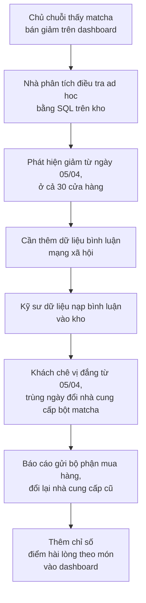
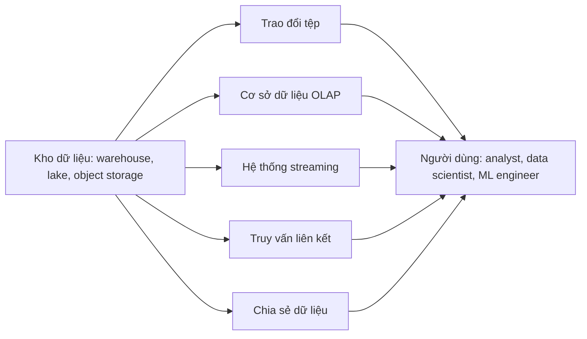
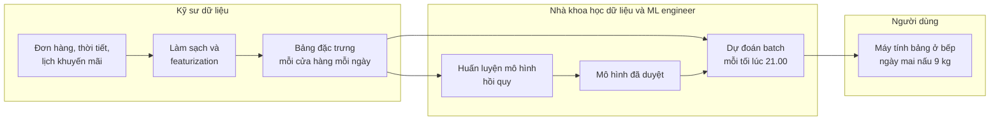

# Cung cấp dữ liệu cho phân tích và học máy

Bài này là phần thân của chương: các loại phân tích (kinh doanh, hoạt động, nhúng), những gì kỹ sư dữ liệu nên biết về ML, các cách phân phát dữ liệu cho cả phân tích lẫn ML (tệp, cơ sở dữ liệu, streaming, truy vấn liên kết, chia sẻ dữ liệu), lớp ngữ nghĩa/số liệu và notebook.

**Tương tự đơn giản:** Cùng một kho nguyên liệu (dữ liệu), nhưng bếp trưởng cần một bản báo cáo cuối tuần (BI), nhân viên trực ca cần chuông báo cháy ngay lập tức (phân tích hoạt động), còn khách của quán cần xem trạng thái đơn hàng trên app (phân tích nhúng). Cách "bê" nguyên liệu ra cho từng người khác nhau.

---

:::note[Ghi nhớ nhanh]

- ⭐ **Xác định use case cuối trước khi cung cấp dữ liệu** — phân tích kinh doanh, hoạt động và nhúng có mục tiêu và yêu cầu rất khác nhau.
- ⭐ **Phân tích hoạt động = hành động ngay; phân tích kinh doanh = insight để hành động** — khác biệt chính là thời gian.
- **Phân tích nhúng** có ba yêu cầu: độ trễ dữ liệu thấp, truy vấn nhanh, đồng thời (concurrency) cao.
- Bốn cách phân phát phổ biến: **tệp, cơ sở dữ liệu, query engine (liên kết), chia sẻ dữ liệu** (kèm streaming).
- **Semantic/metrics layer** (Looker, dbt...) giúp trả lời câu hỏi "những con số này có đúng không?".
- Với notebook: **không nhúng credential vào code**; đưa data scientist ra khỏi laptop lên cloud.

:::

---

## Mục lục

- 1. Phân tích
- 2. Machine learning
- 3. Các cách phân phát dữ liệu cho analytics và ML
- 4. Lớp ngữ nghĩa và số liệu
- 5. Cung cấp dữ liệu trong notebook
- 6. Áp vào chuỗi trà sữa Mây
- Tóm tắt

## 1. Phân tích

**Phân tích** (analytics) là khám phá, xác định và tạo ra các insight và mẫu hình có ý nghĩa trong dữ liệu, thường bằng phương pháp thống kê, báo cáo, công cụ BI. Việc đầu tiên, giống như phần trước: **xác định use case cuối**. Người dùng xem xu hướng lịch sử? Cần được báo tự động ngay khi có bất thường (như cảnh báo gian lận)? Hay dùng dashboard thời gian thực trên app di động? Ba tình huống này tương ứng ba loại: phân tích kinh doanh, phân tích hoạt động và phân tích nhúng.

### 1.1. Phân tích kinh doanh (business analytics)

Dùng dữ liệu lịch sử và hiện tại để đưa ra quyết định **chiến lược và khả thi**. Thường nhìn xu hướng dài hạn, kết hợp phân tích thống kê với kiến thức lĩnh vực và phán đoán của con người, nên "vừa là nghệ thuật vừa là khoa học". Ba mảng lớn:

| Mảng | Mô tả | Công cụ thường dùng |
|---|---|---|
| **Dashboard** | Cho người ra quyết định thấy tổ chức đang vận hành ra sao qua vài số liệu cốt lõi (doanh số, tỷ lệ giữ chân khách...), dưới dạng biểu đồ, heatmap, thống kê tóm tắt, thậm chí một con số. Giống bảng đồng hồ ô tô. Nhà phân tích tạo và bảo trì; khi bên liên quan dựa vào dashboard, analyst xử lý yêu cầu kiểm tra số liệu lạ hoặc thêm số liệu mới | Tableau, Looker, Sisense, Power BI, Apache Superset/Preset |
| **Báo cáo** (report) | Analyst được giao dùng dữ liệu để đẩy tới hiểu biết và hành động | Cùng nền tảng BI với dashboard |
| **Phân tích ad hoc** | Điều tra sâu một vấn đề tiềm ẩn rồi quay lại với insight. Báo cáo thường khởi đầu là yêu cầu ad hoc; nếu kết quả có tác động thì nó thường lên thành báo cáo hoặc dashboard | Excel, Python, notebook R, truy vấn SQL... |

**Ví dụ xuyên suốt của sách (quần short chạy bộ):** nhà bán lẻ online thấy tỷ lệ trả hàng của quần short chạy bộ nữ cao hơn dự kiến. Analyst chạy SQL trên data warehouse, tổng hợp mã lý do trả hàng và phát hiện vải kém chất lượng, nhanh cũ sau vài lần dùng. Kết quả được báo cho bộ phận sản xuất và kiểm soát chất lượng, tóm tắt thành báo cáo đưa lên cùng công cụ BI chứa dashboard. Sau đó analyst biết nhà sản xuất có thêm thông tin chuỗi cung ứng; kỹ sư dữ liệu làm dự án nạp dữ liệu này vào warehouse. Analyst nối số seri hàng may mặc với nhà cung cấp vải, phát hiện phần lớn lỗi đến từ một trong ba nhà cung cấp, và nhà máy ngừng dùng vải của họ.

Rút ra: analyst giỏi liên tục dấn sâu vào nghiệp vụ, và phản hồi cho kỹ sư dữ liệu về chất lượng, độ tin cậy, yêu cầu bộ dữ liệu mới; kỹ sư dữ liệu có trách nhiệm xử lý phản hồi đó.

**Câu chuyện tương tự ở chuỗi Mây:** doanh thu trà sữa matcha giảm 30% trong tháng 4. Sơ đồ dưới cho thấy một câu hỏi ad hoc lớn dần thành báo cáo rồi thành dashboard, và kỹ sư dữ liệu tham gia ở khâu nào.



**Về mặt cung cấp dữ liệu:**

- Dữ liệu cho phân tích kinh doanh thường phát theo **batch** từ data warehouse hoặc data lake. Tần suất khác nhau tuỳ công ty/nhóm: mỗi giây, mỗi phút, 30 phút, mỗi ngày hay tuần.
- Kỹ sư nên cân nhắc các ứng dụng tiềm năng của dữ liệu, cả hiện tại lẫn tương lai. Có thể dùng tần suất cập nhật hỗn hợp, nhưng nhớ: **tần suất thu nạp là trần cho tần suất ở phía sau**. Nếu có ứng dụng streaming thì dữ liệu phải được nạp dạng luồng, dù một số bước sau vẫn xử lý batch.
- Có công cụ BI lưu dữ liệu trong lớp lưu trữ nội bộ; có công cụ chạy truy vấn thẳng trên data lake/warehouse. Cách sau tận dụng sức mạnh của cơ sở dữ liệu OLAP, nhưng đánh đổi ở chi phí, kiểm soát truy cập và độ trễ.

### 1.2. Phân tích hoạt động (operational analytics)

Nếu phân tích kinh doanh dùng dữ liệu để khám phá insight có thể hành động, thì phân tích hoạt động dùng dữ liệu để **hành động ngay lập tức**.

> Phân tích hoạt động so với phân tích kinh doanh = hành động ngay lập tức so với insight có thể hành động.

Khác biệt lớn nhất là **thời gian**. Phân tích kinh doanh nhìn dài hơn, cập nhật tức thời chỉ "thú vị" chứ không đổi kết quả đáng kể. Phân tích hoạt động thì ngược lại: cập nhật thời gian thực có thể giải quyết vấn đề ngay khi nó xảy ra.

**Ví dụ:** giám sát ứng dụng theo thời gian thực. Đội kỹ thuật có dashboard (Hình 9-2 của sách, từ Google Compute Engine) hiển thị request mỗi giây, I/O cơ sở dữ liệu... Một số điều kiện kích hoạt sự kiện **scale** (tăng dung lượng khi máy chủ quá tải). Vi phạm ngưỡng thì hệ thống gửi cảnh báo qua tin nhắn, chat nhóm, email.

**Ranh giới đang mờ.** Khi dữ liệu streaming, độ trễ thấp phổ biến hơn, ta áp dụng cách làm vận hành cho bài toán kinh doanh. Ví dụ ngày Black Friday, nhà bán lẻ online vừa theo dõi hiệu năng website vừa phân tích doanh số, doanh thu, hiệu quả chiến dịch quảng cáo theo thời gian thực. Kiến trúc thay đổi để có cả **dữ liệu nóng (hot) và ấm (warm)** cùng một nơi.

Câu hỏi cốt lõi: **nếu có dữ liệu streaming, bạn sẽ làm gì với nó? Hành động nào?** Hành động đúng tạo ra tác động và giá trị; dữ liệu thời gian thực mà không có hành động chỉ khiến bạn xao nhãng liên tục.

Dự đoán của tác giả: về dài hạn **streaming sẽ thay thế batch**. Sản phẩm dữ liệu 10 năm tới có thể là "streaming trước", kết hợp liền mạch với dữ liệu lịch sử; thu theo thời gian thực nhưng vẫn xử lý batch theo yêu cầu.

**Tiếp ví dụ quần short:** để tìm thêm cơ hội cải thiện chất lượng, các kỹ sư đề xuất phân tích thời gian thực tại nhà máy. Nhà máy có máy móc truyền dữ liệu thời gian thực và camera quay dây chuyền; hiện kỹ thuật viên xem video tìm hàng lỗi và báo người chạy chuyền. Kỹ sư dữ liệu dùng dịch vụ **machine vision** trên cloud để tự phát hiện lỗi, gắn dữ liệu lỗi với số seri sản phẩm và streaming. Pipeline thời gian thực liên kết hàng lỗi với sự kiện từ máy trên dây chuyền. Nhờ đó analyst phát hiện chất lượng vải thô khác nhau giữa các thùng; khi tỷ lệ lỗi tăng, công nhân loại thùng lỗi và tính phí lại nhà cung cấp. Nhà cung cấp thấy hiệu quả nên cũng triển khai kiểm soát tương tự, cải thiện chất lượng kho vải của họ.

### 1.3. Phân tích nhúng (embedded analytics)

Hai loại trên hướng nội. Xu hướng gần đây là **phân tích hướng bên ngoài**, hay phân tích nhúng: nhiều công ty cung cấp analytics cho người dùng cuối thông qua **ứng dụng dữ liệu** (data app), thường là dashboard nhúng ngay trong ứng dụng, cho người dùng xem số liệu chính về mối quan hệ của họ với ứng dụng.

Ví dụ trong sách:

- Bộ điều nhiệt thông minh có app hiển thị nhiệt độ thời gian thực và mức tiêu thụ điện để lập lịch sưởi/làm mát tiết kiệm hơn.
- Nền tảng thương mại điện tử bên thứ ba cung cấp cho người bán dashboard doanh số, tồn kho, hàng trả lại theo thời gian thực; người bán có thể dùng để tung ưu đãi gần như tức thời.

Cả hai cho phép người dùng ra quyết định (thủ công hay tự động) theo thời gian thực dựa trên dữ liệu.

**Ba loại phân tích đặt cạnh nhau ở chuỗi Mây:**

| Loại | Câu hỏi ở Mây | Ai xem | Độ tươi cần có | Hành động |
|---|---|---|---|---|
| Kinh doanh | Doanh thu quý này so với quý trước, theo vùng? | Chủ chuỗi | Hằng ngày là đủ | Quyết định mở thêm quán ở vùng tăng trưởng |
| Hoạt động | Tủ mát nào đang vượt 8°C? Máy POS nào mất kết nối? | Quản lý cửa hàng, đội kỹ thuật | Vài giây tới vài phút | Kiểm tra tủ ngay, gọi kỹ thuật |
| Nhúng | Tôi còn bao nhiêu điểm, sắp được ly miễn phí chưa? | Khách hàng trên app | Gần như tức thì sau khi mua | Khách quay lại mua để đổi quà |

Phân tích nhúng ở Mây đặt ra đúng ba thách thức sách nêu: khách vừa thanh toán xong mở app là muốn thấy điểm cộng ngay (**độ trễ dữ liệu thấp**), mở màn hình phải hiện trong 1–2 giây (**truy vấn nhanh**), và giờ cao điểm trưa có hàng nghìn khách cùng mở app (**đồng thời cao**).

**Vai trò của kỹ sư dữ liệu:** thường không làm giao diện (nhà phát triển ứng dụng làm), nhưng chịu trách nhiệm cơ sở dữ liệu phục vụ phân tích nhúng nên phải hiểu yêu cầu tốc độ và độ trễ. Hiệu năng gồm **ba vấn đề**:

1. **Độ trễ dữ liệu thấp**: người dùng ứng dụng không chấp nhận batch thưa như analyst nội bộ. Người dùng nền tảng tuyển dụng SaaS mong thấy thống kê đổi ngay khi tải CV mới lên.
2. **Hiệu năng truy vấn nhanh**: chỉnh tham số dashboard là muốn thấy kết quả mới sau vài giây.
3. **Đồng thời cao** (high concurrency): tỷ lệ truy vấn rất cao trên nhiều dashboard, nhiều khách hàng.

Google và các công ty đi đầu đã phát triển công nghệ mới cho các thách thức này. Startup thường mặc định dùng cơ sở dữ liệu giao dịch thông thường cho data app, rồi khi lượng khách tăng thì vượt quá kiến trúc ban đầu. Giờ họ có thể dùng thế hệ cơ sở dữ liệu mới kết hợp truy vấn nhanh, đồng thời cao, cập nhật gần thời gian thực với độ dễ dùng tương đối (phân tích dựa trên SQL).

## 2. Machine learning

ML là lĩnh vực chính thứ hai của serving. Ranh giới giữa ML, data science, data engineering và ML engineering ngày càng mờ và khác nhau rất nhiều giữa các tổ chức:

- Có nơi ML engineer đảm nhiệm xử lý dữ liệu cho ứng dụng ML ngay sau khi thu thập, thậm chí lập hẳn một tổ chức dữ liệu song song riêng cho toàn bộ vòng đời ML.
- Có nơi kỹ sư dữ liệu xử lý hết rồi giao dữ liệu cho ML engineer huấn luyện mô hình; kỹ sư dữ liệu thậm chí làm một số việc rất ML, như **featurization** (tạo đặc trưng từ dữ liệu).

**Tiếp ví dụ quần short:** nhà máy dệt có dữ liệu streaming. Data scientist phát hiện chất lượng vải phụ thuộc đặc tính polyester đầu vào, nhiệt độ, độ ẩm và các tham số của máy dệt. Họ xây mô hình cơ bản để tối ưu tham số máy dệt. ML engineer tự động hoá huấn luyện và dựng quy trình tự chỉnh máy theo tham số đầu vào. Kỹ sư dữ liệu và ML cùng thiết kế pipeline featurization; kỹ sư dữ liệu triển khai và duy trì pipeline đó.

### Kỹ sư dữ liệu nên biết gì về ML

Không cần hiểu sâu, nhưng nắm cơ bản ML cổ điển và nguyên tắc deep learning sẽ giúp bạn cộng tác với data scientist rất nhiều. Các chủ đề nên làm quen:

- Khác biệt giữa học **có giám sát, không giám sát, bán giám sát**.
- Khác biệt giữa **phân loại** (classification) và **hồi quy** (regression).
- Kỹ thuật xử lý **dữ liệu chuỗi thời gian** (phân tích và dự báo).
- Khi nào dùng kỹ thuật cổ điển (hồi quy logistic, học dựa trên cây, SVM) so với deep learning. Tác giả thấy data scientist hay nhảy ngay sang deep learning khi nó là quá mức cần thiết; kiến thức cơ bản giúp bạn xác định ML có phù hợp không và quy mô dữ liệu cần cấp.
- Khi nào dùng **AutoML** so với tự xây mô hình; đánh đổi liên quan đến dữ liệu.
- Kỹ thuật **sắp xếp/chuẩn bị dữ liệu** cho dữ liệu có cấu trúc và phi cấu trúc.
- Mọi dữ liệu dùng cho ML đều được **chuyển thành số**. Nếu cấp dữ liệu có cấu trúc/bán cấu trúc, phải đảm bảo chuyển đổi đúng trong feature engineering. Biết cách **mã hoá dữ liệu phân loại** (categorical) và **embedding** cho các loại dữ liệu khác nhau.
- Khác biệt giữa **học theo batch** và **học trực tuyến** (online learning); cách nào hợp use case.
- Vòng đời kỹ thuật dữ liệu giao với vòng đời ML ở công ty bạn thế nào? Bạn có chịu trách nhiệm hỗ trợ **feature store** hay **ML observability** không?
- Khi nào huấn luyện **cục bộ, theo cụm hay ở edge**; khi nào dùng **GPU thay CPU**. Phần cứng phụ thuộc loại bài toán, kỹ thuật và kích thước dữ liệu.
- Khác biệt dữ liệu batch và streaming khi huấn luyện: batch hợp huấn luyện **offline**, streaming hợp huấn luyện **online**.
- **Data cascades** (tầng dữ liệu: lỗi dữ liệu ở thượng nguồn lan truyền và tích luỹ) tác động thế nào tới mô hình ML.
- Kết quả trả về **thời gian thực hay batch**: mô hình phiên âm giọng nói batch xử lý mẫu giọng và trả văn bản sau lệnh gọi API; mô hình đề xuất sản phẩm có thể phải chạy real-time khi khách đang duyệt web.
- Dữ liệu **có cấu trúc và phi cấu trúc**: phân cụm khách hàng từ bảng (có cấu trúc), hay nhận dạng ảnh bằng mạng neuron (phi cấu trúc).

Sách không dạy ML; gợi ý đọc *Hands-On Machine Learning with Scikit-Learn, Keras, and TensorFlow* của Aurélien Géron (O'Reilly).

### Hiểu nôm na vài khái niệm ML qua chuỗi Mây

| Khái niệm | Nghĩa đời thường | Ví dụ ở Mây |
|---|---|---|
| Học có giám sát | Cho máy xem nhiều ví dụ **có sẵn đáp án** để nó tự rút ra quy luật | Cho xem 2 năm dữ liệu "ngày như thế này thì dùng hết bao nhiêu kg trân châu" |
| Học không giám sát | Cho máy dữ liệu **không có đáp án**, để nó tự chia nhóm | Tự chia khách thành nhóm "dân văn phòng mua trưa", "học sinh mua chiều" |
| Hồi quy | Dự đoán một **con số** | Ngày mai cần 12,5 kg trân châu |
| Phân loại | Dự đoán một **nhãn**, thường là có hoặc không | Khách K01 có sắp rời bỏ không? |
| Feature (đặc trưng) | Các "manh mối" đưa cho mô hình, đã đổi thành số | Thứ trong tuần, nhiệt độ ngoài trời, có khuyến mãi không |
| Featurization | Biến dữ liệu thô thành bảng manh mối | Từ hàng triệu đơn, tính ra "số ly trà sữa trân châu bán hôm qua" |
| Dự đoán batch | Chạy một lần cho nhiều trường hợp | Mỗi tối dự báo lượng trân châu cho 30 cửa hàng |
| Dự đoán thời gian thực | Chạy ngay khi có yêu cầu | Khách mở app, gợi ý ngay món hợp khẩu vị |
| Data cascades | Lỗi nhỏ ở đầu nguồn lan và phình to ở cuối | POS ghi trùng đơn, mô hình tưởng nhu cầu cao, bếp nấu dư trân châu |

**Kỹ sư dữ liệu chuẩn bị gì cho mô hình dự báo trân châu?** Mô hình không đọc được đơn hàng thô; nó cần một bảng mỗi dòng là một "ví dụ học" gồm manh mối và đáp án. Hai bảng dưới cho thấy dữ liệu trước và sau featurization.

Trước, đơn hàng thô:

| order_id | thoi_gian | cua_hang | mon | so_luong |
|---|---|---|---|---|
| DH001 | 2026-03-01 08:15 | Q1-Lê Lợi | Trà sữa trân châu | 2 |
| DH004 | 2026-03-01 12:30 | Q1-Lê Lợi | Trà sữa trân châu | 3 |
| ... | ... | ... | ... | ... |

Sau, bảng đặc trưng (mỗi dòng là một cửa hàng trong một ngày):

| cua_hang | ngay | thu | nhiet_do_ngoai_troi | co_khuyen_mai | ly_tran_chau_hom_qua | ly_tran_chau_7_ngay_tb | kg_tran_chau_dung (đáp án) |
|---|---|---|---|---|---|---|---|
| Q1-Lê Lợi | 2026-03-01 | 8 | 34 | 1 | 180 | 165 | 9,5 |
| Q1-Lê Lợi | 2026-03-02 | 2 | 31 | 0 | 210 | 168 | 8,0 |

(`thu` = 8 nghĩa là Chủ nhật, 2 là thứ Hai; `co_khuyen_mai` = 1 là có. Mọi cột đều đã ở dạng số để mô hình đọc được.)

## 3. Các cách phân phát dữ liệu cho analytics và ML

Với cả analyst lẫn data scientist/ML engineer, quy trình cung cấp rất giống nhau, nên sách gộp lại. Bốn cách phổ biến: **tệp, cơ sở dữ liệu, query engine (truy vấn liên kết), chia sẻ dữ liệu**, cộng thêm hệ thống streaming.



### 3.1. Trao đổi tệp (file exchange)

Rất phổ biến: ta xử lý dữ liệu, tạo tệp và chuyển cho consumer. Một tệp phục vụ được nhiều mục đích, ví dụ:

- Data scientist tải tệp văn bản (dữ liệu phi cấu trúc) tin nhắn khách hàng để phân tích cảm xúc của lời phàn nàn.
- Đơn vị kinh doanh nhận dữ liệu hoá đơn từ đối tác dạng nhiều file CSV (có cấu trúc) để analyst thống kê.
- Nhà cung cấp dữ liệu đưa nhà bán lẻ online ảnh sản phẩm trên website đối thủ (phi cấu trúc) để phân loại tự động bằng computer vision.

Cách phát tệp phụ thuộc: use case; quy trình xử lý của consumer; kích thước và số lượng tệp; ai truy cập; kiểu dữ liệu (có cấu trúc, bán cấu trúc, phi cấu trúc). Yếu tố thứ hai (quy trình của consumer) thường quyết định: nhiều khi phải phát qua tệp thay vì chia sẻ dữ liệu vì consumer không dùng được nền tảng chia sẻ.

- **Đơn giản nhất** là gửi email file Excel. Vẫn phổ biến, nhưng mỗi người nhận một bản riêng: chỉnh sửa tách biệt, lệch phiên bản là chắc chắn, và gần như không thu hồi được tệp đã gửi. Cần một phiên bản nhất quán thì dùng nền tảng cộng tác như Microsoft 365 hoặc Google Docs.
- Phát từng tệp lẻ khó mở rộng. Khi lớn lên, bạn sẽ chuyển sang **object storage** (có vài tệp lớn; hợp tệp bán/phi cấu trúc) hoặc **data lake** (có dòng tệp đều đặn).
- Tác giả thường xếp trao đổi tệp qua object storage (data lake) vào nhóm **chia sẻ dữ liệu** hơn là trao đổi tệp, vì cách này mở rộng và gọn hơn nhiều so với trao đổi tệp ad hoc.

### 3.2. Cơ sở dữ liệu

Lớp quan trọng khi phục vụ analytics và ML. Ở đây ngầm hiểu là cơ sở dữ liệu **OLAP** (warehouse, lake). Cung cấp dữ liệu nghĩa là truy vấn cơ sở dữ liệu rồi dùng kết quả cho use case. Ví dụ analyst/data scientist truy vấn bằng SQL editor, xuất CSV cho ứng dụng sau, hoặc phân tích kết quả trong notebook.

**Lợi ích:**

- Áp đặt **thứ tự và cấu trúc** qua schema.
- **Kiểm soát quyền chi tiết** ở cấp bảng, cột, hàng, cho phép chính sách truy cập phức tạp theo vai trò.
- **Hiệu năng cao** cho truy vấn lớn, nặng tính toán và đồng thời cao.

**Hệ thống BI chia việc xử lý với cơ sở dữ liệu nguồn, nhưng ranh giới khác nhau:**

- **Tableau server**: chạy truy vấn ban đầu lấy dữ liệu từ cơ sở dữ liệu và lưu cục bộ; thao tác OLAP/BI cơ bản (lọc, tổng hợp tương tác) chạy trên bản sao cục bộ đó.
- **Looker** (và BI hiện đại tương tự): dựa trên mô hình **query pushdown** (đẩy truy vấn xuống). Looker mã hoá logic xử lý bằng ngôn ngữ riêng (**LookML**), kết hợp với input động của người dùng để sinh SQL, chạy SQL trên cơ sở dữ liệu nguồn và hiển thị kết quả.
- Cả hai đều có tuỳ chọn **cache** kết quả để giảm tải cho truy vấn chạy thường xuyên.

Data scientist có thể kết nối cơ sở dữ liệu, trích xuất dữ liệu, làm feature engineering/selection; tập dữ liệu đã biến đổi đưa vào mô hình ML, huấn luyện offline và cho ra dự đoán.

**Kỹ sư dữ liệu thường quản lý lớp serving của cơ sở dữ liệu**, gồm hiệu năng và chi phí. Với cơ sở dữ liệu tách compute khỏi storage, bài toán tối ưu phức tạp hơn thời hạ tầng cố định tại chỗ: giờ có thể tạo cụm Spark hoặc warehouse Snowflake mới cho từng khối lượng công việc analytics/ML. Tối thiểu nên **chia cụm theo use case chính** (ETL, phục vụ analytics, data science). Nhiều nhóm còn chia nhỏ hơn, cấp một warehouse cho mỗi mảng, để từng nhóm lập ngân sách chi phí truy vấn dưới sự giám sát của nhóm kỹ thuật dữ liệu.

Nhớ lại **ba vấn đề hiệu năng** của phân tích nhúng: độ trễ dữ liệu, hiệu năng truy vấn, đồng thời. Hệ thống nạp thẳng từ luồng giảm độ trễ; nhiều kiến trúc dùng SSD hoặc cache bộ nhớ để tăng hiệu năng truy vấn và đồng thời.

Các nền tảng như **Snowflake** và **Databricks** ngày càng cho analyst và data scientist làm việc trong một môi trường (SQL editor và notebook chung một mái nhà). Vì compute và storage tách biệt, họ dùng chung dữ liệu nền theo nhiều cách mà không ảnh hưởng nhau, cho thông lượng cao và giao sản phẩm dữ liệu nhanh hơn.

### 3.3. Hệ thống streaming

Phân tích streaming ngày càng quan trọng. Ở mức cao, loại phân phát này có thể liên quan tới các **số liệu được phát ra** (emitted metrics), khác với truy vấn truyền thống. Ngoài ra **cơ sở dữ liệu phân tích hoạt động** đóng vai trò lớn dần: cho phép truy vấn trên phạm vi lớn dữ liệu lịch sử **cộng cả dữ liệu hiện tại cập nhật đến từng giây**. Về bản chất, chúng kết hợp khía cạnh của cơ sở dữ liệu OLAP với hệ thống xử lý luồng. Bạn sẽ làm việc với streaming nhiều hơn để phục vụ analytics và ML; xem thêm "live data stack" ở Chương 11.

### 3.4. Truy vấn liên kết (federated queries)

Như Chương 8: federated query lấy dữ liệu từ nhiều nguồn (data lake, RDBMS, warehouse). Ngày càng phổ biến khi các công cụ **ảo hoá truy vấn phân tán** được xem là cách phục vụ truy vấn mà không phải gom dữ liệu vào một hệ OLAP. Ví dụ: **Trino**, **Presto** (mã nguồn mở) và dịch vụ quản lý như **Starburst**. Một số tự mô tả là cách "kích hoạt data mesh" (còn phải chờ xem).

Lưu ý khi phục vụ: người dùng cuối có thể truy vấn nhiều hệ thống cùng lúc (OLTP, OLAP, API, hệ thống tệp...), mỗi hệ có kiểu dùng và đặc thù riêng. Nếu truy vấn liên kết chạm **hệ thống nguồn sản xuất đang chạy**, phải đảm bảo nó không ngốn quá nhiều tài nguyên của nguồn.

Theo kinh nghiệm tác giả, truy vấn liên kết lý tưởng khi:

- Bạn muốn **linh hoạt** trong phân tích, hoặc dữ liệu nguồn cần **kiểm soát chặt**.
- Cần truy vấn ad hoc để khám phá, trộn dữ liệu từ nhiều hệ mà không dựng pipeline/ETL phức tạp. Nhờ đó bạn đánh giá được hiệu năng liên kết có đủ cho dùng lâu dài, hay cần nạp một số/tất cả nguồn vào cơ sở dữ liệu OLAP hoặc lake.
- Cần **quyền chỉ đọc** vào hệ nguồn (không muốn đưa tệp, quyền truy cập DB hay data dump). Người dùng chỉ đọc đúng phiên bản dữ liệu được phép; tốt cho các kịch bản quan trọng về truy cập và tuân thủ.

### 3.5. Chia sẻ dữ liệu (data sharing)

Chương 5 đã bàn sâu. Theo nghĩa rộng, mọi trao đổi dữ liệu giữa các tổ chức hay đơn vị đều là chia sẻ; ở đây sách nói về chia sẻ qua **hệ thống lưu trữ multitenant (nhiều người thuê) trên cloud**. Nó biến serving thành bài toán **bảo mật và kiểm soát truy cập**. Truy vấn thực tế do consumer (analyst, data scientist) xử lý chứ không phải kỹ sư cung cấp dữ liệu. Dù là trong data mesh nội bộ, cho công chúng hay cho doanh nghiệp đối tác, chia sẻ dữ liệu là mô hình hấp dẫn, và đang trở thành tính năng cốt lõi của Snowflake, Redshift, BigQuery.

## 4. Lớp ngữ nghĩa và số liệu

Kỹ sư dữ liệu hay nghĩ về công nghệ lưu trữ và xử lý: Spark hay cloud warehouse? Object storage hay cache trên SSD? Nhưng công cụ xử lý mạnh trả kết quả nhanh trên dữ liệu khổng lồ **không tự tạo ra phân tích kinh doanh chất lượng**. Đưa dữ liệu hay truy vấn kém vào, engine mạnh chỉ trả về kết quả xấu nhanh hơn.

- **Chất lượng dữ liệu**: đặc tính của chính dữ liệu và kỹ thuật lọc/cải thiện dữ liệu xấu.
- **Chất lượng truy vấn**: xây truy vấn có logic đúng để trả lời chính xác câu hỏi kinh doanh. Viết truy vấn và báo cáo ETL chất lượng cao là việc chi tiết, tốn thời gian; nhiều công cụ giúp tự động hoá, tăng nhất quán, dễ bảo trì và cải tiến.

**Metrics layer** (lớp số liệu) về cơ bản là công cụ để duy trì và tính toán **logic kinh doanh**. (**Semantic layer** gần như tương đương về khái niệm; **headless BI** là thuật ngữ liên quan.) Lớp này có thể nằm trong công cụ BI hoặc trong phần mềm xây truy vấn biến đổi. Hai ví dụ cụ thể:

| | **Looker** | **dbt** (Data Build Tool) |
|---|---|---|
| Cách làm | LookML cho phép định nghĩa logic kinh doanh ảo, phức tạp; báo cáo và dashboard trỏ tới LookML để lấy số liệu. Định nghĩa số liệu chuẩn một lần, tham chiếu trong nhiều truy vấn, giải quyết tình trạng lặp lại, bất nhất của script ETL truyền thống | Định nghĩa các luồng SQL phức tạp gồm nhiều truy vấn và định nghĩa chuẩn cho số liệu kinh doanh, giống Looker |
| Phạm vi | Sinh SQL và đẩy xuống DB; kết quả giữ ở máy chủ Looker hoặc trong chính DB với tập kết quả lớn. Tập trung vào **truy vấn và báo cáo** | Chỉ chạy ở **lớp biến đổi** (có thể gồm đẩy truy vấn vào các view tính tại thời điểm truy vấn). Có thể làm công cụ **orchestration pipeline** mạnh cho analytics engineer |

Tác giả tin rằng công cụ metrics layer sẽ ngày càng phổ biến, giúp trả lời câu hỏi trọng tâm khiến nhiều tổ chức vất vả: **"Những con số này có chính xác không?"** Có nhiều người chơi mới trong không gian này ngoài các công cụ đã nêu.

Ở Mây, câu hỏi "những con số này có chính xác không?" thường bắt đầu bằng việc hai người cầm hai báo cáo khác số. Có metrics layer thì câu trả lời là "cả hai đều lấy `doanh_thu_thuan` từ cùng một định nghĩa", và cuộc tranh luận chuyển sang ý nghĩa của con số thay vì cách tính.

*Ví dụ minh hoạ do người ghi chép thêm (không có trong sách):* một "định nghĩa số liệu" viết một lần có thể là một view SQL mà mọi dashboard cùng dùng lại:

```sql
-- Định nghĩa chuẩn của doanh thu thuần: mọi báo cáo đều dùng lại view này
CREATE VIEW metrics.net_revenue AS
SELECT order_date,
       SUM(gross_amount - discount_amount - refund_amount) AS net_revenue
FROM   core.orders
WHERE  status = 'completed'
GROUP  BY order_date;
```

## 5. Cung cấp dữ liệu trong notebook

Data scientist dùng **notebook** hằng ngày cho khám phá dữ liệu, feature engineering, huấn luyện mô hình. Phổ biến nhất lúc sách viết là **Jupyter Notebook** và bản thế hệ sau **JupyterLab**; mã nguồn mở, chạy cục bộ trên laptop, trên máy chủ hoặc qua dịch vụ cloud. (Jupyter là viết tắt của Julia, Python, R; hai ngôn ngữ sau phổ biến trong data science.)

**Truy cập dữ liệu:** data scientist kết nối theo lập trình tới nguồn dữ liệu (API, cơ sở dữ liệu, warehouse, lake) bằng thư viện: tải tệp từ đường dẫn, gọi endpoint API, hoặc tạo kết nối ODBC tới DB. Kết nối từ xa cần credential và quyền chính xác; sau đó cần đúng quyền trên bảng (hàng/cột) hoặc tệp trong object storage. Kỹ sư dữ liệu thường giúp tìm đúng dữ liệu rồi đảm bảo quyền truy cập đúng hàng và cột cần.

Quy trình cực phổ biến: chạy notebook cục bộ và tải dữ liệu vào **pandas DataFrame**. pandas là thư viện Python phổ biến để thao tác/phân tích dữ liệu; khi tải tập dữ liệu, nó **giữ trong bộ nhớ**.

### Xử lý thông tin xác thực (credentials)

Xử lý sai credential trong notebook và code data science là **rủi ro bảo mật lớn**; tác giả liên tục thấy lỗi này. Thường gặp: nhúng credential thẳng vào code (rồi rò vào kho version control), hoặc chuyển credential qua tin nhắn, email.

- Kỹ sư dữ liệu nên rà soát thực hành bảo mật của data science và cùng cải thiện; data scientist dễ tiếp thu nếu được đưa ra giải pháp thay thế.
- Kỹ sư dữ liệu đặt **tiêu chuẩn xử lý credential**: **không bao giờ nhúng credential vào code**; lý tưởng là dùng **credential manager** hoặc công cụ CLI để quản lý truy cập.

### Khi dữ liệu vượt quá bộ nhớ máy cục bộ

Điều này chắc chắn xảy ra vì laptop/workstation hạn chế bộ nhớ, và nó làm dự án data science bị đình trệ. Lộ trình mở rộng:

1. **Notebook trên cloud**: bộ nhớ và lưu trữ co giãn linh hoạt.
2. **Hệ thống thực thi phân tán**: các tuỳ chọn Python phổ biến là **Dask, Ray, Spark**.
3. **Dịch vụ quản lý đầy đủ trên cloud**: **Amazon SageMaker, Google Cloud Vertex AI, Microsoft Azure Machine Learning**.
4. **Quy trình ML toàn diện mã nguồn mở**: **Kubeflow, MLflow** giúp mở rộng khối lượng ML trên Kubernetes và Spark.

Mục tiêu: đưa data scientist ra khỏi laptop để tận dụng sức mạnh và khả năng mở rộng của cloud. Kỹ sư dữ liệu và ML engineer đóng vai trò quan trọng trong việc chuyển lên hạ tầng cloud có thể mở rộng; phân công cụ thể tuỳ tổ chức, nhưng nên dẫn đầu việc dựng hạ tầng, giám sát quản lý môi trường và đào tạo data scientist dùng công cụ cloud. Môi trường cloud đòi hỏi công việc vận hành (quản lý phiên bản và cập nhật, kiểm soát truy cập, duy trì SLA); làm tốt "data science operations" sẽ có lợi nhuận đáng kể.

**Notebook trong sản xuất:** notebook thậm chí có thể là một phần của data science sản xuất, được triển khai rộng rãi ở **Netflix**. Ưu điểm: data scientist đưa công việc vào sản xuất nhanh hơn nhiều; nhược điểm: về bản chất đó là một dạng sản xuất "dưới chuẩn". Phương án thay thế là bắt ML/data engineer chuyển notebook sang sản xuất, dồn gánh nặng lớn lên các nhóm này. Kết hợp có thể lý tưởng: notebook cho sản xuất "nhẹ", quy trình sản xuất đầy đủ cho dự án giá trị cao.

## 6. Áp vào chuỗi trà sữa Mây

### Chọn cách phân phát cho từng người dùng

| Người dùng ở Mây | Cần gì | Cách phân phát hợp | Vì sao |
|---|---|---|---|
| Kế toán | Bảng doanh thu tháng để đối soát | Trao đổi tệp (file Excel trên ổ chung, một bản duy nhất) | Kế toán quen Excel; dùng ổ chung để tránh mỗi người một bản |
| Chủ chuỗi | Dashboard doanh thu | Cơ sở dữ liệu OLAP cộng công cụ BI | Dữ liệu có cấu trúc, cần phân quyền và truy vấn nhanh |
| Quản lý cửa hàng | Cảnh báo tủ mát | Hệ thống streaming | Cần biết trong vài phút |
| Nhà phân tích | Ghép đơn hàng với dữ liệu khách trong hệ thống app, thử trước khi dựng pipeline | Truy vấn liên kết | Khám phá nhanh, không cần dựng ETL ngay |
| Nhà cung cấp trân châu | Dự báo lượng đặt hàng tuần tới | Chia sẻ dữ liệu qua kho đám mây | Họ tự truy vấn phần được phép, Mây không phải gửi file mỗi tuần |
| Nhà khoa học dữ liệu | Bảng đặc trưng để huấn luyện | Cơ sở dữ liệu, đọc vào notebook trên cloud | Dữ liệu 2 năm của 30 cửa hàng có thể vượt bộ nhớ laptop |

### Từ kho tới bếp: pipeline dự báo trân châu

Sơ đồ dưới cho thấy dữ liệu đi từ quầy bán hàng tới con số gợi ý trên máy tính bảng ở bếp, và mỗi khâu do ai phụ trách.



Nếu ở khâu đầu có lỗi (ví dụ đơn bị ghi trùng), mọi khâu sau đều sai theo: đó chính là **data cascades**. Vì vậy kiểm tra chất lượng dữ liệu ở khâu của kỹ sư dữ liệu quan trọng không kém việc chọn mô hình.

### Credential trong notebook: sai và đúng

Nhà khoa học dữ liệu của Mây kết nối kho dữ liệu từ notebook. Bảng dưới so sánh hai cách xử lý mật khẩu.

| | Cách sai | Cách đúng |
|---|---|---|
| Mật khẩu nằm ở đâu | Gõ thẳng trong ô code của notebook | Trong trình quản lý bí mật hoặc biến môi trường |
| Khi notebook được đẩy lên Git | Mật khẩu lộ cho mọi người xem repo | Không có gì để lộ |
| Khi nhân viên nghỉ việc | Phải đổi mật khẩu dùng chung cho cả đội | Chỉ thu hồi quyền của người đó |

## Tóm tắt

| Chủ đề | Ý chính |
|---|---|
| Phân tích kinh doanh | Insight cho quyết định chiến lược; dashboard, báo cáo, ad hoc; thường batch từ warehouse/lake |
| Phân tích hoạt động | Hành động ngay; giám sát, cảnh báo; dữ liệu streaming, độ trễ thấp |
| Phân tích nhúng | Dashboard trong ứng dụng cho người dùng cuối; cần độ trễ thấp, truy vấn nhanh, đồng thời cao |
| ML | Kỹ sư dữ liệu cần nắm cơ bản (giám sát/không giám sát, phân loại/hồi quy, batch/online, GPU/CPU, AutoML...) |
| Cách phân phát | Tệp, cơ sở dữ liệu, streaming, truy vấn liên kết, chia sẻ dữ liệu |
| Lớp số liệu/ngữ nghĩa | Looker (LookML), dbt; viết logic một lần, dùng mọi nơi |
| Notebook | Không nhúng credential; chuyển lên cloud khi dữ liệu vượt bộ nhớ; notebook sản xuất là đánh đổi |
