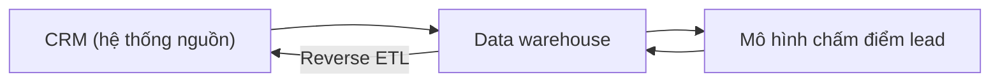
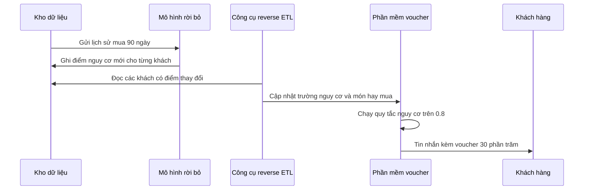
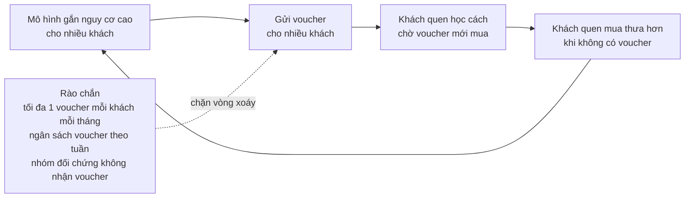

# Reverse ETL, đối tác làm việc và các yếu tố xuyên suốt

Bài cuối của Chương 9 nói về **Reverse ETL** (đẩy dữ liệu đã xử lý ngược về hệ thống nguồn), những ai kỹ sư dữ liệu làm việc cùng ở giai đoạn serving, cách các **yếu tố xuyên suốt** (undercurrents) thể hiện ở giai đoạn này, và lời kết của cả vòng đời kỹ thuật dữ liệu.

**Tương tự đơn giản:** Reverse ETL giống việc thay vì gửi cho nhân viên bán hàng một bảng điểm qua email, bạn ghi thẳng điểm đó lên tấm bảng ngay trên bàn làm việc của họ (CRM), để họ không phải đi tìm.

---

:::note[Ghi nhớ nhanh]

- ⭐ **Reverse ETL** đưa dữ liệu từ phía đầu ra của vòng đời (OLAP) trở lại hệ thống nguồn, giảm "xích mích" cho người dùng cuối (ví dụ đưa lead score thẳng vào CRM).
- ⭐ **Cẩn trọng với vòng phản hồi** — reverse ETL tạo vòng lặp; mô hình lỗi có thể khuếch đại sai lầm (ví dụ giá thầu quảng cáo leo thang), cần giám sát và guardrails.
- Kỹ sư dữ liệu **hỗ trợ** các bên liên quan; không chịu trách nhiệm cách họ diễn giải dữ liệu, nhưng chịu trách nhiệm chất lượng sản phẩm dữ liệu.
- **Bảo mật**: serving có bề mặt tấn công lớn nhất; áp dụng đặc quyền tối thiểu, chỉ đọc, truy cập chi tiết, view lọc.
- Cuối vòng đời là **vòng phản hồi**: lắng nghe bên liên quan và cải thiện.

:::

---

## Mục lục

- 1. Reverse ETL
- 2. Bạn sẽ làm việc với ai
- 3. Các yếu tố xuyên suốt
- 4. Kết luận
- 5. Tài nguyên bổ sung
- Tóm tắt

## 1. Reverse ETL

**Reverse ETL** là thuật ngữ thời thượng cho việc phục vụ dữ liệu bằng cách **nạp dữ liệu từ cơ sở dữ liệu OLAP trở lại hệ thống nguồn**. Thực ra, kỹ sư dữ liệu nào làm nghề hơn vài năm cũng từng làm một biến thể của nó. Reverse ETL phổ biến vào cuối thập niên 2010/đầu 2020 và ngày càng được công nhận là một trách nhiệm chính thức của kỹ thuật dữ liệu.

**Ví dụ trong sách (chấm điểm khách hàng tiềm năng):**

1. Kỹ sư dữ liệu lấy dữ liệu khách hàng và đơn hàng từ **CRM** và lưu vào data warehouse.
2. Dữ liệu dùng để huấn luyện mô hình chấm điểm **lead scoring**; kết quả mô hình được trả về warehouse.
3. Đội bán hàng muốn tiếp cận các lead đã được chấm điểm để tạo thêm doanh thu. Có thể đưa kết quả vào dashboard hay gửi email file Excel, nhưng cách đó **không kết nối với CRM**, nơi nhân viên bán hàng làm việc.
4. Tại sao không đưa lead đã chấm điểm **trở lại CRM**? Sản phẩm dữ liệu thành công là sản phẩm giảm xích mích cho người dùng cuối, ở đây là đội bán hàng. Reverse ETL là cách dễ nhất và tốt nhất.

Nói cách khác: reverse ETL lấy dữ liệu đã xử lý từ **phía đầu ra** của vòng đời kỹ thuật dữ liệu rồi đưa về hệ thống nguồn.

**Thuật ngữ trong bài — hiểu nôm na:**

| Thuật ngữ | Nghĩa đời thường | Ví dụ ở chuỗi Mây |
|---|---|---|
| CRM | Phần mềm quản lý khách hàng, nơi đội bán hàng hoặc marketing làm việc hằng ngày | Phần mềm gửi tin nhắn và voucher của Mây |
| Lead scoring | Chấm điểm khả năng một người sẽ mua | Ở Mây là chấm điểm khả năng khách **rời bỏ** |
| Feedback loop | Kết quả đầu ra quay lại ảnh hưởng đầu vào lần sau | Voucher thay đổi hành vi khách, hành vi khách lại thay đổi điểm |
| Guardrails | Rào chắn tự động ngăn hệ thống đi quá đà | Trần ngân sách voucher mỗi tuần |
| Least privilege | Chỉ cấp đúng quyền cần dùng, không hơn | Công cụ đồng bộ chỉ được ghi hai trường |
| Service account | Tài khoản dành cho **máy** chứ không phải người | Tài khoản của công cụ reverse ETL |

**Về tên gọi:** các tác giả nửa đùa nửa thật gọi nó là **BLT (bidirectional load and transform: tải và biến đổi hai chiều)**, vì "reverse ETL" không mô tả chính xác điều đang xảy ra. Tuy vậy thuật ngữ đã in sâu trong báo chí phổ thông nên sách vẫn dùng. Thuật ngữ này có tồn tại lâu hay không thì chưa biết, nhưng việc nạp dữ liệu từ hệ OLAP về hệ nguồn vẫn sẽ quan trọng.

**Bắt đầu thế nào:** bạn có thể tự xây giải pháp, nhưng đã có nhiều lựa chọn sẵn; tác giả khuyên dùng **mã nguồn mở hoặc dịch vụ thương mại được quản lý**. Không gian này thay đổi cực nhanh, chưa có người thắng rõ ràng và nhiều sản phẩm sẽ bị các nhà cung cấp cloud lớn hoặc nhà cung cấp sản phẩm dữ liệu khác thâu tóm. **Hãy chọn cẩn thận.**

**Cảnh báo: vòng phản hồi.** Reverse ETL vốn tạo ra feedback loop. Ví dụ: tải dữ liệu Google Ads xuống, dùng mô hình tính giá thầu mới, nạp giá thầu lại vào Google Ads, rồi lặp lại. Nếu mô hình giá thầu có lỗi khiến giá thầu ngày càng cao và quảng cáo nhận ngày càng nhiều click, bạn có thể **nhanh chóng đốt một khoản tiền lớn**. Hãy xây hệ thống giám sát và **guardrails** (lan can bảo vệ).

### Áp vào chuỗi trà sữa Mây: đẩy danh sách khách sắp rời bỏ về hệ thống gửi voucher

**Bối cảnh:** đội marketing của Mây dùng một phần mềm gửi tin nhắn và voucher cho khách (giống CRM thu nhỏ). Nhà khoa học dữ liệu đã có mô hình chấm "nguy cơ rời bỏ" cho từng khách, kết quả nằm trong kho dữ liệu. Câu hỏi: làm sao để điểm số đó **đến tay marketing ở đúng chỗ họ làm việc**?

**Cách cũ và cách reverse ETL:**

| | Cách cũ: xuất Excel gửi email | Reverse ETL |
|---|---|---|
| Quy trình | Mỗi thứ Hai, nhà phân tích xuất file, gửi email; marketing tải lên phần mềm voucher bằng tay | Mỗi đêm, công cụ reverse ETL tự đồng bộ cột `nguy_co_roi_bo` vào hồ sơ khách trong phần mềm voucher |
| Độ tươi | Trễ tới 7 ngày | Trễ tối đa 1 ngày |
| Lỗi thường gặp | Quên gửi, tải nhầm file tuần trước, lệch phiên bản | Đồng bộ thất bại thì có cảnh báo |
| Marketing phải làm gì | Mở email, tải file, ghép tay | Không gì cả; chỉ cần lọc khách có nguy cơ cao trong phần mềm quen thuộc |

**Dữ liệu trông thế nào ở hai đầu.** Trong kho, bảng điểm do mô hình sinh ra:

| ma_khach | lan_mua_cuoi | so_don_90_ngay | nguy_co_roi_bo | mon_hay_mua |
|---|---|---|---|---|
| K01 | 2026-02-10 | 2 | 0,82 | Trà sữa trân châu |
| K02 | 2026-03-20 | 11 | 0,08 | Trà đào |
| K03 | 2026-01-28 | 1 | 0,91 | Trà sữa matcha |

Sau khi reverse ETL đồng bộ, hồ sơ khách trong phần mềm voucher có thêm hai trường, và marketing đặt quy tắc tự động "nguy cơ trên 0,8 thì gửi voucher món hay mua":

| Khách trong phần mềm voucher | Nhóm nguy cơ (mới) | Món hay mua (mới) | Hành động tự động |
|---|---|---|---|
| Lan (K01) | Cao | Trà sữa trân châu | Gửi voucher giảm 30% trà sữa trân châu |
| Minh (K02) | Thấp | Trà đào | Không gửi |
| Hoa (K03) | Cao | Trà sữa matcha | Gửi voucher giảm 30% trà sữa matcha |

Sơ đồ dưới cho thấy trình tự mỗi đêm, từ lúc kho có điểm mới tới lúc khách nhận tin nhắn.

**Vòng phản hồi ở Mây và rào chắn cần có.** Voucher làm khách mua lại, điểm nguy cơ giảm; nhưng nếu mô hình học nhầm, nó có thể tạo vòng xoáy tốn tiền như sơ đồ dưới.

| Rào chắn | Bảo vệ khỏi điều gì |
|---|---|
| Mỗi khách tối đa 1 voucher mỗi tháng | Khách "nghiện" voucher |
| Trần ngân sách voucher mỗi tuần; vượt thì dừng và báo marketing | Đốt tiền khi mô hình lỗi |
| Giữ 10% khách nguy cơ cao **không** nhận voucher (nhóm đối chứng) | Biết voucher có thật sự giữ chân khách hay không |
| Cảnh báo khi số khách "nguy cơ cao" tăng gấp đôi qua một đêm | Phát hiện mô hình hoặc dữ liệu đầu vào bị hỏng |

## 2. Bạn sẽ làm việc với ai

Ở giai đoạn serving, kỹ sư dữ liệu giao tiếp với nhiều bên liên quan:

- Nhà phân tích dữ liệu (data analyst).
- Nhà khoa học dữ liệu (data scientist).
- Kỹ sư MLOps/ML.
- Phía kinh doanh: các bên liên quan, quản lý, giám đốc không chuyên về dữ liệu hay kỹ thuật.

Nguyên tắc:

- Kỹ sư dữ liệu đóng vai trò **hỗ trợ** các bên này, **không nhất thiết chịu trách nhiệm cách dữ liệu được dùng cuối cùng**. Ví dụ kỹ sư cấp dữ liệu cho báo cáo mà analyst diễn giải, nhưng không chịu trách nhiệm về diễn giải đó. Họ chịu trách nhiệm tạo **sản phẩm dữ liệu chất lượng cao nhất có thể**.
- Cần nhận thức **vòng phản hồi** giữa vòng đời kỹ thuật dữ liệu và việc dùng dữ liệu rộng hơn: dữ liệu hiếm khi tĩnh, và thế giới bên ngoài ảnh hưởng tới dữ liệu được nạp và phân phối, rồi lại được nạp lại, phân phối lại.
- **Tách biệt nhiệm vụ và mối quan tâm** (separation of duties and concerns): ở công ty giai đoạn đầu, một người có thể vừa là kỹ sư dữ liệu, ML engineer, data scientist; điều này không bền vững. Khi công ty lớn, cần phân chia rõ trách nhiệm với các thành viên khác của nhóm dữ liệu.
- Áp dụng **data mesh** sẽ tổ chức lại đáng kể trách nhiệm: mỗi nhóm domain đảm nhận các khía cạnh serving. Để thành công, mỗi nhóm phải làm tốt phần trách nhiệm cung cấp dữ liệu của mình và các nhóm phải cộng tác hiệu quả.

## 3. Các yếu tố xuyên suốt

Các yếu tố xuyên suốt (undercurrents) kết thúc ở serving. Vòng đời kỹ thuật dữ liệu đúng là một **vòng**: serving thường làm lộ ra điều đã bị bỏ sót ở giai đoạn trước. Câu của tác giả: *"Dữ liệu là kẻ giết người thầm lặng"*, và các undercurrent bị căng ra ở giai đoạn này. Serving là **cơ hội cuối cùng** để đảm bảo dữ liệu ở trạng thái tốt nhất trước khi đến tay người dùng.

### 3.1. Bảo mật

Cùng nguyên tắc dù chia sẻ dữ liệu cho người hay cho hệ thống. Tác giả thường thấy dữ liệu bị chia sẻ bừa bãi, ít hoặc không kiểm soát truy cập và không nghĩ tới mục đích sử dụng; sai lầm này có thể gây hậu quả nặng: vi phạm dữ liệu, bị phạt, báo chí xấu, mất việc. **Trong mọi giai đoạn của vòng đời, serving có bề mặt bảo mật lớn nhất.**

Các thực hành:

- **Đặc quyền tối thiểu** (least privilege) cho cả người và hệ thống: chỉ cấp quyền cần cho mục đích hiện tại. Giám đốc cần dữ liệu gì khác analyst hay data scientist; pipeline ML hay quy trình reverse ETL cũng có nhu cầu riêng. Tránh cấp quyền tuỳ tiện cho mọi người và mọi thứ.
- Dữ liệu serving thường **chỉ đọc**, trừ khi một người/quy trình cần cập nhật dữ liệu trong hệ thống được truy vấn. Cấp quyền đọc cho cơ sở dữ liệu/bộ dữ liệu cụ thể, chỉ nâng lên ghi/cập nhật khi vai trò yêu cầu. Có thể dùng **nhóm người dùng gắn với vai trò IAM** (nhóm analyst, nhóm data scientist) hoặc vai trò IAM tuỳ chỉnh nếu hợp lý; với hệ thống thì cấp **service account** và vai trò tương tự.
- Thu hẹp quyền tới **trường, hàng, cột, ô** của tập dữ liệu nếu cần; kiểm soát càng chi tiết càng tốt và **thu hồi** khi không còn cần.
- Môi trường **multitenant**: đảm bảo người dùng chỉ truy cập dữ liệu của họ. Cách tốt là dàn xếp truy cập qua **view đã lọc** để giảm rủi ro khi chia sẻ quyền vào một bảng chung; hoặc dùng **tính năng chia sẻ dữ liệu** cho kiểm soát chỉ đọc chi tiết giữa bạn và consumer.
- Kiểm tra tần suất dùng sản phẩm dữ liệu và cân nhắc **ngừng chia sẻ** cái ít dùng. Rất phổ biến: giám đốc gấp rút yêu cầu báo cáo rồi báo cáo nhanh chóng bị bỏ xó. Nếu không được dùng, hỏi người dùng có còn cần không; nếu không thì **gỡ bỏ**, nghĩa là bớt lỗ hổng bảo mật.
- **Ở Mây**, đặc quyền tối thiểu nghĩa là mỗi người, mỗi hệ thống chỉ có đúng quyền mình cần:

  | Người hoặc hệ thống | Được làm | Không được làm |
  |---|---|---|
  | Chủ chuỗi | Đọc dashboard doanh thu | Sửa dữ liệu trong kho |
  | Quản lý cửa hàng Q1 | Đọc số liệu của cửa hàng Q1 | Xem cửa hàng khác, xem lương |
  | Tài khoản dịch vụ của công cụ reverse ETL | Đọc **một** bảng điểm rời bỏ; ghi **hai** trường trong phần mềm voucher | Đọc bảng lương, xoá khách trong phần mềm voucher |
  | Nhà khoa học dữ liệu | Đọc bảng đặc trưng đã ẩn danh | Xem số điện thoại khách |

- Xem kiểm soát truy cập và bảo mật là **yếu tố hỗ trợ**, không phải trở ngại. Tác giả biết nhiều hệ thống dữ liệu tiên tiến được xây nhưng do bảo mật triển khai kém nên rất ít người được phép truy cập, hệ thống trì trệ. Kiểm soát truy cập mạnh, chi tiết cho phép làm analytics/ML thú vị hơn mà vẫn bảo vệ doanh nghiệp và khách hàng.

### 3.2. Quản lý dữ liệu (data management)

Tác động của các nỗ lực quản lý dữ liệu xuyên suốt vòng đời sẽ lộ rõ khi mọi người dùng sản phẩm dữ liệu. Ở serving, trọng tâm là đảm bảo mọi người truy cập được dữ liệu **chất lượng cao, đáng tin**.

- **Niềm tin** là biến số quan trọng nhất. Dữ liệu được tin thì được dùng, không đáng tin thì bị bỏ. Hãy biến việc xây niềm tin và cải thiện dữ liệu thành quy trình chủ động bằng **vòng phản hồi**: người dùng báo sự cố, yêu cầu cải tiến; bạn chủ động báo lại khi có thay đổi.
- Mọi người cần dữ liệu gì để làm việc? Với áp lực quy định và tuân thủ, việc cấp **dữ liệu thô** (kể cả giới hạn trường/hàng) gây khó truy vết về một thực thể (một người hay nhóm người). May mắn, các tiến bộ trong **làm xáo trộn dữ liệu** (data obfuscation) cho phép cung cấp dữ liệu **tổng hợp, bị xáo trộn hoặc ẩn danh**. Bộ dữ liệu "giả" này đủ để analyst/data scientist lấy tín hiệu cần thiết nhưng khó xác định thông tin được bảo vệ. Không hoàn hảo (với đủ nỗ lực, nhiều tập dữ liệu có thể bị **khử ẩn danh** hoặc dịch ngược), nhưng ít nhất giảm nguy cơ rò rỉ.
- **Ví dụ làm xáo trộn ở Mây:** nhà khoa học dữ liệu cần dữ liệu khách để huấn luyện mô hình rời bỏ, nhưng không cần biết khách là ai. Bảng trước và sau khi ẩn danh:

  | | Mã khách | Tên | Số điện thoại | Tuổi | Quận | Số đơn 90 ngày |
  |---|---|---|---|---|---|---|
  | Trước | K01 | Lan | 0901234567 | 27 | Quận 3 | 2 |
  | Sau | a9f3c1 | (bỏ) | (bỏ) | 25–29 | Quận 3 | 2 |

  Mã khách được thay bằng chuỗi băm, tuổi gom thành khoảng. Mô hình vẫn học được quy luật, nhưng người xem bảng không nhận ra Lan.

- Đưa **semantic layer và metrics layer** vào lớp serving, cùng mô hình hoá dữ liệu chặt chẽ để thể hiện đúng định nghĩa và logic kinh doanh. Điều này tạo **nguồn sự thật duy nhất** (single source of truth) cho analytics, ML, reverse ETL hay mục đích khác.

### 3.3. DataOps

DataOps **vận hành hoá** quản lý dữ liệu (chất lượng, quản trị, bảo mật). Những thứ nên giám sát:

- Tình trạng dữ liệu và **thời gian ngừng hoạt động** của dữ liệu.
- **Độ trễ** của hệ thống serving (dashboard, cơ sở dữ liệu...).
- Chất lượng dữ liệu.
- Bảo mật và truy cập vào dữ liệu và hệ thống.
- **Phiên bản** của dữ liệu và mô hình đang được phục vụ.
- Thời gian hoạt động so với **SLO**.

Đã có nhiều công cụ giải quyết từng khía cạnh: công cụ **data observability** giảm downtime và tối đa chất lượng dữ liệu; chúng có thể mở rộng sang ML để giám sát mô hình và hiệu năng mô hình. Giám sát DevOps truyền thống cũng quan trọng, ví dụ theo dõi kết nối giữa storage, biến đổi và serving có ổn định không. Như mọi giai đoạn khác: **version control và triển khai vận hành** áp dụng cho mã analytics, mã logic dữ liệu, script ML và job orchestration; dùng nhiều giai đoạn triển khai (**dev, test, prod**) cho báo cáo và mô hình.

### 3.4. Kiến trúc dữ liệu

Serving cần cân nhắc kiến trúc như các giai đoạn khác. Ở serving, **vòng phản hồi phải nhanh và chặt**: người dùng truy cập dữ liệu cần càng nhanh càng tốt khi cần. Data scientist nổi tiếng phát triển phần lớn trên máy cục bộ; hãy khuyến khích họ chuyển quy trình sang **hệ thống dùng chung trên cloud**, nơi nhóm dữ liệu cộng tác trong môi trường dev/test/prod và dựng kiến trúc sản xuất đúng nghĩa. Giúp analyst và data scientist bằng cách hỗ trợ công cụ **xuất bản insight** ít ma sát.

### 3.5. Orchestration (điều phối)

Serving là điểm cuối của rất nhiều quy trình nên chồng chéo cực kỳ phức tạp. Orchestration không chỉ là tổ chức và tự động hoá công việc phức tạp mà còn là phương tiện **điều phối luồng dữ liệu giữa các nhóm** để dữ liệu đến consumer đúng thời điểm đã hứa.

**Quyền sở hữu orchestration** là quyết định tổ chức quan trọng: tập trung hay phân quyền?

| | **Phi tập trung** | **Tập trung** |
|---|---|---|
| Ưu | Nhóm nhỏ tự quản lý luồng dữ liệu của mình | Dễ phối hợp công việc hơn; ít quy trình dữ liệu/phục vụ rải rác trong tổ chức |
| Nhược | Tăng gánh nặng phối hợp giữa các nhóm: thay vì kích hoạt trực tiếp việc hoàn thành DAG/task của nhóm khác trong một hệ thống, các nhóm phải chuyển thông báo hoặc truy vấn giữa các hệ thống | Cần kiểm soát chặt để bảo vệ một tài sản sản xuất duy nhất (một DAG viết kém có thể làm Airflow ngừng hoạt động); đòi hỏi chuẩn cao, kiểm tra DAG tự động và canh gác |

Nếu tập trung thì ai sở hữu? Công ty có nhóm DataOps thường để nhóm đó làm. Nhóm tham gia serving cũng là lựa chọn tự nhiên vì có cái nhìn tổng thể mọi giai đoạn: có thể là DBA, analytics engineer, data engineer hoặc ML engineer. ML engineer orchestrate các quy trình huấn luyện phức tạp nhưng có thể không muốn thêm gánh phức tạp vận hành orchestration vào nhóm vốn đã đông việc.

### 3.6. Kỹ thuật phần mềm

So với vài năm trước, serving đã **đơn giản hơn**: lượng mã cần viết giảm đáng kể, dữ liệu trở nên "ưu tiên mã" hơn nhờ các framework mã nguồn mở đơn giản hoá việc phục vụ. Kỹ sư dữ liệu nên tập trung vào hiểu các hệ thống này hoạt động ra sao và cách phân phối dữ liệu.

- Dù đơn giản, nếu có mã thì kỹ sư vẫn phải hiểu các giao diện serving chính. Ví dụ phải dịch mã data scientist chạy cục bộ trong notebook thành báo cáo hoặc mô hình ML để vận hành.
- Hiểu tác động của mã và truy vấn lên hệ thống lưu trữ: analyst tạo SQL qua nhiều lớp lập trình (LookML, Jinja qua dbt, các công cụ **ORM**, lớp metrics). Khi các lớp này biên dịch ra SQL, SQL đó chạy thế nào? Kỹ sư có thể đề xuất tối ưu khi SQL sinh tự động không hiệu quả bằng SQL viết tay.
- Với sự gia tăng của **analytics và ML IaC** (hạ tầng dưới dạng mã), vai trò viết mã chuyển sang **xây hệ thống hỗ trợ** data scientist và analyst. Kỹ sư dữ liệu có thể phụ trách **CI/CD** và dựng pipeline cho nhóm dữ liệu, đồng thời đào tạo, hỗ trợ họ dùng hạ tầng Data/MLOps đã xây để họ tự lực tối đa.
- Với phân tích nhúng, kỹ sư dữ liệu có thể phải phối hợp **lập trình viên ứng dụng** để truy vấn trả về nhanh và tiết kiệm chi phí. Lập trình viên kiểm soát mã giao diện; kỹ sư dữ liệu đảm bảo họ nhận đúng **payload** như đã yêu cầu.

## 4. Kết luận

Vòng đời kỹ thuật dữ liệu kết thúc hợp lý ở serving, và như mọi vòng đời, có **vòng phản hồi** (Hình 9-6 của sách: "Xây dựng, học hỏi, cải tiến"). Hãy xem serving là cơ hội học điều gì hiệu quả và điều gì có thể cải thiện. **Lắng nghe các bên liên quan**: khi họ nêu vấn đề (chắc chắn họ sẽ nêu), đừng khó chịu mà coi đó là cơ hội cải thiện thứ bạn đã xây. Một kỹ sư dữ liệu giỏi luôn cởi mở với phản hồi mới và không ngừng cải thiện kỹ năng.

Đến đây bạn đã đi hết hành trình vòng đời, biết cách thiết kế, kiến trúc, xây dựng, bảo trì và cải tiến sản phẩm và hệ thống kỹ thuật dữ liệu. Phần III của sách chuyển sang những khía cạnh mà tác giả thường được hỏi và đáng được chú ý hơn (bảo mật, quyền riêng tư và tương lai của kỹ thuật dữ liệu).

## 5. Tài nguyên bổ sung

Một số tài liệu sách gợi ý (nhiều nhất về data product, self-service, semantic/metrics layer, operational analytics):

- "Data as a Product vs. Data Products: What Are the Differences?" (Xavier Gumara Rigol); "Data Jujitsu: The Art of Turning Data into Product" (D. J. Patil).
- *Data Mesh* và "Data Mesh Principles and Logical Architecture" (Zhamak Dehghani); "Designing Data Products" (Seth O'Regan); "How to Build Great Data Products" (Emily Glassberg Sands).
- "The Future of BI Is Headless" (ZD); "Understanding the Superset Semantic Layer" (Srini Kadamati).
- "Know Your Customers' Jobs to Be Done" (Clayton M. Christensen et al.); "The Missing Piece of the Modern Data Stack" và "Why Is Self-Serve Still a Problem?" (Benn Stancil).
- "What Is Operational Analytics...?" (Sylvain Giuliani); "What Is User-Facing Analytics?" (Chinmon Soman).
- Các bài về BI/ML tự phục vụ của Forrester, Gartner Glossary, Paramita (Guha) Ghosh, Harry Dix; "How to Structure a Data Analytics Team" (Niall Napier).

## Tóm tắt

| Chủ đề | Ý chính |
|---|---|
| Reverse ETL | Đưa dữ liệu đã xử lý về hệ thống nguồn (ví dụ lead score vào CRM); dùng giải pháp có sẵn; cảnh giác feedback loop |
| Bên liên quan | Analyst, data scientist, MLOps/ML engineer, phía kinh doanh; kỹ sư hỗ trợ và chịu trách nhiệm chất lượng sản phẩm dữ liệu |
| Bảo mật | Bề mặt lớn nhất; least privilege, chỉ đọc, kiểm soát chi tiết, view lọc, gỡ sản phẩm không dùng |
| Quản lý dữ liệu | Niềm tin, vòng phản hồi, làm xáo trộn/ẩn danh, semantic và metrics layer |
| DataOps | Giám sát sức khoẻ dữ liệu, độ trễ, chất lượng, bảo mật, phiên bản, SLO; dev/test/prod |
| Kiến trúc và orchestration | Vòng phản hồi nhanh; đưa data scientist lên cloud; chọn orchestration tập trung hay phi tập trung |
| Kỹ thuật phần mềm | Hiểu SQL do công cụ sinh ra; xây CI/CD và hạ tầng hỗ trợ; phối hợp dev ứng dụng cho phân tích nhúng |
| Kết luận | Serving là điểm kết thúc và cũng là điểm khởi đầu của vòng phản hồi; lắng nghe và cải tiến |
