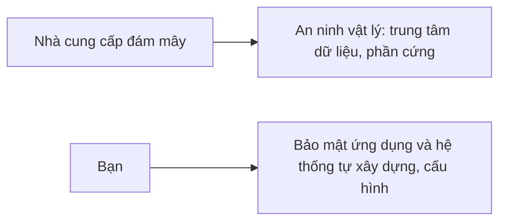

# Bảo mật và quyền riêng tư: con người và quy trình

Chương 10 nhắc lại rằng bảo mật là yếu tố xuyên suốt của toàn bộ vòng đời kỹ thuật dữ liệu, rồi đi qua ba lớp theo đúng thứ tự: **con người**, **quy trình**, **công nghệ**. Bài này trình bày phần mở đầu, lớp con người và lớp quy trình (kèm một chính sách bảo mật mẫu). Lớp công nghệ nằm ở bài sau.

**Tương tự đơn giản:** bảo vệ dữ liệu giống bảo vệ một ngôi nhà. Khóa xịn (công nghệ) vô ích nếu người trong nhà đưa chìa cho người lạ (con người) hoặc không ai có thói quen khóa cửa mỗi tối (quy trình).

---

:::note[Ghi nhớ nhanh]

- ⭐ **Con người là mắt xích yếu nhất** — hầu hết vụ xâm phạm xảy ra ở cấp độ con người (lừa đảo, lộ thông tin đăng nhập), nên hãy cư xử như thể bạn luôn là mục tiêu.
- ⭐ **Đặc quyền tối thiểu** — chỉ cấp đúng quyền và đúng dữ liệu cần cho việc trước mắt, đúng khoảng thời gian cần thiết.
- **Tránh "sân khấu bảo mật"** — tuân thủ trên giấy (SOC-2, ISO 27001) mà không có thói quen thật thì chỉ là ảo tưởng an toàn.
- **Trách nhiệm chung trên đám mây** — nhà cung cấp lo phần cứng và trung tâm dữ liệu; bạn lo cấu hình và ứng dụng của mình.
- **Luôn sao lưu và thử khôi phục** — đặc biệt trong thời đại ransomware.

:::

---

## Mục lục

- [1. Vì sao bảo mật và quyền riêng tư quan trọng](#1-vì-sao-bảo-mật-và-quyền-riêng-tư-quan-trọng)
- [2. Con người](#2-con-người)
- [3. Quy trình](#3-quy-trình)
- [4. Ví dụ về chính sách bảo mật](#4-ví-dụ-về-chính-sách-bảo-mật)
- [Tóm tắt](#tóm-tắt)

## 1. Vì sao bảo mật và quyền riêng tư quan trọng

Các tác giả cho rằng bảo mật là thứ đầu tiên kỹ sư dữ liệu phải nghĩ tới ở mọi khía cạnh công việc và mọi giai đoạn của vòng đời, nhưng thực tế nhiều người lại coi nó là việc "nghĩ sau". Kỹ sư dữ liệu xử lý dữ liệu, thông tin và quyền truy cập nhạy cảm hằng ngày; tổ chức, khách hàng và đối tác kỳ vọng những tài sản này được xử lý hết sức cẩn thận. Một vụ rò rỉ có thể đánh sập doanh nghiệp, và nếu lỗi thuộc về bạn thì sự nghiệp và danh tiếng của bạn cũng bị hủy hoại.

**Bảo mật** (security) là thành phần quan trọng của **quyền riêng tư** (privacy). Quyền riêng tư từ lâu đã là nền tảng của niềm tin trong công nghệ thông tin doanh nghiệp. Dữ liệu mà kỹ sư trực tiếp hoặc gián tiếp xử lý liên quan đến đời sống riêng tư của mọi người, gồm:

- thông tin tài chính;
- dữ liệu liên lạc cá nhân (email, tin nhắn, cuộc gọi);
- lịch sử y tế;
- hồ sơ giáo dục;
- lịch sử công việc.

Quyền riêng tư cũng ngày càng mang ý nghĩa pháp lý. Sách nêu một số ví dụ:

| Đạo luật | Phạm vi | Ghi chú của sách |
|---|---|---|
| FERPA | Quyền riêng tư và quyền giáo dục của gia đình (Mỹ) | Có hiệu lực từ những năm 1970 |
| HIPAA | Trách nhiệm giải trình và cung cấp bảo hiểm y tế (Mỹ) | Ban hành những năm 1990 |
| GDPR | Bảo vệ dữ liệu (châu Âu) | Thông qua giữa những năm 2010 |

Nhiều dự luật về quyền riêng tư ở Mỹ cũng đã hoặc sắp được thông qua. Hình phạt khi vi phạm có thể rất nặng, và vì hệ thống dữ liệu đã len vào giáo dục, y tế và kinh doanh, kỹ sư dữ liệu sẽ chạm vào dữ liệu nhạy cảm thuộc từng luật này.

**Trách nhiệm cụ thể khác nhau theo tổ chức:**

- Ở công ty khởi nghiệp nhỏ, kỹ sư dữ liệu có thể kiêm luôn kỹ sư bảo mật dữ liệu.
- Ở công ty công nghệ lớn có cả đội kỹ sư và nhà nghiên cứu bảo mật, kỹ sư dữ liệu vẫn thường là người nhìn ra các lỗ hổng trong hệ thống của chính nhóm mình, rồi báo cáo và giảm thiểu cùng nhân sự bảo mật chuyên trách.

Chương này không phải danh sách đầy đủ, mà là những điều quan trọng nhất mà các tác giả muốn thấy được cải thiện, dựa trên kinh nghiệm thực tế.

## 2. Con người

> "Liên kết yếu nhất trong bảo mật và quyền riêng tư là bạn."

Vì bảo mật thường bị phá ở cấp độ con người, hãy luôn giữ tư thế phòng thủ cả trực tuyến lẫn ngoại tuyến, vì luôn có bot hoặc kẻ xấu đang tìm cách xâm nhập.

### 2.1. Sức mạnh của suy nghĩ tiêu cực

Sách dẫn lại bài bình luận năm 2007 của bác sĩ phẫu thuật Atul Gawande trên New York Times: suy nghĩ tích cực có thể làm ta mù quáng trước khả năng xảy ra khủng bố hay cấp cứu y tế và cản trở việc chuẩn bị; **suy nghĩ tiêu cực** cho phép ta hình dung tình huống tai hại và hành động để ngăn chặn.

Áp dụng cho kỹ sư dữ liệu:

- Suy nghĩ kỹ về kịch bản sử dụng dữ liệu, **chỉ thu thập dữ liệu nhạy cảm khi thực sự cần về sau**. Cách bảo vệ tốt nhất là không thu nạp dữ liệu đó ngay từ đầu.
- Với mỗi data pipeline và hệ thống lưu trữ, hãy tự hỏi: nếu bị tấn công hoặc rò rỉ thì sao?
- Chọn chiến lược bảo mật mang lại sự an toàn **thật sự** chứ không chỉ cảm giác an toàn.

### 2.2. Luôn cảnh giác

- Khi ai đó yêu cầu thông tin đăng nhập, hãy dừng lại và hỏi ý kiến thứ hai từ đồng nghiệp hoặc bạn bè để xác nhận yêu cầu là hợp pháp. Một cuộc gọi nhanh rẻ hơn nhiều so với một vụ **ransomware** (mã độc mã hóa dữ liệu để đòi tiền chuộc) kích hoạt bằng một cú nhấp vào email.
- Không tin ai theo mệnh giá khi họ xin thông tin xác thực, dữ liệu nhạy cảm hay thông tin mật, kể cả đồng nghiệp.
- Bạn cũng là tuyến phòng thủ đầu tiên về **quyền riêng tư và đạo đức**: nếu thấy khó chịu với dữ liệu nhạy cảm được giao thu thập, hoặc có băn khoăn đạo đức về cách xử lý dữ liệu trong dự án, hãy nêu ra với đồng nghiệp và lãnh đạo. Công việc phải vừa hợp pháp vừa có đạo đức.

## 3. Quy trình

Khi mọi người tuân theo quy trình bảo mật đều đặn, bảo mật trở thành một phần của công việc. Bốn trụ cột: biến bảo mật thành thói quen, bảo mật chủ động, đặc quyền tối thiểu, và hiểu mô hình trách nhiệm chung trên đám mây (kèm việc sao lưu).

### 3.1. Sân khấu bảo mật so với thói quen bảo mật

Các tác giả thấy nhiều khách hàng doanh nghiệp chỉ chăm chăm **tuân thủ** (quy tắc nội bộ, luật pháp, khuyến nghị của cơ quan tiêu chuẩn) mà bỏ qua các tình huống xấu có thể xảy ra. Điều đó tạo ảo tưởng an toàn và để lại lỗ hổng mà chỉ vài phút suy nghĩ là thấy.

**Sân khấu bảo mật** (security theater) là khi công ty có chính sách hàng trăm trang không ai đọc, buổi đánh giá chính sách hằng năm mà mọi người quên ngay, tất cả chỉ để đánh dấu ô kiểm (SOC-2, ISO 27001...) mà không cam kết thật.

Thay vào đó:

- Bảo mật phải đủ đơn giản và hiệu quả để thành thói quen cả tổ chức.
- Đưa tư duy bảo mật vào văn hóa. Ví dụ tác giả nêu: công ty họ đào tạo bảo mật và rà soát chính sách ít nhất mỗi tháng một lần.
- Nhóm dữ liệu không được coi bảo mật là chuyện nghĩ sau; mọi người đều có vai trò và trách nhiệm.

### 3.2. Bảo mật chủ động

Gắn với tư duy tiêu cực: **bảo mật chủ động** (active security) là nghiên cứu các mối đe dọa trong một thế giới luôn thay đổi.

| Cách làm thụ động | Cách làm chủ động |
|---|---|
| Chạy tấn công lừa đảo mô phỏng theo lịch | Nghiên cứu các vụ lừa đảo thành công ngoài đời và rà soát lỗ hổng của tổ chức mình |
| Áp dụng danh sách kiểm tra tuân thủ chuẩn | Nghĩ đến các lỗ hổng nội bộ riêng của tổ chức, kể cả động cơ khiến nhân viên có thể làm rò rỉ hoặc lạm dụng thông tin cá nhân |

### 3.3. Nguyên tắc đặc quyền tối thiểu

**Nguyên tắc đặc quyền tối thiểu** (principle of least privilege): một người hoặc hệ thống chỉ được cấp các đặc quyền và dữ liệu cần để hoàn thành nhiệm vụ trước mắt, không hơn.

- **Phản mẫu thường gặp trên đám mây:** người dùng bình thường được cấp quyền quản trị cho mọi thứ trong khi chỉ cần vài vai trò **IAM** (Identity and Access Management, quản lý danh tính và quyền truy cập). Cấp quyền quản trị tùy ý là sai lầm lớn.
- **Cách đúng:** cấp cho người dùng (hoặc nhóm của họ) các vai trò IAM cần thiết **khi cần**, hết cần thì thu hồi. Quy tắc này áp dụng cả cho **tài khoản dịch vụ** (service account); đối xử với người và máy như nhau.
- **Với quyền riêng tư:** triển khai kiểm soát truy cập theo cột, hàng, ô cho dữ liệu nhạy cảm; cân nhắc che giấu (mask) **PII** (thông tin nhận dạng cá nhân) và dữ liệu nhạy cảm khác; tạo các view chỉ chứa phần người xem cần.
- **Quy trình "kính vỡ"** (break-glass): một số dữ liệu phải giữ lại nhưng chỉ được truy cập khi khẩn cấp. Đặt chúng sau một quy trình phê duyệt khẩn (để khắc phục sự cố, truy vấn lịch sử quan trọng...), và thu hồi quyền ngay sau khi xong việc.

```sql
-- Ví dụ minh hoạ (do người ghi chú thêm, không phải của sách):
-- view chỉ lộ cột cần thiết và che email
CREATE VIEW customer_support_view AS
SELECT customer_id,
       country,
       CONCAT('***@', SPLIT_PART(email, '@', 2)) AS masked_email
FROM customers;
```

### 3.4. Trách nhiệm chung trên đám mây

Bảo mật trên đám mây là **trách nhiệm chung** (shared responsibility):



Phần lớn vụ vi phạm trên đám mây vẫn do **người dùng cuối** gây ra, không phải do đám mây: cấu hình sai, nhầm lẫn, sơ suất, cẩu thả.

### 3.5. Luôn sao lưu dữ liệu

Dữ liệu có thể biến mất vì ổ cứng hay máy chủ chết, ai đó xóa nhầm cơ sở dữ liệu hay vùng object storage, hoặc bị khóa bởi ransomware. Sách lưu ý một số công ty bảo hiểm đang cắt giảm chi trả khi có tấn công, khiến việc khôi phục và trả tiền chuộc càng khó.

- Sao lưu thường xuyên, cho cả khắc phục thảm họa lẫn duy trì hoạt động kinh doanh nếu một bản dữ liệu bị xâm phạm.
- **Kiểm thử việc khôi phục** bản sao lưu thường xuyên, vì bản sao lưu chưa từng thử khôi phục thì chưa chắc dùng được.
- Về chủ đề, sao lưu thuộc nhóm "phòng chống thiên tai" rộng hơn, nhưng gắn chặt với bảo mật trong thời đại ransomware.

## 4. Ví dụ về chính sách bảo mật

Sách đưa một chính sách mẫu, cố ý **ngắn và thiết thực**: một danh sách hành động mọi người làm được ngay, không phức tạp hóa.

**Bảo vệ thông tin xác thực**

- Dùng **SSO** (single sign-on, đăng nhập một lần) cho mọi thứ; tránh mật khẩu khi có thể.
- Dùng xác thực đa yếu tố (MFA) cùng SSO.
- Không chia sẻ mật khẩu hay thông tin đăng nhập, kể cả của khách hàng. Nếu nghi ngờ, hỏi người quản lý; nếu họ cũng nghi ngờ thì tiếp tục tìm hiểu đến khi có câu trả lời.
- Cảnh giác với cuộc gọi lừa đảo, không bao giờ tiết lộ mật khẩu.
- Vô hiệu hóa hoặc xóa thông tin xác thực cũ.
- Không đặt thông tin đăng nhập vào mã; coi bí mật là cấu hình, không đưa vào kiểm soát phiên bản, dùng trình quản lý bí mật (secret manager) nếu có.
- Luôn áp dụng đặc quyền tối thiểu, cho cả đám mây lẫn tại chỗ.

**Bảo vệ thiết bị**

- Dùng quản lý thiết bị cho mọi thiết bị nhân viên, để có thể xóa từ xa khi nhân viên nghỉ việc hoặc mất máy.
- Dùng MFA cho mọi thiết bị; đăng nhập thiết bị bằng tài khoản email công ty.
- Mọi chính sách về thông tin xác thực và hành vi áp dụng cho thiết bị của bạn; coi thiết bị là phần mở rộng của bản thân, không để rời tầm mắt.
- Khi chia sẻ màn hình, biết chính xác mình chia sẻ gì: chỉ một tài liệu, tab hoặc cửa sổ, tránh chia sẻ toàn màn hình.
- Bật chế độ "không làm phiền" khi gọi video để thông báo không hiện ra lúc gọi hoặc ghi hình.

**Chính sách cập nhật phần mềm**

- Khởi động lại trình duyệt khi có thông báo cập nhật.
- Chạy các bản cập nhật hệ điều hành nhỏ trên thiết bị công ty và cá nhân; bản quan trọng do công ty xác định và hướng dẫn.
- Không dùng hệ điều hành bản beta.
- Đợi một hoặc hai tuần sau khi bản hệ điều hành lớn mới phát hành.

Tùy hồ sơ rủi ro của công ty, có thể cần thêm yêu cầu. Và hãy nhớ: con người là mắt xích yếu nhất.

## Tóm tắt

| Chủ đề | Ý chính |
|---|---|
| Vì sao quan trọng | Bảo mật là nền của quyền riêng tư; luật (FERPA, HIPAA, GDPR) ngày càng chặt, phạt nặng |
| Con người | Nghĩ tiêu cực, chỉ thu dữ liệu nhạy cảm khi thật cần, nghi ngờ mọi yêu cầu xin thông tin xác thực, nêu mối lo đạo đức |
| Quy trình | Thói quen thay cho sân khấu bảo mật; bảo mật chủ động; đặc quyền tối thiểu; trách nhiệm chung; sao lưu và thử khôi phục |
| Chính sách mẫu | Ngắn, thiết thực: SSO + MFA, không để bí mật trong mã, quản lý thiết bị, cập nhật phần mềm đều đặn |
