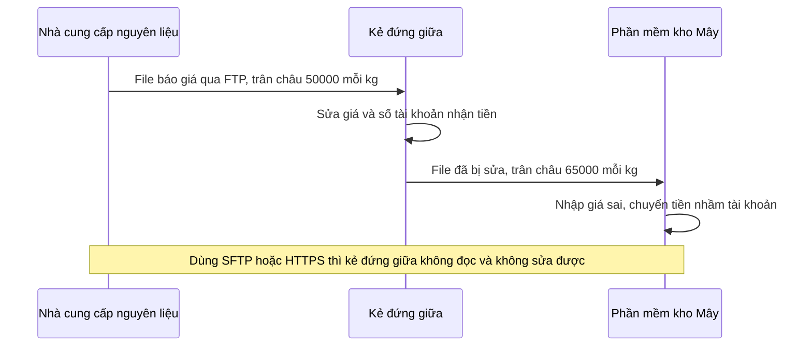
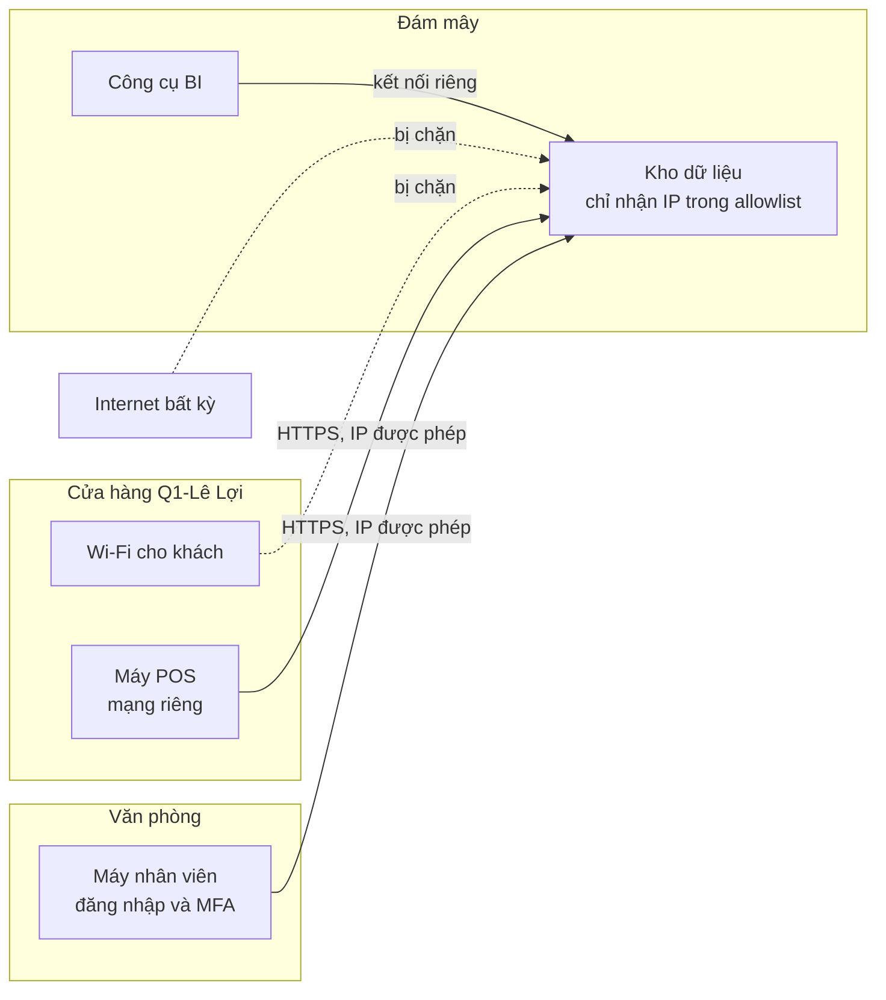

# Bảo mật và quyền riêng tư: công nghệ

Sau khi đã lo xong con người và quy trình, phần cuối của Chương 10 xem xét cách dùng công nghệ để bảo vệ hệ thống và tài sản dữ liệu: vá lỗi, mã hóa, ghi nhật ký và giám sát, kiểm soát truy cập mạng, bảo mật cho kỹ thuật dữ liệu cấp thấp và nghiên cứu bảo mật nội bộ.

**Tương tự đơn giản:** công nghệ bảo mật giống hệ thống camera, khóa cửa và chuông báo động của ngôi nhà. Nó bổ sung cho thói quen của người ở, chứ không thay thế được.

---

:::note[Ghi nhớ nhanh]

- ⭐ **Mã hóa không phải viên đạn bạc** — nó chặn được tấn công cơ bản (như nghe lén mạng) nhưng vô dụng nếu kẻ xấu đã có thông tin đăng nhập hợp lệ.
- ⭐ **Giám sát để phát hiện sớm** — kẻ xấu không báo trước; hãy theo dõi truy cập, tài nguyên, hóa đơn và quyền không dùng.
- **Vá lỗi và cập nhật** đều đặn, tận dụng dịch vụ quản lý tự động nâng cấp.
- **Đừng mở mạng bừa bãi** — tránh bucket công khai, SSH mở cho 0.0.0.0/0, cơ sở dữ liệu mở ra Internet.
- **Mọi kỹ sư là nhà nghiên cứu bảo mật** ở phạm vi công nghệ mình chuyên.

:::

---

## Mục lục

- [1. Vá lỗi và cập nhật hệ thống](#1-vá-lỗi-và-cập-nhật-hệ-thống)
- [2. Mã hóa](#2-mã-hóa)
- [3. Ghi nhật ký, giám sát và cảnh báo](#3-ghi-nhật-ký-giám-sát-và-cảnh-báo)
- [4. Truy cập mạng](#4-truy-cập-mạng)
- [5. Bảo mật cho kỹ thuật dữ liệu cấp thấp](#5-bảo-mật-cho-kỹ-thuật-dữ-liệu-cấp-thấp)
- [6. Nghiên cứu an ninh nội bộ](#6-nghiên-cứu-an-ninh-nội-bộ)
- [7. Kết luận và tài nguyên](#7-kết-luận-và-tài-nguyên)
- [8. Áp vào chuỗi trà sữa Mây](#8-áp-vào-chuỗi-trà-sữa-mây)

**Thuật ngữ trong bài — hiểu nôm na:**

| Thuật ngữ | Nghĩa đời thường | Ví dụ ở chuỗi Mây |
|---|---|---|
| Vá lỗi (patch) | Bản sửa lỗ hổng do nhà sản xuất phát hành, giống thay ổ khoá khi biết ổ cũ bị lộ cách mở | Cập nhật phần mềm máy POS khi hãng báo lỗi bảo mật |
| Mã hoá | Biến dữ liệu thành chuỗi ký tự vô nghĩa, chỉ ai có **khoá** mới đọc lại được | File sao lưu đơn hàng được mã hoá trước khi cất |
| At rest / in transit | Dữ liệu đang "nằm yên" trên ổ đĩa / đang "đi đường" qua mạng | File lương trên laptop kế toán / đơn hàng đang gửi từ POS về kho |
| Khoá (key) | Chìa để mở dữ liệu đã mã hoá | Mất khoá là mất dữ liệu; lộ khoá là lộ dữ liệu |
| Man-in-the-middle | Kẻ đứng giữa đường truyền, đọc trộm hoặc sửa dữ liệu | Kẻ ngồi cùng Wi-Fi quán nghe lén dữ liệu gửi đi không mã hoá |
| Log (nhật ký) | Sổ ghi lại ai làm gì, lúc nào | "Tài khoản QL-Q1 tải bảng khách lúc 02:13" |
| Allowlist | Danh sách khách mời: chỉ ai có tên mới được vào | Kho dữ liệu chỉ nhận kết nối từ văn phòng và công cụ BI |
| Zero trust | Không tin ai mặc định, kể cả người "ở trong nhà"; lần nào cũng kiểm tra | Nhân viên văn phòng vẫn phải đăng nhập và MFA khi mở kho dữ liệu |

## 1. Vá lỗi và cập nhật hệ thống

Phần mềm cũ đi, lỗ hổng bảo mật liên tục được phát hiện. Để không phơi bày lỗ hổng của các phiên bản cũ, hãy luôn **vá lỗi** (patching) và cập nhật hệ điều hành lẫn phần mềm khi có bản mới.

- Nhiều dịch vụ SaaS và dịch vụ quản lý trên đám mây tự nâng cấp và bảo trì, bạn không phải làm gì.
- Với mã và các thư viện phụ thuộc của riêng bạn: tự động hóa quá trình build, hoặc đặt cảnh báo về bản phát hành và lỗ hổng để được nhắc cập nhật thủ công.

## 2. Mã hóa

Mã hóa **không phải viên đạn ma thuật**. Nếu một vụ xâm phạm xuất phát từ con người và kẻ xấu có được thông tin xác thực thì mã hóa không cứu được bạn. Tuy vậy, mã hóa là yêu cầu nền tảng với mọi tổ chức coi trọng bảo mật và quyền riêng tư, và nó chặn được các tấn công cơ bản như nghe lén lưu lượng mạng.

### 2.1. Mã hóa dữ liệu ở trạng thái nghỉ (at rest)

Dữ liệu nằm trên thiết bị lưu trữ phải được mã hóa:

- Laptop công ty bật **mã hóa toàn bộ đĩa** để dữ liệu an toàn nếu máy bị mất cắp.
- Bật **mã hóa phía máy chủ** (server-side) cho dữ liệu trên máy chủ, hệ thống tệp, cơ sở dữ liệu và object storage trên đám mây.
- Mọi bản sao lưu lưu trữ cũng phải được mã hóa.
- Nếu có thể, thêm **mã hóa ở cấp ứng dụng**.

### 2.2. Mã hóa dữ liệu khi truyền (in transit)

Mã hóa trên đường truyền nay đã là mặc định của các giao thức hiện đại; ví dụ HTTPS thường là bắt buộc với API đám mây hiện đại. Một số lưu ý:

- Kỹ sư dữ liệu phải biết cách xử lý **khóa** (key); xử lý khóa kém là nguồn rò rỉ đáng kể.
- HTTPS **không bảo vệ gì** nếu quyền của bucket đã mở cho công chúng, nguyên nhân của nhiều vụ bê bối dữ liệu trong thập kỷ qua.
- Hiểu giới hạn của giao thức cũ: **FTP** không an toàn trên mạng công cộng. Dù có vẻ vô hại khi dữ liệu vốn công khai, FTP dễ bị tấn công **kẻ đứng giữa** (man-in-the-middle): kẻ tấn công chặn dữ liệu tải về và sửa đổi trước khi tới máy khách. Tốt nhất nên tránh FTP.
- Mã hóa mọi thứ qua mạng, kể cả với giao thức cũ; khi nghi ngờ, chọn công nghệ mạnh có tích hợp sẵn mã hóa.

### 2.3. Mã hoá ở chuỗi Mây: kẻ nghe lén thấy gì?

Máy POS ở cửa hàng gửi đơn về kho dữ liệu qua Internet của quán. Giả sử có kẻ nghe lén trên đường truyền. Bảng dưới cho thấy thứ hắn nhìn thấy trong hai trường hợp.

| | Dữ liệu gốc | Kẻ nghe lén thấy nếu **không** mã hoá | Kẻ nghe lén thấy nếu **có** mã hoá (HTTPS) |
|---|---|---|---|
| Đơn hàng | DH001, Lan, 0901234567, 70000 | DH001, Lan, 0901234567, 70000 | `x9#Lq0v!2Zb...` (chuỗi vô nghĩa) |

Còn khi dữ liệu nằm yên, mã hoá at rest bảo vệ trong các tình huống như:

| Tình huống ở Mây | Không mã hoá | Có mã hoá at rest |
|---|---|---|
| Laptop của kế toán bị trộm ở quán cà phê | Kẻ trộm mở file lương ngay | Chỉ thấy ổ đĩa bị khoá |
| Ổ cứng sao lưu cũ bị bán ve chai | Người mua đọc được dữ liệu khách | Không đọc được nếu không có khoá |
| Kẻ xấu lấy được mật khẩu thật của quản lý | Đọc được | **Vẫn đọc được**, vì hắn đăng nhập hợp lệ: đây là lý do mã hoá "không phải viên đạn bạc" |

Sơ đồ dưới là kiểu tấn công kẻ đứng giữa khi dùng giao thức không mã hoá như FTP: kẻ xấu không chỉ đọc mà còn **sửa** được dữ liệu.

## 3. Ghi nhật ký, giám sát và cảnh báo

Tin tặc hiếm khi báo trước. Phần lớn công ty chỉ phát hiện sự cố bảo mật khi chuyện đã xảy ra. Một phần của **DataOps** là quan sát, phát hiện và cảnh báo sự cố. Là kỹ sư dữ liệu, hãy thiết lập giám sát, ghi nhật ký (logging) và cảnh báo tự động, và nếu được thì thêm **phát hiện bất thường** (anomaly detection) tự động.

Bốn nhóm nên theo dõi:

| Nhóm | Câu hỏi cần theo dõi |
|---|---|
| **Truy cập** | Ai truy cập cái gì, khi nào, từ đâu? Quyền mới nào vừa được cấp? Có người dùng hiện tại nào hành xử lạ (truy cập hệ thống họ thường không dùng) gợi ý tài khoản bị chiếm? Có người dùng lạ xuất hiện? Cần rà soát định kỳ nhật ký truy cập, người dùng và vai trò |
| **Tài nguyên** | Đĩa, CPU, bộ nhớ, I/O có mẫu bất thường hay thay đổi đột ngột không? Có thể là dấu hiệu bị xâm phạm |
| **Thanh toán** | Với SaaS và dịch vụ quản lý, đặt cảnh báo ngân sách. Hóa đơn tăng vọt có thể có nghĩa ai đó đang dùng tài nguyên của bạn vào mục đích xấu |
| **Quyền vượt quá** | Các nhà cung cấp ngày càng có công cụ phát hiện quyền mà tài khoản không dùng trong một thời gian, có thể tự cảnh báo quản trị viên hoặc tự gỡ quyền sau thời hạn |

Ví dụ trong sách: một nhà phân tích không truy cập Redshift sáu tháng thì quyền đó có thể bị gỡ để đóng lỗ hổng tiềm ẩn; khi cần lại, họ tạo ticket để khôi phục.

**Nhật ký truy cập kho dữ liệu của Mây trong một đêm** cho thấy giám sát phát hiện bất thường ra sao:

| Thời điểm | Tài khoản | Hành động | Từ đâu | Bình thường? |
|---|---|---|---|---|
| 21:05 | KS-DuLieu | Chạy pipeline đêm | Máy chủ pipeline | Có, ngày nào cũng vậy |
| 22:30 | QL-Q1 | Xem doanh thu cửa hàng Q1 | Văn phòng Q1 | Có |
| 02:13 | QL-Q1 | Tải **toàn bộ** bảng khách hàng, 48.000 dòng | Một địa chỉ IP ở nước ngoài | **Không**: sai giờ, sai phạm vi (quản lý chỉ cần khách quán mình), sai nơi |
| 02:20 | QL-Q1 | Tải bảng lương | Cùng IP lạ | **Không**: tài khoản này chưa từng mở bảng lương |

Hệ thống cảnh báo nên tự khoá tài khoản QL-Q1 ngay lúc 02:13 và nhắn kỹ sư trực. Các cảnh báo nên có ở Mây:

| Nhóm theo dõi | Cảnh báo cụ thể ở Mây |
|---|---|
| Truy cập | Một tài khoản tải hơn 5.000 dòng khách hàng trong một lần; đăng nhập từ quốc gia lạ |
| Tài nguyên | CPU máy chủ phần mềm kho lên 100% lúc nửa đêm (có thể bị cài phần mềm đào tiền ảo) |
| Thanh toán | Hoá đơn đám mây trong ngày vượt gấp 3 mức trung bình |
| Quyền vượt quá | Tài khoản không đăng nhập 90 ngày, ví dụ của quản lý đã nghỉ việc |

Lời khuyên của sách:

- Kết hợp các nhóm trên để có cái nhìn tổng thể về tài nguyên, truy cập và thanh toán.
- Dựng một **dashboard** để cả nhóm dữ liệu theo dõi và được báo khi có điều bất thường.
- Đi kèm một **kế hoạch ứng phó sự cố** (incident response) hiệu quả, và **diễn tập định kỳ** để sẵn sàng.

## 4. Truy cập mạng

Các tác giả kể đã gặp nhiều thực hành tệ của kỹ sư dữ liệu về truy cập mạng:

- bucket Amazon S3 công khai chứa nhiều dữ liệu nhạy cảm;
- phiên bản Amazon EC2 mở cổng SSH vào cho cả thế giới bằng `0.0.0.0/0` (mọi địa chỉ IP);
- cơ sở dữ liệu mở cho mọi yêu cầu từ Internet công cộng.

Về nguyên tắc, an ninh mạng nên giao cho chuyên gia bảo mật (dù ở công ty nhỏ bạn có thể phải tự gánh). Nhưng vì kỹ sư dữ liệu thường xuyên chạm vào cơ sở dữ liệu, object storage và máy chủ, ít nhất cần biết các biện pháp đơn giản:

- Hiểu **IP và cổng nào đang mở, cho ai, vì sao**.
- Chỉ cho phép địa chỉ IP của hệ thống và người dùng thật sự cần (**allowlist**, danh sách trắng), tránh mở kết nối rộng vì bất cứ lý do gì.
- Khi truy cập đám mây hoặc công cụ SaaS, dùng kết nối mã hóa; ví dụ không dùng website không mã hóa ở quán cà phê.

**Mạng của Mây sau khi siết lại.** Mỗi cửa hàng có Wi-Fi miễn phí cho khách. Sai lầm phổ biến là để máy POS dùng chung mạng đó, và để kho dữ liệu nhận kết nối từ bất kỳ đâu. Sơ đồ dưới cho thấy cách tách mạng và dùng allowlist.

### Máy chủ tại chỗ: vành đai cứng và zero trust

Sách nhắc lại Chương 3: **bảo mật vành đai cứng** (hardened perimeter) khác **zero trust** (không tin cậy mặc định, mọi hành động đều phải xác thực).

- Đám mây nhìn chung gần zero trust hơn. Các tác giả tin đám mây là lựa chọn an toàn hơn cho đa số tổ chức, vì ép áp dụng zero trust và cho phép tận dụng đội kỹ sư bảo mật của các nhà cung cấp đám mây công cộng.
- Dù vậy đôi khi tăng cường bảo mật vành đai vẫn hợp lý; ví dụ minh họa của tác giả: hầm tên lửa hạt nhân được **air-gap** (cách ly vật lý, không nối mạng nào). Máy chủ air-gapped là điển hình của vành đai cứng, nhưng vẫn có thể thất bại vì lỗi con người.

| | Vành đai cứng | Zero trust |
|---|---|---|
| Hình ảnh | Lâu đài có hào và tường cao: đã vào trong là được tin | Toà nhà văn phòng hiện đại: cửa phòng nào cũng phải quẹt thẻ |
| Ở Mây | Máy tính trong văn phòng tự động được vào kho dữ liệu | Mọi truy cập kho, kể cả từ văn phòng, đều cần đăng nhập, MFA và đúng quyền |
| Điểm yếu | Một máy trong văn phòng nhiễm mã độc là kẻ xấu đi khắp nơi | Phiền hơn một chút cho người dùng |

## 5. Bảo mật cho kỹ thuật dữ liệu cấp thấp

Với kỹ sư làm ở tầng lưu trữ và xử lý dữ liệu, cần cân nhắc hệ quả bảo mật của từng thành phần. Thư viện phần mềm, hệ thống lưu trữ, nút tính toán nào cũng có thể có lỗ hổng. Một lỗi trong thư viện ghi log ít người biết có thể giúp kẻ tấn công vượt qua kiểm soát truy cập hay mã hóa. Ngay cả kiến trúc CPU và **vi mã** (microcode) cũng có lỗ hổng; dữ liệu nhạy cảm nằm trong bộ nhớ hoặc cache CPU vẫn có thể bị khai thác. **Không mắt xích nào trong chuỗi được coi là đương nhiên an toàn.**

Vì sách chủ yếu bàn kỹ thuật dữ liệu cấp cao (ghép các công cụ để phục vụ cả vòng đời), các chi tiết kỹ thuật sâu này được để lại cho người đọc tự tìm hiểu.

## 6. Nghiên cứu an ninh nội bộ

Sách khuyến nghị áp dụng cách tiếp cận **bảo mật chủ động** cho cả công nghệ: mọi nhân sự công nghệ nên nghĩ đến bảo mật.

Lý do: mỗi người đóng góp công nghệ đều phát triển chuyên môn sâu. Dù công ty có đội nghiên cứu bảo mật riêng, kỹ sư dữ liệu mới là người quen thuộc nhất với các hệ thống dữ liệu và dịch vụ đám mây cụ thể trong phạm vi của họ, nên họ có năng lực nhận ra lỗ hổng ở đó. Hãy khuyến khích mọi kỹ sư dữ liệu tham gia chủ động: khi phát hiện rủi ro, hãy nghĩ kỹ cách giảm thiểu và đóng vai trò tích cực trong việc triển khai.

## 7. Kết luận và tài nguyên

Bảo mật cần là thói quen của tâm trí và hành động; hãy xử lý dữ liệu như bạn xử lý ví hoặc điện thoại của mình. Có thể bạn không phụ trách bảo mật của công ty, nhưng biết các biện pháp cơ bản và luôn đặt bảo mật lên hàng đầu sẽ giảm nguy cơ rò rỉ dữ liệu.

**Tài nguyên bổ sung (theo sách):**

- *Building Secure and Reliable Systems*, Heather Adkins và cộng sự (O'Reilly)
- Các ấn phẩm của **OWASP** (Open Web Application Security Project)
- *Practical Cloud Security*, Chris Dotson (O'Reilly)

## 8. Áp vào chuỗi trà sữa Mây

Gom các biện pháp công nghệ trong bài thành một danh sách kiểm tra cho đội dữ liệu nhỏ của Mây, kèm câu hỏi để tự chấm.

| Biện pháp | Câu hỏi tự kiểm tra ở Mây | Đạt khi |
|---|---|---|
| Vá lỗi | Phần mềm POS, máy chủ phần mềm kho, thư viện trong pipeline có bản mới chưa cài không? | Có cảnh báo tự động khi có bản vá bảo mật; cài trong vòng 1 tuần |
| Mã hoá at rest | Laptop kế toán, ổ sao lưu, kho dữ liệu đã bật mã hoá chưa? | 100% thiết bị và nơi lưu trữ đã bật |
| Mã hoá in transit | Còn chỗ nào nhận file qua FTP hay email không mã hoá? | Mọi trao đổi file dùng SFTP hoặc HTTPS |
| Quản lý khoá | Khoá mã hoá, mật khẩu dịch vụ đang nằm ở đâu? | Nằm trong trình quản lý bí mật, không nằm trong code hay file Excel |
| Giám sát | Nếu ai đó tải toàn bộ bảng khách lúc 2 giờ sáng, ai biết và biết lúc nào? | Có cảnh báo trong vài phút, có người trực nhận |
| Mạng | Kho dữ liệu có nhận kết nối từ Wi-Fi khách hay Internet bất kỳ không? | Chỉ nhận từ allowlist |
| Ứng phó sự cố | Khi phát hiện tài khoản bị chiếm, bước 1, 2, 3 là gì? | Có kịch bản viết sẵn, diễn tập ít nhất mỗi năm một lần |

## Tóm tắt

| Lĩnh vực | Việc cần làm |
|---|---|
| Vá lỗi | Cập nhật OS, phần mềm, phụ thuộc; dùng dịch vụ quản lý tự nâng cấp |
| Mã hóa | At rest (toàn đĩa, server-side, bản sao lưu) và in transit (HTTPS; tránh FTP); quản lý khóa cẩn thận |
| Giám sát | Truy cập, tài nguyên, thanh toán, quyền không dùng; dashboard; kế hoạch ứng phó và diễn tập |
| Mạng | Biết IP/cổng nào mở cho ai; allowlist; không mở 0.0.0.0/0; ưu tiên zero trust |
| Cấp thấp | Mọi thư viện, nút, thậm chí CPU đều có thể có lỗ hổng |
| Nội bộ | Mọi kỹ sư là một "nhà nghiên cứu bảo mật" trong phạm vi chuyên môn của mình |
