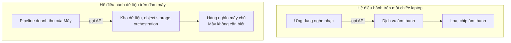
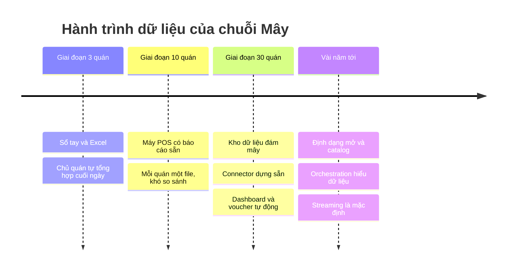

# Tương lai của kỹ thuật dữ liệu: những xu hướng chắc chắn hơn

Chương cuối cùng của cuốn sách trình bày suy nghĩ của các tác giả về tương lai: vừa là quan sát về những diễn biến đang diễn ra, vừa là suy đoán táo bạo. Bài này gom phần "nền tảng tương đối an toàn": vòng đời kỹ thuật dữ liệu vẫn còn đó, công cụ ngày càng đơn giản, "hệ điều hành dữ liệu" trên đám mây với khả năng tương tác tốt hơn, kỹ thuật dữ liệu "doanh nghiệp" và sự biến đổi của chức danh. Phần suy đoán mạnh hơn (live data stack) nằm ở bài sau.

**Tương tự đơn giản:** nghề kỹ sư dữ liệu giống nghề xây dựng. Máy móc ngày càng tốt nên thợ không cần tự đóng từng viên gạch, nhưng nhu cầu xây công trình lớn hơn, phức tạp hơn lại làm nghề này càng cần thiết.

---

:::note[Ghi nhớ nhanh]

- ⭐ **Vòng đời kỹ thuật dữ liệu sẽ không biến mất** — tên công cụ và thứ tự thao tác có thể đổi, các giai đoạn chính thì còn nhiều năm; công cụ đơn giản chỉ đẩy kỹ sư dữ liệu lên các việc cấp cao hơn.
- ⭐ **Công cụ ngày càng dễ dùng** — dịch vụ quản lý, nguồn mở được quản lý và connector dựng sẵn hạ rào cản gia nhập; kỹ thuật dữ liệu là việc mọi công ty đều làm được.
- **"Hệ điều hành dữ liệu" trên đám mây** — object storage, định dạng Parquet/Avro, metadata catalog và orchestration thế hệ mới sẽ tạo nên khả năng tương tác.
- **Kỹ thuật dữ liệu "doanh nghiệp"** — tập trung quản lý, vận hành, quản trị, những việc "nhàm chán" mà quan trọng.
- **Ranh giới chức danh mờ dần** giữa kỹ thuật phần mềm, kỹ thuật dữ liệu, khoa học dữ liệu và kỹ thuật ML.

:::

---

## Mục lục

- [1. Mở đầu: nhìn tương lai từ hàng ghế đầu](#1-mở-đầu-nhìn-tương-lai-từ-hàng-ghế-đầu)
- [2. Vòng đời kỹ thuật dữ liệu sẽ không biến mất](#2-vòng-đời-kỹ-thuật-dữ-liệu-sẽ-không-biến-mất)
- [3. Độ phức tạp giảm, công cụ dễ dùng lên ngôi](#3-độ-phức-tạp-giảm-công-cụ-dễ-dùng-lên-ngôi)
- [4. Hệ điều hành dữ liệu quy mô đám mây và khả năng tương tác](#4-hệ-điều-hành-dữ-liệu-quy-mô-đám-mây-và-khả-năng-tương-tác)
- [5. Kỹ thuật dữ liệu doanh nghiệp](#5-kỹ-thuật-dữ-liệu-doanh-nghiệp)
- [6. Chức danh và trách nhiệm sẽ biến đổi](#6-chức-danh-và-trách-nhiệm-sẽ-biến-đổi)
- [7. Áp vào chuỗi trà sữa Mây](#7-áp-vào-chuỗi-trà-sữa-mây)
- [Tóm tắt](#tóm-tắt)

## 1. Mở đầu: nhìn tương lai từ hàng ghế đầu

Cuốn sách ra đời vì các tác giả thấy tốc độ thay đổi của ngành tạo ra khoảng trống kiến thức cho kỹ sư dữ liệu hiện tại, người muốn chuyển nghề, quản lý công nghệ và lãnh đạo. Bạn bè từng hỏi họ: "Sao dám viết về một lĩnh vực đổi nhanh thế?" Họ thừa nhận điều đó đúng một phần, và việc khó nhất khi viết là **lọc nhiễu để tìm ra tín hiệu**, tức phần khó thay đổi.

Vì vậy sách tập trung vào các ý tưởng lớn sẽ hữu ích trong nhiều năm, cụ thể là **vòng đời kỹ thuật dữ liệu** và các **yếu tố xuyên suốt**. Thứ tự thao tác, tên gọi các best practice và công nghệ có thể đổi, nhưng các giai đoạn chính của vòng đời nhiều khả năng vẫn nguyên. Vài năm trước kỹ thuật dữ liệu còn chưa là một lĩnh vực hay chức danh. Không ai đoán được tương lai, nhưng các tác giả có góc nhìn tốt về quá khứ, hiện tại và các xu hướng.

## 2. Vòng đời kỹ thuật dữ liệu sẽ không biến mất

Khoa học dữ liệu nhận nhiều chú ý những năm gần đây, trong khi kỹ thuật dữ liệu đã nhanh chóng thành lĩnh vực riêng, thuộc nhóm nghề công nghệ tăng trưởng nhanh nhất. Khi các công ty nhận ra phải xây **nền tảng dữ liệu** trước khi chạy theo AI và ML "hào nhoáng", tầm quan trọng của kỹ thuật dữ liệu sẽ còn tăng.

Có người hỏi: công cụ ngày càng đơn giản thì kỹ sư dữ liệu có biến mất không? Các tác giả gọi lối nghĩ này là nông cạn, lười biếng và thiển cận:

- Khi tổ chức dùng dữ liệu theo cách mới, sẽ cần nền tảng, hệ thống và quy trình mới.
- Kỹ sư dữ liệu đóng vai trò trung tâm trong thiết kế, kiến trúc, xây dựng và bảo trì chúng.
- Công cụ dễ hơn thì kỹ sư dữ liệu **tiến lên chuỗi giá trị**, làm các việc cấp cao hơn.

**Ở chuỗi Mây: công cụ đổi, các giai đoạn thì không.** Bảng dưới đặt cùng một vòng đời qua ba thời kỳ của một chuỗi trà sữa. Cột nào cũng có đủ năm giai đoạn; chỉ có cách làm là thay đổi.

| Giai đoạn vòng đời | Thời mới có 3 quán | Hiện nay, 30 quán | Vài năm tới (dự đoán) |
|---|---|---|---|
| Tạo ra dữ liệu | Sổ tay, máy tính tiền đơn giản | POS, app, cảm biến tủ mát | Thêm camera đếm khách, ki-ốt tự gọi món |
| Thu nạp | Chủ quán chép tay vào Excel cuối ngày | Connector dựng sẵn kéo dữ liệu mỗi đêm | Dữ liệu chảy liên tục (streaming) |
| Lưu trữ | Một file Excel trên máy chủ quán | Kho dữ liệu đám mây | Object storage với định dạng mở, nhiều công cụ cùng đọc |
| Chuyển đổi | Công thức Excel | SQL theo lịch hằng đêm | Biến đổi ngay khi dữ liệu tới |
| Cung cấp | In báo cáo giấy | Dashboard, voucher tự động | Ứng dụng tự điều chỉnh lượng nguyên liệu theo thời gian thực |

Người làm dữ liệu ở cột thứ ba không biến mất; họ bớt chép tay, bớt viết script kết nối, và dành thời gian cho câu hỏi "dữ liệu giúp Mây bán tốt hơn thế nào".

## 3. Độ phức tạp giảm, công cụ dễ dùng lên ngôi

Công cụ đơn giản tiếp tục hạ rào cản vào nghề, điều rất tốt khi ngành đang thiếu kỹ sư dữ liệu. Kỹ thuật dữ liệu không phụ thuộc vào một công nghệ hay một cỡ dữ liệu cụ thể, và không chỉ dành cho công ty lớn. Những năm 2000, triển khai công nghệ "dữ liệu lớn" cần đội ngũ lớn và nhiều vốn; nay các dịch vụ SaaS quản lý đã loại bỏ phần lớn độ phức tạp đó, nên **mọi công ty đều làm được kỹ thuật dữ liệu**.

Sách nói **dữ liệu lớn là nạn nhân của thành công của chính nó**. Ví dụ: Google BigQuery, hậu duệ của GFS và MapReduce, truy vấn được hàng petabyte. Công nghệ từng dành riêng cho nội bộ Google nay mở cho bất kỳ ai có tài khoản GCP, trả tiền theo dữ liệu lưu trữ và truy vấn thay vì dựng hạ tầng khổng lồ. Snowflake, Amazon EMR và nhiều giải pháp đám mây siêu quy mô khác cạnh tranh trong cùng không gian.

### Nguồn mở được quản lý

Đám mây thay đổi hẳn cách dùng công cụ nguồn mở:

- Đầu những năm 2010, dùng nguồn mở thường nghĩa là tải mã và tự cấu hình. Nay nhiều công cụ dữ liệu nguồn mở có bản **dịch vụ được quản lý** cạnh tranh trực tiếp với sản phẩm độc quyền.
- Linux có sẵn trên mọi đám mây chính; nền tảng serverless (AWS Lambda, Google Cloud Functions) cho triển khai ứng dụng hướng sự kiện trong vài phút bằng Python, Java, Go; muốn dùng Airflow có Cloud Composer của Google hoặc Airflow quản lý của AWS; Kubernetes quản lý giúp dựng microservice mở rộng cao.
- Nguồn mở quản lý nhiều khi dễ dùng ngang đối thủ độc quyền. Công ty có nhu cầu đặc thù có thể bắt đầu bằng nguồn mở quản lý, sau chuyển sang nguồn mở tự quản lý nếu cần tùy biến mã bên dưới.

### Connector dựng sẵn

Truyền thống, kỹ sư dữ liệu tốn nhiều thời gian xây và duy trì "hệ thống ống nước" kết nối nguồn dữ liệu ngoài. Thế hệ **connector được quản lý** (lúc viết sách: Fivetran, Airbyte) hấp dẫn cả với kỹ sư rất giỏi, vì giúp họ lấy lại thời gian và trí lực cho các dự án khác. Connector API sẽ được **thuê ngoài** để kỹ sư tập trung vào những vấn đề riêng biệt thúc đẩy kinh doanh.

**Ở Mây: tự viết hay dùng connector?** Mây cần kéo dữ liệu đơn từ hai sàn giao đồ ăn mà Mây bán qua.

| Tiêu chí | Tự viết script gọi API của sàn | Dùng connector dựng sẵn (thuê dịch vụ) |
|---|---|---|
| Thời gian để chạy được | 2–4 tuần | 1–2 ngày |
| Khi sàn đổi API | Script gãy, kỹ sư phải sửa gấp | Nhà cung cấp connector cập nhật |
| Chi phí | Lương kỹ sư, không trả phí phần mềm | Phí thuê bao theo lượng dữ liệu |
| Kỹ sư dành thời gian cho | Bảo trì "ống nước" | Dự báo trân châu, voucher giữ chân khách |
| Mây nên chọn | Khi nguồn quá đặc thù, không ai làm connector | **Phù hợp với Mây**: sàn phổ biến, đội dữ liệu chỉ có 2 người |

Cạnh tranh gay gắt giữa các công cụ cộng với số kỹ sư dữ liệu tăng nghĩa là công cụ sẽ **bớt phức tạp nhưng thêm nhiều chức năng**. Sự đơn giản hóa này làm thực hành kỹ thuật dữ liệu phát triển hơn, vì ngày càng nhiều công ty tìm ra cơ hội khai thác giá trị dữ liệu.

## 4. Hệ điều hành dữ liệu quy mô đám mây và khả năng tương tác

### 4.1. Phép so sánh với hệ điều hành

Hệ điều hành (trên điện thoại, laptop, máy chủ, bộ điều nhiệt thông minh) cung cấp các dịch vụ thiết yếu và điều phối (orchestration) tác vụ. Ví dụ tác giả nêu: trên MacBook Pro có khoảng 300 tiến trình, trong đó WindowServer lo cửa sổ đồ họa và CoreAudio lo âm thanh mức thấp. Ứng dụng không chạm trực tiếp vào phần cứng mà gửi lệnh cho dịch vụ hệ điều hành qua **API chuẩn**. Hệ điều hành cũng sắp xếp khởi động dịch vụ đúng thứ tự phụ thuộc, giám sát và khởi động lại khi lỗi.

Các dịch vụ dữ liệu đơn giản hóa mà sách nhắc suốt (BigQuery, Azure Blob Storage, Snowflake, AWS Lambda) **giống dịch vụ hệ điều hành nhưng ở quy mô lớn hơn nhiều**, chạy trên nhiều máy thay vì một máy chủ. Biên giới tiến hóa kế tiếp của "hệ điều hành dữ liệu đám mây" sẽ ở **mức trừu tượng cao hơn**.

Sơ đồ dưới đặt hai thứ cạnh nhau để thấy chúng giống nhau ở đâu: ứng dụng chỉ "nhờ" dịch vụ qua API, không đụng trực tiếp vào máy móc bên dưới.

### 4.2. Khả năng tương tác dữ liệu

Benn Stancil kêu gọi **API dữ liệu chuẩn hóa** để xây data pipeline và ứng dụng dữ liệu. Các tác giả dự đoán kỹ thuật dữ liệu sẽ dần quy tụ quanh một số tiêu chuẩn tương tác:

- **Object storage** trên đám mây ngày càng quan trọng như **lớp giao diện batch** giữa các dịch vụ dữ liệu.
- Các định dạng tệp thế hệ mới như **Parquet** và **Avro** đã được dùng để trao đổi dữ liệu, cải thiện mạnh sự "khủng khiếp" về tương tác của CSV và hiệu năng kém của JSON thô.
- **Ví dụ ở Mây:** bảng đơn hàng được lưu một lần dưới dạng file Parquet trong object storage. Kho dữ liệu dùng nó cho dashboard, nhà khoa học dữ liệu đọc nó bằng Python để dự báo trân châu, và công cụ của nhà cung cấp cũng đọc được phần được chia sẻ. Một bản dữ liệu, nhiều "ứng dụng" cùng dùng, giống nhiều phần mềm cùng đọc một file ảnh JPG.
- **Metadata catalog** (danh mục metadata mô tả schema và phân cấp dữ liệu) là thành phần then chốt khác. Hiện vai trò này phần lớn do **Hive Metastore** đời cũ đảm nhiệm; các tác giả hy vọng sẽ có sản phẩm mới thay thế. Metadata sẽ quan trọng cho tương tác giữa ứng dụng, hệ thống, đám mây và mạng, thúc đẩy tự động hóa và đơn giản hóa.

### 4.3. Orchestration thế hệ mới

- Apache Airflow là nền tảng orchestration dữ liệu đầu tiên thật sự hướng đám mây; nó sẽ tiếp tục phát triển nhờ độ phổ biến. Dagster và Prefect cạnh tranh bằng việc dựng lại kiến trúc orchestration từ đầu.
- Thế hệ tiếp theo sẽ **nhận biết dữ liệu** (data-aware) hơn: tích hợp với danh mục dữ liệu và **data lineage** (dòng dõi dữ liệu).
- Nền tảng orchestration sẽ có khả năng **IaC** (infrastructure as code, tương tự Terraform) và tính năng triển khai mã (như GitHub Actions, Jenkins). Kỹ sư mã hóa pipeline rồi đẩy lên nền tảng để tự build, kiểm thử, triển khai và giám sát; hạ tầng còn thiếu (như database Snowflake, cụm Databricks, stream Amazon Kinesis) sẽ được tạo ngay lần chạy pipeline đầu tiên.

### 4.4. Dữ liệu trực tiếp (streaming)

Streaming cũng sẽ cải thiện đáng kể. Trước đây dựng **DAG streaming** rất phức tạp và tốn công vận hành liên tục (xem Chương 8). Các công cụ như Apache Pulsar hướng tới tương lai triển khai DAG streaming với phép biến đổi phức tạp bằng mã tương đối đơn giản. Đã có bộ xử lý luồng quản lý (Amazon Kinesis Data Analytics, Google Cloud Dataflow); sẽ xuất hiện thế hệ orchestration mới để quản lý, kết nối và giám sát chúng. Phần này được mở rộng ở bài sau ("live data stack").

### 4.5. Điều này nghĩa là gì cho kỹ sư dữ liệu?

Vai trò **không mất đi mà tiến hóa**. Phép so sánh của sách: hệ điều hành và nền tảng di động phức tạp hơn vẫn không loại bỏ được lập trình viên ứng dụng di động; họ chỉ có thể xây ứng dụng chất lượng và phức tạp hơn. Tương tự, mô hình hệ điều hành dữ liệu sẽ tăng tương tác và sự đơn giản giữa các ứng dụng, hệ thống.

## 5. Kỹ thuật dữ liệu doanh nghiệp

Khi công cụ đơn giản đi và các best practice được ghi nhận, kỹ thuật dữ liệu sẽ trở nên **"doanh nghiệp"** (enterprise) hơn. Tác giả hiểu từ này gợi cho nhiều người hình ảnh ủy ban vô danh, giấy tờ rườm rà, dự án thác nước trễ hạn vượt ngân sách. Nhưng họ muốn nói tới **mặt tốt** mà các công ty lớn làm với dữ liệu: quản lý, vận hành, quản trị và những việc "nhàm chán" khác.

- Hiện là "thời kỳ hoàng kim" của công cụ quản lý dữ liệu doanh nghiệp. Công nghệ, phương pháp từng dành cho tổ chức khổng lồ đang dần lan rộng.
- Những phần khó của dữ liệu lớn và streaming nay phần lớn đã được gỡ bỏ, trọng tâm chuyển sang dễ dùng và tương tác.
- Nhờ vậy kỹ sư dữ liệu có cơ hội làm ở quản lý dữ liệu, DataOps và các yếu tố nền tảng khác của kỹ thuật dữ liệu.

## 6. Chức danh và trách nhiệm sẽ biến đổi

Vòng đời kỹ thuật dữ liệu còn đó, nhưng **ranh giới** giữa kỹ thuật phần mềm, kỹ thuật dữ liệu, khoa học dữ liệu và kỹ thuật ML ngày càng mờ. Nhiều nhà khoa học dữ liệu (kể cả các tác giả) chuyển thành kỹ sư dữ liệu một cách tự nhiên: được giao làm "khoa học dữ liệu" nhưng thiếu công cụ, họ tự thiết kế và xây hệ thống phục vụ vòng đời.

- Công cụ đơn giản hơn thì nhà khoa học dữ liệu mất ít thời gian hơn để thu thập và trộn dữ liệu, và kỹ sư dữ liệu mất ít thời gian hơn cho việc cấp thấp (quản lý máy chủ, cấu hình).

### Vai trò mới giữa kỹ thuật ML và kỹ thuật dữ liệu

Khi bộ công cụ ML dễ dùng hơn và dịch vụ ML quản lý trưởng thành, ML chuyển từ khám phá ad hoc và phát triển mô hình sang **một lĩnh vực vận hành**. Kỹ sư kiểu mới này:

- biết thuật toán, kỹ thuật ML, tối ưu và giám sát mô hình, giám sát dữ liệu;
- nhưng vai trò chính là tạo hoặc dùng hệ thống **tự động huấn luyện mô hình, giám sát hiệu năng và vận hành toàn bộ quy trình ML** cho các loại mô hình đã được hiểu rõ;
- giám sát chất lượng dữ liệu và data pipeline, chồng lấn với kỹ thuật dữ liệu hiện nay.

Còn kỹ sư ML truyền thống sẽ chuyên sâu hơn vào các loại mô hình gần nghiên cứu, ít được hiểu rõ hơn.

**Ở Mây, ai làm gì?** Với một chuỗi 30 quán, một người thường đội nhiều mũ. Bảng dưới gợi ý các vai trò dịch chuyển ra sao khi công cụ đơn giản hơn.

| Vai trò | Hiện nay ở Mây | Khi công cụ đơn giản hơn |
|---|---|---|
| Kỹ sư dữ liệu | Viết script kéo dữ liệu, sửa pipeline gãy lúc nửa đêm | Thiết kế mô hình dữ liệu, chất lượng, bảo mật, chi phí |
| Nhà khoa học dữ liệu | 70% thời gian gom và làm sạch dữ liệu | Phần lớn thời gian thử ý tưởng mới: dự báo theo thời tiết, gợi ý món |
| "ML vận hành" | Chưa có; mô hình dự báo được chạy tay mỗi tối | Hệ thống tự huấn luyện lại hằng tuần, tự cảnh báo khi dự báo lệch |
| Lập trình viên app | Làm app xong "ném qua tường" cho đội dữ liệu | Thiết kế app để phát sự kiện sạch ngay từ đầu, cùng ngồi với kỹ sư dữ liệu |

### Giao điểm giữa kỹ thuật phần mềm và kỹ thuật dữ liệu

**Ứng dụng dữ liệu** (kết hợp phần mềm truyền thống với phân tích) thúc đẩy xu hướng này:

- Kỹ sư phần mềm phải hiểu sâu hơn về kỹ thuật dữ liệu: streaming, data pipeline, mô hình hóa và chất lượng dữ liệu.
- Sẽ bỏ cách "ném qua tường" (throw it over the wall) hiện phổ biến: kỹ sư dữ liệu được tích hợp vào nhóm phát triển ứng dụng, lập trình viên có thêm kỹ năng kỹ thuật dữ liệu.
- Ranh giới giữa backend ứng dụng và công cụ kỹ thuật dữ liệu cũng hạ xuống, nhờ tích hợp sâu qua kiến trúc streaming và hướng sự kiện.

## 7. Áp vào chuỗi trà sữa Mây

Dòng thời gian dưới tóm tắt hành trình dữ liệu của một chuỗi như Mây, khớp với các xu hướng trong bài: công cụ ngày càng có sẵn, đội dữ liệu nhỏ vẫn làm được nhiều.

Ba bài học rút ra cho Mây:

| Xu hướng | Mây nên làm gì bây giờ |
|---|---|
| Công cụ đơn giản hơn | Ưu tiên dịch vụ quản lý và connector dựng sẵn; đừng tự xây thứ đã có người bán tốt |
| Khả năng tương tác | Lưu dữ liệu ở định dạng mở (như Parquet) để sau này đổi công cụ không phải chuyển dữ liệu |
| Doanh nghiệp hoá | Dù nhỏ, vẫn bắt đầu ghi định nghĩa chỉ số, phân quyền, theo dõi chất lượng ngay từ bây giờ |

## Tóm tắt

| Xu hướng | Ý chính |
|---|---|
| Vòng đời | Không biến mất; kỹ sư dữ liệu lên chuỗi giá trị |
| Công cụ đơn giản | SaaS, nguồn mở quản lý, connector dựng sẵn; ai cũng làm được kỹ thuật dữ liệu |
| Hệ điều hành dữ liệu | Object storage + Parquet/Avro + metadata catalog + orchestration data-aware, có IaC |
| Doanh nghiệp hóa | Quản lý, vận hành, quản trị trở thành trọng tâm |
| Chức danh | Ranh giới mờ; xuất hiện vai trò "ML vận hành"; kỹ sư phần mềm và kỹ sư dữ liệu hòa vào nhau |
