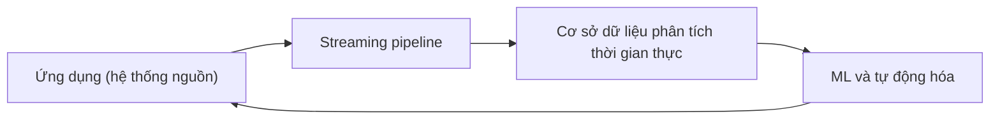
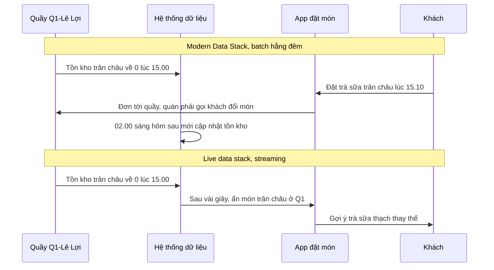
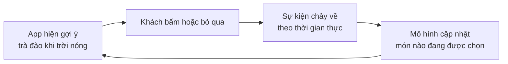
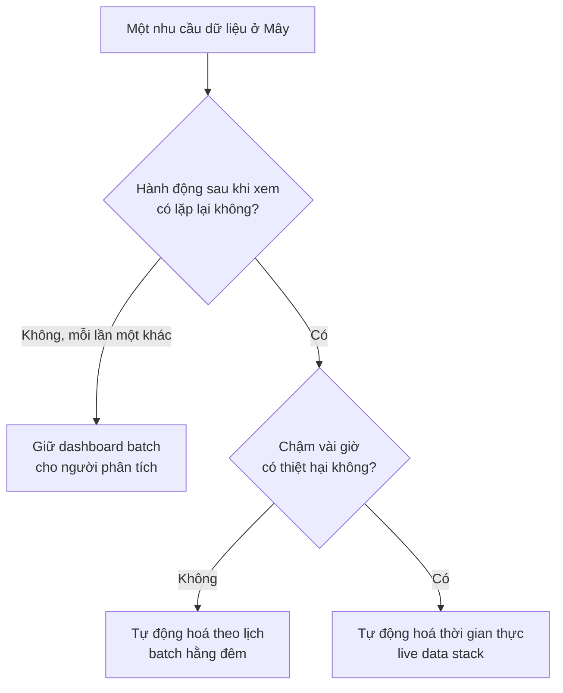

# Từ Modern Data Stack đến Live Data Stack, và lời kết

Phần suy đoán mạnh nhất của chương cuối: Modern Data Stack (MDS) sẽ được kế thừa bởi **live data stack**, trong đó dữ liệu và ML chảy theo thời gian thực giữa ứng dụng và hệ thống phân tích. Bài cũng nói về "vật chất tối" của thế giới dữ liệu là bảng tính, rồi đến lời kết và lời khuyên cho người đọc.

**Tương tự đơn giản:** MDS giống việc xem báo cáo thời tiết sáng nay để quyết định có mang ô không. Live data stack giống chiếc ô tự mở ngay khi trời bắt đầu mưa, không cần ai xem báo cáo.

---

:::note[Ghi nhớ nhanh]

- ⭐ **MDS chỉ là data warehouse "đóng gói lại"** — dựa trên batch và kho dữ liệu đám mây, nên bị giới hạn so với ứng dụng dữ liệu thời gian thực thế hệ sau.
- ⭐ **Live data stack** — streaming pipeline + cơ sở dữ liệu phân tích thời gian thực (Druid, ClickHouse, Rockset, Firebolt), nhập liệu streaming thay batch.
- **Phân tích sẽ dần bị tự động hóa thay thế** — nếu hành động sau khi xem báo cáo lặp đi lặp lại, hãy tự động hóa.
- **Ứng dụng, dữ liệu và ML hợp nhất**, vòng phản hồi ngắn lại.
- **Bảng tính là vật chất tối** của dữ liệu; một loại công cụ lai bảng tính và OLAP đám mây có thể xuất hiện.

:::

---

## Mục lục

- [1. Từ Modern Data Stack đến Live Data Stack](#1-từ-modern-data-stack-đến-live-data-stack)
- [2. Streaming pipeline và cơ sở dữ liệu phân tích thời gian thực](#2-streaming-pipeline-và-cơ-sở-dữ-liệu-phân-tích-thời-gian-thực)
- [3. Sự hợp nhất dữ liệu với ứng dụng](#3-sự-hợp-nhất-dữ-liệu-với-ứng-dụng)
- [4. Phản hồi chặt giữa ứng dụng và ML](#4-phản-hồi-chặt-giữa-ứng-dụng-và-ml)
- [5. Dữ liệu vật chất tối và bảng tính](#5-dữ-liệu-vật-chất-tối-và-bảng-tính)
- [6. Kết luận](#6-kết-luận)
- [7. Áp vào chuỗi trà sữa Mây](#7-áp-vào-chuỗi-trà-sữa-mây)

## 1. Từ Modern Data Stack đến Live Data Stack

Các tác giả nói thẳng: MDS không quá "hiện đại". Họ ghi nhận công lao của MDS: đưa nhiều công cụ dữ liệu mạnh, giá rẻ đến đại chúng và trao quyền cho nhà phân tích kiểm soát stack dữ liệu của mình. Sự nổi lên của **ELT**, data warehouse đám mây và pipeline SaaS trừu tượng hóa đã thay đổi cuộc chơi của nhiều công ty cho BI, phân tích và khoa học dữ liệu.

Tuy nhiên MDS về cơ bản là **đóng gói lại các hoạt động data warehouse cũ bằng công nghệ đám mây và SaaS**. Vì xây trên mô hình data warehouse đám mây, nó có hạn chế nghiêm trọng so với tiềm năng của ứng dụng dữ liệu thời gian thực thế hệ sau. Theo các tác giả, thế giới đang vượt qua việc dùng data science và phân tích nội bộ dựa trên warehouse, hướng tới việc **vận hành cả doanh nghiệp và ứng dụng theo thời gian thực** bằng cơ sở dữ liệu thời gian thực thế hệ mới.

### Điều gì thúc đẩy sự tiến hóa này?

**Phân tích sẽ bị tự động hóa thay thế trong nhiều trường hợp.** Hầu hết dashboard và báo cáo hiện trả lời câu hỏi "cái gì" và "khi nào". Hãy tự hỏi: "Nếu tôi hỏi câu này, tôi sẽ làm gì tiếp theo?" Nếu hành động lặp lại thì đó là ứng viên cho tự động hóa. Thay vì xem báo cáo rồi quyết định, hãy **tự động hóa hành động theo sự kiện khi chúng xảy ra**.

**Ở Mây: hỏi "xem xong thì làm gì?"** Áp câu hỏi của sách vào từng dashboard của Mây, nhiều hành động hoá ra lặp đi lặp lại và tự động được:

| Câu hỏi trên dashboard | Ai xem | Hành động sau khi xem | Tự động hoá thành |
|---|---|---|---|
| Quán nào sắp hết trân châu? | Quản lý vùng | Gọi quán gần đó chuyển bớt sang | Hệ thống tự tạo lệnh điều chuyển khi tồn kho dưới ngưỡng |
| Khách nào lâu không quay lại? | Marketing | Gửi voucher | Reverse ETL và quy tắc gửi voucher tự động (Chương 9) |
| Tủ mát nào nóng? | Quản lý cửa hàng | Kiểm tra tủ | Tin nhắn cảnh báo ngay khi vượt ngưỡng |
| Vì sao doanh thu quý này giảm ở Quận 7? | Chủ chuỗi | Mỗi lần một khác, cần suy nghĩ | **Không** tự động hoá; đây là việc của phân tích |

Xa hơn, vì sao dùng TikTok, Uber, Google hay DoorDash lại như "ma thuật"? Bạn bấm một nút, nhưng phía sau là xử lý dữ liệu và ML cực phức tạp với độ trễ rất nhỏ. Đó là các **ứng dụng dữ liệu thời gian thực** thực thụ. Hiện mức độ phức tạp này nằm sau công nghệ tự xây của các công ty công nghệ lớn, nhưng đang được **dân chủ hóa**, giống cách MDS đưa kho dữ liệu và pipeline quy mô đám mây đến đại chúng. Thế giới dữ liệu sắp "đi vào hoạt động".

### Live data stack là gì

**Live data stack** là kế thừa của MDS: kết hợp phân tích thời gian thực và ML vào ứng dụng bằng công nghệ streaming, bao trùm toàn bộ vòng đời dữ liệu từ hệ thống nguồn của ứng dụng, qua xử lý dữ liệu, tới ML, rồi quay lại ứng dụng (Hình 11-1 trong sách: dữ liệu và "trí thông minh" di chuyển theo thời gian thực giữa ứng dụng và hệ thống hỗ trợ).

Như MDS tận dụng đám mây để đưa công nghệ pipeline và warehouse đến mọi người, live data stack lấy công nghệ ứng dụng dữ liệu thời gian thực của các công ty công nghệ tinh hoa và cung cấp cho công ty mọi quy mô dưới dạng dịch vụ đám mây dễ dùng.

| | Modern Data Stack | Live Data Stack |
|---|---|---|
| Cách xử lý dữ liệu | Batch, dữ liệu bị chặn (bounded) | Luồng liên tục, không giới hạn |
| Lõi lưu trữ và truy vấn | Data warehouse đám mây | Cơ sở dữ liệu OLAP hướng streaming |
| Mục đích chính | BI, phân tích, data science nội bộ | Ứng dụng, tự động hóa, ra quyết định thời gian thực |
| Vị trí so với ứng dụng | Tách biệt | Hợp nhất |

**Cùng một sự cố ở Mây, hai cách phản ứng.** Lúc 15:00, cửa hàng Q1-Lê Lợi hết trân châu nhưng app vẫn nhận đơn trà sữa trân châu. Sơ đồ dưới so sánh MDS (dữ liệu đi theo mẻ hằng đêm) và live data stack (dữ liệu chảy liên tục, ứng dụng tự phản ứng).

## 2. Streaming pipeline và cơ sở dữ liệu phân tích thời gian thực

MDS tự giới hạn ở kỹ thuật batch xử lý dữ liệu bị chặn. Ứng dụng dữ liệu thời gian thực coi dữ liệu là **luồng liên tục không giới hạn**. Hai công nghệ lõi giúp chuyển từ MDS sang live data stack: **streaming pipeline** và **cơ sở dữ liệu phân tích thời gian thực**. Chúng đã có từ lâu, nhưng dịch vụ đám mây quản lý đang giúp triển khai rộng hơn nhiều.

- **Streaming:** sẽ tiếp tục tăng trưởng mạnh, gắn với việc nhìn rõ hơn **giá trị kinh doanh**. Đến nay streaming thường bị coi là món đồ đắt tiền hoặc "ống ngu ngốc" chuyển dữ liệu từ A đến B. Tương lai, streaming sẽ biến đổi công nghệ tổ chức và quy trình kinh doanh, và kỹ sư, kiến trúc sư dữ liệu sẽ dẫn đầu thay đổi này.
- **Cơ sở dữ liệu phân tích thời gian thực:** cho phép cả nạp dữ liệu nhanh và truy vấn dưới một giây trên dữ liệu đó; có thể làm giàu hoặc kết hợp với dữ liệu lịch sử. Khi ghép với streaming pipeline và tự động hóa hay dashboard thời gian thực, bạn không còn bị giới hạn bởi ELT chạy chậm, cập nhật 15 phút hay các "bộ phận chuyển động chậm" khác.
- **Ingest streaming thay batch:** các tác giả dự đoán cuối cùng ta sẽ nhìn batch ingestion như nhìn **modem quay số** ngày nay. Vì sao tạo nút thắt batch ngay đầu pipeline?

### Từ ELT trở lại "STL"

Cùng với streaming, sẽ có "quay lại tương lai" cho việc chuyển đổi: từ **ELT** (biến đổi trong cơ sở dữ liệu) sang thứ giống **ETL** hơn. Các tác giả tạm gọi là **STL: Stream, Transform, Load** (luồng, biến đổi, tải). Trong ngữ cảnh streaming, phần "extract" là liên tục. Biến đổi batch không biến mất (vẫn hữu ích cho huấn luyện mô hình, báo cáo quý...), nhưng **biến đổi streaming sẽ thành tiêu chuẩn**.

| | ETL | ELT | STL (dự đoán) |
|---|---|---|---|
| Thứ tự | Lấy ra, biến đổi, rồi nạp | Lấy ra, nạp thô, rồi biến đổi trong kho | Dữ liệu chảy liên tục, biến đổi ngay trên đường đi, rồi nạp |
| Hình ảnh ở Mây | Sơ chế rau ở chợ rồi mới chở về bếp | Chở cả bao rau về bếp lớn rồi sơ chế | Rau đi trên băng chuyền, được rửa và cắt ngay trên băng chuyền |
| Độ tươi của dashboard | Hôm sau | Hôm sau hoặc vài giờ | Vài giây |
| Ví dụ ở Mây | File lương che cột trước khi vào kho | Đơn hàng nạp thô mỗi đêm | Đơn hàng được làm sạch và cộng vào doanh thu ngay khi vừa thanh toán |

### Cơ sở dữ liệu OLAP hướng streaming

Data warehouse và data lake rất tốt để chứa lượng lớn dữ liệu và truy vấn ad hoc, nhưng **chưa được tối ưu** cho nạp dữ liệu độ trễ thấp hoặc truy vấn dữ liệu di chuyển nhanh. Live data stack sẽ chạy trên **cơ sở dữ liệu OLAP xây riêng cho streaming**. Lúc viết sách, Druid, ClickHouse, Rockset và Firebolt dẫn đầu trong việc cấp sức mạnh cho backend của thế hệ ứng dụng dữ liệu kế tiếp.

### Mô hình hóa dữ liệu sẽ đổi mới

Mô hình hóa dữ liệu là lĩnh vực các tác giả cho là "chín muồi cho đột phá", vì chưa có đổi mới nghiêm túc nào kể từ đầu những năm 2000. Các kỹ thuật theo hướng batch truyền thống (Chương 8) **không phù hợp với dữ liệu streaming**. Kỹ thuật mới sẽ xuất hiện không phải trong warehouse mà **ở các hệ thống tạo ra dữ liệu**. Hy vọng mô hình hóa sẽ có một **lớp định nghĩa ngược dòng** (ngữ nghĩa, metric, lineage, định nghĩa dữ liệu, xem Chương 9) bắt đầu từ nơi dữ liệu sinh ra trong ứng dụng, và diễn ra ở mọi giai đoạn khi dữ liệu chảy và biến đổi trong vòng đời.

## 3. Sự hợp nhất dữ liệu với ứng dụng

Các tác giả hy vọng cuộc cách mạng kế tiếp là **hợp nhất lớp ứng dụng và lớp dữ liệu**. Hiện ứng dụng ở một nơi, MDS ở nơi khác; tệ hơn, dữ liệu được tạo ra mà không quan tâm sau này phân tích ra sao, nên cần rất nhiều "băng keo" để các hệ thống nói chuyện với nhau. Cách chắp vá này là vụng về.

Sớm muộn **ngăn xếp ứng dụng sẽ là ngăn xếp dữ liệu và ngược lại**: ứng dụng tích hợp tự động hóa và ra quyết định thời gian thực nhờ streaming pipeline và ML. Vòng đời kỹ thuật dữ liệu không nhất thiết đổi, nhưng **thời gian giữa các giai đoạn rút ngắn mạnh**. Sẽ có nhiều đổi mới trong công nghệ và thực hành để cải thiện trải nghiệm xây live data stack. Cần để mắt tới các công nghệ cơ sở dữ liệu mới nổi nhằm giải quyết sự kết hợp **OLTP và OLAP**; **feature store** cũng có thể đóng vai trò tương tự cho các trường hợp ML.

## 4. Phản hồi chặt giữa ứng dụng và ML

Ngày nay ứng dụng và ML là các hệ thống rời rạc, như ứng dụng và phân tích: kỹ sư phần mềm làm ở đây, nhà khoa học dữ liệu và kỹ sư ML làm ở kia.

**Ví dụ ở Mây:** app gợi ý món theo thời tiết và giờ trong ngày. Vòng phản hồi càng ngắn, gợi ý càng sát thực tế.

| Độ dài vòng phản hồi | Chuyện xảy ra ở Mây |
|---|---|
| Huấn luyện lại mỗi tháng | Trời đổ mưa bất ngờ, app vẫn gợi ý trà đá suốt buổi chiều |
| Cập nhật mỗi vài phút | Mưa bắt đầu, khách bỏ qua trà đá; sau ít phút app chuyển sang gợi ý trà sữa nóng |

ML phù hợp với tình huống dữ liệu sinh ra nhanh và nhiều đến mức con người không xử lý tay nổi. Khi kích thước và tốc độ dữ liệu tăng, tình huống này áp dụng ngày càng rộng. Dữ liệu khối lượng lớn, di chuyển nhanh, cùng quy trình và hành động phức tạp là ứng viên cho ML. Khi vòng phản hồi dữ liệu ngắn lại, các tác giả mong đợi **hầu hết ứng dụng sẽ tích hợp ML**; dữ liệu càng nhanh thì vòng phản hồi giữa ứng dụng và ML càng chặt. Ứng dụng trong live data stack thông minh và **thích ứng theo thời gian thực** với thay đổi của dữ liệu, tạo chu kỳ ứng dụng ngày càng thông minh và tăng giá trị kinh doanh.

## 5. Dữ liệu vật chất tối và bảng tính

Nền tảng dữ liệu được dùng rộng nhất là gì? **Bảng tính** khiêm tốn. Tùy ước tính, người dùng bảng tính từ 700 triệu đến 2 tỷ. Các tác giả gọi bảng tính là **vật chất tối** của thế giới dữ liệu: rất nhiều phân tích chạy trong đó và không bao giờ vào các hệ thống dữ liệu phức tạp mà sách mô tả. Nhiều tổ chức dùng bảng tính cho báo cáo tài chính, phân tích chuỗi cung ứng, thậm chí CRM.

Về bản chất, bảng tính là một **ứng dụng dữ liệu tương tác hỗ trợ phân tích phức tạp**. Khác với công cụ thuần mã như pandas (thư viện phân tích Python), bảng tính dùng được cho mọi mức người dùng, từ người chỉ biết mở tệp xem báo cáo đến người thành thạo viết kịch bản xử lý dữ liệu phức tạp. Các công cụ BI đến nay chưa mang lại mức tương tác tương đương cho cơ sở dữ liệu: người dùng thường chỉ cắt lát dữ liệu trong khuôn khổ cho phép, không phải phân tích lập trình đa dụng.

**"Vật chất tối" ở Mây** nhiều hơn người ta tưởng: những file Excel quan trọng nằm ngoài kho dữ liệu, không ai giám sát.

| File bảng tính ở Mây | Ai giữ | Vì sao vẫn ở Excel | Rủi ro |
|---|---|---|---|
| Bảng lương và ca làm | Kế toán | Quen tay, công thức phức tạp | Lệch phiên bản, gửi email lung tung |
| Bảng giá nhập nguyên liệu | Bộ phận mua hàng | Nhà cung cấp gửi báo giá dạng Excel | Không ghép được với tồn kho để tính giá vốn |
| Kế hoạch khuyến mãi tháng | Marketing | Dễ sửa, dễ chia sẻ | Kho dữ liệu không biết hôm nào có khuyến mãi, mô hình dự báo thiếu manh mối |

Công cụ "lai" mà sách dự đoán sẽ cho kế toán và marketing vẫn làm việc kiểu bảng tính, nhưng dữ liệu nằm trong kho chung, có phân quyền và lịch sử thay đổi.

Dự đoán: sẽ xuất hiện một loại công cụ mới **kết hợp khả năng phân tích tương tác của bảng tính với sức mạnh backend của hệ thống OLAP đám mây**. Đã có vài ứng viên. Người thắng cuộc có thể tiếp tục mô hình bảng tính, hoặc định nghĩa kiểu giao diện hoàn toàn mới để tương tác với dữ liệu.

## 6. Kết luận

Các tác giả cảm ơn người đọc đã đồng hành qua kiến trúc tốt, các giai đoạn của vòng đời, các best practice bảo mật và chiến lược chọn công nghệ trong một lĩnh vực đổi nhanh chóng.

**Mức độ chắc chắn khác nhau của các dự đoán:**

- Tương đối chắc: đơn giản hóa công cụ quản lý và sự phát triển của kỹ thuật dữ liệu doanh nghiệp, đang diễn ra hằng ngày.
- Mang tính suy đoán: live data stack, vốn kéo theo thay đổi mô hình lớn cho cả cá nhân kỹ sư và tổ chức. Có thể xu hướng dữ liệu thời gian thực lại chững lại khi đa số công ty vẫn tập trung vào xử lý batch cơ bản.
- Chắc chắn còn xu hướng mà họ chưa nhận ra; sự phát triển công nghệ là tương tác phức tạp giữa công nghệ và văn hóa, cả hai đều không đoán trước được.

**Lời khuyên cho người đọc:**

1. Xem cuốn sách như một **"hướng dẫn du lịch"** để tìm đường trong một miền luôn đổi thay, rồi tiếp tục tự khám phá.
2. Tham gia **cộng đồng**: tìm chuyên gia lĩnh vực để biết điểm mạnh và cạm bẫy của các công nghệ, thực hành đang thời thượng; đọc sách, blog, bài báo mới; dự meetup, nghe talk; đặt câu hỏi và chia sẻ chuyên môn; theo dõi thông báo nhà cung cấp nhưng **xem xét kỹ mọi tuyên bố** của họ.
3. Khi đã chọn công nghệ, hãy **áp dụng nó và phát triển chuyên môn**, có thể là người đóng góp cá nhân, trưởng nhóm hoặc trên toàn tổ chức; đừng quên mục tiêu lớn hơn: tập trung vào vòng đời, phục vụ khách hàng (nội bộ và bên ngoài) và mục tiêu kinh doanh.
4. **Bạn góp phần quyết định điều gì xảy ra tiếp theo.** Xu hướng công nghệ do cả người tạo ra lẫn người áp dụng hiệu quả quyết định; dùng công cụ thành công cũng quan trọng như tạo ra nó. Hãy tìm cơ hội áp dụng công nghệ thời gian thực để cải thiện trải nghiệm người dùng, tạo giá trị và xác định các loại ứng dụng hoàn toàn mới. Chính ứng dụng thực tế đó sẽ biến live data stack thành chuẩn mực mới, hoặc một xu hướng khác mà các tác giả chưa nhận ra sẽ thắng.

Lời chúc cuối: các tác giả chọn làm kỹ thuật dữ liệu, tư vấn và viết sách này không chỉ vì nó thời thượng mà vì nó **hấp dẫn**, và hy vọng truyền được một chút niềm vui đó đến người đọc.

## 7. Áp vào chuỗi trà sữa Mây

Live data stack nghe hấp dẫn, nhưng sách cũng nhắc nó **mang tính suy đoán**. Với một chuỗi 30 quán, câu hỏi thực tế là: chuyển phần nào sang thời gian thực, phần nào cứ để batch? Sơ đồ dưới gợi ý cách quyết định cho từng nhu cầu.

| Nhu cầu ở Mây | Kết quả theo sơ đồ |
|---|---|
| Phân tích vì sao doanh thu Quận 7 giảm | Dashboard batch |
| Gửi voucher cho khách sắp rời bỏ | Tự động theo lịch hằng đêm |
| Ẩn món khi quán hết nguyên liệu | Thời gian thực |
| Cảnh báo tủ mát | Thời gian thực |

Đó cũng là tinh thần lời kết của sách: bắt đầu từ **giá trị kinh doanh** và vòng đời dữ liệu, rồi mới chọn công nghệ.

## Tóm tắt

| Chủ đề | Ý chính |
|---|---|
| MDS | Đóng gói lại data warehouse với công nghệ đám mây; batch; giới hạn với ứng dụng thời gian thực |
| Live data stack | Streaming + cơ sở dữ liệu OLAP thời gian thực + ML, hợp nhất ứng dụng và dữ liệu |
| Biến đổi | Từ ELT sang STL (Stream, Transform, Load); streaming transform thành tiêu chuẩn |
| Mô hình hóa | Cần kỹ thuật mới cho streaming, bắt đầu từ hệ thống tạo dữ liệu, với lớp định nghĩa ngược dòng |
| ML và ứng dụng | Vòng phản hồi chặt; ứng dụng thích ứng thời gian thực |
| Bảng tính | "Vật chất tối" của dữ liệu; có thể có công cụ lai bảng tính và OLAP đám mây |
| Lời kết | Tiếp tục học, tham gia cộng đồng, tập trung vào vòng đời và giá trị kinh doanh |
