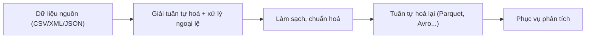
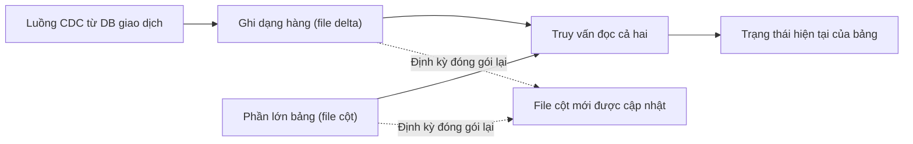

# Phụ lục A. Chi tiết kỹ thuật về tuần tự hoá và nén

Phụ lục này đi sâu vào hai chủ đề đã được nhắc ở Chương 6 (lưu trữ nguyên liệu thô): **tuần tự hoá** (serialization, biến dữ liệu thành chuỗi byte để lưu hoặc truyền) và **nén** (compression, làm dữ liệu nhỏ lại). Hai thứ này luôn đi cùng nhau, và việc chọn đúng định dạng có thể thay đổi hiệu năng cả một pipeline.

**Tương tự đơn giản:** tuần tự hoá giống như cách bạn xếp đồ vào vali (xếp theo từng bộ quần áo hay theo từng loại đồ), còn nén giống như hút chân không vali đó cho gọn lại.

---

:::note[Ghi nhớ nhanh]

- ⭐ **Định dạng theo hàng (CSV, JSON, Avro) hợp ghi/đọc từng bản ghi; định dạng theo cột (Parquet, ORC, Arrow) hợp phân tích** vì chỉ đọc đúng những cột cần và nén rất tốt.
- ⭐ **Chuyển từ CSV sang Parquet đôi khi tăng tốc công việc tới 100 lần** — tác giả nói đã tận mắt thấy.
- **CSV nên tránh** trong pipeline nội bộ; chỉ dùng khi buộc phải trao đổi với hệ thống bên ngoài, và phải ghi kèm cấu hình tuần tự hoá.
- **Hudi và Iceberg** là lớp quản lý bảng (hybrid serialization), kết hợp nhiều kỹ thuật và thêm schema, snapshot, cập nhật.
- **Nén không mất dữ liệu** (gzip, bzip2) cho tỷ lệ tốt; **Snappy, Zstandard, LZ4, LZFSE** ưu tiên tốc độ và CPU hơn tỷ lệ nén.

:::

---

## Mục lục

- [1. Định dạng tuần tự hoá](#1-định-dạng-tuần-tự-hoá)
- [2. Tuần tự hoá theo hàng](#2-tuần-tự-hoá-theo-hàng)
- [3. Tuần tự hoá theo cột](#3-tuần-tự-hoá-theo-cột)
- [4. Tuần tự hoá lai (hybrid)](#4-tuần-tự-hoá-lai-hybrid)
- [5. Storage engine của cơ sở dữ liệu](#5-storage-engine-của-cơ-sở-dữ-liệu)
- [6. Nén](#6-nén)
- [Tóm tắt](#tóm-tắt)

---

## 1. Định dạng tuần tự hoá

Kỹ sư dữ liệu có rất nhiều thuật toán và định dạng tuần tự hoá để chọn. Sự phong phú này vừa là nguồn gây đau đầu, vừa là cơ hội lớn để cải thiện hiệu năng: tác giả kể từng thấy công việc nhanh hơn **100 lần** chỉ nhờ đổi CSV sang Parquet.

Khi dữ liệu đi qua pipeline, kỹ sư còn phải **tuần tự hoá lại** (re-serialization): chuyển từ định dạng này sang định dạng khác. Đôi khi bạn không có lựa chọn và phải nhận dữ liệu ở một định dạng "cổ xưa, khó chịu"; khi đó nhiệm vụ là viết quy trình **giải tuần tự hoá** (deserialization), xử lý các trường hợp ngoại lệ, rồi làm sạch và chuyển sang dạng nhất quán, nhanh để tiêu thụ.



---

## 2. Tuần tự hoá theo hàng

**Tuần tự hoá theo hàng** (row-based serialization) sắp xếp dữ liệu theo từng hàng: các giá trị của một bản ghi nằm liền nhau. CSV là ví dụ điển hình. Với dữ liệu bán cấu trúc (đối tượng lồng nhau, schema thay đổi), mỗi đối tượng được lưu như một đơn vị trọn vẹn.

### 2.1. CSV: "tiêu chuẩn không chuẩn"

CSV (comma-separated values) thực chất chỉ là tên gọi chung cho văn bản được phân cách bằng ký tự nào đó, mỗi nơi lại tự quy ước khác nhau về **ký tự thoát** (escape), **dấu trích dẫn** (quote), **dấu phân cách** (delimiter)... Vì vậy CSV là định dạng mà kỹ sư dữ liệu rất ghét.

Ví dụ cùng một bản ghi nhưng các "phương ngữ" CSV khác nhau:

```text
id,ten,ghi_chu
1,"Nguyễn, An","Nói ""xin chào"""
```

```text
id;ten;ghi_chu
1;Nguyễn, An;Nói "xin chào"
```

Cả hai đều gọi là CSV nhưng parser viết cho kiểu này sẽ đọc sai kiểu kia (dấu phẩy trong tên, dấu nháy kép trong ghi chú, dấu chấm phẩy làm delimiter).

Lời khuyên của sách:

- **Tránh dùng CSV trong pipeline**: dễ lỗi và hiệu năng kém.
- Thường vẫn bị yêu cầu dùng CSV để trao đổi dữ liệu với hệ thống/quy trình kinh doanh ngoài tầm kiểm soát.
- Nếu dùng CSV để **lưu trữ**, hãy kèm mô tả kỹ thuật đầy đủ về cấu hình tuần tự hoá (delimiter, quote, escape, encoding, có header không...) để consumer sau này đọc được.

### 2.2. XML

XML (Extensible Markup Language) phổ biến thời HTML và internet còn non trẻ, nay được coi là **di sản** (legacy). Việc tuần tự hoá/giải tuần tự hoá XML thường **chậm**. Kỹ sư dữ liệu vẫn phải làm việc với XML khi trao đổi dữ liệu với hệ thống và phần mềm cũ. JSON đã thay thế phần lớn XML cho việc tuần tự hoá đối tượng dạng văn bản thuần.

### 2.3. JSON và JSONL

**JSON** (JavaScript Object Notation) là tiêu chuẩn mới để trao đổi dữ liệu qua API, đồng thời cũng rất phổ biến để lưu dữ liệu. Với cơ sở dữ liệu, JSON bùng nổ cùng MongoDB và các document store; Snowflake, BigQuery, SQL Server cũng hỗ trợ gốc (native) rộng rãi, giúp trao đổi giữa ứng dụng, API và database dễ dàng.

**JSONL** (JSON Lines) là biến thể chuyên dùng để lưu **lượng lớn** dữ liệu bán cấu trúc trong file: mỗi dòng là một đối tượng JSON hoàn chỉnh, các đối tượng ngăn cách bằng dấu xuống dòng.

```text
{"id": 1, "ten": "An", "tuoi": 30}
{"id": 2, "ten": "Bình", "tuoi": 25, "thanh_pho": "Huế"}
{"id": 3, "ten": "Chi", "tuoi": 41}
```

Ưu điểm: có thể đọc/ghi từng dòng, nối thêm (append) dễ, schema mỗi dòng có thể khác nhau (dòng 2 có thêm `thanh_pho`).

Quan điểm tác giả: JSONL rất hữu ích để lưu dữ liệu **ngay sau khi nhập** (ingest) từ API hoặc ứng dụng. Nhưng nhiều định dạng cột nhanh hơn hẳn, nên hãy cân nhắc chuyển sang định dạng khác cho các giai đoạn trung gian và phục vụ (serving).

### 2.4. Avro

**Avro** là định dạng theo hàng thiết kế cho RPC và tuần tự hoá dữ liệu. Dữ liệu được mã hoá **nhị phân**, còn **schema (metadata) được khai báo bằng JSON**. Avro phổ biến trong hệ sinh thái Hadoop và được nhiều công cụ dữ liệu đám mây hỗ trợ.

Ví dụ schema Avro (minh hoạ do người ghi chép thêm, không phải của sách):

```json
{
  "type": "record",
  "name": "NguoiDung",
  "fields": [
    {"name": "id", "type": "long"},
    {"name": "ten", "type": "string"},
    {"name": "tuoi", "type": ["null", "int"], "default": null}
  ]
}
```

---

## 3. Tuần tự hoá theo cột

Các định dạng ở mục 2 đều theo hàng: dữ liệu được mã hoá thành một quan hệ hoàn chỉnh (CSV) hoặc tài liệu (XML, JSON) rồi ghi tuần tự vào file.

Với **tuần tự hoá theo cột** (columnar serialization), cách tổ chức được "xoay" lại: **mỗi cột được lưu vào tập file riêng**.

### 3.1. Minh hoạ: lưu theo hàng và theo cột

Giả sử có bảng ba bản ghi (ví dụ do người ghi chép thêm):

| id | ten  | thanh_pho |
|----|------|-----------|
| 1  | An   | Hà Nội    |
| 2  | Bình | Hà Nội    |
| 3  | Chi  | Đà Nẵng   |

Cách chúng nằm trên đĩa:

```text
Theo hàng : [1, An, Hà Nội] [2, Bình, Hà Nội] [3, Chi, Đà Nẵng]
Theo cột  : [1, 2, 3]  [An, Bình, Chi]  [Hà Nội, Hà Nội, Đà Nẵng]
```

Truy vấn `SELECT AVG(id)` hoặc `SELECT thanh_pho, COUNT(*) ...`: với lưu theo cột chỉ cần đọc đúng một hoặc hai cột; với lưu theo hàng phải đọc cả ba cột của mọi hàng.

### 3.2. Lợi ích

1. **Chỉ đọc các cột cần thiết**: phổ biến trong phân tích, giảm mạnh lượng dữ liệu phải quét.
2. **Giá trị tương tự nằm cạnh nhau**, nên mã hoá hiệu quả. Cách phổ biến là tìm giá trị lặp rồi mã hoá chúng (như `Hà Nội, Hà Nội` ở trên) — nén đơn giản mà rất hiệu quả cho cột có nhiều giá trị lặp.
3. Ngay cả cột ít lặp vẫn có thể **dư thừa cao**: ví dụ cột chứa các tin nhắn hỗ trợ khách hàng, nhiều chủ đề và cụm từ giống nhau, nên thuật toán nén đạt tỷ lệ cao.

Vì thế lưu theo cột thường đi kèm nén, tối đa hoá băng thông mạng và đĩa.

### 3.3. Nhược điểm

- **Khó truy cập từng bản ghi riêng lẻ**: phải ghép lại bản ghi bằng cách đọc nhiều file cột.
- **Cập nhật khó**: đổi một trường của một bản ghi phải giải nén file cột, sửa, nén lại, ghi lại. Để tránh viết lại cả cột, cột được chia thành nhiều file, thường kết hợp **phân vùng** (partitioning) và **phân cụm** (clustering) theo mẫu truy vấn và cập nhật. Dù vậy chi phí cập nhật một hàng vẫn lớn.
- **Không phù hợp với khối lượng công việc giao dịch** (OLTP). Cơ sở dữ liệu giao dịch thường dùng lưu trữ theo hàng/bản ghi.

> Lưu ý: bản dịch tiếng Việt ghi nhầm là cơ sở dữ liệu cột "cực kỳ phù hợp" với workload giao dịch. Bản gốc tiếng Anh nói ngược lại: chúng **không phù hợp** (not well suited).

### 3.4. Parquet

**Parquet** lưu dữ liệu dạng cột, thiết kế để đọc/ghi tốt trong môi trường **data lake**. Nó giải quyết nhiều vấn đề hay gây đau đầu:

- **Schema được nhúng sẵn** trong file và hỗ trợ **dữ liệu lồng nhau** (khác CSV).
- **Tính di động**: BigQuery, Snowflake lưu dữ liệu ở định dạng cột độc quyền, truy vấn nội bộ rất nhanh, nhưng khi làm việc với công cụ bên ngoài thì hiệu năng giảm nhiều vì phải giải tuần tự hoá, tuần tự hoá lại sang định dạng trao đổi rồi xuất cho Spark, Presto. Vì vậy file Parquet trong data lake có thể là lựa chọn tốt hơn data warehouse đám mây độc quyền trong môi trường nhiều công cụ (polyglot).
- Dùng với nhiều thuật toán nén; loại tối ưu tốc độ như **Snappy** đặc biệt phổ biến.

### 3.5. ORC

**ORC** (Optimized Row Columnar) là định dạng cột tương tự Parquet, phổ biến với **Apache Hive**. Vẫn dùng nhiều nhưng tác giả thấy ít hơn Parquet và được các công cụ đám mây hiện đại hỗ trợ ít hơn. Ví dụ Snowflake và BigQuery **nhập/xuất** được Parquet; còn ORC thì chỉ **đọc** được, không công cụ nào xuất ra ORC.

### 3.6. Apache Arrow: tuần tự hoá trong bộ nhớ

Phần mềm có thể giữ dữ liệu trong bộ nhớ dưới dạng đối tượng phức tạp rải rác nối bằng con trỏ, hoặc cấu trúc đóng gói dày đặc, có thứ tự như mảng Fortran/C. Cấu trúc dày đặc thường chỉ dành cho kiểu đơn giản (INT64) hoặc độ rộng cố định. Cấu trúc phức tạp (như tài liệu JSON) không thể lưu dày đặc trong bộ nhớ, nên phải tuần tự hoá để lưu và truyền giữa các hệ thống.

**Ý tưởng của Arrow:** nghĩ lại về tuần tự hoá bằng **một định dạng nhị phân dùng chung** cho cả xử lý trong bộ nhớ lẫn xuất ra ngoài. Nhờ vậy tránh được chi phí tuần tự hoá/giải tuần tự hoá: cùng một định dạng cho xử lý trong RAM, truyền qua mạng và lưu lâu dài.

Cơ chế chính:

- Arrow dựa trên **lưu trữ theo cột**, mỗi cột có các khối bộ nhớ riêng.
- Với dữ liệu lồng nhau dùng kỹ thuật **shredding** (bản dịch gọi là "băm nhỏ"): ánh xạ mỗi vị trí trong schema của tài liệu JSON thành một cột riêng.
- Có thể lưu file trên đĩa, **ánh xạ trực tiếp vào không gian địa chỉ chương trình bằng bộ nhớ ảo** (memory mapping) và chạy truy vấn mà không cần giải tuần tự hoá. Có thể hoán đổi từng phần file vào/ra bộ nhớ khi quét để tránh hết RAM với dataset lớn.

Vấn đề: mỗi ngôn ngữ lập trình tuần tự hoá theo cách riêng. Dự án Arrow giải quyết bằng thư viện cho nhiều ngôn ngữ (C, Go, Java, JavaScript, MATLAB, Python, R, Rust), đôi khi dùng giao diện tới mã cấp thấp (như C). Kết quả là khả năng tương tác cao giữa các ngôn ngữ mà không tốn chi phí tuần tự hoá. Ví dụ chương trình Scala dùng thư viện Java ghi dữ liệu Arrow rồi gửi dạng thông điệp cho chương trình Python.

Arrow phát triển nhanh và được tích hợp vào nhiều framework như Apache Spark. **Dremio** là query engine và data warehouse xây quanh tuần tự hoá Arrow để truy vấn nhanh.

---

## 4. Tuần tự hoá lai (hybrid)

**Hybrid serialization** chỉ các công nghệ kết hợp nhiều kỹ thuật tuần tự hoá, hoặc ghép tuần tự hoá với các lớp trừu tượng bổ sung như quản lý schema. Sách nêu hai ví dụ: Hudi và Iceberg.

### 4.1. Apache Hudi

Hudi = **Hadoop Update Delete Incremental**. Đây là công nghệ quản lý bảng, kết hợp nhiều kỹ thuật tuần tự hoá để có **hiệu năng của cơ sở dữ liệu cột cho truy vấn phân tích**, đồng thời hỗ trợ **cập nhật giao dịch nguyên tử**.

Ứng dụng điển hình: một bảng được cập nhật từ luồng **CDC** (change data capture) của cơ sở dữ liệu giao dịch.



- Luồng thay đổi được ghi ở định dạng theo hàng; phần lớn bảng nằm ở định dạng cột.
- Truy vấn chạy trên cả file hàng và cột để trả kết quả theo **trạng thái hiện tại** của bảng.
- Định kỳ một quy trình **đóng gói lại** (compaction) gộp file hàng và cột thành file cột cập nhật để truy vấn hiệu quả nhất.

### 4.2. Apache Iceberg

Giống Hudi, Iceberg là công nghệ quản lý bảng:

- Theo dõi **tất cả các file** tạo nên bảng.
- Theo dõi các file trong **từng snapshot** (ảnh chụp nhanh) của bảng theo thời gian, cho phép **time travel** (du hành thời gian) trong data lake.
- Hỗ trợ **schema evolution** (phát triển schema).
- Quản lý dễ dàng bảng cỡ **petabyte**.

---

## 5. Storage engine của cơ sở dữ liệu

Cuối phần tuần tự hoá, sách điểm qua **storage engine** (công cụ lưu trữ) của database.

- Mọi cơ sở dữ liệu đều có storage engine bên dưới; nhiều hệ thống không phơi bày nó như một lớp trừu tượng riêng (BigQuery, Snowflake).
- Một số hỗ trợ storage engine **cắm rời** (pluggable) hoàn toàn, đáng chú ý là **MySQL**.
- Một số khác (như **SQL Server**) cho tuỳ chọn cấu hình storage engine chính (lưu theo cột hay theo hàng), ảnh hưởng lớn tới hoạt động của database.
- Thường storage engine là lớp phần mềm **tách biệt** với query engine. Nó quản lý mọi khía cạnh cách dữ liệu nằm trên đĩa: **tuần tự hoá, sắp xếp vật lý của dữ liệu và chỉ mục**.

Các đổi mới trong những năm 2000 và 2010:

- Trước đây tối ưu cho truy cập **đĩa quay**; storage engine hiện đại tối ưu cho đặc tính hiệu năng của **SSD**.
- Hỗ trợ tốt hơn các kiểu và cấu trúc dữ liệu hiện đại: chuỗi độ dài thay đổi, mảng, dữ liệu lồng nhau.
- Chuyển sang **lưu trữ theo cột** cho ứng dụng phân tích và data warehouse. SQL Server, PostgreSQL và MySQL đều có hỗ trợ lưu theo cột mạnh mẽ.

---

## 6. Nén

Toán học đằng sau nén phức tạp, nhưng ý tưởng cơ bản dễ hiểu: thuật toán **tìm sự dư thừa và lặp lại** rồi mã hoá lại để giảm dư thừa. Khi đọc, **giải nén** bằng cách đảo ngược thuật toán, đưa phần dư thừa trở lại.

**Ví dụ của sách:** bạn thấy vài từ lặp đi lặp lại khi đọc cuốn sách này. Phân tích nhanh để tìm các từ thường gặp nhất, gán cho chúng mã rút gọn (token). Nén: thay từ thông dụng bằng token. Giải nén: thay token trở lại bằng từ. Kỹ thuật đơn giản này có thể đạt tỷ lệ nén khoảng **2:1** trở lên; các thuật toán thực dùng toán phức tạp hơn và thường đạt **10:1** trên dữ liệu văn bản.

### 6.1. Nén không mất dữ liệu và nén mất dữ liệu

| Loại | Giải nén cho ra | Dùng cho |
|------|-----------------|----------|
| **Lossless** (không mất dữ liệu) | Bản sao **chính xác từng bit** của bản gốc | Dữ liệu phân tích, cần độ chính xác tuyệt đối |
| **Lossy** (mất dữ liệu) | Thứ nghe/nhìn giống bản gốc nhưng **không phải bản sao chính xác** | Âm thanh, hình ảnh, video (giữ độ trung thực cảm quan) |

Kỹ sư dữ liệu có thể gặp nén lossy trong pipeline xử lý đa phương tiện, nhưng **không dùng** nó để tuần tự hoá dữ liệu cho phân tích vì ở đó cần độ trung thực dữ liệu chính xác.

### 6.2. Hai thế hệ thuật toán

- **Truyền thống: gzip, bzip2.** Nén dữ liệu văn bản rất tốt; thường áp dụng cho JSON, JSONL, XML, CSV và các định dạng dựa trên văn bản.
- **Thế hệ mới: Snappy, Zstandard, LZFSE, LZ4.** Những năm gần đây các kỹ sư tạo ra thế hệ ưu tiên **tốc độ và hiệu quả CPU hơn tỷ lệ nén**. Thường dùng để nén dữ liệu trong data lake hoặc cơ sở dữ liệu cột nhằm tối ưu hiệu năng truy vấn nhanh.

Cách nghĩ: gzip/bzip2 "nén chặt nhưng chậm hơn", Snappy/LZ4 "nén vừa phải nhưng cực nhanh" — với phân tích, thời gian giải nén thường quan trọng hơn vài phần trăm dung lượng.

---

## So sánh nhanh các định dạng

| Định dạng | Kiểu | Mã hoá | Schema | Dữ liệu lồng | Điểm mạnh | Hạn chế |
|-----------|------|--------|--------|--------------|-----------|---------|
| CSV | Hàng | Văn bản | Không có | Không | Phổ biến, trao đổi dễ | Không chuẩn, dễ lỗi, chậm |
| XML | Hàng | Văn bản | Tuỳ chọn | Có | Hệ thống cũ | Chậm, di sản |
| JSON / JSONL | Hàng | Văn bản | Linh hoạt | Có | API, ingest, linh hoạt | Kém hiệu năng hơn cột |
| Avro | Hàng | Nhị phân | Có, khai báo bằng JSON | Có | RPC, Hadoop, truyền dữ liệu | Không tối ưu cho phân tích |
| Parquet | Cột | Nhị phân | Nhúng sẵn | Có | Data lake, phân tích, nén tốt | Cập nhật bản ghi khó |
| ORC | Cột | Nhị phân | Nhúng sẵn | Có | Hệ sinh thái Hive | Ít hỗ trợ trên đám mây hiện đại |
| Arrow | Cột (trong bộ nhớ) | Nhị phân | Có | Có (shredding) | Không tốn chi phí tuần tự hoá, tương tác đa ngôn ngữ | Chủ yếu cho xử lý/trao đổi trong bộ nhớ |

Các cột "Schema" và "Dữ liệu lồng" của Avro, ORC, Arrow, XML là tổng hợp của người ghi chép từ kiến thức chung, không phải bảng của sách.

---

## Tóm tắt

| Chủ đề | Ý chính |
|--------|---------|
| Tuần tự hoá theo hàng | CSV, XML, JSON/JSONL, Avro; hợp với ingest, giao dịch, trao đổi |
| CSV | Tránh trong pipeline; nếu buộc phải dùng thì ghi rõ cấu hình |
| JSONL | Tốt cho dữ liệu vừa nhập; về sau nên chuyển sang định dạng cột |
| Tuần tự hoá theo cột | Đọc đúng cột cần, nén tốt; khó cập nhật, không hợp OLTP |
| Parquet / ORC | Cột cho data lake; Parquet phổ biến và được hỗ trợ rộng hơn |
| Arrow | Một định dạng cột nhị phân cho bộ nhớ, mạng và lưu trữ; bỏ chi phí tuần tự hoá |
| Hudi / Iceberg | Quản lý bảng, kết hợp nhiều kỹ thuật; cập nhật, snapshot, time travel, schema evolution |
| Storage engine | Lớp quản lý tuần tự hoá, sắp xếp vật lý và chỉ mục; tối ưu cho SSD, hỗ trợ cột |
| Nén | Lossless cho phân tích; gzip/bzip2 tỷ lệ cao, Snappy/Zstandard/LZ4/LZFSE nhanh |
