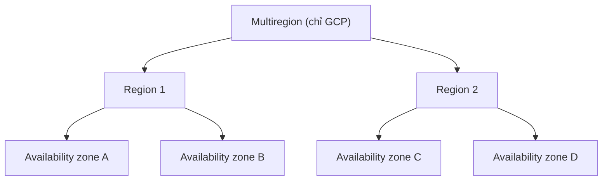

# Phụ lục B. Mạng đám mây

Phụ lục ngắn này nói về những yếu tố mạng mà kỹ sư dữ liệu nên cân nhắc khi làm việc trên đám mây. Kỹ sư dữ liệu thường xuyên đụng chuyện mạng trong sự nghiệp nhưng hay bỏ qua, dù nó ảnh hưởng trực tiếp tới **hiệu năng** và **chi phí** của hệ thống dữ liệu.

**Tương tự đơn giản:** mạng đám mây giống hệ thống đường giao thông giữa các kho hàng. Chở hàng trong cùng một kho thì nhanh và miễn phí; chở sang kho khác trong thành phố thì tốn chút phí; chở ra khỏi thành phố ("ra internet") thì bị thu phí cao.

---

:::note[Ghi nhớ nhanh]

- ⭐ **Chiều vào miễn phí, chiều ra tính phí**: phí **data egress** là "con hào" (moat) giữ khách hàng ở lại nhà cung cấp đám mây.
- ⭐ **Chạy workload thông lượng cao trong một availability zone** để có băng thông cao nhất, độ trễ thấp nhất và chi phí thấp nhất; nhớ dùng **IP riêng** (private IP).
- Thứ bậc tài nguyên: **availability zone** (nhỏ nhất) nằm trong **region**; GCP có thêm lớp **multiregion**.
- **Kết nối trực tiếp** (như AWS Direct Connect) giảm egress, ví dụ từ 9 xu xuống 2 xu mỗi GB.
- **CDN** giúp khi phân phối cùng một dữ liệu nhiều lần; lỗi dịch vụ lớn vẫn có thể ảnh hưởng cả region.

:::

---

## Mục lục

- [1. Cấu trúc liên kết mạng đám mây](#1-cấu-trúc-liên-kết-mạng-đám-mây)
- [2. Phí data egress](#2-phí-data-egress)
- [3. Availability zone](#3-availability-zone)
- [4. Region](#4-region)
- [5. Mạng đặc thù GCP và dự phòng đa vùng](#5-mạng-đặc-thù-gcp-và-dự-phòng-đa-vùng)
- [6. Kết nối mạng trực tiếp tới đám mây](#6-kết-nối-mạng-trực-tiếp-tới-đám-mây)
- [7. CDN](#7-cdn)
- [8. Tương lai của phí data egress](#8-tương-lai-của-phí-data-egress)
- [Tóm tắt](#tóm-tắt)

---

## 1. Cấu trúc liên kết mạng đám mây

**Cloud network topology** (cấu trúc liên kết mạng đám mây) mô tả cách các thành phần trong đám mây được sắp xếp và kết nối: dịch vụ đám mây, mạng, vị trí (zone, region)... Kỹ sư dữ liệu phải luôn biết topology này ảnh hưởng thế nào tới **khả năng kết nối giữa các hệ thống dữ liệu** mình xây.

Azure, GCP và AWS đều dùng hệ thống phân cấp tài nguyên khá giống nhau gồm **availability zone** và **region**. Tại thời điểm sách được viết, GCP thêm một lớp nữa (multiregion, xem mục 5).

---

## 2. Phí data egress

Chương 4 đã bàn về kinh tế đám mây: chi phí thực của nhà cung cấp không nhất thiết quyết định giá bán. Về mạng:

- Đám mây cho lưu lượng **vào** (inbound) **miễn phí**.
- Lưu lượng **ra internet** (outbound, egress) thì **tính phí**.
- Lưu lượng ra không vốn đã rẻ hơn hay đắt hơn; các đám mây dùng cách này để **tạo "con hào" quanh dịch vụ** và tăng độ "dính" (stickiness) của dữ liệu đã lưu — một cách làm bị chỉ trích rộng rãi (sách dẫn bài "AWS's Egregious Egress" của Cloudflare).
- Phí egress cũng có thể áp dụng khi truyền dữ liệu **giữa các availability zone và region** trong cùng một đám mây.

Ví dụ minh hoạ (do người ghi chép thêm): nếu bạn có 50 TB dữ liệu và muốn chuyển sang đám mây khác, bạn trả phí egress cho toàn bộ 50 TB trước khi kể chi phí gì khác. Đó là lý do dữ liệu khó rời khỏi nơi nó đang nằm.

---

## 3. Availability zone

**Availability zone (AZ)** là đơn vị topology nhỏ nhất mà đám mây công cộng cho khách hàng thấy. Một zone có thể gồm nhiều trung tâm dữ liệu, nhưng khách hàng **không điều khiển được vị trí đặt tài nguyên ở mức này**.

Điểm thực tế cho kỹ sư dữ liệu:

- Băng thông mạng **cao nhất** và độ trễ **thấp nhất** thường là giữa các hệ thống/dịch vụ **trong cùng một zone**.
- Vì thế workload dữ liệu thông lượng cao nên chạy trên cụm nằm trong **một zone** (hiệu năng và chi phí). Ví dụ: cụm Amazon EMR tạm thời thường nên nằm trong một AZ.
- Lưu lượng gửi tới các máy ảo trong cùng zone là **miễn phí**, nhưng có điều kiện quan trọng: phải gửi tới **địa chỉ IP riêng**.
  - Các đám mây lớn dùng mạng ảo gọi là **VPC** (virtual private cloud); máy ảo có IP riêng trong VPC.
  - Máy ảo cũng có thể được gán IP công cộng để nói chuyện với bên ngoài và nhận lưu lượng từ internet, nhưng giao tiếp qua IP bên ngoài **có thể bị tính phí egress**.

Mẹo (người ghi chép thêm): các node trong cùng cụm nên gọi nhau bằng IP/hostname nội bộ, không bằng IP công cộng, kẻo trả phí cho chính lưu lượng nội bộ.

---

## 4. Region

**Region** là tập hợp từ **hai availability zone trở lên**.

- Trung tâm dữ liệu cần nhiều tài nguyên (điện, nước...). Tài nguyên của các AZ khác nhau **độc lập**, để mất điện cục bộ không làm sập nhiều AZ.
- Kỹ sư có thể xây hạ tầng tách biệt, chịu lỗi tốt **ngay trong một region** bằng cách chạy máy chủ ở nhiều zone hoặc tạo quy trình **failover tự động** giữa các zone.
- Nhiều region cho phép đặt tài nguyên **gần người dùng**. "Gần" nghĩa là khoảng cách vật lý trên đường truyền ngắn và số **hop** qua router ít; cả hai đều tăng độ trễ và giảm hiệu năng. Các nhà cung cấp lớn liên tục thêm region mới.

Hiệu năng và chi phí theo phạm vi:

| Phạm vi | Hiệu năng mạng | Phí |
|---------|----------------|-----|
| Trong một zone | Tốt nhất | Miễn phí nếu dùng IP riêng |
| Giữa các zone trong region | Nhanh, độ trễ thấp nhưng kém hơn trong một zone | Phí egress danh nghĩa giữa các máy ảo |
| Giữa các region | Chậm hơn nữa | Có thể phí egress cao hơn |

**Object storage** nhìn chung là tài nguyên **cấp region**. Dữ liệu có thể đi giữa các zone để tới máy ảo, nhưng việc này chủ yếu vô hình với khách hàng và **không bị tính phí mạng trực tiếp** (khách vẫn trả chi phí truy cập đối tượng như thường).

**Lỗi tương quan (correlated failure):** dù region được thiết kế dự phòng địa lý, nhiều sự cố dịch vụ đám mây lớn đã ảnh hưởng **cả region**. Lý do: kỹ sư thường triển khai mã và cấu hình cho cả region, nên các lỗi cấp region mà tác giả quan sát thường xuất phát từ vấn đề mã hoặc cấu hình ở cấp region, không phải do cháy hay mất điện.

---

## 5. Mạng đặc thù GCP và dự phòng đa vùng

GCP có vài khái niệm trừu tượng riêng mà kỹ sư làm việc trên GCP nên biết.

### 5.1. Multiregion

**Multiregion** (đa vùng) là một lớp trong hệ thống phân cấp tài nguyên: một multiregion chứa nhiều region. Các multiregion hiện có (tại thời điểm viết sách): **US** (trung tâm dữ liệu ở Mỹ), **EU** (ở các nước thành viên Liên minh châu Âu) và **ASIA**.

Một số tài nguyên GCP hỗ trợ multiregion, gồm **Cloud Storage** và **BigQuery**:

- Dữ liệu được lưu ở nhiều zone trong multiregion theo kiểu **dự phòng địa lý** (geo-redundant), nên vẫn sẵn sàng nếu một region gặp sự cố.
- Lưu trữ đa vùng cũng được thiết kế để phục vụ dữ liệu hiệu quả cho người dùng trong multiregion mà **không cần dựng quy trình sao chép phức tạp** giữa các region.
- **Không tính phí egress** khi máy ảo trong một multiregion truy cập dữ liệu Cloud Storage nằm trong cùng multiregion đó.

### 5.2. Đa vùng trên AWS và Azure

Khách hàng vẫn có thể tự dựng hạ tầng đa vùng trên AWS hoặc Azure. Với database hay object storage, việc này là **sao chép dữ liệu giữa các region** để tăng dự phòng và đưa dữ liệu gần người dùng hơn.

### 5.3. Mạng cấp premium (premium-tier) của Google

Google về cơ bản sở hữu nhiều tài nguyên mạng quy mô toàn cầu hơn hẳn các nhà cung cấp khác, và bán lại cho khách dưới dạng **mạng cấp premium**. Mạng này cho phép lưu lượng giữa các zone và region **đi hoàn toàn trên mạng do Google sở hữu**, không đi qua internet công cộng (backbone riêng).

---

## 6. Kết nối mạng trực tiếp tới đám mây

Mỗi đám mây công cộng lớn đều có tuỳ chọn kết nối nâng cao để khách hàng **tích hợp trực tiếp mạng của mình với một region hoặc VPC**. Ví dụ Amazon có **AWS Direct Connect**.

Ngoài băng thông cao hơn và độ trễ thấp hơn, các tuỳ chọn này thường **giảm mạnh phí egress**. Trong kịch bản điển hình ở Mỹ, phí egress của AWS giảm từ **9 xu mỗi GB** qua internet công cộng xuống còn **2 xu mỗi GB** qua kết nối trực tiếp.

Ví dụ tính nhẩm (người ghi chép thêm, dùng con số của sách): chuyển ra 100 TB (khoảng 100.000 GB): qua internet công cộng tốn xấp xỉ 9.000 USD, qua kết nối trực tiếp xấp xỉ 2.000 USD.

---

## 7. CDN

**CDN** (content delivery network, mạng phân phối nội dung) có thể cải thiện hiệu năng rõ rệt và **giảm chi phí** khi phân phối dữ liệu cho công chúng hoặc khách hàng. Các nhà cung cấp đám mây có tuỳ chọn CDN riêng, cũng có nhiều nhà cung cấp khác như **Cloudflare**.

Lưu ý của sách:

- CDN hiệu quả nhất khi **phân phối cùng một dữ liệu nhiều lần** (nội dung được cache ở các điểm gần người dùng).
- Phải **đọc kỹ điều khoản chi tiết** ("fine print") về giá và giới hạn.
- CDN **không hoạt động ở mọi nơi**: một số quốc gia có thể chặn lưu lượng internet và việc phân phối qua CDN.

---

## 8. Tương lai của phí data egress

Phí data egress là **trở ngại lớn** đối với khả năng tương tác (interoperability), chia sẻ dữ liệu và việc di chuyển dữ liệu lên đám mây. Hiện nay nó là "con hào" nhằm ngăn khách hàng rời đi hoặc triển khai đa đám mây (multicloud).

Nhưng có những tín hiệu cho thấy thay đổi có thể đang tới:

- **Trường hợp Zoom (2020):** gần đầu đại dịch COVID-19, Zoom công bố chọn **Oracle** làm nhà cung cấp hạ tầng đám mây, khiến giới quan sát đám mây chú ý. Oracle thắng hợp đồng lớn này trước các ông lớn bằng cách nào?
- Chuyên gia AWS **Corey Quinn** giải thích khá đơn giản: theo phép tính nhẩm của ông, phí egress hàng tháng của Zoom trên AWS sẽ **hơn 11 triệu USD** theo giá niêm yết; trên Oracle **dưới 2 triệu USD**.

Dự đoán của tác giả:

- Nghi ngờ GCP, AWS hoặc Azure sẽ công bố **cắt giảm đáng kể phí egress trong vài năm tới**, dẫn tới một thay đổi lớn trong mô hình kinh doanh đám mây.
- Cũng hoàn toàn có thể phí egress **biến mất hẳn**, giống như số phút gọi điện thoại di động đắt đỏ và bị giới hạn đã biến mất cách đây nhiều thập kỷ.

---

## Tóm tắt

| Chủ đề | Ý chính |
|--------|---------|
| Topology | Zone nằm trong region; GCP thêm multiregion |
| Egress | Vào miễn phí, ra tính phí; dùng làm "con hào" khoá khách hàng; cũng áp dụng giữa zone và region |
| Availability zone | Đơn vị nhỏ nhất khách thấy; băng thông cao nhất, độ trễ thấp nhất; chạy workload nặng trong một zone, dùng IP riêng |
| Region | Hai zone trở lên, tài nguyên độc lập; gần người dùng; vẫn có lỗi tương quan do mã/cấu hình |
| GCP multiregion | US, EU, ASIA; dự phòng địa lý, không phí egress trong cùng multiregion; mạng premium chạy trên backbone của Google |
| Kết nối trực tiếp | Băng thông cao hơn, độ trễ thấp hơn, egress giảm (9 xu xuống 2 xu mỗi GB ở ví dụ AWS) |
| CDN | Hợp khi phân phối cùng dữ liệu nhiều lần; đọc kỹ điều khoản; có thể bị chặn ở một số nước |
| Tương lai egress | Zoom/Oracle (11 triệu USD so với dưới 2 triệu USD mỗi tháng); tác giả dự đoán egress giảm mạnh hoặc biến mất |
