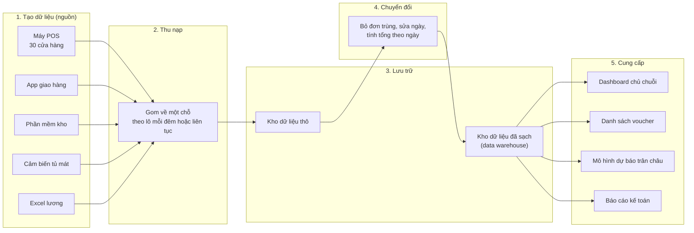
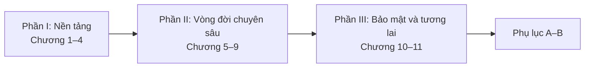

# Data Engineering

Đây là ghi chép chi tiết cuốn **Fundamentals of Data Engineering** (Joe Reis & Matt Housley, O'Reilly, 2022), bản tiếng Việt *"Nguyên tắc cơ bản của Kỹ thuật Dữ liệu"* có đối chiếu bản gốc tiếng Anh. Cuốn sách không dạy một công cụ cụ thể nào. Nó dạy cách **suy nghĩ như một kỹ sư dữ liệu**: dữ liệu đi qua những giai đoạn nào, mỗi giai đoạn có những đánh đổi gì, và làm sao chọn kiến trúc, công nghệ phù hợp mà không bị cuốn theo quảng cáo của nhà cung cấp.

**Tương tự đơn giản:** Kỹ sư dữ liệu giống người thiết kế và vận hành **hệ thống cấp nước** của một thành phố. Nước được lấy từ nhiều nguồn (sông, giếng, hồ chứa) tương ứng với **hệ thống nguồn**. Nước được dẫn về nhà máy (**thu nạp**), chứa trong bể (**lưu trữ**), lọc và xử lý (**chuyển đổi**), rồi phân phối tới từng hộ dân (**cung cấp dữ liệu** cho nhà phân tích, mô hình ML, ứng dụng). Người dân chỉ cần mở vòi là có nước sạch. Họ không cần biết đường ống đi đâu, nhưng chỉ cần một khâu hỏng là cả thành phố bị ảnh hưởng.

---

:::note[Ghi nhớ nhanh]

- ⭐ **Vòng đời kỹ thuật dữ liệu** là khung tư duy xuyên suốt cuốn sách: tạo dữ liệu → lưu trữ → thu nạp → chuyển đổi → cung cấp dữ liệu.
- ⭐ **Các "dòng chảy ngầm" (undercurrents)** chạy dưới mọi giai đoạn: bảo mật, quản lý dữ liệu, DataOps, kiến trúc dữ liệu, orchestration, kỹ thuật phần mềm.
- **Nguyên tắc quan trọng hơn công cụ** — công cụ thay đổi vài năm một lần, còn các khái niệm và đánh đổi thì bền vững.
- **Kiến trúc và công nghệ là hai chuyện khác nhau** — kiến trúc là cái *gì* và *tại sao*, công nghệ là *bằng cách nào*.
- **Bảo mật và quyền riêng tư** phải được tính tới ngay từ đầu, không phải vá sau.

:::

---

## Tình huống xuyên suốt: chuỗi trà sữa Mây

Sách viết cho người đã biết kỹ thuật. Để người chưa quen cũng theo được, ghi chép này dùng **một ví dụ chung cho mọi bài**: chuỗi trà sữa **"Mây"** với 30 cửa hàng. Mỗi khi gặp một khái niệm mới, bạn có thể tự hỏi: *"Ở chuỗi Mây, cái này là gì?"*.

### Mây có những nguồn dữ liệu nào?

Mỗi ngày, rất nhiều "máy móc" và con người ở Mây tạo ra dữ liệu. Bảng dưới liệt kê các nguồn chính, sẽ được nhắc lại ở hầu hết các bài sau.

| Nguồn dữ liệu | Nó ghi lại gì | Trông như thế nào | Tần suất |
| --- | --- | --- | --- |
| Máy bán hàng ở quầy (**POS** — Point of Sale) | Từng đơn khách mua tại quầy | Dòng trong cơ sở dữ liệu | Mỗi đơn, vài giây một lần |
| App đặt món giao tận nơi | Đơn online, địa chỉ giao, trạng thái giao | Dữ liệu gửi qua **API** (cổng để hai phần mềm nói chuyện với nhau) | Liên tục |
| Website khuyến mãi | Ai xem trang nào, bấm vào voucher nào | Nhật ký truy cập (**log**) | Liên tục |
| Phần mềm kho | Nhập/xuất trà, sữa, trân châu | Bảng trong phần mềm kho | Vài lần mỗi ngày |
| File Excel lương | Ca làm, lương nhân viên | File `.xlsx` gửi qua email | Mỗi tháng |
| Cảm biến nhiệt độ tủ mát (**IoT** — thiết bị nối mạng) | Nhiệt độ tủ mỗi phút | Chuỗi số đo kèm giờ | Mỗi phút, 24/7 |
| Mạng xã hội | Khách khen, chê, đánh giá sao | Văn bản tự do | Bất chợt |

### Ai cần dùng dữ liệu của Mây?

| Người dùng | Họ cần gì | Ví dụ câu hỏi |
| --- | --- | --- |
| Chủ chuỗi | **Dashboard** (bảng điều khiển gồm biểu đồ, con số) doanh thu | "Tuần này cửa hàng nào bán kém nhất?" |
| Quản lý cửa hàng | Số liệu của riêng cửa hàng mình | "Hôm nay còn bao nhiêu kg trân châu?" |
| Marketing | Danh sách khách để gửi voucher | "Ai mua hơn 5 lần tháng trước mà tuần này chưa quay lại?" |
| Nhà khoa học dữ liệu | Dữ liệu lịch sử sạch để làm mô hình dự báo | "Thứ Bảy tới cần chuẩn bị bao nhiêu trân châu?" |
| Kế toán | Số liệu chính xác, khớp từng đồng | "Doanh thu tháng 3 của quận 1 là bao nhiêu?" |

### Một dòng dữ liệu mẫu

Đây là bảng đơn hàng mà bạn sẽ gặp đi gặp lại. Mỗi dòng là một món trong một đơn.

| order_id | thoi_gian | cua_hang | mon | so_luong | gia | kenh |
| --- | --- | --- | --- | --- | --- | --- |
| DH001 | 2026-03-01 08:15 | Q1-Lê Lợi | Trà sữa trân châu | 2 | 35000 | quầy |
| DH002 | 2026-03-01 08:17 | Q3-Võ Văn Tần | Trà đào | 1 | 30000 | app |
| DH003 | 2026-03-01 08:20 | Q1-Lê Lợi | Sữa tươi trân châu đường đen | 1 | 40000 | quầy |

### Vòng đời dữ liệu áp vào chuỗi Mây

Kỹ sư dữ liệu của Mây làm đúng việc của "người vận hành hệ thống cấp nước" ở trên: gom dữ liệu từ mọi nguồn, làm sạch, cất vào kho, rồi cung cấp cho từng người cần. Sơ đồ dưới cho thấy toàn bộ hành trình đó. Mỗi khối tương ứng với một giai đoạn của **vòng đời kỹ thuật dữ liệu** mà Chương 2 sẽ đi sâu.

:::tip[Đọc sơ đồ thế nào]

Đi từ trái sang phải là đi theo dòng dữ liệu. Thứ tự đánh số (tạo → thu nạp → lưu trữ → chuyển đổi → cung cấp) là thứ tự *dữ liệu trải qua*. Trong sách, "lưu trữ" được xếp ngay sau "tạo dữ liệu" vì dữ liệu được cất ở nhiều điểm suốt hành trình, không chỉ một lần.

:::

### Thuật ngữ sẽ gặp nhiều — hiểu nôm na

| Thuật ngữ | Nghĩa đời thường | Ví dụ ở chuỗi Mây |
| --- | --- | --- |
| Database (cơ sở dữ liệu) | Cuốn sổ cái điện tử, ghi có hàng có cột, tìm nhanh | Sổ đơn hàng trong máy POS |
| SQL | Ngôn ngữ để "hỏi" cơ sở dữ liệu | "Cho tôi tổng doanh thu ngày 1/3" |
| Cloud (đám mây) | Thuê máy tính, ổ cứng của công ty khác qua Internet thay vì tự mua | Mây thuê chỗ lưu dữ liệu trên AWS hoặc Google Cloud |
| Pipeline (đường ống dữ liệu) | Chuỗi bước tự động đưa dữ liệu từ nguồn tới nơi dùng | Mỗi đêm lấy đơn từ 30 máy POS, làm sạch, cập nhật dashboard |
| Batch (theo lô) | Gom lại xử lý một lần, như giặt đồ cả tuần một lượt | Tổng hợp doanh thu lúc 2 giờ sáng |
| Streaming (luồng liên tục) | Xử lý ngay khi có, như vòi nước chảy liên tục | Báo động ngay khi tủ mát vượt 8°C |
| Data warehouse | Kho dữ liệu đã sắp xếp gọn để phân tích | Bảng doanh thu sạch theo ngày, cửa hàng, món |
| Data lake | "Hồ" chứa mọi thứ ở dạng thô, chưa sắp xếp | Ảnh hoá đơn, log website, bình luận Facebook |

## Cuốn sách dành cho ai?

- **Kỹ sư phần mềm, nhà khoa học dữ liệu, nhà phân tích** muốn chuyển sang hoặc hiểu rõ công việc kỹ thuật dữ liệu.
- **Kỹ sư dữ liệu đang hành nghề** muốn lấp các lỗ hổng kiến thức và có cái nhìn tổng thể.
- **Trưởng nhóm, quản lý kỹ thuật** cần hiểu bức tranh lớn để ra quyết định về kiến trúc và công nghệ.

Sách giả định người đọc đã quen với SQL, Python (hoặc một ngôn ngữ tương tự) và có hiểu biết cơ bản về điện toán đám mây.

## Lộ trình đọc

| Phần | Chương | Nội dung |
| --- | --- | --- |
| **I. Nền tảng và khối xây dựng** | 1. Khái quát về kỹ thuật dữ liệu | Định nghĩa, lịch sử, kỹ năng và vai trò của kỹ sư dữ liệu |
| | 2. Vòng đời kỹ thuật dữ liệu | Các giai đoạn của vòng đời và các undercurrents |
| | 3. Thiết kế kiến trúc dữ liệu tốt | Nguyên tắc kiến trúc, các mẫu kiến trúc phổ biến |
| | 4. Lựa chọn công nghệ | Khung đánh giá: chi phí, build vs buy, monolith vs modular, serverless |
| **II. Vòng đời chuyên sâu** (trọng tâm) | 5. Tạo dữ liệu trong hệ thống nguồn | Cơ sở dữ liệu, API, log, CDC, event stream |
| | 6. Lưu trữ | Từ ổ đĩa vật lý tới data warehouse, data lake, lakehouse |
| | 7. Thu nạp dữ liệu | Batch vs streaming, push/pull, các cách ingest |
| | 8. Truy vấn, mô hình hoá và chuyển đổi | Query, data modeling (Kimball, Inmon, Data Vault), transformation |
| | 9. Cung cấp dữ liệu | Analytics, BI, machine learning, reverse ETL |
| **III. Bảo mật, quyền riêng tư và tương lai** | 10. Bảo mật và quyền riêng tư | Con người, quy trình, công nghệ |
| | 11. Tương lai của kỹ thuật dữ liệu | Xu hướng và dự đoán của tác giả |
| **Phụ lục** | A. Tuần tự hoá và nén | Định dạng file (CSV, JSON, Parquet, Avro…) và thuật toán nén |
| | B. Mạng đám mây | Topology mạng đám mây, chi phí truyền dữ liệu, CDN |

## Cách đọc gợi ý

1. **Lần đầu:** đọc lướt để nắm các ý tưởng cấp cao, đặc biệt Chương 2 (vòng đời). Các chương sau đều quay lại khung này.
2. **Lần hai:** ghi lại các thuật ngữ và công nghệ còn lạ, tra cứu thêm từ tài liệu của nhà cung cấp, blog, video.
3. **Thực hành:** mở tài khoản free tier trên AWS, GCP, Azure, Snowflake hoặc Databricks và làm thử với dữ liệu nhỏ. Nhớ theo dõi chi phí chặt chẽ.

:::tip[Về ghi chép này]

Mỗi chương là một thư mục, chia thành nhiều bài theo các mục lớn của chương. Thuật ngữ kỹ thuật được giữ nguyên tiếng Anh và giải thích ở lần xuất hiện đầu tiên. Một số ví dụ, bảng so sánh và sơ đồ được thêm vào để dễ hiểu hơn bản gốc.

:::
