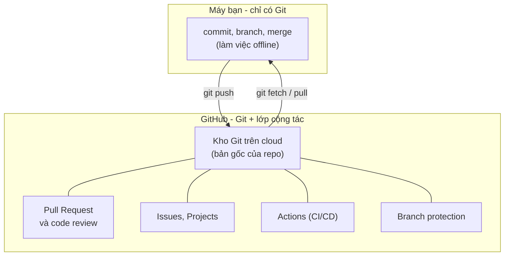
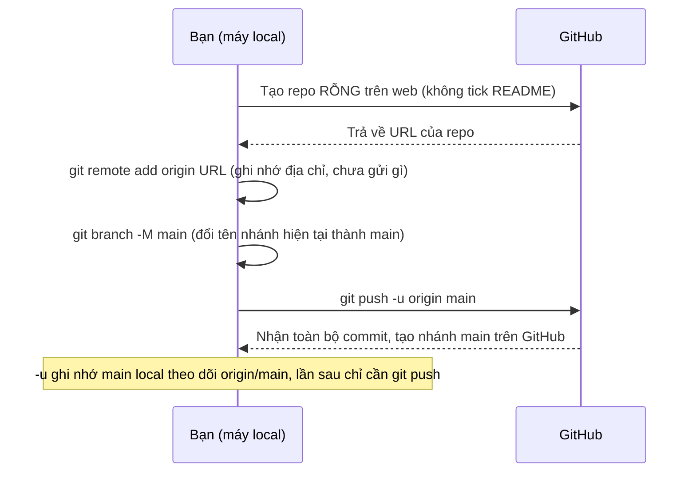
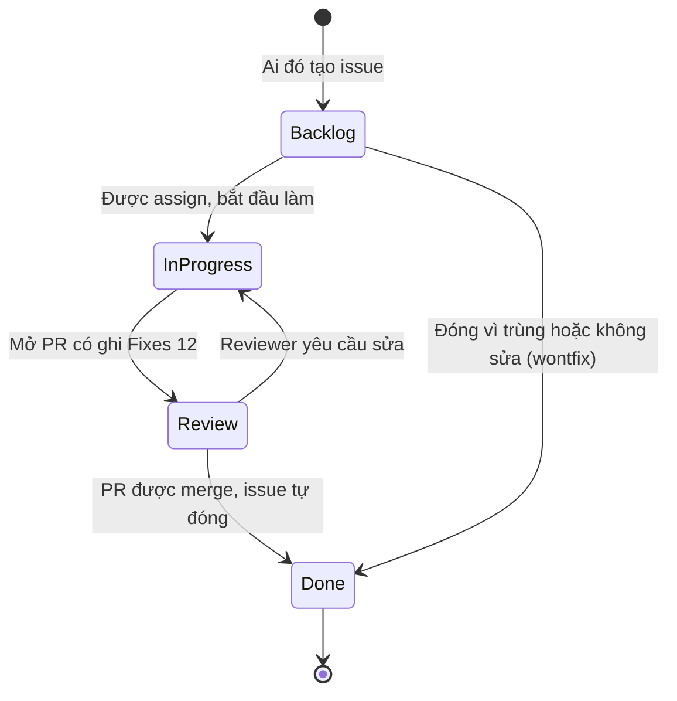
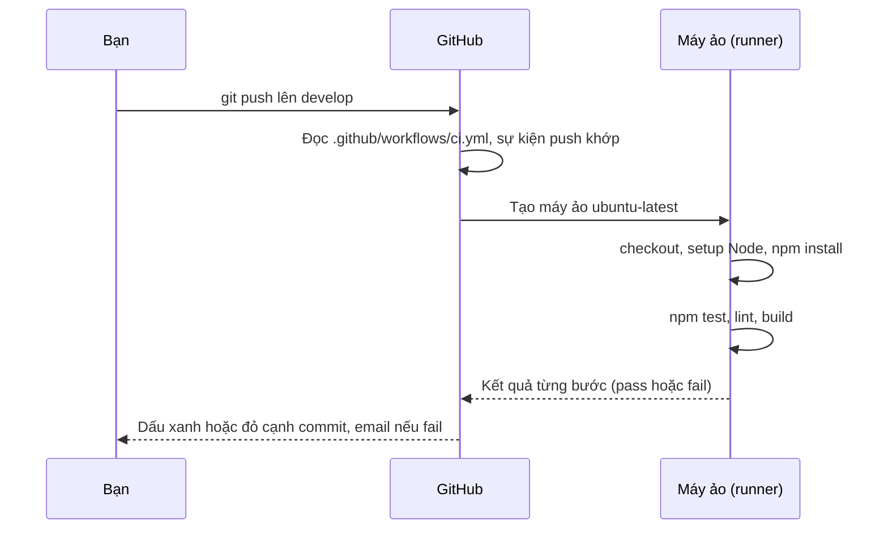
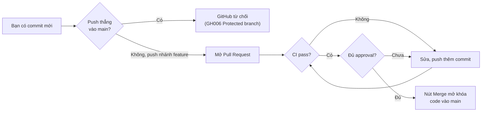

# GitHub cơ bản

GitHub là nền tảng phổ biến nhất thế giới để lưu trữ code và cộng tác phát triển phần mềm. Nếu Git là **công cụ quản lý phiên bản** trên máy tính, thì GitHub là **nơi lưu trữ và chia sẻ** code trên cloud, kèm theo hàng loạt tính năng hỗ trợ cộng tác nhóm. Bài này sẽ giúp bạn hiểu GitHub là gì, cách sử dụng các tính năng chính, và những thiết lập quan trọng cho dự án.

[](pathname:///img/git/github-co-ban.webp)

---

:::note[Ghi nhớ nhanh]

- ⭐ **Git vs GitHub** — Git là công cụ quản lý phiên bản chạy ở local; GitHub là nền tảng hosting repo trên cloud kèm lớp cộng tác (Pull Request, Issues, Actions).
- ⭐ **Branch protection rules bảo vệ nhánh main/develop** — bắt buộc tạo PR, yêu cầu approval và CI pass trước khi được merge.
- **Issues + Labels + Milestones + Projects (Kanban)** — hệ thống quản lý bug và công việc trực quan ngay trong repo.
- **GitHub Actions tự động hóa CI/CD** — chạy test/lint/build qua file YAML trong `.github/workflows/`.
- **Thư mục `.github/` chứa cấu hình dự án** — CODEOWNERS, issue/PR template; còn `README.md` là bộ mặt của dự án.

:::

---

## Mục lục

- [Vì sao cần GitHub?](#vì-sao-cần-github)
- [1. GitHub là gì?](#1-github-là-gì)
- [2. GitHub vs GitLab vs Bitbucket](#2-github-vs-gitlab-vs-bitbucket)
- [3. Tạo Repository trên GitHub](#3-tạo-repository-trên-github)
- [4. README.md — Bộ mặt của dự án](#4-readmemd-bộ-mặt-của-dự-án)
- [5. Issues — Quản lý công việc](#5-issues-quản-lý-công-việc)
- [6. GitHub Projects — Kanban Board](#6-github-projects-kanban-board)
- [7. GitHub Pages — Hosting miễn phí](#7-github-pages-hosting-miễn-phí)
- [8. GitHub Actions — CI/CD Overview](#8-github-actions-cicd-overview)
- [9. Settings quan trọng](#9-settings-quan-trọng)
- [10. Thư mục `.github/` — Cấu hình dự án](#10-thư-mục-github-cấu-hình-dự-án)
- [11. Lỗi thường gặp](#11-lỗi-thường-gặp)

---

## Vì sao cần GitHub?

**Vấn đề:** Bản thân Git chỉ là **công cụ dòng lệnh** quản lý phiên bản trên máy local. Nó **không** cung cấp nơi lưu trữ chung trên mạng, không có giao diện review code, không có hệ thống quản lý issue, cũng không tự động hoá được việc gì. Muốn cả nhóm cùng dùng một repo thì phải tự dựng server Git thủ công — cực kỳ tốn công và khó bảo trì.

**Giải pháp:** **GitHub** (cùng với GitLab, Bitbucket) là nền tảng **hosting repo Git trên cloud**, kèm một lớp cộng tác phía trên:

- **Pull Request + code review** — đề xuất và duyệt thay đổi
- **Issues** — theo dõi bug, feature request, task
- **Actions (CI/CD)** — tự động chạy test, build, deploy
- **Wiki** — tài liệu dự án
- **Quản lý quyền** — phân quyền thành viên, bảo vệ nhánh
- **Releases** — phát hành phiên bản

Nhờ đó, Git từ một công cụ cá nhân biến thành **nền tảng làm việc nhóm** hoàn chỉnh.

:::tip[Dùng thực tế]

- **Lưu và chia sẻ repo** công khai hoặc riêng tư cho cả nhóm cùng truy cập.
- **Review code qua Pull Request** trước khi merge vào nhánh chính.
- **Theo dõi bug và công việc** bằng Issues thay vì ghi chú rời rạc.
- **Chạy CI tự động** bằng Actions: test, lint, build mỗi khi push code.

:::

---

## 1. GitHub là gì?

**GitHub** = Git hosting + collaboration platform + social network cho developer.

GitHub không chỉ là nơi lưu code. Nó cung cấp:

| Tính năng              | Mô tả                            |
| ---------------------- | -------------------------------- |
| **Repository hosting** | Lưu trữ Git repo trên cloud      |
| **Pull Requests**      | Code review và merge code        |
| **Issues**             | Quản lý bug, feature requests    |
| **Actions**            | CI/CD pipeline tự động           |
| **Projects**           | Kanban board quản lý dự án       |
| **Pages**              | Hosting website tĩnh miễn phí    |
| **Discussions**        | Diễn đàn thảo luận cho dự án     |
| **Wiki**               | Tài liệu dự án                   |
| **Security**           | Quét lỗ hổng bảo mật tự động     |
| **Codespaces**         | Môi trường phát triển trên cloud |

### 1.1. Ẩn dụ: Git là cuốn sổ, GitHub là văn phòng chung

:::info[Hình dung bằng đời thường]

- **Git** = **cuốn sổ ghi chép** của bạn. Nó ghi lại mọi lần sửa, chạy ngay trên máy, không cần mạng.
- **GitHub** = **văn phòng chung** của cả nhóm, nơi để **bản gốc** của cuốn sổ. Văn phòng còn có thêm:
  - **bảng ghim việc** (Issues, Projects) — ghi ai đang làm gì, lỗi nào cần sửa;
  - **phòng họp duyệt bài** (Pull Request) — đồng đội đọc và góp ý trước khi chép vào bản gốc;
  - **robot trực ca** (Actions) — tự kiểm tra mỗi khi có trang mới nộp vào;
  - **ổ khóa ở cửa** (Branch protection) — không ai được ghi thẳng vào bản gốc mà bỏ qua bước duyệt.

Không có GitHub, Git vẫn chạy bình thường. Nhưng không có Git, GitHub chẳng có gì để lưu.

:::

Sơ đồ dưới đây cho thấy GitHub là **một lớp phía trên** Git: phần lõi (lưu commit, nhánh) là Git thuần; các tính năng cộng tác là của riêng GitHub, máy bạn không có.



---

## 2. GitHub vs GitLab vs Bitbucket

| Tiêu chí                   | GitHub                           | GitLab                    | Bitbucket                   |
| -------------------------- | -------------------------------- | ------------------------- | --------------------------- |
| **Chủ sở hữu**             | Microsoft                        | GitLab Inc.               | Atlassian                   |
| **Phổ biến**               | Lớn nhất thế giới                | Phổ biến trong enterprise | Phổ biến với team dùng Jira |
| **Private repos miễn phí** | Unlimited                        | Unlimited                 | 5 users miễn phí            |
| **CI/CD**                  | GitHub Actions                   | GitLab CI (tích hợp sẵn)  | Bitbucket Pipelines         |
| **Self-hosted**            | GitHub Enterprise                | GitLab CE (miễn phí)      | Bitbucket Data Center       |
| **Ưu điểm nổi bật**        | Cộng đồng open source lớn nhất   | DevOps all-in-one         | Tích hợp Jira, Confluence   |
| **Open source**            | Không                            | Có (CE edition)           | Không                       |
| **Container registry**     | GHCR                             | Tích hợp sẵn              | Không có                    |
| **Phù hợp**                | Open source, startup, mọi quy mô | Enterprise DevOps         | Team dùng Atlassian suite   |

**Khuyên cho người mới:** Bắt đầu với **GitHub** vì cộng đồng lớn nhất, nhiều tài liệu, và hầu hết dự án open source đều ở đây.

---

## 3. Tạo Repository trên GitHub

### Bước tạo repo

1. Đăng nhập GitHub
2. Click nút **"+"** > **"New repository"**
3. Điền thông tin:
   - **Repository name** — tên repo (ví dụ: `my-project`)
   - **Description** — mô tả ngắn (không bắt buộc nhưng nên có)
   - **Public / Private** — công khai hoặc riêng tư
   - **Initialize with README** — nên chọn
   - **Add .gitignore** — chọn template phù hợp (Node, Python, Java...)
   - **Choose a license** — MIT, Apache 2.0, GPL...

### Public vs Private

| Tiêu chí         | Public                 | Private                     |
| ---------------- | ---------------------- | --------------------------- |
| **Ai xem được**  | Tất cả mọi người       | Chỉ bạn và collaborators    |
| **Fork**         | Ai cũng fork được      | Chỉ collaborators           |
| **Giá**          | Miễn phí               | Miễn phí                    |
| **GitHub Pages** | Miễn phí               | Cần GitHub Pro              |
| **Phù hợp**      | Open source, portfolio | Code công ty, dự án cá nhân |
| **SEO**          | Google index được      | Không index                 |

### Kết nối local repo với GitHub

```bash
# Cách 1: Tạo repo trên GitHub trước, clone về
git clone https://github.com/username/my-project.git
cd my-project
# Bắt đầu code...

# Cách 2: Có repo local sẵn, kết nối với GitHub
cd my-project
git remote add origin https://github.com/username/my-project.git
git branch -M main
git push -u origin main
```

Cách 2 hay làm người mới bối rối nhất, nên đây là trình tự từng bước giữa máy bạn và GitHub:



:::caution[Vì sao nên tạo repo RỖNG khi đã có code sẵn?]

Nếu tick **"Initialize with README"**, GitHub tạo sẵn một commit trên `main`. Repo local của bạn có lịch sử riêng, **không chung gốc** với commit đó, nên `git push` sẽ bị từ chối (*rejected*). Tick README chỉ hợp với **Cách 1** (tạo trên GitHub trước rồi clone).

:::

---

## 4. README.md — Bộ mặt của dự án

README.md là **file đầu tiên** người khác nhìn thấy khi vào repo. Một README tốt giúp người đọc hiểu dự án trong vài phút.

### Cấu trúc README chuẩn

```markdown
# Project Name

Mô tả ngắn gọn dự án (1-2 câu).

## Features

- Feature 1
- Feature 2
- Feature 3

## Demo

Link demo hoặc screenshots

## Tech Stack

- Frontend: React, TypeScript
- Backend: Node.js, Express
- Database: PostgreSQL

## Getting Started

### Prerequisites

- Node.js >= 18
- npm hoặc yarn

### Installation

git clone https://github.com/username/project.git
cd project
npm install
npm start

## Usage

Hướng dẫn sử dụng cơ bản...

## Contributing

Xem file CONTRIBUTING.md

## License

MIT License
```

### Badges — Huy hiệu trạng thái

Badges hiển thị trạng thái dự án một cách trực quan:

```markdown


```

Kết quả: các huy hiệu màu sắc hiển thị build pass/fail, license, version, coverage...

**Tại sao README quan trọng:**

- Ấn tượng đầu tiên cho nhà tuyển dụng
- Giúp người mới bắt đầu nhanh
- Chuyên nghiệp hóa dự án
- Giảm số câu hỏi lặp lại

---

## 5. Issues — Quản lý công việc

Issues là hệ thống **quản lý công việc** tích hợp trong GitHub. Dùng để theo dõi bug, feature requests, và tasks.

### Tạo Issue tốt

```markdown
## Bug: Login form doesn't validate email

### Describe the bug

When submitting the login form with an invalid email (e.g., "abc"),
the form submits without showing an error message.

### Steps to reproduce

1. Go to /login
2. Enter "abc" in email field
3. Enter any password
4. Click "Login"

### Expected behavior

Show error message: "Please enter a valid email"

### Actual behavior

Form submits and shows generic "Login failed" error

### Screenshots

(Đính kèm screenshot nếu có)

### Environment

- OS: macOS 14.0
- Browser: Chrome 120
- Version: 2.1.0
```

### Labels — Nhãn phân loại

GitHub cho phép gắn **labels** (nhãn) cho issues:

| Label              | Màu        | Ý nghĩa                |
| ------------------ | ---------- | ---------------------- |
| `bug`              | Đỏ         | Lỗi cần sửa            |
| `feature`          | Xanh lá    | Tính năng mới          |
| `enhancement`      | Xanh dương | Cải thiện tính năng có |
| `documentation`    | Tím        | Cập nhật tài liệu      |
| `good first issue` | Xanh nhạt  | Phù hợp người mới      |
| `help wanted`      | Vàng       | Cần người giúp         |
| `priority: high`   | Đỏ đậm     | Ưu tiên cao            |
| `wontfix`          | Trắng      | Sẽ không sửa           |

### Milestones — Mốc dự án

Milestones nhóm các issues thành **phiên bản** hoặc **mốc thời gian**:

```
Milestone: v2.0.0 (Due: 2026-06-01)
├── Issue #12: Add dark mode       [In Progress]
├── Issue #15: Refactor auth       [Done]
├── Issue #18: Add search feature  [Todo]
└── Issue #20: Fix mobile layout   [Todo]
Progress: 25% (1/4 done)
```

### Assignees — Giao việc

Mỗi issue có thể **assign** (giao) cho một hoặc nhiều người. Giúp team biết ai đang làm gì, tránh trùng lặp công việc.

---

## 6. GitHub Projects — Kanban Board

GitHub Projects cung cấp **Kanban board** để quản lý workflow trực quan.

### Cấu trúc bảng Kanban cơ bản

```
+-------------+    +-------------+    +-------------+    +----------+
|   Backlog   |    | In Progress |    |   Review    |    |   Done   |
+-------------+    +-------------+    +-------------+    +----------+
| Issue #12   |    | Issue #15   |    | Issue #18   |    | Issue #5 |
| Issue #20   |    | Issue #22   |    |             |    | Issue #8 |
| Issue #25   |    |             |    |             |    | Issue #10|
+-------------+    +-------------+    +-------------+    +----------+
```

### Cách tạo Project

1. Vào tab **Projects** trong repo (hoặc Organization)
2. Click **New project**
3. Chọn template: **Board**, **Table**, hoặc **Roadmap**
4. Thêm issues vào project
5. Kéo thả issues giữa các cột

### Tự động hóa

GitHub Projects hỗ trợ tự động hóa:

- Issue mới tạo -> tự động vào cột **Backlog**
- PR được merge -> issue tự động chuyển sang **Done**
- Issue được assign -> chuyển sang **In Progress**

### Vòng đời một Issue

Một issue thường đi qua các trạng thái sau. Cột trên Kanban chính là các trạng thái này; mũi tên ghi việc làm nó chuyển cột:



:::tip[Mẹo: tự đóng issue khi merge PR]

Trong mô tả PR, viết `Fixes #12` (hoặc `Closes #12`, `Resolves #12`). Khi PR được merge vào nhánh mặc định, GitHub **tự đóng** issue #12 và ghi lại liên kết giữa hai bên.

:::

---

## 7. GitHub Pages — Hosting miễn phí

GitHub Pages cho phép bạn **host website tĩnh miễn phí** trực tiếp từ repo.

### Cách thiết lập

```bash
# Cách 1: Dùng nhánh gh-pages
# Build website ra thư mục build/
npm run build

# Tạo nhánh gh-pages và push
git checkout -b gh-pages
# Copy nội dung build vào root
git add .
git commit -m "deploy: initial github pages"
git push -u origin gh-pages
```

```bash
# Cách 2: Dùng thư mục /docs trên nhánh main
# Đặt website tĩnh trong thư mục docs/
# Vào Settings → Pages → Source: main branch, /docs folder
```

### Settings GitHub Pages

1. Vào **Settings** > **Pages**
2. **Source:** chọn branch (`main` hoặc `gh-pages`) và folder (`/` hoặc `/docs`)
3. **Custom domain:** thêm domain riêng (nếu có)
4. **Enforce HTTPS:** bật (khuyên dùng)

### URL sau khi deploy

```
# Repo: https://github.com/username/project
# GitHub Pages URL: https://username.github.io/project

# Repo đặc biệt: https://github.com/username/username.github.io
# URL: https://username.github.io
```

**Phù hợp cho:**

- Portfolio cá nhân
- Tài liệu dự án (Docusaurus, MkDocs, VitePress)
- Blog tĩnh (Jekyll, Hugo)
- Landing page đơn giản

---

## 8. GitHub Actions — CI/CD Overview

GitHub Actions cho phép bạn **tự động hóa workflow** ngay trong repo.

### Ví dụ: Tự động chạy tests khi push

```yaml
# .github/workflows/ci.yml
name: CI

on:
  push:
    branches: [main, develop]
  pull_request:
    branches: [main]

jobs:
  test:
    runs-on: ubuntu-latest
    steps:
      - uses: actions/checkout@v4

      - name: Setup Node.js
        uses: actions/setup-node@v4
        with:
          node-version: "20"

      - name: Install dependencies
        run: npm install

      - name: Run tests
        run: npm test

      - name: Run linter
        run: npm run lint

      - name: Build
        run: npm run build
```

Hình dung Actions như **robot trực ca**: mỗi lần có sự kiện (push, mở PR...), GitHub thuê một máy ảo sạch, chạy lần lượt các bước trong file YAML, rồi báo kết quả:



### Workflow trigger (khi nào chạy)

| Trigger             | Mô tả                  |
| ------------------- | ---------------------- |
| `push`              | Khi push code          |
| `pull_request`      | Khi tạo hoặc update PR |
| `schedule`          | Chạy theo lịch (cron)  |
| `workflow_dispatch` | Chạy thủ công          |
| `release`           | Khi tạo release        |

### Xem kết quả Actions

1. Vào tab **Actions** trong repo
2. Click vào workflow run
3. Xem logs từng step
4. Xem kết quả: pass (xanh) hoặc fail (đỏ)

---

## 9. Settings quan trọng

### Branch Protection Rules

Branch protection ngăn chặn push trực tiếp vào nhánh quan trọng (main, develop):

```
Settings → Branches → Add branch protection rule

Nhánh: main
☑ Require a pull request before merging
  ☑ Require approvals: 1 (hoặc 2)
  ☑ Dismiss stale PR approvals when new commits are pushed
☑ Require status checks to pass before merging
  ☑ Require branches to be up to date
  ☐ CI (chọn workflow cần pass)
☑ Require conversation resolution before merging
☑ Do not allow bypassing the above settings
```

Khi đã bật các ô trên, đường duy nhất để code vào `main` là đi qua PR:



**Tại sao cần branch protection:**

| Không có protection          | Có protection         |
| ---------------------------- | --------------------- |
| Ai cũng push thẳng main được | Phải tạo PR           |
| Không ai review code         | Bắt buộc có approval  |
| Tests có thể bị skip         | CI phải pass          |
| Code lỗi vào production      | Code được kiểm tra kỹ |

### Collaborators — Quản lý thành viên

**Cho repo cá nhân:**

- Settings > Collaborators > Add people
- Mời qua username hoặc email

**Cho Organization:**

- Tạo **Teams** với quyền khác nhau
- **Read** — chỉ xem
- **Write** — push code, quản lý issues
- **Maintain** — quản lý repo (không xóa)
- **Admin** — toàn quyền

---

## 10. Thư mục `.github/` — Cấu hình dự án

Thư mục `.github/` chứa các file cấu hình đặc biệt cho GitHub:

```
.github/
├── workflows/           # GitHub Actions workflows
│   ├── ci.yml          # Chạy tests
│   └── deploy.yml      # Deploy tự động
├── ISSUE_TEMPLATE/      # Template tạo issue
│   ├── bug_report.md
│   └── feature_request.md
├── PULL_REQUEST_TEMPLATE.md  # Template tạo PR
├── CODEOWNERS           # Ai review code nào
└── dependabot.yml       # Tự động cập nhật dependencies
```

### CODEOWNERS — Ai review file nào

```bash
# .github/CODEOWNERS

# Mọi thay đổi cần review bởi team lead
* @team-lead

# Frontend code cần review bởi frontend team
/src/components/ @frontend-team
/src/pages/      @frontend-team

# Backend code cần review bởi backend team
/api/            @backend-team
/database/       @backend-team

# DevOps files cần review bởi devops team
/.github/        @devops-team
/docker/         @devops-team
Dockerfile       @devops-team
```

**Cách hoạt động:** Khi ai đó tạo PR thay đổi file trong `/src/components/`, GitHub tự động thêm `@frontend-team` làm reviewer.

### Issue Template

File `.github/ISSUE_TEMPLATE/bug_report.md` (phần giữa hai dòng `---` ở đầu là cấu hình để GitHub biết tên template, nhãn tự gắn...):

```markdown
---
name: Bug Report
about: Report a bug to help us improve
title: '[BUG] '
labels: 'bug'
assignees: ''

---

## Describe the bug

A clear description of the bug.

## Steps to reproduce

1. Go to '...'
2. Click on '...'
3. See error

## Expected behavior

What should happen.

## Screenshots

If applicable, add screenshots.

## Environment

- OS: [e.g., macOS 14.0]
- Browser: [e.g., Chrome 120]
- Version: [e.g., 2.1.0]
```

### Pull Request Template

```markdown
<!-- .github/PULL_REQUEST_TEMPLATE.md -->

## Summary

Mô tả ngắn gọn thay đổi.

## Type of change

- [ ] Bug fix
- [ ] New feature
- [ ] Breaking change
- [ ] Documentation update

## Checklist

- [ ] Code follows project style guidelines
- [ ] Self-review completed
- [ ] Tests added/updated
- [ ] Documentation updated
- [ ] No console.log statements

## Test plan

Mô tả cách test thay đổi này.

## Screenshots (if applicable)
```

---

## 11. Lỗi thường gặp

### Lỗi 1: Push thẳng vào main bị từ chối

```bash
git push origin main
# remote: error: GH006: Protected branch update failed
# remote: error: Required status check "CI" is expected.

# Nguyên nhân: Branch protection đang bật
# Cách sửa: Tạo nhánh feature, push, rồi tạo Pull Request
git checkout -b feature/my-change
git push -u origin feature/my-change
# Tạo PR trên GitHub
```

### Lỗi 2: Quên thêm .gitignore

```bash
# Đã commit node_modules/ hoặc .env lên GitHub
# Cách sửa:

# Thêm vào .gitignore
echo "node_modules/" >> .gitignore
echo ".env" >> .gitignore

# Xóa khỏi Git tracking (KHÔNG xóa file thật)
git rm -r --cached node_modules/
git rm --cached .env

git commit -m "chore: add gitignore, remove tracked files"
git push
```

### Lỗi 3: Không thấy tab Actions

```
Nguyên nhân: Actions bị tắt trong settings
Cách sửa: Settings → Actions → General → Allow all actions
```

### Lỗi 4: GitHub Pages không hiển thị

```
Checklist kiểm tra:
1. Settings → Pages → Source đã chọn đúng branch và folder?
2. File index.html có tồn tại ở root của source folder?
3. Repo phải là public (trừ khi có GitHub Pro)?
4. Đợi vài phút sau khi cấu hình (cache CDN)
5. URL đúng format: https://username.github.io/repo-name
```

### Lỗi 5: Collaborator không có quyền push

```
Kiểm tra:
1. Collaborator đã accept invitation chưa? (check email)
2. Permission level đúng chưa? (cần ít nhất "Write")
3. Branch protection có chặn không?
4. Nếu dùng Organization: team permission đã đúng chưa?
```
