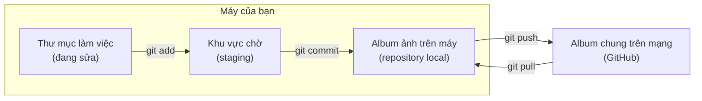
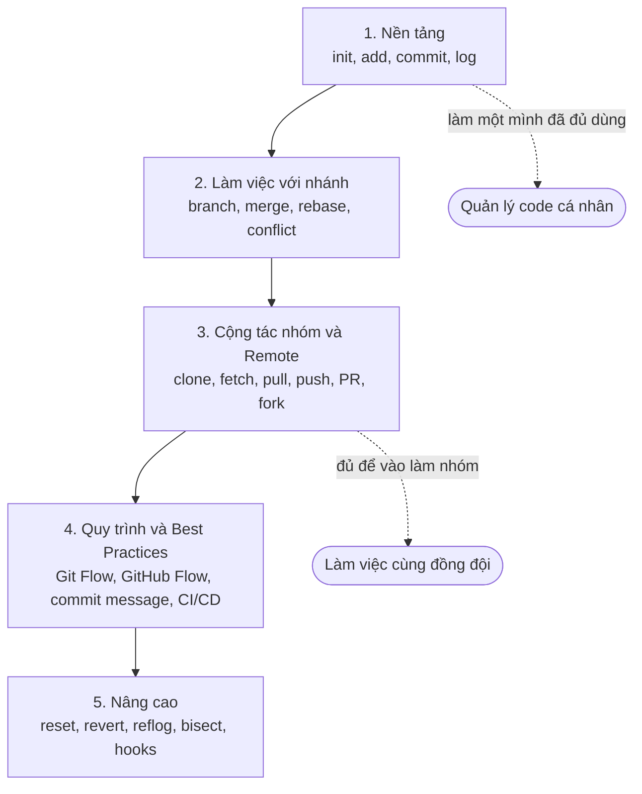

# Lộ trình học Git

:::note[Ghi nhớ nhanh]

- ⭐ **Git là hệ thống quản lý phiên bản** — lưu lại từng "trạng thái" của dự án để xem lại, so sánh hoặc quay về bất kỳ thời điểm nào.
- ⭐ **Git khác GitHub** — Git là công cụ chạy trên máy (như Word), GitHub là dịch vụ lưu trữ và cộng tác online (như Google Drive).
- **Lợi ích chính** — lưu lịch sử thay đổi, làm việc nhóm trật tự, và quay lui code khi lỡ làm hỏng.
- **Lộ trình 5 bước** — Nền tảng → Làm việc với nhánh → Cộng tác & Remote → Quy trình & Best Practices → Nâng cao; học lần lượt vì bước trước là nền cho bước sau.
- **Phải thực hành** — gõ lại từng lệnh trên máy, sai cũng không sao vì Git luôn cho phép quay lui.

:::

## Git là gì?

**Git** là một hệ thống quản lý phiên bản (version control - hệ thống theo dõi và lưu lại các thay đổi của tập tin theo thời gian). Nói đơn giản, Git giúp bạn lưu lại từng "trạng thái" của dự án, để sau này có thể xem lại, so sánh, hoặc quay về bất kỳ thời điểm nào trong quá khứ.

Hãy tưởng tượng bạn đang viết một bài luận bằng Word. Để an toàn, bạn lưu nhiều bản nháp: `bai-luan.docx`, `bai-luan-v2.docx`, `bai-luan-final.docx`, `bai-luan-final-that-su.docx`... Cách làm này vừa rối, vừa khó biết bản nào khác bản nào ở chỗ nào. Git sinh ra để giải quyết đúng vấn đề đó: thay vì tạo hàng chục file rời rạc, Git lưu toàn bộ lịch sử thay đổi một cách gọn gàng trong cùng một thư mục.

## Vì sao cần Git?

- Khi viết code, bạn liên tục sửa đổi. Nếu lỡ làm hỏng một thứ đang chạy tốt, bạn cần cách quay lui nhanh chóng.
- Khi làm việc nhóm, nhiều người cùng sửa một dự án. Cần một công cụ giúp gộp công sức của mọi người mà không ghi đè lên nhau.
- Khi muốn thử một ý tưởng mới mà không phá hỏng phần đang ổn định.

## Phân biệt Git và GitHub

Đây là điểm người mới hay nhầm lẫn:

- **Git** là phần mềm chạy trên máy tính của bạn (offline) để quản lý phiên bản. Nó là "công cụ".
- **GitHub** là một dịch vụ trực tuyến (website) dùng để lưu trữ các dự án Git trên đám mây (cloud) và chia sẻ với người khác. Nó là "nơi lưu trữ và cộng tác".

Ví dụ dễ hiểu: Git giống như Microsoft Word (phần mềm soạn thảo), còn GitHub giống như Google Drive (nơi lưu file để chia sẻ). Ngoài GitHub còn có các dịch vụ tương tự như GitLab, Bitbucket.

## Một ẩn dụ để hình dung toàn bộ Git

Hãy tưởng tượng dự án của bạn là **một cuốn album ảnh** ghi lại quá trình xây một ngôi nhà:

- **Commit** = một **tấm ảnh chụp** toàn bộ ngôi nhà tại một thời điểm, kèm dòng chú thích "hôm nay làm gì". Muốn quay lại hôm qua, chỉ cần lật về tấm ảnh đó.
- **Branch (nhánh)** = một **bản nháp song song**: bạn thử sơn tường màu xanh trên một tập ảnh riêng, tập chính vẫn nguyên vẹn. Ưng thì gộp (merge) vào, không ưng thì bỏ.
- **Remote (kho từ xa, ví dụ GitHub)** = **cuốn album chung** để trên mạng. Mỗi người trong nhóm có một bản sao ở máy mình, thỉnh thoảng gửi ảnh mới lên (push) và lấy ảnh của người khác về (pull).
- **Pull Request** = **xin phép dán ảnh của mình vào album chung**, để đồng đội xem trước và góp ý.

Sơ đồ trên là toàn bộ "đường đi" của một thay đổi: sửa file → đánh dấu muốn lưu → chụp ảnh (commit) trên máy → gửi lên kho chung. Các bài trong lộ trình sẽ lần lượt mở từng mũi tên này ra.

## Lợi ích chính

- **Lưu lịch sử**: Mọi thay đổi đều được ghi lại, kèm theo người thực hiện và lý do.
- **Làm việc nhóm**: Nhiều người cùng đóng góp vào một dự án một cách trật tự.
- **Quay lui code**: Lỡ tay làm hỏng? Chỉ cần quay về phiên bản trước đó là xong.

## Lộ trình học

| # | Chủ đề | Mô tả |
|---|--------|-------|
| 1 | Nền tảng | Cài đặt Git, cấu hình cơ bản, hiểu khái niệm repository (kho chứa code), commit (bản ghi thay đổi), staging area (khu vực chờ). Các lệnh `init`, `add`, `commit`, `status`, `log`. |
| 2 | Làm việc với nhánh | Khái niệm branch (nhánh - dòng phát triển song song), tạo và chuyển nhánh, gộp nhánh (merge), xử lý xung đột (conflict) khi gộp. |
| 3 | Cộng tác nhóm & Remote | Làm việc với kho từ xa (remote), `clone`, `push`, `pull`, `fetch`, đồng bộ với GitHub và làm việc cùng đồng đội. |
| 4 | Quy trình & Best Practices | Pull Request (yêu cầu gộp code), code review (đánh giá code), quy ước đặt tên commit, các mô hình làm việc nhóm (Git Flow, GitHub Flow). |
| 5 | Nâng cao | `rebase` (sắp xếp lại lịch sử), `cherry-pick` (chọn lọc commit), `stash` (cất tạm thay đổi), `reset`, `revert`, và cách gỡ rối các tình huống phức tạp. |

## Học theo thứ tự nào?

Hãy học **lần lượt từ nhóm 1 đến nhóm 5**. Mỗi nhóm là nền tảng cho nhóm tiếp theo:

1. Bắt đầu với **Nền tảng** để nắm vững cách Git lưu lại thay đổi. Đây là phần quan trọng nhất, đừng vội bỏ qua.
2. Sau khi quen với commit, học **Làm việc với nhánh** để biết cách phát triển nhiều tính năng song song.
3. Tiếp theo là **Cộng tác nhóm & Remote** để đưa code lên GitHub và làm việc với người khác.
4. Khi đã làm việc nhóm, học **Quy trình & Best Practices** để tuân theo cách làm chuyên nghiệp.
5. Cuối cùng, khi đã thành thạo, tìm hiểu các kỹ thuật **Nâng cao** để xử lý những tình huống khó.

### Sơ đồ lộ trình

Mũi tên liền là thứ tự nên học; mũi tên đứt cho biết học tới đâu thì đã "dùng được" cho mục đích nào.

Lời khuyên cho người mới: đừng chỉ đọc, hãy **gõ lại từng lệnh** trên máy của mình. Git chỉ thực sự "ngấm" khi bạn tự tay thực hành. Sai cũng không sao, vì Git luôn cho phép bạn quay lui.
