# Branch là gì? Tạo và quản lý nhánh

Khi làm việc với Git, bạn sẽ nhanh chóng nhận ra rằng làm tất cả mọi thứ trên một dòng thời gian duy nhất là một ý tưởng tồi tệ. Tưởng tượng bạn đang viết tính năng mới, đồng nghiệp đang sửa bug, người khác đang thí nghiệm -- tất cả trên cùng một nơi. Hỗn độn là điều chắc chắn. **Branch** (nhánh) chính là giải pháp cho vấn đề này.

[](pathname:///img/git/branch-la-gi.webp)

---

:::note[Ghi nhớ nhanh]

- ⭐ **Branch chỉ là một con trỏ nhẹ (41 bytes)** — trỏ tới một commit, nên tạo và chuyển nhánh gần như tức thì, không tốn dung lượng.
- ⭐ **Mỗi đơn vị công việc = 1 branch** — dùng `git switch -c <tên>` để tạo và chuyển sang nhánh mới trong một bước.
- **HEAD trỏ tới nhánh hiện tại** — khi commit, nhánh đó di chuyển lên commit mới, các nhánh khác giữ nguyên.
- **Ưu tiên `git switch`/`git restore`** — thay cho `git checkout` đa năng dễ gây nhầm giữa chuyển nhánh và khôi phục file.
- **Xóa nhánh: `git branch -d` (an toàn, đã merge), `-D` (ép xóa)** — và `git push -u origin <tên>` để thiết lập tracking với remote.
- **Đặt tên có prefix rõ ràng** — như `feature/`, `bugfix/`, `hotfix/`, chữ thường và dùng dấu gạch nối.

:::

---

## Mục lục

- [Vì sao cần branch?](#vì-sao-cần-branch)
- [1. Branch là gì?](#1-branch-là-gì)
- [2. Tại sao cần branch?](#2-tại-sao-cần-branch)
- [3. Các lệnh cơ bản về branch](#3-các-lệnh-cơ-bản-về-branch)
- [4. Chuyển đổi giữa các branch](#4-chuyển-đổi-giữa-các-branch)
- [5. Naming conventions -- Quy tắc đặt tên branch](#5-naming-conventions-quy-tắc-đặt-tên-branch)
- [6. Branch tracking -- Local vs Remote](#6-branch-tracking-local-vs-remote)
- [7. ASCII diagram -- Branch diverge và merge](#7-ascii-diagram-branch-diverge-và-merge)
- [8. Quản lý branches -- Khi nào tạo, khi nào xoá](#8-quản-lý-branches-khi-nào-tạo-khi-nào-xoá)
- [9. Thực hành -- Bài tập tự làm](#9-thực-hành-bài-tập-tự-làm)
- [10. Lỗi thường gặp](#10-lỗi-thường-gặp)
- [Tóm tắt](#tóm-tắt)

---

## Vì sao cần branch?

**Vấn đề:** Nếu cả nhóm cùng làm việc trực tiếp trên một dòng code chính (`main`), mọi thứ sẽ rất hỗn loạn:

```bash
# Mọi người commit thẳng lên main
git switch main
# Dev A: code tính năng còn dở dang
git commit -m "WIP: thanh toán (chưa xong)"
# Dev B: vừa pull về -> dính code lỗi của A -> bản đang chạy VỠ
# Nhiều tính năng trộn lẫn trong cùng history -> review cực khó
# Muốn phát hành bản ổn định? Không thể, vì main đang dở dang
```

**Giải pháp:** Dùng **branch** để tách một dòng phát triển **độc lập** từ `main`. Mỗi tính năng hay bản sửa lỗi làm riêng một nhánh, không ảnh hưởng nhau; xong và ổn định thì mới merge lại.

```bash
# Mỗi đầu việc một nhánh riêng, tách từ main
git switch -c feature/payment   # Dev A làm thanh toán
git switch -c feature/dashboard # Dev B làm dashboard

# Code dở dang nằm gọn trong nhánh -> main luôn sạch và chạy được
# Xong, ổn định -> mới merge về main
git switch main
git merge feature/payment
```

Branch trong Git **siêu nhẹ** -- chỉ là một con trỏ trỏ tới commit, nên tạo và chuyển nhánh gần như tức thì, không tốn dung lượng.

:::tip[Dùng thực tế]

- **Mỗi tính năng một feature branch:** `feature/login`, `feature/cart`... làm xong mới merge.
- **Hotfix tách riêng:** lỗi production khẩn cấp -> tạo `hotfix/...` từ main, sửa nhanh rồi deploy, không dính code đang dev.
- **Nhiều người làm song song:** mỗi dev một nhánh, không giẫm chân, không conflict liên tục.
- **Giữ main luôn ổn định:** main lúc nào cũng deploy được, vì code chưa hoàn thiện nằm ở nhánh khác.

:::

---

## 1. Branch là gì?

### 1.1. Metaphor cây -- Thân chính và nhánh cây

Hãy tưởng tượng dự án của bạn như một **cái cây**:

- **Thân chính (trunk)** = nhánh `main` -- đây là phiên bản ổn định, chính thức
- **Nhánh cây (branch)** = các nhánh làm việc -- mỗi nhánh là một hướng phát triển độc lập

```
        feature/login
       /
main ----*----*----*----*
       \
        bugfix/header
```

Mỗi nhánh cây có thể **phát triển độc lập** mà không ảnh hưởng đến thân chính. Khi nhánh đã "chín" (hoàn thành), bạn **ghép nó lại** vào thân chính.

:::info[Ẩn dụ thứ hai: bản nháp song song của cùng một bài văn]

Bạn có bài văn đã nộp (`main`). Muốn thử viết lại đoạn mở bài theo hai kiểu, bạn **photo ra hai bản nháp** và sửa trên từng bản — bài gốc không bị đụng tới. Kiểu nào hay thì chép vào bài gốc (**merge** — gộp), kiểu nào dở thì vứt bản nháp (**xoá branch**).

Điểm khác duy nhất: Git **không photo thật**. Mọi "bản nháp" dùng chung những trang cũ, chỉ những trang bạn viết thêm mới thuộc riêng nhánh đó. Vì vậy tạo branch gần như không tốn gì.

:::

Sơ đồ ASCII ở trên vẽ lại bằng gitGraph: `main` là đường chính, hai nhánh rẽ ra từ cùng một commit và phát triển song song (tên nhánh trong sơ đồ dùng `-` thay cho `/`):

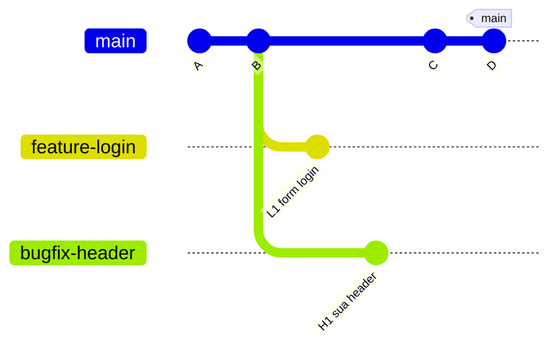

### 1.2. Định nghĩa kỹ thuật -- Branch là một pointer

Trong Git, branch **không phải là một bản sao của toàn bộ dự án**. Nó chỉ là một **con trỏ (pointer)** trỏ đến một commit cụ thể.

```
                    main (pointer)
                      |
                      v
commit-A --> commit-B --> commit-C
                            ^
                            |
                       feature/login (pointer)
```

- Mỗi branch chỉ là một file nhỏ (41 bytes) chứa hash của commit mà nó trỏ đến
- Tạo branch mới **cực nhanh** vì Git chỉ cần tạo thêm một pointer
- Không sao chép file, không tốn dung lượng

**Điều này khác với SVN** -- nơi tạo branch nghĩa là sao chép toàn bộ thư mục dự án. Git thông minh hơn nhiều.

### 1.3. HEAD -- Bạn đang ở đâu?

`HEAD` là một pointer đặc biệt, trỏ đến **branch hiện tại** mà bạn đang làm việc:

```
HEAD --> main --> commit-C

# Khi chuyển sang feature/login:
HEAD --> feature/login --> commit-C
```

Khi bạn commit, branch mà HEAD đang trỏ đến sẽ **di chuyển lên phía trước** (trỏ đến commit mới). Các branch khác giữ nguyên.

Minh hoạ cụ thể: hai nhãn `main` và `feature/login` cùng dán ở commit C, HEAD đang theo `feature/login`. Bạn commit một lần:

**Trước** — một commit, hai nhãn:

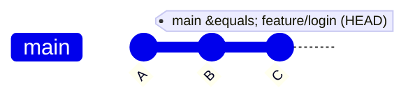

**Sau `git commit`** — chỉ nhãn mà HEAD đang theo được dời sang commit mới D; `main` đứng yên ở C:

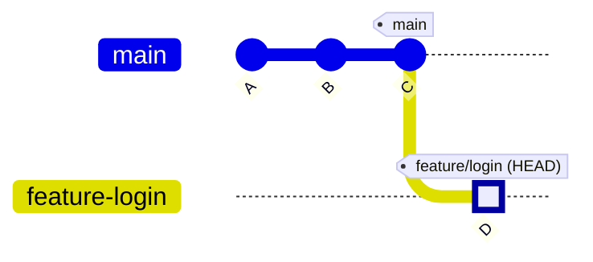

Nếu lúc commit HEAD đang theo `main` thì ngược lại: `main` sang D, `feature/login` đứng yên. **"Đang đứng ở nhánh nào" quyết định nhãn nào được dời** — đó là lý do luôn kiểm tra `git status` (dòng `On branch ...`) trước khi commit.

---

## 2. Tại sao cần branch?

### 2.1. Parallel development -- Làm việc song song

Không có branch:

```
Developer A: đang sửa file login.js
Developer B: cũng sửa file login.js
=> CONFLICT liên tục, mất thời gian giải quyết
```

Có branch:

```
Developer A: làm trên feature/login
Developer B: làm trên feature/dashboard
=> Mỗi người một nhánh, không cản nhau
```

Cùng một buổi sáng của hai người, có và không có branch. Điểm khác là **lúc nào** phải "chạm" vào code của nhau:

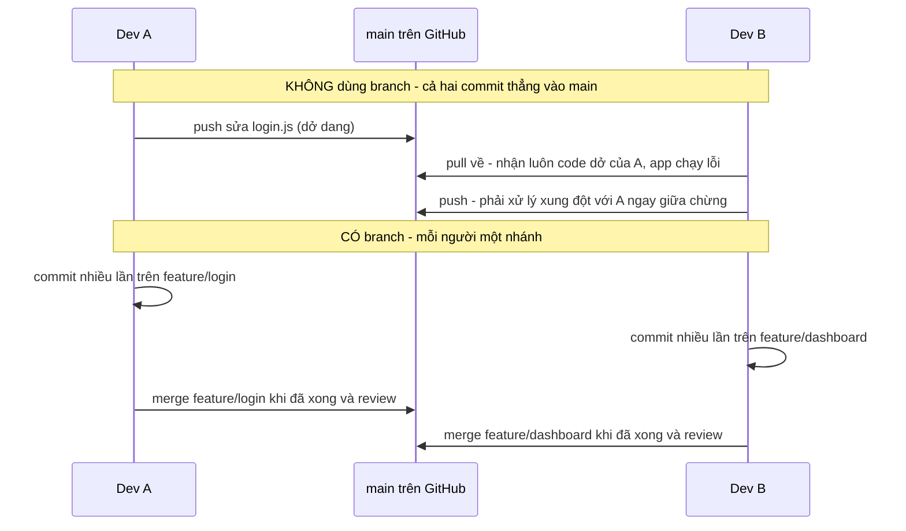

Có branch, `main` chỉ nhận code **đã hoàn chỉnh**; mỗi người chỉ phải "gặp" code của người kia **một lần** lúc merge, thay vì liên tục cả ngày.

### 2.2. Isolation -- Cô lập thay đổi

Branch tạo ra một **không gian làm việc riêng**. Nếu bạn làm hỏng gì đó trên branch của mình, **main vẫn an toàn**. Bạn có thể:

- Xoá branch đó và bắt đầu lại
- Sửa xong rồi mới merge vào main
- Để đồng nghiệp review trước khi merge

### 2.3. Experimentation -- Thí nghiệm tự do

Muốn thử một ý tưởng mới? Tạo branch, thí nghiệm thoải mái:

```bash
# Tạo nhánh thí nghiệm
git switch -c experiment/new-algorithm

# Làm gì thì làm...
# Nếu thành công -> merge vào main
# Nếu thất bại -> xoá branch, không ai biết :)
git switch main
git branch -D experiment/new-algorithm   # -D vì nhánh CHƯA merge (-d sẽ bị từ chối)
```

---

## 3. Các lệnh cơ bản về branch

### 3.1. Liệt kê branches

```bash
# Xem tất cả branch local
git branch
# Kết quả:
#   feature/login
# * main              <-- dấu * chỉ branch hiện tại
#   bugfix/header

# Xem branch local kèm commit cuối
git branch -v
# Kết quả:
#   feature/login  a1b2c3d Thêm form đăng nhập
# * main           e4f5a6b Update README
#   bugfix/header  9c7d8e1 Sửa header responsive

# Xem TẤT CẢ branch (cả local và remote)
git branch -a
# Kết quả:
#   feature/login
# * main
#   bugfix/header
#   remotes/origin/main
#   remotes/origin/feature/login
#   remotes/origin/develop

# Xem chỉ branch đã merge vào branch hiện tại
git branch --merged

# Xem branch CHƯA merge (cẩn thận khi xoá)
git branch --no-merged
```

### 3.2. Tạo branch mới

```bash
# Tạo branch mới (nhưng KHÔNG chuyển sang)
git branch feature/login
# Bạn vẫn đang ở branch cũ

# Tạo branch mới TỪ một commit cụ thể
git branch hotfix/urgent abc1234
# Tạo branch từ commit có hash abc1234

# Tạo branch mới từ một branch khác
git branch feature/v2 develop
# Tạo feature/v2 từ vị trí của develop
```

### 3.3. Xoá branch

```bash
# Xoá branch đã merge (an toàn)
git branch -d feature/login
# Git sẽ kiểm tra: branch này đã merge chưa?
# Nếu chưa merge -> Git từ chối xoá, bảo vệ bạn

# Xoá branch CHƯA merge (ép buộc -- cẩn thận!)
git branch -D feature/login
# -D = --delete --force
# Mất hết commit trên branch này (trừ khi có reflog)

# Xoá branch trên remote
git push origin --delete feature/login
# Hoặc cú pháp ngắn:
git push origin :feature/login
```

**Lưu ý quan trọng:** Không thể xoá branch mà bạn đang đứng trên đó. Phải chuyển sang branch khác trước.

#### Xoá branch thực chất là xoá gì? `-d` vs `-D`

Xoá branch = **bóc tờ nhãn** ra, chứ không xoá commit. Câu hỏi là: bóc nhãn xong, các commit đó còn đường nào để tìm lại không?

**Trường hợp 1 — nhánh đã merge** (`git branch -d feature/login` thành công). F, G vẫn nằm trên đường đi ngược từ `main` (qua merge commit M), nên bóc nhãn không mất gì:

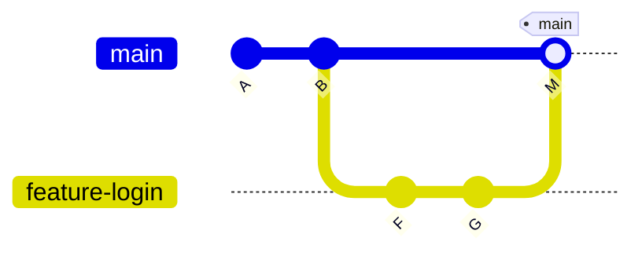

**Trường hợp 2 — nhánh chưa merge** (`-d` bị từ chối, bạn ép bằng `-D`). X, Y **không** nằm trên đường nào từ `main`; bóc nhãn đi là chúng thành "trẻ lạc", chỉ còn tìm qua `git reflog`:

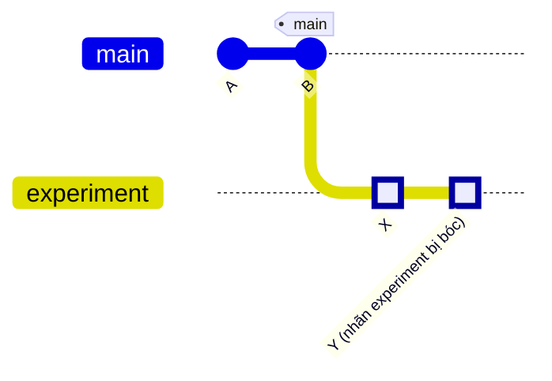

| Tiêu chí                       | `git branch -d`                     | `git branch -D`                              |
| ------------------------------ | ----------------------------------- | -------------------------------------------- |
| Nhánh đã merge                 | Xoá nhãn, không mất gì              | Xoá nhãn, không mất gì                       |
| Nhánh chưa merge               | **Từ chối** ("not fully merged")    | Xoá nhãn, commit thành "trẻ lạc"             |
| Cứu lại được không             | Không cần                           | Được, bằng `git reflog` (thường trong ~30–90 ngày) |
| Nên dùng khi                   | Mặc định                            | Chắc chắn muốn bỏ thí nghiệm                 |

```bash
# KHÔNG ĐƯỢC: đang ở main mà xoá main
git branch -d main
# error: Cannot delete branch 'main' checked out

# ĐÚNG: chuyển sang branch khác trước
git switch develop
git branch -d feature/old
```

---

## 4. Chuyển đổi giữa các branch

### 4.1. `git switch` (hiện đại -- từ Git 2.23+)

```bash
# Chuyển sang branch đã tồn tại
git switch feature/login

# Tạo branch mới VÀ chuyển sang luôn
git switch -c feature/dashboard
# -c = --create

# Tạo branch mới từ một điểm cụ thể
git switch -c hotfix/urgent main
# Tạo hotfix/urgent từ main và chuyển sang

# Quay lại branch trước đó (như cd -)
git switch -
# Rất tiện lợi khi chuyển qua lại giữa 2 branch
```

### 4.2. `git checkout` (cũ -- vẫn hoạt động)

```bash
# Chuyển branch
git checkout feature/login

# Tạo và chuyển
git checkout -b feature/dashboard
```

### 4.3. Tại sao `git switch` tốt hơn `git checkout`?

`git checkout` là lệnh "đa năng" quá mức -- nó làm quá nhiều việc:

| Hành động           | `git checkout`                    | Lệnh hiện đại                          |
| ------------------- | --------------------------------- | -------------------------------------- |
| Chuyển branch       | `git checkout feature`            | `git switch feature`                   |
| Tạo + chuyển branch | `git checkout -b feature`         | `git switch -c feature`                |
| Khôi phục file      | `git checkout -- file.txt`        | `git restore file.txt`                 |
| Khôi phục từ commit | `git checkout abc123 -- file.txt` | `git restore --source abc123 file.txt` |

Vấn đề của `git checkout`:

```bash
# Chuyển sang branch tên "main"? Hay khôi phục file tên "main"?
git checkout main
# Git phải đoán ý bạn -- dễ gây nhầm lẫn!

# Với git switch/restore -- rõ ràng hơn:
git switch main          # Chuyển branch
git restore main         # Khôi phục file tên "main"
```

**Khuyên nghị:** Luôn dùng `git switch` và `git restore`. Chỉ dùng `git checkout` khi làm việc với Git phiên bản cũ (trước 2.23).

---

## 5. Naming conventions -- Quy tắc đặt tên branch

### 5.1. Các prefix phổ biến

| Prefix      | Mục đích                         | Ví dụ                         |
| ----------- | -------------------------------- | ----------------------------- |
| `feature/`  | Tính năng mới                    | `feature/user-authentication` |
| `bugfix/`   | Sửa lỗi (không khẩn cấp)         | `bugfix/login-redirect`       |
| `hotfix/`   | Sửa lỗi khẩn cấp trên production | `hotfix/payment-crash`        |
| `release/`  | Chuẩn bị release phiên bản mới   | `release/v2.1.0`              |
| `docs/`     | Cập nhật tài liệu                | `docs/api-guide`              |
| `refactor/` | Tái cấu trúc code                | `refactor/auth-module`        |
| `test/`     | Thêm hoặc sửa test               | `test/integration-api`        |
| `chore/`    | Công việc bảo trì                | `chore/update-dependencies`   |

### 5.2. Quy tắc đặt tên tốt

```bash
# TỐT -- mô tả rõ ràng, có prefix
feature/user-authentication
bugfix/fix-login-redirect-loop
hotfix/payment-null-pointer

# XẤU -- không rõ ràng
my-branch
fix
test123
thuans-branch
```

**Nguyên tắc:**

- Dùng chữ thường và dấu gạch nối `-` (không dùng dấu cách, underscore)
- Bắt đầu bằng prefix phân loại
- Mô tả ngắn gọn nhưng đủ hiểu
- Có thể thêm ticket ID: `feature/JIRA-123-user-auth`

---

## 6. Branch tracking -- Local vs Remote

### 6.1. Local branch vs Remote branch

```
Local (máy bạn)              Remote (GitHub/GitLab)
-----------------            ---------------------
main                    -->  origin/main
feature/login           -->  origin/feature/login
bugfix/header           -->  (chưa push lên)
                              origin/develop (chưa pull về)
```

- **Local branch:** Chỉ tồn tại trên máy bạn
- **Remote-tracking branch:** Bản sao của branch trên remote, lưu ở local với tên `origin/<branch>`
- **Tracking relationship:** Liên kết giữa local và remote branch

:::info[Ẩn dụ: sổ của bạn, tấm ảnh chụp bảng tin, và bảng tin thật]

- **Remote branch** (trên GitHub) = **bảng tin thật** ở văn phòng — ai cũng ghim thêm được.
- **Remote-tracking branch** (`origin/main` trên máy bạn) = **tấm ảnh bạn chụp bảng tin** lần gần nhất. Nó **không tự cập nhật**; muốn ảnh mới phải chụp lại (`git fetch`).
- **Local branch** (`main`) = **cuốn sổ của bạn**, nơi bạn tự viết. **Tracking** (theo dõi) = ghi chú trên bìa sổ "sổ này đối chiếu với bảng tin `main`", để `git status` nói được "bạn đang hơn/kém bảng tin mấy mục".

:::

Ba "bản" của cùng một nhánh nằm ở ba chỗ khác nhau, và mỗi lệnh chỉ di chuyển dữ liệu giữa hai chỗ:

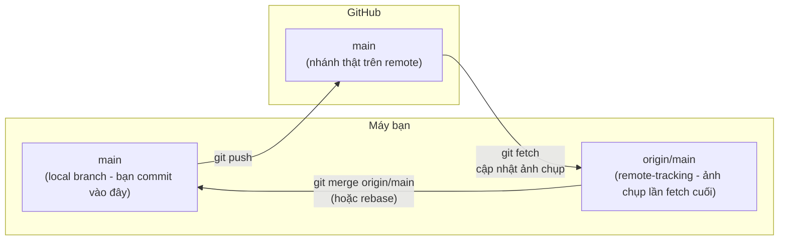

### 6.2. Thiết lập tracking

```bash
# Push branch mới lên remote và thiết lập tracking
git push -u origin feature/login
# -u = --set-upstream
# Lần sau chỉ cần: git push (không cần chỉ định remote và branch)

# Xem tracking information
git branch -vv
# Kết quả:
#   feature/login  a1b2c3d [origin/feature/login] Thêm form login
# * main           e4f5a6b [origin/main] Update README
#   bugfix/header  9c7d8e1 Sửa header  <-- không có tracking

# Thiết lập tracking cho branch đã tồn tại
git branch --set-upstream-to=origin/feature/login feature/login
# Hoặc ngắn hơn:
git branch -u origin/feature/login
```

### 6.3. Fetch vs Pull

```bash
# Fetch: tải về thông tin từ remote (KHÔNG merge)
git fetch origin
# Cập nhật tất cả remote-tracking branches
# Bạn có thể xem thay đổi trước khi merge

# Pull: fetch + merge (hoặc rebase)
git pull origin main
# Tương đương:
# git fetch origin
# git merge origin/main
```

Cùng tình huống: đồng đội vừa push commit D lên `main` trên GitHub, còn máy bạn đang dừng ở C.

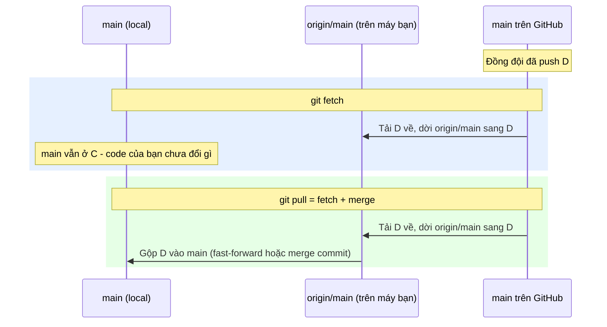

| Tiêu chí                         | `git fetch`                              | `git pull`                                     |
| -------------------------------- | ---------------------------------------- | ---------------------------------------------- |
| Tải commit mới về máy            | Có                                       | Có                                             |
| Đổi file bạn đang mở             | **Không**                                | Có                                             |
| Có thể gây conflict              | Không                                    | Có                                             |
| Dùng khi                         | Muốn **xem trước** rồi mới quyết định    | Đã tin tưởng, muốn cập nhật ngay               |
| Ví von                           | Chụp lại bảng tin, chưa chép vào sổ      | Chụp lại và chép luôn vào sổ                   |

Mẹo an toàn cho người mới: `git fetch` rồi `git log --oneline main..origin/main` để xem "trên GitHub có gì mới mà mình chưa có", sau đó mới `git merge` hoặc `git pull`.

---

## 7. ASCII diagram -- Branch diverge và merge

```
# Ban đầu: chỉ có main
main: A---B---C

# Tạo feature/login từ commit C
main:          A---B---C
                        \
feature/login:           (đang ở C)

# Làm việc trên cả 2 branch
main:          A---B---C---D---E
                        \
feature/login:           F---G---H

# Merge feature/login vào main
main:          A---B---C---D---E---M  (merge commit)
                        \         /
feature/login:           F---G---H

# Sau khi merge, có thể xoá feature/login
main:          A---B---C---D---E---M
```

Vẽ lại các bước trên bằng gitGraph. **Bước "làm việc trên cả 2 branch"** — hai nhánh phân kỳ từ C:

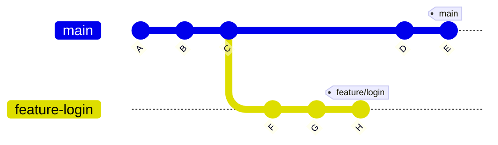

**Sau `git merge feature/login`** trên `main` — merge commit M có 2 parent (E và H). Xoá nhãn `feature/login` sau đó không làm mất F, G, H vì chúng vẫn nối vào M:

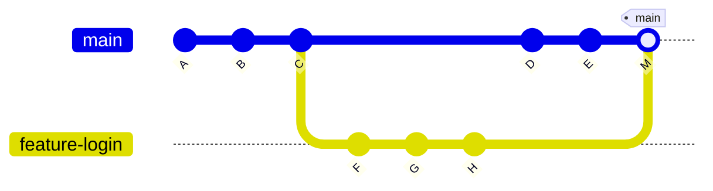

Chi tiết các kiểu merge (fast-forward, 3-way, squash) xem ở bài [Merge cơ bản](./2_merge-co-ban.md).

Xem trực quan bằng lệnh:

```bash
git log --oneline --graph --all
# Kết quả:
# *   M (HEAD -> main) Merge branch 'feature/login'
# |\
# | * H (feature/login) Hoàn thiện login
# | * G Thêm validation
# | * F Tạo form login
# * | E Update homepage
# * | D Thêm footer
# |/
# * C Thêm trang chủ
# * B Thêm README
# * A Initial commit
```

---

## 8. Quản lý branches -- Khi nào tạo, khi nào xoá

### 8.1. Khi nào tạo branch mới?

- **Bắt đầu tính năng mới** -- luôn tạo branch riêng
- **Sửa bug** -- tạo branch từ main hoặc release
- **Thí nghiệm** -- tạo branch để thử ý tưởng
- **Review code** -- mỗi PR tương ứng với một branch

**Nguyên tắc vàng:** Mỗi đơn vị công việc (feature, bugfix, task) = 1 branch.

### 8.2. Khi nào xoá branch?

```bash
# Sau khi đã merge thành công
git branch -d feature/login

# Kiểm tra các branch đã merge (an toàn để xoá)
git branch --merged main
# Liệt kê các branch đã merge vào main

# Dọn dẹp branch remote đã merge
git fetch --prune
# Xoá các remote-tracking branch mà remote đã xoá
```

### 8.3. Dọn dẹp branch định kỳ

```bash
# Xem các branch cũ (không hoạt động > 3 tháng)
git for-each-ref --sort=-committerdate --format='%(committerdate:short) %(refname:short)' refs/heads/

# Xoá tất cả branch đã merge (trừ main và develop)
git branch --merged main | grep -v "main\|develop" | xargs git branch -d
```

---

## 9. Thực hành -- Bài tập tự làm

### Bài tập 1: Tạo và quản lý branch

```bash
# 1. Tạo thư mục dự án mới
mkdir git-branch-practice && cd git-branch-practice
git init

# 2. Tạo commit đầu tiên trên main
echo "# My Project" > README.md
git add README.md
git commit -m "Initial commit"

# 3. Tạo branch feature/header
git switch -c feature/header

# 4. Làm việc trên feature/header
echo "<header>My Header</header>" > header.html
git add header.html
git commit -m "Thêm header"

# 5. Quay lại main
git switch main

# 6. Tạo branch feature/footer
git switch -c feature/footer
echo "<footer>My Footer</footer>" > footer.html
git add footer.html
git commit -m "Thêm footer"

# 7. Xem tất cả branches
git branch -v

# 8. Xem graph
git log --oneline --graph --all
```

### Bài tập 2: Xoá branch

```bash
# Merge feature/header vào main trước
git switch main
git merge feature/header

# Xoá branch đã merge
git branch -d feature/header
# Thành công!

# Thử xoá branch chưa merge
git branch -d feature/footer
# error: The branch 'feature/footer' is not fully merged
# Git bảo vệ bạn! Dùng -D nếu chắc chắn muốn xoá
```

---

## 10. Lỗi thường gặp

### Lỗi 1: Quên commit trước khi chuyển branch

```bash
# Đang edit file trên feature/login
# Chuyển sang main mà chưa commit
git switch main
# Các thay đổi CHƯA COMMIT sẽ đi theo bạn sang main!
# (Nếu chúng đụng file mà main có nội dung khác, Git TỪ CHỐI chuyển:
#  "Your local changes ... would be overwritten by checkout")
# => Dùng git stash hoặc commit trước khi chuyển

# Cách xử lý:
git stash                    # Cất tạm thay đổi
git switch main              # Chuyển branch
# ... làm việc ...
git switch feature/login     # Quay lại
git stash pop                # Lấy lại thay đổi
```

Trước khi `git switch`, tự hỏi theo sơ đồ này:

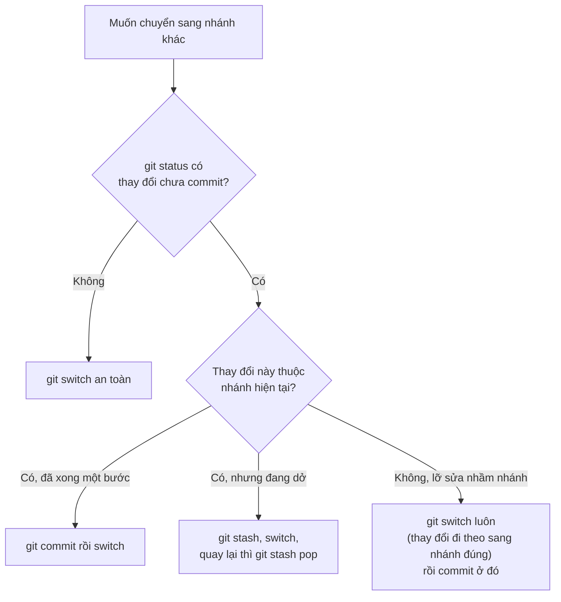

### Lỗi 2: Xoá nhầm branch chưa merge

```bash
# Xoá nhầm bằng -D
git branch -D feature/important
# OH NO!

# Cứu bằng reflog (trong vòng 30 ngày)
git reflog
# Tìm hash commit cuối của branch đã xoá
# abc1234 HEAD@{5}: commit: Tính năng quan trọng

git switch -c feature/important abc1234
# Phục hồi thành công!
```

### Lỗi 3: Tạo branch từ sai vị trí

```bash
# Muốn tạo branch từ main nhưng đang ở feature/old
git switch -c feature/new
# Branch mới sẽ bắt đầu từ feature/old, không phải main!

# Cách đúng:
git switch -c feature/new main
# Chỉ định rõ: tạo từ main
```

### Lỗi 4: Tên branch có dấu cách hoặc ký tự đặc biệt

```bash
# SAI:
git switch -c "feature/my feature"    # Dấu cách
git switch -c feature/login:v2        # Ký tự : (Git không cho phép, cùng với ~ ^ ? * [ \ và "..")

# ĐÚNG:
git switch -c feature/my-feature      # Dấu gạch nối
git switch -c feature/login-v2        # Dấu gạch nối
```

---

## Tóm tắt

| Lệnh                       | Chức năng                       |
| -------------------------- | ------------------------------- |
| `git branch`               | Liệt kê branches                |
| `git branch <tên>`         | Tạo branch mới                  |
| `git branch -d <tên>`      | Xoá branch đã merge             |
| `git branch -D <tên>`      | Xoá branch (ép buộc)            |
| `git branch -a`            | Xem tất cả branches (cả remote) |
| `git branch -vv`           | Xem tracking info               |
| `git switch <tên>`         | Chuyển branch                   |
| `git switch -c <tên>`      | Tạo và chuyển branch            |
| `git switch -`             | Quay lại branch trước đó        |
| `git push -u origin <tên>` | Push và thiết lập tracking      |

**Ghi nhớ:** Branch trong Git rẻ và nhanh. Hãy tạo branch cho mỗi đơn vị công việc -- đừng ngại tạo nhiều branch!
