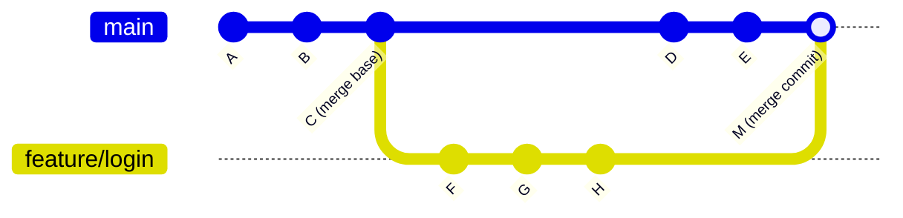
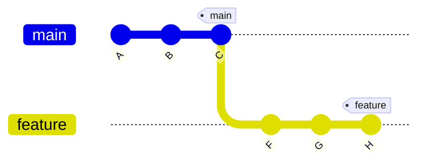
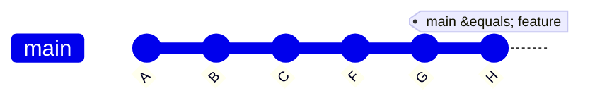
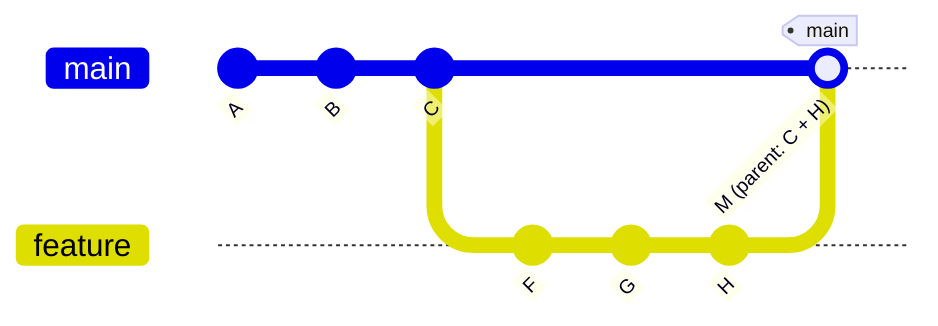
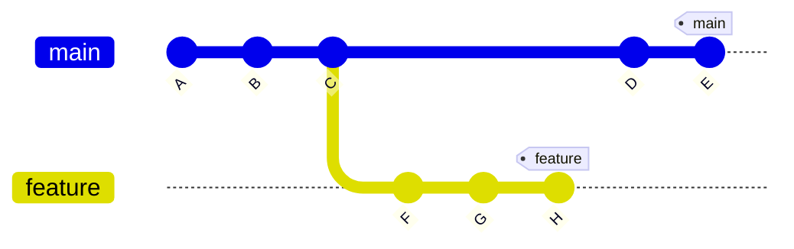
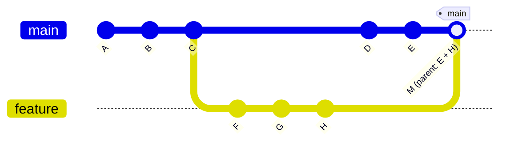
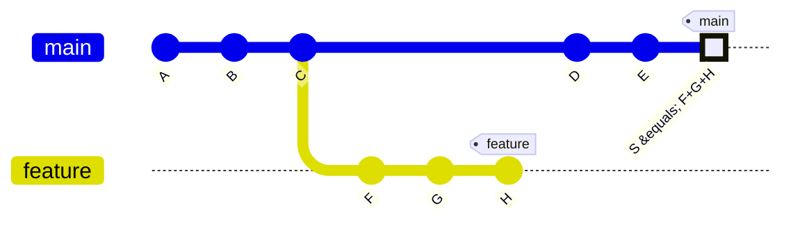
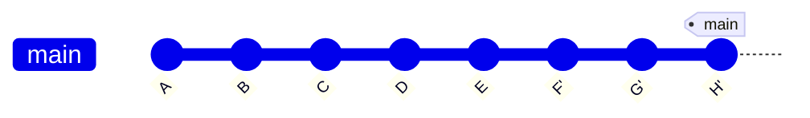

# Merge — Gộp nhánh trong Git

Sau khi bạn làm việc trên một branch riêng và hoàn thành công việc, bước tiếp theo là **gộp (merge)** các thay đổi đó vào branch chính. Merge là một trong những thao tác quan trọng nhất trong Git, và hiểu rõ các kiểu merge sẽ giúp bạn làm việc hiệu quả hơn trong nhóm.

[](pathname:///img/git/merge-co-ban.webp)

---

:::note[Ghi nhớ nhanh]

- ⭐ **Luôn đứng trên nhánh NHẬN rồi mới merge** — muốn gộp feature vào main thì phải ở `main` rồi chạy `git merge feature/...`.
- ⭐ **Ba kiểu merge** — fast-forward (chỉ dời con trỏ), 3-way (tạo merge commit có 2 parent), squash (gộp mọi commit thành 1, phải tự commit).
- **`--no-ff` ép tạo merge commit** — giữ dấu vết nhánh, dễ rollback cả feature bằng `git revert -m 1`.
- **`git merge --abort` hủy merge đang conflict** — đưa mọi thứ về trạng thái sạch trước khi merge.
- **`-s ours` bỏ toàn bộ code nhánh kia; `-X ours`/`-X theirs` chỉ quyết định khi có conflict** — phần không conflict vẫn merge bình thường.

:::

---

## Mục lục

- [Vì sao cần merge?](#vì-sao-cần-merge)
- [1. Merge là gì?](#1-merge-là-gì)
- [2. Fast-forward merge](#2-fast-forward-merge)
- [3. Three-way merge (3-way merge)](#3-three-way-merge-3-way-merge)
- [4. Squash merge](#4-squash-merge)
- [5. Hủy merge -- `--abort`](#5-hủy-merge-abort)
- [6. So sánh các kiểu merge](#6-so-sánh-các-kiểu-merge)
- [7. Merge strategies](#7-merge-strategies)
- [8. Thực hành -- Trải nghiệm tất cả các kiểu merge](#8-thực-hành-trải-nghiệm-tất-cả-các-kiểu-merge)
- [9. Best practices khi merge](#9-best-practices-khi-merge)
- [10. Lỗi thường gặp](#10-lỗi-thường-gặp)
- [Tóm tắt](#tóm-tắt)

---

## Vì sao cần merge?

**Vấn đề:**

```bash
# Bạn làm xong tính năng login trên một branch riêng
git switch feature/login
git log --oneline
# def5678 Hoàn thành validation
# abc1234 Thêm form đăng nhập

# Nhưng main vẫn chưa có gì cả!
git switch main
git log --oneline
# 0000aaa Initial commit
# => Công việc vẫn "mắc kẹt" trên feature/login, đồng đội không dùng được

# Copy file thủ công sang main? => mất toàn bộ lịch sử commit, dễ sót file
```

**Giải pháp:**

```bash
# git merge GỘP lịch sử và thay đổi của feature vào main
git switch main
git merge feature/login
# => Toàn bộ commit của feature được đưa về main, giữ nguyên dấu vết

# Tùy tình huống, Git chọn:
# - Fast-forward: khi hai nhánh không phân kỳ, chỉ dời pointer
# - Merge commit: khi cả hai cùng tiến, tạo 1 commit hợp nhất 2 dòng lịch sử
```

:::tip[Dùng thực tế]

- **Đưa feature về main:** làm xong tính năng trên nhánh riêng, merge vào main để cả team dùng chung.
- **Cập nhật nhánh đang làm:** gộp main mới nhất vào feature để tránh lệch xa, giải quyết conflict sớm.
- **Hợp nhất công việc nhiều người:** gộp nhánh của các thành viên lại với nhau.
- **Giữ lịch sử nhánh:** dùng merge commit để biết rõ nhóm commit nào thuộc feature nào, dễ rollback cả feature.

:::

---

## 1. Merge là gì?

Merge là quá trình **gộp các thay đổi từ branch này vào branch khác**. Thông thường, bạn merge branch tính năng (feature) vào branch chính (main).

```bash
# Đang ở branch main, muốn gộp feature/login vào
git switch main
git merge feature/login
```

**Nguyên tắc cơ bản:** Luôn **chuyển sang branch nhận** trước khi merge. Nếu bạn muốn gộp feature vào main, bạn phải **đứng trên main** rồi merge feature vào.

```
# SAI: đang ở feature/login, merge main
git switch feature/login
git merge main
# => Đây là merge main vào feature (cập nhật feature), không phải merge feature vào main

# ĐÚNG: đang ở main, merge feature/login
git switch main
git merge feature/login
# => Đây là gộp feature vào main
```

---

## 2. Fast-forward merge

### 2.1. Khi nào xảy ra?

Fast-forward xảy ra khi branch main **không có commit mới nào** kể từ khi bạn tạo branch feature. Nói cách khác, lịch sử là một đường thẳng:

```
# Trước khi merge:
main:          A---B---C
                        \
feature/login:           D---E---F

# Main không có commit mới sau C
# => Git chỉ cần "di chuyển" pointer main lên F

# Sau khi merge (fast-forward):
main:          A---B---C---D---E---F  (main pointer di chuyển lên F)
```

### 2.2. Ví dụ thực tế

```bash
# Bắt đầu từ main
git switch main
git log --oneline
# abc1234 (HEAD -> main) Initial commit

# Tạo và chuyển sang feature
git switch -c feature/header
echo "<header>Logo</header>" > header.html
git add header.html
git commit -m "Thêm header"

echo "<nav>Menu</nav>" >> header.html
git add header.html
git commit -m "Thêm navigation"

# Quay lại main và merge
git switch main
git merge feature/header
# Kết quả:
# Updating abc1234..def5678
# Fast-forward          <-- Git báo bạn: đây là fast-forward
#  header.html | 2 ++
#  1 file changed, 2 insertions(+)
```

### 2.3. Ưu và nhược điểm

| Ưu điểm                       | Nhược điểm                                                         |
| ----------------------------- | ------------------------------------------------------------------ |
| Lịch sử sạch, một đường thẳng | Không biết được "nhóm commit nào thuộc feature nào"                |
| Không tạo merge commit thừa   | Mất thông tin về branch (branch đã tồn tại bao lâu, merge khi nào) |
| Dễ đọc log                    | Khó rollback cả một feature                                        |

### 2.4. `--no-ff` -- Ép tạo merge commit

Nếu bạn muốn **giữ lại dấu vết** của branch (biết rằng nhóm commit này thuộc feature nào), dùng `--no-ff`:

```bash
git switch main
git merge --no-ff feature/header
# Git sẽ mở editor để bạn nhập merge commit message
# Mặc định: "Merge branch 'feature/header'"
```

```
# Với --no-ff, lịch sử sẽ như thế này:
main:   A---B---C-----------M  (merge commit)
                 \         /
feature/header:   D---E---F

# Thay vì fast-forward:
main:   A---B---C---D---E---F  (không có merge commit)
```

**Khuyến nghị:** Nhiều team bắt buộc dùng `--no-ff` để lịch sử rõ ràng hơn. Có thể cấu hình mặc định:

```bash
# Cấu hình --no-ff mặc định cho branch main
git config branch.main.mergeoptions "--no-ff"
```

---

## 3. Three-way merge (3-way merge)

### 3.1. Khi nào xảy ra?

3-way merge xảy ra khi **cả hai branch đều có commit mới** kể từ điểm rẽ nhánh. Git không thể chỉ "di chuyển pointer" -- nó phải **kết hợp thay đổi từ cả hai phía**.

```
# Trước khi merge:
main:          A---B---C---D---E      (main có commit D, E)
                        \
feature/login:           F---G---H    (feature có commit F, G, H)

# Cả hai đều có commit mới từ điểm rẽ C
# Git cần so sánh 3 điểm: C (base), E (main), H (feature)
```

### 3.2. Quy trình 3-way merge

Git thực hiện 3 bước:

1. **Tìm merge base** -- commit chung gần nhất (C trong ví dụ trên)
2. **So sánh** thay đổi từ base đến main (C -> E) và từ base đến feature (C -> H)
3. **Kết hợp** cả hai nhóm thay đổi và tạo **merge commit** (M)

```
# Sau khi merge:
main:          A---B---C---D---E---M  (merge commit có 2 parent)
                        \         /
feature/login:           F---G---H

# Merge commit M có 2 parent: E và H
# Nó là "nơi kết nối" hai dòng lịch sử
```

Sơ đồ Git minh họa 3-way merge — hai nhánh cùng tiến rồi hợp nhất tại merge commit:



### 3.3. Ví dụ thực tế

```bash
# Tạo dự án mới
mkdir merge-practice && cd merge-practice
git init

# Commit đầu tiên
echo "line 1" > file.txt
git add file.txt
git commit -m "A: initial"

# Tạo feature branch
git switch -c feature/update

# Commit trên feature
echo "line 2 from feature" >> file.txt
git add file.txt
git commit -m "F: thêm dòng 2 từ feature"

# Quay lại main và tạo commit mới
git switch main
echo "# README" > README.md
git add README.md
git commit -m "D: thêm README"

# Bây giờ cả main và feature đều có commit mới
# Merge sẽ là 3-way merge
git merge feature/update
# Git sẽ mở editor để nhập merge commit message
# Mặc định: "Merge branch 'feature/update'"

# Xem lịch sử
git log --oneline --graph --all
# *   M (HEAD -> main) Merge branch 'feature/update'
# |\
# | * F (feature/update) thêm dòng 2 từ feature
# * | D thêm README
# |/
# * A initial
```

---

## 4. Squash merge

### 4.1. Squash merge là gì?

Squash merge **gộp tất cả commit từ feature branch thành MỘT commit** trên main, nhưng **không tạo merge commit** và **không lưu lại lịch sử branch**.

```
# Branch feature có 5 commit nhỏ:
feature:  F1---F2---F3---F4---F5

# Squash merge vào main:
main:     A---B---C---S
#                      ^
#                      S = 1 commit chứa tất cả thay đổi từ F1-F5
```

### 4.2. Cách dùng

```bash
git switch main
git merge --squash feature/login
# Kết quả: tất cả thay đổi được staged nhưng CHƯA COMMIT

# Bạn phải tự commit
git commit -m "feat: thêm tính năng đăng nhập"
# Chỉ 1 commit gọn gàng trên main
```

### 4.3. Khi nào dùng squash merge?

| Nên dùng khi                                 | Không nên dùng khi                       |
| -------------------------------------------- | ---------------------------------------- |
| Feature branch có nhiều commit nhỏ, messy    | Mỗi commit đều có ý nghĩa và cần giữ lại |
| Commit message như "fix typo", "wip", "test" | Cần truy vết lịch sử chi tiết            |
| Muốn main branch có lịch sử sạch             | Team cần biết ai làm gì khi nào          |
| PR có nhiều commit chỉnh sửa theo review     | Branch dài ngày với nhiều milestone      |

**Lưu ý:** Sau squash merge, Git không biết branch đã được merge. `git branch --merged` sẽ KHÔNG liệt kê branch đó. Bạn cần xóa branch thủ công.

```bash
git merge --squash feature/login
git commit -m "feat: thêm login"
# feature/login vẫn hiển thị là "chưa merge"
git branch -d feature/login
# error: not fully merged
git branch -D feature/login  # Phải dùng -D
```

---

## 5. Hủy merge -- `--abort`

Khi merge gây ra conflict mà bạn chưa muốn giải quyết:

```bash
git merge feature/complex
# CONFLICT: Merge conflict in app.js
# Automatic merge failed; fix conflicts and then commit the result.

# Bạn chưa sẵn sàng giải quyết? Hủy merge:
git merge --abort
# Mọi thứ quay lại trạng thái trước khi merge
# Như chưa có gì xảy ra

# Kiểm tra trạng thái
git status
# On branch main
# nothing to commit, working tree clean
```

**Khi nào nên dùng `--abort`?**

- Conflict phức tạp, cần thêm thời gian phân tích
- Merge nhầm branch
- Muốn thảo luận với đồng nghiệp trước khi resolve

---

## 6. So sánh các kiểu merge

| Đặc điểm         | Fast-forward             | 3-way merge              | Squash merge          |
| ---------------- | ------------------------ | ------------------------ | --------------------- |
| Merge commit     | Không                    | Có (1 commit)            | Không (bạn tự commit) |
| Lịch sử branch   | Mất                      | Giữ lại                  | Mất                   |
| Độ phức tạp      | Đơn giản nhất            | Trung bình               | Đơn giản              |
| Rollback feature | Khó (nhiều commit)       | Dễ (revert merge commit) | Dễ (revert 1 commit)  |
| Lịch sử main     | Phẳng, nhiều commit      | Có nhánh rẽ              | Phẳng, ít commit      |
| Điều kiện        | Main không có commit mới | Cả hai có commit mới     | Bất kỳ                |
| Lệnh             | `git merge` (tự động)    | `git merge` (tự động)    | `git merge --squash`  |

### 6.1. Trước hết: commit và branch thực chất là gì?

Muốn hình dung merge, cần nhớ 2 điều:

- **Commit** = ảnh chụp (snapshot) toàn bộ project + **con trỏ tới commit cha (parent)** + mã hash. Hash được tính từ chính nội dung đó, nên **đổi parent là đổi hash** — tức thành commit khác.
- **Branch** chỉ là **một nhãn dán** lên một commit. `main` không "chứa" commit nào cả, nó chỉ trỏ vào commit mới nhất; Git đi ngược theo con trỏ parent để ra lịch sử.

Vì vậy, mọi kiểu merge chỉ khác nhau ở 3 câu hỏi:

1. Có **tạo commit mới** không?
2. Commit mới đó có **mấy parent**?
3. Các commit F, G, H của feature có **nằm trên đường đi ngược từ `main`** nữa không, và có **giữ nguyên hash** không?

### 6.2. Tình huống 1 — main đứng yên (chưa ai commit thêm)

Bạn rẽ nhánh `feature` từ C, làm 3 commit F, G, H. Trong lúc đó `main` **không có commit mới**.



**Cách 1: `git merge feature` → Fast-forward**

Git thấy H đã "nối thẳng" phía sau C, nên **không tạo commit nào**, chỉ **bóc nhãn `main` từ C dán sang H**:

```
Trước:  A---B---C          ← main
                 \
                  F---G---H ← feature

Sau:    A---B---C---F---G---H   ← main, feature  (cùng trỏ vào H)
```



- Không có commit mới, F, G, H **giữ nguyên hash**.
- Nhìn log sau này **không biết** F, G, H từng nằm trên một nhánh riêng.

**Cách 2: `git merge --no-ff feature` → ép tạo merge commit**

Dù có thể fast-forward, Git vẫn tạo **commit M có 2 parent** (C và H):



- Có thêm 1 commit M. F, G, H **giữ nguyên hash**, nằm trên "đường vòng" qua parent thứ 2 của M.
- Muốn gỡ cả feature: `git revert -m 1 M` — một lệnh là xong.

### 6.3. Tình huống 2 — main đã có commit mới (hai nhánh phân kỳ)

Trong lúc bạn làm F, G, H thì đồng đội đã đưa D, E vào `main`. Fast-forward **không thể** xảy ra nữa, vì H không nằm "phía sau" E.



**Cách 3: `git merge feature` → 3-way merge (merge commit)**

Git so sánh C (base) ↔ E (main) ↔ H (feature), gộp hai phía thành **M có 2 parent: E và H**:



- F, G, H **giữ nguyên hash**, vẫn thấy rõ "đây là một nhánh đã nhập vào".
- `git log` trên main sẽ liệt kê cả D, E, F, G, H, M (xen kẽ theo thời gian).

**Cách 4: `git merge --squash feature` + `git commit` → Squash**

Git lấy **tổng thay đổi** của F + G + H, đắp lên E và bạn tự commit thành **S — commit thường, chỉ 1 parent là E**:



- **Nội dung code** của S giống hệt M ở cách 3, nhưng **lịch sử** khác hẳn: S **không có dây nối** nào sang H.
- F, G, H **không nằm trên main**; chúng chỉ còn trên nhánh `feature`. Xóa nhánh đi là chúng "mồ côi" và sau này bị Git dọn mất.
- Đó là lý do Git coi `feature` là "chưa merge" và `git branch -d` từ chối xóa.

**Cách 5 (để so sánh): Rebase rồi merge — nút "Rebase and merge" trên GitHub**

Git **chép lại** F, G, H lên trên E thành F', G', H' (cùng nội dung thay đổi, nhưng parent khác nên **hash khác**), rồi fast-forward `main`:



- Lịch sử thẳng, giữ đủ từng commit, nhưng là **bản sao mới**; F, G, H gốc bị bỏ lại. Chi tiết ở bài [Rebase cơ bản](./3_rebase-co-ban.md).

### 6.4. Bảng "số phận" của commit F, G, H

| Kiểu merge         | Commit mới?            | Số parent của commit mới | F, G, H có trên main? | Hash F, G, H  | Nhìn `git log --graph` |
| ------------------ | ---------------------- | ------------------------ | --------------------- | ------------- | ---------------------- |
| Fast-forward       | Không                  | —                        | Có                    | Giữ nguyên    | Một đường thẳng        |
| `--no-ff` / 3-way  | Có (M)                 | **2**                    | Có (qua parent 2)     | Giữ nguyên    | Có "mắt lưới" rẽ ra rồi nhập lại |
| Squash             | Có (S, bạn tự commit)  | 1                        | **Không**             | Không lên main | Đường thẳng, 1 commit gọn |
| Rebase + merge     | Có (F', G', H')        | 1 mỗi commit             | Bản sao F', G', H'    | **Đổi hash**  | Đường thẳng, đủ từng commit |

:::tip[Tự kiểm chứng trên máy]

Lệnh sau in thêm **hash của parent** (`%p`) cho từng commit — nhìn vào là biết commit nào có 2 parent (merge commit):

```bash
git log --graph --format='%h  parent=[%p]  %s' --all
# *   9c1e2f0  parent=[7ab31d2 4f0e9aa]  Merge branch 'feature'   <-- 2 parent
# |\
# | * 4f0e9aa  parent=[c3d2b10]  H
# ...
```

Chạy lại với từng cách ở trên (tạo repo thử, reset về trước merge giữa mỗi lần) để thấy F, G, H còn hay mất, hash có đổi không.

:::

---

## 7. Merge strategies

Git hỗ trợ nhiều chiến lược merge. Thường bạn không cần chỉ định -- Git tự chọn. Nhưng trong một số trường hợp đặc biệt:

### 7.1. Recursive (mặc định cho 3-way merge)

```bash
git merge feature/login
# Git tự động dùng recursive strategy
# Xử lý tốt khi cả 2 branch có thay đổi
```

### 7.2. Ours -- Giữ phiên bản của main, bỏ feature

```bash
git merge -s ours feature/old-design
# Tạo merge commit nhưng GIỮ TOÀN BỘ nội dung của main
# Code từ feature/old-design bị BỎ HOÀN TOÀN
# Hữu ích khi: cần "đánh dấu" branch đã merge nhưng không lấy code
```

**Lưu ý:** `-s ours` (strategy) khác với `-X ours` (strategy option):

```bash
# -s ours: Bỏ TOÀN BỘ thay đổi từ branch kia
git merge -s ours feature/old

# -X ours: Chỉ khi có CONFLICT mới chọn phiên bản của mình
# Nhưng thay đổi không conflict vẫn được merge bình thường
git merge -X ours feature/login
```

### 7.3. Theirs -- Khi conflict, ưu tiên phiên bản của branch kia

```bash
git merge -X theirs feature/redesign
# Khi có conflict, tự động chọn phiên bản từ feature/redesign
# Thay đổi không conflict vẫn merge bình thường
```

**Lưu ý:** Không có `-s theirs` strategy. Chỉ có `-X theirs` (strategy option).

---

## 8. Thực hành -- Trải nghiệm tất cả các kiểu merge

### Bài tập 1: Fast-forward merge

```bash
mkdir merge-lab && cd merge-lab
git init

# Tạo commit ban đầu
echo "Hello World" > index.html
git add index.html
git commit -m "Initial: tạo index.html"

# Tạo feature branch và thêm commit
git switch -c feature/style
echo "body { margin: 0; }" > style.css
git add style.css
git commit -m "Thêm file CSS"

# Merge vào main (fast-forward)
git switch main
git merge feature/style
# Chú ý dòng: "Fast-forward"

git log --oneline --graph
# Lịch sử là một đường thẳng
```

### Bài tập 2: 3-way merge

```bash
# Tạo feature mới
git switch -c feature/script
echo "console.log('hello')" > app.js
git add app.js
git commit -m "Thêm JavaScript"

# Quay lại main và tạo commit mới
git switch main
echo "<h1>Welcome</h1>" >> index.html
git add index.html
git commit -m "Cập nhật tiêu đề"

# Merge (3-way)
git switch main
git merge feature/script
# Git tạo merge commit

git log --oneline --graph --all
# Thấy rõ 2 nhánh hợp lại
```

### Bài tập 3: Squash merge

```bash
# Tạo feature với nhiều commit nhỏ
git switch -c feature/footer
echo "<footer>" > footer.html
git add footer.html
git commit -m "wip: bắt đầu footer"

echo "<footer>Copyright</footer>" > footer.html
git add footer.html
git commit -m "wip: thêm nội dung"

echo "<footer>Copyright 2024</footer>" > footer.html
git add footer.html
git commit -m "fix: sửa năm"

# Squash merge
git switch main
git merge --squash feature/footer
git commit -m "feat: thêm footer component"

git log --oneline
# Chỉ thấy 1 commit gọn gàng cho footer
```

### Bài tập 4: So sánh lịch sử

```bash
# Xem sự khác biệt
git log --oneline --graph --all

# Thử dùng format đẹp hơn
git log --oneline --graph --all --decorate
```

---

## 9. Best practices khi merge

### 9.1. Trước khi merge

```bash
# 1. Cập nhật main mới nhất
git switch main
git pull origin main

# 2. Merge main vào feature trước (giải quyết conflict ở feature)
git switch feature/login
git merge main
# Giải quyết conflict (nếu có) trên feature branch
# Test lại để đảm bảo mọi thứ hoạt động

# 3. Bây giờ merge feature vào main (sẽ là clean merge)
git switch main
git merge feature/login
# Không còn conflict vì đã giải quyết ở bước 2
```

### 9.2. Quy trình chuẩn trong team

1. **Tạo PR/MR** trên GitHub/GitLab
2. **Code review** bởi ít nhất 1 người
3. **CI/CD chạy xong** (tests pass, lint pass)
4. **Merge** bằng nút trên GitHub (thường là squash merge hoặc merge commit)
5. **Xóa branch** sau khi merge

### 9.3. Merge commit message

```bash
# Mặc định (tốt):
Merge branch 'feature/login'

# Tốt hơn -- thêm context:
Merge branch 'feature/login'

Thêm hệ thống đăng nhập với email và mật khẩu.
Bao gồm: form login, validation, API integration.
Reviewed by: @teammate

# Với squash merge -- tóm tắt tất cả thay đổi:
feat: thêm hệ thống đăng nhập (#42)

- Tạo form đăng nhập với validation
- Kết nối API authentication
- Thêm error handling và loading state
- Thêm unit tests cho login flow
```

---

## 10. Lỗi thường gặp

### Lỗi 1: Merge nhầm branch

```bash
# Vừa merge nhầm feature/wrong vào main
git merge feature/wrong
# Oh no!

# Hủy ngay (nếu chưa push):
git reset --hard HEAD~1
# Quay lại commit trước merge commit

# Nếu đã push:
git revert -m 1 HEAD
# Tạo commit mới "undo" merge commit
# -m 1 = giữ main, bỏ feature
```

### Lỗi 2: Quên chuyển branch trước khi merge

```bash
# Đang ở feature/A, merge feature/B vào
git merge feature/B
# => feature/B merge vào feature/A, không phải main!

# Hủy:
git reset --hard HEAD~1
# Chuyển sang main rồi merge lại
git switch main
git merge feature/B
```

### Lỗi 3: Merge có conflict nhưng ấn Enter quá nhanh

```bash
# Conflict xảy ra nhưng bạn commit mà chưa sửa
git add .
git commit
# File vẫn còn <<<<<<< markers!

# Sửa: mở file, tìm và sửa tất cả conflict markers
# Rồi amend commit:
git add .
git commit --amend
```

### Lỗi 4: Fast-forward khi bạn muốn merge commit

```bash
# Muốn có merge commit nhưng Git fast-forward
git merge feature/small
# Fast-forward -- mất dấu vết branch!

# Phòng tránh: luôn dùng --no-ff khi muốn giữ lịch sử
git reset --hard HEAD~1  # Quay lại
git merge --no-ff feature/small
# Bây giờ có merge commit
```

---

## Tóm tắt

| Lệnh                          | Chức năng                                       |
| ----------------------------- | ----------------------------------------------- |
| `git merge <branch>`          | Merge branch vào branch hiện tại                |
| `git merge --no-ff <branch>`  | Merge với merge commit (không fast-forward)     |
| `git merge --squash <branch>` | Gộp tất cả commit thành 1 (cần commit thủ công) |
| `git merge --abort`           | Hủy merge đang có conflict                      |
| `git merge -X ours`           | Khi conflict, ưu tiên phiên bản hiện tại        |
| `git merge -X theirs`         | Khi conflict, ưu tiên phiên bản branch kia      |
| `git merge -s ours <branch>`  | Giữ toàn bộ phiên bản hiện tại, bỏ branch kia   |
| `git log --oneline --graph`   | Xem lịch sử dạng cây (dễ thấy merge)            |

**Ghi nhớ:** Merge là kỹ năng cơ bản nhất khi làm việc nhóm với Git. Hiểu rõ 3 kiểu merge (fast-forward, 3-way, squash) và biết khi nào dùng cái nào sẽ giúp bạn làm việc hiệu quả hơn.
