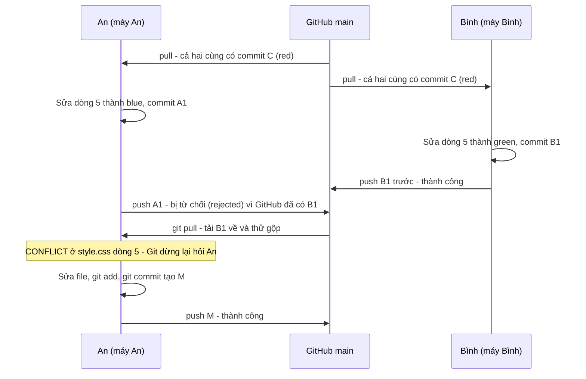
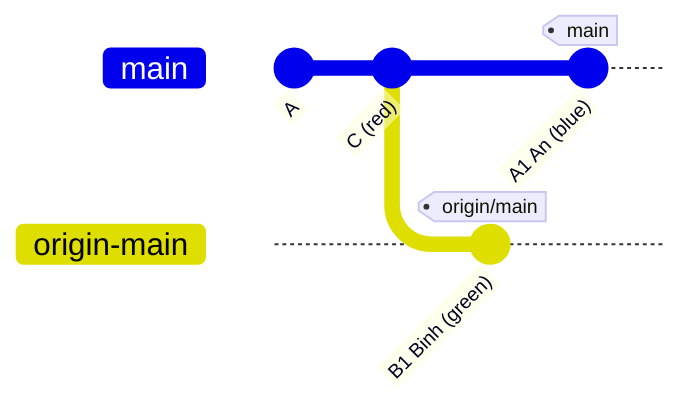
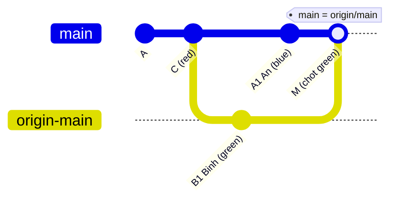
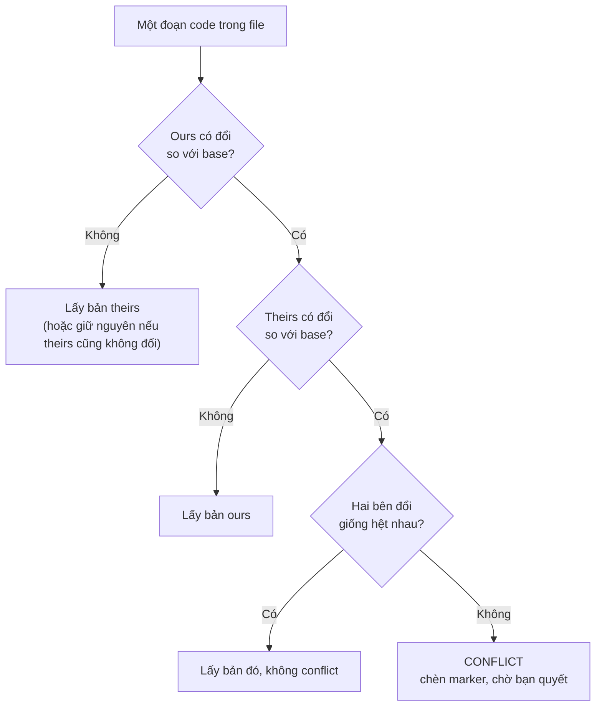
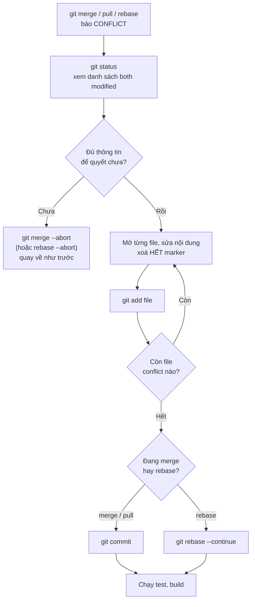
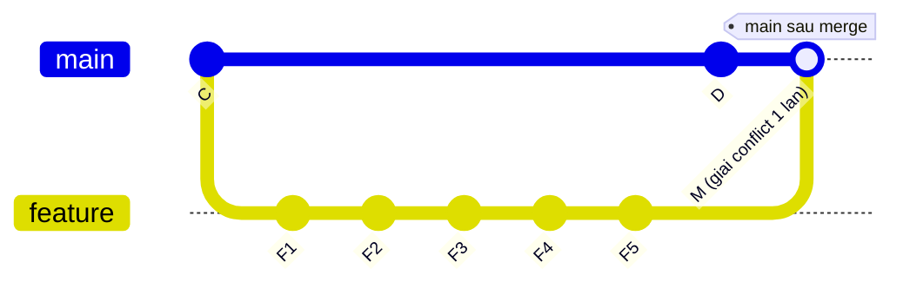
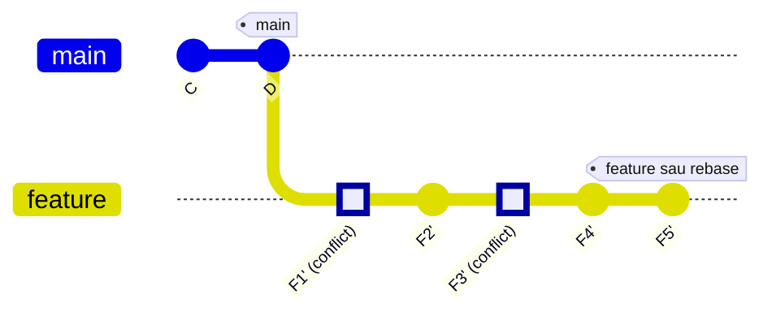
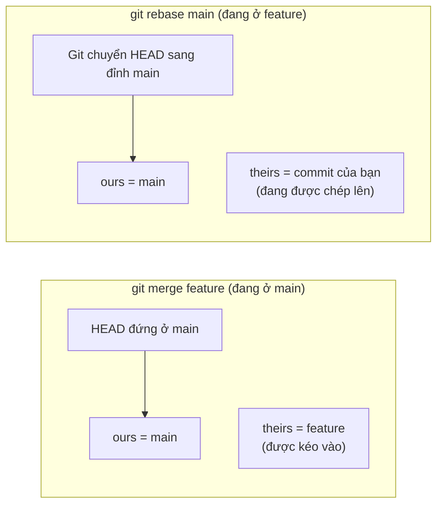

# Giải quyết conflict trong Git

Conflict (xung đột) là điều **không thể tránh khỏi** khi làm việc nhóm với Git. Nhưng thay vì sợ hãi, bạn nên xem conflict như một **cơ hội để review và cải thiện code**. Bài này sẽ giúp bạn hiểu tại sao conflict xảy ra, cách đọc conflict markers, và quy trình giải quyết conflict từ cơ bản đến nâng cao.

[](pathname:///img/git/giai-quyet-conflict.webp)

---

:::note[Ghi nhớ nhanh]

- ⭐ **Conflict xảy ra khi hai nhánh sửa CÙNG một dòng của cùng file** — Git không tự quyết được nên dừng lại và nhờ con người chọn.
- ⭐ **Đọc conflict markers** — `<<<<<<< HEAD` (bản của bạn), `=======` (ranh giới), `>>>>>>>` (bản nhánh kia); phải xóa HẾT marker trước khi commit.
- **Quy trình** — `git status` xem file conflict, sửa, `git add`, rồi `git commit` (merge) hoặc `git rebase --continue` (rebase).
- **CẢNH BÁO: `--ours`/`--theirs` bị ĐẢO khi rebase** — lúc rebase `--ours` = base (main), `--theirs` = nhánh của bạn, ngược với merge.
- **Phòng tránh** — pull thường xuyên, chia nhỏ PR, phân chia công việc rõ ràng và luôn chạy test sau khi merge.

:::

---

## Mục lục

- [Vì sao có conflict & phải giải quyết?](#vì-sao-có-conflict--phải-giải-quyết)
- [1. Conflict xảy ra khi nào và tại sao?](#1-conflict-xảy-ra-khi-nào-và-tại-sao)
- [2. Conflict markers -- Đọc và hiểu](#2-conflict-markers-đọc-và-hiểu)
- [3. Quy trình giải quyết conflict từng bước](#3-quy-trình-giải-quyết-conflict-từng-bước)
- [4. Dùng VS Code để resolve conflict](#4-dùng-vs-code-để-resolve-conflict)
- [5. `git mergetool` -- Công cụ resolve chuyên dụng](#5-git-mergetool-công-cụ-resolve-chuyên-dụng)
- [6. Conflict trong merge vs rebase](#6-conflict-trong-merge-vs-rebase)
- [7. `--ours` vs `--theirs`](#7-ours-vs-theirs)
- [8. Ví dụ thực tế -- Tạo conflict cố ý và giải quyết](#8-ví-dụ-thực-tế-tạo-conflict-cố-ý-và-giải-quyết)
- [9. Tips phòng tránh conflict](#9-tips-phòng-tránh-conflict)
- [10. Conflict trong file binary](#10-conflict-trong-file-binary)
- [11. Lỗi thường gặp](#11-lỗi-thường-gặp)
- [Tóm tắt](#tóm-tắt)

---

## Vì sao có conflict & phải giải quyết?

**Vấn đề:** Khi `git merge` hoặc `git rebase`, nếu **hai branch cùng sửa CÙNG một đoạn** của một file theo cách khác nhau, Git **không thể tự quyết** nên giữ bản nào.

```bash
# Branch A sửa dòng 5:  body { color: blue; }
# Branch B sửa dòng 5:  body { color: green; }
git merge branch-b
# CONFLICT (content): Merge conflict in style.css
# => Git KHÔNG biết chọn blue hay green
```

Nếu nhắm mắt chọn bừa một bản, bạn sẽ **xóa mất công việc của người kia** mà không hề hay biết.

**Giải pháp:** Git **đánh dấu vùng xung đột** bằng markers và **yêu cầu con người quyết định** — vì chỉ con người mới hiểu ý nghĩa của code và biết cách gộp đúng. Sau khi gộp xong thì `git add` rồi `commit` (merge) hoặc `rebase --continue`.

```bash
<<<<<<< HEAD
body { color: blue; }     # bản của bạn
=======
body { color: green; }    # bản của branch kia
>>>>>>> branch-b

# Bạn sửa lại thành bản đúng, rồi:
git add style.css
git commit          # hoặc: git rebase --continue
```

Đây là **cơ chế an toàn** để tránh mất dữ liệu: Git thà dừng lại và hỏi, còn hơn tự ý ghi đè.

:::tip[Dùng thực tế]

- **Hai người sửa cùng một hàm:** A và B cùng chỉnh `getGreeting()` → merge báo conflict, hai người cùng quyết bản gộp.
- **Merge nhánh lệch lâu ngày:** feature branch tách ra cả tuần, main đã đi xa → gộp lại dễ đụng nhiều vùng conflict.
- **Rebase qua thay đổi của người khác:** `git rebase main` áp lại commit của bạn lên các thay đổi mới của đồng đội → conflict từng commit.
- **Dùng merge tool của IDE:** VS Code hiển thị 3-way editor để chọn _Current / Incoming / Both_ thay vì sửa markers thủ công.

:::

---

## 1. Conflict xảy ra khi nào và tại sao?

### 1.1. Điều kiện để xảy ra conflict

Conflict xảy ra khi **hai người (hoặc hai branch) cùng sửa một dòng** trong cùng một file, và Git **không biết nên chọn phiên bản nào**.

```
# Developer A (trên feature/header):
# Sửa dòng 5 của file style.css
body { color: red; }        -->  body { color: blue; }

# Developer B (trên feature/theme):
# Cũng sửa dòng 5 của file style.css
body { color: red; }        -->  body { color: green; }

# Khi merge: Git không biết chọn blue hay green
# => CONFLICT!
```

### 1.2. Khi nào KHÔNG có conflict?

Git thông minh hơn bạn nghĩ. Nhiều trường hợp Git tự động giải quyết:

```
# Trường hợp 1: Sửa KHÁC FILE
# A sửa header.html, B sửa footer.html
# => Không conflict, Git merge bình thường

# Trường hợp 2: Sửa KHÁC DÒNG trong cùng file
# A sửa dòng 5, B sửa dòng 20
# => Không conflict, Git gộp cả hai
# (Ngoại lệ: hai dòng SÁT NHAU, vd A sửa dòng 5, B sửa dòng 6,
#  Git vẫn có thể báo conflict vì không chắc thứ tự gộp)

# Trường hợp 3: Một người sửa, người kia không
# A sửa file.txt, B không động file.txt
# => Không conflict, Git lấy phiên bản của A
```

### 1.3. Các tình huống gây conflict

| Tình huống               | Xảy ra khi                                                         |
| ------------------------ | ------------------------------------------------------------------ |
| **Merge conflict**       | `git merge branch` -- hai branch cùng sửa một dòng                 |
| **Rebase conflict**      | `git rebase main` -- commit của bạn conflict với main              |
| **Pull conflict**        | `git pull` -- remote và local cùng sửa một dòng                    |
| **Cherry-pick conflict** | `git cherry-pick hash` -- commit chọn conflict với branch hiện tại |
| **Stash pop conflict**   | `git stash pop` -- stash conflict với thay đổi hiện tại            |

### 1.4. Minh hoạ trọn vẹn: An và Bình cùng sửa một dòng

:::info[Ẩn dụ: hai người cùng sửa một câu trong bản photo]

Trưởng phòng đưa An và Bình mỗi người **một bản photo** của cùng một tờ thông báo. Câu thứ ba ghi "Họp lúc **9 giờ**". An sửa thành "**8 giờ**", Bình sửa thành "**10 giờ**". Cuối ngày, thư ký phải chép hai bản vào **bản gốc** — các câu khác ai sửa thì chép theo người đó, nhưng câu thứ ba thì **thư ký không thể tự đoán** nên ghi cả hai lên giấy, khoanh lại và hỏi: "Chốt giờ nào?".

Git chính là người thư ký đó. **Conflict** (xung đột) không phải lỗi — đó là Git đang **hỏi bạn**. Các dấu `<<<<<<<`, `=======`, `>>>>>>>` chính là cái **khoanh tròn** trên giấy.

:::

**Bối cảnh:** file `style.css` trên `main` (commit C) có dòng 5 là `body { color: red; }`. An và Bình cùng lấy về từ C.



**Lịch sử lúc conflict xảy ra** (nhánh `origin-main` là bản của GitHub mà An vừa tải về):



**Ba phiên bản của cùng một dòng** mà Git đang phải cân:

| Phiên bản                       | Dòng 5 của `style.css`   | Ai làm   |
| ------------------------------- | ------------------------ | -------- |
| Base (tổ tiên chung, commit C)  | `body { color: red; }`   | —        |
| Ours (HEAD, bên An đang đứng)   | `body { color: blue; }`  | An       |
| Theirs (bên đang được gộp vào)  | `body { color: green; }` | Bình     |

Git so sánh từng bên với **base**: chỉ một bên đổi thì lấy bên đó; **cả hai cùng đổi, đổi khác nhau** thì conflict.

**File `style.css` mà An nhìn thấy sau `git pull`** — Git đã tự gộp các dòng khác, chỉ chèn "khoanh tròn" ở dòng 5:

```css
/* style.css */
* { box-sizing: border-box; }
h1 { font-size: 2rem; }
p  { line-height: 1.6; }
<<<<<<< HEAD
body { color: blue; }
=======
body { color: green; }
>>>>>>> 4f2a9c1 (doi mau chu sang green)
footer { padding: 1rem; }
```

Đọc từng phần:

| Dòng                          | Ý nghĩa                                                                         |
| ----------------------------- | ------------------------------------------------------------------------------- |
| `<<<<<<< HEAD`                | Bắt đầu vùng xung đột. Từ đây tới `=======` là **bản của bạn** (An, ours)        |
| `body { color: blue; }`       | Nội dung An viết                                                                |
| `=======`                     | Đường ranh giữa hai bản                                                         |
| `body { color: green; }`      | Nội dung Bình viết (theirs)                                                     |
| `>>>>>>> 4f2a9c1 (...)`       | Kết thúc vùng xung đột, kèm tên nhánh hoặc commit của **bên kia**              |
| Các dòng ngoài vùng           | Git đã tự gộp xong, **không cần đụng tới**                                      |

**Sau khi sửa** — An hỏi Bình, hai người chốt dùng `green` (hoặc một màu mới). An **xoá toàn bộ 3 dòng marker** và chỉ để lại nội dung cuối cùng:

```css
/* style.css */
* { box-sizing: border-box; }
h1 { font-size: 2rem; }
p  { line-height: 1.6; }
body { color: green; }
footer { padding: 1rem; }
```

```bash
git add style.css      # báo cho Git: "file này đã giải quyết xong"
git commit             # tạo merge commit M (message mặc định là đủ)
git push
```

**Lịch sử sau khi giải quyết** — M có hai parent (A1 và B1), giữ dấu vết cả hai người:



Các cách "chốt" mà An có thể chọn, cùng kết quả:

| Cách xử lý                                | Dòng 5 sau khi sửa        | Khi nào hợp lý                              |
| ----------------------------------------- | ------------------------- | ------------------------------------------- |
| Giữ bản của mình (Accept Current / ours)  | `body { color: blue; }`   | Chắc chắn bản mình đúng, đã báo bên kia     |
| Lấy bản bên kia (Accept Incoming / theirs) | `body { color: green; }` | Bản bên kia mới hơn / đúng yêu cầu hơn      |
| Viết bản mới kết hợp                      | `body { color: teal; }`   | Cả hai đều đúng một phần                    |
| Giữ cả hai (Accept Both)                  | hai dòng `body {...}`     | Hiếm khi đúng với CSS/config — đọc kỹ!       |
| Bỏ cuộc: `git merge --abort`              | quay về `blue`, chưa gộp  | Cần hỏi lại người kia trước khi quyết       |

:::tip[Tự kiểm chứng trên máy — và bật hiển thị cả bản gốc]

Chạy đoạn ở mục 8 để tự tạo conflict. Muốn marker hiện **cả bản base** (rất có ích để hiểu "ai đã đổi gì"), bật:

```bash
git config --global merge.conflictStyle zdiff3   # Git >= 2.35; bản cũ hơn dùng diff3
```

File sẽ có thêm phần `||||||| base` ở giữa:

```text
<<<<<<< HEAD
body { color: blue; }
||||||| 9b1c2d3
body { color: red; }
=======
body { color: green; }
>>>>>>> 4f2a9c1 (doi mau chu sang green)
```

Nhìn vào là thấy: gốc là `red`, An đổi sang `blue`, Bình đổi sang `green`.

:::

**Một câu để nhớ:** conflict = Git khoanh tròn chỗ hai người cùng sửa và hỏi bạn chốt bản nào; bạn sửa file cho đúng, xoá hết marker, `git add` rồi commit.

### 1.5. Git tự gộp được hay phải hỏi bạn?

Với mỗi đoạn trong file, Git làm phép so sánh 3 bên (base, ours, theirs) như sau:



---

## 2. Conflict markers -- Đọc và hiểu

### 2.1. Cấu trúc conflict markers

Khi conflict xảy ra, Git chèn các **markers** vào file:

```
<<<<<<< HEAD
// Đây là code của BRANCH HIỆN TẠI (branch bạn đang đứng trên)
body { color: blue; }
=======
// Đây là code của BRANCH ĐANG MERGE VÀO
body { color: green; }
>>>>>>> feature/theme
```

Giải thích:

```
<<<<<<< HEAD              <-- Bắt đầu vùng conflict (phiên bản của bạn)
[code từ branch hiện tại]
=======                   <-- Ranh giới giữa 2 phiên bản
[code từ branch đang merge]
>>>>>>> feature/theme     <-- Kết thúc vùng conflict (tên branch kia)
```

### 2.2. Ví dụ thực tế

```javascript
// File: app.js
const config = {
<<<<<<< HEAD
  theme: 'dark',
  fontSize: 16,
  language: 'vi',
=======
  theme: 'light',
  fontSize: 14,
  language: 'en',
>>>>>>> feature/settings
  debug: false,
};
```

Bạn có 4 lựa chọn:

```javascript
// Lựa chọn 1: Giữ phiên bản của bạn (HEAD)
const config = {
  theme: "dark",
  fontSize: 16,
  language: "vi",
  debug: false,
};

// Lựa chọn 2: Lấy phiên bản từ branch kia
const config = {
  theme: "light",
  fontSize: 14,
  language: "en",
  debug: false,
};

// Lựa chọn 3: Kết hợp cả hai
const config = {
  theme: "dark", // Giữ dark từ HEAD
  fontSize: 16, // Giữ 16 từ HEAD
  language: "en", // Lấy en từ feature
  debug: false,
};

// Lựa chọn 4: Viết lại hoàn toàn
const config = {
  theme: "auto", // Hoàn toàn mới
  fontSize: 15,
  language: "vi",
  debug: false,
};
```

### 2.3. Nhiều vùng conflict trong một file

Một file có thể có **nhiều vùng conflict**. Bạn phải giải quyết **tất cả** trước khi commit:

```python
# file: settings.py

<<<<<<< HEAD
DATABASE_URL = "postgresql://localhost/mydb"
=======
DATABASE_URL = "postgresql://localhost/testdb"
>>>>>>> feature/testing

SECRET_KEY = "shared-secret"  # Dòng này không conflict

<<<<<<< HEAD
DEBUG = False
LOG_LEVEL = "WARNING"
=======
DEBUG = True
LOG_LEVEL = "DEBUG"
>>>>>>> feature/testing
```

**Quan trọng:** Sau khi sửa xong, đảm bảo **KHÔNG còn bất kỳ marker nào** (`<<<<<<<`, `=======`, `>>>>>>>`) trong file. Một marker sót lại = code bị hỏng.

---

## 3. Quy trình giải quyết conflict từng bước

### Bước 1: Nhận biết conflict

```bash
git merge feature/login
# Auto-merging app.js
# CONFLICT (content): Merge conflict in app.js
# Auto-merging style.css
# CONFLICT (content): Merge conflict in style.css
# Automatic merge failed; fix conflicts and then commit the result.

# Xem trạng thái
git status
# On branch main
# You have unmerged paths.
#   (fix conflicts and run "git commit")
#   (use "git merge --abort" to abort the merge)
#
# Unmerged paths:
#   (use "git add <file>..." to mark resolution)
#         both modified:   app.js
#         both modified:   style.css
```

### Bước 2: Mở file và tìm conflict markers

```bash
# Tìm tất cả file có conflict markers
grep -rn "<<<<<<< " .
# ./app.js:10:<<<<<<< HEAD
# ./style.css:5:<<<<<<< HEAD

# Hoặc xem danh sách file conflict
git diff --name-only --diff-filter=U
# app.js
# style.css
```

### Bước 3: Sửa file -- loại bỏ markers và chọn code đúng

Mở file trong editor, tìm các vùng `<<<<<<<`, quyết định giữ code nào:

```javascript
// TRƯỚC (có conflict markers):
function getGreeting(user) {
<<<<<<< HEAD
  return `Xin chào, ${user.name}!`;
=======
  return `Hello, ${user.fullName}!`;
>>>>>>> feature/i18n
}

// SAU (đã giải quyết -- kết hợp cả hai):
function getGreeting(user) {
  return `Xin chào, ${user.fullName}!`;
  // Giữ "Xin chào" từ HEAD, dùng "fullName" từ feature
}
```

### Bước 4: Stage file đã sửa

```bash
# Stage từng file
git add app.js
git add style.css

# Hoặc stage tất cả file đã sửa
git add .
```

### Bước 5: Commit

```bash
# Với merge conflict:
git commit
# Git tự động tạo message: "Merge branch 'feature/login'"
# Hoặc bạn có thể sửa message

# Với rebase conflict:
git rebase --continue
# KHÔNG dùng git commit với rebase!
```

### Bước 6: Xác nhận

```bash
# Kiểm tra không còn conflict
git status
# On branch main
# nothing to commit, working tree clean

# Kiểm tra kết quả merge
git log --oneline --graph -5
# *   abc1234 (HEAD -> main) Merge branch 'feature/login'
# |\
# ...

# Kiểm tra code hoạt động đúng
# Chạy tests, build, etc.
```

Toàn bộ quy trình 6 bước gói trong một sơ đồ — bao gồm "lối thoát hiểm" `--abort` nếu chưa sẵn sàng:



---

## 4. Dùng VS Code để resolve conflict

### 4.1. Giao diện VS Code

Khi mở file có conflict trong VS Code, bạn sẽ thấy:

```
<<<<<<< HEAD (Current Change)     <-- Highlight màu xanh lá
  theme: 'dark',
=======
  theme: 'light',
>>>>>>> feature/theme (Incoming Change)  <-- Highlight màu xanh dương
```

VS Code hiển thị các nút:

- **Accept Current Change** -- Giữ code của bạn (HEAD)
- **Accept Incoming Change** -- Lấy code từ branch kia
- **Accept Both Changes** -- Giữ cả hai (xếp chồng lên nhau)
- **Compare Changes** -- Mở diff view để so sánh

### 4.2. Cách dùng

```
1. Mở file có conflict
2. Tìm vùng highlight màu
3. Click nút phù hợp:
   - "Accept Current" nếu code của bạn đúng
   - "Accept Incoming" nếu code của branch kia đúng
   - "Accept Both" nếu cần cả hai
   - Hoặc sửa thủ công
4. Lưu file
5. Lặp lại cho tất cả vùng conflict trong file
6. Lặp lại cho tất cả file có conflict
7. git add . && git commit
```

### 4.3. Source Control panel

```
1. Click biểu tượng Source Control (nhánh cây) trên sidebar
2. Trong mục "Merge Changes", thấy danh sách file conflict
3. Click vào file -> mở diff view
4. Sử dụng toolbar trong diff view để accept/reject
5. Sau khi sửa xong, click dấu "+" để stage file
6. Nhập commit message và commit
```

---

## 5. `git mergetool` -- Công cụ resolve chuyên dụng

### 5.1. Cấu hình mergetool

```bash
# Dùng VS Code làm mergetool
git config --global merge.tool vscode
git config --global mergetool.vscode.cmd 'code --wait --merge $REMOTE $LOCAL $BASE $MERGED'

# Dùng vimdiff (có sẵn trên Linux/Mac)
git config --global merge.tool vimdiff

# Không tạo file .orig (file backup)
git config --global mergetool.keepBackup false
```

### 5.2. Sử dụng mergetool

```bash
# Khi đang có conflict
git mergetool
# Git sẽ mở từng file conflict trong tool đã cấu hình

# Với VS Code: mở 3-way merge editor
# Ô trên-trái:  Incoming = REMOTE (code từ branch kia)
# Ô trên-phải:  Current  = LOCAL (code của bạn)
# Ô dưới:       Result   = KẾT QUẢ (bạn chỉnh sửa ở đây)
# BASE (phiên bản chung trước khi cả hai sửa) dùng để so sánh,
# bật xem bằng nút "Compare with Base" nếu cần
```

### 5.3. 3-way merge editor trong VS Code

```
+------------------+------------------+
| INCOMING(Theirs) |  CURRENT (Ours)  |
|  body {          |  body {          |
|    color: green; |    color: blue;  |
|  }               |  }               |
+------------------+------------------+
|            RESULT (Merged)           |
|  body {                              |
|    color: ???    <-- Bạn chọn ở đây  |
|  }                                   |
+--------------------------------------+
```

---

## 6. Conflict trong merge vs rebase

### 6.1. Conflict khi merge

```bash
git switch main
git merge feature/login
# CONFLICT in app.js

# Đặc điểm:
# - Giải quyết TẤT CẢ conflict 1 lần
# - Sau khi sửa: git add . && git commit
# - Tạo merge commit
```

### 6.2. Conflict khi rebase

```bash
git switch feature/login
git rebase main
# CONFLICT in app.js  (commit 1/3)

# Đặc điểm:
# - Giải quyết conflict cho TỪNG COMMIT
# - Sau khi sửa: git add . && git rebase --continue
# - Không tạo merge commit
# - Có thể phải giải quyết conflict NHIỀU LẦN
```

### 6.3. So sánh

| Đặc điểm          | Merge conflict      | Rebase conflict                 |
| ----------------- | ------------------- | ------------------------------- |
| Số lần giải quyết | 1 lần               | Có thể nhiều lần (từng commit)  |
| Sau khi resolve   | `git commit`        | `git rebase --continue`         |
| Hủy bỏ            | `git merge --abort` | `git rebase --abort`            |
| Merge commit      | Có                  | Không                           |
| Độ phức tạp       | Thường đơn giản hơn | Có thể phức tạp hơn (nhiều lần) |

### 6.4. Ví dụ so sánh

```bash
# Feature branch có 5 commits, main có thay đổi

# Với MERGE:
git merge feature/login
# 1 lần giải quyết conflict (gộp tất cả thay đổi)
git add .
git commit

# Với REBASE:
git rebase main
# Conflict ở commit 1 -> sửa -> git add . -> git rebase --continue
# Conflict ở commit 3 -> sửa -> git add . -> git rebase --continue
# Commit 2, 4, 5 không conflict -> tự động apply
# Tổng cộng: giải quyết 2 lần
```

Vì sao rebase có thể bắt bạn giải nhiều lần? So hai lịch sử kết quả: merge gộp **một lần** tại M, còn rebase **chép lại từng commit** F1…F5 lên đỉnh main — mỗi lần chép là một cơ hội conflict (ở đây là F1' và F3'):





---

## 7. `--ours` vs `--theirs`

### 7.1. Khi dùng với merge

```bash
# Khi merge và gặp conflict:
git merge feature/login

# Chọn TOÀN BỘ phiên bản của bạn cho 1 file:
git checkout --ours app.js
git add app.js

# Chọn TOÀN BỘ phiên bản của branch kia cho 1 file:
git checkout --theirs style.css
git add style.css

# Áp dụng cho TẤT CẢ conflict files (chạy merge lại từ đầu,
# nếu đang kẹt conflict thì git merge --abort trước):
git merge -X ours feature/login     # Đoạn nào conflict thì lấy bản của bạn
git merge -X theirs feature/login   # Đoạn nào conflict thì lấy bản branch kia
# Lưu ý: -X chỉ quyết định các ĐOẠN conflict; phần không conflict
# của cả hai bên vẫn được gộp bình thường.
```

### 7.2. Ours và Theirs trỏ đến đâu?

```
# Khi MERGE:
# ours   = branch hiện tại (branch bạn đang đứng trên) = HEAD
# theirs = branch đang merge vào

git switch main
git merge feature/login
# ours   = main
# theirs = feature/login
```

```
# Khi REBASE (CHÚ Ý: NGƯỢC LẠI!):
# ours   = branch đang rebase LÊN (main)
# theirs = branch của bạn (feature/login)

git switch feature/login
git rebase main
# ours   = main          <-- NGƯỢC với merge!
# theirs = feature/login  <-- NGƯỢC với merge!
```

**Đây là điều gây nhầm lẫn nhất!** Khi rebase, Git "đặt bạn sang một bên" và áp dụng từng commit của bạn lên main. Nên "ours" là main (base mới), "theirs" là commit của bạn.

Mẹo nhớ: **"ours" luôn là nhánh mà HEAD đang đứng lúc Git gộp**. Khi merge, bạn đứng trên `main`. Khi rebase, Git lặng lẽ **chuyển HEAD sang `main`** rồi chép từng commit của bạn lên — nên lúc đó "nhà" là `main`:



### 7.3. Bảng tóm tắt

| Thao tác                           | `--ours` là     | `--theirs` là |
| ---------------------------------- | --------------- | ------------- |
| `git merge feature` (đang ở main)  | main            | feature       |
| `git rebase main` (đang ở feature) | main            | feature       |
| `git cherry-pick abc`              | branch hiện tại | commit abc    |

---

## 8. Ví dụ thực tế -- Tạo conflict cố ý và giải quyết

### 8.1. Tạo conflict

```bash
# Setup
mkdir conflict-lab && cd conflict-lab
git init

# Tạo file ban đầu
cat > app.js << 'EOF'
const app = {
  name: 'My App',
  version: '1.0',
  theme: 'default',
  language: 'vi',
};

function start() {
  console.log('Starting...');
}
EOF

git add app.js
git commit -m "Initial: tạo app.js"

# Tạo branch A và sửa
git switch -c feature/dark-theme
cat > app.js << 'EOF'
const app = {
  name: 'My App',
  version: '1.1',
  theme: 'dark',
  language: 'vi',
  darkMode: true,
};

function start() {
  console.log('Starting in dark mode...');
}
EOF

git add app.js
git commit -m "Chuyển sang dark theme"

# Quay lại main và sửa CÙNG file
git switch main
cat > app.js << 'EOF'
const app = {
  name: 'My App Pro',
  version: '2.0',
  theme: 'light',
  language: 'en',
};

function start() {
  console.log('Starting My App Pro...');
}
EOF

git add app.js
git commit -m "Nâng cấp lên Pro version"
```

### 8.2. Giải quyết conflict

```bash
# Merge
git merge feature/dark-theme
# Auto-merging app.js
# CONFLICT (content): Merge conflict in app.js

# Xem nội dung file
cat app.js
# const app = {
# <<<<<<< HEAD
#   name: 'My App Pro',
#   version: '2.0',
#   theme: 'light',
#   language: 'en',
# =======
#   name: 'My App',
#   version: '1.1',
#   theme: 'dark',
#   language: 'vi',
#   darkMode: true,
# >>>>>>> feature/dark-theme
# };
#
# function start() {
# <<<<<<< HEAD
#   console.log('Starting My App Pro...');
# =======
#   console.log('Starting in dark mode...');
# >>>>>>> feature/dark-theme
# }
```

```bash
# Giải quyết: kết hợp cả hai phiên bản
cat > app.js << 'EOF'
const app = {
  name: 'My App Pro',
  version: '2.0',
  theme: 'dark',
  language: 'vi',
  darkMode: true,
};

function start() {
  console.log('Starting My App Pro in dark mode...');
}
EOF

# Stage và commit
git add app.js
git commit -m "Merge feature/dark-theme: kết hợp Pro + dark mode"

# Xác nhận
git log --oneline --graph
# *   abc1234 (HEAD -> main) Merge feature/dark-theme
# |\
# | * def5678 (feature/dark-theme) Chuyển sang dark theme
# * | 9e19012 Nâng cấp lên Pro version
# |/
# * 1a73456 Initial: tạo app.js
```

---

## 9. Tips phòng tránh conflict

### 9.1. Pull thường xuyên

```bash
# Mỗi sáng khi bắt đầu làm việc:
git switch main
git pull origin main
git switch feature/my-feature
git merge main  # Hoặc git rebase main

# Càng pull thường xuyên -> conflict càng nhỏ -> càng dễ giải quyết
```

### 9.2. Chia nhỏ Pull Request

```
# XẤU: 1 PR lớn, sửa 50 files, 2000 dòng code
# => Rất nhiều conflict, khó review

# TỐT: 5 PR nhỏ, mỗi PR sửa 10 files, 400 dòng code
# => Ít conflict, dễ review, merge nhanh
```

### 9.3. Phân chia công việc rõ ràng

```
# XẤU: A và B cùng làm tính năng login
# => Conflict chắc chắn

# TỐT: A làm frontend login, B làm backend API
# => Ít khả năng conflict (khác file)
```

### 9.4. Giao tiếp trong team

```
# Trước khi sửa file quan trọng (config, shared utils):
# 1. Thông báo trên Slack/Teams
# 2. Merge nhanh, không để branch tồn đọng lâu
# 3. Review và merge PR sớm
```

### 9.5. Sử dụng `.gitattributes`

```bash
# File: .gitattributes
# Chỉ định merge strategy cho các file cụ thể

# Luôn giữ phiên bản của branch hiện tại cho lock files
package-lock.json merge=ours
yarn.lock merge=ours

# Binary files: không merge, chọn manual
*.png binary
*.jpg binary
```

---

## 10. Conflict trong file binary

### 10.1. Vấn đề

Git **không thể merge file binary** (hình ảnh, PDF, file nén...). Khi conflict:

```bash
git merge feature/new-logo
# CONFLICT (content): Merge conflict in logo.png
# warning: Cannot merge binary files: logo.png

# File logo.png ở trạng thái hỏng -- không mở được!
```

### 10.2. Cách giải quyết

```bash
# Chọn phiên bản của bạn:
git checkout --ours logo.png
git add logo.png

# Hoặc chọn phiên bản của branch kia:
git checkout --theirs logo.png
git add logo.png

# Commit
git commit -m "Resolve: chọn logo mới từ feature/new-logo"
```

### 10.3. Phòng tránh conflict binary

- Dùng **Git LFS** (Large File Storage) cho file lớn
- **Không sửa cùng một file binary** trên nhiều branch
- Đặt tên khác nhau nếu cần nhiều phiên bản: `logo-v1.png`, `logo-v2.png`
- Dùng `.gitattributes` để chỉ định cách xử lý

```bash
# Cấu hình Git LFS
git lfs install
git lfs track "*.png"
git lfs track "*.psd"
git add .gitattributes
```

---

## 11. Lỗi thường gặp

### Lỗi 1: Commit mà vẫn còn conflict markers

```bash
# Bạn commit nhưng file vẫn còn <<<<<<< markers
git add .
git commit -m "resolve conflict"
# Code bị hỏng vì còn markers trong file!

# Kiểm tra trước khi commit:
grep -rn "<<<<<<< " .
grep -rn "=======" .
grep -rn ">>>>>>> " .
# Nếu còn kết quả -> chưa sửa hết!

# Sửa và amend:
# Sửa file...
git add .
git commit --amend
```

### Lỗi 2: Merge bị chặn vì có thay đổi chưa commit

```bash
git merge feature/login
# error: Your local changes to the following files would be overwritten by merge:
#         file.txt
# Please commit your changes or stash them before you merge.
# Aborting

# Nguyên nhân: bạn có thay đổi CHƯA COMMIT ở file mà merge cần sửa
# Cách xử lý: cất đi TRƯỚC khi merge
git stash
git merge feature/login
git stash pop
```

Lưu ý: đừng `git stash` khi đang **kẹt giữa conflict** — Git sẽ từ chối (`needs merge`). Lúc đó hoặc giải quyết xong, hoặc `git merge --abort` để quay về trạng thái trước merge. Nếu trước khi merge bạn đã có thay đổi chưa commit, `--abort` có thể không khôi phục chúng trọn vẹn — vì vậy luôn merge với working tree sạch.

### Lỗi 3: Nhầm lẫn ours/theirs khi rebase

```bash
# Đang rebase feature lên main
git rebase main

# Muốn giữ code của FEATURE (code của bạn):
git checkout --theirs file.txt    # ĐÚNG (theirs = feature khi rebase)
# KHÔNG PHẢI:
git checkout --ours file.txt      # SAI (ours = main khi rebase)

# Nhớ: khi rebase, ours và theirs BỊ ĐẢO NGƯỢC so với merge!
```

### Lỗi 4: Quên giải quyết conflict ở một file

```bash
# Merge có conflict ở 3 file, bạn chỉ sửa 2 file
git add app.js style.css
git commit
# error: Committing is not possible because you have unmerged paths.
# Hint: Fix them up in the work tree, and then use 'git add <file>'

# Xem file nào chưa resolve:
git status
# Unmerged paths:
#         both modified:   config.js    <-- Chưa sửa!

# Sửa config.js, rồi:
git add config.js
git commit
```

### Lỗi 5: Merge tạo ra code sai nhưng không có conflict

```bash
# Đôi khi Git merge "thành công" nhưng kết quả sai
# Ví dụ: A xóa function, B gọi function đó
# Git merge không conflict (khác dòng) nhưng code bị lỗi runtime

# Cách phòng tránh:
# 1. LUÔN chạy tests sau khi merge
# 2. Review kết quả merge (git diff HEAD~1)
# 3. Build và test trước khi push
```

---

## Tóm tắt

| Lệnh                                   | Chức năng                          |
| -------------------------------------- | ---------------------------------- |
| `git status`                           | Xem file nào đang conflict         |
| `git diff --name-only --diff-filter=U` | Liệt kê file conflict              |
| `git checkout --ours <file>`           | Chọn phiên bản của branch hiện tại |
| `git checkout --theirs <file>`         | Chọn phiên bản của branch kia      |
| `git merge --abort`                    | Hủy merge                          |
| `git rebase --abort`                   | Hủy rebase                         |
| `git rebase --continue`                | Tiếp tục rebase sau khi resolve    |
| `git merge -X ours`                    | Merge, ưu tiên ours khi conflict   |
| `git merge -X theirs`                  | Merge, ưu tiên theirs khi conflict |
| `git mergetool`                        | Mở công cụ resolve chuyên dụng     |

**Ghi nhớ:** Conflict là bình thường -- không phải lỗi. Giải quyết conflict là kỹ năng quan trọng của mọi developer. Càng làm nhiều, bạn càng tự tin và nhanh nhẹn khi gặp conflict.
