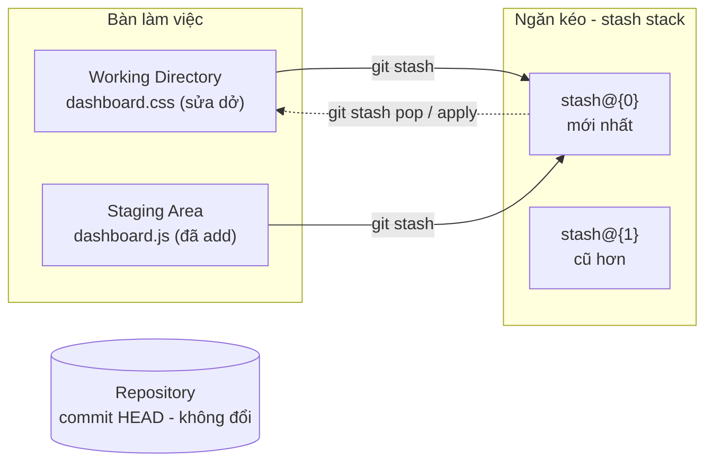
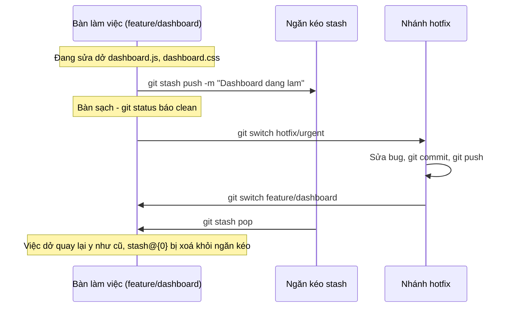
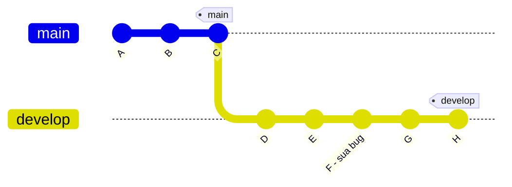
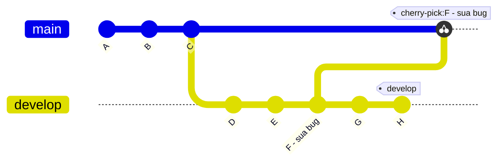
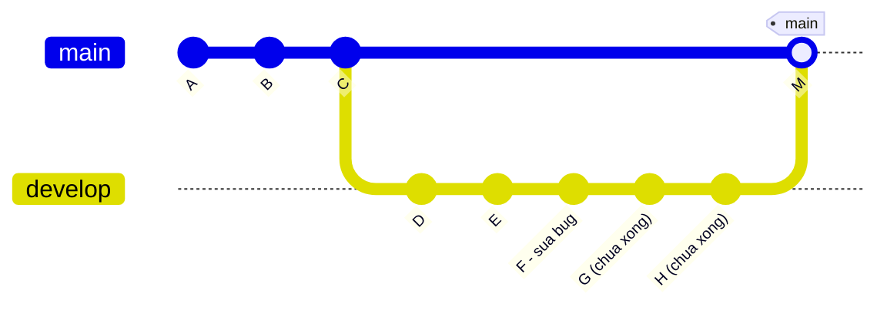
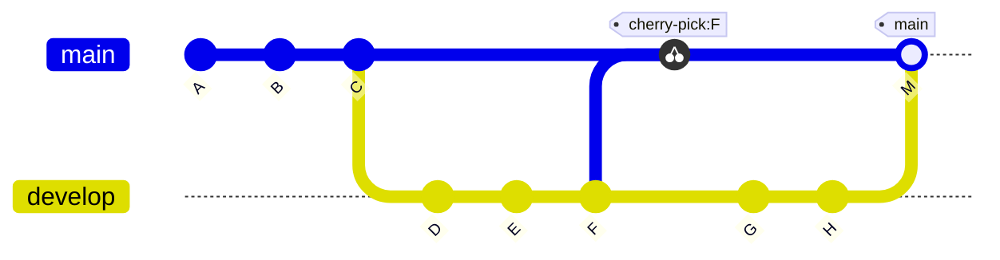
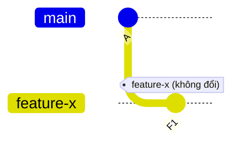
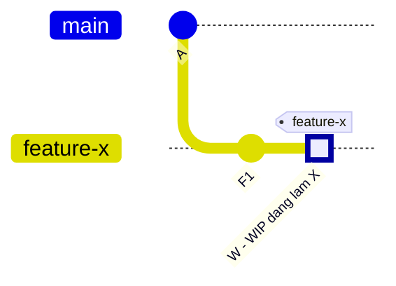
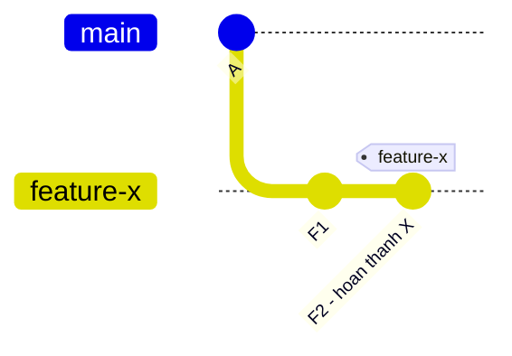
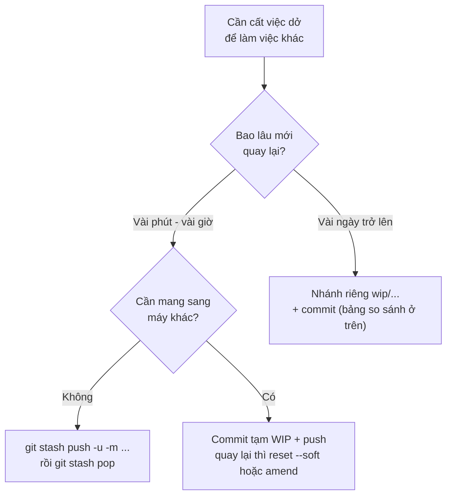

# Cherry-pick và Stash

Trong công việc hàng ngày với Git, bạn sẽ gặp hai tình huống rất thường xuyên: (1) cần **tạm cất thay đổi đang làm dở** để chuyển sang việc khác, và (2) cần **lấy một commit cụ thể** từ branch khác mà không merge toàn bộ. **Stash** và **Cherry-pick** là hai công cụ giúp bạn xử lý chính xác hai tình huống này.

[](pathname:///img/git/cherry-pick-va-stash.webp)

---

:::note[Ghi nhớ nhanh]

- ⭐ **`git stash` tạm cất thay đổi chưa commit** — cất cả staged/unstaged vào ngăn xếp (LIFO), làm sạch working directory để chuyển việc.
- ⭐ **`git cherry-pick <hash>` áp MỘT commit cụ thể** — lấy đúng commit cần từ nhánh khác lên nhánh hiện tại (tạo commit mới, hash mới), không phải merge cả nhánh.
- **`stash pop` lấy lại và xóa khỏi stack; `stash apply` lấy lại nhưng giữ** — mặc định KHÔNG cất file untracked, phải thêm `-u`.
- **Cherry-pick dùng cho hotfix, backport, lấy tính năng lẻ** — nhưng có rủi ro duplicate commit và thiếu dependency, nên cân nhắc kỹ.
- **Stash cho tạm dừng ngắn (trong ngày); tạo branch cho tạm dừng dài** — branch có tên rõ, push chia sẻ được và hiện trong lịch sử.

:::

---

## Mục lục

- [Vì sao có cherry-pick & stash?](#vì-sao-có-cherry-pick--stash)
- [Phần 1: Git Stash -- Tạm cất thay đổi](#phần-1-git-stash-tạm-cất-thay-đổi)
- [1. Stash là gì và tại sao cần?](#1-stash-là-gì-và-tại-sao-cần)
- [2. Các lệnh stash cơ bản](#2-các-lệnh-stash-cơ-bản)
- [3. Stash nâng cao](#3-stash-nâng-cao)
- [4. Stash workflow thực tế](#4-stash-workflow-thực-tế)
- [Phần 2: Git Cherry-pick -- Chọn commit cụ thể](#phần-2-git-cherry-pick-chọn-commit-cụ-thể)
- [5. Cherry-pick là gì?](#5-cherry-pick-là-gì)
- [6. Cherry-pick cơ bản](#6-cherry-pick-cơ-bản)
- [7. Khi nào dùng cherry-pick?](#7-khi-nào-dùng-cherry-pick)
- [8. Risks của cherry-pick](#8-risks-của-cherry-pick)
- [9. So sánh Stash vs Branch cho việc tạm lưu](#9-so-sánh-stash-vs-branch-cho-việc-tạm-lưu)
- [10. ASCII diagrams cho cherry-pick flow](#10-ascii-diagrams-cho-cherry-pick-flow)
- [11. Thực hành tổng hợp](#11-thực-hành-tổng-hợp)
- [12. Lỗi thường gặp](#12-lỗi-thường-gặp)
- [Tóm tắt](#tóm-tắt)

---

## Vì sao có cherry-pick & stash?

**Vấn đề:**

```bash
# (1) Chỉ cần LẤY MỘT commit cụ thể từ nhánh khác (ví dụ một bản vá lỗi)
#     chứ không muốn merge cả nhánh
git merge develop
# Kéo theo HÀNG LOẠT commit chưa sẵn sàng, không chỉ bản vá cần thiết

# (2) Đang sửa dở thì cần CHUYỂN NHÁNH gấp (hotfix)
#     nhưng chưa muốn commit nửa vời
git switch hotfix/urgent
# error: Your local changes ... would be overwritten by checkout
# Git không cho đổi nhánh khi còn thay đổi chưa lưu
```

**Giải pháp:**

```bash
# (1) cherry-pick: áp đúng MỘT commit lên nhánh hiện tại
git switch main
git cherry-pick <commit>   # chỉ lấy bản vá, không đụng phần còn lại

# (2) stash: CẤT TẠM các thay đổi chưa commit vào ngăn riêng
git stash                  # working dir sạch lại
git switch hotfix/urgent   # đổi nhánh làm việc khác thoải mái
# ... xử lý xong ...
git switch -               # quay về nhánh cũ
git stash pop              # lấy lại đúng phần đang làm dở
```

:::tip[Dùng thực tế]

- **Lấy hotfix sang nhánh release:** bug đã sửa ở `develop`, `cherry-pick` đúng commit đó qua `release` để vá nhanh.
- **Cất việc dở để xử lý gấp:** `git stash` cất code đang viết, nhảy qua sửa lỗi production rồi `stash pop` làm tiếp.
- **Thử nhanh trên nhánh khác:** `stash` việc hiện tại, chuyển nhánh kiểm tra một ý tưởng, xong quay lại lấy nguyên trạng.
- **Mang một commit lẻ qua nhánh:** chỉ cần một tính năng/bản vá riêng lẻ, `cherry-pick` thay vì merge toàn bộ nhánh.

:::

---

## Phần 1: Git Stash -- Tạm cất thay đổi

## 1. Stash là gì và tại sao cần?

### 1.1. Tình huống thực tế

Bạn đang code tính năng mới trên `feature/dashboard`, viết được nửa chừng thì sếp bảo: "Có bug khẩn cấp trên production, sửa ngay!". Bạn cần:

1. Chuyển sang branch `hotfix/urgent`
2. Sửa bug
3. Quay lại `feature/dashboard` và tiếp tục

**Vấn đề:** Bạn chưa muốn commit code đang làm dở (chưa xong, chưa test). Nhưng Git không cho chuyển branch khi có uncommitted changes (trong một số trường hợp).

**Giải pháp:** `git stash` -- **tạm cất (chứa) thay đổi** vào một nơi an toàn, làm sạch working directory, để bạn chuyển branch tự do.

### 1.2. Stash hoạt động thế nào?

```
# Trước khi stash:
Working Directory: có thay đổi (modified files)
Staging Area: có thể có files đã staged

# Sau khi stash:
Working Directory: SẠCH (như vừa commit xong)
Staging Area: SẠCH
Stash stack: thay đổi của bạn được lưu ở đây

# Khi stash pop:
Working Directory: thay đổi được khôi phục
Stash stack: entry bị xóa
```

Stash hoạt động như một **ngăn xếp (stack)** -- Last In, First Out (LIFO):

```
+-------------------+
| stash@{0}: mới nhất |  <-- pop lấy cái này trước
+-------------------+
| stash@{1}: cũ hơn   |
+-------------------+
| stash@{2}: cũ nhất   |
+-------------------+
```

### 1.3. Hình dung bằng ngăn kéo tạm

:::info[Ẩn dụ: dọn bàn vào ngăn kéo]

Bạn đang bày giấy tờ dở dang đầy bàn (working directory có thay đổi chưa commit) thì sếp gọi làm việc gấp, cần **bàn trống**. Bạn **gạt hết vào ngăn kéo** (`git stash`), dán mẩu giấy ghi chú lên trên (message). Xong việc gấp, bạn **lấy đúng xấp đó ra bày lại** (`git stash pop`).

- Ngăn kéo là **chồng giấy**: xấp cất sau nằm trên cùng (`stash@{0}`), lấy ra trước.
- Ngăn kéo **chỉ nằm ở bàn của bạn** — không ai khác thấy (stash không được push lên remote).
- Ngăn kéo **không gắn với nhánh nào** — cất ở nhánh A, lấy ra ở nhánh B vẫn được (đôi khi lại rất tiện, đôi khi gây nhầm).

Thuật ngữ: **WIP** = *work in progress* (việc đang làm dở); **stack** = chồng/ngăn xếp.

:::

Stash lấy thay đổi từ **cả Working Directory lẫn Staging Area**, cất vào ngăn kéo, để lại hai vùng đó sạch như vừa commit. `pop` làm chiều ngược lại:



Một vòng "cất → đi làm việc khác → lấy lại" diễn ra theo thời gian như sau:



---

## 2. Các lệnh stash cơ bản

### 2.1. `git stash` -- Tạm cất thay đổi

```bash
# Đang làm việc trên feature/dashboard
echo "new feature code" >> dashboard.js
echo "new styles" >> dashboard.css
git add dashboard.js  # Stage 1 file

# Tạm cất tất cả thay đổi (cả staged và unstaged)
git stash
# Saved working directory and index state WIP on feature/dashboard: abc1234 Last commit message

# Kiểm tra: working directory sạch
git status
# On branch feature/dashboard
# nothing to commit, working tree clean

# Bây giờ có thể chuyển branch tự do
git switch hotfix/urgent
```

### 2.2. `git stash list` -- Xem danh sách stash

```bash
git stash list
# stash@{0}: WIP on feature/dashboard: abc1234 Thêm dashboard layout
# stash@{1}: WIP on feature/login: def5678 Tạo form login
# stash@{2}: WIP on main: 9e19012 Update README

# Mỗi entry có:
# stash@{n}  -- index (0 = mới nhất)
# WIP on <branch>  -- branch khi stash
# <hash> <message>  -- commit message gần nhất
```

### 2.3. `git stash pop` -- Lấy lại và xóa khỏi stash

```bash
# Lấy lại thay đổi mới nhất (stash@{0})
git stash pop
# On branch feature/dashboard
# Changes not staged for commit:
#         modified:   dashboard.js
#         modified:   dashboard.css
# Dropped refs/stash@{0} (abc1234...)

# Lưu ý: dashboard.js lúc stash ĐÃ được staged, nhưng pop trả về dạng
# "not staged". Muốn khôi phục đúng cả trạng thái staging: git stash pop --index

# stash@{0} đã bị XÓA khỏi stash list
git stash list
# stash@{1} bây giờ thành stash@{0}
# (các entry dịch lên 1 bậc)
```

### 2.4. `git stash apply` -- Lấy lại nhưng GIỮ trong stash

```bash
# Lấy lại thay đổi nhưng KHÔNG xóa khỏi stash
git stash apply
# Thay đổi được khôi phục
# Nhưng stash entry VẪN CÒN trong list

git stash list
# stash@{0}: WIP on feature/dashboard: abc1234 ...
# Vẫn còn!

# Hữu ích khi: muốn apply cùng stash vào nhiều branch
git stash apply           # Apply stash@{0}
git stash apply stash@{2} # Apply stash cụ thể
```

### 2.5. `git stash drop` và `git stash clear`

```bash
# Xóa 1 stash cụ thể
git stash drop stash@{1}
# Dropped stash@{1} (abc1234...)

# Xóa stash mới nhất
git stash drop
# Dropped refs/stash@{0} (def5678...)

# Xóa TẤT CẢ stash (cẩn thận!)
git stash clear
# Xóa sạch, không lấy lại được!
```

---

## 3. Stash nâng cao

### 3.1. Stash có message -- `git stash push -m`

```bash
# Mặc định: message là "WIP on <branch>: <commit>" -- không mô tả
# Tốt hơn: thêm message mô tả
git stash push -m "Dashboard: đang làm biểu đồ doanh thu"
git stash push -m "Login: thêm remember me checkbox"

# Bây giờ stash list rõ ràng hơn:
git stash list
# stash@{0}: On feature/login: Login: thêm remember me checkbox
# stash@{1}: On feature/dashboard: Dashboard: đang làm biểu đồ doanh thu

# Dễ tìm và apply đúng stash khi cần
```

### 3.2. Stash specific files

```bash
# Chỉ stash 1 hoặc vài file cụ thể
git stash push -m "Chỉ stash file CSS" style.css layout.css

# Các file khác KHÔNG bị stash (vẫn ở working directory)

# Hoặc dùng pattern:
git stash push -m "Stash tất cả JS" -- "*.js"
```

### 3.3. Stash untracked files -- `--include-untracked`

```bash
# Mặc định: git stash CHỈ cất file đã tracked (đã có trong Git)
# File mới tạo (untracked) sẽ KHÔNG được stash!

echo "new file" > brand-new.js
git stash
# brand-new.js VẪN CÒN trong working directory!

# Để stash cả untracked files:
git stash push --include-untracked -m "Cả file mới"
# Hoặc viết tắt:
git stash push -u -m "Cả file mới"

# Bây giờ brand-new.js cũng được stash
git status
# nothing to commit, working tree clean
```

### 3.4. Stash cả ignored files -- `--all`

```bash
# Stash tất cả, kể cả file trong .gitignore
git stash push --all -m "Tất cả kể cả node_modules"
# Hoặc:
git stash push -a -m "Tất cả"

# Hiếm khi cần, nhưng hữu ích khi muốn "reset" hoàn toàn
```

### 3.5. Xem nội dung stash

```bash
# Xem danh sách file trong stash
git stash show
# dashboard.js | 5 +++++
# dashboard.css | 3 +++
# 2 files changed, 8 insertions(+)

# Xem chi tiết diff
git stash show -p
# diff --git a/dashboard.js b/dashboard.js
# +new feature code
# ...

# Xem stash cụ thể
git stash show -p stash@{2}
```

### 3.6. Tạo branch từ stash

```bash
# Khi stash có conflict khi pop (vì branch đã thay đổi nhiều)
# Giải pháp: tạo branch mới từ stash
git stash branch feature/recovered-work stash@{0}
# Tạo branch mới từ commit khi stash
# Apply stash và xóa khỏi list
# Không bao giờ có conflict vì quay về đúng trạng thái cũ
```

---

## 4. Stash workflow thực tế

### 4.1. Workflow "sửa bug khẩn cấp"

```bash
# Đang làm feature/dashboard
# Có file đã sửa nhưng chưa muốn commit
git status
# modified: dashboard.js
# modified: chart.js
# new file: utils.js

# Bước 1: Stash thay đổi
git stash push -u -m "Dashboard: chart và utils đang làm"

# Bước 2: Chuyển sang hotfix
git switch main
git pull origin main
git switch -c hotfix/payment-bug

# Bước 3: Sửa bug
# ... sửa code ...
git add .
git commit -m "fix: sửa lỗi thanh toán null pointer"
git push -u origin hotfix/payment-bug

# Bước 4: Quay lại feature
git switch feature/dashboard

# Bước 5: Lấy lại thay đổi
git stash pop
# Tiếp tục làm việc như chưa có gì xảy ra!
```

### 4.2. Workflow "thử ý tưởng nhanh"

```bash
# Đang làm feature/A, nảy ra ý tưởng cho feature/B
# Không muốn trộn lẫn code

# Stash công việc hiện tại
git stash push -u -m "Feature A: đang làm UI"

# Thử ý tưởng trên branch mới
git switch -c experiment/idea-B
# ... viết code thử ...
# Không ok? Xóa branch
git switch feature/A
git branch -D experiment/idea-B

# Lấy lại công việc
git stash pop
```

---

## Phần 2: Git Cherry-pick -- Chọn commit cụ thể

## 5. Cherry-pick là gì?

### 5.1. Định nghĩa

Cherry-pick cho phép bạn **chọn một (hoặc vài) commit cụ thể** từ branch khác và **áp dụng vào branch hiện tại**. Không cần merge toàn bộ branch -- chỉ lấy những gì bạn cần.

```
# Branch develop có 5 commits:
develop: A---B---C---D---E

# Bạn chỉ cần commit C (sửa bug quan trọng)
# Cherry-pick C vào main:

main:    X---Y---Z---C'
                      ^
                      C' = bản sao của C (hash mới, nội dung giống)

# develop không bị ảnh hưởng
```

### 5.2. Tại sao gọi là "cherry-pick"?

Tưởng tượng một cây cherry có nhiều quả. Bạn không hái cả cây (merge), mà chỉ **nhặt (pick) những quả chín (cherry)** -- những commit cụ thể mà bạn cần.

### 5.3. ASCII diagram chi tiết

```
# Trước cherry-pick:
main:    A---B---C
                  \
develop:           D---E---F---G---H

# Cherry-pick commit F vào main:
main:    A---B---C---F'
                  \
develop:           D---E---F---G---H
#                          ^
#                     Commit gốc vẫn ở develop

# F' có nội dung giống F nhưng HASH KHÁC
# Vì F' có parent khác (C thay vì E)
```

### 5.4. Minh hoạ trước / sau bằng gitGraph

:::info[Ẩn dụ: chép một công thức từ sổ tay người khác]

Đồng nghiệp có cuốn sổ tay (nhánh `develop`) với 5 công thức D, E, F, G, H. Bạn chỉ cần công thức F nên **chép tay** F sang sổ của mình (`main`). Bản chép (F') có **nội dung y hệt**, nhưng là **trang mới trong sổ của bạn** — đánh số khác, nằm sau trang C của bạn chứ không nằm sau trang E của đồng nghiệp. Sổ của đồng nghiệp không hề bị đụng tới.

:::

**Trước:** `main` dừng ở C, `develop` có D…H.



**Sau `git switch main && git cherry-pick F`:** `main` có thêm **một** commit mới F' (Mermaid vẽ kèm chú thích "cherry-pick" trỏ về F). D, E, G, H **không** sang main; `develop` giữ nguyên:



### 5.5. Cherry-pick vs merge — cùng tình huống

Nếu thay vì cherry-pick, bạn `git merge develop` vào `main`, thì main nhận **tất cả** D, E, F, G, H qua merge commit M — kể cả G, H chưa sẵn sàng:



| Tiêu chí                                | `git cherry-pick F`                         | `git merge develop`                          |
| --------------------------------------- | ------------------------------------------- | -------------------------------------------- |
| Main nhận những gì                      | **Chỉ** thay đổi của F                      | Toàn bộ D, E, F, G, H                        |
| Commit mới trên main                    | F' (bản sao, hash mới, 1 parent là C)       | M (merge commit, 2 parent là C và H)         |
| Commit gốc F                            | Vẫn ở develop, không liên kết với F'        | Nằm trong lịch sử main (qua M), giữ hash     |
| Git có "nhớ" là đã lấy F không          | **Không** — F và F' là hai commit khác nhau | Có — lần merge sau chỉ lấy phần mới          |
| Rủi ro                                  | Thiếu commit phụ thuộc (vd F cần E), trùng lặp | Kéo theo code chưa sẵn sàng                 |
| Hợp với                                 | Hotfix, backport, lấy lẻ 1–2 commit         | Đưa cả một nhánh đã hoàn thành vào           |

**Một câu để nhớ:** merge là **nhập cả nhánh** (Git nhớ đã nhập), cherry-pick là **chép lẻ từng commit** (Git không nhớ, chỉ tạo bản sao).

---

## 6. Cherry-pick cơ bản

### 6.1. Cherry-pick một commit

```bash
# Bước 1: Tìm commit hash cần cherry-pick
git log --oneline develop
# 9e19012 (develop) Thêm feature H
# def5678 Sửa bug F          <-- Cần commit này!
# abc1234 Thêm feature E
# ...

# Bước 2: Chuyển sang branch đích
git switch main

# Bước 3: Cherry-pick
git cherry-pick def5678
# [main abc1111] Sửa bug F
#  1 file changed, 5 insertions(+)

# Commit mới trên main với nội dung giống F
# Nhưng hash khác (abc1111 thay vì def5678)
```

### 6.2. Cherry-pick nhiều commits

```bash
# Cherry-pick nhiều commit riêng lẻ
git cherry-pick abc1234 def5678 9e19012
# Áp dụng 3 commit theo thứ tự

# Cherry-pick một RANGE (từ commit A đến commit B)
git cherry-pick abc1234..9e19012
# Áp dụng tất cả commit SAU abc1234 đến 9e19012
# CHÚ Ý: KHÔNG bao gồm abc1234!

# Bao gồm cả commit đầu:
git cherry-pick abc1234^..9e19012
# ^ nghĩa là "cha của abc1234" -> bao gồm abc1234
```

### 6.3. `--no-commit` flag

```bash
# Mặc định: cherry-pick tạo commit mới ngay lập tức
git cherry-pick def5678
# Commit mới được tạo

# Với --no-commit: chỉ áp dụng thay đổi, KHÔNG commit
git cherry-pick --no-commit def5678
# Thay đổi được staged nhưng CHƯA commit
# Bạn có thể:
# - Chỉnh sửa thêm trước khi commit
# - Gộp nhiều cherry-pick thành 1 commit
# - Review thay đổi trước khi commit

git cherry-pick --no-commit abc1234
git cherry-pick --no-commit def5678
# Gộp 2 cherry-pick thành 1 commit
git commit -m "Backport: sửa 2 bug từ develop"
```

### 6.4. Cherry-pick và conflict

```bash
git cherry-pick def5678
# CONFLICT: Merge conflict in app.js

# Giải quyết giống như merge conflict:
# 1. Mở file, sửa conflict markers
# 2. git add app.js
# 3. git cherry-pick --continue

# Hoặc hủy:
git cherry-pick --abort

# Bỏ qua commit này và tiếp tục:
git cherry-pick --skip
```

---

## 7. Khi nào dùng cherry-pick?

### 7.1. Hotfix -- Sửa bug khẩn cấp

```bash
# Bug được phát hiện và sửa trên develop
# Cần deploy fix ngay lên production (main)

# Trên develop:
git switch develop
# ... sửa bug ...
git commit -m "fix: sửa lỗi crash khi user chưa đăng nhập"
# Commit hash: abc1234

# Cherry-pick vào main (production)
git switch main
git cherry-pick abc1234
git push origin main
# Deploy ngay!

# Không cần merge toàn bộ develop (có thể có feature chưa sẵn sàng)
```

### 7.2. Backport -- Sửa bug cho phiên bản cũ

```bash
# Bug được sửa trên main (phiên bản 3.0)
# Cần sửa cho cả phiên bản 2.x (branch release/2.x)

git switch release/2.x
git cherry-pick abc1234  # Commit sửa bug từ main
# Bug được sửa cho cả phiên bản cũ
```

### 7.3. Lấy tính năng cụ thể

```bash
# Team B có một tiện ích (utility) hay trên branch của họ
# Bạn muốn lấy chỉ tiện ích đó, không phải toàn bộ branch

git log --oneline team-b/feature
# ... nhiều commit ...
# def5678 feat: thêm date formatter utility  <-- Chỉ cần cái này

git switch feature/my-feature
git cherry-pick def5678
```

---

## 8. Risks của cherry-pick

### 8.1. Duplicate commits

```
# Sau khi cherry-pick F vào main:
main:    A---B---C---F'
                  \
develop:           D---E---F---G---H

# Khi merge develop vào main sau đó:
main:    A---B---C---F'---M  (merge commit)
                  \      /
develop:           D---E---F---G---H

# F và F' có CÙNG NỘI DUNG nhưng KHÁC HASH
# Git thường xử lý tốt (không conflict)
# Nhưng lịch sử sẽ có 2 commit giống nhau -- confusing
```

Vẽ ra cho dễ thấy: sau khi merge, đi ngược từ M trên `main` sẽ gặp **cả F' lẫn F** — hai commit cùng nội dung, hai hash khác nhau:



`git log main` sẽ liệt kê hai dòng "Sửa bug F". Nếu sau khi cherry-pick, một trong hai bên **sửa tiếp** đúng đoạn code đó, lúc merge còn có thể **conflict** với chính bản sao của mình.

### 8.2. Mất context

```bash
# Commit F trên develop phụ thuộc vào commit E (refactor trước đó)
# Cherry-pick chỉ F vào main -- không có E
# => Code có thể bị lỗi vì thiếu context từ E

# Cách phòng tránh:
# 1. Cherry-pick cả E và F
git cherry-pick E F

# 2. Hoặc kiểm tra kỹ commit có phụ thuộc gì không
git show def5678  # Xem nội dung commit trước khi cherry-pick
```

### 8.3. Khi nào KHÔNG nên dùng cherry-pick?

| Không nên                                 | Nên dùng thay thế             |
| ----------------------------------------- | ----------------------------- |
| Lấy nhiều commit liên tiếp từ branch khác | `git merge` hoặc `git rebase` |
| "Sao chép" feature toàn bộ                | `git merge feature-branch`    |
| Thường xuyên cherry-pick giữa 2 branch    | Xem lại branching strategy    |
| Commit phụ thuộc nhiều commit khác        | Merge cả nhóm commit          |

---

## 9. So sánh Stash vs Branch cho việc tạm lưu

| Đặc điểm     | `git stash`                            | Tạo branch mới                         |
| ------------ | -------------------------------------- | -------------------------------------- |
| Tốc độ       | Nhanh (1 lệnh)                         | Chậm hơn (3 lệnh: switch, add, commit) |
| Phạm vi      | Tạm thời, ngắn hạn                     | Dài hạn, có tên rõ ràng                |
| Chia sẻ      | Không (chỉ local)                      | Có (push lên remote)                   |
| Lịch sử      | Không hiển thị trong git log           | Có commit, hiển thị trong log          |
| Tìm lại      | Khó (stash list không trực quan)       | Dễ (git branch liệt kê)                |
| Khi nào dùng | Chuyển việc nhanh (vài phút - vài giờ) | Tạm dừng lâu (vài ngày+)               |

### Ví dụ so sánh

```bash
# Stash: chuyển việc nhanh
git stash push -u -m "Đang làm X"
git switch hotfix/urgent
# ... sửa bug (30 phút) ...
git switch feature/X
git stash pop

# Branch: tạm dừng lâu
git switch -c wip/feature-X-paused
git add .
git commit -m "WIP: tạm dừng feature X"
git switch hotfix/urgent
# ... sửa bug ...
# Vài ngày sau:
git switch wip/feature-X-paused
# Tiếp tục làm
```

### Stash vs commit tạm (WIP commit) — cùng một tình huống

Còn một cách thứ ba rất phổ biến: **không tạo nhánh mới**, cứ commit luôn việc dở trên nhánh hiện tại với message "WIP", lát quay lại thì "gỡ" commit đó ra. Cùng tình huống: bạn đang ở `feature-x` (đã có commit F1), sửa dở thì phải đi sửa hotfix.

:::info[Ẩn dụ: ngăn kéo vs kẹp tạm vào hồ sơ]

- **Stash** = gạt vào **ngăn kéo bàn** — nhanh, nhưng ngăn kéo không ghi là của hồ sơ nào, và chỉ bàn bạn có.
- **Commit tạm** = **kẹp xấp giấy dở vào cuối hồ sơ** với tờ ghi chú "CHƯA XONG". Nó nằm đúng hồ sơ (đúng nhánh), mang theo được (push được), nhưng phải nhớ **gỡ tờ ghi chú** trước khi nộp.

:::

**Cách A — `git stash`:** lịch sử nhánh **không đổi**. Việc dở nằm ngoài, trong ngăn kéo:



**Cách B — commit tạm:** `git add . && git commit -m "WIP: dang lam X"` → nhánh có thêm commit W:



Quay lại làm tiếp, có hai cách "gỡ" W:

```bash
# B1. Gỡ W ra, trả việc dở về Working Directory + Staging như trước khi commit
git reset --soft HEAD~1     # nhãn feature-x lùi về F1, thay đổi vẫn còn (đã staged)

# B2. Hoặc cứ làm tiếp, xong thì "đè" lên W bằng commit hoàn chỉnh
git add .
git commit --amend -m "feat: hoan thanh X"   # W được thay bằng commit mới (hash mới)
```

Sau B2, lịch sử sạch như thể chưa từng có commit tạm:



| Tiêu chí                                | Stash                                     | Commit tạm (WIP)                                     |
| --------------------------------------- | ----------------------------------------- | ---------------------------------------------------- |
| Số lệnh để cất                          | 1 (`git stash -u`)                        | 2 (`git add .` + `git commit`)                       |
| Gắn với nhánh nào                       | Không gắn — dễ pop nhầm nhánh             | Nằm đúng trên nhánh đang làm                         |
| Hiện trong `git log`                    | Không                                     | Có (commit "WIP")                                    |
| Push lên remote / đổi máy làm tiếp      | Không được                                | Được                                                 |
| File untracked                          | Phải nhớ thêm `-u`                        | `git add .` tự gom                                   |
| Rủi ro                                  | Quên trong ngăn kéo, `stash clear` là mất | Quên gỡ → commit "WIP" lọt vào main                  |
| Khôi phục sau khi lỡ tay                | Khó (phải mò `git fsck`)                  | Dễ (`git reflog`)                                    |
| Hợp với                                 | Gián đoạn ngắn, vài phút–vài giờ          | Gián đoạn dài, hoặc cần chuyển máy                   |

Chọn nhanh:



**Một câu để nhớ:** stash là ngăn kéo riêng của bàn bạn; commit tạm là kẹp giấy vào đúng hồ sơ — nhớ gỡ trước khi nộp.

---

## 10. ASCII diagrams cho cherry-pick flow

### 10.1. Hotfix flow

```
# 1. Bug phát hiện trên production (main)
main:     A---B---C              (production)
                   \
develop:            D---E---F    (development)

# 2. Sửa bug trên develop
develop:            D---E---F---G  (G = bug fix)

# 3. Cherry-pick G vào main
main:     A---B---C---G'         (G' = cherry-pick của G)
                   \
develop:            D---E---F---G

# 4. Deploy main (có fix)
# 5. Khi develop merge vào main sau đó, Git xử lý G và G' tự động
```

### 10.2. Backport flow

```
# Main đã ở phiên bản 3.0, cần fix cho 2.x
main (v3.0):      A---B---C---D---FIX---E---F
                                   ^
                                   |
release/2.x:  X---Y---Z---FIX'   (cherry-pick FIX)
```

### 10.3. Feature pick flow

```
# Team A cần 1 utility từ team B
team-B/feature:    P---Q---R---S---T
                               ^
                               | cherry-pick
team-A/feature:    X---Y---S'---Z
```

---

## 11. Thực hành tổng hợp

### Bài tập 1: Stash workflow

```bash
mkdir stash-lab && cd stash-lab
git init

# Tạo commit ban đầu
echo "version 1" > app.js
git add app.js
git commit -m "Initial commit"

# Bắt đầu làm feature
git switch -c feature/new-ui
echo "new ui code" >> app.js
echo "styles" > style.css

# Đột nhiên cần chuyển việc!
git stash push -u -m "New UI: đang làm"

# Kiểm tra
git status             # Clean
git stash list         # Thấy stash

# Chuyển sang sửa bug
git switch main
echo "bugfix" >> app.js
git add app.js
git commit -m "fix: sửa bug"

# Quay lại feature
git switch feature/new-ui
git stash pop
git status             # Thay đổi được khôi phục!
```

### Bài tập 2: Cherry-pick workflow

```bash
mkdir cherry-lab && cd cherry-lab
git init

# Setup main
echo "main v1" > app.js
git add app.js
git commit -m "A: initial"

# Tạo develop và thêm commits
git switch -c develop
echo "feature 1" > f1.js
git add f1.js
git commit -m "D: thêm feature 1"

echo "bugfix" >> app.js
git add app.js
git commit -m "E: sửa bug trong app.js"

echo "feature 2" > f2.js
git add f2.js
git commit -m "F: thêm feature 2"

# Chỉ cần commit E (bugfix) cho main
git log --oneline
# abc3 F: thêm feature 2
# abc2 E: sửa bug trong app.js    <-- Cần cái này
# abc1 D: thêm feature 1
# abc0 A: initial

# Cherry-pick vào main
git switch main
git cherry-pick abc2  # Thay abc2 bằng hash thực tế
# Chỉ commit bugfix được áp dụng, feature 1 và 2 không

git log --oneline
# def1 (HEAD -> main) E: sửa bug trong app.js
# abc0 A: initial
```

### Bài tập 3: Cherry-pick với --no-commit

```bash
# Tiếp tục từ bài tập 2
# Muốn lấy cả feature 1 và 2 nhưng gộp thành 1 commit

git cherry-pick --no-commit abc1  # Feature 1
git cherry-pick --no-commit abc3  # Feature 2

git status
# Thay đổi từ cả 2 commit được staged

git commit -m "feat: backport feature 1 và 2 từ develop"
# Chỉ 1 commit gọn gàng
```

---

## 12. Lỗi thường gặp

### Lỗi 1: Stash pop bị conflict

```bash
# Stash lúc trước, nhưng branch đã thay đổi nhiều
git stash pop
# CONFLICT: Merge conflict in app.js

# Cách 1: Giải quyết conflict
# Mở file, sửa conflict markers
git add app.js
# CHÚ Ý: stash KHÔNG bị xóa khi pop có conflict!
# Phải drop thủ công sau khi giải quyết:
git stash drop

# Cách 2: Tạo branch mới từ stash (không bao giờ conflict)
git stash branch feature/recovered stash@{0}
```

### Lỗi 2: Stash nhưng không thấy file mới

```bash
# Tạo file mới
echo "new" > new-file.js
git stash
# new-file.js VẪN CÒN! (untracked)

# Dùng -u để stash cả untracked files
git stash push -u -m "Cả file mới"
```

### Lỗi 3: Cherry-pick nhầm commit

```bash
# Cherry-pick nhầm
git cherry-pick wrong-hash
# Oh no!

# Hủy commit vừa tạo (chưa push):
git reset --hard HEAD~1
# Quay lại trạng thái trước cherry-pick
# CẨN THẬN: --hard xoá luôn mọi thay đổi chưa commit đang có trong
# working directory. Nếu đang có việc dở, dùng: git reset --keep HEAD~1

# Nếu ĐÃ push: đừng reset, hãy tạo commit đảo ngược
git revert HEAD
```

### Lỗi 4: Cherry-pick mà quên dependency

```bash
# Commit B phụ thuộc commit A (B dùng function tạo ở A)
# Chỉ cherry-pick B:
git cherry-pick B
# Code bị lỗi vì thiếu function từ A!

# Cách đúng:
git cherry-pick A B  # Cherry-pick cả hai, theo thứ tự
```

### Lỗi 5: Quên stash và làm mất

```bash
# Stash rồi quên mất
# Sau 1 thời gian, stash vẫn còn (không tự động hết hạn)
git stash list
# Nhưng nếu bạn làm git stash clear hoặc drop...

# Phòng tránh:
# 1. Luôn dùng message: git stash push -m "mô tả"
# 2. Kiểm tra stash list định kỳ
# 3. Nếu tạm dừng lâu -> dùng branch thay vì stash
```

---

## Tóm tắt

### Stash

| Lệnh                         | Chức năng                             |
| ---------------------------- | ------------------------------------- |
| `git stash`                  | Tạm cất thay đổi (chỉ tracked files)  |
| `git stash push -u -m "msg"` | Stash với message, cả untracked files |
| `git stash push file1 file2` | Stash chỉ định files                  |
| `git stash list`             | Xem danh sách stash                   |
| `git stash show -p`          | Xem nội dung stash (diff)             |
| `git stash pop`              | Lấy lại và xóa khỏi stack             |
| `git stash apply`            | Lấy lại nhưng giữ trong stack         |
| `git stash drop stash@{n}`   | Xóa 1 stash cụ thể                    |
| `git stash clear`            | Xóa tất cả stash                      |
| `git stash branch <name>`    | Tạo branch từ stash                   |

### Cherry-pick

| Lệnh                                 | Chức năng                         |
| ------------------------------------ | --------------------------------- |
| `git cherry-pick <hash>`             | Áp dụng 1 commit                  |
| `git cherry-pick A B C`              | Áp dụng nhiều commit              |
| `git cherry-pick A..B`               | Áp dụng range (không gồm A)       |
| `git cherry-pick A^..B`              | Áp dụng range (gồm cả A)          |
| `git cherry-pick --no-commit <hash>` | Áp dụng nhưng không commit        |
| `git cherry-pick --continue`         | Tiếp tục sau khi resolve conflict |
| `git cherry-pick --abort`            | Hủy cherry-pick                   |
| `git cherry-pick --skip`             | Bỏ qua commit hiện tại            |

**Ghi nhớ:** Stash để "tạm cất", cherry-pick để "nhặt chọn". Cả hai là công cụ không thể thiếu trong workflow hàng ngày của developer.
