# Reset, Revert, Amend — Sửa lỗi trong Git

Ai cũng mắc sai lầm khi commit — viết sai message, quên thêm file, hoặc commit nhầm code. Đừng lo, Git có những công cụ mạnh mẽ giúp bạn sửa lỗi. Trong bài này, mình sẽ đi qua ba "vũ khí" chính: `amend`, `reset`, và `revert` — mỗi cái phù hợp với một tình huống khác nhau.

[](pathname:///img/git/git-reset-revert-amend.webp)

---

:::note[Ghi nhớ nhanh]

- ⭐ **Ba công cụ, ba tình huống** — `git commit --amend` sửa commit cuối, `git reset` lùi HEAD (khi CHƯA push), `git revert` tạo commit đảo ngược (AN TOÀN cho branch đã push).
- ⭐ **`reset` vs `revert`** — `reset` viết lại lịch sử nên nguy hiểm trên shared branch; `revert` chỉ thêm commit mới nên an toàn khi đã push.
- **3 mode của `git reset`** — `--soft` giữ staging, `--mixed` (mặc định) unstage, `--hard` xóa sạch cả working directory.
- **`--amend` đổi SHA commit** — chỉ dùng khi chưa push; nếu đã push phải `--force-with-lease` (an toàn hơn `--force`).
- **Lỡ tay `reset --hard`?** — dùng `git reflog` tìm lại commit rồi khôi phục.

:::

---

## Mục lục

- [Vì sao có reset, revert, amend?](#vì-sao-có-reset-revert-amend)
- [1. git commit --amend](#1-git-commit-amend)
- [2. git reset](#2-git-reset)
- [3. git revert](#3-git-revert)
- [4. Bảng so sánh: Amend vs Reset vs Revert](#4-bảng-so-sánh-amend-vs-reset-vs-revert)
- [5. Decision Tree: Chọn lệnh nào?](#5-decision-tree-chọn-lệnh-nào)
- [6. Ví dụ thực tế: Undo sai lầm phổ biến](#6-ví-dụ-thực-tế-undo-sai-lầm-phổ-biến)
- [7. Lỗi thường gặp](#7-lỗi-thường-gặp)
- [Tóm tắt](#tóm-tắt)

---

## Vì sao có reset, revert, amend?

**Vấn đề:** Ai cũng có lúc commit nhầm — sai nội dung, quên thêm file, sai message, hoặc commit luôn thứ lẽ ra không nên đưa lên. Ta cần cách SỬA hoặc HOÀN TÁC an toàn, đặc biệt phải phân biệt commit đã push (chung với team) hay chưa.

```bash
git commit -m "fxi: sai chinh ta luon"   # message viết sai
git add main.js                          # nhưng quên mất utils.js
git commit -m "feat: them tinh nang"     # commit thiếu file

git push                                 # và đã đẩy lên branch chung...
# Giờ sửa kiểu gì cho không phá lịch sử của người khác?
```

**Giải pháp:** Git cho ba công cụ, mỗi cái cho một tình huống:

```bash
# amend: sửa commit GẦN NHẤT (đổi message hoặc thêm file đã quên)
git commit --amend -m "fix: sua chinh ta"
git add utils.js && git commit --amend --no-edit

# reset: lùi HEAD về commit cũ (soft/mixed/hard) — cho commit CHƯA push
git reset --soft HEAD~1     # bỏ commit, giữ thay đổi ở staging
git reset --hard HEAD~1     # xóa sạch commit lẫn thay đổi

# revert: tạo commit MỚI đảo ngược một commit cũ — AN TOÀN cho commit đã push
git revert <commit-hash>    # không viết lại lịch sử, push bình thường
```

:::tip[Dùng thực tế]

- **Vừa commit, message sai hoặc quên file (chưa push):** `git commit --amend` để sửa luôn, không tạo commit thừa.
- **Commit local rác, chưa push:** `git reset` lùi lại để gộp/sửa hoặc bỏ hẳn.
- **Commit đã lên `main`/`develop` mà bị lỗi:** `git revert` để hoàn tác an toàn, không phá lịch sử của team.
- **Dọn lịch sử trước khi push:** dùng `reset --soft` gộp nhiều commit nhỏ thành một commit gọn gàng.

:::

:::info[Hình dung bằng cuốn sổ nhật ký]

Coi lịch sử commit như một **cuốn sổ nhật ký**, mỗi commit là **một trang đã viết xong và ký tên**:

- **`amend`** = **xé trang cuối, chép lại một trang mới** (sửa chữ sai, kẹp thêm tờ quên). Trang mới trông giống nhưng là **tờ giấy khác** — nên mã hash (SHA, "số seri" của commit) đổi.
- **`reset`** = **dời cái kẹp đánh dấu trang** về một trang cũ hơn. Các trang phía sau coi như "không còn trong sổ" (thật ra vẫn nằm trong thùng rác một thời gian — xem bài [Reflog](./2_git-reflog-va-khu-phuc-du-lieu.md)).
- **`revert`** = **viết thêm một trang "đính chính"**: "Trang hôm qua ghi sai, xin huỷ nội dung đó". Không xé gì cả, ai đã photo cuốn sổ cũng không bị lệch.

Thuật ngữ đi kèm:

- **HEAD** = ngón tay đang chỉ "tôi đang đứng ở trang nào". Thường HEAD chỉ vào một branch, branch chỉ vào commit mới nhất.
- **`HEAD~1`** = "trang ngay trước trang hiện tại", `HEAD~3` = lùi 3 trang.
- **Shared branch** (nhánh chung) = nhánh người khác cũng đã kéo về máy, như `main`, `develop`. Xé trang ở đây là làm lệch sổ của cả team.

:::

---

## 1. git commit --amend

### Sửa commit message cuối cùng

Bạn vừa commit xong nhưng nhận ra message bị lỗi chính tả? Dùng `--amend`:

```bash
# Commit ban đầu với message sai
git commit -m "fxi: sửa lỗi đăng nhập"

# Sửa lại message (mở editor)
git commit --amend

# Hoặc sửa trực tiếp trên command line
git commit --amend -m "fix: sửa lỗi đăng nhập"
```

### Thêm file quên stage vào commit cuối

Bạn commit xong rồi mới nhớ quên thêm một file? Không cần tạo commit mới:

```bash
# Commit ban đầu — quên thêm file utils.js
git add main.js
git commit -m "feat: thêm tính năng tìm kiếm"

# Ối, quên utils.js!
git add utils.js
git commit --amend --no-edit
# --no-edit giữ nguyên message cũ, chỉ thêm file mới vào commit
```

### Cơ chế hoạt động

```
Trước amend:
  A --- B --- C (HEAD)
              |
              message: "fxi: sửa lỗi"

Sau amend:
  A --- B --- C' (HEAD)     ← C' là commit MỚI, SHA khác C
              |
              message: "fix: sửa lỗi"

  (C cũ vẫn tồn tại trong reflog nhưng không còn trên branch)
```

Cùng ý đó vẽ bằng sơ đồ: **trước** amend, `main` trỏ vào C (message sai):

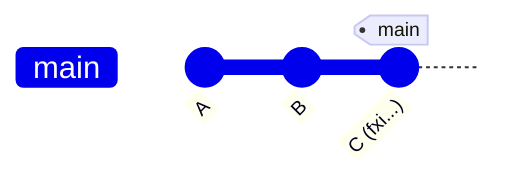

**Sau** amend, `main` trỏ vào **C' — một commit hoàn toàn mới**, cùng parent B nhưng khác hash. C cũ không bị sửa (Git không bao giờ sửa commit cũ), nó chỉ bị "bỏ rơi":

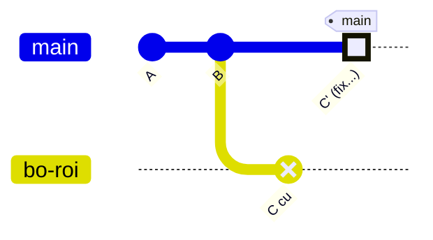

> Nhánh `bo-roi` trong hình chỉ để minh hoạ: thực tế C cũ **không có nhãn nào** trỏ tới, chỉ còn tìm thấy qua `git reflog`.

### Lưu ý quan trọng

`--amend` THAY ĐỔI SHA của commit. Điều này có nghĩa:

- Nếu bạn **chưa push** → an toàn, dùng thoải mái
- Nếu bạn **đã push** → NGUY HIỂM! Đồng nghiệp đã có commit cũ, bạn sửa sẽ gây conflict

```bash
# NGUY HIỂM: Amend sau khi đã push
git commit --amend -m "fix: sửa lỗi đăng nhập"
git push              # Lỗi! rejected vì history khác
git push --force      # Ép push → có thể xóa code đồng nghiệp!

# AN TOÀN: Chỉ amend khi chưa push
git commit --amend -m "fix: sửa lỗi đăng nhập"
git push              # OK, lần push đầu tiên
```

---

## 2. git reset

`git reset` di chuyển HEAD (và có thể branch pointer) về một commit trước đó. Có 3 chế độ, mỗi chế độ ảnh hưởng khác nhau đến 3 vùng của Git.

### Ba vùng trong Git

```
+-------------------+    +-------------------+    +-------------------+
|  Working Directory|    |   Staging Area    |    |    Repository     |
|  (thư mục làm    | => |   (Index/Stage)   | => |   (commit history)|
|   việc của bạn)   |    |   git add vào đây |    |   git commit ở đây|
+-------------------+    +-------------------+    +-------------------+
```

Hình dung bằng **văn phòng**:

- **Working Directory** (thư mục làm việc) = **mặt bàn**: giấy tờ bạn đang viết dở, sửa thoải mái.
- **Staging Area** (khu chuẩn bị, còn gọi index) = **khay "chờ nộp"**: bạn chọn tờ nào đã ổn thì bỏ vào khay (`git add`).
- **Repository** (kho lịch sử) = **tủ hồ sơ đã đóng dấu**: mỗi lần `git commit` là bê nguyên khay cất vào tủ thành một tập hồ sơ có số.

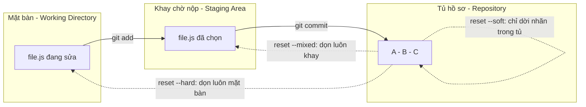

Ba mũi tên nét đứt chính là ba chế độ của `reset`: **càng mạnh thì càng "với tay" sang trái** — `--soft` chỉ chạm tủ hồ sơ, `--mixed` chạm thêm khay, `--hard` chạm tới tận mặt bàn.

### --soft: Chỉ di chuyển HEAD

```bash
git reset --soft HEAD~1
```

```
Trước reset --soft HEAD~1:
  Working Dir: file.js (đã sửa + committed)
  Staging:     file.js (đã committed)
  Repository:  A --- B --- C (HEAD)

Sau reset --soft HEAD~1:
  Working Dir: file.js (giữ nguyên nội dung của C)
  Staging:     file.js (thay đổi từ C nằm ở đây, sẵn sàng commit lại)
  Repository:  A --- B (HEAD)    ← C bị "gỡ" khỏi branch

  => Thay đổi của commit C chuyển về Staging Area
  => Bạn có thể sửa rồi commit lại
```

**Dùng khi nào:** Muốn gộp nhiều commit thành một, hoặc sửa nội dung commit cuối.

```bash
# Ví dụ: Gộp 3 commit cuối thành 1
git reset --soft HEAD~3
git commit -m "feat: hoàn thành tính năng tìm kiếm"
```

### --mixed (mặc định): Di chuyển HEAD + reset Staging

```bash
git reset HEAD~1          # --mixed là mặc định
git reset --mixed HEAD~1  # tường minh hơn
```

```
Trước reset --mixed HEAD~1:
  Working Dir: file.js (nội dung commit C)
  Staging:     file.js (nội dung commit C)
  Repository:  A --- B --- C (HEAD)

Sau reset --mixed HEAD~1:
  Working Dir: file.js (giữ nguyên nội dung của C)
  Staging:     (trống — file bị unstage)
  Repository:  A --- B (HEAD)

  => Thay đổi của C chuyển về Working Directory (unstaged)
  => Bạn cần git add lại rồi mới commit được
```

**Dùng khi nào:** Muốn undo commit và chọn lại file nào cần stage.

```bash
# Ví dụ: Undo commit cuối, chỉ giữ lại một số thay đổi
git reset HEAD~1
git add file-can-giu.js
git commit -m "feat: chỉ thêm tính năng cần thiết"
# file-khong-can.js vẫn nằm trong working dir, chưa staged
```

### --hard: Reset tất cả (NGUY HIỂM)

```bash
git reset --hard HEAD~1
```

```
Trước reset --hard HEAD~1:
  Working Dir: file.js (nội dung commit C)
  Staging:     file.js (nội dung commit C)
  Repository:  A --- B --- C (HEAD)

Sau reset --hard HEAD~1:
  Working Dir: (quay lại trạng thái commit B)
  Staging:     (quay lại trạng thái commit B)
  Repository:  A --- B (HEAD)

  => MỌI THỨ của commit C bị xóa!
  => Working directory cũng bị reset!
  => Nếu có thay đổi chưa commit → MẤT LUÔN!
```

**Dùng khi nào:** Muốn xóa sạch mọi thứ và quay về trạng thái cũ. Hãy chắc chắn 100%!

```bash
# Ví dụ: Code lung tung quá, muốn quay về commit sạch
git reset --hard HEAD~1

# Quay về remote branch (xóa mọi thay đổi local)
git reset --hard origin/main
```

### Bảng so sánh 3 mode reset

| Mode      | HEAD      | Staging Area | Working Directory | Mức độ nguy hiểm |
| --------- | --------- | ------------ | ----------------- | ---------------- |
| `--soft`  | Di chuyển | Giữ nguyên   | Giữ nguyên        | Thấp             |
| `--mixed` | Di chuyển | Reset        | Giữ nguyên        | Trung bình       |
| `--hard`  | Di chuyển | Reset        | Reset             | CAO              |

### Minh họa: cùng một tình huống, ba kiểu reset

**Điểm xuất phát:** bạn có 3 commit A, B, C trên `main` (chưa push). Commit C sửa `login.js` (thêm 1 dòng `validate()`). Ngoài ra trên mặt bàn bạn đang sửa dở `config.js` (file đã có từ commit A, tức Git đang theo dõi) — sửa **chưa add, chưa commit**. Bạn gõ `git reset <mode> HEAD~1`.

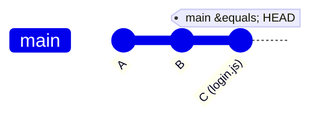

**Lịch sử sau reset — giống hệt nhau ở cả 3 mode:** nhãn `main` (kéo theo HEAD) lùi từ C về B. C không bị xoá ngay, chỉ không còn nhãn nào trỏ tới (vẫn cứu được bằng `git reflog`).

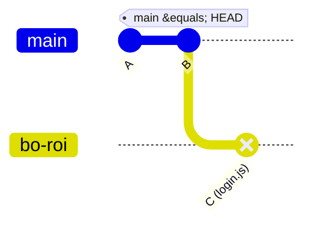

> Như phần amend, nhánh `bo-roi` chỉ để vẽ; thực tế C là commit "mồ côi", không có nhãn.

Vậy **khác nhau ở đâu?** Ở chỗ **dòng `validate()` của C rơi vào vùng nào**, và **phần sửa dở trong `config.js` còn sống không**:

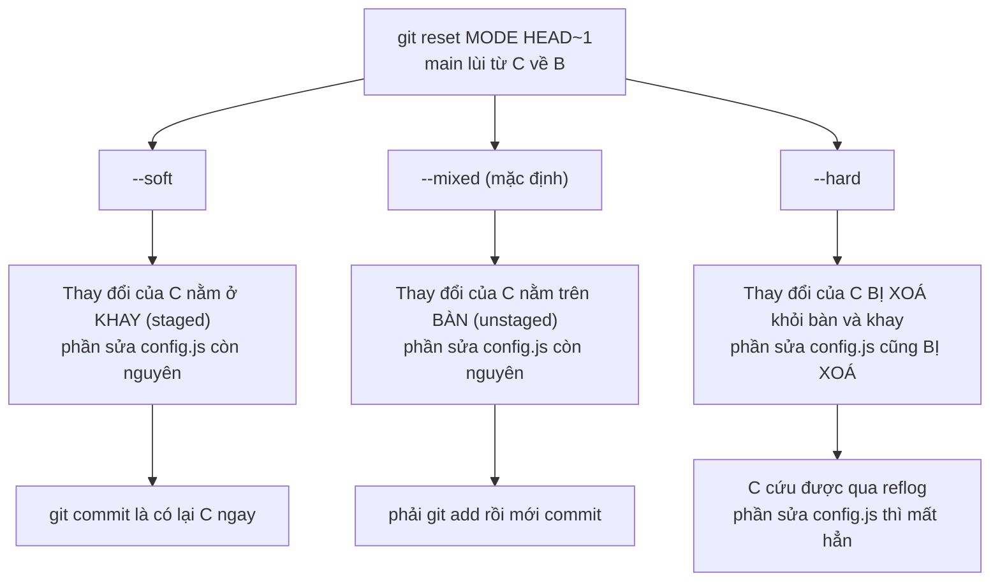

Bảng tổng kết, đọc theo từng "ngăn":

| Sau `git reset ... HEAD~1` | Tủ hồ sơ (`main` trỏ vào) | Khay (staging)            | Mặt bàn (working dir)             | Phần sửa dở `config.js` | `git status` sẽ báo                |
| -------------------------- | ------------------------- | ------------------------- | --------------------------------- | ---------------------- | ---------------------------------- |
| `--soft`                   | B                         | Có dòng `validate()` của C | Có `validate()` + sửa `config.js`      | Còn                    | `Changes to be committed`          |
| `--mixed`                  | B                         | Giống B (trống thay đổi)  | Có `validate()` + sửa `config.js`      | Còn                    | `Changes not staged for commit`    |
| `--hard`                   | B                         | Giống B                   | Giống B — **mất cả hai**          | **Mất vĩnh viễn**      | `nothing to commit, working tree clean` |

:::warning[Điểm dễ hiểu lầm nhất]

`--hard` nguy hiểm **không phải** vì làm mất commit C (C vẫn nằm trong reflog ~90 ngày), mà vì nó **ghi đè mặt bàn** — những gì **chưa từng được commit** như phần sửa dở trong `config.js` thì Git chưa bao giờ lưu, nên **không có cách nào lấy lại**. Trước khi `--hard`, chạy `git status`; còn thứ gì đang sửa dở thì `git stash` trước.

:::

:::tip[Tự kiểm chứng trên máy]

```bash
mkdir thu-reset && cd thu-reset && git init
echo a > login.js && echo "port=80" > config.js && git add . && git commit -m "A"
echo b >> login.js && git commit -am "B"
echo "validate()" >> login.js && git commit -am "C"
echo "port=8080" > config.js            # sửa dở, chưa add

git reset --soft HEAD~1 && git status   # thử lần lượt từng mode
git diff --staged; git diff             # xem thay đổi đang nằm ở khay hay trên bàn
```

Muốn thử mode khác: `git reset --hard ORIG_HEAD` để quay lại C (`ORIG_HEAD` = nơi HEAD đứng trước lần reset vừa rồi), chạy lại dòng `echo "port=8080" > config.js`, rồi thử mode tiếp theo.

Lưu ý: `--hard` chỉ ghi đè các file **Git đang theo dõi**. File mới tinh chưa từng `git add` (untracked) thì `--hard` để yên — muốn xoá cả chúng phải dùng `git clean`.

:::

### Reset file cụ thể (unstage)

```bash
# Unstage một file (không ảnh hưởng commit history)
git reset HEAD file.js
# Tương đương với:
git restore --staged file.js   # Git 2.23+, rõ ràng hơn

# Unstage tất cả files
git reset HEAD
```

### reset vs checkout cho files

```bash
# reset: bỏ file khỏi staging area (unstage)
git reset HEAD file.js
# => file.js vẫn có thay đổi trong working dir, chỉ bị unstage

# checkout: khôi phục file về trạng thái commit (XÓA thay đổi)
git checkout -- file.js
# => file.js bị ghi đè bởi version trong commit, MẤT thay đổi!

# Git 2.23+ (rõ ràng hơn):
git restore --staged file.js   # thay cho reset
git restore file.js            # thay cho checkout --
```

---

## 3. git revert

### Tạo commit "đảo ngược"

`git revert` không xóa history mà tạo một commit MỚI để undo thay đổi:

```bash
git revert abc1234
```

```
Trước revert:
  A --- B --- C --- D (HEAD)
              |
              commit gây bug

Sau revert:
  A --- B --- C --- D --- R (HEAD)
                          |
                          commit mới, nội dung đảo ngược C

  => History vẫn giữ nguyên!
  => R chứa thay đổi ngược lại với C (C thêm dòng nào thì R xoá dòng đó)
  => An toàn cho shared branches
```

Vẽ lại bằng sơ đồ. **Trước:** C là commit gây bug, sau nó đã có D (không liên quan):

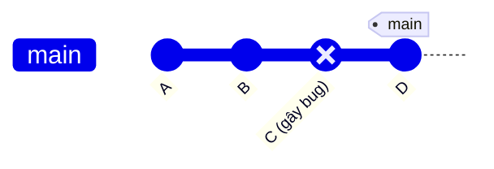

**Sau `git revert <hash-của-C>`:** thêm R ở cuối. A, B, C, D **giữ nguyên hash**, chỉ có thêm một trang "đính chính":

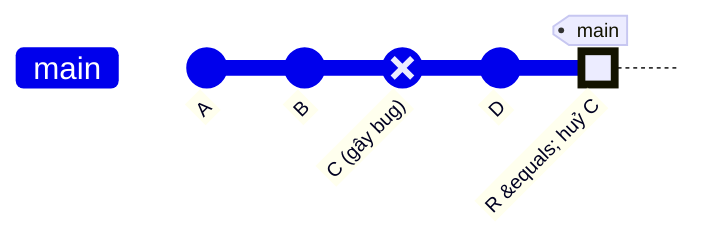

Điểm hay: revert **gỡ được commit nằm giữa** (C) mà **không đụng tới D**. Còn `reset` chỉ "cắt đuôi" — muốn bỏ C bằng reset thì phải bỏ luôn cả D.

### Cú pháp cơ bản

```bash
# Revert commit cụ thể (mở editor để viết message)
git revert abc1234

# Revert không mở editor (dùng message mặc định)
git revert abc1234 --no-edit

# Revert commit cuối cùng
git revert HEAD

# Revert nhiều commits (tạo nhiều revert commits)
git revert HEAD~3..HEAD

# Revert nhiều commits thành 1 commit
git revert HEAD~3..HEAD --no-commit
git commit -m "revert: undo 3 commits cuối"
```

### Revert merge commit

Merge commit có 2 parents, nên bạn phải chỉ rõ giữ parent nào:

```bash
# Xem merge commit
git log --oneline
# a1b2c3d Merge branch 'feature' into main

# Revert merge commit, giữ lại main (parent 1)
git revert a1b2c3d -m 1
# -m 1: giữ parent thứ nhất (thường là main/nhánh đích)
# -m 2: giữ parent thứ hai (thường là feature/nhánh nguồn)

# Cách nhớ: -m 1 = "undo merge, giữ main"
```

### Tại sao revert an toàn hơn reset?

```bash
# Reset: XÓA history → conflict khi đồng nghiệp pull
git reset --hard HEAD~1    # Commit biến mất
git push --force           # Ép remote, gây rối cho team

# Revert: THÊM history → không conflict
git revert HEAD            # Commit mới được tạo
git push                   # Push bình thường, team nhận revert commit
```

---

## 4. Bảng so sánh: Amend vs Reset vs Revert

| Tiêu chí                  | `amend`                | `reset`                     | `revert`                 |
| ------------------------- | ---------------------- | --------------------------- | ------------------------ |
| Cơ chế                    | Thay thế commit cuối   | Di chuyển HEAD về commit cũ | Tạo commit mới đảo ngược |
| Thay đổi history          | Có (SHA mới)           | Có (bỏ commits khỏi branch) | Không (chỉ thêm commit)  |
| An toàn cho shared branch | KHÔNG                  | KHÔNG                       | CÓ                       |
| Phạm vi                   | Chỉ commit cuối        | Bất kỳ commit nào           | Bất kỳ commit nào        |
| Khi nào dùng              | Sửa nhỏ commit vừa tạo | Undo trên local branch      | Undo trên shared branch  |
| Cần force push?           | Có (nếu đã push)       | Có (nếu đã push)            | Không                    |

### Minh họa: cùng một commit lỗi, ba cách xử lý

**Điểm xuất phát:** `main` có A, B, C — commit C có lỗi (sai message, hoặc code sai).

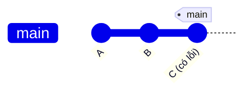

**Cách 1 — `git commit --amend`:** thay C bằng **C'** (bản đã sửa). Số commit không đổi, nhưng C' là commit mới, hash khác.

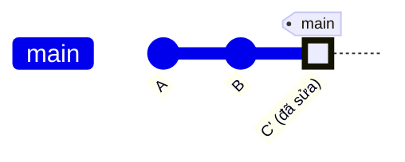

**Cách 2 — `git reset HEAD~1`:** `main` lùi về B, C rời khỏi branch. Thay đổi của C nằm ở khay hoặc trên bàn (tuỳ mode) để bạn làm lại.

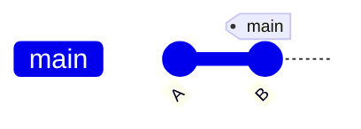

**Cách 3 — `git revert HEAD`:** giữ nguyên C, thêm **R** đảo ngược C. Lịch sử dài thêm 1 commit, không ai bị lệch.

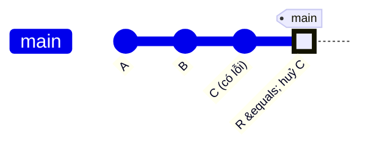

Khác biệt thật sự lộ ra khi **C đã được push và đồng nghiệp đã pull về**. Sơ đồ dưới so sánh "đi đường tắt" (reset/amend + force push) với revert:

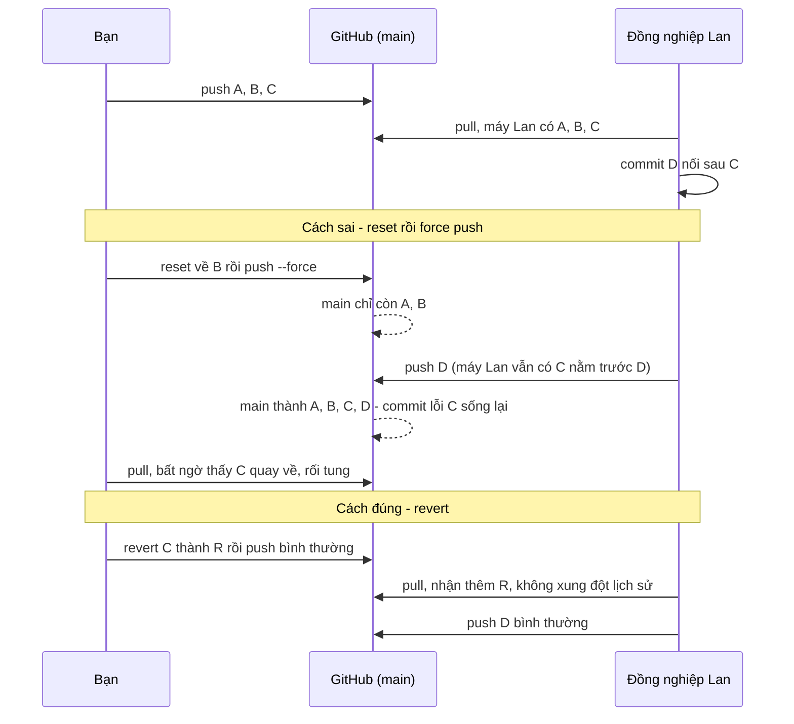

| Câu hỏi                                   | `amend`                         | `reset`                              | `revert`                     |
| ----------------------------------------- | ------------------------------- | ------------------------------------ | ---------------------------- |
| C còn nằm trên `main` không?              | Không (thay bằng C')            | Không                                | **Còn**                      |
| Số commit trên `main` sau khi làm         | 3 (A, B, C')                    | 2 (A, B)                             | 4 (A, B, C, R)               |
| Hash của các commit cũ                    | C đổi thành C'                  | A, B giữ nguyên, C rời branch        | Tất cả giữ nguyên            |
| Đồng nghiệp đã pull C thì sao?            | Lệch lịch sử, phải xử lý tay    | Lệch lịch sử, C có thể "sống lại"    | Chỉ pull thêm R, êm          |
| Gỡ được commit **nằm giữa** lịch sử?      | Không (chỉ commit cuối)         | Không (cắt luôn phần đuôi)           | **Có**                       |

:::tip[Một câu để nhớ]

**Chưa push → sửa trong sổ của mình thoải mái (amend, reset). Đã push → chỉ được viết thêm trang đính chính (revert).**

:::

---

## 5. Decision Tree: Chọn lệnh nào?

```
Bạn muốn sửa gì?
│
├── Sửa commit message cuối?
│   └── Đã push chưa?
│       ├── Chưa → git commit --amend
│       └── Rồi → để nguyên (hoặc amend + push --force-with-lease nếu là branch riêng)
│
├── Thêm file quên vào commit cuối?
│   └── Đã push chưa?
│       ├── Chưa → git add file && git commit --amend --no-edit
│       └── Rồi → git add file && git commit -m "fix: thêm file thiếu"
│
├── Undo commit cuối nhưng giữ thay đổi?
│   └── git reset --soft HEAD~1 (hoặc --mixed)
│
├── Undo commit cuối, xóa sạch thay đổi?
│   └── git reset --hard HEAD~1
│       (cẩn thận! kiểm tra git stash trước)
│
├── Undo commit trên shared branch (main/develop)?
│   └── git revert <commit-hash>
│
└── Unstage file (bỏ khỏi staging area)?
    └── git reset HEAD <file>
        hoặc git restore --staged <file>
```

Cây trên rút gọn lại chỉ còn **hai câu hỏi quyết định**: *đã push lên nhánh chung chưa?* và *có cần giữ lại thay đổi không?*

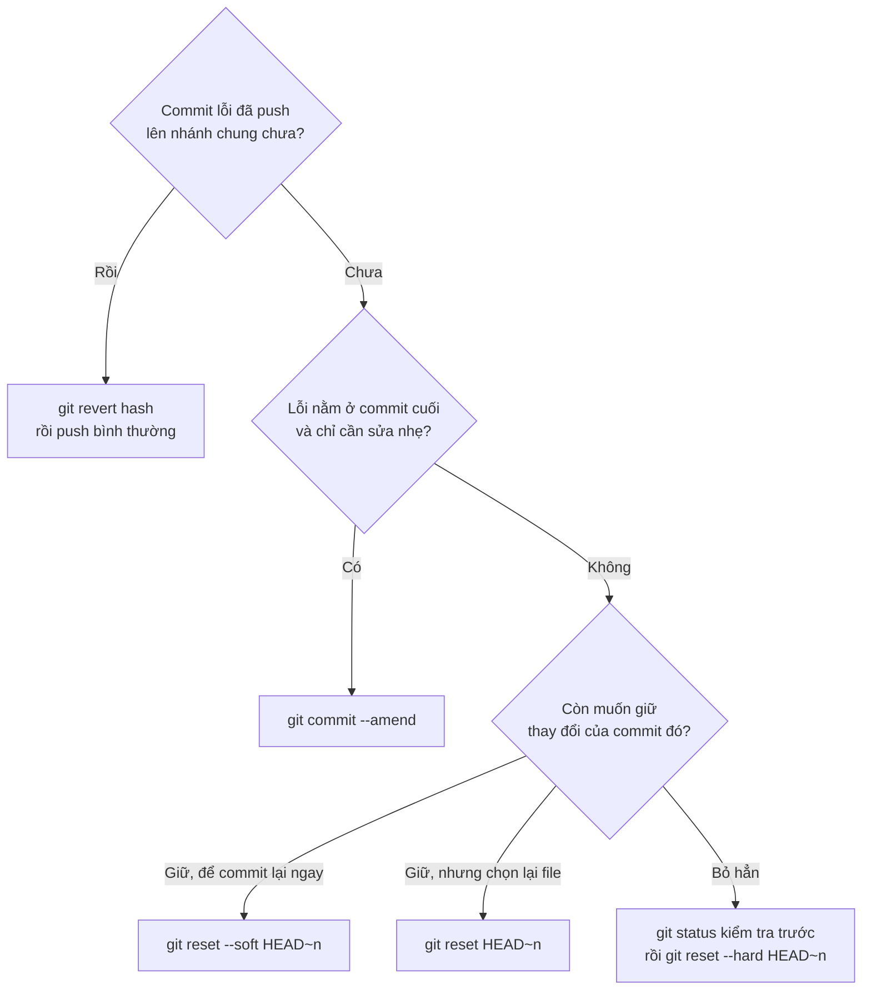

---

## 6. Ví dụ thực tế: Undo sai lầm phổ biến

### Tình huống 1: "Tôi commit nhầm file .env"

```bash
# .env đã bị commit vào Git!
git log --oneline
# a1b2c3d feat: thêm cấu hình database  ← commit chứa .env

# Cách fix: Xóa file khỏi Git nhưng giữ trên máy
git rm --cached .env
echo ".env" >> .gitignore
git add .gitignore
git commit -m "fix: xóa .env khỏi tracking, thêm vào .gitignore"

# Nếu chưa push, có thể amend luôn:
git rm --cached .env
echo ".env" >> .gitignore
git add .gitignore
git commit --amend --no-edit
```

### Tình huống 2: "Tôi commit lên nhầm branch"

```bash
# Đang ở main, lỡ commit rồi!
git log --oneline
# x1y2z3 feat: tính năng mới  ← commit nhầm trên main

# Bước 1: Tạo branch mới chứa commit đó
git branch feature-moi

# Bước 2: Reset main về trạng thái trước
git reset --hard HEAD~1

# Bước 3: Chuyển sang branch mới
git switch feature-moi
# Commit x1y2z3 giờ nằm trên feature-moi, main sạch sẽ
```

### Tình huống 3: "Tôi muốn undo commit cuối trên branch đã share"

```bash
# Đang ở develop (shared branch), commit cuối bị lỗi
git log --oneline
# d4e5f6 fix: sửa logic tính toán  ← commit này gây bug

# ĐÚNG: Dùng revert
git revert d4e5f6 --no-edit
git push

# SAI: Dùng reset rồi force push
git reset --hard HEAD~1
git push --force   # ĐỒNG NGHIỆP SẼ GHÉT BẠN!
```

### Tình huống 4: "Tôi reset --hard nhầm!"

```bash
# Đừng panic! Dùng reflog để khôi phục
git reflog
# abc1234 HEAD@{0}: reset: moving to HEAD~3
# def5678 HEAD@{1}: commit: feat: tính năng quan trọng  ← đây!

git reset --hard def5678
# Khôi phục thành công!
```

---

## 7. Lỗi thường gặp

### Lỗi 1: Amend sau khi đã push

```bash
# SAI
git commit --amend -m "fix message"
git push
# ERROR: rejected, non-fast-forward

# CÁCH SỬA: Hoặc force push (nếu branch cá nhân)
git push --force-with-lease   # an toàn hơn --force

# HOẶC: Tạo commit mới thay vì amend
git commit -m "fix: sửa lại message"
```

### Lỗi 2: Reset --hard mất code chưa commit

```bash
# Bạn đang code, chưa commit, rồi:
git reset --hard HEAD
# Mọi thay đổi chưa commit → MẤT!

# PHÒNG TRÁNH: Luôn stash trước khi reset
git stash
git reset --hard HEAD
git stash pop   # lấy lại nếu cần
```

### Lỗi 3: Revert nhầm rồi revert lại

```bash
# Revert commit A
git revert A   # tạo commit A'

# Ối, revert nhầm! Muốn lấy A lại
git revert A'  # revert cái revert → khôi phục A
# Kết quả: A --- A' --- A'' (nội dung giống A)
```

### Lỗi 4: Không hiểu reset --mixed vs --soft

```bash
# --soft: thay đổi vẫn ở staging (sẵn sàng commit)
git reset --soft HEAD~1
git status
# Changes to be committed: (staged)

# --mixed: thay đổi ở working dir (cần git add lại)
git reset --mixed HEAD~1
git status
# Changes not staged for commit: (unstaged)
```

---

## Tóm tắt

| Tình huống                            | Lệnh                                           |
| ------------------------------------- | ---------------------------------------------- |
| Sửa message commit cuối (chưa push)   | `git commit --amend`                           |
| Thêm file vào commit cuối (chưa push) | `git add file && git commit --amend --no-edit` |
| Undo commit, giữ thay đổi staged      | `git reset --soft HEAD~1`                      |
| Undo commit, giữ thay đổi unstaged    | `git reset HEAD~1`                             |
| Undo commit, xóa sạch thay đổi        | `git reset --hard HEAD~1`                      |
| Undo commit trên shared branch        | `git revert <commit-hash>`                     |
| Unstage file                          | `git restore --staged <file>`                  |
