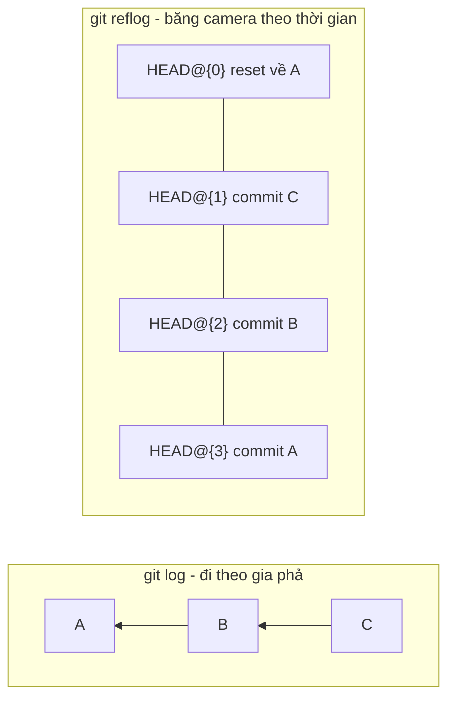
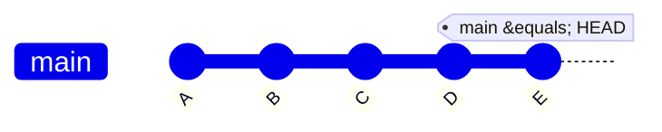
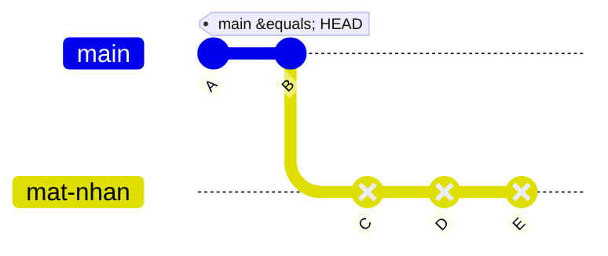
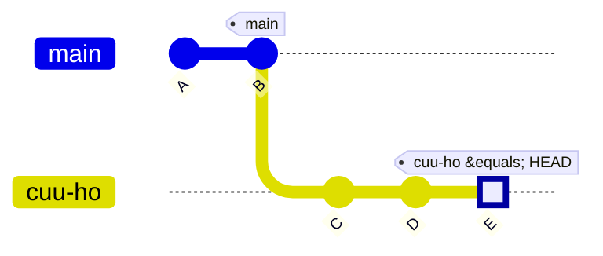
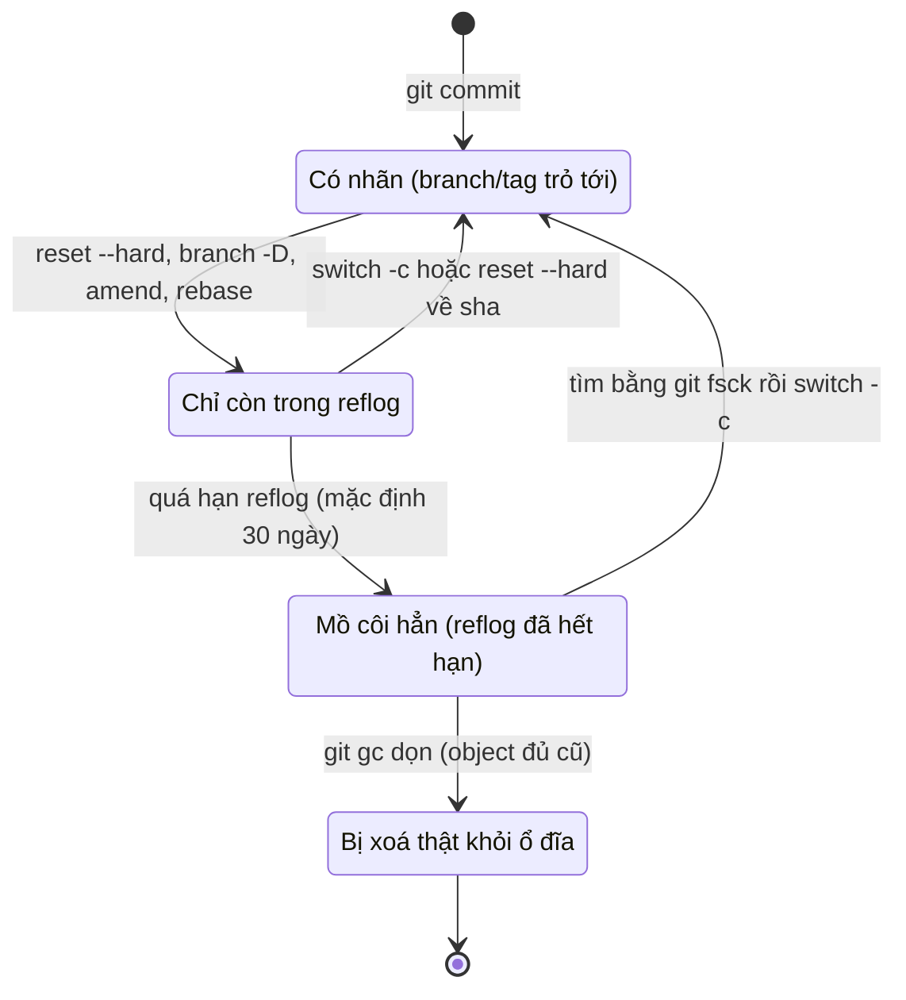
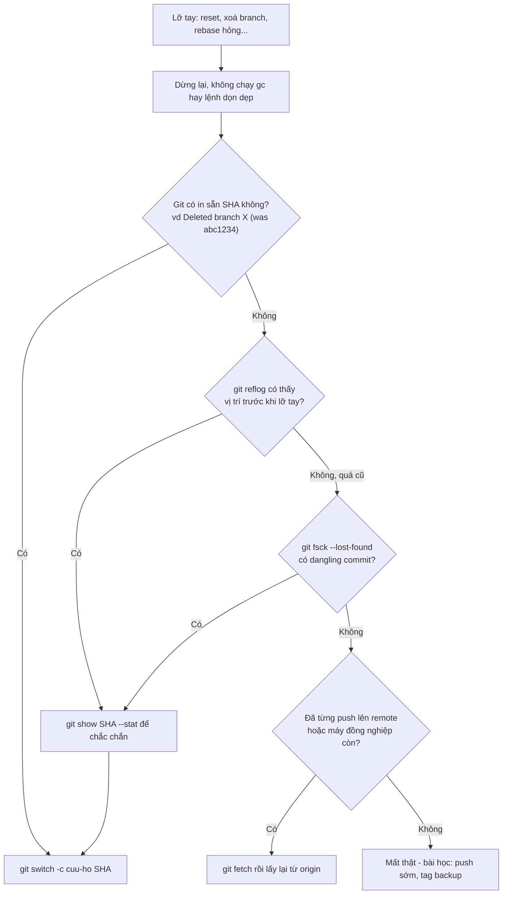

# Git Reflog — Khôi phục dữ liệu đã mất

Bạn đã bao giờ `reset --hard` nhầm và nghĩ rằng code đã mất vĩnh viễn? Tin vui: Git gần như KHÔNG BAO GIỜ xóa dữ liệu thực sự. Bí mật nằm ở **reflog** — cuốn nhật ký ghi lại mọi thay đổi của HEAD. Đây chính là "lưới an toàn" của Git.

[](pathname:///img/git/git-reflog-va-khoi-phuc.webp)

---

:::note[Ghi nhớ nhanh]

- ⭐ **Reflog là lưới an toàn của Git** — ghi lại mọi lần HEAD di chuyển, giúp khôi phục commit sau `reset --hard`, rebase hỏng, hay xóa nhánh nhầm.
- ⭐ **Quy trình khôi phục** — `git reflog` tìm SHA rồi `git reset --hard <sha>`, hoặc an toàn hơn là `git switch -c <nhánh> <sha>`.
- **Reflog chỉ ở local** — không được push lên remote; repo vừa clone reflog gần như trống.
- **Thời gian lưu** — reachable 90 ngày, unreachable 30 ngày; sau đó `git gc` mới xóa object thật.
- **Đừng chạy `git gc --prune=now`** (nhất là kèm `git reflog expire --expire=now`) khi đang cần recovery — object mồ côi bị xóa ngay, không cứu được.

:::

---

## Mục lục

- [Vì sao có git reflog?](#vì-sao-có-git-reflog)
- [1. Reflog là gì?](#1-reflog-là-gì)
- [2. Đọc output của git reflog](#2-đọc-output-của-git-reflog)
- [3. Reflog vs Log — Khác nhau cơ bản](#3-reflog-vs-log-khác-nhau-cơ-bản)
- [4. Recover lost commits sau reset --hard](#4-recover-lost-commits-sau-reset-hard)
- [5. Recover deleted branch](#5-recover-deleted-branch)
- [6. Reflog cho nhánh cụ thể](#6-reflog-cho-nhánh-cụ-thể)
- [7. Thời gian lưu trữ reflog](#7-thời-gian-lưu-trữ-reflog)
- [8. git fsck — Tìm dangling objects](#8-git-fsck-tìm-dangling-objects)
- [9. Garbage Collection: Khi nào object THỰC SỰ bị xóa?](#9-garbage-collection-khi-nào-object-thực-sự-bị-xóa)
- [10. Workflow khôi phục hoàn chỉnh](#10-workflow-khôi-phục-hoàn-chỉnh)
- [11. Mẹo thực tế](#11-mẹo-thực-tế)
- [12. Lỗi thường gặp](#12-lỗi-thường-gặp)
- [Tóm tắt](#tóm-tắt)

---

## Vì sao có git reflog?

**Vấn đề:**

```bash
# Bạn lỡ tay reset --hard, xóa nhánh, hoặc rebase hỏng
git reset --hard HEAD~5      # Ối! Xóa nhầm 5 commits
git branch -D feature        # Ối! Nhánh đó chưa merge

# git log không còn thấy các commits đó nữa
git log --oneline
# → Các commit "biến mất" khỏi lịch sử

# Hoảng loạn: nghĩ rằng mất công sức nhiều ngày làm việc!
```

**Giải pháp:**

```bash
# git reflog: Git ÂM THẦM ghi lại MỌI lần HEAD di chuyển
# (commit, checkout, reset, rebase, merge...) trong nhật ký LOCAL
git reflog
# d4e5f6a HEAD@{0}: reset: moving to HEAD~5
# a1b2c3d HEAD@{1}: commit: feat: tính năng quan trọng  ← commit "mất"

# Tìm lại hash của commit "mất" rồi khôi phục:
git reset --hard a1b2c3d        # đưa HEAD về lại
# hoặc an toàn hơn:
git switch -c recovered a1b2c3d # tạo nhánh mới từ hash đó
```

Reflog là **lưới an toàn** của Git: dù bạn thao tác nhầm thế nào, các commit thường vẫn còn đó và tìm lại được qua nhật ký HEAD.

:::tip[Dùng thực tế]

- **Khôi phục sau `reset --hard` nhầm**: tìm hash commit cuối trong reflog rồi `git reset --hard <hash>`.
- **Lấy lại nhánh đã xóa**: tìm hash commit cuối của nhánh rồi `git switch -c <ten-nhanh> <hash>`.
- **Cứu commit sau rebase hỏng**: reset về trạng thái `rebase (start)` ghi trong reflog.
- **Tìm lại trạng thái cũ**: dùng `HEAD@{n}` để quay về đúng thời điểm trước thao tác nhầm.

:::

---

## 1. Reflog là gì?

**Reflog** (reference log) là nhật ký ghi lại MỌI lần HEAD thay đổi trên máy local của bạn. Mỗi khi bạn commit, reset, checkout, merge, rebase... Git đều ghi lại một entry trong reflog.

```
Reflog = Nhật ký di chuyển của HEAD
       = Lịch sử mọi hành động bạn làm trong repo
       = "Ctrl+Z" cho Git
```

Điểm quan trọng:

- Reflog chỉ tồn tại trên **máy local** — không được push lên remote
- Reflog giữ entries trong **90 ngày** (mặc định)
- Reflog ghi lại cả các commits mà `git log` không hiển thị

:::info[Hình dung: reflog là camera an ninh của repo]

- **`git log`** giống **sơ đồ gia phả**: bắt đầu từ commit mà branch đang trỏ, lần ngược "cha → ông → cụ". Commit nào không còn nằm trên dòng họ đó thì `git log` **không nhìn thấy**.
- **`git reflog`** giống **camera an ninh gắn trên đầu HEAD**: nó không quan tâm gia phả, chỉ ghi lại *"lúc 10:05 HEAD đứng ở commit X, lúc 10:07 nhảy sang Y vì lệnh reset"*. Commit bị "đuổi" khỏi branch vẫn còn trong đoạn băng ghi hình.
- **Commit "mất"** thật ra giống **món đồ bị gỡ nhãn tên**, vẫn nằm trong kho. Chỉ cần tua băng camera xem nó ở đâu, rồi dán nhãn lại (tạo branch) là xong.
- **Garbage collection (GC)** = **xe rác định kỳ**: chỉ dọn những món không có nhãn **và** đã quá hạn lưu băng (mặc định 30–90 ngày).

Băng camera chỉ lưu **trên máy bạn** — máy đồng nghiệp có camera riêng, GitHub cũng không có băng của bạn.

:::



Hai cách "nhìn" khác nhau: `git log` đi theo mũi tên parent nên sau khi reset về A chỉ còn thấy A; reflog thì liệt kê **mọi vị trí HEAD từng đứng**, nên B và C vẫn hiện ra.

---

## 2. Đọc output của git reflog

```bash
git reflog
```

Output mẫu:

```
a1b2c3d HEAD@{0}: commit: feat: thêm trang đăng nhập
f4e5d6c HEAD@{1}: commit: fix: sửa lỗi validation
9876543 HEAD@{2}: checkout: moving from feature to main
1234567 HEAD@{3}: commit: feat: API endpoint users
abcdef0 HEAD@{4}: reset: moving to HEAD~2
7777777 HEAD@{5}: commit: chore: thêm cấu hình eslint
8888888 HEAD@{6}: commit: feat: tính năng quan trọng
```

### Giải thích từng phần

```
a1b2c3d HEAD@{0}: commit: feat: thêm trang đăng nhập
   |       |          |           |
   |       |          |           └── Message/chi tiết
   |       |          └── Loại hành động (commit, reset, checkout, merge...)
   |       └── Vị trí trong reflog (0 = gần nhất)
   └── SHA của commit tại thời điểm đó
```

### Các loại hành động phổ biến trong reflog

```
commit:         Bạn tạo commit mới
commit (amend): Bạn amend commit
reset:          Bạn dùng git reset
checkout:       Bạn chuyển branch
merge:          Bạn merge branch
rebase:         Bạn rebase
pull:           Bạn pull từ remote
cherry-pick:    Bạn cherry-pick commit
```

---

## 3. Reflog vs Log — Khác nhau cơ bản

| Tiêu chí      | `git log`                            | `git reflog`                               |
| ------------- | ------------------------------------ | ------------------------------------------ |
| Hiển thị gì   | Lịch sử commits trên branch hiện tại | MỌI thay đổi HEAD (cả commits đã bị "xóa") |
| Phạm vi       | Chỉ commits reachable từ HEAD        | Tất cả, kể cả unreachable                  |
| Shared        | Có (push lên remote)                 | Không (chỉ local)                          |
| Thời gian lưu | Vĩnh viễn (nếu reachable)            | 90 ngày (mặc định)                         |
| Sắp xếp       | Theo thời gian commit                | Theo thời gian hành động                   |
| Dùng khi nào  | Xem lịch sử bình thường              | Khôi phục dữ liệu, debug                   |

Ví dụ minh họa:

```bash
# Tạo 3 commits
git commit -m "A"   # commit A
git commit -m "B"   # commit B
git commit -m "C"   # commit C

# Reset xóa 2 commits cuối
git reset --hard HEAD~2

# git log chỉ thấy:
git log --oneline
# aaa1111 A

# git reflog thấy MỌI THỨ:
git reflog
# aaa1111 HEAD@{0}: reset: moving to HEAD~2
# ccc3333 HEAD@{1}: commit: C          ← vẫn ở đây!
# bbb2222 HEAD@{2}: commit: B          ← vẫn ở đây!
# aaa1111 HEAD@{3}: commit: A
```

---

## 4. Recover lost commits sau reset --hard

Đây là tình huống phổ biến nhất. Bạn `reset --hard` nhầm và nghĩ code mất rồi.

### Bước 1: Xem reflog để tìm commit

```bash
git reflog
# a1b2c3d HEAD@{0}: reset: moving to HEAD~3
# f4e5d6c HEAD@{1}: commit: feat: hoàn thành module thanh toán  ← CẦN TÌM
# 9876543 HEAD@{2}: commit: feat: thêm giỏ hàng
# 1234567 HEAD@{3}: commit: feat: trang sản phẩm
```

### Bước 2: Khôi phục

```bash
# Cách 1: Reset về commit đó
git reset --hard f4e5d6c
# Hoặc dùng reflog syntax:
git reset --hard HEAD@{1}

# Cách 2: Tạo branch mới từ commit đó (an toàn hơn)
git switch -c recovered-branch f4e5d6c
```

### Minh họa: commit tưởng mất được cứu ra sao

**Trước khi lỡ tay:** `main` có A, B, C, D, E — ba commit cuối là công sức cả tuần.



**Sau `git reset --hard HEAD~3`:** nhãn `main` lùi về B. C, D, E **không bị xoá** — chúng chỉ bị gỡ nhãn, `git log` không đi tới được nữa (vẽ ở nhánh phụ nét mờ chỉ để minh hoạ, thực tế chúng không có tên).



Lúc này "băng camera" ghi:

```
f4e5d6c HEAD@{0}: reset: moving to HEAD~3     ← HEAD đang ở B
a1b2c3d HEAD@{1}: commit: E                   ← vị trí ngay trước khi reset
...
```

**Cứu bằng `git switch -c cuu-ho HEAD@{1}`:** dán một nhãn mới lên E. Vì E vẫn nhớ parent là D, D nhớ C, nên **cả chuỗi C → D → E sống lại** cùng lúc, hash giữ nguyên.



Kiểm tra kỹ rồi, muốn `main` quay lại như cũ thì `git switch main && git merge cuu-ho` (fast-forward, `main` nhảy tới E) — hoặc `git reset --hard a1b2c3d` ngay trên `main`.

| Cách cứu                               | `main` sau khi chạy | Rủi ro                                                    | Khi nào dùng                       |
| -------------------------------------- | ------------------- | --------------------------------------------------------- | ---------------------------------- |
| `git reset --hard <sha>`               | Nhảy về E ngay      | Xoá luôn mọi thay đổi chưa commit đang có trên bàn        | Chắc chắn 100% đúng commit         |
| `git switch -c cuu-ho <sha>`           | Vẫn ở B             | Gần như không — chỉ thêm một nhãn                          | Chưa chắc, muốn xem trước          |
| Không làm gì                           | Ở B                 | Sau ~30 ngày + GC, C, D, E bị dọn thật                    | —                                  |

### Quy trình hoàn chỉnh

```
Tình huống: reset --hard nhầm, mất 3 commits

Bước 1: Bình tĩnh! Code chưa mất.

Bước 2: git reflog
         → Tìm SHA của commit cuối trước khi reset

Bước 3: git reset --hard <sha>
         → Khôi phục hoàn toàn

Bước 4: git log --oneline
         → Kiểm tra xác nhận
```

---

## 5. Recover deleted branch

Bạn xóa branch nhầm? Reflog cũng cứu được!

```bash
# Xóa branch nhầm
git branch -D feature-quan-trong
# Deleted branch feature-quan-trong (was abc1234).
# Ối! Branch đó có code chưa merge!

# Bước 1: Xem reflog để tìm commit cuối của branch
git reflog
# ... tìm entry liên quan đến feature-quan-trong ...

# (Reflog riêng của branch đã bị xoá cùng branch — xem lưu ý bên dưới)

# Bước 2: Tạo lại branch từ SHA
git switch -c feature-quan-trong abc1234
# Branch feature-quan-trong đã hồi sinh!
```

> Lưu ý: khi xoá branch, **reflog riêng của branch đó cũng bị xoá theo**, nên `git reflog show feature-quan-trong` thường báo lỗi. Hãy tìm trong reflog của **HEAD** (`git reflog`) — mỗi lần bạn từng `switch` sang hay commit trên branch đó đều được ghi lại.

Mẹo: Khi Git báo `Deleted branch X (was abc1234)`, hãy **ghi lại SHA abc1234** ngay. Đó là cách nhanh nhất để recovery.

---

## 6. Reflog cho nhánh cụ thể

```bash
# Reflog của HEAD (mặc định)
git reflog

# Reflog của branch main
git reflog show main

# Reflog của branch feature
git reflog show feature/login

# Output mẫu:
git reflog show main
# a1b2c3d main@{0}: merge feature/login: Fast-forward
# f4e5d6c main@{1}: commit: fix: hotfix production
# 9876543 main@{2}: pull origin main: Fast-forward
```

---

## 7. Thời gian lưu trữ reflog

### Cấu hình mặc định

```bash
# Xem cấu hình hiện tại
git config gc.reflogExpire
# 90.days.ago  (entries reachable — còn trên branch)

git config gc.reflogExpireUnreachable
# 30.days.ago  (entries unreachable — commits "mồ côi")
```

### Thay đổi thời gian lưu

```bash
# Giữ reflog 180 ngày (thay vì 90)
git config gc.reflogExpire 180.days.ago

# Giữ unreachable entries 60 ngày (thay vì 30)
git config gc.reflogExpireUnreachable 60.days.ago

# KHÔNG BAO GIỜ hết hạn (cẩn thận, tốn disk)
git config gc.reflogExpire never
```

### Xóa reflog thủ công

```bash
# Xóa reflog entries đã hết hạn
git reflog expire --expire=now --all

# Xóa reflog của branch cụ thể
git reflog expire --expire=now refs/heads/main
```

---

## 8. git fsck — Tìm dangling objects

Khi commit không còn được branch hay tag nào trỏ tới, nó trở thành "dangling object". `git fsck` giúp tìm chúng.

```bash
# Tìm tất cả dangling objects
git fsck --lost-found

# Output mẫu:
# dangling commit abc1234def5678...
# dangling commit 9876543210abcd...
# dangling blob aaabbbcccdddee...

# Xem nội dung commit dangling
git show abc1234def5678

# Khôi phục commit dangling
git switch -c recovered abc1234def5678
```

### Khi nào dùng fsck thay vì reflog?

```
Reflog: Tìm commits mà BẠN đã từng trỏ tới (HEAD đã đi qua)
fsck:   Tìm MỌI object mồ côi (kể cả từ stash, cherry-pick bị hủy...)

Thường thì reflog đủ rồi. Dùng fsck khi:
- Reflog đã hết hạn (>90 ngày)
- Object đến từ nguồn khác (fetch rồi không merge)
- Cần tìm blob (file) đơn lẻ, không phải commit
```

---

## 9. Garbage Collection: Khi nào object THỰC SỰ bị xóa?

Git objects (commits, blobs, trees) chỉ bị xóa khi **garbage collection** chạy VÀ object đó không còn reference nào:

```
Object lifecycle:

  Tạo commit ──→ Có reference ──→ An toàn
                      │
                  Mất reference ──→ Dangling ──→ GC chạy ──→ XÓA THẬT
                  (reset, delete)    (30-90 ngày)
```

Cùng vòng đời đó dưới dạng sơ đồ trạng thái — để ý mũi tên **quay ngược** từ "Chỉ còn trong reflog" về "Có nhãn": đó chính là lúc bạn cứu commit.



### Các lệnh GC

```bash
# Xem kích thước repo
git count-objects -v

# Chạy GC nhẹ (Git tự chạy định kỳ)
git gc

# Chạy GC mạnh (nén tối đa, xóa dangling objects hết hạn)
git gc --aggressive --prune=now

# CHÚ Ý: --prune=now xóa NGAY các object không còn ai tham chiếu
# (commit còn được reflog nhắc tới vẫn được giữ). Nguy hiểm nhất là cặp:
#   git reflog expire --expire=now --all && git gc --prune=now
# → xóa băng camera trước, rồi dọn rác ngay → không recovery được nữa!
```

### Timeline xóa object

```
Ngày 0:   git reset --hard HEAD~3    → 3 commits trở thành dangling
Ngày 1-29: Dangling, nhưng reflog còn → recovery được
Ngày 30:   gc.reflogExpireUnreachable → reflog entry bị xóa
Ngày 30+:  git gc chạy → object bị xóa THẬT SỰ
           (nếu không có reference nào khác)

=> Bạn có ~30 ngày để recovery commits "mồ côi"
=> Commits còn trên branch thì an toàn mãi (90 ngày chỉ là hạn của các
   entry reflog, không phải của bản thân commit)
```

---

## 10. Workflow khôi phục hoàn chỉnh

Trước khi đi vào từng tình huống, đây là "bản đồ cứu hộ" chung — bắt đầu từ chỗ ít tốn công nhất:



### Tình huống: "Tôi vừa reset --hard nhầm!"

```bash
# 1. ĐỪNG PANIC. Đừng chạy thêm lệnh git nào khác.
#    (Mỗi lệnh thêm = thêm entry reflog, nhưng không mất gì)

# 2. Xem reflog
git reflog
# d4e5f6a HEAD@{0}: reset: moving to HEAD~5
# a1b2c3d HEAD@{1}: commit: feat: tính năng xác thực 2FA    ← ĐÍCH
# f9e8d7c HEAD@{2}: commit: feat: giao diện cài đặt
# 1a2b3c4 HEAD@{3}: commit: fix: sửa lỗi token hết hạn
# ...

# 3. Xác nhận đúng commit cần khôi phục
git show a1b2c3d --stat
# Xem danh sách files thay đổi để chắc chắn

# 4a. Khôi phục trực tiếp (nếu chắc chắn)
git reset --hard a1b2c3d
# Hoặc:
git reset --hard HEAD@{1}

# 4b. Tạo branch mới (nếu muốn an toàn hơn)
git switch -c backup-recovery a1b2c3d

# 5. Kiểm tra
git log --oneline -5
# Xác nhận commits đã được khôi phục
```

### Tình huống: "Tôi xóa branch có code chưa merge!"

```bash
# 1. Nhớ lại tên branch
# Git thường hiện SHA khi xóa: "Deleted branch X (was abc1234)"

# 2. Nếu nhớ SHA:
git switch -c ten-branch-cu abc1234

# 3. Nếu KHÔNG nhớ SHA:
git reflog | grep "ten-branch"
# Tìm entry cuối cùng liên quan

# 4. Hoặc dùng fsck:
git fsck --lost-found
# Tìm dangling commit, git show từng cái
```

### Tình huống: "Tôi rebase nhầm, commits bị lộn xộn!"

```bash
# 1. Reflog ghi lại trạng thái trước rebase
git reflog
# abc1234 HEAD@{0}: rebase (finish): ...
# def5678 HEAD@{1}: rebase (pick): ...
# ...
# 999aaaa HEAD@{8}: rebase (start): checkout main
# bbb1111 HEAD@{9}: commit: feat: commit cuối trước rebase  ← ĐÍCH

# 2. Reset về trạng thái trước rebase
git reset --hard bbb1111

# 3. Branch giờ y hệt trước khi rebase
```

---

## 11. Mẹo thực tế

### Tạo alias hữu ích

```bash
# Reflog dạng đẹp, dễ đọc
git config --global alias.rl "reflog --format='%C(yellow)%h%C(reset) %C(blue)%gd%C(reset) %C(green)%ci%C(reset) %gs'"

# Dùng:
git rl
```

### Backup trước khi làm gì nguy hiểm

```bash
# Tạo tag backup trước khi rebase/reset
git tag backup-truoc-rebase

# Nếu hỏng:
git reset --hard backup-truoc-rebase

# Xóa tag khi không cần:
git tag -d backup-truoc-rebase
```

### Kiểm tra reflog trước khi GC

```bash
# Xem còn bao nhiêu reflog entries
git reflog | wc -l

# Xem entries sắp hết hạn
git reflog --date=relative
```

---

## 12. Lỗi thường gặp

### Lỗi 1: Reflog trống trên repo mới clone

```bash
git clone https://github.com/user/repo.git
cd repo
git reflog
# Chỉ thấy 1 entry: clone

# TẠI SAO: Reflog là LOCAL. Khi clone, chỉ có 1 entry (clone).
# Reflog của người khác KHÔNG được clone theo.
```

### Lỗi 2: Chạy git gc --prune=now rồi mới cần recovery

```bash
git reset --hard HEAD~5
git reflog expire --expire=now --all   # "dọn dẹp" reflog cho gọn...
git gc --prune=now                     # ...rồi XÓA NGAY mọi object không còn tham chiếu
git reflog                             # 5 commit kia không còn dấu vết
# Quá muộn, không recovery được nữa.

# Lưu ý: chỉ chạy gc --prune=now (không expire reflog) thì commit vẫn được
# reflog giữ lại. Nhưng đừng thử vận may.
# BÀI HỌC: KHÔNG BAO GIỜ dọn reflog / chạy gc --prune=now khi đang cần recovery
```

### Lỗi 3: Nhầm lẫn `HEAD@{n}` với `HEAD~n`

```bash
# HEAD~n: n commits TRƯỚC theo parent chain
# HEAD@{n}: n entries TRƯỚC trong reflog (theo thời gian hành động)

# Ví dụ: Bạn commit A, B, C rồi checkout sang branch khác
git reflog
# x1y2z3 HEAD@{0}: checkout: moving from main to feature
# c3c3c3 HEAD@{1}: commit: C
# b2b2b2 HEAD@{2}: commit: B

# HEAD~1 = parent của commit hiện tại (trên branch feature)
# HEAD@{1} = commit C trên main (entry reflog trước đó)
# HAI CÁI NÀY KHÁC NHAU HOÀN TOÀN!
```

### Lỗi 4: Nghĩ reflog là vĩnh viễn

```bash
# Reflog KHÔNG vĩnh viễn! Mặc định:
# - Reachable entries: 90 ngày
# - Unreachable entries: 30 ngày

# Nếu bạn reset --hard 2 tháng trước và bây giờ mới biết
# → Commit có thể đã bị GC xóa rồi!

# GIẢI PHÁP: Nếu code quan trọng, push lên remote
# Remote là backup tốt nhất
```

---

## Tóm tắt

```
Khôi phục commit sau reset:    git reflog → git reset --hard <sha>
Khôi phục branch đã xóa:       git reflog → git switch -c <name> <sha>
Khôi phục sau rebase nhầm:     git reflog → git reset --hard <sha-truoc-rebase>
Tìm object mồ côi:             git fsck --lost-found
An toàn trước thao tác nguy:   git tag backup-<ten>
```

Nhớ: **Git gần như không bao giờ xóa dữ liệu ngay lập tức**. Nếu bạn còn trong vòng 30 ngày, khả năng cao là recovery được. Reflog là người bạn tốt nhất của bạn khi mọi thứ sai lầm.
