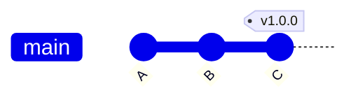
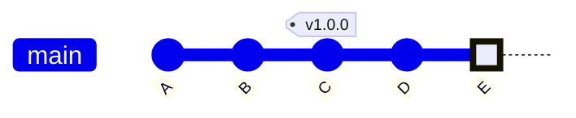
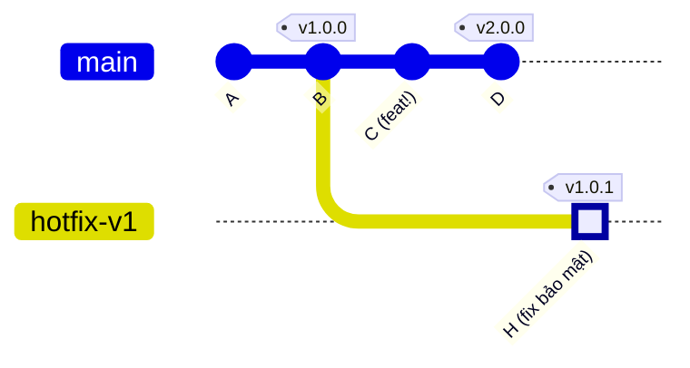
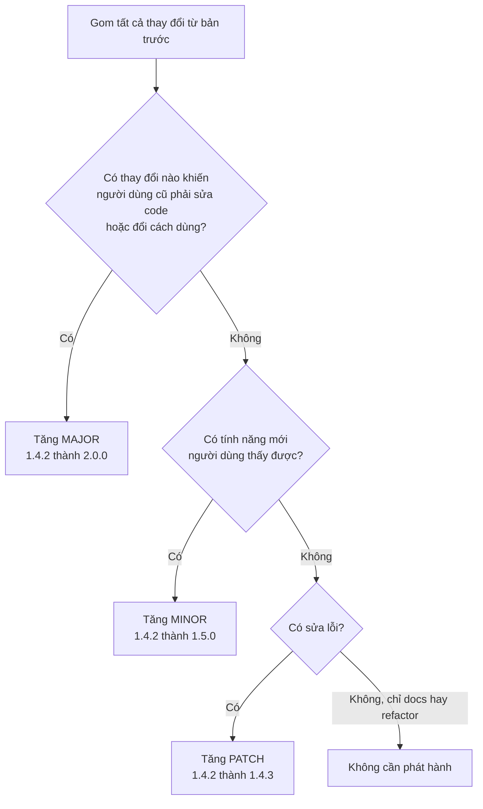
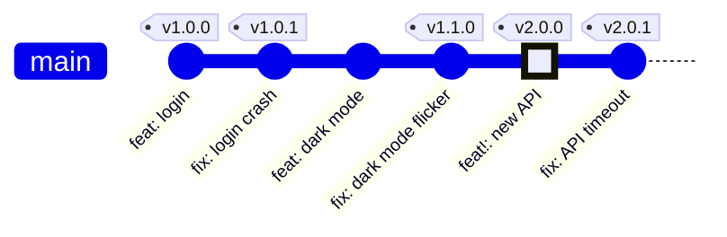
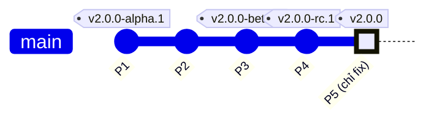
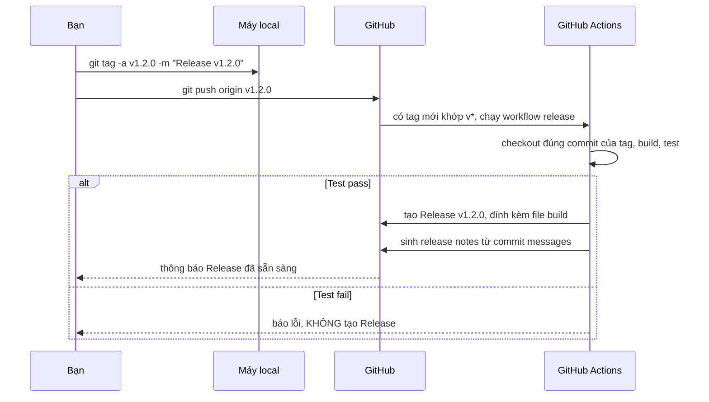

# Tag và Release

Khi dự án của bạn đạt đến một mốc quan trọng — phiên bản đầu tiên, bản sửa lỗi lớn, hoặc tính năng mới — bạn cần **đánh dấu** thời điểm đó trong lịch sử Git. Đây là lúc **tag** phát huy tác dụng. Kết hợp với **GitHub Releases**, bạn có thể đóng gói phần mềm, viết release notes, và phân phối đến người dùng. Bài này sẽ hướng dẫn bạn mọi thứ từ tag cơ bản đến quy trình release chuyên nghiệp.

[](pathname:///img/git/tag-va-release.webp)

---

:::note[Ghi nhớ nhanh]

- ⭐ **Annotated vs Lightweight tag** — release chính thức LUÔN dùng annotated (`git tag -a`) vì lưu tagger, ngày, message và ký GPG được; lightweight chỉ là con trỏ cho tag tạm.
- ⭐ **SemVer** — `MAJOR.MINOR.PATCH`: `fix`→PATCH, `feat`→MINOR, breaking→MAJOR; tăng MINOR reset PATCH về 0, tăng MAJOR reset cả hai.
- **`git push` KHÔNG tự đẩy tag** — dùng `git push origin <tag>` / `--tags`, hoặc set `push.followTags true` để tự động.
- **GitHub Release = tag + release notes + assets** — `gh release create v1.0.0 --generate-notes`.
- **Pre-release** — thứ tự alpha → beta → rc → stable; tạo với cờ `--prerelease`.

:::

---

## Mục lục

- [Vì sao cần tag & release?](#vì-sao-cần-tag--release)
- [1. Tag là gì?](#1-tag-là-gì)
- [2. Hai loại Tag](#2-hai-loại-tag)
- [3. Các thao tác với Tag](#3-các-thao-tác-với-tag)
- [4. Semantic Versioning (SemVer)](#4-semantic-versioning-semver)
- [5. GitHub Releases](#5-github-releases)
- [6. Workflow đầy đủ: Từ commit đến Release](#6-workflow-đầy-đủ-từ-commit-đến-release)
- [7. Versioning strategies cho different project types](#7-versioning-strategies-cho-different-project-types)
- [8. Lỗi thường gặp](#8-lỗi-thường-gặp)
- [9. Tóm tắt](#9-tóm-tắt)

---

## Vì sao cần tag & release?

**Vấn đề:**

```bash
# Commit hash khó nhớ và không nói lên "đây là phiên bản nào"
git log --oneline
# 7f3a9b2 fix: sửa lỗi thanh toán
# c4e1d80 feat: thêm dark mode
# a91f5c3 refactor: dọn dẹp code

# Khách báo: "App bị lỗi ở bản nào?"  → "Ờ... chắc khoảng commit c4e1d80?"
# Cần biết bản đang chạy trên production?  → không có cách nào chắc chắn
# Muốn quay lại đúng bản đã phát hành?     → đào trong cả đống hash
```

**Giải pháp:**

```bash
# TAG: gắn NHÃN cố định lên một commit để đánh dấu mốc phát hành
git tag -a v1.2.0 -m "Release v1.2.0"
git log --oneline --decorate
# 7f3a9b2 (tag: v1.2.0) fix: sửa lỗi thanh toán  ← rõ ràng đây là version nào

# RELEASE (trên GitHub): đóng gói tag kèm changelog + binary để phân phối
gh release create v1.2.0 --generate-notes

# Quản lý phiên bản rõ ràng theo Semantic Versioning, dễ rollback
```

:::tip[Dùng thực tế]

- **Phát hành lần đầu:** gắn `v1.0.0` để đánh dấu bản ổn định đầu tiên thay vì nhớ chuỗi commit.
- **Biết bản trên production:** nhìn tag là biết ngay production đang chạy `v1.2.0` hay `v2.0.0`.
- **Rollback nhanh:** khi bản mới lỗi, `git checkout v1.1.0` để quay lại đúng bản đã phát hành trước đó.
- **Báo lỗi theo version:** khách báo "lỗi ở `v2.0.0`" → bạn xác định chính xác code cần kiểm tra.

:::

---

## 1. Tag là gì?

Tag là một **"nhãn dán" (label)** trên một commit cụ thể trong lịch sử Git. Khác với branch (thay đổi theo thời gian), tag là **cố định** — nó luôn trỏ đến cùng một commit.

:::info[Hình dung: cột mốc cây số và dải ruy băng đánh dấu sách]

- **Branch** giống **dải ruy băng kẹp trong cuốn sách đang đọc**: đọc tới đâu, ruy băng dời theo tới đó. Mỗi commit mới, nhãn `main` lại nhích lên.
- **Tag** giống **cột mốc cây số trên quốc lộ** hoặc **tờ giấy note dán cứng vào một trang**: "Trang này là bản phát hành 1.0". Đường có làm dài thêm bao nhiêu thì cột mốc vẫn đứng yên chỗ cũ.
- **Release** (trên GitHub) = **hộp sản phẩm xuất xưởng**: lấy đúng trang có tag, đóng hộp kèm tờ hướng dẫn "bản này có gì mới" (release notes) và file cài đặt để người dùng tải.

Thuật ngữ:

- **Version** (phiên bản) = con số đặt cho một lần phát hành, ví dụ `v1.2.0`.
- **Annotated tag** = tag "có lý lịch": ghi ai tạo, lúc nào, lời nhắn. **Lightweight tag** = chỉ là một nhãn trơn.
- **Detached HEAD** = trạng thái bạn đang "đứng xem" một trang cụ thể (ví dụ một tag) mà không cầm ruy băng nào — commit lúc này không thuộc branch nào.

:::

**Tag đứng yên, branch đi tiếp.** Trước: `main` và tag `v1.0.0` cùng ở commit C.



Sau khi commit thêm D, E: nhãn `main` (tên nhánh ở đầu đường kẻ) đã chạy tới E, còn `v1.0.0` **vẫn dán ở C**. Một năm sau, `git checkout v1.0.0` vẫn ra đúng code của C.



```
  main:  --o---o---o---o---o---o---o---o--->
              |         |              |
            v1.0.0    v1.1.0         v2.0.0
              |         |              |
           Tag này luôn trỏ đến commit này, không bao giờ thay đổi
```

**Tại sao cần tag?**

| Mục đích               | Giải thích                               |
| ---------------------- | ---------------------------------------- |
| **Đánh dấu release**   | "Đây là code của version 1.0.0"          |
| **Điểm tham chiếu**    | Quay lại xem code tại bất kỳ version nào |
| **Trigger CI/CD**      | Push tag -> tự động build và deploy      |
| **Tạo GitHub Release** | Release notes, download binaries         |
| **Debugging**          | "Bug này xuất hiện từ version nào?"      |

---

## 2. Hai loại Tag

Git có 2 loại tag, khác nhau về lượng thông tin lưu trữ:

### 2.1. Lightweight Tag — Đơn giản

Lightweight tag chỉ là **một con trỏ** đến commit, không có thêm thông tin gì.

```bash
# Tạo lightweight tag
git tag v1.0.0

# Tag trên 1 commit cụ thể (không phải HEAD)
git tag v0.9.0 abc1234
# abc1234 là hash của commit bạn muốn tag

# Xem thông tin — chỉ có hash
git show v1.0.0
# commit abc1234...
# Author: ...
# Date: ...
# (không có thêm thông tin gì ngoài commit)
```

### 2.2. Annotated Tag — Đầy đủ thông tin

Annotated tag là một **Git object** riêng biệt, chứa đầy đủ thông tin:

```bash
# Tạo annotated tag với message
git tag -a v1.0.0 -m "Release version 1.0.0 - First stable release"

# Xem thông tin — có nhiều hơn
git show v1.0.0
# tag v1.0.0
# Tagger: Alice <alice@example.com>       ← ai tạo tag
# Date:   Sat Mar 15 10:30:00 2024        ← tạo lúc nào
#
# Release version 1.0.0 - First stable release  ← message
#
# commit abc1234...
# Author: ...
```

### 2.3. So sánh

| Đặc điểm               | Lightweight            | Annotated          |
| ---------------------- | ---------------------- | ------------------ |
| **Tagger (người tạo)** | Không lưu              | Có lưu             |
| **Ngày tạo**           | Không lưu              | Có lưu             |
| **Message**            | Không có               | Có                 |
| **Có thể ký GPG**      | Không                  | Có (`git tag -s`)  |
| **Là Git object**      | Không (chỉ là pointer) | Có                 |
| **Khi nào dùng**       | Tag tạm, nội bộ        | Release chính thức |

```bash
# Quy tắc chung:
# - Release tags (v1.0.0, v2.0.0) → LUÔN dùng Annotated
# - Tag tạm (test, debug) → Có thể dùng Lightweight
# - Có thể ký GPG → Chỉ Annotated

# Tạo annotated tag với GPG signature (bảo mật cao)
git tag -s v1.0.0 -m "Signed release v1.0.0"
# Cần có GPG key đã cấu hình
```

---

## 3. Các thao tác với Tag

### 3.1. Tạo tag

```bash
# --- Lightweight tag ---
git tag v1.0.0                          # Tag tại HEAD hiện tại
git tag v0.9.0 abc1234                  # Tag tại commit cụ thể

# --- Annotated tag ---
git tag -a v1.0.0 -m "First release"   # Tag tại HEAD với message
git tag -a v1.0.0 abc1234 -m "Release" # Tag tại commit cụ thể

# --- Tag với nhiều dòng message ---
git tag -a v2.0.0 -m "Release v2.0.0

Major changes:
- Redesigned API
- New authentication system
- Improved performance by 50%

Breaking changes:
- API v1 endpoints removed
- Old auth tokens invalidated"
```

### 3.2. Liệt kê tags

```bash
# Liệt kê tất cả tags
git tag
# v1.0.0
# v1.0.1
# v1.1.0
# v2.0.0

# Lọc theo pattern
git tag -l "v1.*"
# v1.0.0
# v1.0.1
# v1.1.0

git tag -l "v2.*"
# v2.0.0

# Sắp xếp theo version (không phải alphabet)
git tag -l --sort=-version:refname
# v2.0.0
# v1.1.0
# v1.0.1
# v1.0.0

# Xem tag với thông tin commit
git tag -l -n1
# v1.0.0   First stable release
# v1.0.1   Hotfix: payment crash
# v1.1.0   Add dark mode feature
# v2.0.0   Major redesign
```

### 3.3. Push tags lên remote

```bash
# QUAN TRỌNG: git push KHÔNG tự động push tags!
# Bạn phải push tags riêng:

# Push 1 tag cụ thể
git push origin v1.0.0

# Push TẤT CẢ tags cùng lúc
git push origin --tags

# Push chỉ annotated tags (bỏ qua lightweight)
git push origin --follow-tags
```

**Mẹo:** Cấu hình Git tự động push annotated tags:

```bash
# Tự động push annotated tags khi git push
git config --global push.followTags true

# Sau đó chỉ cần:
git push
# Sẽ push cả commits VÀ annotated tags
```

### 3.4. Xóa tag

```bash
# Xóa tag local
git tag -d v1.0.0
# Deleted tag 'v1.0.0'

# Xóa tag trên remote
git push origin --delete v1.0.0
# Hoặc:
git push origin :refs/tags/v1.0.0

# Xóa và tạo lại tag (point đến commit khác)
git tag -d v1.0.0
git tag -a v1.0.0 new-commit-hash -m "Corrected release"
git push origin --delete v1.0.0
git push origin v1.0.0
```

**Cảnh báo:** Xóa tag đã public là **rất nguy hiểm**! Nếu người khác đã pull tag đó, họ sẽ có tag cũ trỏ đến commit cũ. Chỉ xóa tag khi thực sự cần thiết và thông báo team.

### 3.5. Checkout code tại 1 tag

```bash
# Xem code tại version cụ thể
git checkout v1.0.0
# Lưu ý: bạn đang ở "detached HEAD" state
# Không nên commit trực tiếp ở đây

# Nếu muốn làm việc từ 1 tag cũ, tạo branch mới
git checkout -b hotfix/v1.0.1 v1.0.0
# Bây giờ bạn có branch mới bắt đầu từ v1.0.0

# So sánh 2 tags
git diff v1.0.0 v2.0.0
git diff v1.0.0 v2.0.0 --stat  # Chỉ xem tên file thay đổi

# Log giữa 2 tags
git log v1.0.0..v2.0.0 --oneline
# Thấy tất cả commits giữa 2 versions
```

**Minh họa: vá lỗi cho bản cũ từ một tag.** `main` đã đi tới v2.0.0, nhưng một khách hàng vẫn dùng v1.0.0 và gặp lỗi bảo mật. Bạn rẽ nhánh `hotfix` **từ đúng commit có tag v1.0.0**, sửa, rồi gắn tag `v1.0.1` trên nhánh đó — không cần kéo theo các tính năng của 2.0:



Tag `v1.0.1` **không nằm trên `main`** — hoàn toàn bình thường. Tag chỉ cần dán lên commit, không quan tâm commit thuộc nhánh nào. (Nếu `main` cũng dính lỗi đó, cherry-pick H sang `main`.)

---

## 4. Semantic Versioning (SemVer)

### 4.1. Format

```
MAJOR.MINOR.PATCH
  |     |     |
  |     |     +-- Sửa lỗi, không đổi API     (backward compatible bug fix)
  |     +-- Thêm tính năng mới, không đổi API (backward compatible feature)
  +-- Thay đổi không tương thích ngược        (breaking changes)

Ví dụ: 2.4.1
       | | |
       | | +-- Patch: đợt sửa lỗi thứ 1 kể từ bản 2.4.0
       | +-- Minor: đợt thêm tính năng thứ 4 kể từ bản 2.0.0
       +-- Major: thế hệ thứ 2 (đã có 1 lần breaking change kể từ 1.x)

Khi tăng số bên trái, các số bên phải RESET về 0:
  2.4.1 → (fix)      2.4.2
  2.4.1 → (feat)     2.5.0
  2.4.1 → (breaking) 3.0.0
```

### 4.2. Khi nào tăng version nào?

| Thay đổi                 | Tăng  | Ví dụ         | Giải thích                                      |
| ------------------------ | ----- | ------------- | ----------------------------------------------- |
| Sửa lỗi nhỏ              | PATCH | 1.0.0 → 1.0.1 | Fix bug, không đổi API                          |
| Thêm tính năng mới       | MINOR | 1.0.0 → 1.1.0 | Thêm endpoint mới, thêm option mới              |
| Thay đổi breaking        | MAJOR | 1.0.0 → 2.0.0 | Xóa endpoint, đổi format response               |
| Sửa nhiều lỗi            | PATCH | 1.2.3 → 1.2.4 | Vẫn là patch dù sửa nhiều bug                   |
| Thêm tính năng + sửa lỗi | MINOR | 1.2.3 → 1.3.0 | MINOR "thắng" PATCH, reset PATCH về 0           |
| Breaking + tính năng mới | MAJOR | 1.2.3 → 2.0.0 | MAJOR "thắng" tất cả, reset MINOR và PATCH về 0 |

Hình dung bằng **ổ cắm điện**: PATCH = siết lại con ốc lỏng (cắm vẫn như cũ); MINOR = thêm một cổng USB (phích cũ vẫn cắm được, có thêm lựa chọn mới); MAJOR = đổi chuẩn ổ cắm (phích cũ **không vừa nữa**, người dùng phải đổi theo).



**Cả vòng đời trên một lịch sử:** mỗi commit ghi type theo Conventional Commits, tag version được gắn khi phát hành:



Để ý đợt `v1.1.0`: có cả `feat` lẫn `fix` nhưng chỉ tăng MINOR (MINOR "thắng" PATCH), và PATCH quay về 0.

### 4.3. Pre-release versions

Trước khi release chính thức, bạn có thể phát hành bản pre-release:

```bash
# Alpha — giai đoạn phát triển sớm, nhiều bug
git tag -a v2.0.0-alpha.1 -m "Alpha 1 of version 2.0"
git tag -a v2.0.0-alpha.2 -m "Alpha 2 — fixed major crashes"

# Beta — tính năng cơ bản hoàn thành, còn bug
git tag -a v2.0.0-beta.1 -m "Beta 1 — feature complete"
git tag -a v2.0.0-beta.2 -m "Beta 2 — performance improvements"

# Release Candidate (RC) — gần như sẵn sàng, chỉ fix bug
git tag -a v2.0.0-rc.1 -m "Release candidate 1"
git tag -a v2.0.0-rc.2 -m "Release candidate 2 — final fixes"

# Release chính thức
git tag -a v2.0.0 -m "Version 2.0.0 — stable release"
```

```
Thứ tự pre-release:
alpha.1 < alpha.2 < beta.1 < beta.2 < rc.1 < rc.2 < release

Vòng đời đầy đủ:
v2.0.0-alpha.1 → v2.0.0-alpha.2 → v2.0.0-beta.1 →
v2.0.0-beta.2 → v2.0.0-rc.1 → v2.0.0-rc.2 → v2.0.0
```

Trên lịch sử, các tag pre-release chỉ là những cột mốc "chạy thử" dọc đường trước cột mốc chính thức:



### 4.4. Build metadata

```bash
# Thêm thông tin build (không ảnh hưởng version ordering)
git tag -a v1.0.0+build.123 -m "Build 123"
git tag -a v1.0.0+20240315 -m "Build date March 15"

# v1.0.0+build.123 == v1.0.0 (cùng version, khác build)
```

---

## 5. GitHub Releases

### 5.1. Release là gì?

GitHub Release = Tag + Release Notes + Download Files. Nó là cách để **phân phối phần mềm** đến người dùng.

```
+----------------------------------------------+
|  GitHub Release v2.0.0                       |
+----------------------------------------------+
|  Tag: v2.0.0                                 |
|  Date: March 15, 2024                        |
|  Author: alice                               |
|                                              |
|  ## What's New                               |
|  - Redesigned API for better performance     |
|  - New authentication system                 |
|  - Dark mode support                         |
|                                              |
|  ## Breaking Changes                         |
|  - API v1 endpoints removed                  |
|                                              |
|  ## Assets                                   |
|  - app-v2.0.0-linux.tar.gz  (15 MB)        |
|  - app-v2.0.0-macos.dmg     (20 MB)        |
|  - app-v2.0.0-windows.exe   (18 MB)        |
|  - Source code (zip)                         |
|  - Source code (tar.gz)                      |
+----------------------------------------------+
```

### 5.2. Tạo Release bằng GitHub CLI

```bash
# Bước 1: Tạo tag (nếu chưa có)
git tag -a v2.0.0 -m "Version 2.0.0"
git push origin v2.0.0

# Bước 2: Tạo release từ tag
gh release create v2.0.0 \
  --title "Version 2.0.0" \
  --notes "## What's New
- Redesigned API
- New auth system
- Dark mode

## Bug Fixes
- Fixed login crash
- Fixed image upload on Safari"

# Bước 3: Upload assets (binaries, archives)
gh release upload v2.0.0 ./dist/app-linux.tar.gz
gh release upload v2.0.0 ./dist/app-macos.dmg
gh release upload v2.0.0 ./dist/app-windows.exe
```

### 5.3. Auto-generate Release Notes

GitHub có thể tự động tạo release notes từ các PR đã merge:

```bash
# Tự động tạo release notes từ PRs
gh release create v2.0.0 --generate-notes

# Kết quả tự động:
# ## What's Changed
# * feat: add dark mode by @alice in #42
# * fix: resolve login crash by @bob in #43
# * feat: redesign API by @charlie in #44
#
# ## New Contributors
# * @charlie made their first contribution in #44
#
# **Full Changelog**: v1.0.0...v2.0.0
```

**Cấu hình auto-generate** với file `.github/release.yml`:

```yaml
# .github/release.yml
changelog:
  categories:
    - title: "New Features"
      labels:
        - "enhancement"
        - "feature"
    - title: "Bug Fixes"
      labels:
        - "bug"
        - "bugfix"
    - title: "Performance"
      labels:
        - "performance"
    - title: "Documentation"
      labels:
        - "documentation"
    - title: "Other Changes"
      labels:
        - "*"
  exclude:
    labels:
      - "skip-changelog"
```

### 5.4. Pre-release và Draft

```bash
# Tạo pre-release (hiển thị bằng màu vàng, không phải latest)
gh release create v2.0.0-beta.1 \
  --title "v2.0.0 Beta 1" \
  --prerelease \
  --notes "Beta release for testing"

# Tạo draft release (chỉ team thấy, chưa public)
gh release create v2.0.0 \
  --title "Version 2.0.0" \
  --draft \
  --notes "Draft — do not publish yet"

# Publish draft khi sẵn sàng
gh release edit v2.0.0 --draft=false
```

### 5.5. Các thao tác khác với GitHub CLI

```bash
# Liệt kê tất cả releases
gh release list

# Xem chi tiết 1 release
gh release view v2.0.0

# Xóa release (giữ lại tag)
gh release delete v2.0.0

# Xóa release VÀ tag
gh release delete v2.0.0 --cleanup-tag

# Download assets từ release
gh release download v2.0.0

# Sửa release notes
gh release edit v2.0.0 --notes "Updated release notes"
```

---

## 6. Workflow đầy đủ: Từ commit đến Release

```
  Developer workflow:
  ==================

  1. Code & commit
     git add .
     git commit -m "feat: add new feature"
         |
  2. Merge vào main (qua PR)
     git checkout main
     git merge feature/xxx
         |
  3. Tạo tag
     git tag -a v1.2.0 -m "Release v1.2.0"
         |
  4. Push tag
     git push origin v1.2.0
         |
  5. CI/CD triggered (tự động)
     - Build
     - Test
     - Create artifacts
         |
  6. GitHub Release
     gh release create v1.2.0 --generate-notes
     gh release upload v1.2.0 ./dist/*
         |
  7. Deploy (tự động hoặc thủ công)
     - Staging → Production
```

Cùng quy trình đó dưới dạng "ai nói chuyện với ai" — để ý: **chỉ bước push tag là do người làm**, mọi thứ sau đó máy tự chạy:



| Bước                     | Không dùng tag + release                    | Dùng tag + release                              |
| ------------------------ | ------------------------------------------- | ----------------------------------------------- |
| Biết production chạy gì  | "Hình như commit 7f3a9b2?"                  | "v1.2.0" — ghi rõ trên trang Releases           |
| Rollback khi bản mới lỗi | Đào log tìm commit ổn định gần nhất         | Deploy lại `v1.1.0`                             |
| Người dùng tải bản cũ    | Không có chỗ tải                            | Trang Releases giữ mọi bản kèm file             |
| Viết "bản này có gì mới" | Tự đọc log rồi gõ tay                       | `--generate-notes` sinh tự động                 |

**Script tự động hóa:**

```bash
#!/bin/bash
# release.sh — Script tạo release

# Kiểm tra tham số
VERSION=$1
if [ -z "$VERSION" ]; then
  echo "Sử dụng: ./release.sh v1.2.0"
  exit 1
fi

echo "Tạo release $VERSION..."

# Đảm bảo đang ở main và cập nhật
git checkout main
git pull origin main

# Tạo annotated tag
git tag -a "$VERSION" -m "Release $VERSION"

# Push tag
git push origin "$VERSION"

# Tạo GitHub Release với auto-generated notes
gh release create "$VERSION" \
  --title "Release $VERSION" \
  --generate-notes

echo "Release $VERSION đã được tạo thành công!"
echo "Xem tại: https://github.com/$(gh repo view --json nameWithOwner -q .nameWithOwner)/releases/tag/$VERSION"
```

---

## 7. Versioning strategies cho different project types

| Loại dự án         | Strategy                | Ví dụ                              |
| ------------------ | ----------------------- | ---------------------------------- |
| **Library/SDK**    | Strict SemVer           | v1.0.0, v1.1.0, v2.0.0             |
| **Web App (SaaS)** | Date-based hoặc SemVer  | v2024.03.15 hoặc v3.2.1            |
| **Mobile App**     | SemVer + build number   | v2.1.0 (build 142)                 |
| **API**            | URL versioning + SemVer | /api/v2/ + tag v2.3.1              |
| **Monorepo**       | Per-package versioning  | @mylib/core@1.2.0, @mylib/ui@3.0.0 |
| **Game**           | Marketing version       | v1.0 "Season 3 Update"             |

```bash
# Date-based versioning (CalVer)
git tag -a v2024.03.15 -m "Release March 15, 2024"
git tag -a v2024.03.15.2 -m "Second release of the day"

# Mobile app với build number
git tag -a v2.1.0+build.142 -m "Build 142 submitted to App Store"
# Dùng dấu + (build metadata), KHÔNG dùng dấu -:
# v2.1.0-build.142 bị SemVer hiểu là bản PRE-RELEASE, xếp TRƯỚC v2.1.0

# Monorepo — tag per package
git tag -a core@1.2.0 -m "Core package v1.2.0"
git tag -a ui@3.0.0 -m "UI package v3.0.0"
```

---

## 8. Lỗi thường gặp

### Lỗi 1: Quên push tags

```bash
# Tạo tag nhưng quên push → tag chỉ ở local, team không thấy
git tag -a v1.0.0 -m "Release"
git push origin main  # Chỉ push commits, KHÔNG push tag!

# ĐÚNG: push tag riêng
git push origin v1.0.0
# Hoặc push tất cả tags
git push origin --tags

# Tốt nhất: cấu hình auto push
git config --global push.followTags true
```

### Lỗi 2: Tag sai commit

```bash
# Tag nhưng nhận ra sai commit → cần sửa

# Bước 1: Xóa tag cũ (local + remote)
git tag -d v1.0.0
git push origin --delete v1.0.0

# Bước 2: Tạo tag mới tại commit đúng
git tag -a v1.0.0 correct-commit-hash -m "Release v1.0.0"
git push origin v1.0.0

# CẢNH BÁO: Nếu người khác đã pull tag cũ, họ cần:
git fetch --tags --force
```

### Lỗi 3: Không dùng annotated tag cho release

```bash
# SAI: dùng lightweight tag cho release
git tag v1.0.0  # Không có thông tin ai tạo, khi nào

# ĐÚNG: dùng annotated tag cho release
git tag -a v1.0.0 -m "Release v1.0.0 — first stable release"
# Có: tagger, date, message, có thể GPG sign
```

### Lỗi 4: Version numbering không nhất quán

```bash
# SAI: nhảy lung tung
v1.0.0 → v1.0.2 → v1.0.5 → v1.1.3 → v3.0.0

# ĐÚNG: tăng tuần tự theo SemVer
v1.0.0 → v1.0.1 → v1.0.2 → v1.1.0 → v1.2.0 → v2.0.0

# Lưu ý: MINOR tăng thì PATCH reset về 0
# v1.2.3 + feat mới = v1.3.0 (KHÔNG PHẢI v1.3.3)
```

### Lỗi 5: Không tạo release notes

```bash
# Tag mà không có release notes → người dùng không biết thay đổi gì

# LUÔN tạo release notes, ít nhất với --generate-notes
gh release create v1.0.0 --generate-notes

# Tốt hơn: viết release notes cụ thể với:
# - What's New (tính năng mới)
# - Bug Fixes (lỗi đã sửa)
# - Breaking Changes (thay đổi không tương thích)
# - Migration Guide (hướng dẫn nâng cấp)
```

---

## 9. Tóm tắt

```
+--------------------------------------------------------------+
|  Git Tag — Đánh dấu điểm quan trọng trong lịch sử            |
|  - Lightweight: chỉ là pointer (dùng cho tag tạm)            |
|  - Annotated: đầy đủ thông tin (dùng cho release)            |
+--------------------------------------------------------------+
|  SemVer: MAJOR.MINOR.PATCH                                  |
|  - fix → PATCH, feat → MINOR, breaking → MAJOR              |
|  - Pre-release: alpha → beta → rc → stable                  |
+--------------------------------------------------------------+
|  GitHub Release = Tag + Release Notes + Assets               |
|  - gh release create v1.0.0 --generate-notes                |
|  - Upload binaries, archives                                 |
+--------------------------------------------------------------+
|  Workflow: commit → tag → push → CI/CD → release → deploy   |
+--------------------------------------------------------------+
```
