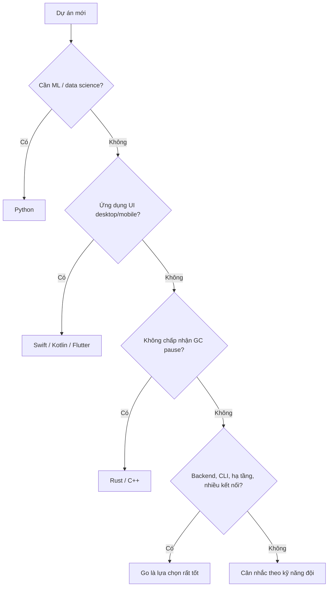

# Vì sao dùng Go

Trước khi học cú pháp, nên hiểu Go được thiết kế để giải quyết vấn đề gì và **cố tình bỏ đi** những gì. Bài này đi qua triết lý thiết kế của Go, ưu và nhược điểm, so sánh với Java, Node.js, Python, Rust, và quan trọng nhất: khi nào nên chọn Go, khi nào không. Đây cũng là câu hỏi mở đầu gần như mọi buổi phỏng vấn vị trí Go developer.

---

:::note[Ghi nhớ nhanh]

- ⭐ **Triết lý: đơn giản, rõ ràng, dễ đọc hơn là "thông minh"** — Go có khoảng 25 từ khoá, không kế thừa class, không exception, không overload hàm.
- ⭐ **Điểm mạnh nhất: concurrency rẻ + binary tĩnh + biên dịch nhanh** — rất hợp cho microservice, CLI, hạ tầng cloud.
- **Lỗi là giá trị (errors are values)** — trả về `error`, kiểm tra tường minh bằng `if err != nil`; dài dòng nhưng luồng xử lý lỗi lộ rõ.
- **Composition thay cho inheritance** — struct embedding và interface ngầm định (implicit interface).
- **Không hợp** cho UI desktop/mobile, data science/ML, hệ thống cần kiểm soát bộ nhớ tuyệt đối (real-time cứng, kernel).

:::

---

## Mục lục

- [Vì sao Go ra đời?](#vì-sao-go-ra-đời)
- [Triết lý thiết kế](#triết-lý-thiết-kế)
- [Ưu điểm](#ưu-điểm)
- [Nhược điểm](#nhược-điểm)
- [So sánh với ngôn ngữ khác](#so-sánh-với-ngôn-ngữ-khác)
- [Khi nào nên và không nên chọn Go](#khi-nào-nên-và-không-nên-chọn-go)

---

## Vì sao Go ra đời?

**Vấn đề:** Khoảng năm 2007, Google có những codebase C++ và Java khổng lồ. Ba nỗi đau lớn nhất:

1. **Biên dịch chậm** — một bản build C++ lớn mất hàng chục phút, phần lớn thời gian là xử lý `#include` lặp đi lặp lại.
2. **Ngôn ngữ phức tạp** — C++ có template, đa kế thừa, overload toán tử... mỗi đội dùng một "tập con" khác nhau, đọc code đội khác như đọc ngôn ngữ khác.
3. **Concurrency khó** — server chạy trên máy nhiều nhân, nhưng viết code đa luồng bằng thread + lock rất dễ sai.

Ví dụ một tác vụ đơn giản "gọi 3 API song song rồi gom kết quả" trong Java truyền thống:

```java
ExecutorService pool = Executors.newFixedThreadPool(3);
List<Future<String>> futures = new ArrayList<>();
for (String url : urls) {
    futures.add(pool.submit(() -> httpGet(url))); // mỗi tác vụ chiếm 1 OS thread (~1MB stack)
}
List<String> results = new ArrayList<>();
for (Future<String> f : futures) {
    try {
        results.add(f.get());
    } catch (InterruptedException | ExecutionException e) {
        // xử lý 2 loại exception khác nhau
    }
}
pool.shutdown(); // quên dòng này → ứng dụng không thoát
```

**Giải pháp:** Go đưa concurrency vào ngay trong ngôn ngữ bằng **goroutine** (luồng nhẹ do runtime Go quản lý, stack khởi đầu chỉ vài KB) và **channel** (kênh truyền dữ liệu giữa các goroutine):

```go
package main

import "fmt"

func fetch(url string) string {
	return "kết quả từ " + url // giả lập gọi HTTP
}

func main() {
	urls := []string{"a.com", "b.com", "c.com"}
	ch := make(chan string)

	for _, u := range urls {
		go func() { // từ khoá go: chạy hàm trong goroutine mới
			ch <- fetch(u) // gửi kết quả vào channel
		}()
	}

	for range urls {
		fmt.Println(<-ch) // nhận đủ 3 kết quả (thứ tự không cố định)
	}
}
```

Không cần thread pool, không cần `shutdown`, mỗi goroutine chỉ tốn vài KB — chạy 100.000 goroutine trên laptop là chuyện bình thường.

:::tip[Dùng thực tế]

- **Microservice/API** — một service Go nhận hàng chục nghìn request/giây với vài chục MB RAM; image Docker chỉ vài MB vì chỉ cần một file binary.
- **CLI tool** — `kubectl`, `gh`, `terraform`, `hugo`: build một lần cho Linux/macOS/Windows, người dùng tải về chạy luôn, không cần cài runtime.
- **Hạ tầng cloud** — Docker, Kubernetes, Prometheus, etcd, Consul đều viết bằng Go.
- **Proxy, gateway, worker xử lý hàng đợi** — nơi cần nhiều kết nối đồng thời và độ trễ ổn định.

:::

:::tip[Ví dụ đời thường]

Java giống **nhà hàng lớn**: có bếp trưởng, phó bếp, quy trình nhiều tầng — phục vụ được mọi món nhưng khởi động chậm và tốn mặt bằng. Go giống **xe phở gánh của một ông chủ lanh lẹ**: menu ít món, nhưng dọn hàng trong 5 phút, gánh đi đâu cũng bán được (binary tĩnh), và một mình ông xoay xở cùng lúc chục khách (goroutine) mà không cần thuê thêm người.

:::

---

## Triết lý thiết kế

### 1. Đơn giản hơn là đầy đủ tính năng

Go cố tình **không có** nhiều thứ mà ngôn ngữ khác coi là hiển nhiên:

| Không có trong Go | Go dùng gì thay thế |
|-------------------|---------------------|
| Class, kế thừa (`extends`) | `struct` + method + embedding (nhúng struct) |
| `implements` tường minh | Interface ngầm định: có đủ method là thoả mãn |
| Exception (`try/catch`) | Trả về `error` như một giá trị; `panic` cho lỗi không thể phục hồi |
| Overload hàm/toán tử | Đặt tên hàm khác nhau: `ParseInt`, `ParseFloat` |
| Toán tử 3 ngôi `a ? b : c` | `if/else` |
| `while`, `do-while` | Chỉ có `for` |
| Generics (trước 1.18) | Từ Go 1.18 đã có generics, nhưng cố ý tối giản |

Rob Pike gọi đây là "**less is exponentially more**": mỗi tính năng thêm vào làm số cách kết hợp tăng theo cấp số nhân, khiến code khó đọc hơn.

### 2. Code được đọc nhiều hơn được viết

```go
// Go ép mọi người viết giống nhau:
// - gofmt định dạng code thống nhất (tab, vị trí ngoặc...)
// - import không dùng → lỗi biên dịch
// - biến cục bộ khai báo mà không dùng → lỗi biên dịch
package main

import (
	"fmt"
	// "os" // nếu bỏ comment mà không dùng → "imported and not used"
)

func main() {
	x := 10
	fmt.Println(x) // xoá dòng này → "declared and not used: x"
}
```

### 3. Errors are values

```go
f, err := os.Open("config.yaml")
if err != nil {
	return fmt.Errorf("mở file cấu hình: %w", err) // bọc thêm ngữ cảnh rồi trả lên
}
defer f.Close()
```

Dài hơn `try/catch`, nhưng nhìn vào code là biết **chính xác dòng nào có thể lỗi** và lỗi được xử lý thế nào.

### 4. Concurrency theo mô hình CSP

> "Don't communicate by sharing memory; share memory by communicating."
> (Đừng giao tiếp bằng cách chia sẻ bộ nhớ; hãy chia sẻ bộ nhớ bằng cách giao tiếp.)

CSP (Communicating Sequential Processes — mô hình các tiến trình tuần tự trao đổi qua kênh) là nền tảng của goroutine + channel. Go vẫn có `sync.Mutex` khi cần, nhưng khuyến khích truyền dữ liệu qua channel.

### 5. Tương thích ngược là cam kết

Code viết cho Go 1.0 (2012) phần lớn vẫn biên dịch được với Go mới nhất. Điều này giúp nâng phiên bản gần như không đau — khác hẳn trải nghiệm Python 2 → 3.

---

## Ưu điểm

| Ưu điểm | Giải thích |
|---------|------------|
| **Biên dịch rất nhanh** | Dependency được phân tích một lần, không có header file; project vừa build trong vài giây |
| **Binary tĩnh, một file** | Không cần cài JVM/Node/Python; copy file là chạy; image Docker `FROM scratch` vài MB |
| **Cross-compile dễ** | `GOOS=linux GOARCH=arm64 go build` từ máy Mac ra binary cho Linux ARM |
| **Concurrency rẻ** | Goroutine vài KB, scheduler M:N của runtime tự phân phối lên các OS thread |
| **Hiệu năng tốt** | Nhanh hơn Python/Node nhiều lần ở tác vụ CPU, gần Java; khởi động tính bằng mili giây |
| **Bộ nhớ thấp** | Service Go thường dùng vài chục MB, so với vài trăm MB của JVM |
| **Thư viện chuẩn mạnh** | `net/http`, `encoding/json`, `crypto/*`, `testing`, `database/sql`... đủ dựng service không cần framework |
| **Tooling tích hợp** | `go fmt`, `go vet`, `go test`, `go mod`, race detector, profiler — có sẵn, thống nhất |
| **Dễ học, dễ onboard** | Lập trình viên đã biết ngôn ngữ khác có thể đọc hiểu code Go sau 1–2 tuần |

---

## Nhược điểm

| Nhược điểm | Giải thích |
|------------|------------|
| **Xử lý lỗi dài dòng** | `if err != nil { return err }` lặp lại khắp nơi |
| **Thiếu tính năng "tiện"** | Không có enum thật (dùng `const` + `iota`), không có `Optional`, không có map/filter trên slice trước khi có `slices` package |
| **Generics còn hạn chế** | Method không có tham số kiểu riêng; constraint đơn giản hơn Rust/TypeScript |
| **Có GC** | Có thể gây độ trễ (latency) nhỏ; không hợp cho hệ thống real-time cứng |
| **Hệ sinh thái hẹp ở một số mảng** | Data science, ML, GUI, game kém xa Python/C#/C++ |
| **Nil pointer vẫn tồn tại** | Không có null-safety ở mức kiểu như Kotlin/Rust |

```go
// Nhược điểm dễ thấy nhất: code xử lý lỗi chiếm nhiều dòng
func loadUser(id int) (*User, error) {
	row, err := db.Query(id)
	if err != nil {
		return nil, fmt.Errorf("query user %d: %w", id, err)
	}
	user, err := scan(row)
	if err != nil {
		return nil, fmt.Errorf("scan user %d: %w", id, err)
	}
	if err := validate(user); err != nil {
		return nil, fmt.Errorf("validate user %d: %w", id, err)
	}
	return user, nil
}
```

:::warning[Hiểu lầm hay gặp]

- **"Go không có OOP"** — sai. Go có đóng gói (exported/unexported), đa hình (interface), nhưng không có kế thừa class. Go là hướng đối tượng theo kiểu **composition**.
- **"Go nhanh như C"** — chưa hẳn. Go có GC và runtime, thường chậm hơn C/C++/Rust ở tác vụ tính toán thuần, nhưng đủ nhanh cho 95% backend.
- **"Goroutine là thread"** — không. Goroutine do runtime Go lập lịch, nhiều goroutine chạy trên ít OS thread.

:::

---

## So sánh với ngôn ngữ khác

### Bảng tổng quan

| Tiêu chí | Go | Java | Node.js | Python | Rust |
|----------|----|------|---------|--------|------|
| Kiểu dữ liệu | Tĩnh | Tĩnh | Động (TS: tĩnh) | Động | Tĩnh |
| Chạy trên | Mã máy | JVM | V8 | Interpreter (CPython) | Mã máy |
| Quản lý bộ nhớ | GC | GC | GC | Reference count + GC | Ownership, không GC |
| Concurrency | Goroutine + channel | Thread, virtual thread (21+) | Event loop đơn luồng + async | GIL hạn chế đa luồng CPU | async/await, thread an toàn nhờ borrow checker |
| Thời gian khởi động | Rất nhanh | Chậm hơn (JIT warm-up) | Nhanh | Nhanh | Rất nhanh |
| Đóng gói triển khai | 1 binary | JAR + JVM | Mã nguồn + `node_modules` | Mã nguồn + virtualenv | 1 binary |
| Độ khó học | Thấp | Trung bình | Thấp | Rất thấp | Cao |
| Tốc độ biên dịch | Rất nhanh | Trung bình | Không biên dịch | Không biên dịch | Chậm |

### Go vs Java

- **Java** mạnh ở hệ sinh thái enterprise (Spring, Hibernate), tooling IDE, tính năng ngôn ngữ phong phú. Từ Java 21 có **virtual thread** — thu hẹp khoảng cách concurrency với Go.
- **Go** thắng ở độ gọn: không framework vẫn viết được service, binary nhỏ, khởi động nhanh, RAM thấp → hợp với container và serverless.

### Go vs Node.js

- **Node.js** chạy một luồng với event loop: rất tốt cho I/O, nhưng một tác vụ CPU nặng (resize ảnh, mã hoá) sẽ **chặn mọi request khác**.
- **Go** tận dụng tất cả nhân CPU tự động; code viết theo kiểu tuần tự (blocking style) dễ đọc, không cần `async/await` hay callback.

```go
// Go: code trông tuần tự, nhưng runtime tự chuyển goroutine khác chạy khi chờ I/O
resp, err := http.Get("https://api.example.com/users")
if err != nil {
	return err
}
defer resp.Body.Close()
```

### Go vs Python

- **Python** vô địch ở data science, ML, scripting, prototype nhanh.
- **Go** nhanh hơn nhiều lần ở tác vụ CPU, không bị GIL (Global Interpreter Lock — khoá toàn cục khiến chỉ một thread chạy bytecode Python tại một thời điểm), triển khai đơn giản hơn. Nhiều công ty viết prototype bằng Python rồi viết lại phần "nóng" bằng Go.

### Go vs Rust

- **Rust** không có GC, an toàn bộ nhớ ở thời điểm biên dịch, hiệu năng ngang C/C++ — nhưng học khó, biên dịch chậm.
- **Go** đánh đổi một chút hiệu năng để lấy **năng suất đội**: người mới viết được code production nhanh hơn nhiều.


---

## Khi nào nên và không nên chọn Go

### Nên chọn Go khi

- Viết **API backend, microservice** cần throughput cao, độ trễ thấp, chạy trong container.
- Viết **CLI tool** cần phân phối dễ cho nhiều hệ điều hành.
- Viết **hạ tầng, DevOps tooling**: operator Kubernetes, exporter Prometheus, proxy, agent thu log.
- Hệ thống có **nhiều kết nối đồng thời**: WebSocket, chat, streaming, crawler.
- Đội đông người, nhiều người mới — cần code **đồng nhất, dễ review**.

### Không nên chọn Go khi

- **Data science, ML, phân tích dữ liệu** → Python (NumPy, Pandas, PyTorch).
- **Ứng dụng giao diện** desktop/mobile → Swift, Kotlin, Flutter, React Native.
- **Hệ thống cần kiểm soát bộ nhớ tuyệt đối**, không chấp nhận GC pause: game engine, driver, kernel, real-time cứng → Rust, C/C++.
- **Ứng dụng nghiệp vụ enterprise phức tạp** mà đội đã quen Spring với hệ sinh thái sẵn có → Java/Kotlin có thể hiệu quả hơn.
- **Prototype/script nhỏ** chạy một lần → Python, Bash nhanh hơn.



:::tip[Dùng thực tế]

Nhiều công ty Việt Nam và khu vực (Grab, Shopee, Tiki, MoMo, VNG...) dùng **kết hợp**: Java/Kotlin cho core nghiệp vụ lâu đời, Go cho các service mới cần hiệu năng (gateway, notification, tracking), Python cho data/ML. Chọn ngôn ngữ theo bài toán, không theo trào lưu.

:::
