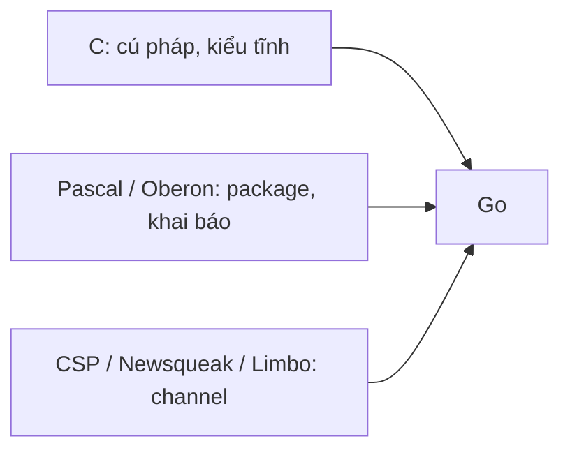
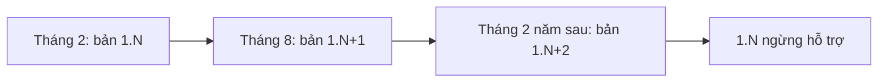

# Lịch sử Go

Hiểu lịch sử Go giúp giải thích rất nhiều "vì sao" khi đọc code: vì sao dự án cũ có thư mục `GOPATH`, vì sao có `vendor/`, vì sao code trước 2022 không có generics, vì sao bài blog cũ khuyên `x := x` trong vòng lặp. Bài này đi qua các mốc chính từ 2007 đến nay, cam kết tương thích Go 1, và chu kỳ phát hành 6 tháng — đủ để bạn biết một tính năng có từ bản nào và đọc code cũ không bị bỡ ngỡ.

---

:::note[Ghi nhớ nhanh]

- ⭐ **Cam kết tương thích Go 1 (2012)** — code viết đúng đặc tả Go 1 sẽ tiếp tục biên dịch và chạy với mọi bản Go 1.x sau đó.
- ⭐ **Các mốc phải nhớ**: modules (1.11 → mặc định 1.16), generics (1.18), `min`/`max`/`slog` (1.21), biến vòng lặp per-iteration + router mới (1.22), iterator `range over func` (1.23).
- **Ra đời tại Google năm 2007** — tác giả Robert Griesemer, Rob Pike, Ken Thompson; mã nguồn mở tháng 11/2009.
- **Phát hành mỗi 6 tháng** — khoảng tháng 2 và tháng 8; mỗi bản được hỗ trợ cho đến khi có 2 bản mới hơn (khoảng 1 năm).
- **Tên chính thức là "Go"** — "Golang" chỉ là biệt danh do tên miền cũ `golang.org`, dùng để tìm kiếm dễ hơn.

:::

---

## Mục lục

- [Vì sao Go ra đời?](#vì-sao-go-ra-đời)
- [Những người tạo ra Go](#những-người-tạo-ra-go)
- [Dòng thời gian các mốc chính](#dòng-thời-gian-các-mốc-chính)
- [Cam kết tương thích Go 1](#cam-kết-tương-thích-go-1)
- [Từ GOPATH đến Go modules](#từ-gopath-đến-go-modules)
- [Generics trong Go 1.18](#generics-trong-go-118)
- [Các bản gần đây](#các-bản-gần-đây)
- [Chu kỳ phát hành và chính sách hỗ trợ](#chu-kỳ-phát-hành-và-chính-sách-hỗ-trợ)

---

## Vì sao Go ra đời?

**Vấn đề:** Tháng 9/2007, ba kỹ sư Google ngồi chờ một bản build C++ khổng lồ chạy xong — mất khoảng **45 phút**. Trong lúc chờ, họ phác thảo một ngôn ngữ mới. Nỗi đau cụ thể:

- Build chậm vì C++ `#include` cùng một header hàng nghìn lần.
- Mỗi đội dùng một tập con khác nhau của C++, code khó đọc chéo.
- Viết server đa luồng trên máy nhiều nhân bằng thread + lock dễ sinh bug.
- Quản lý dependency thủ công, không có công cụ chuẩn.

**Giải pháp:** một ngôn ngữ biên dịch, kiểu tĩnh, nhưng **đọc gọn như ngôn ngữ động**, có sẵn concurrency và tooling thống nhất:

```go
package main

import "fmt"

// Chương trình Go đầu tiên trong bài công bố năm 2009 trông gần như thế này —
// và nó vẫn biên dịch được với Go hiện tại.
func main() {
	fmt.Println("Hello, 世界")
}
```

:::tip[Dùng thực tế]

- **Đọc code cũ** — thấy `GOPATH`, `dep`, `glide`, `vendor/` là biết dự án trước thời modules (trước 2018–2019).
- **Chọn phiên bản tối thiểu** — dòng `go 1.22` trong `go.mod` quyết định ngữ nghĩa vòng lặp và tính năng ngôn ngữ được dùng.
- **Đọc blog/StackOverflow** — câu trả lời trước 2022 nói "Go không có generics" đã lỗi thời.
- **Nâng cấp phiên bản** — cam kết Go 1 giúp nâng từ 1.20 lên 1.2x thường chỉ cần đổi một dòng.

:::

:::tip[Ví dụ đời thường]

Lịch sử Go giống **lịch sử một tuyến xe buýt**: lộ trình chính (cú pháp Go 1) giữ nguyên từ ngày khai trương để khách quen không bị lạc, nhưng mỗi năm công ty thêm điều hoà, thẻ từ, app theo dõi xe (modules, generics, iterator). Khách đi từ năm 2012 vẫn bắt đúng xe ở đúng trạm.

:::

---

## Những người tạo ra Go

| Người | Đóng góp nổi bật trước Go |
|-------|---------------------------|
| **Ken Thompson** | Đồng tạo ra Unix, ngôn ngữ B (tiền thân của C), UTF-8 (cùng Rob Pike), giải Turing 1983 |
| **Rob Pike** | Plan 9, UTF-8, ngôn ngữ Limbo/Newsqueak (tiền thân ý tưởng channel) |
| **Robert Griesemer** | Làm việc với V8 JavaScript engine, Java HotSpot VM, ngôn ngữ Sawzall |

Sau đó có thêm **Ian Lance Taylor** (viết `gccgo` — trình biên dịch Go thứ hai dựa trên GCC, và là người dẫn dắt thiết kế generics) và **Russ Cox** (dẫn dắt dự án Go nhiều năm, thiết kế Go modules). Linh vật **Gopher** do họa sĩ Renée French vẽ.

Ảnh hưởng của các ngôn ngữ trước lên Go:



---

## Dòng thời gian các mốc chính

| Năm | Phiên bản | Mốc quan trọng |
|-----|-----------|----------------|
| 2007 | — | Bắt đầu thiết kế tại Google (tháng 9) |
| 2009 | — | Công bố mã nguồn mở (10/11/2009) |
| 2012 | **Go 1.0** | Bản ổn định đầu tiên + cam kết tương thích Go 1 (28/3/2012) |
| 2015 | Go 1.5 | Trình biên dịch và runtime viết lại hoàn toàn bằng Go (bỏ C); GC đồng thời (concurrent GC) độ trễ thấp; `GOMAXPROCS` mặc định bằng số nhân CPU |
| 2016 | Go 1.7 | Package `context` vào thư viện chuẩn |
| 2018 | Go 1.11 | **Go modules** thử nghiệm (`go.mod`) |
| 2019 | Go 1.13 | Module proxy (`proxy.golang.org`) và checksum database mặc định; error wrapping (`%w`, `errors.Is`, `errors.As`) |
| 2020 | Go 1.14 | Modules sẵn sàng cho production; goroutine preemption bất đồng bộ |
| 2021 | Go 1.16 | Modules bật mặc định (`GO111MODULE=on`); `embed` nhúng file vào binary |
| 2022 | **Go 1.18** | **Generics**, fuzzing tích hợp, workspace (`go work`) |
| 2023 | Go 1.21 | `min`, `max`, `clear` built-in; package `slices`, `maps`, `cmp`, `log/slog`; dòng `toolchain` trong `go.mod` |
| 2024 | Go 1.22 | Biến vòng lặp mới mỗi lần lặp; `for i := range 10`; `ServeMux` có method + wildcard; `math/rand/v2` |
| 2024 | Go 1.23 | Iterator: `range` trên hàm (range over func), package `iter`; `unique` |
| 2025 | Go 1.24 | Generic type alias; `map` cài đặt lại bằng Swiss table (nhanh hơn); dòng `tool` trong `go.mod`; `os.Root`; `testing.B.Loop` |
| 2025 | Go 1.25 | `GOMAXPROCS` tự nhận giới hạn CPU của container; `sync.WaitGroup.Go`; `testing/synctest` ổn định |
| 2026 | Go 1.26 | `new(expr)` nhận biểu thức khởi tạo; GC "Green Tea" bật mặc định; `errors.AsType` generic |

---

## Cam kết tương thích Go 1

Khi ra Go 1.0, đội Go công bố tài liệu **"Go 1 and the Future of Go Programs"** ([go.dev/doc/go1compat](https://go.dev/doc/go1compat)):

> Chương trình viết theo đặc tả Go 1 sẽ tiếp tục biên dịch và chạy đúng, không thay đổi, trong suốt vòng đời của Go 1.

```go
// Code này viết năm 2012 — vẫn chạy với Go 1.26
package main

import (
	"fmt"
	"strings"
)

func main() {
	words := strings.Fields("go là ngôn ngữ đơn giản")
	for i, w := range words {
		fmt.Println(i, w)
	}
}
```

**Ngoại lệ** được phép phá vỡ tương thích:

- Lỗi bảo mật cần vá.
- Hành vi không được đặc tả (unspecified behavior) — ví dụ thứ tự duyệt `map`.
- Bug trong đặc tả hoặc trình biên dịch.
- Code dùng `unsafe` hoặc phụ thuộc vào chi tiết cài đặt.

### Thay đổi ngữ nghĩa được kiểm soát bằng dòng `go` trong go.mod

Từ Go 1.21, những thay đổi có thể ảnh hưởng hành vi (như ngữ nghĩa biến vòng lặp ở 1.22) được **gắn với phiên bản khai báo trong `go.mod`**, không phải phiên bản toolchain đang cài:

```text
module example.com/shop

go 1.22   // ← dòng này quyết định: biến vòng lặp được tạo mới mỗi lần lặp
```

Module khai báo `go 1.21` vẫn giữ ngữ nghĩa cũ dù biên dịch bằng Go 1.26. Đồng thời Go 1.21 bổ sung **GODEBUG** — cờ runtime cho phép bật lại hành vi cũ khi cần chuyển đổi dần.

:::warning[Lỗi hay gặp]

- Nghĩ rằng **"Go 2"** sẽ là bản phá vỡ tương thích như Python 3. Đội Go đã tuyên bố sẽ **không có Go 2 phá vỡ code Go 1**; các tính năng từng được gọi là "Go 2" (generics, error wrapping) đều đã vào Go 1.x.
- Nâng toolchain lên 1.22 nhưng quên sửa `go.mod` → vòng lặp vẫn chạy theo ngữ nghĩa cũ.

:::

---

## Từ GOPATH đến Go modules

### Thời GOPATH (2012–2018)

Mọi code Go phải nằm trong **một** thư mục làm việc duy nhất:

```text
$GOPATH/
├── bin/                      # binary do go install sinh ra
├── pkg/                      # file biên dịch trung gian
└── src/
    ├── github.com/gin-gonic/gin/   # thư viện tải về bằng go get
    └── github.com/toi/du-an/       # code của mình cũng phải ở đây
```

Vấn đề lớn: **không có phiên bản**. `go get` luôn lấy commit mới nhất của nhánh mặc định; hai dự án cần hai phiên bản khác nhau của cùng thư viện → bế tắc. Cộng đồng tự chế `godep`, `glide`, `dep` và thư mục `vendor/` để chữa cháy.

### Thời modules (1.11 → 1.16)

```text
~/projects/shop/              # đặt ở đâu cũng được
├── go.mod                    # khai báo module + phiên bản dependency
├── go.sum                    # checksum để đảm bảo không bị sửa đổi
└── main.go
```

```text
module github.com/toi/shop

go 1.22

require (
	github.com/gin-gonic/gin v1.10.0
	golang.org/x/sync v0.7.0
)
```

| Phiên bản | Thay đổi về modules |
|-----------|---------------------|
| 1.11 (2018) | Ra mắt thử nghiệm, bật bằng `GO111MODULE=on` |
| 1.13 (2019) | `proxy.golang.org` và `sum.golang.org` làm mặc định — tải nhanh, chống giả mạo |
| 1.14 (2020) | Được khuyến nghị cho production |
| 1.16 (2021) | Bật mặc định; `go install pkg@version` |
| 1.18 (2022) | Workspace (`go.work`) để làm việc nhiều module cùng lúc |
| 1.21 (2023) | Dòng `toolchain`, tự tải toolchain phù hợp |
| 1.24 (2025) | Dòng `tool` quản lý công cụ phát triển (thay cho file `tools.go`) |

Module dùng **Semantic Versioning** (vMAJOR.MINOR.PATCH) và quy tắc **Minimal Version Selection** (MVS — chọn phiên bản thấp nhất thoả mãn mọi yêu cầu), giúp build tái lập được mà không cần lock file phức tạp.

---

## Generics trong Go 1.18

**Vấn đề:** trước 1.18, muốn viết hàm dùng cho nhiều kiểu phải chép code hoặc dùng `interface{}` mất an toàn kiểu:

```go
// Trước 1.18: viết lại cho từng kiểu...
func SumInts(xs []int) int {
	total := 0
	for _, x := range xs {
		total += x
	}
	return total
}

func SumFloats(xs []float64) float64 {
	total := 0.0
	for _, x := range xs {
		total += x
	}
	return total
}
```

**Giải pháp (1.18):** tham số kiểu (type parameter) với ràng buộc (constraint):

```go
type Number interface {
	~int | ~int64 | ~float64
}

func Sum[T Number](xs []T) T {
	var total T
	for _, x := range xs {
		total += x
	}
	return total
}

// Sum([]int{1, 2, 3}) → 6
// Sum([]float64{1.5, 2.5}) → 4
```

Generics mất **hơn 10 năm** tranh luận với nhiều bản thiết kế bị loại (contracts, ...) trước khi chốt — minh hoạ cho triết lý "thà chậm còn hơn thêm sai". Sau 1.18, thư viện chuẩn mới có `slices`, `maps`, `cmp` (1.21) dựa trên generics.

---

## Các bản gần đây

### Go 1.21 (8/2023) — built-in mới và log có cấu trúc

```go
package main

import (
	"fmt"
	"log/slog"
	"slices"
)

func main() {
	fmt.Println(min(3, 1, 2), max(3, 1, 2)) // 1 3 — built-in, không cần import

	nums := []int{5, 2, 8}
	slices.Sort(nums)
	fmt.Println(nums, slices.Contains(nums, 8)) // [2 5 8] true

	m := map[string]int{"a": 1}
	clear(m) // xoá toàn bộ phần tử map
	fmt.Println(len(m)) // 0

	slog.Info("đặt hàng thành công", "order_id", 1001, "amount", 250000)
}
```

### Go 1.22 (2/2024) — sửa "bẫy" vòng lặp nổi tiếng

```go
// Trước 1.22: i và v là MỘT biến dùng chung cho mọi lần lặp
// → closure/goroutine bắt giữ biến này thường thấy giá trị cuối cùng.
// Từ 1.22: mỗi lần lặp có biến mới → in 0, 1, 2 (theo thứ tự bất kỳ nếu chạy goroutine)
for i := range 3 { // range trên số nguyên, cũng mới ở 1.22
	go func() { fmt.Println(i) }()
}
```

Router chuẩn mạnh hơn, đủ dùng cho nhiều API không cần framework:

```go
mux := http.NewServeMux()
mux.HandleFunc("GET /users/{id}", func(w http.ResponseWriter, r *http.Request) {
	id := r.PathValue("id") // lấy wildcard từ đường dẫn
	fmt.Fprintf(w, "user %s", id)
})
```

### Go 1.23 (8/2024) — iterator

```go
package main

import (
	"fmt"
	"iter"
	"maps"
	"slices"
)

// Countdown trả về iterator: hàm nhận yield, gọi yield cho từng phần tử
func Countdown(n int) iter.Seq[int] {
	return func(yield func(int) bool) {
		for i := n; i > 0; i-- {
			if !yield(i) { // người dùng break → yield trả false → dừng
				return
			}
		}
	}
}

func main() {
	for x := range Countdown(3) {
		fmt.Println(x) // 3 2 1
	}

	ages := map[string]int{"An": 30, "Bình": 25}
	keys := slices.Sorted(maps.Keys(ages)) // maps.Keys trả iterator
	fmt.Println(keys)                       // [An Bình]
}
```

### Go 1.24, 1.25, 1.26

| Bản | Điểm đáng chú ý cho lập trình viên ứng dụng |
|-----|---------------------------------------------|
| 1.24 (2/2025) | `map` nhanh hơn nhờ Swiss table; generic type alias; `go get -tool` + dòng `tool` trong `go.mod`; `os.Root` chống truy cập file ra ngoài thư mục; `testing.B.Loop` viết benchmark gọn hơn |
| 1.25 (8/2025) | `GOMAXPROCS` tôn trọng giới hạn CPU của cgroup (container); `wg.Go(func() {...})` thay cho cặp `wg.Add(1)` + `defer wg.Done()`; `testing/synctest` test code có thời gian/goroutine |
| 1.26 (2/2026) | `new(42)` tạo con trỏ tới giá trị khởi tạo; GC Green Tea mặc định (giảm chi phí GC); `errors.AsType[*MyErr](err)` thay cho `errors.As` với biến tạm |

```go
// Go 1.25: sync.WaitGroup.Go
var wg sync.WaitGroup
for _, url := range urls {
	wg.Go(func() { fetch(url) }) // tự Add(1) và Done()
}
wg.Wait()

// Go 1.26: new với biểu thức
p := new(42)          // *int trỏ tới 42
name := new("Gopher") // *string — tiện cho field tuỳ chọn kiểu con trỏ
```

---

## Chu kỳ phát hành và chính sách hỗ trợ



- **Bản lớn (major release)** ra mỗi 6 tháng, thường vào **tháng 2 và tháng 8**. Khoảng 1 tháng trước có bản RC (release candidate).
- **Bản vá (minor release)** như `1.22.3`, `1.22.4` sửa bug và lỗ hổng bảo mật, ra thường xuyên (thường hằng tháng).
- **Chính sách hỗ trợ**: mỗi bản lớn được vá cho tới khi có **hai bản lớn mới hơn**. Ví dụ khi 1.26 ra, 1.24 ngừng nhận bản vá → thực tế luôn có **2 bản được hỗ trợ** cùng lúc.
- Từ Go 1.21, phiên bản đầu tiên của mỗi bản lớn được đánh số `1.21.0` (trước đó là `1.20`, không có `.0`).

```bash
go version              # xem phiên bản đang dùng, vd: go version go1.26.0 darwin/arm64
go env GOTOOLCHAIN      # cách chọn toolchain (auto/local/goX.Y.Z)
```

:::tip[Dùng thực tế]

- **Production nên chạy một trong hai bản được hỗ trợ** — để còn nhận bản vá bảo mật.
- **Nâng bản lớn sau khi có bản `.1` hoặc `.2`** — an toàn hơn bản `.0` mới ra.
- **Đọc release notes** tại [go.dev/doc/devel/release](https://go.dev/doc/devel/release) mỗi lần nâng cấp.

:::
